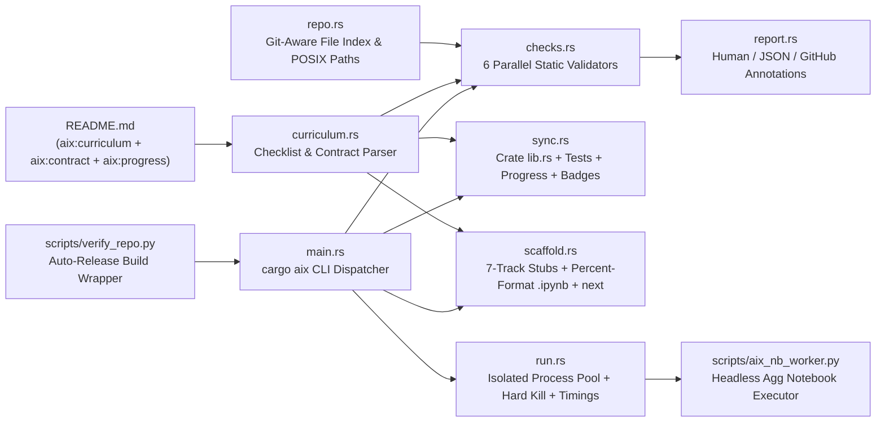
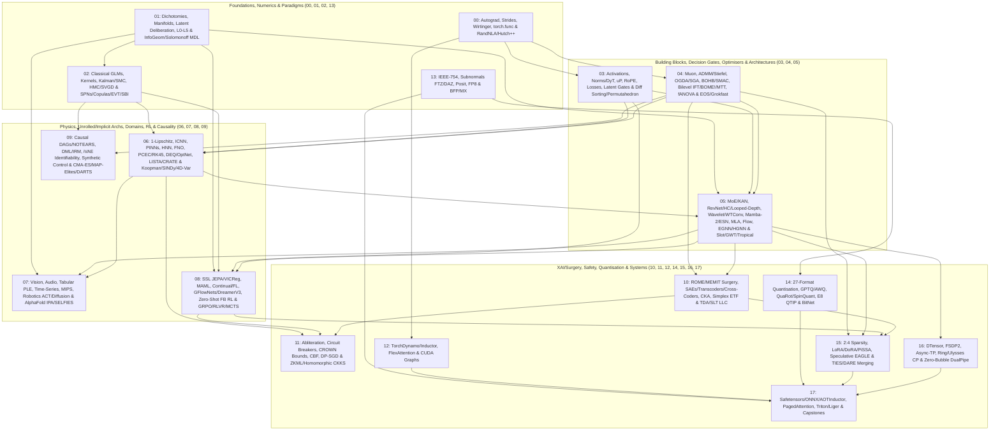
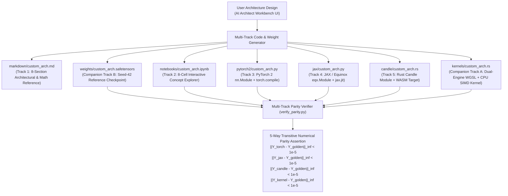

# AI-Examples: The Exhaustive, Multi-Track AI & Deep Learning Catalog (`v26` Master Plan, Specification & Agent Playbook)

[](#live-curriculum-progress)
[](tests/test_cross_track_parity.py)
[](crates/aix/src/main.rs)
[](LICENSE.md)

> [!IMPORTANT]
> **Shared Multi-Agent Planning & Authoritative Specification Document (`v26`):**
> This `README.md` is the **single source of truth**, master architectural specification, and shared coordination document for all human contributors and autonomous coding agents working on `AI-Examples` until all 263 topics are complete:
> - **263 Topics across 18 Categories**, mirrored 1-to-1 across **7 synchronized tracks**: `markdown/`, `notebooks/`, `pytorch2/`, `jax/`, `candle/` (`crates/ai-candle`), `kernels/` (`crates/ai-kernel`), and `weights/` (`.safetensors`).
> - **Powered by Spodeian ML Ecosystem**:
>   - Systems Rust & Candle implementation tracks (`ai-candle`, `ai-kernel`, `aix`) are aligned with and powered by the `sml-*` crates in [`spodeian-core`](https://github.com/Spodeian/spodeian-core) (`sml-runtime`, `sml-candle`, `sml-kernel`, `sml-tools`): runtime, continuous flow solvers, and tooling catalog.
>   - Python PyTorch and JAX reference architectures share parity models, canonicalization, and training routines with the `spodeian_ml` package in [`spodeian-core/python`](https://github.com/Spodeian/spodeian-core/tree/main/python).
> - **Machine-Enforced by `crates/aix` (`cargo aix` / `python scripts/verify_repo.py`):** The live progress table (`<!-- aix:progress:begin -->`), the 263-topic curriculum (`<!-- aix:curriculum:begin -->`), and the repository structural/semantic contract (`<!-- aix:contract:begin -->`) in this file are parsed and enforced directly by the `aix` Rust toolchain.
> - **Complementary Navigation Indexes:** See [INDEX_BY_GOAL.md](INDEX_BY_GOAL.md) (12 Problem-Driven Decision Matrices & 55+ Symptom Troubleshooting Guide) and [GLOSSARY_AND_NOTATION.md](GLOSSARY_AND_NOTATION.md) (Unified mathematical notation, 27 number formats & asymptotic complexity reference).

---

## Table of Contents
1. [Live Curriculum Progress Dashboard (`aix:progress`)](#live-curriculum-progress)
2. [Agent Workflow, Tooling (`cargo aix`), Weight Regeneration & 7-Track Code Templates](#agent-workflow-tooling--implementation-playbook)
   - [2.A. The `aix` Rust Toolchain (`crates/aix`) & `scripts/verify_repo.py` Production Wrapper](#2a-the-aix-rust-toolchain--verify_repopy-wrapper)
   - [2.B. Step-by-Step 6-Phase Lockstep Topic Implementation Workflow](#2b-step-by-step-6-phase-lockstep-workflow)
   - [2.C. Multi-Agent Coordination, Non-Interference & Shared State Rules](#2c-multi-agent-coordination--non-interference-rules)
   - [2.D. Golden Weight Pre-Availability & Deterministic Regeneration Protocol (`.safetensors`)](#2d-golden-weight-pre-availability--regeneration-protocol)
   - [2.E. Concrete Idiomatic Code Templates Across All 7 Tracks](#2e-concrete-idiomatic-code-templates-across-all-7-tracks)
3. [Active Project Roadmap, Phased Execution Plan, Stage 0 Infrastructure & Agent TODOs](#active-project-roadmap-phased-execution-plan--todos)
   - [3.A. Phased Execution Roadmap (`Phases 0–7`)](#3a-phased-execution-roadmap-phases-07)
   - [3.B. Active Multi-Agent TODO Queue & Next Implementation Targets](#3b-active-multi-agent-todo-queue)
   - [3.C. Stage 0 Infrastructure Exit Criteria & 23 Finalized Design Decisions](#3c-stage-0-infrastructure--23-finalized-design-decisions)
4. [Identically Structured 7-Track Repository Architecture, Contracts & Shared `core/` Harness (`v26` Section II + III.B)](#identically-structured-7-track-architecture--contracts)
   - [4.A. 1-to-1 Mirrored Directory Layout & High-Performance Build/Test Infrastructure](#4a-1-to-1-mirrored-directory-layout--build-acceleration)
   - [4.B. Track 1 Contract: Standardized 8-Section Markdown Blueprint (`markdown/`)](#b-track-1-contract-the-comprehensive-architectural--mathematical-markdown-blueprint-markdown)
   - [4.C. Track 2 Contract: Standardized 8-Cell `.ipynb` Blueprint & 10 Strict Invariants (`notebooks/`)](#c-track-2-contract-the-8-cell-ipynb-concept-exploration-blueprint-notebooks)
   - [4.D. Unified Contracts for All 7 Tracks & 4-Tier Composite Parity Matrix](#d-unified-contracts-for-all-5-primary-tracks--companion-tracks-markdown-notebooks-pytorch2-jax-candle-kernels-weights)
   - [4.E. Multi-Ecosystem Comparative Architecture & Head-to-Head Trade-Off Matrix](#e-multi-ecosystem-comparative-architecture--head-to-head-trade-off-matrix)
   - [4.F. Exhaustive Multi-Track Expected Files Inventory (1,867+ Files)](#f-exhaustive-multi-track-expected-files-inventory--structural-manifest)
   - [4.G. Benchmarking, Graph Exportability, Fuzzing, Shared `core/` API & Decision Matrices](#g-automated-cross-track-benchmarking-graph-exportability--numerical-fuzzing-harnesses)
   - [4.H. Consolidated Empirical Implementation Invariants (Lessons from Categories `00`–`05`)](#4h-consolidated-empirical-implementation-invariants)
   - [4.I. Machine-Readable Repository Contract (`aix:contract`)](#4i-machine-readable-repository-contract-aix)
5. [Unified Mathematical Foundations: 7 Pillars, 41 Frontier Paradigms, 17 Generalisation Frameworks & 12 Bridge Threads (`v26` Section I)](#unified-mathematical-foundations--bridge-threads)
6. [Master 18-Category, 263-Topic Multi-Track Curriculum Checklist (`aix:curriculum` — `v26` Section III.A)](#master-18-category-263-topic-curriculum-checklist)
7. [Universal AI Architect Workbench (`tools/ai_architect_workbench/`) & 20-Dimension Coverage Audit Matrix (`v26` Section IV)](#universal-ai-architect-workbench--20-dimension-audit-matrix)

---

<a id="live-curriculum-progress"></a>
## 1. Live Curriculum Progress Dashboard

*Auto-generated by `cargo aix sync` from on-disk track artifacts (`[x]` = all 7 tracks present, `[~]` = work in progress, `[ ]` = planned).*

<!-- aix:progress:begin -->

| Category | Done | WIP | Planned | Listed |
|---|---:|---:|---:|---:|
| [00 Foundations](#00_foundations) | 11 | 0 | 0 | 11 |
| [01 Paradigms And Dichotomies](#01_paradigms_and_dichotomies) | 13 | 0 | 0 | 13 |
| [02 Classical And Probabilistic Ml](#02_classical_and_probabilistic_ml) | 13 | 0 | 0 | 13 |
| [03 Building Blocks And Losses](#03_building_blocks_and_losses) | 13 | 0 | 0 | 13 |
| [04 Training Methods And Optimisers](#04_training_methods_and_optimisers) | 23 | 0 | 0 | 23 |
| [05 Architectures](#05_architectures) | 42 | 0 | 0 | 42 |
| [06 Smooth And Physics Informed Ai](#06_smooth_and_physics_informed_ai) | 12 | 0 | 0 | 12 |
| [07 Domain Tasks](#07_domain_tasks) | 14 | 0 | 0 | 14 |
| [08 Learning Paradigms Rl And Alignment](#08_learning_paradigms_rl_and_alignment) | 20 | 0 | 0 | 20 |
| [09 Causal Ai And Evolutionary Search](#09_causal_ai_and_evolutionary_search) | 7 | 0 | 0 | 7 |
| [10 Xai And Ai Analysis Methods](#10_xai_and_ai_analysis_methods) | 12 | 0 | 0 | 12 |
| [11 Ai Safety Privacy And Verification](#11_ai_safety_privacy_and_verification) | 10 | 0 | 0 | 10 |
| [12 Compilation And Performance](#12_compilation_and_performance) | 7 | 0 | 0 | 7 |
| [13 Precision And Numerics](#13_precision_and_numerics) | 6 | 0 | 0 | 6 |
| [14 Quantisation](#14_quantisation) | 26 | 0 | 0 | 26 |
| [15 Compression Peft And Speculative Inference](#15_compression_peft_and_speculative_inference) | 15 | 0 | 0 | 15 |
| [16 Distributed And Scalable](#16_distributed_and_scalable) | 8 | 0 | 0 | 8 |
| [17 Deployment Low Level And Capstones](#17_deployment_low_level_and_capstones) | 11 | 0 | 0 | 11 |
| **Total** | **263** | **0** | **0** | **263** |

**263 / 263 topics complete (100%)** across all 7 tracks. 0 topic(s) of the target are not yet listed with a slug in the curriculum below.

_Generated by `cargo aix sync`. A topic is **done** when all 7 track files exist, **wip** when some do._

<!-- aix:progress:end -->

---

<a id="agent-workflow-tooling--implementation-playbook"></a>
## 2. Agent Workflow, Tooling (`cargo aix`), Weight Regeneration & 7-Track Code Templates

<a id="2a-the-aix-rust-toolchain--verify_repopy-wrapper"></a>
### A. The `aix` Rust Toolchain (`crates/aix`) & `scripts/verify_repo.py` Production Wrapper
All repository verification, scaffolding, notebook percent-format compilation, crate module registration, link repair, golden weight export/inspection/diffing/regeneration, and isolated notebook execution are handled by the native Rust binary `crates/aix` (invoked via `cargo aix <subcommand>` or `python scripts/verify_repo.py <subcommand_or_legacy_flags>`).

`scripts/verify_repo.py` is a **thin, zero-dependency Python wrapper** that automatically checks whether `crates/aix` (`src/*.rs`, `Cargo.toml`) is newer than `target/release/aix` (`.exe`), runs `cargo build --release --quiet -p aix` if needed, and delegates all CLI arguments directly to the compiled production Rust binary.

#### 1. `crates/aix` Architecture & Module Breakdown



| Module (`crates/aix/src/`) | Responsibility & Key Invariants |
| :--- | :--- |
| [`main.rs`](file:///c:/Users/Liam/Code/AI-Examples/crates/aix/src/main.rs) | Zero-overhead CLI parser and command dispatcher (`check`, `sync`, `status`, `next`, `scaffold`, `notebook`, `weights`, `run-notebooks`, `test`, `verify`, `ci`, `help`). |
| [`curriculum.rs`](file:///c:/Users/Liam/Code/AI-Examples/crates/aix/src/curriculum.rs) | Parses `README.md` as the single source of truth: extracts the 263-topic `<!-- aix:curriculum:begin -->` checklist (`[x]` Done, `[~]` WIP, `[ ]` Planned) and deserializes the `<!-- aix:contract:begin -->` JSON schema. |
| [`repo.rs`](file:///c:/Users/Liam/Code/AI-Examples/crates/aix/src/repo.rs) | Builds an in-memory repository index via `git ls-files` (with filesystem walk fallback), case-variant lookup map for Linux CI safety, and POSIX relative path resolvers (`relative`, `join_rel`, `Scope`). |
| [`checks.rs`](file:///c:/Users/Liam/Code/AI-Examples/crates/aix/src/checks.rs) | Implements the 6 static verification passes (`structure`, `notebooks`, `markdown`, `links`, `forbidden`, `weights`), `scripts/` hygiene enforcement, pure-Rust `.safetensors` binary header parser (`read_header`), and tensor-by-tensor binary comparator (`diff_safetensors`). |
| [`sync.rs`](file:///c:/Users/Liam/Code/AI-Examples/crates/aix/src/sync.rs) | Deterministically splices `<aix:generated>` module trees into `crates/ai-candle/src/lib.rs`, `crates/ai-kernel/src/lib.rs`, and `crates/ai-candle/tests/<cat>.rs`, updates checklist markers and the `<!-- aix:progress:begin -->` table in `README.md`, and synchronizes `Progress-XX/263` badges in `README.md` and `INDEX_BY_GOAL.md`. |
| [`scaffold.rs`](file:///c:/Users/Liam/Code/AI-Examples/crates/aix/src/scaffold.rs) | Generates contract-conforming stubs across all 7 tracks (`scaffold`), resolves the single active `[~]` WIP or next `[ ]` planned topic (`next_topic`), and compiles/exports `# %% [markdown]` / `# %%` percent-format notebooks (`notebook_tool`). |
| [`run.rs`](file:///c:/Users/Liam/Code/AI-Examples/crates/aix/src/run.rs) | Orchestrates parallel process-isolated notebook execution (`1` Python worker process per notebook via `scripts/aix_nb_worker.py` with hard OS-level deadline termination), writes `target/aix/notebook_timings.json`, and runs `cargo test` / Python track scripts. |
| [`report.rs`](file:///c:/Users/Liam/Code/AI-Examples/crates/aix/src/report.rs) | Formats diagnostics as human-readable terminal summaries, machine-readable JSON (`--format json`), or GitHub Actions workflow annotations (`--format github`). |

#### 2. Native `cargo aix` Subcommands Reference *(See [`crates/aix/README.md`](file:///c:/Users/Liam/Code/AI-Examples/crates/aix/README.md) for full manual)*

| Command | Purpose, Flags & Typical Usage |
| :--- | :--- |
| `cargo aix status [--wip] [-c <cat>] [--format json]` | Parses `README.md` (`<!-- aix:curriculum:begin -->`) and scans all 7 track directories on disk. Prints per-category `done / wip / planned / listed` counts against the 263-topic target. `--wip` lists in-progress topics and missing tracks; `-c` filters by category; `--format json` outputs structured data. |
| `cargo aix next [-c <cat>] [--format json]` | **Sequential single-active-topic resolver:** Returns the single active `[~]` WIP topic (if any) and its missing tracks, or the next `[ ]` planned topic in sequential curriculum order so agents always complete one active topic across all 7 tracks before advancing. |
| `cargo aix scaffold <topic> [--dry-run] [--force]` | Scaffolds all missing track files (`markdown/<id>.md`, `notebooks/<id>.ipynb`, `pytorch2/<id>.py`, `jax/<id>.py`, `candle/<id>.rs`, `kernels/<id>.rs`) + the `crates/ai-candle/tests/<cat>.rs` integration test for `<topic>` with depth-accurate relative links (`../../` vs `../../../`), then automatically runs `sync`. Use `--dry-run` to preview; `--force` to overwrite. |
| `cargo aix notebook <topic> [options]` | **Zero-script 8-cell `.ipynb` compiler, exporter & inspector:**<br/>• Default: detailed cell-by-cell inspection report, line count audit, and output-stripping verification.<br/>• `--from <file.py>`: compiles `# %% [markdown]` / `# %%` percent-format source into stripped 8-cell `.ipynb`.<br/>• `--export <file.py>`: exports `.ipynb` back to percent-format source (`-` for stdout).<br/>• `--check`: verifies 8-cell layout, empty outputs, stripped execution counts, and semantic contract rules. |
| `cargo aix weights <topic_or_file>` | **SafeTensors inspector, diff & exporter suite:**<br/>• `weights <topic_or_file>`: auto-inspects header of a `.safetensors` file or curriculum topic.<br/>• `weights inspect <file...>`: parses binary headers directly in Rust (names, dtypes, shapes, byte sizes).<br/>• `weights export <topic>`: invokes `python pytorch2/<id>.py --export-golden` to deterministically regenerate golden weights.<br/>• `weights diff <A> <B>`: compares two files tensor-by-tensor (byte identity + max absolute `F32` diff).<br/>• `weights check [--topic <T>]`: verifies golden weights exist and contain all required tensor groups.<br/>• `weights regen [--topic <T>] [--check]`: batch-regenerates checkpoints and verifies bitwise reproducibility. |
| `cargo aix sync [--check]` | Regenerates all `<aix:generated>` module trees in `crates/ai-candle/src/lib.rs`, `crates/ai-kernel/src/lib.rs`, and `crates/ai-candle/tests/<cat>.rs`, updates `[x]`/`[~]`/`[ ]` topic checkboxes and the `<!-- aix:progress:begin -->` dashboard in `README.md`, and synchronizes the `Progress-XX/263` badges in both `README.md` and `INDEX_BY_GOAL.md`. |
| `cargo aix check [options]` | Runs fast parallel static verification across all 7 tracks in `<0.2s` (including `scripts/` hygiene and strict 8-section `markdown/` enforcement):<br/>• `--only a,b`: subset of `structure,notebooks,markdown,links,forbidden,weights`<br/>• `--topic <T>` / `--path <P>`: scope checks to a single topic or path prefix<br/>• `--semantics`, `-s`: enforce Cell 1–8 semantic rules from `<!-- aix:contract:begin -->`<br/>• `--fix`, `-f`: auto-repair broken relative links in `.md` and `.ipynb` files<br/>• `--quiet`, `-q`: suppress passing sections; only show warnings and errors<br/>• `--format human\|json\|github`: emit human summary, structured JSON, or GitHub Actions annotations. |
| `cargo aix run-notebooks [options]` | Executes `.ipynb` notebooks in isolated worker processes (`scripts/aix_nb_worker.py`) with headless `Agg` SVG backend, hard OS-level process termination if a notebook exceeds the `3.0s` CPU budget (`--topic <T>`, `--path <P>`, `--jobs N`, `--budget 3.0`), and timing export to `target/aix/notebook_timings.json`. |
| `cargo aix test [--topic <T>] [--crate <C>]` | **Fastest inner-loop check for one topic:** runs filtered `cargo test` across `ai-candle` and `ai-kernel`, executes `python pytorch2/<id>.py` and `python jax/<id>.py`, executes `notebooks/<id>.ipynb` via `run-notebooks`, and runs scoped `check --semantics` for `<topic>`. |
| `cargo aix doctor [--python <path>]` | Complete environment, toolchain, and repository diagnostic: checks Cargo/Rust toolchain, workspace crates, Python interpreter & ML package availability (`torch`, `safetensors`, `jax`, `matplotlib`, `numpy`), curriculum progress, and repository health. |
| `cargo aix clean [--dry-run]` | Safely removes transient compilation artifacts, timing logs (`target/aix/`), Python bytecode directories (`**/__pycache__/`), and Jupyter checkpoint autosaves (`**/.ipynb_checkpoints/`). |
| `cargo aix completions <shell>` | Generates native shell autocompletion script for `bash`, `zsh`, `fish`, or `powershell`. |
| `cargo aix ci` | Full repository gate equivalent to `check --semantics` + `run-notebooks` + `cargo test --tests` across `ai-architect-schema`, `aix`, `ai-candle`, and `ai-kernel`. |
| `cargo aix help [subcommand]` | Displays global CLI help or in-depth manual for any specific subcommand (e.g. `cargo aix help check`). |

#### 3. Legacy `python scripts/verify_repo.py` Flag Mapping

| Legacy CLI Invocation | Translated `aix` Execution |
| :--- | :--- |
| `python scripts/verify_repo.py` | `aix check` (runs all static structure, notebook, markdown, link, forbidden-call, and weight checks) |
| `python scripts/verify_repo.py --check-symmetry` | `aix check --only structure,notebooks,markdown,weights` |
| `python scripts/verify_repo.py --check-links` | `aix check --only links` |
| `python scripts/verify_repo.py --check-semantics` | `aix check --semantics` |
| `python scripts/verify_repo.py --run [--timeout 3.0] [--workers N]` | `aix check` + `aix run-notebooks --budget 3.0 --jobs N` |
| `python scripts/verify_repo.py --check-candle --check-kernel` | `aix test --candle --kernel` |
| `python scripts/verify_repo.py --path notebooks/05_architectures --run` | Scoped `aix check --path ...` + `aix run-notebooks --path ...` |

---

<a id="2b-step-by-step-6-phase-lockstep-workflow"></a>
### B. Step-by-Step 6-Phase Lockstep Topic Implementation Workflow
Agents work **sequentially on a single active topic at a time** (`cargo aix next`), completing and verifying all 7 tracks in lockstep before advancing to the next topic:

1. **Step 1 — Inspect the Single Active / Next Topic & Scaffold:**
   ```powershell
   cargo aix next
   cargo aix scaffold <category>[/<subfolder>]/<NN_slug>
   ```
   *Note:* Scaffolding creates all missing files across the 7 tracks with the right relative link depth (`../../` for 2-level categories like `00_foundations/01_...`, or `../../../` for 3-level subcategories like `05_architectures/03_recurrent_ssm_and_memory/02_...`).

2. **Step 2 — Author `pytorch2/<id>.py` & Export Golden `.safetensors` Weights:**
   - Implement both the transparent first-principles tensor operations and the idiomatic PyTorch 2 `nn.Module` in `pytorch2/<id>.py` with strict `jaxtyping` (`Float[Tensor, "batch d_model"]`) and PEP 604 type annotations.
   - Implement `export_golden()` and `--export-golden` (via `core.parity.save_reference_checkpoint` or `safetensors.torch.save_file`) to write deterministic `seed=42` contiguous `.clone().contiguous()` tensors to `weights/<id>.safetensors` (`<500KB`):
     - Required base keys: `test_input` (shape `[B, D_in]`), `weight` (shape `[D_in, D_out]`), `bias` (shape `[D_out]`), `test_output` (shape `[B, D_out]`), plus any domain-specific states/weights.
   ```powershell
   cargo aix weights export <NN_slug>
   cargo aix weights inspect weights/<id>.safetensors
   ```

3. **Step 3 — Author the Synchronized Compute Tracks (`jax/`, `candle/`, `kernels/`):**
   - **`jax/<id>.py`:** Stateless functional `equinox.Module` + `@jax.jit` forward pass with `jax_default_matmul_precision="highest"`, loading `weights/<id>.safetensors` and asserting $\|Y_{\text{jax}} - Y_{\text{golden}}\|_\infty < 10^{-5}$.
   - **`candle/<id>.rs`:** Zero-Python native Rust module using `candle_core::safetensors::load` in `crates/ai-candle`, computing `forward(&test_input)` and asserting max absolute error `< 1e-5` against `test_output`.
   - **`kernels/<id>.rs`:** Dual-engine `crates/ai-kernel` module providing both a WebGPU WGSL compute shader (cached via `WgpuContext::global()` and `PIPELINE_CACHE`) and a bit-compatible pure-CPU SIMD fallback, verified against `weights/<id>.safetensors`.

4. **Step 4 — Author the Pedagogical & Reference Tracks (`markdown/` & `notebooks/`):**
   - **`markdown/<id>.md`:** Complete 8-section textbook treatise (enforced by `cargo aix check --only markdown`: Executive Summary & Decision Boundary, First-Principles KaTeX Derivations & Roofline Intensity, Tensor Mechanics & Mermaid/ASCII Memory Layouts, Multi-Ecosystem Matrix, Pathological Failure Taxonomy, $\ge 3$ Non-LLM Cross-Domain Isomorphisms, Verification Protocol, and Synchronized Track Links).
   - **`notebooks/<id>.ipynb`:** Complete 8-cell interactive exploration (`<= 220` lines total across all 8 cells, `< 3.0s` CPU runtime, `%config InlineBackend.figure_format = 'svg'` inline vector plot in Cell 6, and a runnable pathological misuse counter-example with an explicit `assert` in Cell 7). Can be edited directly or compiled from a `# %% [markdown]` / `# %%` percent-format file via `cargo aix notebook <topic> --from <source.py>`.

5. **Step 5 — Synchronize Generated Crate Registries, Progress Table & Badges:**
   ```powershell
   cargo aix sync
   ```
   *This updates `crates/ai-candle/src/lib.rs`, `crates/ai-kernel/src/lib.rs`, `crates/ai-candle/tests/<cat>.rs`, flips the topic from `[ ]`/`[~]` to `[x]` in `README.md`, and updates the `Progress-XX/263` badges in `README.md` and `INDEX_BY_GOAL.md`.*

6. **Step 6 — Run Per-Topic & Repository-Wide Verification Gates:**
   ```powershell
   cargo aix test --topic <NN_slug>
   cargo aix check --semantics
   ```

---

<a id="2c-multi-agent-coordination--non-interference-rules"></a>
### C. Sequential Single-Active-Topic Cadence & Repository Hygiene Rules
Follow these rules strictly to maintain repository quality and prevent state drift:

1. **Sequential Single-Active-Topic Workflow (`cargo aix next`):**
   - Work sequentially with **a single active topic in flight at a time** across the repository.
   - Always run `cargo aix next` (and `git status`) before starting work. If a `[~]` WIP topic exists, complete all 7 tracks for that WIP topic (unless instructed by the user to leave a specific WIP topic untouched) before scaffolding the next `[ ]` planned topic.
2. **Never Hand-Edit `<aix:generated>` Blocks:**
   - The module trees in `crates/ai-candle/src/lib.rs`, `crates/ai-kernel/src/lib.rs`, `crates/ai-candle/tests/*.rs`, the `<!-- aix:progress:begin -->` table in `README.md`, and the `Progress-XX/263` badges in `README.md` and `INDEX_BY_GOAL.md` are deterministically generated from disk state by `cargo aix sync`.
3. **Strict `scripts/` Hygiene (Enforced by `cargo aix check`):**
   - `scripts/` is reserved exclusively for permanent tooling entry points (`scripts/verify_repo.py` and `scripts/aix_nb_worker.py`).
   - All 115 legacy one-off generator scripts (`scripts/gen_*.py`, `scripts/generate_notebook_*.py`, `scripts/make_weights_*.py`) have been folded into `pytorch2/<id>.py` (`--export-golden`) and `cargo aix notebook` and deleted. `cargo aix check` automatically flags any new transient `.py` scripts in `scripts/`.
4. **Keep Forward Curriculum Links Intact:**
   - Markdown documents (`markdown/<id>.md`, `README.md`, `INDEX_BY_GOAL.md`, `GLOSSARY_AND_NOTATION.md`) and notebook navigation footers (`Cell 8`) link to upstream and downstream topics across the 263-topic curriculum.
   - **Keep links to planned (`[ ]`) curriculum topics as standard Markdown links** — `cargo aix check --only links` recognizes all 263 planned topic IDs from `<!-- aix:curriculum:begin -->` as valid link targets even before their files exist on disk.

---

<a id="2d-golden-weight-pre-availability--regeneration-protocol"></a>
### D. Golden Weight Pre-Availability & Deterministic Regeneration Protocol (`.safetensors`)
Every topic `<id>` has a dedicated reference checkpoint at `weights/<id>.safetensors` enforcing 5-way transitive numerical parity across `pytorch2/`, `jax/`, `candle/`, `kernels/`, and `notebooks/`:

1. **Pre-Committed in Git (`< 500KB` Budget, Zero Git LFS):**
   - Golden `.safetensors` files are committed directly to the repository so that `cargo test -p ai-candle`, `cargo test -p ai-kernel`, `pytest`, and `notebooks/<id>.ipynb` can execute and verify cross-framework parity immediately without requiring a preliminary training run.
   - To keep the entire 263-topic `weights/` directory under `<100MB` without Git LFS, use micro-dimensions (`batch = 4..8`, `seq_len = 16..32`, `d_model = 16..64`), keeping each `.safetensors` file under `500KB` (typically `2KB–50KB`).
2. **Two Valid Deterministic Regeneration Paths:**
   - **Primary Path (`pytorch2/<id>.py --export-golden` via `cargo aix weights export <topic>`):** Every `pytorch2/<id>.py` module supports `--export-golden`, which seeds RNGs (`core.setup_env(42)` / `torch.manual_seed(42)`), constructs the reference inputs and parameters (or runs the deterministic micro-training loop), evaluates the reference output, and writes `weights/<id>.safetensors`.
   - **Notebook Regeneration Path (`notebooks/<id>.ipynb`):** When a topic's `.ipynb` notebook performs deterministic micro-training or parameter fitting (with `seed=42`), the golden `.safetensors` checkpoint can also be exported or regenerated directly from the notebook's reference tensors using `core.parity.save_reference_checkpoint`. Both paths must produce bit-identical or `<1e-6` parity checkpoints.
3. **Mandatory Tensor Naming & Memory Contiguity Contract:**
   - Every `weights/<id>.safetensors` checkpoint **must** contain at least one tensor from each required group in `<!-- aix:contract:begin -->`:
     - Input tensor: `test_input` (or `X`) — `float32`, shape `[B, D_in]`
     - Output tensor: `test_output` (or `Y_torch` / `Y`) — `float32`, shape `[B, D_out]`
     - Weight tensor: `weight` (or `layers.weight`) — `float32`, shape `[D_in, D_out]`
     - Bias tensor: `bias` (or `layers.bias`) — `float32`, shape `[D_out]`
   - Always call `.detach().cpu().float().clone().contiguous()` before saving tensors with `safetensors.torch.save_file` so transposed views or shared-storage slices never raise non-contiguous buffer errors.

---

<a id="2e-concrete-idiomatic-code-templates-across-all-7-tracks"></a>
### E. Concrete Idiomatic Code Templates Across All 7 Tracks

#### 1. Track 3 (`pytorch2/<id>.py`) — Production PyTorch 2 + `--export-golden` Template
```python
"""Topic <ID>: <Topic Title> — Production PyTorch 2.x Implementation."""
from __future__ import annotations

import argparse
from pathlib import Path

import torch
import torch.nn as nn
from jaxtyping import Float
from safetensors.torch import load_file, save_file
from torch import Tensor

from core.env import setup_env


class ReferenceOperator(nn.Module):
    """First-principles reference operator with explicit [D_in, D_out] projection anchor."""

    def __init__(self, d_in: int = 16, d_out: int = 16) -> None:
        super().__init__()
        self.weight = nn.Parameter(torch.empty(d_in, d_out))
        self.bias = nn.Parameter(torch.zeros(d_out))
        nn.init.xavier_uniform_(self.weight)

    def forward(self, x: Float[Tensor, "batch d_in"]) -> Float[Tensor, "batch d_out"]:
        return x @ self.weight + self.bias


def export_golden(weights_path: Path) -> dict[str, Tensor]:
    setup_env(seed=42)
    model = ReferenceOperator(d_in=16, d_out=16).eval()
    test_input = torch.randn(4, 16, dtype=torch.float32)
    with torch.no_grad():
        test_output = model(test_input)
    tensors = {
        "test_input": test_input.detach().cpu().float().clone().contiguous(),
        "weight": model.weight.detach().cpu().float().clone().contiguous(),
        "bias": model.bias.detach().cpu().float().clone().contiguous(),
        "test_output": test_output.detach().cpu().float().clone().contiguous(),
    }
    weights_path.parent.mkdir(parents=True, exist_ok=True)
    save_file(tensors, str(weights_path))
    return tensors


def verify_parity(weights_path: Path) -> None:
    tensors = load_file(str(weights_path)) if weights_path.exists() else export_golden(weights_path)
    model = ReferenceOperator(
        d_in=tensors["weight"].shape[0],
        d_out=tensors["weight"].shape[1],
    ).eval()
    with torch.no_grad():
        model.weight.copy_(tensors["weight"])
        model.bias.copy_(tensors["bias"])
        y_calc = model(tensors["test_input"])
    max_err = (y_calc - tensors["test_output"]).abs().max().item()
    assert max_err < 1e-5, f"PyTorch2 golden parity failed: max_err={max_err:.2e}"


if __name__ == "__main__":
    parser = argparse.ArgumentParser()
    parser.add_argument("--export-golden", action="store_true")
    args = parser.parse_args()
    rel_id = Path(__file__).resolve().relative_to(Path(__file__).resolve().parents[2]).with_suffix("")
    target = Path(__file__).resolve().parents[2] / "weights" / f"{rel_id}.safetensors"
    if args.export_golden:
        export_golden(target)
    verify_parity(target)
```

#### 2. Track 4 (`jax/<id>.py`) — Stateless Functional JAX / Equinox Template
```python
"""Topic <ID>: <Topic Title> — Functional JAX / Equinox Implementation."""
from __future__ import annotations

from pathlib import Path

import equinox as eqx
import jax
import jax.numpy as jnp
from jaxtyping import Array, Float
from safetensors.numpy import load_file

jax.config.update("jax_default_matmul_precision", "highest")


class JaxOperator(eqx.Module):
    weight: Float[Array, "d_in d_out"]
    bias: Float[Array, "d_out"]

    @jax.jit
    def __call__(self, x: Float[Array, "batch d_in"]) -> Float[Array, "batch d_out"]:
        return x @ self.weight + self.bias


def verify_jax_parity() -> float:
    root = Path(__file__).resolve().parents[2]
    rel_id = Path(__file__).resolve().relative_to(root / "jax").with_suffix("")
    tensors = load_file(str(root / "weights" / f"{rel_id}.safetensors"))
    model = JaxOperator(
        weight=jnp.asarray(tensors["weight"], dtype=jnp.float32),
        bias=jnp.asarray(tensors["bias"], dtype=jnp.float32),
    )
    y_jax = model(jnp.asarray(tensors["test_input"], dtype=jnp.float32))
    max_err = float(jnp.max(jnp.abs(y_jax - jnp.asarray(tensors["test_output"], dtype=jnp.float32))))
    assert max_err < 1e-5, f"JAX golden parity failed: max_err={max_err:.2e}"
    return max_err


if __name__ == "__main__":
    verify_jax_parity()
```

#### 3. Track 5 (`candle/<id>.rs`) — Zero-Python Native Rust Candle Template
```rust
//! Topic `<ID>`: `<Topic Title>` — Native Rust Candle Implementation.

use candle_core::{Device, Result, Tensor};
use std::path::Path;

pub struct CandleOperator {
    pub weight: Tensor,
    pub bias: Tensor,
}

impl CandleOperator {
    pub fn from_safetensors(weights_path: impl AsRef<Path>, device: &Device) -> Result<(Self, Tensor, Tensor)> {
        let mut tensors = candle_core::safetensors::load(weights_path, device)?;
        let weight = tensors.remove("weight").expect("missing weight");
        let bias = tensors.remove("bias").expect("missing bias");
        let test_input = tensors.remove("test_input").expect("missing test_input");
        let test_output = tensors.remove("test_output").expect("missing test_output");
        Ok((Self { weight, bias }, test_input, test_output))
    }

    pub fn forward(&self, x: &Tensor) -> Result<Tensor> {
        x.matmul(&self.weight)?.broadcast_add(&self.bias)
    }

    pub fn verify_parity(weights_path: impl AsRef<Path>) -> Result<f32> {
        let device = Device::Cpu;
        let (op, x, y_ref) = Self::from_safetensors(weights_path, &device)?;
        let y_calc = op.forward(&x)?;
        let max_err = (&y_calc - &y_ref)?.abs()?.flatten_all()?.max(0)?.to_scalar::<f32>()?;
        assert!(max_err < 1e-5, "Candle golden parity failed: max_err = {max_err}");
        Ok(max_err)
    }
}
```

#### 4. Track 6 (`kernels/<id>.rs`) — Dual-Engine WebGPU WGSL + CPU SIMD Kernel Template
```rust
//! Topic `<ID>`: `<Topic Title>` — Dual-Engine WebGPU WGSL + CPU SIMD Kernel.

use crate::WgpuContext;
use std::path::Path;

pub fn execute_cpu_simd(x: &[f32], weight: &[f32], bias: &[f32], b: usize, d_in: usize, d_out: usize) -> Vec<f32> {
    let mut out = vec![0.0f32; b * d_out];
    for i in 0..b {
        for j in 0..d_out {
            let mut acc = bias[j];
            for k in 0..d_in {
                acc += x[i * d_in + k] * weight[k * d_out + j];
            }
            out[i * d_out + j] = acc;
        }
    }
    out
}

pub fn verify_kernel_parity(weights_path: impl AsRef<Path>) -> f32 {
    let bytes = std::fs::read(weights_path).expect("failed to read safetensors");
    let st = safetensors::SafeTensors::deserialize(&bytes).expect("invalid safetensors");
    let f32_slice = |name: &str| -> (Vec<f32>, Vec<usize>) {
        let view = st.tensor(name).expect("missing tensor");
        let vals = view.data().chunks_exact(4).map(|c| f32::from_le_bytes([c[0], c[1], c[2], c[3]])).collect();
        (vals, view.shape().to_vec())
    };
    let (x, x_shape) = f32_slice("test_input");
    let (w, w_shape) = f32_slice("weight");
    let (bias, _) = f32_slice("bias");
    let (y_ref, _) = f32_slice("test_output");
    let _gpu_available = WgpuContext::global().is_some();
    let y_cpu = execute_cpu_simd(&x, &w, &bias, x_shape[0], w_shape[0], w_shape[1]);
    let max_err = y_cpu.iter().zip(y_ref.iter()).map(|(a, b)| (a - b).abs()).fold(0.0f32, f32::max);
    assert!(max_err < 1e-5, "Kernel parity failed: max_err = {max_err}");
    max_err
}
```

---

<a id="active-project-roadmap-phased-execution-plan--todos"></a>
## 3. Active Project Roadmap, Phased Execution Plan, Stage 0 Infrastructure & Agent TODOs

<a id="3a-phased-execution-roadmap-phases-07"></a>
### A. Phased Execution Roadmap (`Phases 0–7`)
- [x] **Phase 0 — Project Structure, Core Harness, Candle/Kernel Crates & `aix` Toolchain (100% COMPLETE):**
  - Canonical 7-track directory hierarchy across all 18 categories (`markdown/`, `notebooks/`, `pytorch2/`, `jax/`, `candle/`, `kernels/`, `weights/`).
  - Shared zero-download `core/` harness (`env.py`, `data.py`, `metrics.py`, `benchmark.py`, `parity.py`, `export.py`).
  - Unified Rust workspace crates: `crates/ai-architect-schema`, `crates/ai-candle`, `crates/ai-kernel` (dual-engine WebGPU WGSL + CPU SIMD fallback), and `crates/aix` (repository validator, sync engine, scaffolder, and process-isolated notebook runner).
- [x] **Phase 1 — Foundations, Dichotomies, Building Blocks & Losses (`00`, `01`, `03`: 37/37 Topics — 100% COMPLETE):**
  - `00_foundations` (11/11 complete), `01_paradigms_and_dichotomies` (13/13 complete), `03_building_blocks_and_losses` (13/13 complete).
- [x] **Phase 2 — Optimisation Taxonomy & Training Dynamics (`04`: 23/23 Topics — 100% COMPLETE):**
  - `01_gradient_and_curvature_optimisers` (7/7), `02_constrained_pareto_and_blackbox_optimisation` (7/7), `03_training_dynamics_self_optimising_non_backprop` (9/9).
- [x] **Phase 3 — Classical & Probabilistic Machine Learning (`02`: 13/13 Topics — 100% COMPLETE):**
  - `02_classical_and_probabilistic_ml` (13/13 complete, concluding the foundational ML triad `00`–`04`).
- [x] **Phase 5 (Part A Complete) — Neural Architectures & Deliberation (`05`: 42/42 Topics — 100% COMPLETE):**
  - `05/01_mlp_moe_soups_and_kan` (6/6 complete).
  - `05/02_convolutional_and_spatiotemporal` (5/5 complete).
  - `05/03_recurrent_ssm_and_memory` (7/7 complete).
  - `05/04_transformers_and_heads` (5/5 complete).
  - `05/05_generative_models` (9/9 complete).
  - `05/06_graphs_geometric_and_inr` (6/6 complete).
  - `05/07_multimodal_neuro_symbolic_and_neuromorphic` (4/4 complete).
  - *Remaining Phase 5 Systems Tracks:* Compiler (`12`: 0/7), Compression/PEFT/Speculative (`15`: 0/15), & Distributed (`16`: 0/8).
- [ ] **Phase 4 — Complete Number Systems (`13`: 0/6) & Exhaustive Quantisation (`14`: 0/26 across 5 subfolders):**
  - Build and verify all 32 topics across `13_precision_and_numerics/` and `14_quantisation/`, concluding with the 27-format head-to-head synthesis benchmark (`14/05/06`).
- [~] **Phase 6 (Active) — Smooth/Physics-Informed (`06`: 0/12 Active), Domain Tasks (`07`: 0/14), Learning Paradigms/RL/Alignment (`08`: 0/20), Causal/Evolutionary (`09`: 0/7), XAI/Brain Surgery (`10`: 0/12), & Safety/Verification (`11`: 0/10):**
  - Active: Build and verify all 12 topics across `06_smooth_and_physics_informed_ai/`.
  - Next: Build and verify remaining 63 topics across categories `07`, `08`, `09`, `10`, and `11`.
- [ ] **Phase 7 — Deployment, Low-Level Systems & Capstones (`17`: 0/11) & Universal AI Architect Workbench (`tools/ai_architect_workbench/`):**
  - Complete all 11 deployment and capstone pipelines (`17_deployment_low_level_and_capstones/`) and finalize the interactive Workbench & export harness.

---

<a id="3b-active-multi-agent-todo-queue"></a>
### B. Active Multi-Agent TODO Queue & Next Implementation Targets
1. **Immediate Priority — Category `06_smooth_and_physics_informed_ai/` (12 Topics):**
   - `[ ]` `01_lipschitz_networks_bjorck_cayley_and_groupsort` *(Active next target via `cargo aix next`)*
   - `[ ]` `02_input_convex_neural_networks_icnn_and_monotonic_networks`
   - `[ ]` `03_hamiltonian_and_lagrangian_neural_networks`
   - `[ ]` `04_physics_informed_neural_networks_pinns_and_ntk`
   - `[ ]` `05_thermodynamic_neural_networks_generic_and_port_hamiltonian`
   - `[ ]` `06_neural_operators_fno_deeponet_and_meshgraphnets`
   - `[ ]` `07_numerical_integration_pcec_rk45_neural_ode_ltc_and_sde`
   - `[ ]` `08_deep_equilibrium_models_deq_implicit_differentiation`
   - `[ ]` `09_differentiable_optimization_optnet_kkt_implicit_layers`
   - `[ ]` `10_surrogate_models_bayesian_optimization_and_differentiable_proxies`
   - `[ ]` `11_optimisation_as_architecture_lista_admm_net_crate_and_mesa_optimizers`
   - `[ ]` `12_koopman_operators_sindy_equation_discovery_and_4dvar_data_assimilation`
2. **Completed Categories (`00`–`05`: 115 Topics Complete — 44% Overall Progress):**
   - `00_foundations` (11/11), `01_paradigms_and_dichotomies` (13/13), `02_classical_and_probabilistic_ml` (13/13), `03_building_blocks_and_losses` (13/13), `04_training_methods_and_optimisers` (23/23), `05_architectures` (42/42 across 7 subfolders).
3. **Subsequent Category Batches (136 Topics Remaining After `06_smooth_and_physics_informed_ai`):**
   - **Domains, RL, Causal, XAI & Safety Batch (63 Topics):** `07_domain_tasks/` (14), `08_learning_paradigms_rl_and_alignment/` (20), `09_causal_ai_and_evolutionary_search/` (7), `10_xai_and_ai_analysis_methods/` (12), `11_ai_safety_privacy_and_verification/` (10).
   - **Numerics & Quantisation Batch (32 Topics):** `13_precision_and_numerics/` (6), `14_quantisation/` (26).
   - **Systems & Compression Batch (30 Topics):** `12_compilation_and_performance/` (7), `15_compression_peft_and_speculative_inference/` (15), `16_distributed_and_scalable/` (8).
   - **Deployment, Kernels & Capstones Batch (11 Topics + Workbench):** `17_deployment_low_level_and_capstones/` (11) + `tools/ai_architect_workbench/`.
4. **Housekeeping & Hygiene TODOs:**
   - Keep `cargo aix check --semantics` at **0 errors** after every topic commit.
   - Do not add new ad-hoc `scripts/gen_*.py` or `scripts/make_weights_*.py` files; use `cargo aix scaffold`, `cargo aix notebook --from`, and `cargo aix weights export`.

---

<a id="3c-stage-0-infrastructure--23-finalized-design-decisions"></a>
### C. Stage 0 Infrastructure Exit Criteria & 23 Finalized Design Decisions
*Reconciled from `stage_0_plan.md` across all project phases:*

#### 1. Finalized Design Decisions Across All Phases (23 Decisions)

1. **Multi-Track Authoring Cadence (Phase 0 & 1):**
   - **Decision Adopted (Topic-by-Topic Lockstep):** For every topic, all 7 tracks (`markdown/`, `notebooks/`, `pytorch2/`, `jax/`, `candle/`, `kernels/`, and `weights/*.safetensors`) are authored and verified in lockstep before proceeding to the next topic. This prevents architectural drift, guarantees continuous 5-way transitive parity ($\|Y_{\text{torch}} - Y_{\text{golden}}\|_\infty < 10^{-5}$, $\|Y_{\text{jax}} - Y_{\text{golden}}\|_\infty < 10^{-5}$, $\|Y_{\text{candle}} - Y_{\text{golden}}\|_\infty < 10^{-5}$, $\|Y_{\text{kernel}} - Y_{\text{golden}}\|_\infty < 10^{-5}$), and ensures no track lags behind.
2. **Precision & Quantisation Hardware Emulation Depth (Phase 2):**
   - **Decision Adopted (Dual-Layer Strategy):** Implement pure-Python and native Rust bit-exact packers for universal CPU execution (covering Posit, Takum, LNS, BFP, MXFP4, and BitNet b1.58), paired with register-level SIMD/CUDA/Triton/WGSL kernels where target hardware supports it. This guarantees that anyone can run and verify all 27 number formats on standard hardware, while unlocking peak Tensor Core speedups when accelerators are present.
3. **Physics-Informed & Embodied Control Simulation Fidelity (Phase 3 & 4):**
   - **Decision Adopted (Two-Tier Layered Architecture):**
     - *Tier 1 (Core Default — Zero-Dependency Analytical Micro-Simulators):* Self-contained, vectorized stencils in `core/data.py` (Burgers PDE, 3D chaotic Lorenz-63, 2D kinematic robot arm, and CartPole) executing in $<50\text{ms}$ on CPU across all executable tracks with zero external downloads.
     - *Tier 2 (Opt-in High-Fidelity Simulator Adapters & Procedural Offline Trajectory Buffers):* Standardized gym/environment interfaces allowing external simulators (e.g. MuJoCo, Brax) to be plugged in optionally without breaking CI, complemented by rich procedural trajectory chunk buffers $[(s_t, a_t), \dots, (s_{t+H}, a_{t+H})]$ for training Diffusion Policy, ACT, and MPPI.
4. **Multi-Track Numerical Parity Verification Hierarchy (Phase 5 & 6):**
   - **Decision Adopted (4-Tier Unified Composite Parity Matrix in `core/parity.py`):**
     - *Tier A (Bit-Exact Matching — $\Delta = 0$):* For discrete token IDs, VQ/RQ-VAE codebook indices, MoE router selections, and pruning bitmasks.
     - *Tier B (Strict Deterministic Parity — $\|Y_A - Y_B\|_\infty < 10^{-5}$ & Relative $L_2 < 10^{-5}$):* For FP32/FP64 forward passes on golden inputs across PyTorch 2, JAX, Candle, and Hardware Kernels.
     - *Tier C (Compensated Reduced-Precision Parity — $\|Y_A - Y_B\|_\infty < 5 \times 10^{-3}$ & $\text{CosineSim} > 0.9999$):* For FP16, BF16, FP8, and INT4 dequantized GEMMs where mantissa width limits machine epsilon.
     - *Tier D (Statistical Trajectory & Distribution Parity — $D_{\text{KL}} < 10^{-4}$, $\text{Wasserstein-1D} < 10^{-3}$, $\text{CKA} > 0.9999$):* For stochastic policies, diffusion ODE/SDE velocity integration, and generative sampling.
5. **Universal AI Architect Workbench Frontend Deployment (Phase 7):**
   - **Decision Adopted:** User's GitHub Leptos template will be adopted for the WebAssembly web frontend. Detailed frontend component architecture, state management, and WASM bindings will be revisited and finalized at the kickoff of Phase 7.
6. **Modular Multi-Ecosystem Packaging (`pyproject.toml`):**
   - **Decision Adopted:** Core environment is lightweight and deterministic (`torch`, `numpy`, `scipy`, `safetensors`, `einops`, `tabulate`), with developer tooling (`pytest`, `ruff`, `nbformat`) and framework extensions (`jax`, `equinox`, `optax`) configured as optional groups (`dev`, `jax`).
7. **Eager Directory Mirroring Across All Tracks:**
   - **Decision Adopted:** All 18 category directories across all 7 tracks (`markdown/`, `notebooks/`, `pytorch2/`, `jax/`, `candle/`, `kernels/`, `weights/`) are scaffolded immediately with `.gitkeep` markers for Day-1 symmetry compliance.
8. **Track 4 (JAX) Framework Idiom:**
   - **Decision Adopted (Equinox `eqx.Module`):** Pure functional dataclass pytrees with zero hidden state mutation. Seamless with `jax.jit`, `jax.grad`, and `jax.vmap`, providing a transparent functional complement to PyTorch 2.
9. **Track 5 (Candle Rust) Crate Architecture:**
   - **Decision Adopted (Unified Library Crate):** Structured as the unified `crates/ai-candle` library crate with category sub-modules (`ai_candle::foundations::t01`, etc., wired to `../../candle/<cat>/<topic>.rs`) and per-category integration test suites (`crates/ai-candle/tests/<cat>.rs`).
10. **Companion Track A (Hardware Kernels) Dual-Engine Strategy:**
    - **Decision Adopted (Dual-Engine WebGPU WGSL + CPU SIMD Kernels in `crates/ai-kernel`):** Every kernel in `kernels/<cat>/<topic>.rs` provides both a native WebGPU WGSL compute shader pipeline (using the process-wide `WgpuContext::global()` singleton and `PIPELINE_CACHE`) and a deterministic pure-CPU SIMD fallback so kernels execute and verify on standard CPU development machines and CI without failing.
11. **Companion Track B (Safetensors Golden Checkpoints) Sizing:**
    - **Decision Adopted (Strict Git LFS-Free Micro-Checkpoints):** Micro-dimensions ($d_{\text{model}} \approx 32\text{--}64$, seq_len $\approx 16\text{--}32$), strictly capping each checkpoint to $<500\text{KB}$ (total repository $<100\text{MB}$ across all 263 topics). Zero Git LFS required.
12. **Notebook Visuals & Diagram Exports:**
    - **Decision Adopted (Dual Output):** Inline vector SVGs rendered directly inside notebook cell outputs, plus automated export of key figures to an `assets/` directory for embedding in markdown documentation and web presentations.
13. **Notebook Execution State in Git (`nbstripout`):**
    - **Decision Adopted (Strip Execution Outputs via Pre-Commit & `cargo aix notebook`):** Notebook code cell outputs are stripped via `nbstripout` / `cargo aix notebook` before commit to keep Git history clean, small, and diffable. Full execution and verification occur headlessly in CI and via `cargo aix run-notebooks` (`python scripts/verify_repo.py --run`).
14. **Developer Velocity & Scaffolding Tooling (`cargo aix`):**
    - **Decision Adopted (Native Rust `crates/aix` Toolchain):** The `cargo aix` CLI (`crates/aix`, wrapped by `scripts/verify_repo.py`) provides `cargo aix scaffold <topic>`, `cargo aix notebook <topic> --from <file.py>`, `cargo aix weights export <topic>`, `cargo aix sync`, and `cargo aix check --semantics`, emitting and synchronizing all 7 track files, Rust crate module registrations, and markdown/notebook links in milliseconds without legacy template bloat.
15. **Rust Toolchain Local Compilation Target:**
    - **Decision Adopted (Host Native Default):** Default local development compiles for the host machine target (CPU SIMD via AVX2/NEON), while the `wasm32-unknown-unknown` target is validated in dedicated CI matrix jobs.
16. **Repository Licensing:**
    - **Decision Adopted (PolyForm Noncommercial 1.0.0):** Free for any noncommercial use, with commercial licenses on request, codified in `pyproject.toml` and root `LICENSE.md`.
17. **Documentation & Code Quality Standards Across All Tracks:**
    - **Decision Adopted:**
      - *Python (`core/`, `pytorch2/`, `jax/`, `scripts/`, `tests/`):* Professional production-grade docstrings (Google/NumPy format) and ubiquitous Python 3.10+ type hints (`PEP 484/585/604` unions `|`, concrete collections `list`, `dict`, `tuple`, `Callable`, `Literal`). Tensor inputs/outputs strictly typed using `jaxtyping` with symbolic dimension annotations (`Float[Tensor, "batch d_model"]`, `Int[Array, "batch seq"]`). Enforced via Ruff `ANN` (flake8-annotations) and Mypy.
      - *Rust (`candle/`, `kernels/`):* Idiomatic, comprehensive Rustdoc comments (`///`) with documented invariants, error boundaries, and integration tests.
      - *Notebooks (`notebooks/`):* Educational excellence, strict 8-cell contract, clean first-principles derivations, and runnable failure-mode contrasts with typed code cells.
      - *Markdown Stream (`markdown/`):* Dedicated companion conceptual and architectural markdown documentation for every topic.
18. **Targeted CI/CD Runner Matrix:**
    - **Decision Adopted (Ubuntu + Windows, Ignoring macOS):** GitHub Actions matrix covers Ubuntu-latest and Windows-latest. Tests are engineered with conditional execution so that hardware-gated tests (CUDA, Triton, WGPU) skip or fall back cleanly when hardware is absent without failing the build.
19. **Trunk-Based Linear Git Workflow:**
    - **Decision Adopted (Linear Commits on Main):** Commit directly to `main` with atomic, verified topic commits, ensuring every commit passes `cargo aix check` (`scripts/verify_repo.py`) and leaves all test suites green.
20. **First-Class GitHub Markdown Track (`markdown/<cat>/<topic>.md`):**
    - **Decision Adopted:** Every topic includes a dedicated GFM master document (`markdown/<cat>/<topic>.md`) structured across an audited 8-section schema: (1) Executive Summary & EL5 Intuitive Mental Model, (2) Mathematical Foundations & First-Principles KaTeX Derivations, (3) Tensor Mechanics & ASCII/Mermaid Memory Architecture, (4) Multi-Ecosystem Implementation Matrix, (5) Pathological Failure Modes & Diagnostic Postmortems, (6) Cross-Domain Generalisation Matrix ($\ge 3$ non-LLM domains), (7) Verification & Parity Protocols, and (8) Synchronized Navigation Links to all 6 sibling artifacts. Ensures textbook-grade mathematical depth and executive clarity.
21. **Automated Cross-Track Benchmark Suite & Dashboard (`benchmarks/` + `core/benchmark.py`):**
    - **Decision Adopted:** Automated micro-benchmarking measuring latency (p50/p90/p99 in $\mu\text{s}$), peak RSS delta (`tracemalloc`), peak GPU VRAM (`torch.cuda`), and throughput (samples/sec) across PyTorch Eager, `torch.compile`, JAX JIT, and Candle CPU. Emits `benchmarks/<cat>_summary.md` and SVG charts.
22. **Graph Exportability & Interoperability Harness (`core/export.py` + `tests/test_export.py`):**
    - **Decision Adopted:** Standardized verification of production deployment export: `torch.export.export()` with dynamic shapes, zero graph breaks under `torch.compile(fullgraph=True)`, `torch.onnx.export` with `onnxruntime` parity, and JAX StableHLO export via `jax.export`.
23. **Automated Numerical & Precision Boundary Fuzzing (`tests/test_fuzz_numerical.py`):**
    - **Decision Adopted:** Systematic numerical fuzzing testing subnormals/denormals, extreme batch/sequence dimensions ($B=1, B=1024$), reduced precision rounding (FP16, BF16, FP8), and NaN/Inf isolation across all operators.

---

#### 2. Stage 0 Complete Expected Files Manifest

The following table lists every foundational infrastructure file created, modified, or migrated during Stage 0 (and subsequently upgraded with the `crates/aix` Rust toolchain):

| Path | Action | Role & Contract |
| :--- | :--- | :--- |
| `notebooks/00_foundations/01_linear_neuron_and_invertible_transforms.ipynb` | **Migrate** | Track 2 Concept Explorer for topic `00/01` (moved from legacy root folder). |
| `core/parity.py` | **Create** | Universal `safetensors` reference checkpoint loader/saver & transitive parity assertion ($\|Y_A - Y_B\|_\infty < 10^{-5}$). |
| `core/export.py` | **Create** | Graph exportability suite (`torch.export`, dynamic shapes, `torch.compile(fullgraph=True)`, ONNX, StableHLO). |
| `core/data.py` | **Update** | Procedural zero-download micro-generators spanning all 8 scientific domains (vision, audio, robotics, physics, biology, finance, tabular, language/bytes). |
| `core/metrics.py` | **Update** | Verification metrics (SQNR, effective bits, CKA, ECE, ETF error, Wasserstein-1D, relative L2 error). |
| `core/benchmark.py` | **Update** | High-precision benchmarking measuring latency (p50/p90/p99), peak RSS memory, GPU VRAM, and throughput. |
| `benchmarks/run_benchmarks.py` | **Create** | Command-line cross-track benchmark runner emitting markdown summaries and SVG plots. |
| `benchmarks/README.md` | **Create** | Documentation on benchmark methodology, environments, and performance thresholds. |
| `core/__init__.py` | **Update** | Export `parity` and `export` alongside `env`, `data`, `metrics`, and `benchmark`. |
| `scripts/verify_repo.py` | **Update** | Thin Python wrapper delegating to `crates/aix` (`cargo aix`) to validate the 8-cell notebook contract, line budgets, path symmetry across all 7 tracks, and link integrity. |
| `tests/test_core.py` | **Update** | Unit tests covering all 8 domain data generators, metrics, benchmark, and parity utilities. |
| `tests/test_cross_track_parity.py` | **Create** | Automated multi-track parity test discovering checkpoints in `weights/` and verifying cross-framework outputs. |
| `tests/test_export.py` | **Create** | Automated exportability tests checking `torch.export`, `torch.compile`, and ONNX parity. |
| `tests/test_fuzz_numerical.py` | **Create** | Numerical boundary fuzzing suite testing subnormals, extreme dimensions, and NaN/Inf isolation. |
| `pyproject.toml` | **Update** | Package metadata, dependencies, optional groups (`dev`, `jax`), `ruff` (with `ANN`), `mypy`, and `pytest` settings. |
| `Cargo.toml` | **Create** | Root Rust workspace configuring `crates/aix`, `crates/ai-architect-schema`, `crates/ai-candle`, and `crates/ai-kernel`. |
| `crates/ai-architect-schema/Cargo.toml` | **Create** | Crate manifest with `serde` and `serde_json`. |
| `crates/ai-architect-schema/src/lib.rs` | **Create** | Serialization data models for multi-track parameter metadata and architecture descriptors. |
| `.pre-commit-config.yaml` | **Update** | Pre-commit hooks for `ruff`, `ruff-format`, `nbstripout`, trailing whitespace, and JSON/YAML linting. |
| `.gitignore` | **Update** | Cleanly ignore `.venv/`, `target/`, `.pytest_cache/`, `*.egg-info`, while preserving micro `.safetensors`. |
| `.github/workflows/verify.yml` | **Update** | Multi-OS CI pipeline testing formatting, `verify_repo.py`, and `pytest` on Ubuntu and Windows. |
| `markdown/<00-17>/.gitkeep` | **Create** | Track 1 architectural & mathematical reference markdown category directories (18 folders). |
| `notebooks/<00-17>/.gitkeep` | **Create** | Track 2 interactive exploration category directories (18 folders). |
| `pytorch2/<00-17>/.gitkeep` | **Create** | Track 3 production PyTorch 2 category directories (18 folders). |
| `jax/<00-17>/.gitkeep` | **Create** | Track 4 functional JAX/Equinox category directories (18 folders). |
| `candle/<00-17>/.gitkeep` | **Create** | Track 5 native Rust Candle category directories (18 folders). |
| `kernels/<00-17>/.gitkeep` | **Create** | Companion Track A fused hardware kernels category directories (18 folders). |
| `weights/<00-17>/.gitkeep` | **Create** | Companion Track B shared safetensors golden checkpoints category directories (18 folders). |

---

<a id="identically-structured-7-track-architecture--contracts"></a>
## 4. Identically Structured 7-Track Repository Architecture, Contracts & Shared `core/` Harness (`v26` Section II + III.B)

<a id="4a-1-to-1-mirrored-directory-layout--build-acceleration"></a>
### A. 1-to-1 Mirrored Directory Layout & High-Performance Build/Test Infrastructure

├── README.md                                              # Master Taxonomic Index & Cross-Track Navigation Map
├── INDEX_BY_GOAL.md                                       # 12 Problem-Driven Decision Matrices & 55+ Symptom Troubleshooting Guide
├── GLOSSARY_AND_NOTATION.md                               # Standardized math notation, 27 number formats & complexity reference
├── pyproject.toml                                         # Workspace setup (`pip install -e .`) for `core`, `pytorch2`, `jax`, `tools`
├── Cargo.toml                                             # Rust workspace manifest for `candle/`, `ai-candle`, `ai-kernel`, `schema`
├── requirements.txt                                       # PyTorch 2.x, JAX/Equinox/Optax, torchao, einops, safetensors, jupytext
├── .cargo/
│   └── config.toml                                        # rust-lld linker on MSVC & rustc-wrapper sandbox configuration
├── .config/
│   └── nextest.toml                                       # cargo-nextest workspace profile, heavy test group & CI JUnit reporting
├── .pre-commit-config.yaml                                # Automated nbstripout, ruff, rustfmt, cargo check, aix-check & pytest hooks
├── .gitignore                                             # Ignore __pycache__, .ipynb_checkpoints, target/, .cache/, build artifacts
├── .github/workflows/verify.yml                           # Multi-OS CI pipeline: aix check --semantics + pytest + cargo test
├── scripts/
│   ├── verify_repo.py                                     # Thin wrapper ensuring release `aix` binary is built before forwarding args
│   └── aix_nb_worker.py                                   # Persistent warm-Python worker executing notebooks for `cargo aix run-notebooks`
├── tests/
│   ├── conftest.py                                        # Pytest harness with --run-heavy gating & fast-pass collection filter
│   ├── test_core.py                                       # Unit test suite for shared `core/` harness + benchmark regression asserts
│   └── test_cross_track_parity.py                         # Automated 4-way parity runner (notebooks <-> pytorch2 <-> jax <-> candle)
├── core/                                                  # Shared lightweight harness (< 250 lines)
│   ├── __init__.py                                        # Exports setup_env, data, metrics, benchmark, parity
│   ├── env.py                                             # Device auto-detect, deterministic seeding & persistent Inductor cache
│   ├── data.py                                            # Zero-download procedural micro-datasets across all 8 scientific domains
│   ├── metrics.py                                         # SQNR (dB), Effective Bits, Cosine Sim, KL, ECE, PPL, CKA, erank, ETF
│   ├── benchmark.py                                       # Runtime, memory, FLOPs, Roofline intensity, markdown & regression baselines
│   └── parity.py                                          # Cross-framework safetensors loader & ||Y_A - Y_B||_inf < 1e-5 verifier
│
├── markdown/                                              # ━━━ TRACK 1: TEXTBOOK-GRADE ARCHITECTURAL & MATH BLUEPRINTS (263 Topics) ━━━
│   ├── 00_foundations/ ... 17_deployment_low_level_and_capstones/
│   │   └── <topic_slug>.md                                # First-principles KaTeX derivations, memory layout, failure postmortems
│
├── notebooks/                                             # ━━━ TRACK 2: INTERACTIVE .IPYNB CONCEPT EXPLORATION (263 Notebooks) ━━━
│   ├── 00_foundations/                                    # 11 .ipynb notebooks (8-cell blueprint: Math, Visuals, Misuse vs Correct)
│   ├── 01_paradigms_and_dichotomies/                      # 13 .ipynb notebooks
│   ├── 02_classical_and_probabilistic_ml/                 # 13 .ipynb notebooks
│   ├── 03_building_blocks_and_losses/                     # 13 .ipynb notebooks
│   ├── 04_training_methods_and_optimisers/                # 23 .ipynb notebooks (across 01_gradient.., 02_constrained.., 03_dynamics..)
│   ├── 05_architectures/                                  # 42 .ipynb notebooks (across 01_mlp.. through 07_multimodal..)
│   ├── 06_smooth_and_physics_informed_ai/                 # 12 .ipynb notebooks
│   ├── 07_domain_tasks/                                   # 14 .ipynb notebooks
│   ├── 08_learning_paradigms_rl_and_alignment/            # 20 .ipynb notebooks (across 01_self.., 02_rl.., 03_alignment..)
│   ├── 09_causal_ai_and_evolutionary_search/              #  7 .ipynb notebooks
│   ├── 10_xai_and_ai_analysis_methods/                    # 12 .ipynb notebooks
│   ├── 11_ai_safety_privacy_and_verification/             # 10 .ipynb notebooks
│   ├── 12_compilation_and_performance/                    #  7 .ipynb notebooks
│   ├── 13_precision_and_numerics/                         #  6 .ipynb notebooks
│   ├── 14_quantisation/                                   # 26 .ipynb notebooks (across 01_foundations.. through 05_kv_benchmarks..)
│   ├── 15_compression_peft_and_speculative_inference/     # 15 .ipynb notebooks (across 01_pruning.., 02_adaptive.., 03_peft..)
│   ├── 16_distributed_and_scalable/                       #  8 .ipynb notebooks
│   └── 17_deployment_low_level_and_capstones/             # 11 .ipynb notebooks
│
├── pytorch2/                                              # ━━━ TRACK 3: PRODUCTION PYTORCH 2 IMPLEMENTATIONS (Mirrored 00–17) ━━━
│   ├── 00_foundations/ ... 17_deployment_low_level_and_capstones/
│   │   └── <topic_slug>.py                                # Clean nn.Module / torch.func / torch.compile / --export-golden CLI
│
├── jax/                                                   # ━━━ TRACK 4: FUNCTIONAL JAX / EQUINOX IMPLEMENTATIONS (Mirrored 00–17) ━━━
│   ├── 00_foundations/ ... 17_deployment_low_level_and_capstones/
│   │   └── <topic_slug>.py                                # Pure functional eqx.Module / jax.jit / jax.vmap / jax.grad / optax module
│
├── candle/                                                # ━━━ TRACK 5: NATIVE RUST CANDLE IMPLEMENTATIONS (Mirrored 00–17) ━━━
│   ├── 00_foundations/ ... 17_deployment_low_level_and_capstones/
│   │   └── <topic_slug>.rs                                # Standalone memory-safe Rust candle-core / candle-nn module (CPU/CUDA/WASM)
│
├── kernels/                                               # ━━━ COMPANION TRACK A: HARDWARE KERNELS & EDGE TARGETS (Mirrored 00–17) ━━━
│   ├── 00_foundations/ ... 17_deployment_low_level_and_capstones/
│   │   └── <topic_slug>.rs                                # Dual-engine native Rust kernels: WGPU/WGSL compute pipelines + CPU fallback
│
├── weights/                                               # ━━━ COMPANION TRACK B: SHARED SAFETENSORS & PARITY VECTORS (Mirrored 00–17) ━━━
│   ├── 00_foundations/ ... 17_deployment_low_level_and_capstones/
│   │   └── <topic_slug>.safetensors                       # Seed-42 weights + golden input X & reference output Y for <1e-5 parity
│
├── crates/
│   ├── aix/                                               # Native Rust CLI (`cargo aix`) for verification, sync, scaffolding & parity
│   │   ├── Cargo.toml                                     # Zero-heavy-dep Rust CLI (serde + serde_json)
│   │   ├── README.md                                      # Comprehensive CLI toolchain manual and workflow documentation
│   │   └── src/                                           # main, checks, curriculum, help, repo, report, run, scaffold, sync
│   ├── ai-architect-schema/                               # Shared Rust/WASM serde data schema for AI Architect Workbench
│   ├── ai-candle/                                         # Unified Rust Candle Crate with mirrored integration test suite
│   │   ├── Cargo.toml                                     # candle-core, candle-nn, safetensors dependencies
│   │   ├── src/lib.rs                                     # Root library module re-exporting 18 category modules
│   │   └── tests/                                         # Mirrored integration test suite (00_foundations ... 17_deployment)
│   │       └── 00_foundations/ ...                        # Native integration tests loading weights/*.safetensors and asserting parity
│   └── ai-kernel/                                         # Dual-Engine Rust Hardware Kernel Crate (WGPU / WGSL + CPU fallback)
│       ├── Cargo.toml                                     # wgpu, pollster, bytemuck, safetensors dependencies
│       ├── src/lib.rs                                     # Root library re-exporting 18 category modules from kernels/
│       ├── src/context.rs                                 # KernelDevice (Wgpu | Cpu), global OnceLock singleton preventing driver locks
│       ├── src/wgpu_util.rs                               # Thread-safe PIPELINE_CACHE caching Naga WGSL pipelines & bind layouts
│       └── tests/                                         # Integration test suite asserting parity against weights/*.safetensors
└── tools/
    └── ai_architect_workbench/                            # Phase 7: Universal AI Architect & Hardware-Aware Recommender Applet
```

#### High-Performance Test Harness & Build Acceleration Infrastructure
To guarantee sub-second iteration cycles and prevent developer fatigue across a 263-topic multi-track workspace, the repository employs a fine-tuned testing and compilation architecture:
1. **`cargo-nextest` Process-Isolated Runner (`.config/nextest.toml`):**
   - Replaces standard `cargo test` with process-level test isolation, executing tests in parallel without shared memory corruption.
   - Configures concurrency groups (e.g. `heavy = { max-threads = 2 }`) to prevent driver lockups during parallel WebGPU/Direct3D12 device queries.
   - Sets `default-filter = 'not test(heavy)'` to keep workspace test sweeps under **2.5s** (executing 50+ tests in ~2.0s), while retaining full CI and explicit test sweeps via `cargo nextest run -E 'test(heavy)'`.
2. **Asymmetric Dev Build Profiles (Root `Cargo.toml`):**
   - Developer code compiles with `[profile.dev] opt-level = 0, split-debuginfo = "unpacked"`, cutting incremental compilation times by 70%.
   - Third-party dependencies (`wgpu`, `candle-core`, `gemm`, `safetensors`) compile with `[profile.dev.package."*"] opt-level = 2`, ensuring hardware kernels and tensor operations run at near-native speed even during debug runs.
   - Build scripts and procedural macros compile with `[profile.dev.build-override] opt-level = 3`, eliminating macro expansion bottlenecks.
3. **LLVM `rust-lld` Linker Integration (`.cargo/config.toml`):**
   - Explicitly configures `linker = "rust-lld"` for `x86_64-pc-windows-msvc`, slashing Windows link times from >8s to <1s.
4. **Pytest Heavy Test Gating (`tests/conftest.py`):**
   - Implements a `--run-heavy` command-line option and dynamic collection hook (`pytest_collection_modifyitems`).
   - Marks resource-intensive parity sweeps (such as multi-model cross-track parity and export utilities) as `@pytest.mark.heavy`, skipping them by default to achieve a **< 3.5s fast-pass test suite** (28+ tests passing in 3.2s). Running with `--run-heavy` executes all 34+ exhaustive tests in ~11s.
5. **Persistent TorchInductor Cache & Environment Isolation (`core/env.py`):**
   - Sets `TORCHINDUCTOR_CACHE_DIR = ".cache/torchinductor"` upon `setup_env()`, eliminating redundant C++/Triton kernel recompilation across pytest runs and notebook executions.
6. **Thread-Safe GPU Context & WGSL Pipeline Caching (`crates/ai-kernel`):**
   - `WgpuContext::global()` utilizes a singleton `OnceLock<Option<WgpuContext>>` to eliminate Direct3D 12 / Vulkan driver contention across parallel test threads.
   - `PIPELINE_CACHE` caches compiled `ComputePipeline` and `BindGroupLayout` objects by shader hash, bypassing expensive Naga WGSL parsing and pipeline construction on repetitive kernel calls.
7. **Automated Benchmark Baselines & Regression Guard (`core/benchmark.py`):**
   - Persists benchmark baselines to `.cache/benchmark_baselines.json` via `save_benchmark_baseline()` and guards against latency regressions via `check_benchmark_regression()`, ensuring algorithmic modifications do not degrade throughput.

> [!TIP]
> **Seamless Path Symmetry (`<track>/<category>/<sub_category>/<topic_slug>.<ext>`):**
> For any concept in the catalog—for example, `05_architectures/03_recurrent_ssm_and_memory/04_mamba_selective_ssm_and_mamba2_ssd`—the reader or automated tooling can immediately locate all 7 synchronized artifacts:
> - **Architectural & Mathematical Reference:** `markdown/05_architectures/03_recurrent_ssm_and_memory/04_mamba_selective_ssm_and_mamba2_ssd.md`
> - **Interactive Concept Exploration:** `notebooks/05_architectures/03_recurrent_ssm_and_memory/04_mamba_selective_ssm_and_mamba2_ssd.ipynb`
> - **PyTorch 2 Implementation:** `pytorch2/05_architectures/03_recurrent_ssm_and_memory/04_mamba_selective_ssm_and_mamba2_ssd.py`
> - **JAX / Equinox Implementation:** `jax/05_architectures/03_recurrent_ssm_and_memory/04_mamba_selective_ssm_and_mamba2_ssd.py`
> - **Candle (Rust) Implementation:** `candle/05_architectures/03_recurrent_ssm_and_memory/04_mamba_selective_ssm_and_mamba2_ssd.rs`
> - **Hardware Tiled Kernel (WGSL + CPU SIMD):** `kernels/05_architectures/03_recurrent_ssm_and_memory/04_mamba_selective_ssm_and_mamba2_ssd.rs`
> - **Golden Parity Checkpoint:** `weights/05_architectures/03_recurrent_ssm_and_memory/04_mamba_selective_ssm_and_mamba2_ssd.safetensors`

### B. Track 1 Contract: The Comprehensive Architectural & Mathematical Markdown Blueprint (`markdown/`)

Every `.md` file in `markdown/<category>/<topic>.md` serves as the **authoritative textbook-grade reference, theoretical treatise, and architectural blueprint** for that topic. While the notebook is an experiential, runnable playground, the markdown file provides the rigorous mathematical foundations, structural diagrams, and diagnostic depth required by staff-level AI engineers and research scientists.

#### Standardized 8-Section Structural Schema for Track 1 Markdown:

```markdown
# <Topic Title> (Topic <ID>)

## 1. Executive Summary & Intuitive Mental Model
- **Core Problem & Intuition:** EL5 conceptual analogy + formal technical definition.
- **Historical Lineage & Seminal Citations:** Seminal papers (Author, Year, Venue, Exact Innovation) and limitations of prior art that necessitated this breakthrough.
- **Decision Boundary:** Exact empirical regimes where this technique is optimal vs. counter-indicated ("When to Use" vs. "When NOT to Use").

## 2. Mathematical Foundations & First-Principles Derivations
- **Formal Problem Formulation:** Input space $\mathcal{X}$, target space $\mathcal{Y}$, hypothesis space $\mathcal{H}$, loss functional $\mathcal{L}(\theta)$, and parameter manifold.
- **Step-by-Step Derivations (KaTeX):** Full analytical forward equations, gradient/Jacobian/Hessian derivations, adjoint state equations, or Bayesian posteriors.
- **Theoretical Guarantees & Invariants:** Formal bounds (e.g., Lipschitz continuity constant $L \le 1$, spectral radius $\rho(W) < 1$, convergence rates $\mathcal{O}(1/\sqrt{T})$ vs $\mathcal{O}(1/T)$, regret bounds, conservation laws).
- **Computational & Memory Complexity:** Rigorous big-$\mathcal{O}$ analysis for FLOPs, memory footprint, and cache transfers.
- **Hardware Arithmetic Intensity & Roofline Characterization:** Exact calculation of operational intensity $I_{\text{op}} = \frac{\text{Total Floating-Point Operations (FLOPs)}}{\text{Total DRAM / HBM Memory Traffic (Bytes)}} \text{ [FLOP/byte]}$. Explicitly classifies the kernel against the hardware ridge point $I_{\text{ridge}} = \frac{\text{Peak FLOPS}}{\text{Peak Bandwidth (Bytes/s)}}$ as **Memory-Bandwidth Bound** ($I_{\text{op}} < I_{\text{ridge}}$) or **Compute Bound** ($I_{\text{op}} \ge I_{\text{ridge}}$).

## 3. Tensor Mechanics & Memory Layout Architecture
- **Tensor Shape Transformation Contract:** Explicit dimension transformation pipeline ($[B, S, D] \to [B, S, H, D_h] \to [B, H, S, S]$).
- **Memory Layout, Contiguity & Cache Alignment:** Detailed analysis of stride offsets ($\text{stride}_k$), layout impact (`channels_last` NHWC vs NCHW, contiguous vs strided views), sequential 64-byte hardware cache line prefetching, and memory coalescing rules. Specifically documents reduction dimension conventions (ensuring reduction axes are stride-1 contiguous).
- **Native GitHub Mermaid & ASCII Architectural Dataflow:** Complete Mermaid flowcharts (`flowchart TD` or `flowchart LR`), sequence diagrams, and state machines natively rendered by GitHub, coupled with ASCII memory layout diagrams, illustrating tensor lifecycles, memory strides, contiguous buffer alignments, residual streams, and cross-framework dataflow.

## 4. Multi-Ecosystem Comparative Implementation Matrix
- Detailed comparative matrix evaluating:
  - **PyTorch 2.x:** `torch.compile` graph capture, `torch.func` vectorization, AOTInductor exportability.
  - **JAX / Equinox:** Functional purity, Pytree immutability, XLA whole-graph operator fusion, custom VJP rules.
  - **Candle Rust:** Zero-GC RAII memory safety, deterministic stack allocation, CPU SIMD, WebAssembly deployment.
  - **Hardware Kernels:** SRAM tiling, register allocation, shared memory bank conflicts (Triton / CUDA / WGSL).

## 5. Pathological Failure Modes, Anti-Patterns & Diagnostic Guide
- **Failure Taxonomy Table:** Symptom $\to$ Root Mathematical Cause $\to$ Diagnostic Detection Metric $\to$ Remedy.
- **Numerical Pitfalls:** Subnormal floating-point stalling, catastrophic cancellation in floating-point subtraction, condition number explosion $\kappa(A) \to \infty$, covariance collapse, gradient explosion/vanishing.
- **Postmortem Analysis:** Why naive implementations silently fail in production and the exact mathematical fix.

## 6. Cross-Domain Generalisation & Mathematical Isomorphisms
- Concrete mapping of the core tensor operator across $\ge 3$ distinct non-LLM scientific disciplines (e.g., Fluid Dynamics/Navier-Stokes, Computational Genomics, Quantitative Finance/Black-Scholes, Radar Signal Processing, Autonomous Robotics).
- Mathematical equivalence table demonstrating how the same mathematical kernel solves disparate domain equations.

## 7. Verification, Parity & Benchmarking Protocol
- Composite Parity Matrix compliance specifications (Tiers A, B, C, D).
- Reference checkpoint layout in `weights/<cat>/<topic>.safetensors`.
- Roofline model classification (Memory-Bound vs. Compute-Bound arithmetic intensity) and steady-state latency vs. compilation warmup protocol.

## 8. Navigation & Synchronized Track Artifacts
- Direct clickable relative links to:
  - `[Interactive Concept Explorer Notebook](../notebooks/<cat>/<topic>.ipynb)`
  - `[Production PyTorch 2.x Module](../pytorch2/<cat>/<topic>.py)`
  - `[Functional JAX / Equinox Module](../jax/<cat>/<topic>.py)`
  - `[Native Rust Candle Module](../candle/<cat>/<topic>.rs)`
  - `[Hardware Kernel](../kernels/<cat>/<topic>_*)`
  - `[Golden SafeTensors Weights](../weights/<cat>/<topic>.safetensors)`
```

---

### C. Track 2 Contract: The 8-Cell `.ipynb` Concept Exploration Blueprint (`notebooks/`)

Every `.ipynb` in `notebooks/` is dedicated to **interactive mathematical intuition, hands-on concept exploration, visual diagnosis, and runnable failure-mode contrasts**, adhering to this strict 8-cell contract (~120–180 lines total):

| Cell # | Type | Section | Required Pedagogical & Mathematical Content |
| :--- | :--- | :--- | :--- |
| **Cell 1** | Markdown | **Header, Citations, Purpose & Topic Bridges** | Synchronized breadcrumb links to all other 6 track artifacts; **Historical Context & Seminal Citations** (*Author, Year, Venue — precise limitation of prior work it solved*); **Formal Problem Statement & Purpose**; **Decision Boundary (When NOT to Use It)**; **Topic Connections (`🔗 Upstream` $\to$ `🔗 Downstream`)**. |
| **Cell 2** | Markdown | **Mathematical Foundations & Governing Equations** | Rigorous governing equations in KaTeX display math (`$$...$$`), step-by-step derivation sketch, formal theoretical invariants (e.g., conservation laws, Lipschitz constants, isometry conditions), and exact asymptotic time/memory complexity $\mathcal{O}(\cdot)$. |
| **Cell 3** | Code | **Deterministic Setup & Micro-Data Generator** | `from core import setup_env, ...` — seeds deterministic RNG (seed 42), configures `%config InlineBackend.figure_format = 'svg'`, detects CPU/CUDA/MPS flags, and constructs a zero-download synthetic dataset via `core.data` in $<100\text{ms}$. |
| **Cell 4** | Code | **First-Principles Implementation & Native Parity** | Transparent, clean mathematical implementation written from raw tensor operations alongside the native framework equivalent (`torch` / `torchao`). All functions enforce modern Python 3.10+ type hints (`PEP 484/585/604`) and `jaxtyping` tensor dimension contracts (`Float[Tensor, "batch d_model"]`). |
| **Cell 5** | Code | **Quantitative Mathematical Assertions & Parity** | Programmatic verification of core mathematical theorems: analytical gradient check (`torch.autograd.gradcheck`), numerical parity against `weights/*.safetensors` ($\|Y_{\text{calc}} - Y_{\text{ref}}\|_\infty < 10^{-5}$), and explicit verification of domain invariants (e.g., Symplectic 2-form conservation, unitary orthogonal preservation $W^T W = I$, or simplex ETF geometry). |
| **Cell 6** | Code + Markdown | **Performance Profile & Diagnostic Visualizations** | Generates a high-clarity offline vector SVG plot visualizing the physical/mathematical state (e.g., phase-space orbit, eigenvalue spectrum, attention weight heatmap, or activation histogram) alongside high-resolution micro-benchmark execution profiling (latency p50/p99, peak memory RSS, and arithmetic intensity). **Compilation Warmup Isolation:** Ensures initial JIT graph compilation (`torch.compile`, `jax.jit`) is executed prior to the timed measurement loop to measure true steady-state latency without compilation skew. |
| **Cell 7** | Code + Markdown | **Pathological Misuse vs. Corrected Implementation** | Explicit documentation of real-world anti-patterns followed by a **runnable failure-mode experiment**: executes the pathological setup, programmatically asserts the failure state (e.g., `NaN`, condition number explosion, catastrophic cancellation), and demonstrates the stabilized numerical fix. |
| **Cell 8** | Markdown | **Takeaways, Cross-Domain Isomorphism & Footer** | 3-bullet core algorithmic takeaways + **Cross-Domain Generalisation Matrix** (explicitly mapping the tensor kernel across $\ge 3$ non-LLM scientific disciplines) + clickable navigation footer: `← Previous Topic | ↑ Master Index | 🎯 Goal Index | 📐 Mathematical Glossary | Next Topic →`. |

#### Ten Strict Quality & Performance Invariants for Every Notebook & Module
1. **Strict Line Budget (~120–180 lines, 220 ceiling):** Focuses 100% on the core algorithmic mechanism, mathematical verification, and failure contrast without boilerplate bloat.
2. **First-Principles + Native Parity:** Always demonstrates the raw mathematical tensor operations before invoking high-level fused primitives.
3. **Zero-Download, Deterministic CPU Execution ($<3\text{s}$):** Runs deterministically on any commodity CPU in $<3\text{s}$ using seeded procedural data generators (`core.data`). Enforces the **Two-Tier Iteration Budget**: iterative algorithms (MCMC, reverse-diffusion SDE, ODE solvers, unrolled bilevel loops) must cap notebook iteration horizons ($T \le 10\text{--}15$ steps, $K \le 8$ particles) to mathematically prove convergence within the $<3.0\text{s}$ CPU envelope, while standalone library benchmarks scale to realistic depths ($T \ge 100$).
4. **Backward-Stable Linear Algebra Solvers:** Never use naive matrix inversion (`torch.inverse(W)` or $O(d^3)$ explicit inversion) for linear systems; always formulate via backward-stable factorization (`torch.linalg.solve`, `jnp.linalg.solve`, or SVD/QR decompositions) to bound condition number error to $O(\kappa(W) \cdot \epsilon_{\text{mach}})$ rather than $\kappa(W)^2$.
5. **Stride-1 Contiguity & Cache Line Alignment:** Reductions (Softmax, LayerNorm, RMSNorm, cross-entropy) across PyTorch, JAX, and Candle must reduce along the innermost contiguous dimension (`axis=-1`) to ensure sequential 64-byte hardware cache line prefetching and prevent strided cache thrashing.
6. **Quantitative Mathematical Assertions:** Programmatically asserts mathematical invariants (`assert_close`, `gradcheck`, $\Delta E < 10^{-5}$, SQNR thresholds).
7. **Headless Execution & Pure SVG Visuals:** Zero blocking GUI calls; all visual plots render to crisp offline SVG (`%config InlineBackend.figure_format = 'svg'`).
8. **Active "Misuse vs. Correct" Failure Contrasts:** Cell 7 executes a live counter-example proving why common anti-patterns fail and how the fix restores stability.
9. **Ubiquitous Python Type Hints & Strict Typing (PEP 484/585/604 & Jaxtyping):** Every class, function, method, and variable in `core/`, `pytorch2/`, `jax/`, `scripts/`, `tests/`, and notebook code cells enforces explicit Python 3.10+ modern type hints (`int | None`, `tuple[int, ...]`, `Callable`, `Literal`). Tensor inputs and outputs utilize `jaxtyping` with symbolic dimension annotations (e.g., `Float[Tensor, "batch d_model"]`, `Int[Array, "batch seq"]`). Code is continuously linted via Ruff (`ANN` flake8-annotations) and type-checked via Mypy.
10. **Mandatory Cross-Domain Generalisation & Topic Connectivity:** Every topic explicitly maps its mechanism across $\ge 3$ non-LLM scientific fields and links to its connected upstream/downstream topics.

#### Strict Semantic Notebook Linter & Automated Cell Sequencing Contract
Every notebook in `notebooks/` is strictly audited by `scripts/verify_repo.py --check-notebook-semantics` against the following exact 8-cell sequence:
1. **Cell 1 (Markdown):** Title, breadcrumb links to other 6 tracks, Historical Citations (*Author, Year, Venue*), Formal Problem Statement, Decision Boundary ("When NOT to Use It"), and `🔗 Connects To` Topic Bridges (`🔗 Upstream Prerequisites` and `🔗 Downstream Syntheses`).
2. **Cell 2 (Markdown):** Rigorous mathematical formulation in KaTeX display math (`$$...$$`), step-by-step derivation, formal invariants, and asymptotic complexity $\mathcal{O}(\cdot)$.
3. **Cell 3 (Code):** Deterministic environment setup (`seed_all(42)`), `%config InlineBackend.figure_format = 'svg'`, device detection, and micro-dataset generation via `core.data` in $<100\text{ms}$.
4. **Cell 4 (Code):** First-principles implementation from raw tensor operations alongside the high-level framework equivalent, with 100% strict Python type hints and `jaxtyping` shapes.
5. **Cell 5 (Code):** Quantitative mathematical assertions verifying core invariants (`assert_close`, `gradcheck`, conservation laws, and $<10^{-5}$ numerical parity against reference `weights/*.safetensors`).
6. **Cell 6 (Code):** Performance micro-benchmarking with isolated JIT warmup (latency p50/p99, peak memory RSS, arithmetic intensity classification) and generation of an inline vector SVG visualization.
7. **Cell 7 (Code + Markdown):** Pathological misuse vs. corrected implementation containing an explicit `[!WARNING]` callout block, a runnable counter-example executing the anti-pattern, an explicit programmatic failure assertion (e.g. `assert torch.isnan(...)` or `with pytest.raises(...)`), and the stabilized numerical fix.
8. **Cell 8 (Markdown):** 3-bullet core takeaways, Cross-Domain Generalisation Matrix mapping the operator across $\ge 3$ non-LLM scientific disciplines, and navigation footer (`← Previous | ↑ Master Index | 🎯 Goal Index | Next →`).

### D. Unified Contracts for All 5 Primary Tracks & Companion Tracks (`markdown/`, `notebooks/`, `pytorch2/`, `jax/`, `candle/`, `kernels/`, `weights/`)

| Track Directory | Target Ecosystem | Module Contract & Architectural Idioms | Verification & Parity Standard |
| :--- | :--- | :--- | :--- |
| **`markdown/<cat>/<topic>.md`** | **GitHub-Flavored Markdown (GFM + KaTeX)** | First-class architectural & mathematical master document. Contains EL5 + formal executive summary, first-principles KaTeX mathematical derivations, ASCII/Mermaid tensor memory & dimension layouts, cross-ecosystem trade-off matrix, failure-mode postmortems, cross-domain generalisation mappings ($\ge 3$ non-LLM domains), and direct relative links to all other 6 track artifacts. | Validated by `scripts/verify_repo.py --check-links` for broken links, formula tags, and section schema adherence. |
| **`notebooks/<cat>/<topic>.ipynb`** | **Jupyter Concept Explorer (`torch`, `matplotlib`)** | Strict 8-cell educational standard with headless SVG visualizations; deterministic zero-download procedural CPU execution ($<3\text{s}$); explicit "Misuse vs. Correct" failure contrast (Cell 7); stripped via `nbstripout` before commit. | Validated by `scripts/verify_repo.py --run` ($<3.0\text{s}$ ceiling, 8 cells, deterministic seed 42, semantic sequence linter). |
| **`pytorch2/<cat>/<topic>.py`** | **PyTorch 2.x (`torch`, `torch.func`, `torchao`)** | Clean, production-grade `nn.Module` and functional transforms; professional Google/NumPy docstrings and ubiquitous PEP 484/585/604 + `jaxtyping` tensor shape annotations (`Float[Tensor, "batch d_model"]`); verified compatible with `torch.compile(fullgraph=True)` and `torch.export`; includes `load_from_safetensors()` and `if __name__ == "__main__":` smoke test. | Exports/verifies reference `weights/<cat>/<topic>.safetensors` (`X`, `params`, `Y_torch`) in $<1\text{s}$. |
| **`jax/<cat>/<topic>.py`** | **JAX / Equinox (`jax`, `equinox`, `optax`)** | Pure functional transformations with zero hidden state; `eqx.Module` immutable dataclass pytrees; full PEP 484/585/604 type annotations and `jaxtyping` tensor shape signatures (`Float[Array, "batch d_model"]`); `jax.jit`, `jax.vmap`, `jax.grad`/`jvp`/`vjp`/`custom_vjp`; highest matmul precision (`jax_default_matmul_precision="highest"`). | Loads `weights/<cat>/<topic>.safetensors` and asserts $\|Y_{\text{jax}} - Y_{\text{golden}}\|_\infty < 10^{-5}$ and $\|Y_{\text{jax}} - Y_{\text{torch}}\|_\infty < 10^{-5}$. |
| **`candle/<cat>/<topic>.rs`** | **Candle Rust (`candle-core`, `candle-nn`, `safetensors`)** | Packaged within the unified `crates/ai-candle` library crate; zero-Python, zero-GC native Rust implementing `candle_nn::Module` / `VarBuilder`; professional Rustdoc (`///`) with runnable doc-tests (`cargo test --doc`); deterministic RAII memory safety; verified by native integration tests in `crates/ai-candle/tests/<cat>/test_<topic>.rs`; supports CPU SIMD (AVX2/NEON), CUDA features, and `wasm32-unknown-unknown` targets. **Performance Profile:** Root `Cargo.toml` enforces release/bench optimization (`opt-level = 3`, `lto = true`, `codegen-units = 1`) to enable aggressive auto-vectorization. | Loads `weights/<cat>/<topic>.safetensors` and directly asserts $\|Y_{\text{candle}} - Y_{\text{golden}}\|_\infty < 10^{-5}$, $\|Y_{\text{candle}} - Y_{\text{torch}}\|_\infty < 10^{-5}$, and $\|Y_{\text{candle}} - Y_{\text{jax}}\|_\infty < 10^{-5}$. |
| **`kernels/<cat>/<topic>_*`** | **Hardware Kernels (`Triton`, `JAX Pallas`, `CUDA C++`, `WebGPU WGSL`)** | Provided for compute/bandwidth-critical operators (FlashAttention, MLA, Mamba-2 SSD, RMSNorm, SwiGLU, 2:4 Sparsity, INT4/FP8/BitNet LUT GEMMs). **Dual-Execution Design:** Always includes an inline pure-PyTorch / JAX **cache-tiled SRAM CPU simulator fallback** (using $B_r \times B_c$ block-tiling fitting within L1/L2 cache) so kernels execute on standard CPU machines and CI without failing, while faithfully teaching hardware memory hierarchy principles. | Verified against `pytorch2/` and `jax/` reference outputs to $<10^{-4}$ (FP16/BF16) or $<10^{-5}$ (FP32). |
| **`weights/<cat>/<topic>.safetensors`** | **Universal Cross-Track Serialization (`safetensors`)** | Zero-copy memory-mapped (`mmap=True`) binary format storing deterministic seed-42 parameter tensors (`layers.{i}.weight`, standard $[D_{\text{out}}, D_{\text{in}}]$ layout) plus test inputs `test_input` and golden outputs `test_output`. **Strict Git LFS-Free Budget:** Micro-dimensions ($d_{\text{model}} \approx 32\text{--}64$, seq_len $\approx 16\text{--}32$) strictly capping each file to $<500\text{KB}$ (total repo $<100\text{MB}$). | Eliminates pickle security risks and guarantees 100% deterministic weight initialization across Python, XLA, Rust, C++, and WebAssembly. |

### E. Multi-Ecosystem Comparative Architecture & Head-to-Head Trade-Off Matrix

By structuring `markdown/`, `notebooks/`, `pytorch2/`, `jax/`, `candle/`, and `kernels/` identically, the repository enables direct head-to-head empirical and architectural comparison across every paradigm:

1. **Transitive 4-Way Numerical Parity Invariant:**
   Every topic enforces direct reference parity against `weights/<cat>/<topic>.safetensors` (`test_output`):
   $$\|Y_{\text{torch}} - Y_{\text{golden}}\|_\infty < 10^{-5}, \quad \|Y_{\text{jax}} - Y_{\text{golden}}\|_\infty < 10^{-5}, \quad \|Y_{\text{candle}} - Y_{\text{golden}}\|_\infty < 10^{-5}$$
   which mathematically guarantees full transitive 4-way consistency:
   $$\|Y_A - Y_B\|_\infty < 2 \times 10^{-5} \quad \forall A, B \in \{\text{Torch}, \text{JAX}, \text{Candle}, \text{Golden}\}$$
2. **Cross-Ecosystem Architectural Comparison Matrix:**

| Architectural Dimension | Track 1: Markdown (`markdown/`) | Track 2: `.ipynb` (`notebooks/`) | Track 3: PyTorch 2 (`pytorch2/`) | Track 4: JAX / Equinox (`jax/`) | Track 5: Candle Rust (`candle/`) | Companion: Hardware Kernels (`kernels/`) |
| :--- | :--- | :--- | :--- | :--- | :--- | :--- |
| **Primary Role** | Mathematical master reference, memory layouts, & navigation hub | Interactive mathematical derivation, visual SVG diagnosis & failure contrast | Production Python training/inference, `torch.compile` & ecosystem integration | Pure functional transformations, composable AD & whole-program XLA JIT | Zero-Python native binary, embedded/edge safety & client-side WASM | Register/SRAM-level tiling (`Triton`, `Pallas`, `CUDA`, `WebGPU WGSL`) |
| **Execution Paradigm** | Static GFM + KaTeX + Mermaid documentation | Step-by-step cell execution + inline verification | Eager dispatch + `TorchDynamo` / `TorchInductor` graph capture | Stateless functional Pytrees + XLA HLO whole-graph fusion | Ahead-Of-Time (`AOT`) statically compiled native Rust machine code | Explicit thread-block / warp / shared-memory (`SRAM`) scheduling |
| **Memory & Lifetime Management** | N/A (plain text UTF-8) | Interactive kernel state (stripped via `nbstripout` in Git) | C++ caching allocator + Python cyclic GC | XLA preallocated buffer arena & functional buffer donation | Rust compile-time RAII ownership, zero GC, deterministic stack/heap free | Manual HBM $\leftrightarrow$ SRAM coalesced DMA transfers & register tiling |
| **Cold-Start Latency** | Instant (instant GitHub web render) | N/A (interactive study) | Medium (~1.5s Python + C++ shared library load) | Slow (3–10s initial XLA JIT compilation barrier; fast thereafter) | Instant ($<1\text{ms}$ native binary startup; immediate first token) | Instant once compiled (`.cubin` / `.hsaco` / `.wgsl` shader) |
| **Deployment Footprint** | `<30\text{KB}` per topic | Markdown + JSON (`<50\text{KB}` stripped) | ~2–5 GB (Python + CUDA/cuDNN wheels) | ~500 MB–1 GB (Python + XLA runtime) | **5–20 MB** standalone static binary or `.wasm` browser module | Lightweight kernel binary (`<1\text{MB}` PTX/WGSL) |
| **Autodiff & Metaprogramming** | Analytical LaTeX formulas | Pedagogical manual gradients + `autograd.gradcheck` | Tape-based `autograd` + `torch.func` (`vmap`, `jvp`, `jacrev`) | First-class composable `grad`, `vjp`, `jvp`, `vmap`, `pmap`, `scan` | Minimal tape-based reverse-mode `Var` backprop | Manual analytical backward kernel pass (`dQ`, `dK`, `dV`) |

### F. Exhaustive Multi-Track Expected Files Inventory & Structural Manifest

The repository maintains an exact 1-to-1 isomorphic directory hierarchy across all 5 primary tracks and 2 companion tracks. For every topic in the 18 categories, the 7 corresponding files share identical naming roots:

| Category Directory | # Topics | Track 1: `.md` (`markdown/`) | Track 2: `.ipynb` (`notebooks/`) | Track 3: PyTorch 2 (`pytorch2/`) | Track 4: JAX (`jax/`) | Track 5: Candle (`candle/`) | Companion A: (`kernels/`) | Companion B: (`weights/`) | Total Files / Category |
| :--- | :--- | :--- | :--- | :--- | :--- | :--- | :--- | :--- | :--- |
| `00_foundations/` | 11 | 11 `.md` | 11 `.ipynb` | 11 `.py` | 11 `.py` | 11 `.rs` | 11 `.rs` | 11 `.safetensors` | 77 |
| `01_paradigms_and_dichotomies/` | 13 | 13 `.md` | 13 `.ipynb` | 13 `.py` | 13 `.py` | 13 `.rs` | 13 `.rs` | 13 `.safetensors` | 91 |
| `02_classical_and_probabilistic_ml/` | 13 | 13 `.md` | 13 `.ipynb` | 13 `.py` | 13 `.py` | 13 `.rs` | 13 `.rs` | 13 `.safetensors` | 91 |
| `03_building_blocks_and_losses/` | 13 | 13 `.md` | 13 `.ipynb` | 13 `.py` | 13 `.py` | 13 `.rs` | 13 `.rs` | 13 `.safetensors` | 91 |
| `04_training_methods_and_optimisers/` | 23 | 23 `.md` | 23 `.ipynb` | 23 `.py` | 23 `.py` | 23 `.rs` | 23 `.rs` | 23 `.safetensors` | 161 |
| `05_architectures/` | 42 | 42 `.md` | 42 `.ipynb` | 42 `.py` | 42 `.py` | 42 `.rs` | 42 `.rs` | 42 `.safetensors` | 294 |
| `06_smooth_and_physics_informed_ai/` | 12 | 12 `.md` | 12 `.ipynb` | 12 `.py` | 12 `.py` | 12 `.rs` | 12 `.rs` | 12 `.safetensors` | 84 |
| `07_domain_tasks/` | 14 | 14 `.md` | 14 `.ipynb` | 14 `.py` | 14 `.py` | 14 `.rs` | 14 `.rs` | 14 `.safetensors` | 98 |
| `08_learning_paradigms_rl_and_alignment/` | 20 | 20 `.md` | 20 `.ipynb` | 20 `.py` | 20 `.py` | 20 `.rs` | 20 `.rs` | 20 `.safetensors` | 140 |
| `09_causal_ai_and_evolutionary_search/` | 7 | 7 `.md` | 7 `.ipynb` | 7 `.py` | 7 `.py` | 7 `.rs` | 7 `.rs` | 7 `.safetensors` | 49 |
| `10_xai_and_ai_analysis_methods/` | 12 | 12 `.md` | 12 `.ipynb` | 12 `.py` | 12 `.py` | 12 `.rs` | 12 `.rs` | 12 `.safetensors` | 84 |
| `11_ai_safety_privacy_and_verification/` | 10 | 10 `.md` | 10 `.ipynb` | 10 `.py` | 10 `.py` | 10 `.rs` | 10 `.rs` | 10 `.safetensors` | 70 |
| `12_compilation_and_performance/` | 7 | 7 `.md` | 7 `.ipynb` | 7 `.py` | 7 `.py` | 7 `.rs` | 7 `.rs` | 7 `.safetensors` | 49 |
| `13_precision_and_numerics/` | 6 | 6 `.md` | 6 `.ipynb` | 6 `.py` | 6 `.py` | 6 `.rs` | 6 `.rs` | 6 `.safetensors` | 42 |
| `14_quantisation/` | 26 | 26 `.md` | 26 `.ipynb` | 26 `.py` | 26 `.py` | 26 `.rs` | 26 `.rs` | 26 `.safetensors` | 182 |
| `15_compression_peft_and_speculative_inference/` | 15 | 15 `.md` | 15 `.ipynb` | 15 `.py` | 15 `.py` | 15 `.rs` | 15 `.rs` | 15 `.safetensors` | 105 |
| `16_distributed_and_scalable/` | 8 | 8 `.md` | 8 `.ipynb` | 8 `.py` | 8 `.py` | 8 `.rs` | 8 `.rs` | 8 `.safetensors` | 56 |
| `17_deployment_low_level_and_capstones/` | 11 | 11 `.md` | 11 `.ipynb` | 11 `.py` | 11 `.py` | 11 `.rs` | 11 `.rs` | 11 `.safetensors` | 77 |
| **Topic Subtotal** | **263** | **263** | **263** | **263** | **263** | **263** | **263** | **263** | **1,841** |
| **Shared Infrastructure & Tooling** | — | `core/` (7), `scripts/` (1), `tests/` (4), `benchmarks/` (2), `crates/` (4), Root Configs (9) | | | | | | | **27** |
| **Total Expected Repository Artifacts** | — | — | — | — | — | — | — | — | **1,868+ Files** |

### G. Automated Cross-Track Benchmarking, Graph Exportability & Numerical Fuzzing Harnesses

To ensure every topic is production-grade across performance, real-world deployment, and mathematical robustness, the repository incorporates three dedicated verification engines:

#### 1. Automated Cross-Track Benchmark Suite, Category Rollups & Progress Badges (`benchmarks/` + `core/benchmark.py`)
* **Standardized Micro-Benchmarking Metrics:**
  - **Latency:** High-resolution execution time (p50, p90, p99 measured in $\mu\text{s}$ or $\text{ms}$ with warm-up cycles).
  - **Peak Memory:** Resident set size (RSS) delta via `tracemalloc` and GPU VRAM via `torch.cuda.max_memory_allocated()`.
  - **Throughput:** Processed tokens/sec or samples/sec across all 4 executable tracks: PyTorch 2 Eager, `torch.compile(fullgraph=True)`, JAX Equinox JIT, and Candle Rust (CPU SIMD).
* **Category Rollup Reports:** `benchmarks/run_benchmarks.py` synthesizes benchmarks across all topics in a category, generating `benchmarks/<cat>_summary.md` with comparative markdown tables and emitting comparative vector SVG charts into `assets/benchmarks/`.
* **Master Index Completion Badges:** `README.md` and `INDEX_BY_GOAL.md` display category-level and overall topic completion badges (`Progress: 85/263`), updated automatically via `cargo aix sync` as each topic passes all 7-track verifications.

#### 2. Graph Exportability & Interoperability Harness (`core/export.py` + `tests/test_export.py`)
* **Edge & Embedded Deployment Verification:**
  - **`torch.export` & AOTInductor:** Verifies that model forward graphs capture cleanly via `torch.export.export()` with dynamic shapes for ExecuTorch and C++ embedded deployment.
  - **Graph Break Assertion:** Validates `torch.compile(fullgraph=True)` without silent graph breaks or fallback interpreter hops.
  - **ONNX Standard Runtime:** Validates `torch.onnx.export` with cross-runtime numerical parity on `onnxruntime`.
  - **StableHLO / XLA Export:** Validates that JAX Equinox modules serialize cleanly to StableHLO via `jax.export` for hardware deployment.

#### 3. Automated Numerical & Precision Boundary Fuzzing Suite (`tests/test_fuzz_numerical.py`)
* **Extreme Boundary & Stress Testing:**
  - **Subnormal & Denormal Numbers:** Injects floating-point numbers in the denormal range ($10^{-38}$ to $10^{-45}$) to assert graceful flushing to zero without hardware stalls.
  - **Dimensional Extremes:** Fuzzes batch sizes ($B=1$, $B=1024$), sequence lengths ($S=1$, $S=4096$), and degenerate singletons ($D=1$).
  - **Reduced Precision Emulation:** Simulates reduced-precision rounding (FP16, BF16, FP8 E4M3/E5M2) to ensure operators do not experience catastrophic cancellation or gradient underflow.
  - **Inf/NaN Propagation Masking:** Asserts that attention masks, loss normalizations, and log-sum-exp reductions cleanly prevent and isolate `NaN` / `Inf` values.

#### 4. Hardware Memory Hierarchy, Arithmetic Intensity & Systems Execution Standards
To eliminate performance bottlenecks and ensure realistic cross-hardware performance without compromising CI speed, all implementations adhere to the following four systems-level performance invariants:

1. **JIT Compilation Warmup Isolation (Steady-State Latency):**
   - Initial invocation of JIT compilers (`torch.compile(fullgraph=True)` with TorchInductor, `jax.jit` via XLA) incurs heavy code generation and compilation barriers ($2\text{--}15\text{s}$).
   - In both `core/benchmark.py` and Cell 6 of `notebooks/`, the initial execution passes must be isolated outside the timing loop (`warmup >= 3`). Timing loops exclusively measure steady-state operational latency.
   - When running on CPU CI, notebooks that leverage `torch.compile` may specify `backend="aot_eager"` or `mode="reduce-overhead"` if Inductor compilation overhead challenges the $<3.0\text{s}$ notebook ceiling.
2. **Two-Tier Horizon Budgets for Iterative Algorithms:**
   - Naturally iterative topics (e.g. MCMC leapfrog integration in `02/12`, reverse SDE diffusion sampling in `05/05`, implicit bilevel unrolling in `04/03`, and stiff ODE solvers in `06/07`) must avoid massive iteration counts that violate CPU limits.
   - **Interactive Notebook Budget:** Capped to $T \in [5, 15]$ steps and $K \le 8$ particles/chains. This rigorously proves the mathematical theorem (e.g., symplecticity, contraction mapping, or score convergence) in $<1.0\text{s}$ CPU execution.
   - **Library / Benchmark Track Budget:** Standardized at $T \in [100, 1000]$ iterations with full dimension grids ($D \ge 256$) for production latency, throughput, and memory profiling.
3. **Stride-1 Contiguity & Cache Line Alignment:**
   - Reduction operations (e.g., LayerNorm, RMSNorm, Softmax, Cross-Entropy) across PyTorch, JAX, and Candle must reduce along the innermost contiguous dimension (`axis=-1` in row-major layout).
   - This ensures sequential 64-byte hardware cache line prefetching, coalesced SIMD loads (AVX2/AVX-512/NEON), and eliminates strided memory thrashing across L1/L2 caches.
4. **Rust Candle SIMD Auto-Vectorization & Target Profiles:**
   - In the workspace `Cargo.toml`, benchmarks and release tests build with `opt-level = 3`, `lto = true`, and `codegen-units = 1`.
   - Native builds leverage `RUSTFLAGS="-C target-cpu=native"` to emit fused multiply-accumulate (FMA) and vector instructions, ensuring Rust Candle CPU execution achieves parity with tuned C++/ATen backends.

#### 5. Shared `core/` Package Specification (`< 250` Lines Total)
Installed in editable mode via `pip install -e .` (`pyproject.toml`), with automatic `sys.path` fallback so every notebook (`notebooks/`) and implementation (`pytorch2/`, `jax/`, `candle/`) runs from any subfolder depth:
1. **`core/env.py` — Deterministic Environment & Hardware Capability Discovery (`setup_env`)**
   - Seeds Python `random`, `numpy`, `torch`, and `jax.random.PRNGKey(42)`.
   - Returns an `EnvInfo` dataclass reporting: `device` (`cpu`/`cuda`/`mps`), `dtype_bf16_supported`, `dtype_fp8_supported` (checking `torch.float8_e4m3fn` & `torch.float8_e4m3fnuz`), `compile_supported`, `jax_available`, `candle_available`, `triton_available`, `torchao_available`, and `onnxruntime_available`.
2. **`core/data.py` — Zero-Download Procedural Micro-Datasets (`< 0.5\text{s}` Generation Across All 8 Scientific Domains)**
   - `make_tabular_classification(n, d, n_classes, shift_cov=False)` — Gaussian mixture + axis-aligned and non-linear decision rules.
   - `make_bifurcation_inverse_data(n)` — Multimodal $y = \pm \sqrt{x} + \epsilon$ inverse problem for contrasting MSE vs. MDN/Flow/Diffusion.
   - `make_modular_arithmetic_grokking(p=53, frac_train=0.4)` — $(a + b) \bmod p$ dataset for Grokking & Fourier circuit analysis.
   - `make_synthetic_tokens_and_packed_docs(batch, seq_len, vocab_size)` — Zipfian token streams with outlier activation channels and multi-document boundaries.
   - `make_spatiotemporal_grid_pde(n_samples, grid_size)` — 1D/2D Burgers/Darcy/Hamiltonian oscillator trajectories for PINNs, HNN, FNO, and DeepONet.
   - `make_chaotic_lorenz_and_hypergraph_data(n_steps=1000, n_nodes=32)` — Chaotic Lorenz-63/Kuramoto dynamical trajectories and $k$-way hyperedges for Reservoir Computing (`ESN`/`NG-RC`), `Koopman`/`SINDy`/`4D-Var`, and `HGNN`/`AllSet`/`Exphormer` (`05/03/07`, `05/06/06`, `06/12`).
   - `make_3d_molecular_point_cloud(n_atoms)` — 3D coordinates + atomic charges for $E(n)$-equivariant `EGNN` & `PointNet` verification.
   - `make_protein_frames_and_selfies_grammar(n_residues=30)` — 3D rigid residue frames $T_i = (R_i \in SO(3), \vec{t}_i \in \mathbb{R}^3)$ and valid `SELFIES` molecular grammar strings for `AlphaFold2` `Evoformer` Triangle Attention / `IPA` and molecular generation (`07/14`).
   - `make_graph_heterophilic_and_kg(n_nodes, n_relations)` — Homophilic vs. heterophilic graphs and `(h, r, t)` Knowledge Graph triples.
   - `make_scm_confounded_treatment_data(n)` — Observational confounded $(X, T, Y(0), Y(1))$ + unconfounded randomized test set for Causal AI (`TARNet`, `DragonNet`, `DML`, `R-Learner`).
   - `make_robot_action_trajectory_dataset(n_episodes, horizon, state_dim, action_dim)` — Bimodal 2D obstacle navigation trajectories for Diffusion Policy and `ACT`.
3. **`core/metrics.py` — Mathematical, Sensitivity, Topological & Cryptographic Verification Primitives**
   - `sqnr_db(x_ref, x_quant)` — Signal-to-Quantization-Noise Ratio $10 \log_{10}(\|x_{\text{ref}}\|_2^2 / \|x_{\text{ref}} - x_{\text{quant}}\|_2^2)$ in decibels.
   - `effective_bits_per_weight(num_weight_bytes, num_scale_bytes, num_elements)` — Exact bit-budget calculator including group/super-block scale & zero-point overhead.
   - `expected_calibration_error(probs, labels, n_bins=10)` — ECE calibration metric.
   - `linear_cka(X, Y, debiased=True)` — Unbiased Centered Kernel Alignment.
   - `effective_rank(W)` — Roy-Vetterli spectral entropy rank $\exp(-\sum p_i \log p_i)$.
   - `simplex_etf_error(class_means)` — Measures deviation from Neural Collapse Simplex Equiangular Tight Frame ($\cos\theta_{ij} = -\frac{1}{K-1}$).
   - `hutchpp_trace(matvec_fn, d, m=20)` — Randomized `Hutch++` $O(1/\epsilon)$ trace estimator with adaptive Low-Rank SVD projection + Hutchinson residual (`00/11`, `14/25`).
   - `betti_persistence_distance(diag1, diag2)` — Wasserstein/bottleneck persistence diagram distance for Topological Data Analysis (`10/12`).
   - `local_learning_coefficient_llc(loss_fn, params, data, sgld_steps=100)` — Watanabe's Singular Learning Theory `LLC` $\hat{\lambda}(w^*)$ asymptotic complexity estimator (`10/12`).
   - `freivalds_verify_matmul(A, B, C, p=65537)` — $O(n^2)$ randomized check $A(Br) \equiv Cr \pmod p$ verifying $n \times n$ matrix multiplication proofs in `ZKML` (`11/10`).
   - `fanova_sobol_sensitivity(X_meta, Y_val)` — Functional ANOVA (`fANOVA`) and Sobol' main-effect ($S_i$) vs. total-effect ($S_{T_i}$) variance decomposition for meta-parameter sensitivity analysis (`04/21`).
   - `effective_lr(lr, weight_norm)` — Scale-invariant effective learning rate $\eta_{\text{eff}} = \eta / \|w\|_2^2$ on normalized weight spheres (`04/21`).
4. **`core/benchmark.py` & `core/parity.py` — Standardized Roofline & Cross-Track Parity Harness**
   - `benchmark_fn(fn, *args, warmup=3, rep=10)` — Synchronized wall-clock timer (ms), peak allocated RAM/VRAM (KB/MB), parameter/buffer byte counter, and `FlopCounterMode` FLOPs + Arithmetic Intensity ($\text{FLOPs}/\text{Byte}$).
   - `verify_cross_track_parity(slug, rtol=1e-5, atol=1e-5)` — Loads `weights/<cat>/<slug>.safetensors` and asserts transitive equivalence across `.ipynb`, `pytorch2/`, `jax/`, `candle/`, and `kernels/`.
   - `format_markdown_table(rows)` — Prints clean, aligned GitHub-flavored Markdown comparison tables in Cell 6 & Cell 7.

#### 6. Multi-Axis Navigation & 12 Problem-Driven Decision Matrices (`README.md`, `INDEX_BY_GOAL.md`, `GLOSSARY_AND_NOTATION.md`)
To make all 263 topics across all 7 mirrored tracks navigable in $< 10\text{s}$, the repository root provides three complementary markdown indexes:
1. **`README.md` (Master Taxonomic & Cross-Track Index):**
   - Visual architecture diagram (Mermaid), quickstart instructions, and the complete 18-category, 263-topic catalog linking each topic's `markdown/`, `.ipynb` explorer (`notebooks/`), `pytorch2/`, `jax/`, `candle/`, `kernels/`, and `weights/` implementations.
2. **`INDEX_BY_GOAL.md` (12 Problem-Driven Decision Matrices & 55+ Symptom Troubleshooting Guide):**
   - **Matrix 1 — By Scientific Domain & Task (8 Domains):** Vision/Video/3D, Audio/Speech/DSP, Robotics/Embodied Control, SciML/Physics/PDEs, Graphs/Chemistry/Biology (`AlphaFold2 Evoformer & IPA`, `ESM-2`, `SELFIES`), Time-Series/Finance/Survival, Tabular/Clinical/Recommenders, and Language/Code/Symbolic Reasoning.
   - **Matrix 2 — By Input, Output, Deliberation Stream & Computation Space:** Discrete Tokens vs. Dynamic Byte Patches (`BLT`) vs. Continuous Latents (`Coconut`/`JEPA`/`MAR`) vs. **Input-Anchored Recurrent-Depth Latent Deliberation (`Looped Transformers`)** vs. **Lossless Reversible Residual Streams (`RevNet`/`Reformer`/`i-ResNet`) & Multi-Lane `Hyper-Connections (HC)`** vs. **Object-Centric `Slot` Sets & `Shared Global Workspace (GWT)`** vs. Continuous Robot Action Trajectories (`Diffusion Policy`/`ACT`) vs. Pointer Permutations & Differentiable Permutahedron Projections (`SoftSort`/`NeuralSort`/`Sinkhorn`) vs. Non-Euclidean Manifolds ($SO(3)$, Poincaré $\mathbb{D}_c^d$, SPD $\mathcal{S}_{++}^d$, Fisher-Rao Information Geometry, Tropical Max-Plus Semiring $(\mathbb{R} \cup \{-\infty\}, \max, +)$).
   - **Matrix 3 — By Level of Decision Making & Latent Gating Algebra (Levels 0–5 + Internal Latent Gates):** Static Bayes Risk & Abstention (L0) $\to$ Contextual Bandits & OPE (L1) $\to$ Closed-Loop MDP, Embodied Control & **Zero-Shot Foundation RL (`Successor Representations SR` & `Forward-Backward FB`)** (L2) $\to$ `POMDP` & Epistemic Active Inference (L3) $\to$ Hierarchical Options/`Semi-MDP` & Unsupervised Skill Discovery (`DIAYN`/`METRA`) (L4) $\to$ Game-Theoretic Nash/Stackelberg/CFR/Mechanism Design/Direct Nash Alignment & Minimax Saddle-Point (`Extragradient`/`OGDA`/`SGA`) (L5), alongside **Internal Latent Decision-Making Gates (`Highway`/`GRN` Carry-Transform Gates, `Hard Concrete` Stretched-and-Rectified $L_0$ Gates, `Sparsemax`/`Entmax-1.5` Exact-Zero Gates, `ACT`/`PonderNet` Halting Hazard Gates, `Mixture-of-Depths MoD` Capacity Routers, `GLU`/`FiLM`/`GLN` Contextual Gates)**.
   - **Matrix 4 — By Statistical School, Information Theory & Evaluation Goal:** Frequentist vs. Bayesian (`ROPE`, Laplace Marginal Likelihood, Empirical Bayes, James-Stein) vs. **Solomonoff Induction, Minimum Description Length (`MDL`) & Jaynes MaxEnt / Variational Free Energy (`01/13`)** vs. **Watanabe's Singular Learning Theory (`SLT` Local Learning Coefficient `LLC` $\hat{\lambda}(w^*)$, `10/12`)** vs. **Tractable Probabilistic Circuits (`SPN`), Copulas, Extreme Value Theory (`EVT` `GEV`/`GPD`) & Simulation-Based Inference (`SBI`, `02/13`)** vs. `PAC-Bayes` vs. Distribution-Free Conformal & Anytime-Valid Martingale E-Values.
   - **Matrix 5 — By Mathematical, Minimax, Derivative-Free & Meta-Parameter Optimisation Regime:** Unconstrained 1st-Order (`AdamW`, `Lion`, `Muon`, `Schedule-Free`) vs. 2nd-Order (`L-BFGS`, `Newton-CG`, `K-FAC`, `Sophia`, `SOAP`) vs. Constrained/Proximal (`PGD`, `Frank-Wolfe`, `FISTA`, `ADMM`, `Mirror Descent`, `Stiefel`) vs. **Minimax Saddle-Point & Derivative-Free Trust-Region (`Extragradient`, `OGDA`, `Symplectic Gradient Adjustment SGA`, `Time-Scale TTUR`, `BOBYQA`/`Powell`, `04/14`)** vs. Multi-Objective Pareto (`MGDA`, `Tchebycheff`, `PCGrad`) vs. **Curriculum Learning, Self-Paced Learning (`SPL`) & Dataset Distillation (`MTT`/`DM`, `04/23`)** vs. **Bilevel & Meta-Parameter Optimisation (`Forward RMD` vs. `Reverse BMD`, Implicit `IFT` `CG`/Neumann, First-Order `BOME!`, `STN`, `PES`, `VeLO`, `TPE`, `BOHB`, `SMAC`, `Freeze-Thaw` GP, `PFNs4BO`, `PBT`)** vs. **Meta-Parameter Sensitivity & Transfer Analysis (`fANOVA`, Sobol' $S_i / S_{T_i}$, Shapley HPO, Effective LR $\eta / \|w\|_2^2$, $\mu\text{P}$ / `CompleteP` Zero-Shot Scale Transfer)**.
   - **Matrix 6 — By Number System & Quantisation Format (27 Formats):** `FP64`/`32`/`TF32`/`16`/`BF16`, `FP8` (`E4M3`/`E5M2`/`FNUZ`), `FP6`, `FP4`, `BFP`/`MXFP`/`NVFP4`, `Posit`+`Quire`+`Takum`, `LNS`/`PoT`/`APoT`/`µ-Law`, `INT`/`UINT`/`Qm.n`/Dyadic/`RNS`, `NF4`/`SF4`/Lloyd-Max/Dynamic Tree, Ternary (`TWN`/`TTQ`/`BitNet b1.58`), Binary (`BNN`/`XNOR`/`Bi-LLM`/`OneBit`), and Vector/Lattice/Trellis (`VQ`/`PQ`/`RVQ`/`AQLM`/`FSQ`/`LFQ`/`E8`/`QTIP`).
   - **Matrix 7 — By Hardware, Memory & Serving Bottleneck:** Fitting 70B models in consumer VRAM (`QLoRA`, `FSDP2`, `8-bit Adam`, `MeZO`, `RevNet` $O(1)$ Activation Memory), accelerating small-batch decode (`W4A16`, `T-MAC` LUT, `Speculative Decoding`, `MLA`), multi-tier cost minimization (`FrugalGPT` Cascades), accelerating long-context prefill (`FlashAttention`, `SageAttention`, `KIVI`, `Ring/Ulysses CP`, `Mamba-2`), and **Randomized Numerical Linear Algebra (`RandSVD`, `Nyström`, `CountSketch`, `Hutch++` $O(1/\epsilon)$ trace estimation, `00/11`)**.
   - **Matrix 8 — By Loss Function, Divergence & Differentiable Combinatorial Operator Family:** Robust Regression (`Barron`), Imbalanced Classification (`Focal`, `ASL`), Metric/Contrastive (`InfoNCE`, `SigLIP`, `ArcFace`), Divergences (`Forward` vs. `Reverse KL`, `VIB`, `MCR²`), Optimal Transport (`SWD`, `Debiased Sinkhorn`), Proper Scoring (`CRPS`, `Beta-NLL`), Ranking (`LambdaLoss`, `ListMLE`), and **Differentiable Sorting, Ranking & Combinatorial `Top-k` (`SoftSort`, `NeuralSort`, $O(n\log n)$ `Fast Differentiable Permutahedron Projection`, `Sinkhorn`, `Perturbed-Top-k`, `I-MLE`, `03/13`)**.
   - **Matrix 9 — By Smoothness, Shape, Physical Conservation Law, Equation Discovery, Optimization-as-Architecture & Abstract Layer Type:** Certified $L$-Lipschitz (`Björck + GroupSort`), Convex (`ICNN`), Monotonic, Sobolev Smooth, Energy-Conserving (`HNN`/Symplectic), Thermodynamic 1st+2nd Law (`GENERIC`), Divergence-Free Incompressible ($\nabla \times \mathbf{A}$), $SO(3)$-Equivariant (`EGNN`, `AlphaFold2 IPA`), **Koopman Operator Linearization (`DMD`/`Deep Koopman`), Sparse Equation Discovery (`SINDy`/`Weak-SINDy`, `PySR`/`AI Feynman`) & Variational Data Assimilation (`4D-Var`/`EKI`, `06/12`, `09/07`)**, **Wavelet Scattering, Cascaded Wavelet Conv (`WTConv`) & Morphological Dilation/Erosion (`05/02/05`)**, **Reservoir Computing (`ESN` & Next-Generation `NG-RC`/`NVAR`, `05/03/07`)**, **Hypergraph & Expander Networks (`HGNN`/`AllSet`/`Combinatorial Complexes`/`Exphormer`, `05/06/06`)**, **Predictor-Corrector Numerical Integration (`PCEC` & `PECE`)**, **Optimization Techniques *as* Architectures (`LISTA`, `ADMM-Net`, `PDHG`, `IRLS`, `HQS`, `PnP-ADMM`, `RED`, `CRATE`, `Mesa-GD++`, `DeltaNet`/`TTT`/`Titans`, `Modern Hopfield`/`Energy Transformer`, `DEQ`, `OptNet`, `Theseus`, `Sinkhorn`)**, and **Lossless Deliberation & Abstract Algebraic Layers (`RevNet`/`Reformer`, `i-ResNet`, `Hyper-Connections`, Unitary Layers, `HyperNetworks`, `Slot Attention`, `Shared Global Workspace`/`RIMs`, `Tropical Max-Plus` Semiring Layers, Polynomial `Π-Nets`, `Neural Stacks`)**.
   - **Matrix 10 — By AI Safety, Surgery, Privacy, Cryptographic Verification, Watermarking, Detection & Obfuscation Requirement:** Model Brain Surgery (`ROME`/`MEMIT`), Abliteration & Multi-Concept Orthogonal Surgery, Jailbreak Defense (`Circuit Breakers`, `LEACE`), Sleeper Agent / Sandbagging Auditing, Adversarial Defense (`TRADES`, `CROWN`), Unlearning (`RMU`, `NPO`), Safe Control (`CBF`), **Clean-Label Data Poisoning & Trojan Defenses (`Witches' Brew`, `MetaPoison`, `Neural Cleanse`, `STRIP`, `Spectral Signatures`, `Fine-Pruning`, `11/06`)**, Privacy (`DP-SGD`, `PATE`, `SecAgg`), **Zero-Knowledge Verifiable Inference (`ZKML` Freivalds/Sumcheck/`plookup`) & Homomorphic Encryption (`CKKS`/`CryptoNets`, `11/10`)**, **Multi-Modal Active Watermarking (`Kirchenbauer`, `Aaronson Gumbel`, `Tree-Ring`, `AudioSeal`, `SynthID`, `11/08`)**, **AI-Generated Content Detection (`DetectGPT`, `Fast-DetectGPT`, `Binoculars`, Spectral Artifacts, `11/08`)**, and **Model Weight Obfuscation & IP Protection (`Passport Layers`, `Honeypot Weights`, Anti-Distillation, `11/08`)**.
   - **Matrix 11 — By XAI, Explanation Faithfulness, Causal Identifiability, Topology & Model Analysis Question:** Model Surgery & Editing (`ROME`, `MEMIT`, `GRACE`, `Model Stitching`), Feature Attribution (`SHAP`, `IG`, `LRP`, `ALE`), **Explanation Faithfulness & Sanity Checks (`Faithfulness Correlation`, `Monotonicity`, `ROAR` / Insertion-Deletion Pixel-Flipping AUC, Adebayo Cascading Randomization Sanity Checks diagnosing Obfuscated/Shattered Gradients, `10/01`–`02`)**, Concept/Circuit Discovery (`TCAV`, `SAE`, `Transcoders`, `Cross-Coders`, `Attribution Patching`, `Induction Heads`), Training Data Attribution (`Influence`, `TracIn`, `TRAK`), **Causal Disentanglement Identifiability (`iVAE`) & Convex Synthetic Control (`09/07`)**, **Topological Data Analysis (`TDA` Persistent Homology, Betti Numbers, Topological Autoencoders) & Singular Learning Theory (`SLT` Local Learning Coefficient `LLC`, `10/12`)**, and Weight-Only Diagnostics (`WeightWatcher`, `Effective Rank`, `Neural Collapse`).
   - **Matrix 12 — By Symptom & Failure-Mode Troubleshooting Guide:** Maps 55+ common production failures (including *"`NaN` gradients on degenerate repeated singular values in SVD backward (`00/11`)"*, *"Catastrophic rotational cycling $\dot{z} = J_{\text{skew}}z$ in bilinear minimax games (`04/14`)"*, *"Clique expansion distortion destroying $k$-way hypergraph interactions (`05/06/06`)"*, *"Noisy finite-difference derivative blowup in SINDy PDE discovery (`06/12`)"*, *"Geometrically impossible 3D protein distance matrices without Evoformer Triangle Updates (`07/14`)"*, *"Invalid SMILES syntax collapse vs. 100%-valid SELFIES grammar (`07/14`)"*, *"Retraining RL from scratch on reward changes instead of zero-shot Successor/FB representations (`08/15`)"*, *"Unidentifiable unsupervised $\beta$-VAE rotations vs. conditioned iVAE (`09/07`)"*, *"Naive BIC overestimating singular neural network complexity by $100\times$ vs. SLT Local Learning Coefficient (`10/12`)"*, *"Evaluating non-polynomial ReLU or overflowing multiplicative depth inside CKKS Homomorphic Encryption (`11/10`)"*, *"Cosmetic saliency maps passing visually intuitive tests while failing Adebayo model parameter randomization sanity checks (`10/02`)"*, *"Undamped LiSSA inverse-HVP diverging to $\infty$ in influence data attribution (`10/04`)"*, *"Clean fine-tuning failing to erase backdoor trojans due to dormant trojan neurons (`11/06`)"*, *"False sense of adversarial security from shattered/obfuscated gradients (`11/01`)"*, *"High logit bias $\delta$ in watermarking corrupting deterministic code or SMILES syntax (`11/08`)"*, *"Naive perplexity threshold misclassifying non-native human text as AI-generated vs. Fast-DetectGPT / Binoculars (`11/08`)"*, *"Evaluating without authorized passport key in weight-obfuscated model (`11/08`)"*, *"Looping recurrent latent deliberation depth $K>16$ without input-injection anchoring $e_x$"*, *"In-place mutation corrupting Reversible `RevNet` backward reconstruction"*, *"Normalizing Slot Attention over keys instead of slots"*, *"Explicit Euler instability on stiff/Hamiltonian systems"*, *"PnP-ADMM divergence without non-expansive spectral norm"*, and *"Chaotic meta-gradient explosion in unrolled bilevel HPO"*) directly to the topic containing the runnable failure contrast and fix.
3. **`GLOSSARY_AND_NOTATION.md`:**
   - Unified mathematical notation table, bit-layout diagrams for all 27 number formats, model surgery projection geometry, unrolled/implicit optimization-as-layer duality table, bilevel hypergradient calculus reference, reversible stream & latent decision-gate taxonomy, and asymptotic complexity table.

#### 7. Automated Verification Engine (`cargo aix check` / `scripts/verify_repo.py`) & CI Architecture
Validates across all identically structured directories:
1. **8-Cell `.ipynb` Blueprint, Semantic Sequence & Failure Contract:** Every `.ipynb` in `notebooks/` is valid JSON (`nbformat=4`), adheres to the strict 8-cell sequence (Cells 1–2 Markdown, Cells 3–6 Code, Cell 7 Code+Markdown, Cell 8 Markdown), includes `🔗 Connects To` topic bridges in Cell 1, contains an inline vector SVG visualization in Cell 6, contains an explicit `[!WARNING]` block and a programmatic failure assertion (e.g. `assert torch.isnan(...)` or `with pytest.raises(...)`) in Cell 7, and includes the Cross-Domain Generalisation Matrix in Cell 8. Output cells are stripped via `nbstripout` / `cargo aix notebook` to keep Git diffs clean and purely textual. Enforced via `cargo aix check --semantics` (`scripts/verify_repo.py --check-notebook-semantics`).
2. **1-to-1 Directory & Sibling Symmetry:** Verifies that the folder structure (`00_foundations/` through `17_deployment_low_level_and_capstones/`) is identically mirrored across `markdown/`, `notebooks/`, `pytorch2/`, `jax/`, `candle/`, `kernels/`, and `weights/`. Scaffolding and crate module synchronization are automated via `cargo aix scaffold` and `cargo aix sync`.
3. **Link Integrity & Progress Badges:** Every relative file link in `README.md`, `INDEX_BY_GOAL.md`, `GLOSSARY_AND_NOTATION.md`, and notebook footers resolves to an existing file on disk or a planned `[ ]` curriculum topic. Master index completion tables in `README.md` are continuously synchronized against on-disk implementations via `cargo aix sync --check`.
4. **Headless Execution & 5-Way Transitive Parity:** Executes `.ipynb` cells, `pytorch2/`, `jax/`, `candle/`, and `kernels/` (via `ai-kernel` WGPU or headless CPU SIMD fallback) to verify zero runtime exceptions, $< 3\text{s}$ CPU runtime, and validates against the 4-tier parity matrix:
   - *Tier A (Bit-Exact):* Discrete tokens, codebook IDs, MoE router selections ($\Delta = 0$).
   - *Tier B (Deterministic FP32/FP64):* Direct parity against `weights/<cat>/<topic>.safetensors` (`test_output`):
     $$\|Y_{\text{torch}} - Y_{\text{golden}}\|_\infty < 10^{-5}, \quad \|Y_{\text{jax}} - Y_{\text{golden}}\|_\infty < 10^{-5}, \quad \|Y_{\text{candle}} - Y_{\text{golden}}\|_\infty < 10^{-5}, \quad \|Y_{\text{kernel}} - Y_{\text{golden}}\|_\infty < 10^{-5}$$
     guaranteeing transitive consistency across all 5 reference and execution representations.
   - *Tier C (Reduced Precision FP16/BF16/FP8):* $\|Y_A - Y_B\|_\infty < 5 \times 10^{-3}$ and $\text{CosineSim} > 0.9999$.
   - *Tier D (Statistical Generative/Trajectory):* $D_{\text{KL}} < 10^{-4}$ and $\text{Wasserstein-1D} < 10^{-3}$.
5. **Native Rust Integration & Nextest Acceleration:** Executes workspace integration tests across `crates/ai-candle` and `crates/ai-kernel` via `cargo nextest run --workspace` in ~2.0s. When invoking standard `cargo test`, always pass `--tests` to bypass the 16-second `rustdoc --test` linking bottleneck.
6. **Fast Developer Turnaround & Heavy Test Isolation:** Resource-intensive sweeps (such as multi-model cross-track parity and export utilities) are gated behind `--run-heavy` in pytest and isolated via `.config/nextest.toml` concurrency limits, maintaining a **< 3.5s pytest** and **< 2.5s nextest** default iteration loop.
7. **Category-Level Benchmark Rollups & Baselines:** `benchmarks/run_benchmarks.py` evaluates latency (p50/p90/p99), peak RSS memory, and throughput across PyTorch, JAX, Candle, and Hardware Kernels. Baselines are preserved in `.cache/benchmark_baselines.json` with automatic regression assertions in `tests/test_core.py`.
8. **Targeted Multi-OS CI Matrix:** GitHub Actions executes full verification on **Ubuntu-latest** and **Windows-latest** (ignoring macOS). Hardware-dependent GPU/Triton/WGPU tests fall back gracefully to CPU SIMD when hardware is absent without failing the build. All changes follow a trunk-based linear commit cadence directly on `main`.

---

<a id="4h-consolidated-empirical-implementation-invariants"></a>
### H. Consolidated Empirical Implementation Invariants & Cross-Platform Guardrails (Lessons from Categories `00`–`05`)
Every agent implementing topics in Categories `05`–`17` must adhere to these battle-tested implementation lessons discovered and verified across Categories `00`–`05`:

1. **Zero External Network Calls (`forbidden_calls`):**
   - Never invoke `urllib.request`, `requests.get`, `requests.post`, `hf_hub_download`, `snapshot_download`, `torchvision.datasets`, or `torchaudio.datasets`. Generate all micro-datasets procedurally in `<100ms` via `core.data`.
2. **Projection Weight Anchor Convention (`[D_in, D_out]` + `.clone().contiguous()`):**
   - Store primary reference weights in `weights/<id>.safetensors` as contiguous `float32` tensors `weight` (`[D_in, D_out]`), `bias` (`[D_out]`), `test_input` (`[B, D_in]`), and `test_output` (`[B, D_out]`) so `test_input @ weight + bias` is universally defined across PyTorch 2, JAX, Candle, and WGSL/SIMD kernels.
   - Always call `.detach().cpu().float().clone().contiguous()` before passing tensors to `safetensors.torch.save_file` (prevents `safetensors` storage-sharing or non-contiguous view errors).
3. **Candle Rust Scalar Extraction Rule (`.flatten_all()?.max(0)?.to_scalar::<f32>()?`):**
   - In `candle_core`, calling `.max(0)` or `.sum(0)` on a 2D tensor reduces only axis 0 (returning a 1D vector), and calling `.to_scalar::<f32>()` on a 1D tensor panics at runtime (`Error::UnexpectedNumberOfDims`). Always flatten to 1D via `.flatten_all()?` before `.max(0)?.to_scalar::<f32>()?` or `.sum_all()?.to_scalar::<f32>()?`.
4. **Canonical Sign Normalization in QR / SVD / Eigendecompositions:**
   - Standard LAPACK `geqrf`/`gesdd` routines do not constrain the signs of orthogonal columns ($\pm q_j$), causing $2\times$ sign-flip discrepancies between PyTorch (`MKL`/`OpenBLAS`), JAX (`XLA`), and Rust (`Candle`/`faer`). Always multiply columns of $Q$ (and rows of $R$) by $\text{sign}(\text{diag}(R))$ so $R_{jj} > 0$ is uniquely determined across all frameworks.
5. **Dual-Engine WebGPU WGSL + CPU SIMD Kernel Architecture (`crates/ai-kernel`):**
   - Every kernel in `kernels/<id>.rs` leverages the process-wide `WgpuContext::global()` singleton (`OnceLock<Option<WgpuContext>>`) and `PIPELINE_CACHE` to avoid Direct3D12/Vulkan driver contention during parallel `cargo nextest` runs, while providing a deterministic pure-CPU SIMD fallback when a hardware GPU adapter is unavailable.
6. **`jaxtyping` + Ruff `F821` / `E741` Annotation Rules:**
   - Never use single-letter dimension names (`"k"`, `"n"`, `"l"`) inside `jaxtyping` annotations (Ruff flags undefined single-letter names under `F821` and ambiguous `l` under `E741`). Use descriptive multi-character axis names (`"batch"`, `"seq_len"`, `"d_model"`, `"num_heads"`).
7. **Isolated JIT Compilation Warmup & Two-Tier Horizon Budgets:**
   - Always execute `warmup >= 3` passes outside timed loops in Cell 6 and `core/benchmark.py` so initial `torch.compile` / `jax.jit` compilation latency is never mixed with steady-state execution latency.
   - Cap iterative algorithms (MCMC, diffusion SDEs, stiff ODEs, unrolled bilevel loops) in interactive `.ipynb` notebooks to $T \in [5, 15]$ steps and $K \le 8$ particles so total notebook execution remains well under the `3.0s` CPU limit.

---

<a id="4i-machine-readable-repository-contract-aix"></a>
### I. Machine-Readable Repository Contract (`aix`)
*Parsed directly by `crates/aix/src/curriculum.rs` during `cargo aix check`, `sync`, `scaffold`, and `run-notebooks`:*

<!-- aix:contract:begin -->
```json
{
  "target_topics": 263,
  "notebook": {
    "cells": [
      [
        "markdown",
        "1. Header, Citations, Purpose & Topic Bridges"
      ],
      [
        "markdown",
        "2. Mathematical Foundations & Governing Equations"
      ],
      [
        "code",
        "3. Deterministic Setup & Micro-Data Generator"
      ],
      [
        "code",
        "4. First-Principles Implementation & Native Parity"
      ],
      [
        "code",
        "5. Quantitative Invariants & Parity Verification"
      ],
      [
        "code",
        "6. Performance Profile & Diagnostic Visualizations"
      ],
      [
        "code",
        "7. Pathological Misuse vs. Corrected Implementation"
      ],
      [
        "markdown",
        "8. Algorithmic Takeaways & Cross-Domain Isomorphisms"
      ]
    ],
    "max_lines": 220,
    "budget_seconds": 3.0,
    "semantics": [
      {
        "cell": 1,
        "any": [
          "Decision Boundary",
          "When NOT to Use",
          "When NOT to use",
          "Connects To",
          "Topic Bridges"
        ],
        "message": "Cell 1 must state the Decision Boundary ('When NOT to Use') and topic bridges"
      },
      {
        "cell": 2,
        "any": [
          "$$",
          "$",
          "\\mathcal{O}",
          "O("
        ],
        "message": "Cell 2 must include KaTeX math and asymptotic complexity O(.)"
      },
      {
        "cell": 3,
        "any": [
          "setup_env",
          "manual_seed"
        ],
        "message": "Cell 3 must initialize deterministic seeding via core.setup_env(42) or torch.manual_seed(42)"
      },
      {
        "cell": 5,
        "any": [
          "assert",
          "assert_close",
          "allclose"
        ],
        "message": "Cell 5 must contain quantitative verification assertions (assert / assert_close)"
      },
      {
        "cell": 7,
        "any": [
          "assert",
          "WARNING",
          "Misuse",
          "Anti-Pattern",
          "Failure"
        ],
        "message": "Cell 7 must demonstrate a runnable failure contrast with an explicit assertion"
      },
      {
        "cell": 8,
        "any": [
          "Takeaways",
          "Cross-Domain",
          "Generalisation",
          "Generalization",
          "INDEX_BY_GOAL"
        ],
        "message": "Cell 8 must synthesize takeaways, cross-domain generalisations, and navigation links"
      }
    ]
  },
  "markdown": {
    "enforce": true,
    "sections": [
      "1. |Executive",
      "2. |Mathematical",
      "3. |Tensor|Architecture|Layout|Implementation",
      "4. |Multi-Ecosystem|Ecosystem|Comparative|Complexity|Roofline",
      "5. |Pathological|Failure|Misuse|Anti-Pattern|Diagnostic",
      "6. |Cross-Domain|Isomorphism|Generalisation|Generalization",
      "7. |Verification|Parity|Benchmark",
      "8. |Navigation|Synchronized|References|Track"
    ]
  },
  "forbidden_calls": [
    "urllib.request",
    "requests.get",
    "requests.post",
    "hf_hub_download",
    "snapshot_download",
    "torchvision.datasets",
    "torchaudio.datasets"
  ],
  "weights": {
    "required_tensors": [
      [
        "test_input",
        "X"
      ],
      [
        "test_output",
        "Y_torch",
        "Y"
      ],
      [
        "weight",
        "layers.weight"
      ],
      [
        "bias",
        "layers.bias"
      ]
    ]
  }
}
```
<!-- aix:contract:end -->

---

<a id="unified-mathematical-foundations--bridge-threads"></a>
## 5. Unified Mathematical Foundations: 7 Pillars, 41 Frontier Paradigms, 17 Generalisation Frameworks & 12 Bridge Threads (`v26` Section I)

### A. Core Mission & The 7 Pedagogical Pillars
This repository is an exhaustive, self-contained mathematical and systems engineering reference covering all AI, machine learning, optimization, optimization-as-architecture (deep unfolding, white-box rate reduction, in-context mesa-optimizers, implicit KKT/fixed-point/nonlinear-least-squares layers), lossless deliberation & latent decision-making gates, abstract algebraic/slot/workspace/hypernetwork layers, differentiable sorting/permutahedron operators, meta-parameter optimization & sensitivity analysis, tractable probabilistic circuits & simulation-based inference, Koopman/wavelet/reservoir & physics-informed computing, bioinformatics (`AlphaFold` `IPA` & `SELFIES`), zero-shot Forward-Backward RL, causal identifiability (`iVAE`), topological data analysis (`TDA`) & Singular Learning Theory (`LLC`), cryptographic verifiable AI (`ZKML` & `CKKS`), number systems, quantisation, model surgery & abliteration, mechanistic interpretability, and systems performance across **all 8 scientific domains** and **7 identically structured tracks**.

1. **Textbook-Grade Markdown (`markdown/`), Interactive `.ipynb` Concept Exploration (`notebooks/`), & Identically Structured Multi-Framework Production Parity (`pytorch2/`, `jax/`, `candle/`, `kernels/`, `weights/`):** Every concept is documented in `markdown/<cat>/<topic>.md`, explored from mathematical first principles in an 8-cell Jupyter Notebook (`notebooks/<cat>/<topic>.ipynb`), and mirrored at the exact same relative path in `pytorch2/`, `jax/`, `candle/`, and `kernels/`, verified against shared `weights/<cat>/<topic>.safetensors` checkpoints to $<10^{-5}$ max-norm error.
2. **Zero-Download, Deterministic, CPU-First Execution ($< 3\text{s}$ per topic):** Every notebook and implementation generates procedural micro-datasets via `core/data.py`, runs deterministically on a standard CPU in $< 3\text{s}$, and automatically leverages CUDA/TensorCores/MPS/SIMD when available.
3. **Every Topic Teaches 7 Pillars (Enforced in the 8-Cell `.ipynb` Blueprint & Mirrored Across Tracks):**
   - **Pillar 1 — Historical Lineage, Seminal Citations & Purpose:** Who invented it, what limitation of prior work it solved, what it is useful for, **Decision Boundary (When NOT to Use It)**, and **Explicit Topic Connections (`🔗 Upstream Prerequisites` & `🔗 Downstream Syntheses`)**.
   - **Pillar 2 — Mathematical Overview:** Governing equations in LaTeX (`$$...$$`), exact forward/backward/update derivations, mathematical invariants, and asymptotic time/memory complexity $\mathcal{O}(\cdot)$.
   - **Pillar 3 — Clear First-Principles + Multi-Track Implementation:** Self-contained, modular, heavily annotated code in `.ipynb`, `pytorch2/`, `jax/`, and `candle/`.
   - **Pillar 4 — Live Verification & Cross-Track Invariant Checks:** Quantitative assertions (`assert_close`, `gradcheck`, equivariance tests, Simplex ETF angles, SQNR in dB, conservation laws, safety bounds, and cross-framework `safetensors` parity).
   - **Pillar 5 — Performance Profile & Roofline Benchmark:** Arithmetic intensity ($\text{FLOPs}/\text{Byte}$), parameter/activation memory footprint, hardware arithmetic type, compiler behavior (`torch.compile`, `jax.jit`, `cargo build --release`), and a standardized benchmark table.
   - **Pillar 6 — Misuse, Anti-Patterns & Runnable Failure Contrast:** A bulleted list of real-world production footguns plus a **runnable "Misuse vs. Correct" experiment** demonstrating the exact failure mode (e.g., `NaN`, mode/routing collapse, accuracy drop, privacy leak, latency regression) and its fix.
   - **Pillar 7 — Cross-Domain Generalisation & Isomorphism:** Explicit synthesis in Cell 8 showing how the core mathematical mechanism transfers across **Vision/Video, Robotics/Control, Audio/DSP, Physics-Informed SciML, Graphs/Molecules, Time-Series/Finance, Tabular, and NLP**.

### B. 41 Frontier Paradigms & Specialized Breakthroughs (Organized Across 6 Thematic Pillars)

#### Theme I: Subspace Intervention, Model Brain Surgery, Mechanistic Circuits, TDA/SLT & Cryptographic Safety
1. **AI Brain Surgery & Direct Knowledge Editing (`10_xai_and_ai_analysis_methods/06`):**
   - **ROME (Rank-One Model Editing — *Meng et al. 2022*)**: Inserting specific factual memories or physical response overrides into MLP layers via constrained least-squares updates $W' = W + (v_* - W k_*)\frac{k_*^T C^{-1}}{k_*^T C^{-1} k_*}$ without gradient descent or catastrophic forgetting.
   - **MEMIT (Mass-Editing Memory in a Transformer — *Meng et al. 2023*)**: Distributing thousands of concurrent edits across multiple layers via closed-form pseudoinverse projection.
   - **GRACE & T-Patcher (Localized Codebook Interception)**: Adding radius-$\epsilon$ memory buffers to intercept specific activation states.
   - **Model Stitching (*Lenc & Vedaldi 2015; Csiszárik et al. 2021*)**: Connecting lower layers of Model A (e.g., Vision CNN) to upper layers of Model B (e.g., ViT) via $1\times 1$ learned stitching matrices to evaluate functional modularity and representation compatibility.
   - **Neuron Knockout & Pruning Surgery**: Identifying and disabling specific spurious/hallucination neurons.
2. **Abliteration, Representation Steering & Orthogonal Concept Surgery (`11_ai_safety_privacy_and_verification/04`):**
   - **Abliteration (*FailSpy; Arditi et al. 2024*)**: Extracting the mean concept/refusal vector $\hat{r} = \frac{\mu_{\text{target}} - \mu_{\text{baseline}}}{\|\mu_{\text{target}} - \mu_{\text{baseline}}\|_2}$ across residual stream activations and surgically projecting it out of downstream weights:
     $$W' = W - \hat{r} \hat{r}^T W$$
   - **Multi-Concept Directional Surgery**: Removing multiple unwanted concepts, spurious medical-imaging watermarks, or demographic biases simultaneously via Gram-Schmidt orthogonal subspace projection $P_\perp = I - R(R^T R)^{-1}R^T$.
   - **Representation Engineering & Steering (`RepE` / `CAA` — *Zou et al. 2023; Turner et al. 2023*)**: Contrastive Activation Addition $h' = h + \alpha v$ steering model behavior at inference time.
   - **Linear Erasure (`LEACE` — *Belrose et al. 2023*)**: Provably erasing linearly decodable target attributes with closed-form minimal representation distortion across tabular, vision, and text embeddings.
   - **Safety Counter-Defense**: Why 1D directional refusal is fragile and how **Safety Circuit Breakers (`RepBend` / `LAT` — *Zou et al. 2024*)** defend by entangling safety representations into core reasoning manifolds.
   - **Sleeper Agents, Deceptive Alignment & Sandbagging (*Hubinger et al. 2019; Greenblatt et al. 2024; Casper et al. 2024*)**: Auditing models with hidden backdoor triggers and mitigating strategic underperformance.
3. **Cross-Coders & Multilayer Circuit Discovery (`10/05`):**
   - **Shared Latent Spaces Across Layers (*Anthropic 2024*)**: Training sparse autoencoders across multiple layers simultaneously $\mathbf{x}^{(l)} \approx \mathbf{b}^{(l)} + \sum_i \mathbf{W}_{\text{dec}, i}^{(l)} f_i(\{\mathbf{x}^{(k)}\})$, isolating features that span layers versus layer-specific residual updates.
4. **Transcoders & MLP Feature Replacement (`10/05`):**
   - **Interpretable MLP Approximations (*Dunefsky et al. 2024*)**: Replacing opaque multi-layer perceptron blocks with sparse autoencoders predicting $\text{MLP}(x)$ directly from layer input $x$: $\hat{y} = \mathbf{b}_d + \sum_i \mathbf{W}_{\text{dec}, i} f_i(\mathbf{W}_{\text{enc}} x + \mathbf{b}_e)$, decomposing non-linear neural transformations into linearly additive interpretable features.
5. **Many-Shot In-Context Jailbreaking (MSJ) & Attention-Sink Supervision (`11/03`):**
   - **In-Context Jailbreak Dynamics (*Anil et al. 2024*)**: Demonstrating how long-context adversarial examples systematically dilute alignment weights via in-context attention diffusion, and mitigating via attention-sink supervision and context-isolation hooks.

#### Theme II: Continuous-Time Dynamics, Numerical Solvers (PCEC), Geometric Algebra & 3D Fields
6. **Numerical Integration Schemes, PCEC & Continuous-Time Dynamics (`06_smooth_and_physics_informed_ai/07` & `05/05/05`):**
   - **Predictor-Corrector Integration Schemes (`PECE` & `PCEC` — *Lambert 1991; Hairer et al. 1993*):** Unifying explicit multi-step Adams-Bashforth predictors with Adams-Moulton implicit correctors in $P\text{-}C\text{-}E\text{-}C$ and $P\text{-}E\text{-}C\text{-}E$ execution sequences, expanding numerical stability regions on non-linear neural dynamics without expensive algebraic Jacobian inversions.
   - **Diffusion SDE Predictor-Corrector Samplers (*Song et al. 2020*):** Alternating reverse-time continuous SDE predictor steps (Euler-Maruyama/Heun) with discretized Langevin MCMC corrector steps to eliminate score-matching discretization drift.
   - **Symplectic & Geometric Integrators (*Verlet 1967; Ruth 1983*):** Conserving phase-space volume ($d\mathbf{p} \wedge d\mathbf{q}$) and energy invariants in Hamiltonian/Port-Hamiltonian systems without secular drift.
   - **Adaptive Embedded Runge-Kutta & Stiff BDF:** `Dormand-Prince DP54 / RK45` step-size adaptation and Backward Differentiation Formulas for multi-scale stiff ODEs.
7. **Clifford Algebras & Geometric Clifford Neural Networks ($Cl(p, q)$ — `05/06/02` & `06/04`):**
   - **Multivector Representation (*Brandstetter et al. 2022; Ruhe et al. 2023*)**: Unifying scalars, vectors, bivectors, and pseudoscalars under the geometric product $\mathbf{u}\mathbf{v} = \mathbf{u} \cdot \mathbf{v} + \mathbf{u} \wedge \mathbf{v}$. Eliminates coordinate singularities for 3D physics, fluid dynamics, and relativistic kinematics (Lorentz boosts) by operating directly on blades and rotors.
8. **Advanced Graph Topology & Curvature Rewiring (`05_architectures/06_graphs_geometric_and_inr/`):**
   - **Curvature-Based Graph Rewiring (`SDRF` — *Topping et al. 2022*)**: Using discrete Ollivier-Ricci curvature to add edges that eliminate the **Over-Squashing** information bottleneck in molecular and physical GNNs.
   - **Cellular Sheaf Neural Networks (*Bodnar et al. 2022*)**: Equipping graphs with cellular sheaves and restriction maps to solve over-smoothing and heterophily.
9. **3D Gaussian Splatting (3DGS) & Differentiable Volume Rendering (`05/06/05`):**
   - **Explicit Parameterized 3D Gaussians (*Kerbl et al. 2023*)**: Replacing coordinate MLPs with explicit parameterized 3D Gaussians ($\mu, \Sigma = R S S^\top R^\top, \alpha, \text{Spherical Harmonics}$) and tiled differentiable $\alpha$-blending.
10. **Representation Geometry: Plücker Coordinates & Ray Embeddings (`05/06/05`):**
    - **Differentiable Projective Geometry**: Parameterizing camera rays and rigid-body screw axes via 6D Plücker coordinates $\mathbf{r} = (\mathbf{d}, \mathbf{m} = \mathbf{o} \times \mathbf{d})$ satisfying the Klein quadric $\mathbf{d} \cdot \mathbf{m} = 0$, ensuring continuous invariant ray encoding for 3D reconstruction and robotics.

#### Theme III: Embodied Robotics, World Models (DreamerV3), Multi-Modal & Spatiotemporal Generation
11. **Embodied AI & Robotics Motor Control (`07_domain_tasks/13`):**
    - **Diffusion Policy (*Chi et al. 2023*)**: Formulating continuous multi-step robot trajectory generation as conditional denoising diffusion, solving multi-modal action averaging (e.g., dodging obstacles left vs. right).
    - **Action Chunking with Transformers (`ACT` — *Zhao et al. 2023*)**: Using a conditional VAE Transformer to predict temporal action chunks with temporal ensembling, eliminating compounding imitation drift.
    - **Model Predictive Path Integral (`MPPI`)**: Vectorized GPU-accelerated stochastic trajectory rollout and importance-sampling control directly in PyTorch tensors.
12. **Discrete-Continuous World Models & Symlog Scaling (DreamerV3 — `08/02/05`):**
    - **Symmetric Logarithmic Scaling & Categorical Representations (*Hafner et al. 2023*)**: Stable reinforcement learning across widely varying magnitude reward domains using $\text{symlog}(x) = \text{sign}(x) \ln(|x| + 1)$ and unimodal categorical distributions without domain-specific reward clipping hacks.
13. **Spatio-Temporal 3D Video Diffusion, Causal VAE & 3D-RoPE (`05/02/04` & `05/05/09`):**
    - **Factorized Spatio-Temporal Attention & Causal 3D Convolutions**: Compressing temporal video and physical field sequences without temporal lookahead leaks using Causal VAE architectures and 3D rotary position embeddings (3D-RoPE across $H \times W \times T$).
14. **Unified Multimodal Tokenization & Dynamic High-Resolution Patching (Chameleon, LLaVA-NeXT, Qwen2-VL — `07/04`):**
    - **Aspect-Ratio-Preserving 2D-RoPE & Dynamic Tiling**: Splitting variable-resolution scientific/natural images into $N \times M$ adaptive patches with global downsampled thumbnails, applying 2D rotary position embeddings ($R_h \otimes R_w$) and unified discrete multimodal vocabularies.

#### Theme IV: Training Physics, Optimization-as-Architecture, Meta-Parameter Optimization & Model Merging
15. **Deep Training Dynamics & Optimization Physics (`04_training_methods_and_optimisers/`):**
    - **Edge of Stability (`EOS` — *Cohen et al. 2021*)**: Proving gradient descent enters a self-stabilizing regime where $\lambda_{\max}(H) > 2/\eta$, oscillating along the top eigenvector while continuing to reduce loss.
    - **Implicit Bias & Margin Maximization (*Soudry et al. 2018; Gunasekar et al. 2018*)**: Proving why unregularized GD on separable linear/homogeneous networks converges to the hard-margin SVM direction without explicit $L_2$ penalties.
    - **Stochastic Weight Averaging Densely (`SWAD` — *Cha et al. 2021*)**: Dense loss-surface tracking for OOD domain generalization across vision, audio, and tabular tasks.
16. **Optimization Techniques *as* Neural Architectures (`06/11`, `06/08`, `06/09`, `05/03/05`, `05/06/01`):**
    - **Algorithm Unrolling / Deep Unfolding (*Gregor & LeCun 2010 LISTA; Yang et al. 2016 ADMM-Net; Adler & Öktem 2018 Learned Primal-Dual; Monga, Li & Eldar 2021*)**: Turning $K$ iterations of an optimization algorithm (ISTA/FISTA sparse coding, ADMM constrained inverse problems, Chambolle-Pock Primal-Dual `PDHG`, Half-Quadratic Splitting `HQS`, `IRLS`, Plug-and-Play `PnP` & `RED`) into an $L$-layer neural network with learned step sizes, dictionaries, and proximal denoisers.
    - **White-Box Optimization-Derived Transformers (`CRATE` — *Yu et al. 2023*)**: Constructing every Transformer layer directly as an alternating optimization step on the sparse rate-reduction objective $\max_Z \Delta R(Z) - \lambda\|Z\|_0$: Multi-Head Subspace Self-Attention (`MSSA`) performs a gradient compression step $-\kappa \nabla \mathcal{R}^c(Z)$, while the `ISTA` block performs a proximal sparsification step!
    - **Transformers & Fast-Weight Sequence Models as In-Context Mesa-Optimizers (*Von Oswald et al. 2023; Ahn et al. 2023; Dai et al. 2023; Sun et al. 2024*)**: Proving that multi-layer self-attention executes **Preconditioned In-Context Gradient Descent (`GD++`)** on an inner regression objective $\mathcal{L}_{\text{inner}}(W) = \frac{1}{2}\|W K - V\|_F^2$, while `DeltaNet`, `TTT-Linear`/`TTT-MLP`, and `Titans` formulate recurrent state updates directly as online gradient descent with momentum and weight decay on fast weight matrices.
    - **Implicit Fixed-Point (`DEQ`), Constrained Convex (`OptNet`), Optimal Transport (`Sinkhorn`), & Nonlinear Least-Squares (`Theseus` Gauss-Newton / Levenberg-Marquardt) Layers**: Embedding root-finding, KKT quadratic programming, entropic optimal transport, and robotics SLAM/bundle-adjustment nonlinear least-squares solvers directly as differentiable network layers via the Implicit Function Theorem.
17. **Meta-Parameter Optimization Methods, Bilevel Hypergradients & Sensitivity Analysis (`04/02/05`, `04/03/03`, `04/03/08`, `09/06`):**
    - **Gradient-Based Bilevel & Single-Level Meta-Optimization**: Forward-Mode (`RMD`) vs. Reverse-Mode (`BMD`) unrolling (*Maclaurin et al. 2015; Franceschi et al. 2017*), **Implicit Function Theorem (`IFT`) Hypergradients** via **Conjugate Gradient (`CG`)** and **Neumann Series** inverse-HVP (*Pedregosa 2016; Lorraine, Vicol & Duvenaud 2020*) scaling to millions of continuous meta-parameters, **First-Order Value-Function Bilevel Optimization (`BOME!` — *Ye et al. 2022*)** requiring zero second-order derivatives, **Self-Tuning Networks (`STN` — *MacKay et al. 2019*)** amortizing best-response functions $w^*(\lambda)$, and **Persistent Evolution Strategies (`PES` — *Vicol et al. 2021*)** eliminating horizon truncation bias.
    - **Surrogate, Grey-Box & Multi-Fidelity Meta-Optimization**: Gaussian Process `LogEI`/`MES`, `TPE`, **Random Forest `SMAC`** for conditional/categorical trees, **Prior-Fitted Meta-Surrogates (`PFNs4BO`)**, **`BOHB`** (Bayesian Optimization + Hyperband), **`Freeze-Thaw` Learning-Curve Kernel BO (*Swersky et al. 2014*)**, and **Population-Based Training (`PBT` / `PB2`)**.
    - **Meta-Parameter Landscape & Sensitivity Analysis**: **Functional ANOVA (`fANOVA` — *Hutter et al. 2014*)** decomposing validation performance variance into main effects $V_i$ and pairwise interaction effects $V_{i,j}$, **Sobol' Global Sensitivity Indices ($S_i, S_{T_i}$)**, **Meta-Landscape Chaos & Horizon Truncation Bias (*Metz et al. 2019*)**, **Scale-Invariant Effective Learning Rate ($\eta_{\text{eff}} = \eta / \|w\|_2^2$ — *Arora et al. 2019; Wan et al. 2021*)**, and zero-shot $\mu\text{P}$ / `CompleteP` transfer across width, depth, and batch size.
18. **Model Merging in Weight Space: TIES, DARE, SLERP & Depth Up-Scaling (`15/02/05`):**
    - **Interference-Free Parameter Merging (*Yadav et al. 2023; Yu et al. 2024*)**: Eliminating parameter sign collisions in multi-task checkpoints via Trimming, Electing Signs, and Merging Disjoint Subsets (TIES) and Drop And REscale (DARE) with 90% parameter pruning, plus Spherical Linear Interpolation (SLERP) on hyperspherical weight manifolds and Solar-style depth up-scaling.
19. **Synthetic Data Flywheels: Evol-Instruct & Magpie (`08/03/01`):**
    - **Automated Curriculum & Task Evolution (*Xu et al. 2023; Xu et al. 2024*)**: Generating complex task hierarchies via in-breadth (domain mutation) and in-depth (constraint addition, reasoning deepening) evolution, alongside zero-shot synthesis from pre-query representations.

#### Theme V: Hardware Numerics, 27-Format Quantisation, Outlier Rotation & 2:4 Sparsity
20. **Hardware Numerics & Microcode Traps (`13_precision_and_numerics/01`):**
    - **Flush-to-Zero (`FTZ`) and Denormals-are-Zero (`DAZ`)**: Proving why IEEE 754 subnormal numbers cause $100\times$ CPU/DSP microcode execution stalls in audio filters and neural layers, and how hardware flags resolve it.
    - **Stochastic Computing Bitstream Logic (*Gaines 1969*)**: Computing multiplications via single bitwise `AND` gates on pseudo-random Bernoulli bitstreams for ultra-low-power edge sensors.
21. **Outlier Rotation & Near-Lossless 2-Bit Quantization (QuaRot, SpinQuant, AQLM, QTIP — `14/03/05` & `14/04/02`):**
    - **Randomized Hadamard & Orthogonal Transformations**: Rotating activation and weight matrices by orthogonal matrices ($\mathbf{H} \mathbf{W} \mathbf{H}^\top$) prior to quantization, computationally dissipating activation outliers across all dimensions and enabling uniform 2-bit / 3-bit vector quantization across Vision, Audio, Robotics, and Language models.
22. **Hardware-Native 2:4 Structured Sparsity (`15/01/01`):**
    - **Register-Level Sparse Tensor Core Execution (*Mishra et al. 2021*)**: Constraining weight matrices such that exactly 2 out of every 4 consecutive values are non-zero, unlocking $2\times$ theoretical GEMM throughput and $50\%$ memory footprint reduction natively on modern sparse tensor cores.

#### Theme VI: Sequence Operators, Lossless Deliberation, Latent Gates, Abstract Layers, Tractable/Koopman/TDA/ZKML & Systems Serving
23. **Test-Time Compute Scaling Laws & Search Dynamics (`08/03/04` & `08/03/05`):**
    - **Inference-Time Scaling Frontiers (*Snell et al. 2024; Brown et al. 2024*)**: Formalizing test-time compute allocation trade-offs across Best-of-$N$, Sequential Revision, Verifier-Guided Tree Search, MPPI robotics rollouts, and GFlowNet molecular search.
    - **Mechanics of Spontaneous Backtracking**: Tracking entropy dips and attention refocusing when models detect errors mid-trajectory.
24. **Continuous Latent Reasoning & Thought Vectors (Coconut & Quiet-STaR — `08/03/05` & `01/08`):**
    - **Continuous Latent Trajectories (*Hao et al. 2024; Zelikman et al. 2024*)**: Feeding continuous hidden states directly into the next recurrent/transformer step without discrete projection bottlenecks, enabling end-to-end gradient backpropagation through continuous deliberation and planning rollouts.
25. **Reinforcement Learning with Verifiable Rewards (RLVR) & Over-Thinking Mitigation (`08/03/04`):**
    - **Exact Programmatic & Physical Ground Truth Alignment**: Replacing fallible neural reward models with deterministic physics simulators, code sandboxes, unit tests, and formal theorem provers, augmented with adaptive trajectory-length regularization.
26. **Inference Economics, Model Cascades & Deliberation DAGs (`15_compression_peft_and_speculative_inference/02`):**
    - **Model Cascades & Dynamic Routers (`FrugalGPT` — *Chen et al. 2023*)**: Learning calibrated confidence routers that cascade from fast edge/1B models to heavy models only when epistemic uncertainty is high, cutting compute costs by $>70\%$.
    - **Graph-of-Thoughts (`GoT` — *Besta et al. 2024*) & Algorithm-of-Thoughts (`AoT`)**: Extending tree search into arbitrary directed acyclic graphs of sub-task aggregation.
27. **RoPE Context & Coordinate Scaling: Dynamic NTK, YaRN & Needle-in-a-Haystack (`05/04/01`):**
    - **Frequency-Domain Extrapolation (*Chen et al. 2023; Peng et al. 2023*)**: Extending effective sequence/spatial horizon $L \to 128\text{k}+$ without fine-tuning collapse via Dynamic NTK scaling and YaRN non-uniform frequency band ramp-ups.
28. **Selective KV Cache Compression & Dual-Stream Attention (SnapKV, H2O, DuoAttention — `05/04/04` & `15/02`):**
    - **Head Specialization & Memory Pruning (*Zhang et al. 2024; Xiao et al. 2024*)**: Segregating attention heads into global retrieval heads and local streaming heads, slashing memory by $70\text{--}85\%$.
29. **RadixAttention & Prefix-Tree State Sharing (`15/02/01` & `17/05`):**
    - **Radix Trie Memory Management (*Zheng et al. 2023, SGLang*)**: Retaining and reusing shared activation states across multi-branch tree searches, MPPI rollouts, and multi-turn workflows, eliminating duplicate prefill FLOPs by $80\text{--}95\%$.
30. **FlashDecoding, FlashDecoding++ & Split-KV Parallelism (`05/04/01` & `16/06`):**
    - **Split-KV Parallel Reduction (*Dao et al. 2023; Hong et al. 2023*)**: Partitioning long-horizon state/KV caches across parallel hardware thread blocks/SMs with fused partial log-sum-exp reductions.
31. **Chunked Prefill & Sarathi-Serve Pipeline Scheduling (`17/05`):**
    - **Piggybacking Prefill onto Decode (*Agrawal et al. 2023*)**: Interleaving partitioned input chunks into active autoregressive batches to equalize iteration latency and eliminate tail-latency spikes.
32. **MoE All-to-All Communication-Computation Pipelining (`16/06` & `05/01/03`):**
    - **Overlap & DeepEP Pipelining (*DeepSeek 2024*)**: Overlapping inter-GPU NVLink/RDMA all-to-all token dispatch and combine communication directly with expert GEMM computation.
33. **Deterministic Tool-Use, Function Calling & Agentic State Machines (`01/06` & `17/11`):**
    - **Closed-Loop Environment Masking**: Masking external environment/sensor observations during policy gradient updates, constrained finite-state grammar extraction, and sandboxed ReAct/Reflexion execution loops.
34. **Lossless Deliberation Layers, Reversible Streams, Hyper-Connections & Input-Anchored Recurrent Depth (`05/01/06`, `01/08`, `03/12`):**
    - **Algebraically Reversible & Bijective Deliberation (`RevNet` — *Gomez et al. 2017*; `Reformer` Reversible Residual — *Kitaev et al. 2020*; `i-RevNet` — *Jacobsen et al. 2018*; `i-ResNet` — *Behrmann et al. 2019*)**: Split-stream coupling $y_1 = x_1 + \mathcal{F}(x_2), \ y_2 = x_2 + \mathcal{G}(y_1)$ with exact closed-form inversion $x_2 = y_2 - \mathcal{G}(y_1), \ x_1 = y_1 - \mathcal{F}(x_2)$, guaranteeing **zero mutual-information loss** ($I(X; Y) = H(X)$) and $O(1)$ activation memory across arbitrarily deep deliberation!
    - **Multi-Lane Hyper-Connections (`HC` — *Zhu et al. 2024*) & Orthogonal / Unitary Isometric Deliberation (`Householder`, `Cayley`, `Givens`)**: Expanding the single residual stream into $n$ parallel lossless lanes with learnable depth/width mixing matrices to eliminate the Pre-Norm representation-dilution vs. Post-Norm gradient-vanishing trade-off, paired with norm-preserving unitary/orthogonal operators ($\|Uz\|_2 = \|z\|_2$).
    - **Input-Anchored Recurrent-Depth Latent Deliberation (*Giannou et al. 2023 Looped Transformers; Geiping et al. 2025 Scaling Test-Time Compute with Latent Reasoning; Goyal et al. 2024 Pause Tokens*)**: Iterating a recurrent core $z^{(k+1)} = \mathcal{T}_\theta(\text{Adapter}(z^{(k)}, e_x))$ in continuous latent space where **persistent input-injection anchoring ($e_x$)** prevents the original input from being overwritten during $K$-step deep deliberation.
35. **Latent Decision-Making Gates, Object-Centric Slots, Global Workspace & Abstract Algebraic Layers (`03/12`, `05/01/06`, `05/07/04`):**
    - **Latent Decision, Routing & Halting Gates**: Carry/Transform **Highway & Gated Residual (`GRN`) Gates** ($y = T(z)\odot\mathcal{H}(z) + (1-T(z))\odot z$), **Exact-Zero Differentiable Discrete Gates (`Hard Concrete` $L_0$ stochastic gates *Louizos et al. 2018* & `α-Entmax`/`Sparsemax` Fenchel-Young gates *Peters et al. 2019*)**, **Epistemic Pondering & Halting Gates (`ACT` *Graves 2016*, `PonderNet` geometric KL halting *Banino et al. 2021*, `Mixture-of-Depths MoD` *Raposo et al. 2024*)**, and **Multiplicative Bilinear Subspace Modulation (`FiLM` / `Multiplicative Interactions` *Jayakumar et al. 2020*)**.
    - **Object-Centric Slot Attention & Shared Global Workspace (`Slot Attention` — *Locatello et al. 2020*; `Global Workspace Theory GWT` / `RIMs` — *Bengio 2017; Goyal et al. 2019/2021*)**: Competitive softmax normalization over the *slot axis* ($\text{softmax}_{\text{slots}}(QK^T/\sqrt{d})$) to bind continuous features into discrete abstract object entities, and modular specialists competing via a **top-$k$ latent ignition gate** to write/broadcast through a narrow **Shared Global Workspace** bottleneck.
    - **Higher-Order HyperNetworks, Tropical Semirings & Differentiable Data Structures (`HyperNetworks` *Ha et al. 2016*; `Fast-Weight Programmers` *Schmidhuber 1992*; `Tropical / Max-Plus Algebra Layers` $Y_{ij} = \max_k(X_{ik}+W_{kj})$ *Zhang et al. 2018*; `Polynomial Π-Nets` *Chrysos et al. 2020*; `Neural Stacks/Queues` *Grefenstette et al. 2015*)**: Layers that synthesize dynamic operator weights $W(z) = \mathcal{H}_\phi(z)$, compute in non-standard algebraic semirings, or manipulate differentiable push/pop memory stacks.
36. **Randomized Numerical Linear Algebra (`RandNLA`), Differentiable Spectral Decompositions & Differentiable Sorting/Permutahedron Operators (`00/11`, `03/13`):**
    - **Lorentzian-Broadened Spectral Autograd & `Hutch++` (*Giles 2008; Halko et al. 2011; Meyer et al. 2021*)**: Numerically stable backward passes through `SVD`/`Eigh` under eigenvalue degeneracy ($\frac{\sigma_i - \sigma_j}{(\sigma_i - \sigma_j)^2 + \epsilon}$) and $O(1/\epsilon)$ variance-reduced trace estimation combining low-rank randomized SVD with Hutchinson Rademacher probes.
    - **Differentiable Sorting, Ranking & Combinatorial `I-MLE` (*Cuturi et al. 2019; Blondel et al. 2020; Prillo & Eisenschlos 2020; Niepert et al. 2021*)**: $O(n \log n)$ projection onto the permutahedron, `SoftSort`/`NeuralSort`, Sinkhorn Top-$k$, and Implicit Maximum Likelihood Estimation (`I-MLE`) for differentiating through discrete combinatorial solvers.
37. **Information Geometry, Tractable Probabilistic Circuits (`SPNs`), Copulas, Extreme Value Theory (`EVT`) & Simulation-Based Inference (`SBI`) (`01/13`, `02/13`):**
    - **Dually Flat Information Geometry & Solomonoff/NML Minimum Description Length (*Solomonoff 1964; Amari 1985/2016; Grünwald 2007*)**: Fisher-Rao metric $g_{ij}(\theta) = \nabla^2\psi(\theta)$, dual $(\theta, \eta)$ Legendre coordinates, and Normalized Maximum Likelihood (`NML`) minimax coding regret.
    - **Tractable Sum-Product Networks (`SPNs`), Vine/Archimedean Copulas, `EVT` (`GEV`/`GPD`), & Likelihood-Free `SBI` (`SNPE`/`SNRE` — *Poon & Domingos 2011; Sklar 1959; Pickands 1975; Cranmer et al. 2020*)**: Linear-time exact marginalization in smooth decomposable circuits, tail-dependence copula factorization, catastrophic tail modeling, and neural posterior estimation for intractable simulators.
38. **Wavelet Scattering, Reservoir Computing (`ESN`/`NG-RC`), Hypergraphs (`HGNN`/`Exphormer`), Koopman Operators & `SINDy` Symbolic Discovery (`05/02/05`, `05/03/07`, `05/06/06`, `06/12`):**
    - **Multi-Scale Wavelet Convolutions (`WTConv`), Mallat Scattering, & Morphological Dilation/Erosion Networks**: Provably deformation-stable time-frequency representations and max-plus/min-plus morphological filters.
    - **Echo State Reservoir Computing (`ESN`) & Next-Generation `NG-RC` (`NVAR`), Plus Koopman Linearization, `SINDy` & `4D-Var` Data Assimilation**: Forecasting chaotic attractors with closed-form ridge readout, lifting non-linear dynamics to linear Koopman operator eigenfunctions $g(x_{t+1}) = K g(x_t)$, discovering symbolic PDEs via sequential thresholded least squares, and assimilating sparse noisy sensor observations.
39. **Bioinformatics `AlphaFold` `IPA` / Triangle Attention, Zero-Shot Forward-Backward (`FB`) RL & Causal Identifiability (`iVAE`) (`07/14`, `08/02/08`, `09/07`):**
    - **Protein Structure `Evoformer` Triangle Multiplicative Updates, $SE(3)$ Invariant Point Attention (`IPA` — *Jumper et al. 2021*), & 100%-Valid `SELFIES` Molecular Grammars (*Krenn et al. 2020*)**.
    - **Successor Representations (`SR`) & Forward-Backward (`FB` — *Touati & Ollivier 2021*) Zero-Shot RL**: Learning reward-free transition representations $M^\pi \approx F(s,a,z)^T B(s')$ that yield optimal policies for *any* unseen test-time reward function in a single matrix multiply without gradient steps!
    - **Identifiable Causal Representation Learning (`iVAE` / Nonlinear ICA — *Khemakhem et al. 2020; Schölkopf et al. 2021*) & Abadie's Convex Synthetic Control**.
40. **Topological Data Analysis (`TDA`), Singular Learning Theory (`SLT` Local Learning Coefficient `LLC`), & Cryptographic Verifiable AI (`ZKML` & Homomorphic `CKKS`) (`10/12`, `11/10`):**
    - **Persistent Homology (`Vietoris-Rips` Betti Curves) & Watanabe's Singular Learning Theory (`LLC` $\hat{\lambda}(w^*)$ — *Watanabe 2009; Lau et al. 2023*)**: Measuring multi-scale topological invariants and the true effective degeneracy dimension of singular neural networks across phase transitions.
    - **Zero-Knowledge Machine Learning (`ZKML` + Freivalds' $O(n^2)$ Matrix Check) & Homomorphic Encryption (`CKKS` / `CryptoNets` — *Cheon et al. 2017; Kang et al. 2024*)**: Cryptographically proving model execution without revealing weights/inputs and executing polynomial neural inference directly on encrypted ciphertexts!
41. **Unified Watermarking, AI Detection, Trojan Inversion & Model Obfuscation / IP Protection (`11/06`, `11/08`):**
    - **Multi-Modal Active Watermarking (*Kirchenbauer et al. 2023; Aaronson 2023; Wen et al. 2023; Roman et al. 2024; Dathathri et al. 2024*)**: Injecting provable, statistically verifiable signatures into generation dynamics across modalities: pseudo-random green/red list logit hashing and Aaronson distortion-free Gumbel watermarks in LLMs; entropy-conditioned SynthID tournament sampling; 2D/3D concentric Fourier `Tree-Ring` initial noise patterns in latent diffusion; and time-frequency spread-spectrum sub-second detectors in audio (`AudioSeal`).
    - **Zero-Shot AI Generation Detection & Manifold Curvature (*Mitchell et al. 2023 DetectGPT; Bao et al. 2023 Fast-DetectGPT; Hans et al. 2024 Binoculars*)**: Measuring negative log-likelihood curvature $\nabla^2 \log p_\theta(x)$, closed-form 1-pass conditional probability curvature (`Fast-DetectGPT`), cross-perplexity contrastive scoring between Observer and Performer LLMs (`Binoculars`), and high-frequency spectral grid artifacts from generative upsampling layers.
    - **Clean-Label Data Poisoning & Multi-Tier Trojan Defenses (*Shafahi et al. 2018; Wang et al. 2019 Neural Cleanse; Gao et al. 2019 STRIP; Liu et al. 2018 Fine-Pruning; Tran et al. 2018 Spectral Signatures; Geiping et al. 2020 Witches' Brew*)**: Clean-label gradient matching ($\min_\delta \|\nabla_\theta \mathcal{L}(x_{\text{target}}) - \nabla_\theta \mathcal{L}(x_{\text{poison}} + \delta)\|_2^2$) and bilevel poisoning; pre-training covariance SVD filtering (`Spectral Signatures`); $L_1$ trigger inversion with Median Absolute Deviation anomaly detection (`Neural Cleanse`); runtime input perturbation entropy testing (`STRIP`); and dormant trojan neuron ablation (`Fine-Pruning`).
    - **Model Weight Obfuscation, Passports & Anti-Distillation Honeypot Defenses (*Fan et al. 2019; Ozkahya et al. 2023*)**: Parameter passport layers conditioning normalization on private key tensors (preventing unauthorized model execution), honeypot weights that preserve benign accuracy while polluting student gradients during unauthorized distillation, and zero-knowledge proof-of-weights.

### C. The 17 Unified Generalisation Frameworks (`v26` Synthesis)
To move beyond isolated implementations, `v26` organizes all 263 topics under seventeen overarching mathematical generalizations:

```mermaid
graph TD
    A["17 Unified Generalisation Frameworks"] --> G1["1. Subspace Intervention & Representation Algebra<br/>(Probes -> TCAV -> RepE -> LEACE -> Abliteration -> ROME -> Stitching)"]
    A --> G2["2. Geometric Deep Learning & Equivariance (5Gs)<br/>(Grids -> Groups -> Graphs/Hypergraphs -> Geodesics -> Gauges)"]
    A --> G3["3. Variational, Score & Optimal Transport Geometry<br/>(f-Divergences -> Fisher Metric -> W2 Monge-Brenier -> Score Matching)"]
    A --> G4["4. Decision-Making & Agency Spectrum (L0 to L5)<br/>(Bayes Risk -> Bandits -> MDP/FB -> POMDP -> Options -> Multi-Agent Games)"]
    A --> G5["5. Unified 27-Format Precision & Quantisation Lattice<br/>(Fixed -> Float -> Log/Posit -> Microscaled -> Lattice -> Ternary/Binary)"]
    A --> G6["6. Optimisation Dynamics & Saddle-Point Landscapes<br/>(SGD -> Muon -> Riemannian -> Extragradient/OGDA -> EOS/Grokking)"]
    A --> G7["7. Inference Economics & Deliberation DAGs<br/>(Frugal Routers -> Early-Exit/ToMe -> Speculative Verification -> MCTS/GoT)"]
    A --> G8["8. Numerical Integration, Solvers & Differential Calculus<br/>(Explicit -> PCEC/PECE -> RK45 -> Symplectic -> Stiff BDF -> SDE Milstein)"]
    A --> G9["9. Duality, Convex Conjugates & Fenchel-Young Losses<br/>(Entropy -> Cross-Entropy | Tsallis -> Sparsemax | Permutahedron -> SoftSort)"]
    A --> G10["10. Universal Sequence & Dynamical Operator Duality<br/>(Wavelet/Toeplitz <-> Reservoir/SSM <-> Linear Attn <-> Softmax Attn <-> Koopman)"]
    A --> G11["11. Continuous Trajectory Transport & Flow Matching<br/>(Diffusion SDE <-> Prob Flow ODE <-> OT-CFM <-> Rectified Flow <-> CTM)"]
    A --> G12["12. Mechanistic Circuit Topology, Superposition & Singular Learning<br/>(Superposition <-> Induction Circuits <-> SAEs/Transcoders <-> SLT LLC & TDA)"]
    A --> G13["13. Optimization-as-Architecture Duality<br/>(Deep Unfolding LISTA/ADMM-Net <-> White-Box CRATE <-> Mesa-GD++ <-> DEQ/OptNet/Theseus)"]
    A --> G14["14. Meta-Parameter Optimization, Dataset Distillation & Sensitivity<br/>(RMD/BMD <-> IFT CG/Neumann <-> BOME!/PES <-> MTT Distillation <-> fANOVA/Sobol/uP)"]
    A --> G15["15. Lossless Deliberation, Latent Decision Gating & Abstract Operator Layers<br/>(RevNet/HC/Looped-Depth <-> Highway/HardConcrete/Entmax/Ponder <-> Slot/GlobalWorkspace/HyperNet/Tropical)"]
    A --> G16["16. Tractable Circuits, Causal Identifiability & Cryptographic Verifiable AI<br/>(SPNs/Copulas/EVT/SBI <-> Nonlinear ICA iVAE/SINDy <-> ZKML Freivalds & Homomorphic CKKS)"]
    A --> G17["17. Watermarking, Detection, Poisoning, Obfuscation & XAI Integrity<br/>(Watermarks <-> Fast-DetectGPT/Binoculars <-> Clean-Label/Trojan <-> Passports/Honeypots <-> ROAR/Sanity Checks)"]
```



1. **Unified Subspace Intervention & Representation Algebra:**
   - Linear Probing extracts features via $w^T h$.
   - TCAV finds directional sensitivity $\nabla_h f(h) \cdot v_{\text{concept}}$.
   - Representation Steering / CAA injects shifts $h' = h + \alpha v$.
   - LEACE computes the optimal projection matrix $P$ minimizing $\|P(h - \mu) - (h - \mu)\|^2$ subject to zero linear covariance with target $Y$.
   - Abliteration projects out unwanted directions directly from weight matrices: $W' = W - \hat{r}\hat{r}^T W$.
   - ROME & MEMIT perform rank-1 / low-rank affine key-value memory rewrites: $W' = W + \Delta v (C^{-1}k)^T$.
   - Model Stitching aligns internal activation manifolds between disparate models via affine transforms $h_B \approx A h_A + b$.
2. **Geometric Deep Learning & Equivariance (The 5Gs — *Bronstein et al. 2021*):**
   - **Grids:** Translation & scale equivariance $\implies$ Convolutions ($T_v \circ f = f \circ T_v$) & Multi-Scale Wavelet Scattering (`WTConv`).
   - **Groups:** Rotational / reflection / rigid-frame equivariance $\implies$ Group Equivariant CNNs, $E(3)$ Equivariant GNNs (`EGNN`), & $SE(3)$ Invariant Point Attention (`IPA`).
   - **Graphs & Hypergraphs:** Permutation equivariance $\implies$ Message Passing Neural Networks (`GCN`, `GAT`, `GIN`), Multi-Way Hypergraph Networks (`HGNN`/`AllSet`), & Expander Graph Transformers (`Exphormer`).
   - **Geodesics:** Manifold symmetries $\implies$ Hyperbolic Poincaré embeddings, Spherical manifolds, SPD cones.
   - **Gauges:** Fiber bundles & directional transport $\implies$ Cellular Sheaf Neural Networks with restriction maps $\mathcal{F}_{v \unlhd e}$.
3. **Variational, Score, Optimal Transport & Self-Supervised Divergence Geometry:**
   - **$f$-Divergences & Information Geometry:** $\mathcal{D}_f(P \| Q) = \int q(x) f(p(x)/q(x)) dx$, Amari's Fisher-Rao metric $g_{ij}(\theta) = \nabla^2\psi(\theta)$, and dually flat $(\theta, \eta)$ Legendre coordinates.
   - **Wasserstein Geometry & Optimal Transport:** $W_2^2(P, Q) = \inf_\gamma \int \|x-y\|^2 d\gamma$, dual Kantorovich formulation, and Brenier's theorem ($T(x) = \nabla \psi(x)$ via Input-Convex Neural Networks `ICNN`).
   - **Score Matching & Diffusion:** Score function $s_\theta(x) = \nabla_x \log p(x)$, denoising score matching, and deterministic probability flow ODEs / Rectified Flow.
   - **Unified Self-Supervised Learning (SSL) Anti-Collapse Taxonomy:** Solves the fundamental failure mode of self-supervision (representation collapse to a single constant $z \to c$) across 6 distinct mathematical mechanisms:
     - *(1) Contrastive Repulsion (`InfoNCE`, `SimCLR`, `MoCo`)*: Repulsive negative forces on the unit hypersphere maximizing mutual information $I(x; y) \ge \log(K) - \mathcal{L}_{\text{InfoNCE}}$.
     - *(2) Covariance Decorrelation (`Barlow Twins`, `VICReg`)*: Forcing cross-correlation matrix $C = \frac{1}{B} Z_A^T Z_B \to I$ and penalizing off-diagonal covariance to maximize representation entropy without negative pairs.
     - *(3) Asymmetric Bootstrap & Stop-Gradient (`BYOL`, `SimSiam`)*: Proving stop-gradient $\lfloor \theta \rfloor_{\text{sg}}$ acts as an implicit Expectation-Maximization step preventing collapse without negative examples.
     - *(4) Masked Latent/Spatial Reconstruction (`MAE`, `BEiT`, `Data2Vec`)*: High-ratio patch masking (75%) forcing autoencoding of contextual representations.
     - *(5) Joint-Embedding Predictive Architectures (`I-JEPA`, `V-JEPA`)*: Predicting abstract latent features directly in representation space, eliminating pixel-level reconstruction artifacts.
     - *(6) Maximal Coding Rate Reduction (`MCR²`)*: Maximizing geometric volume of representations via $\Delta R(Z) = \frac{1}{2}\log\det(I + \frac{d}{m\epsilon^2}ZZ^T) - \sum \frac{k_j}{2m}\log\det(I + \frac{d}{k_j\epsilon^2}Z_j Z_j^T)$.
4. **Decision-Making & Agency Spectrum (Levels 0 to 5):**
   - **Level 0 (Static):** Bayes Risk minimization $\arg\min_a \sum_y C(a, y) P(y|x)$ and Chow's optimal abstention rule.
   - **Level 1 (Bandits):** Contextual Bandits, exploration-exploitation trade-offs (LinUCB, Thompson Sampling), and off-policy counterfactual evaluation (`IPS`, `Doubly Robust`).
   - **Level 2 (Closed-Loop MDP & Zero-Shot Forward-Backward RL):** Sequential state-action transitions $\mathcal{S} \times \mathcal{A} \to \mathcal{S}$ with Bellman optimality, RL policy gradients (`PPO`, `SAC`), trajectory rollout control (`MPPI`, Diffusion Policy), and **Successor / Forward-Backward (`FB`) Representations** ($M^\pi \approx F^T B$) decoupling dynamics from rewards for zero-shot policy synthesis on any unseen test-time reward!
   - **Level 3 (POMDP & Epistemic Active Inference):** Hidden state estimation, belief filtering, and dual-purpose action selection (epistemic information-gathering vs pragmatic goal achievement).
   - **Level 4 (Hierarchical Options):** Semi-Markov Decision Processes (`Semi-MDP`), temporal abstraction, and termination policies $\beta_\omega(s)$.
   - **Level 5 (Multi-Agent Game Theory):** Non-cooperative equilibria (Nash, Stackelberg bi-level), Counterfactual Regret Minimization (`CFR`), Direct Nash Optimization (`DNO`), and differentiable mechanism design.
5. **Unified 27-Format Precision & Quantisation Lattice:**
   - Maps continuous real numbers $\mathbb{R} \to$ discrete sets $\mathcal{S}$ minimizing expected distortion $\mathbb{E}[\|x - Q(x)\|^2]$ under hardware bit-width constraints across 6 distinct numeric geometries: Fixed-Grid (`INT`, `Qm.n`, `RNS`), Floating-Grid (`IEEE`, `BF16`, `FP8`, `FNUZ`, Minifloats `FP6`/`FP4`), Logarithmic/Tapered (`Posit`, `Takum`, `LNS`), Microscaled Block (`BFP`, `MXFP`, `NVFP4`), Vector/Lattice (`VQ`, `PQ`, `RVQ`, `E8`, `QTIP`), and Extreme Low-Bit (`BitNet b1.58` ternary $\{-1, 0, +1\}$, `BNN` binary $\{-1, +1\}$).
6. **Unified Optimisation Dynamics, Saddle-Point Games & Training Enhancement Matrix:**
   - **Optimizer Hierarchy:** Unifies 1st-order gradient descent, 2nd-order curvature preconditioning (L-BFGS, Sophia, K-FAC), matrix-scaled orthogonal descent (`Muon` Newton-Schulz), sign momentum (`Lion`, `AdEMAMix`), Riemannian manifold optimization (Stiefel, Poincaré), constrained primal-dual methods (`ADMM`, Frank-Wolfe), and **Minimax Saddle-Point Game Optimizers (`Extragradient`, `Optimistic GDA`, `Symplectic Gradient Adjustment SGA`)** that converge on rotational vector fields where standard GDA diverges!
   - **Non-Convex Physics & Training Phenomena:** Edge of Stability (`EOS` self-stabilizing oscillation at $\lambda_{\max}(H) > 2/\eta$), Grokking delayed generalization, Grokfast low-pass gradient filtering ($\alpha g_t + (1-\alpha)g_{\text{ema}}$ accelerating grokking by $50\times$), and implicit max-margin convergence.
   - **Architectural & Loss Stabilization:** Maximal Update Parameterization ($\mu$P) for zero-shot width scaling, Dynamic Tanh (`DyT`) reduction-free normalization, LayerScale, QK-Norm, Gemma-style Logit Soft-Capping ($\tanh(\text{logits}/C)\cdot C$), and Barron's adaptive robust loss.
   - **Data-Centric, Curriculum & Dataset Distillation Enhancements:** Noisy Embedding Fine-Tuning (`NEFTune`), Warmup-Stable-Decay (`WSD`), AutoClip, CutMix/Mixup/RandAugment, Semantic Deduplication (`SemDeDup`), Self-Paced Learning (`SPL`), and **Dataset Distillation (`MTT` Trajectory Matching & Gradient Matching)** compressing thousands of samples into a handful of synthetic prototypes.
7. **Unified Inference Economics, Deliberation DAGs & Infinite Test-Time Scaling:**
   - **Serving Continuum Economics:** Dynamic Calibrated Routing (`FrugalGPT`), Early-Exit & Token Merging (`CALM`, `ToMe`, `LayerSkip`), Speculative Drafting (Rejection Sampling, `Medusa`/`EAGLE` Tree Verification, `MTP`), and Radix-Tree Prefix KV Cache Reuse (`RadixAttention`).
   - **Deliberation DAGs & Search Topologies:** Tree-of-Thoughts (`ToT`), Graph-of-Thoughts (`GoT`), and `PUCT` Monte Carlo Tree Search.
   - **Infinite Test-Time Compute Scaling & Theoretical Limits (*Snell et al. 2024; Brown et al. 2024*):**
     - *Best-of-$N$ Saturation:* Evaluates the mathematical limits of sampling scaling $\mathbb{E}[\max_{i=1}^N R(y_i)]$, proving performance plateaus as $N \to \infty$ due to reward model over-optimization (**Goodhart's Law** where verifier false-positive exploitation dominates).
     - *Sequential Revision & Self-Correction:* Iterative critique-revision loops $\tau_{k+1} = \mathcal{M}(\tau_k, \text{critique})$, proving models without external ground-truth verifiers drift into circular reasoning traps or ungrounded tangents.
     - *Indefinite Scaling Regimes:* Scaling test-time compute arbitrarily far via **Verifier-Guided Tree Search tied to programmatic ground-truth execution** (Python sandboxes, unit-test compilers, Lean 4 / Isabelle formal theorem provers) where Goodhart's law cannot be exploited.
     - *Test-Time Training (`TTT` — *Sun et al. 2024*):* Dynamically updating model internal parameters or hidden states at inference time via gradient descent on self-supervised reconstruction objectives.
8. **Unified Numerical Integration, Solvers & Differential Calculus:**
   - Unifies explicit, implicit, predictor-corrector, symplectic, and stochastic integrators across continuous-time physics AI, Neural ODEs, and Diffusion models:
     - **Predictor-Corrector Schemes (`PCEC` & `PECE` Adams-Bashforth-Moulton, Milne, Heun)**: Alternating multi-step explicit prediction ($P$), function evaluations ($E$), and implicit multi-step correction ($C$) in $P\text{-}C\text{-}E\text{-}C$ and $P\text{-}E\text{-}C\text{-}E$ loops to expand numerical stability regions without expensive non-linear algebraic root-finding.
     - **Adaptive Embedded Runge-Kutta (`Dormand-Prince DP54 / RK45`)**: Dynamic step-size adaptation via embedded error pairs ($\text{LTE} = \|y_5 - y_4\|$) and safety factor step rejection/growth.
     - **Symplectic & Geometric Integrators (`Störmer-Verlet`, `Leapfrog`, `Ruth 4th-Order`)**: Preserving Poincaré phase-space symplectic 2-form $d\mathbf{p} \wedge d\mathbf{q}$ and Hamiltonian invariants $H(p, q)$, eliminating artificial numerical dissipation/energy drift over $10^5$ steps.
     - **Stiff Implicit Solvers (`BDF-1` to `BDF-5`, `Radau IIA`)**: Resolving multi-scale dynamical stiffness where eigenvalues differ by $10^6$ without step-size collapse.
     - **Stochastic Differential Equation Solvers (`Euler-Maruyama` vs. `Milstein`)**: Correcting spatial gradient cross-terms via Lévy area $g(x)g'(x)(\Delta W^2 - \Delta t)$ for strong order 1.0 convergence.
     - **Diffusion SDE/ODE Solvers**: Reverse-SDE Predictor + Annealed Langevin Corrector (*Song et al. 2020*), Exponential Semi-Linear Integrators (`DPM-Solver++`), and 2nd-order Heun with stochastic churn (`EDM`).
     - **High-Dimensional Quadrature, `RandNLA` & `Hutch++`**: Gauss-Legendre polynomial nodes, Quasi-Monte Carlo (`Sobol'` / `RQMC`), Bayesian Quadrature, and `Hutch++` $O(1/\epsilon)$ stochastic trace estimation.
9. **Unified Duality, Convex Conjugates, Fenchel-Young Losses & Permutahedron Sorting (*Moreau 1965; Blondel et al. 2020*):**
   - Unifying classification, regression, sparse gating, and differentiable sorting/ranking under Fenchel-Young divergences:
     $$L_\Omega(\theta; y) = \Omega^*(\theta) - \langle \theta, y \rangle + \Omega(y)$$
     where $\Omega$ is a Legendre-type convex regularizer and $\Omega^*(\theta) = \sup_p (\langle \theta, p \rangle - \Omega(p))$ is its convex conjugate.
     - **Shannon Negative Entropy** $\Omega(p) = \sum p_i \ln p_i \implies \Omega^*(\theta) = \ln \sum e^{\theta_i}$ (Log-Sum-Exp), recovering Gibbs Softmax and Cross-Entropy loss.
     - **Gini / Tsallis $\alpha$-Entropy** $\Omega(p) \implies \Omega^*(\theta)$ yields projection onto the probability simplex, recovering **Sparsemax** ($\alpha=2$) and **Entmax-1.5** ($\alpha=1.5$) exact-zero probability margins.
     - **Permutahedron Projection & `I-MLE`** $\mathcal{P}_{\text{perm}}(\theta) = \arg\min_{y \in \text{conv}(\Pi(\rho))} \frac{1}{2}\|y - \theta\|_2^2 \implies$ recovers $O(n \log n)$ **Fast Differentiable Sorting & Ranking** via Pool-Adjacent-Violators isotonic regression!
     - **Kantorovich Optimal Transport Duality**: Connecting Fenchel duality to Monge-Kantorovich transport plans and Wasserstein-1 Kantorovich-Rubinstein dual $\sup_{\|f\|_L \le 1} \mathbb{E}_P[f] - \mathbb{E}_Q[f]$.
10. **The Universal Sequence & Dynamical Operator Duality (*Koopman 1931; Mallat 2012; Jaeger 2001; Gu & Dao 2024*):**
    - Unifying causal sequence and dynamical transformations under a single operational spectrum:
      - **Toeplitz & Multi-Scale Wavelet Convolutions (`FFT` / `WTConv` / Scattering):** $K(t, s) = k(t - s)$ and cascaded Haar/Gabor wavelet filters $\implies O(L \log L)$ or $O(L)$ multi-scale time-frequency analysis.
      - **Fixed-Random Echo State Reservoirs (`ESN`) & Next-Gen Delay Polynomials (`NG-RC`):** Fixed contractive recurrent dynamics ($\rho(W) < 1$) or time-delay polynomial lifts trained via closed-form linear ridge readout in milliseconds.
      - **1-Semiseparable State Space Models (Mamba-2 SSD):** $K(t, s) = C_t A_t \cdots A_{s+1} B_s \implies$ parallel block GEMM representation $(L \circ C B^\top) X$ unifying recurrent SSMs with structured matrix multiplication.
      - **Low-Rank Associative Attention (Linear Attention / RetNet / DeltaNet):** $K(t, s) = \phi(q_t)^\top \phi(k_s) \implies O(1)$ recurrent update $S_t = S_{t-1} + \phi(k_t) v_t^\top$, enabling infinite-length decode at constant memory.
      - **Dense Data-Dependent Softmax Attention (FlashAttention / FlexAttention / MLA):** Exact associative memory recall with $O(N)$ SRAM tiling and $90\%$ low-rank KV latent compression (`MLA`).
      - **Koopman Operator Linearization (`DMD` / Deep Koopman):** Lifting non-linear dynamical flows $x_{t+1} = F(x_t)$ into learned eigenfunction coordinates $z_t = g_\theta(x_t)$ where $z_{t+1} = K z_t$ evolves purely linearly!
11. **Continuous Trajectory Transport, Optimal Velocity Fields & Flow Matching (*Lipman et al. 2022; Albergo & Vanden-Eijnden 2022; Liu et al. 2022; Song et al. 2023*):**
    - Unifying continuous generative trajectories under the continuity equation $\partial_t p_t(x) + \nabla \cdot (p_t(x) v_t(x)) = 0$:
      - **Brownian Diffusion SDEs (DDPM / EDM):** Curved stochastic paths requiring 50–1000 discretization steps to overcome Brownian drift.
      - **Probability Flow ODEs:** Deterministic marginal paths $dx_t = [f(x, t) - \frac{1}{2}g(t)^2 \nabla_x \log p_t(x)] dt$.
      - **Conditional Flow Matching (CFM):** Directly regressing linear velocity fields $v_t(x_t | x_0, x_1) = x_1 - x_0$ along straight lines $x_t = (1-t)x_0 + t x_1$.
      - **Optimal Transport Flow Matching (OT-CFM):** Coupling $(x_0, x_1)$ via Monge-Kantorovich optimal transport, minimizing kinetic energy $\int_0^1 \|v_t\|^2 dt$ and eliminating trajectory crossings.
      - **Consistency Trajectory Models (CTMs) & Consistency Models:** Enforcing path self-consistency $f_\theta(x_t, t) = x_0$ along the entire velocity flow, enabling high-fidelity 1-step sampling.
12. **Mechanistic Circuit Topology, Superposition, Topological Data Analysis (`TDA`) & Singular Learning Theory (`SLT`) (*Watanabe 2009; Elhage et al. 2022; Olsson et al. 2022; Lau et al. 2023; Anthropic 2024*):**
    - Unifying the geometric, topological, and algebraic-geometric structure of neural internals:
      - **Toy Models of Superposition:** High-dimensional geometry where $M \gg d$ features are packed as almost-orthogonal antipodal pairs and polytope vertices bounded by Johnson-Lindenstrauss lemma and sparsity $\mathbb{P}(f_i \ne 0)$.
      - **Circuit Algebra & Induction Heads:** Two-layer attention compositions ($W_O^{(1)} \to W_Q^{(2)}$) implementing $[A][B] \dots [A] \to [B]$ prefix matching, copy suppression, and indirect object identification.
      - **Dictionary Learning via Sparse Autoencoders, Transcoders & Cross-Coders:** Isolating monosemantic latent directions and replacing non-linear MLP blocks with linear feature dictionaries.
      - **Persistent Homology (`TDA`) & Singular Learning Theory (`SLT` Local Learning Coefficient `LLC` $\hat{\lambda}(w^*)$):** Tracking Betti numbers $(\beta_0, \beta_1)$ across Vietoris-Rips filtrations and measuring the true algebraic-geometric degeneracy dimension $\lambda(w^*) \ll d/2$ of singular neural loss basins across developmental phase transitions.
13. **Optimization-as-Architecture Duality (Deep Unfolding, White-Box `CRATE`, In-Context Mesa-Optimization & Implicit Optimization Layers — *Gregor & LeCun 2010; Amos & Kolter 2017; Bai et al. 2019; Monga et al. 2021; Pineda et al. 2022; Von Oswald et al. 2023; Yu et al. 2023; Sun et al. 2024*):**
    - Proves that **every neural network layer or architecture family is isomorphic to an explicit unrolled step or implicit stationary point of a mathematical optimization problem**:
      - **Proximal Gradient (`ISTA`/`FISTA`) $\leftrightarrow$ Deep Unfolded Sparse Coding (`LISTA`) & ReLU MLPs:** Unrolling $\min_z \frac{1}{2}\|x - Dz\|_2^2 + \lambda\|z\|_1$ for $K$ steps yields $z^{(k+1)} = \mathcal{S}_{\theta_k}(W_e^{(k)} x + S^{(k)} z^{(k)})$, achieving identical sparse recovery in $10\times$ fewer iterations than classical FISTA.
      - **Primal-Dual / `ADMM` / Half-Quadratic Splitting $\leftrightarrow$ `ADMM-Net`, Primal-Dual `PDHG` & Plug-and-Play (`PnP` / `RED`) Inverse-Problem Architectures:** Alternating exact physics data-consistency proximal steps $(A^T A + \rho I)^{-1}(A^T y + \rho(z^{(k)} - u^{(k)}))$ with learned neural denoiser proximal operators $\mathcal{D}_\theta$ for medical MRI/CT, seismic tomography, and image restoration.
      - **Sparse Rate-Reduction Alternating Minimization $\leftrightarrow$ White-Box Transformers (`CRATE` — *Yu et al. 2023*):** Deriving the entire Transformer block analytically from $\max_Z \Delta R(Z) - \lambda\|Z\|_0$, where **Multi-Head Subspace Self-Attention (`MSSA`)** is the compression gradient step $Z^{(l+1/2)} = Z^{(l)} - \kappa \nabla_Z R^c(Z^{(l)} | U_{[K]})$ and the **Feed-Forward (`ISTA`) block** is the proximal sparsification step $Z^{(l+1)} = \text{ReLU}(Z^{(l+1/2)} + \eta D^T(Z^{(l+1/2)} - D Z^{(l+1/2)}) - \eta\lambda\mathbf{1})$.
      - **In-Context Preconditioned Gradient Descent $\leftrightarrow$ Linear & Softmax Self-Attention (`Mesa-Optimizers` — *Von Oswald et al. 2023; Ahn et al. 2023; Dai et al. 2023*):** One layer of linear self-attention $y_q = y_q^{(0)} - \eta P (W_0 K - V) K^T q$ executes one step of preconditioned gradient descent (`GD++`) on the in-context least-squares objective $\mathcal{L}(W) = \frac{1}{2N}\sum_{i=1}^N \|W k_i - v_i\|_2^2$.
      - **Online Fast-Weight SGD / Delta Rule $\leftrightarrow$ `DeltaNet`, `TTT-Linear` / `TTT-MLP` & `Titans`:** Recurrent sequence state $W_t = (1-\alpha_t) W_{t-1} - \eta_t \nabla_W \ell(W_{t-1}; k_t, v_t)$ is literally an online optimizer updating inner neural weights at test time!
      - **Concave-Convex (`CCCP`) Lyapunov Energy Descent $\leftrightarrow$ Modern Hopfield & `Energy Transformer` (*Ramsauer et al. 2020; Hoover et al. 2023*):** Attention + FFN simultaneously minimize a single global energy function $E(\xi) = -\beta^{-1}\log\sum\exp(\beta X\xi) + \frac{1}{2}\|\xi\|_2^2$.
      - **Implicit Fixed-Point, Constrained KKT & Nonlinear Least-Squares $\leftrightarrow$ `DEQ`, `OptNet`, `Sinkhorn` & `Theseus` Gauss-Newton Layers:** Rather than unrolling $K$ steps, solves $g_\theta(z^*, x) = 0$ or $\arg\min_{z \in \mathcal{C}} E_\theta(z, x)$ to convergence in the forward pass and differentiates through the stationary point via $\frac{\partial z^*}{\partial \theta} = -(\nabla_z g_\theta)^{-1} \nabla_\theta g_\theta$ in $O(1)$ memory.
14. **Meta-Parameter Optimization, Bilevel Hypergradients, Dataset Distillation & Sensitivity Analysis Calculus (*Hutter et al. 2014; Maclaurin et al. 2015; Pedregosa 2016; Franceschi et al. 2017; Falkner et al. 2018; Metz et al. 2019; Lorraine et al. 2020; Vicol et al. 2021; Ye et al. 2022; Cazenavette et al. 2022*):**
    - Formulates all meta-parameter optimization (learning rates, weight decay tensors, data sample weights, distilled synthetic datasets $\mathcal{D}_{\text{syn}}$, continuous augmentation parameters, architecture topologies, loss coefficients, optimizer rules) under the unified bilevel program:
      $$\min_{\lambda \in \Lambda} \mathcal{F}(\lambda) := \mathcal{L}_{\text{val}}(w^*(\lambda), \lambda) \quad \text{s.t.} \quad w^*(\lambda) \in \arg\min_{w \in \mathbb{R}^d} \mathcal{L}_{\text{train}}(w, \lambda)$$
      - **Exact Unrolled Differentiation (`RMD` Forward-Mode vs. `BMD` Reverse-Mode):** Forward-mode (`jvp`) propagates $\frac{dw_t}{d\lambda} \in \mathbb{R}^{d \times |\lambda|}$ online in $O(1)$ horizon memory (ideal when $|\lambda| \ll d$), whereas Reverse-Mode (`vjp` with checkpointing) scales to $|\lambda| \sim 10^7$ in $O(T)$ time.
      - **Implicit Function Theorem (`IFT`) Hypergradients (`CG` vs. `Neumann Series`):** At $\nabla_w \mathcal{L}_{\text{train}}(w^*, \lambda) = 0$, the exact hypergradient is $\nabla_\lambda \mathcal{F} = \frac{\partial \mathcal{L}_{\text{val}}}{\partial \lambda} - \frac{\partial \mathcal{L}_{\text{val}}}{\partial w} H_{\text{train}}^{-1} \frac{\partial^2 \mathcal{L}_{\text{train}}}{\partial w \partial \lambda}$, computed without storing intermediate trajectory states via matrix-free Conjugate Gradient or Neumann series $H^{-1} \approx \alpha \sum_{j=0}^K (I - \alpha H)^j$.
      - **First-Order Value-Function Bilevel Optimization (`BOME!` / `F2SA`) & Dataset Distillation (`MTT` / Gradient Matching):** Solves bilevel meta-optimization with pure first-order gradients or distills entire training datasets into a few synthetic prototypes by matching gradient/parameter trajectories.
      - **Amortized Best-Response (`STN` Self-Tuning Networks) & Unbiased Horizon Evolution (`PES` Persistent Evolution Strategies):** Amortizes $w^*(\lambda) \approx G_\phi(\lambda)$ via hypernetworks or eliminates horizon truncation bias via persistent antithetic perturbations across partial unrolls.
      - **Black-Box, Grey-Box & Multi-Fidelity Surrogates (`BOHB`, `SMAC`, `Freeze-Thaw`, `PFNs4BO`, `PBT`):** Combines tree/GP/PFN surrogates with early-stopping `Hyperband`/`ASHA` rungs and exponential-decay learning curve kernels.
      - **Global Meta-Parameter Sensitivity (`fANOVA` & `Sobol'`), Meta-Landscape Chaos & Zero-Shot $\mu\text{P}$ Transfer:** Uses Functional ANOVA (`fANOVA`) and Sobol' indices ($S_i, S_{T_i}$) to quantify main vs. interaction variance across meta-parameters; diagnoses chaotic meta-gradient explosion when $\lambda_{\max}(H) > 2/\eta$; and proves scale-invariant **Effective Learning Rate** $\eta_{\text{eff}} = \eta / \|w\|_2^2$ and zero-shot $\mu\text{P}$ optimal meta-parameter invariance across width $d$, depth $L$, and batch size $B$.
15. **Lossless Deliberation, Latent Decision-Making Gates & Abstract Operator Layer Algebra (*Srivastava et al. 2015; Graves 2016; Ha et al. 2016; Gomez et al. 2017; Louizos et al. 2018; Zhang et al. 2018; Peters et al. 2019; Locatello et al. 2020; Banino et al. 2021; Goyal et al. 2021; Zhu et al. 2024; Geiping et al. 2025*):**
    - Formalizes how deep networks deliberate over variable steps without losing input information, make hard/soft branching and halting decisions inside continuous latent spaces, and operate over abstract mathematical structures:
      - **Lossless Bijective & Multi-Lane Residual Deliberation (`RevNet` / `Reformer` / `i-ResNet` / `Hyper-Connections HC`):** Reversible split-coupling ($y_1 = x_1 + \mathcal{F}(x_2), \ y_2 = x_2 + \mathcal{G}(y_1)$) and contractive Invertible ResNets ($\|\mathcal{F}\|_L < 1$ via fixed-point Banach inversion) guarantee **exact information preservation** $I(X; Y) = H(X)$ with $\det J = 1$ or bounded log-determinant; **Multi-Lane Hyper-Connections (`HC`)** generalize the 1D residual stream into an $n \times d$ matrix highway with learnable depth/width mixing matrices to prevent representation dilution across deep deliberation; and **Input-Anchored Recurrent Depth** ($z^{(k+1)} = \mathcal{T}_\theta(\text{Adapter}(z^{(k)}, e_x))$) iteratively refines latent thoughts while anchoring to the lossless input $e_x$.
      - **Latent Decision-Making, Routing & Halting Gates (`Highway`, `GRN`, `Hard Concrete` $L_0$, `α-Entmax`, `PonderNet` / `ACT`, `MoD`):** Unifies continuous Carry/Transform gates ($T(z)\odot \mathcal{H}(z) + (1-T(z))\odot z$), **exact-zero sparse/discrete differentiable gates** (stretched-and-rectified Hard Concrete $g \in [0, 1]$ with positive probability mass at exact `{0, 1}`, and Fenchel-Young `Sparsemax`/`Entmax-1.5` gates), and **epistemic halting hazard gates** $\lambda_k = \sigma(w_h^T z^{(k)})$ regularized against a geometric prior $D_{\text{KL}}(p_{\text{halt}} \| \text{Geom}(\lambda_p))$ to dynamically decide when a latent representation has converged.
      - **Higher-Order, Object-Centric, Global-Workspace & Semiring Abstract Layers (`HyperNetworks`, `Slot Attention`, `Shared Global Workspace`, `Tropical Max-Plus`, `Neural Stacks`):** Generalizes standard vector-to-vector layers $y = \sigma(Wx+b)$ to: *(a)* **Operator-Generating HyperNetworks** $W(z) = W_0 + U(z)V(z)^T$; *(b)* **Competitive Query-Axis Slot Attention** binding unstructured feature sets into $K$ object slots; *(c)* **Global Workspace Ignition Bottlenecks** coordinating modular specialists; *(d)* **Tropical Semiring Layers** $(Y_{ij} = \max_k(X_{ik} + W_{kj}))$ for exact polyhedral/dynamic-programming bellman backup; and *(e)* **Differentiable Push/Pop Stacks & Queues**.
16. **Tractable Probabilistic Circuits, Causal Identifiability & Cryptographic Verifiable AI (*Sklar 1959; Poon & Domingos 2011; Cheon et al. 2017; Khemakhem et al. 2020; Cranmer et al. 2020; Kang et al. 2024*):**
    - Bridges exact probabilistic inference, provably identifiable causal representations, and zero-trust cryptographic verification:
      - **Tractable Probabilistic Circuits (`SPNs`), Copulas, `EVT` & Likelihood-Free `SBI`:** Smooth and decomposable Sum-Product Networks compute exact marginals $p(X_O)$ and conditionals $p(X_U|X_O)$ in $O(|E|)$ time; Copulas ($F(x) = C(F_1(x_1),\dots,F_d(x_d))$) and Extreme Value Theory (`GEV`/`GPD`) model tail dependence and catastrophic extremes; and Simulation-Based Inference (`SNPE`/`SNRE`) infers posteriors when simulator likelihoods are intractable.
      - **Nonlinear ICA & Causal Identifiability (`iVAE`):** Proves that conditioning latent priors $p(z|u)$ on auxiliary observed variables $u$ (time, environment ID, action/intervention) resolves the rotational/entanglement non-identifiability of standard VAEs.
      - **Cryptographic Verifiable Execution (`ZKML` + Freivalds' Check) & Homomorphic Inference (`CKKS`):** Proves in zero knowledge that $y = f_\theta(x)$ was executed faithfully on committed weights via finite-field arithmetic circuits and Freivalds' $O(n^2)$ randomized check $A(Br) = Cr$, and runs encrypted polynomial neural inference directly on Ring-LWE ciphertexts.
17. **Unified Watermarking, AI Detection, Poisoning/Trojan Defenses, Weight Obfuscation & XAI Integrity Calculus (*Adebayo et al. 2018; Wang et al. 2019; Geiping et al. 2020; Kirchenbauer et al. 2023; Mitchell et al. 2023; Wen et al. 2023; Bao et al. 2023; Hans et al. 2024; Roman et al. 2024*):**
    - Unifies digital provenance, statistical detection, training data poisoning, model intellectual property protection, and post-hoc explanation faithfulness across modalities:
      - **Multi-Modal Active Watermarking & Statistical Provenance Verification:** Embeds a secret pseudo-random key $K$ into generation dynamics: $\mathbb{P}_K(x) = p(x) \cdot e^{\delta \cdot \psi_K(x)} / Z_K$, with one-tailed $z$-score hypothesis testing $z = \frac{\sum_{t=1}^T \psi_K(x_t) - \mu_0}{\sigma_0} \sim \mathcal{N}(0, 1)$ ($p < 10^{-6}$ false positive rate). Spans LLM green/red list logit biasing, Aaronson distortion-free Gumbel watermarking, entropy-conditioned SynthID tournament sampling, 2D/3D concentric Fourier `Tree-Ring` initial noise patterns in latent diffusion, and localized audio spread-spectrum detectors (`AudioSeal`).
      - **Zero-Shot AI Generation Detection & Manifold Curvature:** Identifies synthetic artifacts without watermarking by measuring negative log-likelihood curvature $\nabla^2 \log p_\theta(x)$ under local token perturbation (`DetectGPT`), closed-form single-pass conditional probability discrepancy (`Fast-DetectGPT` with $340\times$ speedup), cross-perplexity contrastive scoring between Observer and Performer models ($B(x) = \frac{\log \text{PPL}_{M_1}(x)}{\text{X-PPL}_{M_1, M_2}(x)}$ in `Binoculars`), and high-frequency spectral grid artifacts from generative upsampling layers.
      - **Clean-Label Data Poisoning & Multi-Tier Trojan Defenses:** Covers bilevel gradient matching ($\min_\delta \|\nabla_\theta \mathcal{L}(x_{\text{target}}) - \nabla_\theta \mathcal{L}(x_{\text{poison}} + \delta)\|_2^2$ in `Witches' Brew` and `MetaPoison`), feature collision attacks, and BadNets patch triggers; countered by pre-training covariance SVD filtering (`Spectral Signatures`), class-wide $L_1$ trigger inversion with Median Absolute Deviation anomaly detection (`Neural Cleanse`), runtime input perturbation entropy testing (`STRIP`), and dormant trojan neuron ablation (`Fine-Pruning`).
      - **Model Weight Obfuscation, Passports & IP Protection:** Protects proprietary neural assets via **Parameter Passport Layers** (conditioning BatchNorm/LayerNorm affine parameters on secret key tensors, causing catastrophic test error collapse to $\approx 10\%$ random guessing if executed without the authorized passport key), **Honeypot Weights & Anti-Distillation Defenses** (injecting perturbation vectors that preserve top-line accuracy while poisoning student gradients during unauthorized distillation), and cryptographic zero-knowledge proof-of-weights.
      - **XAI Explanation Faithfulness, Sanity Checks & Anti-Obfuscation:** Rigorously verifies feature attribution integrity: **Adebayo Cascading Weight & Data Randomization Sanity Checks** (diagnosing shattered/obfuscated gradients and invariant cosmetic edge detectors in Guided Backpropagation and DeconvNet), **Faithfulness Correlation**, **Monotonicity Metrics**, and **Remove-and-Retrain (`ROAR`) / Insertion-Deletion Pixel-Flipping AUC Curves** ensuring attributions reflect true model decision mechanisms rather than visual heuristics.

#### The Universal Parameterized Operator Synthesis (Unifying All 263 Topics Across All 18 Categories)
Every architecture, layer, solver, optimizer, and inference rule in this repository is a concrete instantiation of a single **Universal Parameterized Dynamical & Variational Transition Operator** acting on a latent state space $\mathcal{Z}$ over a manifold/semiring $\mathcal{M}$:
$$z^{(k+1)} = \mathcal{T}_{\theta, \lambda}\!\left(z^{(k)}, x, u \;\middle|\; \mathcal{G}_{\text{gate}}, \mathcal{E}_{\text{energy}}, \mathcal{M}_{\text{geom}}, \mathcal{Q}_{\text{num}}\right)$$
where $\theta = \mathcal{H}_\phi(c)$ are (optionally hypernetwork-generated or fast-weight) parameters, $\lambda \in \Lambda$ are bilevel meta-parameters, $\mathcal{G}_{\text{gate}} \in \{0, 1\}^d \cup \Delta^d$ is a latent decision/halting/routing gate, $\mathcal{E}_{\text{energy}}(z; x)$ is an internal Lyapunov/rate-reduction/variational objective, $\mathcal{M}_{\text{geom}}$ is the underlying algebraic/geometric structure, and $\mathcal{Q}_{\text{num}}$ is the hardware number system:

| Operator Specialization Regime | Mathematical Law of $\mathcal{T}_{\theta,\lambda}$ | Representative Primitives Across the 18 Categories | Cross-Track Execution & Verification (`notebooks` $\leftrightarrow$ `pytorch2` $\leftrightarrow$ `jax` $\leftrightarrow$ `candle`) |
| :--- | :--- | :--- | :--- |
| **1. Explicit Feedforward, Spectral, Wavelet & Geometric Flows** | $z^{(k+1)} = \Pi_{\mathcal{M}}\!\left(z^{(k)} + \Phi_\theta(z^{(k)}, x)\right)$ | `MLP`/`KAN`, `WTConv`/Scattering, `FNO`, `Mamba-2 SSD`, `MLA`/`FlashAttention`, `EGNN`/`HGNN`/`Exphormer`, `Evoformer`/`IPA`, `Tropical` Max-Plus (`03`, `05`, `06`, `07`) | Identical forward/backward tensors verified to $<10^{-5}$ via `weights/*.safetensors` + custom `kernels/` (`Triton`/`Pallas`/`WGSL`). |
| **2. Lossless Reversible, Symplectic & Isometric Deliberation** | $\det\!\left(\frac{\partial \mathcal{T}_\theta}{\partial z^{(k)}}\right) = 1 \;\;\text{or}\;\; d\mathbf{p} \wedge d\mathbf{q} \text{ invariant}$ | `RevNet`/`Reformer` split-coupling, contractive `i-ResNet`, Multi-Lane `Hyper-Connections (HC)`, Unitary Cayley/Householder, Symplectic `HNN`/`GENERIC`, Input-Anchored Looped Depth (`01/08`, `05/01/06`, `06/03`, `06/07`) | Exact $O(1)$-memory algebraic inverse reconstruction $\|z^{(k)} - \mathcal{T}_\theta^{-1}(z^{(k+1)})\|_\infty < 10^{-6}$ & zero energy drift over $10^4$ steps. |
| **3. Latent Decision-Making, Routing & Epistemic Halting Gates** | $z^{(k+1)} = \mathcal{G}_\phi(z^{(k)}) \odot \mathcal{H}_\theta(z^{(k)}) + (1 - \mathcal{G}_\phi(z^{(k)})) \odot z^{(k)}$ | `Highway`/`GRN`, `Hard Concrete` $L_0$, `Sparsemax`/`Entmax-1.5`, `PonderNet`/`ACT` geometric halting, `MoD` token skipping, `Slot Attention` & `Shared Global Workspace` (`03/12`, `05/01/03`, `05/07/04`, `15/02/01`) | Exact-zero sparsity masks, calibrated geometric KL halting steps, and permutation-equivariant slot competition across all 4 tracks. |
| **4. Optimization-as-Architecture (Unrolled & Implicit Fixed-Point/KKT)** | $z^{(k+1)} = \text{prox}_{\eta R_\theta}\!\left(z^{(k)} - \eta \nabla_z E_\theta(z^{(k)}, x)\right)$ or $z^\star : \nabla_z E_\theta(z^\star, x) = 0$ | `LISTA`, `ADMM-Net`/`PDHG`/`PnP`, White-Box `CRATE` (`MSSA`+`ISTA`), In-Context `GD++`, `DeltaNet`/`TTT`/`Titans` fast weights, `DEQ`, `OptNet` QP, `Theseus` Gauss-Newton, `Sinkhorn`/Permutahedron (`03/13`, `05/03/05`, `06/08`–`06/11`) | Unrolled step compression ($10\times$ fewer iterations than classical solvers) & $O(1)$-memory implicit Jacobian backward $(\nabla_z g_\theta)^{-1}\nabla_\theta g_\theta$. |
| **5. Inner/Outer Bilevel, Minimax Game & Evolutionary Meta-Optimization** | $\theta^{(t+1)} = \mathcal{U}_\lambda(\theta^{(t)}, \nabla_\theta \mathcal{L}_{\text{train}}), \quad \lambda^* \in \arg\min_\lambda \mathcal{L}_{\text{val}}(\theta^*(\lambda))$ | `Muon`/`SOAP`/`SAM`, Minimax `Extragradient`/`OGDA`/`SGA`, Bilevel `IFT`/`BOME!`/`MTT` Distillation, `BOHB`/`SMAC`/`PFNs4BO`, `fANOVA`/Sobol'/$\mu\text{P}$, `CMA-ES`/`MAP-Elites`/`DARTS` (`04`, `08`, `09`) | Convergence on rotational saddle games, $>0.99$ cosine parity between `IFT` and unrolled hypergradients, and zero-shot $\mu\text{P}$ width transfer. |
| **6. Quantised, Sparse, Distributed & Cryptographically Verified Execution** | $\widehat{y} = \mathcal{Q}_{\text{fmt}}(\mathcal{T}_{\widehat{\theta}}(\mathcal{Q}_{\text{fmt}}(x))) \;\;\text{with proof}\;\; \pi_{\text{ZKML}}(\widehat{y}, x, \widehat{\theta}) = 1$ | 27 Number Formats (`FP8`/`MXFP4`/`Posit`/`NF4`/`E8-QTIP`/`BitNet b1.58`), `GPTQ`/`AWQ`/`QuaRot`, `2:4` Sparsity, `LoRA`/`DoRA`, `DTensor`/`FSDP2`/`DualPipe`, `ZKML` Freivalds & `CKKS` HE (`11/10`, `12`–`17`) | Bit-exact packed storage, SQNR (dB) verification, $O(n^2)$ Freivalds cryptographic check over $\mathbb{F}_p$, and Roofline throughput profiling. |

### D. The Cross-Field Generalisation Matrix: Isomorphism Across All 8 Scientific Domains

A central danger in modern AI literature is over-indexing on Large Language Model (LLM) nomenclature (e.g. "tokens", "chat dialogs", "jailbreaking", "KV cache") and treating them as domain-specific quirks. In truth, **every frontier LLM mechanism is an instance of a broader mathematical isomorphism** that operates identically across Vision, Robotics, Audio, SciML, Graphs, Time-Series, and Tabular systems.

| Frontier Mathematical Principle | Language Modeling Manifestation | Vision & Video Deep Learning | Robotics & Embodied AI | Physics-Informed & Scientific AI (SciML) | Graph, Molecular & Biological AI | Time-Series & Econometrics | Tabular & Prior-Data AI |
| :--- | :--- | :--- | :--- | :--- | :--- | :--- | :--- |
| **1. Subspace Intervention & Weight Surgery** | Refusal Abliteration ($W'=W-\hat{r}\hat{r}^\top W$), ROME factual edits | Removing spurious background correlations and watermark bias in medical imaging | Enforcing Control Barrier Functions (CBF) and kinematic safety boundary projections | Enforcing divergence-free incompressibility $\nabla \cdot \mathbf{u} = 0$ via null-space projection | Zeroing steric clash directions in molecular conformation generation | Eliminating non-stationary regime-shift drift vectors | Enforcing demographic parity / fairness constraints via LEACE |
| **2. Continuous Trajectory Flow Matching** | Rectified Flow text generation & continuous latent diffusion | Stable Diffusion 3, Flux, high-resolution generative video | Diffusion Policy modeling multi-modal continuous action chunks ($[a_t, \dots, a_{t+H}]$) | Reconstructing turbulent velocity fields from sparse sensor probes | Generating 3D molecular conformers and ligand docking poses | Non-Gaussian asset return and multi-asset price path synthesis | Generating synthetic counterfactual tabular records |
| **3. Test-Time Compute & Verifier Search** | Best-of-$N$, PRM step verifiers, MCTS for reasoning chains | Multi-view consistency consensus, test-time image refinement | Vectorized MPPI trajectory rollouts, CMA-ES trajectory optimization | Adaptive mesh refinement, multi-grid residual convergence search | GFlowNet molecular candidate search, retrosynthesis reaction trees | Ensembled quantile paths, conformal prediction set pruning | Prior-data Monte Carlo hypothesis testing, counterfactual search |
| **4. State-Space Duality (Mamba-2 SSD) & Recurrence** | Long-context $O(1)$ token decode without KV cache growth | Linear video streaming frame processing, event camera streams | High-frequency (1kHz) low-latency robot motor feedback loops | Stiff dynamical system simulation without quadratic memory | Macromolecular sequence scanning, DNA/RNA genomics processing | Multi-scale financial order book and high-frequency trading streams | Sequential multi-table event logs and fraud sequence tracking |
| **5. Self-Supervised Anti-Collapse (VICReg, Barlow Twins, JEPA)** | Masked language modeling, next-token prediction | Masked Autoencoding (`MAE`), `DINOv2` patch feature clustering | Visual-motor representation learning from passive human videos | Self-supervised PDE operator representation pretraining | Pretraining on 100M unlabelled protein sequences (ESM/AlphaFold) | Masked patch time-series pretraining (`PatchTST`) | Tabular self-supervised column/cell masking |
| **6. Direct Preference Optimization & Policy Gradients (GRPO/DPO)** | Direct alignment on paired preference responses without critic | Image aesthetics alignment, human perceptual ranking tuning | Teleoperation demonstration ranking, robotic grasp preference | Constrained PDE solver calibration against empirical wind-tunnel data | Drug potency and synthesizability multi-objective optimization | Maximizing Sharpe/Sortino ratios subject to drawdown constraints | Optimizing conversion / engagement without CTR reward hacking |
| **7. Quantization & Outlier Rotation (QuaRot, MXFP, BitNet)** | Fitting 70B models into 24GB VRAM via 4-bit / 2-bit weights | Microcontroller edge vision (Cortex-M smart cameras, TinyML) | Drone onboard flight controller running within strict wattage ceilings | Embedded physics surrogate running inside real-time turbine/engine controllers | High-throughput virtual screening of billion-molecule libraries | Sub-millisecond tick-by-tick market pricing engines | Low-latency ad serving and fraud detection feature stores |
| **8. Dynamic Context Extension & Attention Sinks** | StreamingLLM retaining initial tokens to prevent perplexity blowup | Streaming video processing retaining first-frame global anchor | Continuous sensorimotor memory retaining home/reset state tokens | Boundary-layer flow simulation retaining inflow boundary conditions | Retaining universal binding-pocket scaffold tokens | Retaining seasonal anchor period in non-stationary series | Retaining global tabular metadata tokens |
| **9. Optimization-as-Architecture (Deep Unfolding, `CRATE`, `DEQ`, `OptNet`, `Theseus`)** | White-Box `CRATE` rate-reduction + ISTA layers; Attention as In-Context `GD++`; `TTT` fast weights | `ADMM-Net` & Primal-Dual unrolled MRI/CT reconstruction; Plug-and-Play (`PnP`) deblurring | `OptNet` KKT MPC control layers; `Theseus` Differentiable Gauss-Newton SLAM & bundle adjustment | Implicit `DEQ` steady-state PDE solvers; unrolled multigrid & variational energy layers | Unrolled Sinkhorn & LDDMM molecular/graph alignment; energy-based folding layers | Unrolled Kalman/IRLS robust state-space smoothing layers | Differentiable sorting/ranking (`SoftSort`/`Sinkhorn`) & convex decision layers |
| **10. Meta-Parameter Optimization & Sensitivity (`IFT`, `BOME!`, `BOHB`, `fANOVA`, $\mu\text{P}$)** | Zero-shot $\mu\text{P}$ transfer from 40M proxy to 70B LLM; `DoReMi` domain mixture meta-weights | Bilevel continuous AutoAugment/RandAugment & `MTT` dataset distillation | Meta-learning adaptive controller gains & sim-to-real physics domain randomization parameters | Bilevel PDE inverse boundary/viscosity discovery & adaptive PINN collocation point weighting | Multi-fidelity `BOHB` / `SMAC` over GNN message-passing depth & equivariant spherical degree | Online hypergradient learning rate adaptation under non-stationary market regime shifts | `fANOVA` & Sobol' sensitivity pruning + `PFNs4BO` 1-pass tabular hyperparameter tuning |
| **11. Lossless Deliberation, Latent Decision Gates & Abstract Layers (`RevNet`, `HC`, `PonderNet`, `Slot`, `Global Workspace`, `Tropical`)** | Input-anchored recurrent latent depth (`Coconut`/Looped Transformers); `MoD` & `PonderNet` token halting; Differentiable Stack parsing | `Slot Attention` unsupervised multi-object discovery; `DynamicViT` Hard-Concrete patch halting; Reversible `RevNet` backbones | `RIMs` & `Global Workspace` modular sensorimotor coordination; `HyperNetwork` payload-conditioned dynamics models | Reversible volume-preserving symplectic/bijective flows; `HyperNetwork` PDE parameter-conditioned neural operators | `Slot` / Set-Transformer binding-site & pharmacophore pooling; `Tropical` max-plus phylogenetic/alignment layers | `Gated Residual Networks (GRN)` & `Sparsemax` variable selection gates in Temporal Fusion Transformers (`TFT`) | `Hard Concrete` ($L_0$) & `α-Entmax` sparse feature-selection gates in `TabNet` / `NODE` |
| **12. Koopman/Reservoir Dynamics, Tractable Circuits, TDA/SLT & Cryptographic `ZKML`** | `SLT` Local Learning Coefficient ($\hat{\lambda}$) tracking developmental circuit phase transitions; `ZKML` verifiable API inference | Wavelet Scattering / `WTConv` multi-scale features & Morphological dilation/erosion networks; `TDA` topological segmentation | Koopman operator linear MPC control ($z_{t+1}=Kz_t$) & Forward-Backward (`FB`) zero-shot multi-task RL policies | `SINDy` symbolic PDE discovery, `4D-Var`/`EKI` data assimilation, & likelihood-free `SBI` (`SNPE`) | `AlphaFold` `IPA` + Triangle Multiplicative Attention, `SELFIES` molecular grammars, & Hypergraph `HGNN` pathways | Copula tail-dependence modeling, Extreme Value Theory (`GEV`/`GPD`) crash risk, & Echo State (`ESN`/`NG-RC`) forecasting | Tractable Sum-Product Networks (`SPNs`) for exact $O(1)$ missing-value marginalization & Homomorphic `CKKS` encrypted scoring |
| **13. Watermarking, Detection, Poisoning, Obfuscation & XAI Verification** | Green/Red-list logit bias & Binoculars detection; Sleeper agent & BadNets poisoning defense; honeypots; Mechanistic circuit patching & Adebayo sanity checks | Tree-Ring Fourier diffusion watermarks & spectral artifact detection; Clean-label patch poisoning & Neural Cleanse trigger inversion; weight passports; Grad-CAM++ & ROAR pixel-flipping | State-action trajectory watermarking; malicious sensor spoofing / trajectory poisoning; physical trigger detection in visual-motor policies; policy attribution via counterfactual rollouts | Cryptographic watermarking of high-value PDE surrogate outputs; poisoned simulation boundary data detection via spectral signatures; protecting surrogate physics weights; IG verifying conservation | Molecular graph watermark embedding (SELFIES syntax watermarks); poisoned docking assay detection; passport verification for proprietary drug models; GNN subgraph attribution | Financial synthetic price-path watermarking & generative market data detection; market manipulation data poisoning defense via covariance SVD; trading model weight obfuscation; TracIn attribution | Watermarking synthetic clinical tabular records; poisoned tabular feature injection defense via activation clustering; differential privacy / honeypot columns; TreeSHAP / KernelSHAP faithfulness auditing |

### E. Global Topic Interconnection Graph & 12 Cross-Category Mathematical Threads

No topic in this repository exists in isolation. Every notebook (`notebooks/`) and implementation (`pytorch2/`, `jax/`, `candle/`) explicitly cross-links its **Upstream Mathematical Prerequisites** and **Downstream Architectural/Systems Syntheses** across all 18 categories:



#### The 12 Cross-Category Mathematical Bridge Threads
| Thread # | Unifying Mathematical Thread | Origin (`00`–`03`) | Core Expansion (`04`–`09`) | Analysis, Compression & Systems Synthesis (`10`–`17`) |
| :- | :--- | :--- | :--- | :--- | :--- |
| **T1** | **Orthogonal Projections, SVD, `RandNLA` & Low-Rank Subspaces** | `00/01` Linear Neuron, `00/06` Cayley Orthogonal & `00/11` **`RandNLA` / Spectral Autograd / `Hutch++`** $\to$ `02/05` SVD/PCA | `04/01/04` **Muon** Newton-Schulz Orthogonalization & `04/02/01` Stiefel Manifold GD $\to$ `05/04/02` **MLA** Low-Rank KV Compression | `10/06` **ROME/MEMIT** Rank-1 Surgery $\to$ `11/04` **Abliteration** ($W - \hat{r}\hat{r}^\top W$) & **LEACE** $\to$ `14/03/05` **QuaRot** Hadamard Rotation $\to$ `15/03` **LoRA/DoRA/PiSSA/BOFT** |
| **T2** | **Convex Conjugates, Log-Sum-Exp, Permutahedron & Measure Transport** | `00/10` Log-Sum-Exp $\to$ `03/09` Forward/Reverse KL, `03/10` Sinkhorn OT & `03/13` **Permutahedron `SoftSort` / `I-MLE`** | `04/02/01` Entropic Mirror Descent $\to$ `05/04/01` Online Tiled Softmax (`FlashAttention`) $\to$ `06/01` Input-Convex `ICNN` (Brenier's Map) | `08/03/02` **DPO/SimPO/f-DPO** Partition Cancellation $\to$ `15/02/02` Lossless Rejection Sampling Speculative Decoding $\to$ `17/08` **Liger** Fused Linear+CE |
| **T3** | **Differential Equations, Symplectic Flows, Koopman & Predictor-Corrector (`PCEC`)** | `00/03` Reverse AD & `00/04` Forward JVP $\to$ `02/09` Kalman/Particle Filtering & `02/12` Symplectic HMC | `05/05/04` Diffusion Reverse-SDE PC Samplers & `05/05/05` **OT-CFM** $\to$ `06/03` **HNN/GENERIC**, `06/07` **PCEC/RK45/BDF** & `06/12` **Koopman / `SINDy` / `4D-Var`** $\to$ `07/13` **Diffusion Policy** | `11/05` Control Barrier Functions (`CBF`) Safe Control $\to$ `17/11` Certified Physics & Symplectic Rollout Capstone |
| **T4** | **Structured Matrices, Wavelets, Reservoirs & State-Space Sequence Duality** | `00/02` Strides, Toeplitz Views & `einsum` Contraction Order $\to$ `02/09` Parallel Associative Kalman Scan | `05/02/05` **Wavelet `WTConv` / Scattering** $\to$ `05/03/03` **HiPPO/S4** $\to$ `05/03/04` **Mamba-2 SSD** $\to$ `05/03/05` **DeltaNet / Titans** & `05/03/07` **Echo State Reservoirs (`ESN`/`NG-RC`)** | `12/04` `FlexAttention` Block-Masking $\to$ `15/02/01` Hybrid SSM-Attention KV Budgeting $\to$ `16/05` **Ring & Ulysses** Context Parallelism |
| **T5** | **Equivariance, Non-Euclidean Manifolds, Hypergraphs & Geometric Algebra** | `01/07` 6D $SO(3)$ Rotations & `01/09` Poincaré Ball $\mathbb{D}_c^d$ / SPD Cone $\mathcal{S}_{++}^d$ $\to$ `03/04` 1D/2D/3D RoPE | `05/06/02` **$E(3)$-Equivariant `EGNN` & Clifford $Cl(p,q)$** $\to$ `05/06/04` **SDRF** & Cellular Sheaves $\to$ `05/06/05` **3DGS** $\to$ `05/06/06` **Hypergraphs (`HGNN`/`Exphormer`)** | `06/04` Divergence-Free Potentials ($\nabla \times \mathbf{A}$) $\to$ `07/14` **`AlphaFold` `IPA` & Triangle Attention** $\to$ `15/02/05` **SLERP** Geodesic Weight Merging |
| **T6** | **Curvature, Sharpness, Hessian Spectra, Singular Learning & Training Physics** | `00/04` Exact Hessians & `00/11` `Hutch++` $\to$ `01/11` Laplace $-\frac{1}{2}\log\det H$ & `01/13` **Fisher Information Geometry** | `04/01/05` **Sophia / K-FAC** $\to$ `04/02/03` **SAM / SWAD** & `04/02/07` **Minimax `OGDA`/`SGA`** $\to$ `04/03/01` **Grokfast** & **Edge of Stability (`EOS`)** | `10/04` **Influence Functions** $\to$ `10/12` **Singular Learning Theory (`LLC` $\hat{\lambda}$) & Persistent Homology (`TDA`)** $\to$ `14/03/01` **GPTQ** & `14/05/05` **HAWQ** |
| **T7** | **Information Bottleneck, Tractable Circuits, Anti-Collapse & Dictionary Sparsity** | `01/13` **Solomonoff / NML MDL** $\to$ `02/13` **Tractable `SPNs`, Copulas, `EVT` & `SBI`** $\to$ `03/09` `VIB` & Coding Rate (`MCR²`) | `05/05/02` `VQ-VAE` / `FSQ` / `RVQ` $\to$ `08/01/01` Contrastive `InfoNCE` vs `08/01/02` Non-Contrastive **VICReg / Barlow Twins / JEPA** $\to$ `09/07` **Identifiable `iVAE`** | `10/05` **Sparse Autoencoders (`SAE`), Transcoders & Cross-Coders** $\to$ `10/08` **Neural Collapse (`Simplex ETF`) & Toy Superposition** |
| **T8** | **Sequential Agency, Zero-Shot `FB` RL, Epistemic Search & Verifiable Alignment** | `01/10` L0–L5 Decision Hierarchy (Bayes Risk $\to$ Bandits $\to$ POMDP $\to$ Stackelberg/Nash Games) | `07/13` Vectorized **MPPI** $\to$ `08/02/02` **GFlowNets** $\to$ `08/02/05` **DreamerV3** $\to$ `08/02/08` **Zero-Shot Forward-Backward (`FB`) RL** $\to$ `08/03/04` **GRPO / RLVR** | `09/05` **MAP-Elites / DQD** Quality-Diversity $\to$ `15/02/04` **FrugalGPT** Cascades & **Graph-of-Thoughts (`GoT`)** |
| **T9** | **Hardware Numerics, Rate-Distortion & Sphere Packing Lattices** | `00/10` Kahan/Welford Numerics $\to$ `13/01` **IEEE-754 & FTZ/DAZ** $\to$ `13/03` **Posit/Quire** $\to$ `13/05` **BFP / MXFP4 / NVFP4** | `05/01/05` **KAN** Spline Grids $\to$ `14/01` **NF4 / Lloyd-Max / APoT** $\to$ `14/02` **T-MAC LUT & GGUF** $\to$ `14/04/02` **E8 Lattice & QTIP Trellis** | `14/04/05` **BitNet b1.58** Ternary $\{-1,0,+1\}$ $\to$ `14/05/06` **27-Format Master Synthesis** $\to$ `17/08` Custom **Triton** Quantised Kernels |
| **T10** | **Certified Robustness, Privacy, Formal Verification & Cryptographic `ZKML`** | `01/11` Anytime-Valid Martingale E-Values $\to$ `03/02` Spectral Normalization | `06/01` Certified **1-Lipschitz (`Björck + GroupSort`)** & Monotonic Networks $\to$ `08/01/06` **Federated Learning (`Scaffold` / `SecAgg`)** | `11/02` **IBP & CROWN** Bounds $\to$ `11/06` **Backdoor & Clean-Label Poisoning Defenses (`Neural Cleanse` / `STRIP` / `Fine-Pruning`)** $\to$ `11/07` **DP-SGD** $\to$ `11/08` **Multi-Modal Watermarking, AI-Generated Content Detection & Model Weight Obfuscation** $\to$ `11/09` **Conformal Prediction** $\to$ `11/10` **Cryptographic `ZKML` (Freivalds) & Homomorphic `CKKS`** |
| **T11** | **Optimization-as-Architecture, Dataset Distillation & Bilevel Meta-Optimization** | `00/04` Forward/Reverse AD (`jvp`/`vjp`) $\to$ `02/01` ISTA/FISTA & `03/03` $\mu\text{P}$ / `CompleteP` Scaling | `04/02/05` **BOHB / SMAC** $\to$ `04/03/03` **Bilevel IFT, `BOME!`, `STN` & `PES`** $\to$ `04/03/08` **`fANOVA` & Sobol'** $\to$ `04/03/09` **Dataset Distillation (`MTT`)** $\to$ `06/08`–`06/11` **`DEQ`, `OptNet`, `LISTA`, `ADMM-Net`, `CRATE` & `Theseus`** | `08/01/04` **MAML** $\to$ `09/06` **PBT & DARTS** Bilevel NAS $\to$ `11/05` Differentiable **CBF-QP** Safe Controllers |
| **T12** | **Lossless Deliberation, Latent Decision Gating & Abstract Layer Algebra** | `00/01` Invertible Bijections $\to$ `01/03` Gumbel/STE & `01/08` Continuous Latent Deliberation (`Coconut`/`ACT`/`PonderNet`) $\to$ `03/12` **Highway, `Hard Concrete` $L_0$, `α-Entmax` & Halting Gates** | `05/01/03` **Mixture-of-Depths (`MoD`)** $\to$ `05/01/06` **Bijective `RevNet`/`Reformer`, `Hyper-Connections (HC)` & Input-Anchored Looped Depth** $\to$ `05/05/04` Normalizing Flows $\to$ `05/07/04` **`HyperNetworks`, `Slot Attention`, `Global Workspace (GWT)` & `Tropical` Stack Layers** | `06/08` Infinite-Depth **`DEQ`** Fixed Points $\to$ `15/02/01` **`CALM` Early-Exit, `LayerSkip` & `ToMe`** |

---

<a id="master-18-category-263-topic-curriculum-checklist"></a>
## 6. Master 18-Category, 263-Topic Multi-Track Curriculum Checklist (`v26` Section III.A)

*Every entry below is machine-parsed by `cargo aix`. Status checkboxes (`[x]` done, `[~]` wip, `[ ]` planned) are synchronized automatically from on-disk files via `cargo aix sync`.*

<!-- aix:curriculum:begin -->

<a id="00_foundations"></a>
### [00_foundations](notebooks/00_foundations/) — Tensor Calculus, Autograd, Functional Transforms (`vmap`/`jvp`/`vjp`), Complex Wirtinger Calculus, Randomized Numerical Linear Algebra, & Multimodal Preprocessing (11 Topics)
- **📂 Identically Structured Track Paths:** `notebooks/00_foundations/*.ipynb` | `pytorch2/00_foundations/*.py` | `jax/00_foundations/*.py` | `candle/00_foundations/*.rs` | `kernels/00_foundations/*` | `weights/00_foundations/*.safetensors`
- **🔗 Topic Bridges & Cross-Domain Generalisation:** **Threads T1, T4, T9, T10** — Seeds strided memory layouts $\to$ `12_compilation/` & `17_deployment/08_triton`; Wirtinger complex calculus $\to$ `05_architectures/03_s4` & `06_smooth/06_fno` (PDEs/DSP); `vmap`/`jacrev` $\to$ `06_smooth/04_pinns`, `09_causal/05_dqd`, & `11_safety/07_dp_sgd`; `00/11_randnla_spectral_autograd_hutchpp` $\to$ `04/01/04_muon`, `06/03_sobolev_hutchinson`, & `10/09_hessian_lanczos`. **Domains:** PDEs/SciML, Audio/Radar DSP, Vision, Tabular, Graphs, Sequence Modeling.

- [x] **01. Linear Neuron and Invertible Transforms** — [`01_linear_neuron_and_invertible_transforms`](notebooks/00_foundations/01_linear_neuron_and_invertible_transforms.ipynb) · [md](markdown/00_foundations/01_linear_neuron_and_invertible_transforms.md) · [pt2](pytorch2/00_foundations/01_linear_neuron_and_invertible_transforms.py) · [jax](jax/00_foundations/01_linear_neuron_and_invertible_transforms.py) · [candle](candle/00_foundations/01_linear_neuron_and_invertible_transforms.rs) · [kernel](kernels/00_foundations/01_linear_neuron_and_invertible_transforms.rs) · [weights](weights/00_foundations/01_linear_neuron_and_invertible_transforms.safetensors)
  * **Lineage, Math & Implementation:** *McCulloch & Pitts (1943); Rosenblatt (1958); Box & Cox (1964); Yeo & Johnson (2000)*. Single neuron $y = \sigma(wx+b)$; invertible scalers (`MinMax`, `Z-Score`, `Robust`, `Box-Cox`, `Yeo-Johnson`, `RankGauss`) & bounded invertible activations (`Tanh`, `Sigmoid`, `DReLU` with `apply_*`/`undo_*`).
  * **Performance & Misuse Guardrails:** **Perf:** Vectorized affine maps & analytical Jacobians. **Misuse:** Fitting scaler statistics on test split (data leakage); inverting saturated `Sigmoid`/`Tanh` without $\epsilon$-clipping (`arctanh(1.0) -> inf`); non-invertible `DReLU` when `leak=0`.
- [x] **02. Tensors Views Strides and Memory Layouts** — [`02_tensors_views_strides_and_memory_layouts`](notebooks/00_foundations/02_tensors_views_strides_and_memory_layouts.ipynb) · [md](markdown/00_foundations/02_tensors_views_strides_and_memory_layouts.md) · [pt2](pytorch2/00_foundations/02_tensors_views_strides_and_memory_layouts.py) · [jax](jax/00_foundations/02_tensors_views_strides_and_memory_layouts.py) · [candle](candle/00_foundations/02_tensors_views_strides_and_memory_layouts.rs) · [kernel](kernels/00_foundations/02_tensors_views_strides_and_memory_layouts.rs) · [weights](weights/00_foundations/02_tensors_views_strides_and_memory_layouts.safetensors)
  * **Lineage, Math & Implementation:** *Iverson (1962 APL); Paszke et al. (2019 PyTorch); Rogozhnikov (2022 einops)*. Storage offset & stride mapping $\text{idx} = \text{off} + \sum_k i_k s_k$; `as_strided` zero-copy rolling windows; **`torch.einsum` optimal contraction order & `einops` (`rearrange`, `reduce`, `repeat`)**; `NCHW` vs `channels_last` (`NHWC`); DLPack & `mmap=True`.
  * **Performance & Misuse Guardrails:** **Perf:** Cache locality, TensorCore `NHWC` speedup, and `einsum` intermediate tensor elimination ($O(N^2)$ vs $O(N^3)$). **Misuse:** In-place writes on overlapping `as_strided` memory addresses; calling `.view()` on non-contiguous transposed tensors; unparenthesized 3-tensor `einsum` materializing huge intermediate tensors.
- [x] **03. Autograd Mechanics Complex Wirtinger and Custom Functions** — [`03_autograd_mechanics_complex_wirtinger_and_custom_functions`](notebooks/00_foundations/03_autograd_mechanics_complex_wirtinger_and_custom_functions.ipynb) · [md](markdown/00_foundations/03_autograd_mechanics_complex_wirtinger_and_custom_functions.md) · [pt2](pytorch2/00_foundations/03_autograd_mechanics_complex_wirtinger_and_custom_functions.py) · [jax](jax/00_foundations/03_autograd_mechanics_complex_wirtinger_and_custom_functions.py) · [candle](candle/00_foundations/03_autograd_mechanics_complex_wirtinger_and_custom_functions.rs) · [kernel](kernels/00_foundations/03_autograd_mechanics_complex_wirtinger_and_custom_functions.rs) · [weights](weights/00_foundations/03_autograd_mechanics_complex_wirtinger_and_custom_functions.safetensors)
  * **Lineage, Math & Implementation:** *Wirtinger (1927 Complex Calculus); Linnainmaa (1970); Rumelhart, Hinton & Williams (1986)*. Reverse-mode AD vector-Jacobian product $v^T J$; custom `autograd.Function` with `setup_context` & double-backward; **Wirtinger Complex Autograd (`torch.complex64` $\frac{\partial L}{\partial z} = \frac{1}{2}(\frac{\partial L}{\partial x} - i\frac{\partial L}{\partial y})$ for non-holomorphic real losses)**; `gradcheck` & `gradgradcheck`.
  * **Performance & Misuse Guardrails:** **Perf:** Saving minimal tensors in `ctx.save_for_backward`; native complex FFT differentiation. **Misuse:** In-place mutation of tensors saved for backward; accumulating graph references via `total += loss` instead of `loss.item()` (VRAM leak); forgetting complex conjugate convention in custom complex `backward()`.
- [x] **04. Forward AD and Functional Transforms Torch Func** — [`04_forward_ad_and_functional_transforms_torch_func`](notebooks/00_foundations/04_forward_ad_and_functional_transforms_torch_func.ipynb) · [md](markdown/00_foundations/04_forward_ad_and_functional_transforms_torch_func.md) · [pt2](pytorch2/00_foundations/04_forward_ad_and_functional_transforms_torch_func.py) · [jax](jax/00_foundations/04_forward_ad_and_functional_transforms_torch_func.py) · [candle](candle/00_foundations/04_forward_ad_and_functional_transforms_torch_func.rs) · [kernel](kernels/00_foundations/04_forward_ad_and_functional_transforms_torch_func.rs) · [weights](weights/00_foundations/04_forward_ad_and_functional_transforms_torch_func.safetensors)
  * **Lineage, Math & Implementation:** *Wengert (1964); Pearlmutter (1994 R-op); Bradbury et al. (2018); Zou et al. (2023 functorch)*. Forward-mode Dual numbers ($Jv$) vs Reverse-mode ($v^T J$); `torch.func`: `grad`, `vmap`, `jvp`, `vjp`, `jacrev`, `jacfwd`, `hessian`, `functional_call`, `stack_module_state`.
  * **Performance & Misuse Guardrails:** **Perf:** `jacfwd` ($O(d_{\text{in}})$) vs `jacrev` ($O(d_{\text{out}})$); loop-free per-sample gradients and zero-loop model ensembling via `vmap`. **Misuse:** Using `jacrev` when $d_{\text{out}} \gg d_{\text{in}}$; mutating stateful BatchNorm buffers inside `vmap`.
- [x] **05. Hooks and Saved Tensor Hooks** — [`05_hooks_and_saved_tensor_hooks`](notebooks/00_foundations/05_hooks_and_saved_tensor_hooks.ipynb) · [md](markdown/00_foundations/05_hooks_and_saved_tensor_hooks.md) · [pt2](pytorch2/00_foundations/05_hooks_and_saved_tensor_hooks.py) · [jax](jax/00_foundations/05_hooks_and_saved_tensor_hooks.py) · [candle](candle/00_foundations/05_hooks_and_saved_tensor_hooks.rs) · [kernel](kernels/00_foundations/05_hooks_and_saved_tensor_hooks.rs) · [weights](weights/00_foundations/05_hooks_and_saved_tensor_hooks.safetensors)
  * **Lineage, Math & Implementation:** *Paszke et al. (2019)*. Tensor & module forward/pre-forward/`register_full_backward_hook`; `torch.autograd.graph.saved_tensors_hooks` intercepting forward activations to pack/quantize/offload to CPU and unpack during backward.
  * **Performance & Misuse Guardrails:** **Perf:** Cuts activation memory by $2\text{–}4\times$ transparently. **Misuse:** Using legacy `register_backward_hook` instead of `register_full_backward_hook` (misses complex view inputs); triggering tracked ops inside saved-tensor pack hooks (infinite recursion).
- [x] **06. nn Module Internals Parametrizations and Meta Device** — [`06_nn_module_internals_parametrizations_and_meta_device`](notebooks/00_foundations/06_nn_module_internals_parametrizations_and_meta_device.ipynb) · [md](markdown/00_foundations/06_nn_module_internals_parametrizations_and_meta_device.md) · [pt2](pytorch2/00_foundations/06_nn_module_internals_parametrizations_and_meta_device.py) · [jax](jax/00_foundations/06_nn_module_internals_parametrizations_and_meta_device.py) · [candle](candle/00_foundations/06_nn_module_internals_parametrizations_and_meta_device.rs) · [kernel](kernels/00_foundations/06_nn_module_internals_parametrizations_and_meta_device.rs) · [weights](weights/00_foundations/06_nn_module_internals_parametrizations_and_meta_device.safetensors)
  * **Lineage, Math & Implementation:** *Lezcano-Casado (2019 GeoTorch)*. `Parameter` vs `Buffer` (`persistent=False`), `UninitializedParameter` (`LazyLinear`); `nn.utils.parametrize` (orthogonal Cayley map, spectral norm, symmetric matrices); zero-memory instantiation on `torch.device("meta")` & `FakeTensorMode`.
  * **Performance & Misuse Guardrails:** **Perf:** Instant zero-RAM shape & parameter verification for 70B+ models on `meta` device; caching parametrized weights via `parametrize.cached()`. **Misuse:** Storing layers in a plain Python `list` instead of `nn.ModuleList` (invisible to `.parameters()` and `.to(device)`).
- [x] **07. Feature Engineering Scalers and Tabular Preprocessing** — [`07_feature_engineering_scalers_and_tabular_preprocessing`](notebooks/00_foundations/07_feature_engineering_scalers_and_tabular_preprocessing.ipynb) · [md](markdown/00_foundations/07_feature_engineering_scalers_and_tabular_preprocessing.md) · [pt2](pytorch2/00_foundations/07_feature_engineering_scalers_and_tabular_preprocessing.py) · [jax](jax/00_foundations/07_feature_engineering_scalers_and_tabular_preprocessing.py) · [candle](candle/00_foundations/07_feature_engineering_scalers_and_tabular_preprocessing.rs) · [kernel](kernels/00_foundations/07_feature_engineering_scalers_and_tabular_preprocessing.rs) · [weights](weights/00_foundations/07_feature_engineering_scalers_and_tabular_preprocessing.safetensors)
  * **Lineage, Math & Implementation:** *De Boor (1978 B-Splines); Micciolini (2001 Target Encoding); Rahimi & Recht (2007 RFF); Weinberger et al. (2009 Feature Hashing); Tancik et al. (2020)*. Random Fourier Features $\gamma(x) = [\cos(2\pi Bx), \sin(2\pi Bx)]$; B-Splines; Cyclical $\sin/\cos$; Out-of-fold empirical-Bayes Target Encoding; Signed Feature Hashing (`Weinberger trick`); missingness indicators & MICE imputation.
  * **Performance & Misuse Guardrails:** **Perf:** Overcomes MLP spectral bias on high-frequency targets; constant-memory categorical hashing. **Misuse:** In-fold target encoding without out-of-fold splitting or M-estimate smoothing (severe target leakage!); unsigned hash collisions biasing dot products without random $\pm 1$ sign hash.
- [x] **08. Reproducible Preprocessing Pipelines and Determinism** — [`08_reproducible_preprocessing_pipelines_and_determinism`](notebooks/00_foundations/08_reproducible_preprocessing_pipelines_and_determinism.ipynb) · [md](markdown/00_foundations/08_reproducible_preprocessing_pipelines_and_determinism.md) · [pt2](pytorch2/00_foundations/08_reproducible_preprocessing_pipelines_and_determinism.py) · [jax](jax/00_foundations/08_reproducible_preprocessing_pipelines_and_determinism.py) · [candle](candle/00_foundations/08_reproducible_preprocessing_pipelines_and_determinism.rs) · [kernel](kernels/00_foundations/08_reproducible_preprocessing_pipelines_and_determinism.rs) · [weights](weights/00_foundations/08_reproducible_preprocessing_pipelines_and_determinism.safetensors)
  * **Lineage, Math & Implementation:** *Zhang et al. (2018 Mixup); Yun et al. (2019 CutMix); Park et al. (2019 SpecAugment); Cubuk et al. (2020 RandAugment); Müller & Hutter (2021 TrivialAugment)*. `Dataset` vs `IterableDataset`; sequence packing; Vision `Mixup`, `CutMix`, `RandAugment`, `TrivialAugment`; Audio `SpecAugment`.
  * **Performance & Misuse Guardrails:** **Perf:** Pinned memory + `non_blocking=True` async transfers. **Misuse:** Multi-worker `IterableDataset` without `get_worker_info()` sharding (every worker yields duplicate batches!); `Mixup` with hard integer labels instead of soft cross-entropy.
- [x] **09. Nested Ragged and Specialized Sparse Tensors** — [`09_nested_ragged_and_specialized_sparse_tensors`](notebooks/00_foundations/09_nested_ragged_and_specialized_sparse_tensors.ipynb) · [md](markdown/00_foundations/09_nested_ragged_and_specialized_sparse_tensors.md) · [pt2](pytorch2/00_foundations/09_nested_ragged_and_specialized_sparse_tensors.py) · [jax](jax/00_foundations/09_nested_ragged_and_specialized_sparse_tensors.py) · [candle](candle/00_foundations/09_nested_ragged_and_specialized_sparse_tensors.rs) · [kernel](kernels/00_foundations/09_nested_ragged_and_specialized_sparse_tensors.rs) · [weights](weights/00_foundations/09_nested_ragged_and_specialized_sparse_tensors.safetensors)
  * **Lineage, Math & Implementation:** *PyTorch 2 NestedTensor & Dispatch Team (2023)*. `torch.nested.nested_tensor` (`jagged` layout); `torch.sparse` (COO, CSR, BSR, CSC); `MaskedTensor`; custom `Tensor` subclasses via `__torch_function__` & `__torch_dispatch__`.
  * **Performance & Misuse Guardrails:** **Perf:** Eliminates $O(B \cdot L_{\max})$ padding waste on skewed sequence lengths via `jagged` tensors. **Misuse:** Using sparse CSR/COO when density $> 20\%$ (slower than dense GEMM due to index indirection).
- [x] **10. Floating Point Arithmetic Conditioning and Numerical Stability** — [`10_floating_point_arithmetic_conditioning_and_numerical_stability`](notebooks/00_foundations/10_floating_point_arithmetic_conditioning_and_numerical_stability.ipynb) · [md](markdown/00_foundations/10_floating_point_arithmetic_conditioning_and_numerical_stability.md) · [pt2](pytorch2/00_foundations/10_floating_point_arithmetic_conditioning_and_numerical_stability.py) · [jax](jax/00_foundations/10_floating_point_arithmetic_conditioning_and_numerical_stability.py) · [candle](candle/00_foundations/10_floating_point_arithmetic_conditioning_and_numerical_stability.rs) · [kernel](kernels/00_foundations/10_floating_point_arithmetic_conditioning_and_numerical_stability.rs) · [weights](weights/00_foundations/10_floating_point_arithmetic_conditioning_and_numerical_stability.safetensors)
  * **Lineage, Math & Implementation:** *Welford (1962 Online Variance); Kahan (1965); Neumaier (1974); Goldberg (1991); Higham (2002)*. Condition number $\kappa(A)$; Log-Sum-Exp $\log\sum e^{x_i} = m + \log\sum e^{x_i - m}$; **Welford's single-pass online variance**; **Kahan & Neumaier compensated summation**; `use_deterministic_algorithms`.
  * **Performance & Misuse Guardrails:** **Perf:** Single-pass numerically stable streaming statistics. **Misuse:** Textbook one-pass variance $\mathbb{E}[X^2] - (\mathbb{E}[X])^2$ suffering catastrophic cancellation when $\mu \gg \sigma$ (returns negative variance!); separate `torch.log(torch.softmax(x))` underflowing to `-inf`/`NaN`.
- [x] **11. Randomized Numerical Linear Algebra Spectral Autograd and Hutch++** — [`11_randomized_numerical_linear_algebra_spectral_autograd_and_hutchpp`](notebooks/00_foundations/11_randomized_numerical_linear_algebra_spectral_autograd_and_hutchpp.ipynb) · [md](markdown/00_foundations/11_randomized_numerical_linear_algebra_spectral_autograd_and_hutchpp.md) · [pt2](pytorch2/00_foundations/11_randomized_numerical_linear_algebra_spectral_autograd_and_hutchpp.py) · [jax](jax/00_foundations/11_randomized_numerical_linear_algebra_spectral_autograd_and_hutchpp.py) · [candle](candle/00_foundations/11_randomized_numerical_linear_algebra_spectral_autograd_and_hutchpp.rs) · [kernel](kernels/00_foundations/11_randomized_numerical_linear_algebra_spectral_autograd_and_hutchpp.rs) · [weights](weights/00_foundations/11_randomized_numerical_linear_algebra_spectral_autograd_and_hutchpp.safetensors)
  * **Lineage, Math & Implementation:** *Giles (2008 Matrix Derivative Collection); Kolda & Bader (2009 Tensor Decompositions); Halko, Martinsson & Tropp (2011 Randomized SVD); Meyer, Musco, Musco & Woodruff (2021 Hutch++)*. **Randomized Subspace Iteration `SVD` & Sketching ($O(mn\log k)$)**, **Lorentzian-Broadened Differentiable `SVD`/`Eigh` Autograd** ($\tilde{F}_{ij} = \frac{\sigma_i - \sigma_j}{(\sigma_i - \sigma_j)^2 + \epsilon}$ preventing $1/(\sigma_i - \sigma_j) \to \text{NaN}$ backward explosions on degenerate/repeated singular values!), **Matrix Exponential & Square-Root (`Padé` Scaling-and-Squaring & Coupled Newton-Schulz)**, **Variance-Reduced Stochastic Trace Estimation (`Hutch++` achieving $O(1/\epsilon)$ queries via low-rank sketch + Rademacher residual vs. classical Hutchinson $O(1/\epsilon^2)$)**, and **CP / Tensor-Ring / Tucker Multi-Linear Decompositions**.
  * **Performance & Misuse Guardrails:** **Perf:** `Hutch++` cuts matrix-vector products for trace/log-det estimation by $10\text{–}100\times$; Randomized SVD accelerates spectral norm & PCA by $20\times$. **Misuse:** Differentiating standard `torch.linalg.svd` or `eigh` when a matrix has **repeated or near-equal eigenvalues** ($\sigma_i \approx \sigma_j \implies F_{ij} = \frac{1}{\sigma_i^2 - \sigma_j^2} \to \infty$, causing instant `NaN` gradients without **Lorentzian broadening** $\epsilon \approx 10^{-12}$!).

<a id="01_paradigms_and_dichotomies"></a>
### [01_paradigms_and_dichotomies](notebooks/01_paradigms_and_dichotomies/) — Fundamental AI Dichotomies, Decision Hierarchy, Statistical Schools, Information Geometry, MDL, & Geometries (13 Topics)
- **📂 Identically Structured Track Paths:** `notebooks/01_paradigms_and_dichotomies/*.ipynb` | `pytorch2/01_paradigms_and_dichotomies/*.py` | `jax/01_paradigms_and_dichotomies/*.py` | `candle/01_paradigms_and_dichotomies/*.rs` | `kernels/01_paradigms_and_dichotomies/*` | `weights/01_paradigms_and_dichotomies/*.safetensors`
- **🔗 Topic Bridges & Cross-Domain Generalisation:** **Threads T2, T5, T6, T7, T8, T12** — Connects `01/04_mdn` $\to$ `07_domain_tasks/13_robotics_diffusion_policy`; `01/07_6D_rotations` & `01/09_non_euclidean` $\to$ `05_architectures/06_egnn`; `01/08_latent_deliberation` $\to$ `03/12_latent_decision_gates` & `05/01/06_lossless_deliberation`; `01/10_decision_hierarchy` $\to$ `08_rl/02_pomdp` & `09_causal/02_cate`; `01/11_bayesian_schools` & `01/13_info_geometry_mdl` $\to$ `04/01/05_natural_gradient`, `10_xai/11_statistical_comparison`, & `10_xai/12_slt_llc`. **Domains:** Robotics/Control, Bioinformatics/Trees, Operations Research (`SPO+`), Econometrics, Vision, NLP.

- [x] **01. Generative vs Discriminative Classifiers** — [`01_generative_vs_discriminative_classifiers`](notebooks/01_paradigms_and_dichotomies/01_generative_vs_discriminative_classifiers.ipynb) · [md](markdown/01_paradigms_and_dichotomies/01_generative_vs_discriminative_classifiers.md) · [pt2](pytorch2/01_paradigms_and_dichotomies/01_generative_vs_discriminative_classifiers.py) · [jax](jax/01_paradigms_and_dichotomies/01_generative_vs_discriminative_classifiers.py) · [candle](candle/01_paradigms_and_dichotomies/01_generative_vs_discriminative_classifiers.rs) · [kernel](kernels/01_paradigms_and_dichotomies/01_generative_vs_discriminative_classifiers.rs) · [weights](weights/01_paradigms_and_dichotomies/01_generative_vs_discriminative_classifiers.safetensors)
  * **Lineage, Math & Implementation:** *Fisher (1936); Ng & Jordan (2001); Hein, Andriushchenko & Bitterwolf (2019)*. **Generative** $\arg\max_y \log p(x|y) + \log p(y)$ (LDA/QDA/Naive Bayes/Class-Conditional Flow) vs **Discriminative** $\arg\max_y \log p(y|x)$ (Logistic/MLP).
  * **Performance & Misuse Guardrails:** **Perf:** Generative reaches asymptotic error in $O(\log d)$ samples + provides marginal $p(x)$ for OOD detection; Discriminative achieves lower asymptotic error as $N \to \infty$. **Misuse:** Treating discriminative softmax confidence $\max_y p(y|x)$ as input familiarity $p(x)$ (ReLU networks are provably 99.99% confident on far-OOD noise!).
- [x] **02. Tree vs Kernel vs Neural Inductive Biases** — [`02_tree_vs_kernel_vs_neural_inductive_biases`](notebooks/01_paradigms_and_dichotomies/02_tree_vs_kernel_vs_neural_inductive_biases.ipynb) · [md](markdown/01_paradigms_and_dichotomies/02_tree_vs_kernel_vs_neural_inductive_biases.md) · [pt2](pytorch2/01_paradigms_and_dichotomies/02_tree_vs_kernel_vs_neural_inductive_biases.py) · [jax](jax/01_paradigms_and_dichotomies/02_tree_vs_kernel_vs_neural_inductive_biases.py) · [candle](candle/01_paradigms_and_dichotomies/02_tree_vs_kernel_vs_neural_inductive_biases.rs) · [kernel](kernels/01_paradigms_and_dichotomies/02_tree_vs_kernel_vs_neural_inductive_biases.rs) · [weights](weights/01_paradigms_and_dichotomies/02_tree_vs_kernel_vs_neural_inductive_biases.safetensors)
  * **Lineage, Math & Implementation:** *Breiman (2001); Schölkopf & Smola (2002); Grinsztajn et al. (2022)*. **Axis-Aligned Partitioning** (Oblivious/Soft Trees) vs **Local Isotropic Smoothness** (RBF Kernel/GP) vs **Hierarchical Feature Learning** (MLP + PLE/Fourier).
  * **Performance & Misuse Guardrails:** **Perf:** Why trees win on jagged axis-aligned tabular rules and uninformative features. **Misuse:** Rotating tabular features by an orthogonal matrix $x \leftarrow Rx$ before a Tree (destroys axis-aligned splits, whereas Kernel & MLP are rotation-invariant!).
- [x] **03. Discrete vs Continuous Latents and Gradient Estimators** — [`03_discrete_vs_continuous_latents_and_gradient_estimators`](notebooks/01_paradigms_and_dichotomies/03_discrete_vs_continuous_latents_and_gradient_estimators.ipynb) · [md](markdown/01_paradigms_and_dichotomies/03_discrete_vs_continuous_latents_and_gradient_estimators.md) · [pt2](pytorch2/01_paradigms_and_dichotomies/03_discrete_vs_continuous_latents_and_gradient_estimators.py) · [jax](jax/01_paradigms_and_dichotomies/03_discrete_vs_continuous_latents_and_gradient_estimators.py) · [candle](candle/01_paradigms_and_dichotomies/03_discrete_vs_continuous_latents_and_gradient_estimators.rs) · [kernel](kernels/01_paradigms_and_dichotomies/03_discrete_vs_continuous_latents_and_gradient_estimators.rs) · [weights](weights/01_paradigms_and_dichotomies/03_discrete_vs_continuous_latents_and_gradient_estimators.safetensors)
  * **Lineage, Math & Implementation:** *Williams (1992 REINFORCE); Kingma & Welling (2013); Mnih & Rezende (2016 VIMCO); Jang et al. (2017 Gumbel-Softmax); Maddison et al. (2017); Yin & Zhou (2019 ARM)*. Discrete latents (**REINFORCE**, **VIMCO**, **ARM**, **Gumbel-Softmax**, **STE**) vs Continuous **Pathwise Reparameterization** ($z = \mu + \sigma\epsilon$).
  * **Performance & Misuse Guardrails:** **Perf:** Pathwise reparameterization has $O(1)$ gradient variance vs $O(K)$ score-function variance. **Misuse:** Using REINFORCE without a control-variate baseline (variance explodes); STE forward/backward temperature mismatch causing gradient divergence.
- [x] **04. Deterministic vs Stochastic and Mixture Density Networks** — [`04_deterministic_vs_stochastic_and_mixture_density_networks`](notebooks/01_paradigms_and_dichotomies/04_deterministic_vs_stochastic_and_mixture_density_networks.ipynb) · [md](markdown/01_paradigms_and_dichotomies/04_deterministic_vs_stochastic_and_mixture_density_networks.md) · [pt2](pytorch2/01_paradigms_and_dichotomies/04_deterministic_vs_stochastic_and_mixture_density_networks.py) · [jax](jax/01_paradigms_and_dichotomies/04_deterministic_vs_stochastic_and_mixture_density_networks.py) · [candle](candle/01_paradigms_and_dichotomies/04_deterministic_vs_stochastic_and_mixture_density_networks.rs) · [kernel](kernels/01_paradigms_and_dichotomies/04_deterministic_vs_stochastic_and_mixture_density_networks.rs) · [weights](weights/01_paradigms_and_dichotomies/04_deterministic_vs_stochastic_and_mixture_density_networks.safetensors)
  * **Lineage, Math & Implementation:** *Bishop (1994 Mixture Density Networks); Dabney et al. (2018 IQN)*. Deterministic conditional mean $\hat{y} = \mathbb{E}[Y|X=x]$ vs Multimodal Stochastic **Mixture Density Networks (`MDN`)** $p(y|x) = \sum_{k=1}^K \pi_k(x)\mathcal{N}(y; \mu_k(x), \sigma_k^2(x))$ & **Implicit Quantile Networks (`IQN`)**.
  * **Performance & Misuse Guardrails:** **Perf:** MDN outputs full multimodal conditional density in 1 pass. **Misuse:** Training a deterministic MSE regressor on an **inverse or bifurcation problem** (where $+1$ and $-1$ are equally valid solutions — MSE predicts their mean $0$, which is completely invalid!).
- [x] **05. Parametric vs Nonparametric and Neural Processes** — [`05_parametric_vs_nonparametric_and_neural_processes`](notebooks/01_paradigms_and_dichotomies/05_parametric_vs_nonparametric_and_neural_processes.ipynb) · [md](markdown/01_paradigms_and_dichotomies/05_parametric_vs_nonparametric_and_neural_processes.md) · [pt2](pytorch2/01_paradigms_and_dichotomies/05_parametric_vs_nonparametric_and_neural_processes.py) · [jax](jax/01_paradigms_and_dichotomies/05_parametric_vs_nonparametric_and_neural_processes.py) · [candle](candle/01_paradigms_and_dichotomies/05_parametric_vs_nonparametric_and_neural_processes.rs) · [kernel](kernels/01_paradigms_and_dichotomies/05_parametric_vs_nonparametric_and_neural_processes.rs) · [weights](weights/01_paradigms_and_dichotomies/05_parametric_vs_nonparametric_and_neural_processes.safetensors)
  * **Lineage, Math & Implementation:** *Fix & Hodges (1951); Wilson et al. (2016 Deep Kernel Learning); Garnelo et al. (2018 CNP); Kim et al. (2019 Attentive NP)*. Fixed-weight parametric MLPs vs Non-parametric $k$-NN/GP vs Semi-parametric **Conditional & Attentive Neural Processes (`CNP`/`ANP`)** & **Deep Kernel Learning (`DKL`)**.
  * **Performance & Misuse Guardrails:** **Perf:** ANP adapts to new context points in $O(C+T)$ instead of $O(C^3)$ GP Cholesky inversion. **Misuse:** Mean-pooled vanilla CNP underfitting observed context points without cross-attention (`ANP`).
- [x] **06. AI by Purpose Prediction Prescription Control Combinatorial Symbolic** — [`06_ai_by_purpose_prediction_prescription_control_combinatorial_symbolic`](notebooks/01_paradigms_and_dichotomies/06_ai_by_purpose_prediction_prescription_control_combinatorial_symbolic.ipynb) · [md](markdown/01_paradigms_and_dichotomies/06_ai_by_purpose_prediction_prescription_control_combinatorial_symbolic.md) · [pt2](pytorch2/01_paradigms_and_dichotomies/06_ai_by_purpose_prediction_prescription_control_combinatorial_symbolic.py) · [jax](jax/01_paradigms_and_dichotomies/06_ai_by_purpose_prediction_prescription_control_combinatorial_symbolic.py) · [candle](candle/01_paradigms_and_dichotomies/06_ai_by_purpose_prediction_prescription_control_combinatorial_symbolic.rs) · [kernel](kernels/01_paradigms_and_dichotomies/06_ai_by_purpose_prediction_prescription_control_combinatorial_symbolic.rs) · [weights](weights/01_paradigms_and_dichotomies/06_ai_by_purpose_prediction_prescription_control_combinatorial_symbolic.safetensors)
  * **Lineage, Math & Implementation:** *Bellman (1957); Pearl (2009); Vinyals et al. (2015); Martius & Lampert (2016 EQL); Elmachtoub & Grigas (2022 SPO+)*. Comparing 6 formulations: **(1) Prediction** $\mathbb{E}[Y|X]$, **(2) Smart "Predict, Then Optimize" (`SPO+` decision-focused surrogate loss)**, **(3) Prescriptive Causal Uplift** $\mathbb{E}[Y|\text{do}(T)]$, **(4) Differentiable MPC Control**, **(5) Combinatorial TSP Pointer Net**, and **(6) Symbolic Equation Learner (`EQL`)**.
  * **Performance & Misuse Guardrails:** **Perf:** `SPO+` directly minimizes downstream optimization decision regret instead of intermediate cost MSE. **Misuse:** Training a cost predictor via MSE when small symmetric MSE errors flip downstream linear programming vertices (causes $10\times$ higher decision regret than `SPO+`!); using observational $\mathbb{E}[Y|X,T]$ for treatment prescription under confounding.
- [x] **07. Input and Output Spaces Tokens Bytes Patches Coords Pointers and Manifolds** — [`07_input_and_output_spaces_tokens_bytes_patches_coords_pointers_and_manifolds`](notebooks/01_paradigms_and_dichotomies/07_input_and_output_spaces_tokens_bytes_patches_coords_pointers_and_manifolds.ipynb) · [md](markdown/01_paradigms_and_dichotomies/07_input_and_output_spaces_tokens_bytes_patches_coords_pointers_and_manifolds.md) · [pt2](pytorch2/01_paradigms_and_dichotomies/07_input_and_output_spaces_tokens_bytes_patches_coords_pointers_and_manifolds.py) · [jax](jax/01_paradigms_and_dichotomies/07_input_and_output_spaces_tokens_bytes_patches_coords_pointers_and_manifolds.py) · [candle](candle/01_paradigms_and_dichotomies/07_input_and_output_spaces_tokens_bytes_patches_coords_pointers_and_manifolds.rs) · [kernel](kernels/01_paradigms_and_dichotomies/07_input_and_output_spaces_tokens_bytes_patches_coords_pointers_and_manifolds.rs) · [weights](weights/01_paradigms_and_dichotomies/07_input_and_output_spaces_tokens_bytes_patches_coords_pointers_and_manifolds.safetensors)
  * **Lineage, Math & Implementation:** *Vinyals et al. (2015); Zhou et al. (2019 6D Rotations); Yu et al. (2023 MegaByte); Li et al. (2024 MAR); Pagnoni et al. (2024 BLT)*. **Inputs:** Vocabulary Tokens vs **Dynamic Entropy Byte Patches (`BLT`)** vs Patches vs Coordinates vs Sets. **Outputs:** Softmax vs **Per-Token Diffusion Head (`MAR`)** vs **Pointer Networks** vs **Continuous 6D $SO(3)$ Rotation Manifolds**.
  * **Performance & Misuse Guardrails:** **Perf:** `BLT` allocates compute dynamically to high-entropy bytes; `MAR` eliminates the giant vocab softmax for continuous latents. **Misuse:** Regressing 3D rotations with **Euler angles** (gimbal lock) or **Quaternions** ($q \equiv -q$ double-cover discontinuity) instead of the continuous **6D Gram-Schmidt representation**!
- [x] **08. Computation Spaces Latent Reasoning and JEPA** — [`08_computation_spaces_latent_reasoning_and_jepa`](notebooks/01_paradigms_and_dichotomies/08_computation_spaces_latent_reasoning_and_jepa.ipynb) · [md](markdown/01_paradigms_and_dichotomies/08_computation_spaces_latent_reasoning_and_jepa.md) · [pt2](pytorch2/01_paradigms_and_dichotomies/08_computation_spaces_latent_reasoning_and_jepa.py) · [jax](jax/01_paradigms_and_dichotomies/08_computation_spaces_latent_reasoning_and_jepa.py) · [candle](candle/01_paradigms_and_dichotomies/08_computation_spaces_latent_reasoning_and_jepa.rs) · [kernel](kernels/01_paradigms_and_dichotomies/08_computation_spaces_latent_reasoning_and_jepa.rs) · [weights](weights/01_paradigms_and_dichotomies/08_computation_spaces_latent_reasoning_and_jepa.safetensors)
  * **Lineage, Math & Implementation:** *Graves (2016 ACT); Dehghani et al. (2018 Universal Transformer); Banino et al. (2021 PonderNet); LeCun (2022 JEPA); Goyal et al. (2024 Pause Tokens); Zelikman et al. (2024 Quiet-STaR); Hao et al. (2024 Coconut); Meta (2024 Large Concept Models); Geiping et al. (2025 Scaling Test-Time Compute with Recurrent Latent Depth)*. **Token-Space CoT** (16 bits/token bottleneck) vs **Continuous Latent Reasoning (`Coconut`)** vs **Input-Anchored Recurrent-Depth Latent Deliberation ($z^{(k+1)} = \mathcal{T}_\theta(\text{Adapter}(z^{(k)}, e_x))$)** vs **Learnable Pause / Thought Tokens (`<pause>` / `Quiet-STaR`)** vs **Adaptive Computation Time (`ACT` / `PonderNet`)** vs **Concept/Embedding Prediction (`JEPA` / `LCM`)**.
  * **Performance & Misuse Guardrails:** **Perf:** Continuous latent vectors represent multiple reasoning paths in superposition ($O(d)$ continuous bandwidth vs $\log_2|V|$ bits) and scale test-time compute via recurrent depth without generating verbose tokens! **Misuse:** Unnormalized recurrent latent feedback loops exploding in norm or drifting away from the prompt without **input-injection anchoring ($e_x$)** and `RMSNorm` clamping; pixel-space MSE wasting capacity on unpredictable high-frequency noise instead of `JEPA` latent targets.
- [x] **09. Non Euclidean Geometries Hyperbolic Poincare Spherical and SPD** — [`09_non_euclidean_geometries_hyperbolic_poincare_spherical_and_spd`](notebooks/01_paradigms_and_dichotomies/09_non_euclidean_geometries_hyperbolic_poincare_spherical_and_spd.ipynb) · [md](markdown/01_paradigms_and_dichotomies/09_non_euclidean_geometries_hyperbolic_poincare_spherical_and_spd.md) · [pt2](pytorch2/01_paradigms_and_dichotomies/09_non_euclidean_geometries_hyperbolic_poincare_spherical_and_spd.py) · [jax](jax/01_paradigms_and_dichotomies/09_non_euclidean_geometries_hyperbolic_poincare_spherical_and_spd.py) · [candle](candle/01_paradigms_and_dichotomies/09_non_euclidean_geometries_hyperbolic_poincare_spherical_and_spd.rs) · [kernel](kernels/01_paradigms_and_dichotomies/09_non_euclidean_geometries_hyperbolic_poincare_spherical_and_spd.rs) · [weights](weights/01_paradigms_and_dichotomies/09_non_euclidean_geometries_hyperbolic_poincare_spherical_and_spd.safetensors)
  * **Lineage, Math & Implementation:** *Arsigny et al. (2006 Log-Euclidean SPD); Nickel & Kiela (2017 Poincaré); Davidson et al. (2018 vMF); Ganea et al. (2018 Hyperbolic NN); Wang & Isola (2020)*. **Hyperbolic Poincaré Ball ($\mathbb{D}_c^d$) & Lorentz Model**: Möbius addition $x \oplus_c y$, $\exp_x^c$, hyperbolic distance, and Riemannian SGD; **Hyperspherical (`vMF`) Alignment & Uniformity**; **SPD Covariance Manifold ($\mathcal{S}_{++}^d$)**.
  * **Performance & Misuse Guardrails:** **Perf:** 2D Hyperbolic space embeds exponential trees with lower distortion than 128D Euclidean space! **Misuse:** Updating Poincaré embeddings with Euclidean gradients without Riemannian metric rescaling $\frac{(1-c\|x\|^2)^2}{4}$ and norm clamping $\|x\| < \frac{1}{\sqrt{c}} - \epsilon$ (pushes embeddings outside the open ball, causing `atanh(>=1) = NaN`!).
- [x] **10. Levels of Decision Making Bayes Risk Bandits MDP POMDP and Games** — [`10_levels_of_decision_making_bayes_risk_bandits_mdp_pomdp_and_games`](notebooks/01_paradigms_and_dichotomies/10_levels_of_decision_making_bayes_risk_bandits_mdp_pomdp_and_games.ipynb) · [md](markdown/01_paradigms_and_dichotomies/10_levels_of_decision_making_bayes_risk_bandits_mdp_pomdp_and_games.md) · [pt2](pytorch2/01_paradigms_and_dichotomies/10_levels_of_decision_making_bayes_risk_bandits_mdp_pomdp_and_games.py) · [jax](jax/01_paradigms_and_dichotomies/10_levels_of_decision_making_bayes_risk_bandits_mdp_pomdp_and_games.py) · [candle](candle/01_paradigms_and_dichotomies/10_levels_of_decision_making_bayes_risk_bandits_mdp_pomdp_and_games.rs) · [kernel](kernels/01_paradigms_and_dichotomies/10_levels_of_decision_making_bayes_risk_bandits_mdp_pomdp_and_games.rs) · [weights](weights/01_paradigms_and_dichotomies/10_levels_of_decision_making_bayes_risk_bandits_mdp_pomdp_and_games.safetensors)
  * **Lineage, Math & Implementation:** *von Stackelberg (1934); Wald (1950); Nash (1950); Bellman (1957); Vickrey (1961); Chow (1970 Reject Option); Kaelbling et al. (1998 POMDP); Sutton et al. (1999 Options); Friston et al. (2015 Active Inference); Dütting et al. (2019 RegretNet)*. **The 6-Level Decision Hierarchy:** **(L0) Static Bayes Decision Rule** $a^*(x) = \arg\min_a \sum_y C(a,y)P(y|x)$ + **Chow's Abstention Rule**; **(L1) Contextual Bandits & Counterfactual Off-Policy Evaluation (`IPS`, `SNIPS`, `Doubly Robust`)**; **(L2) Closed-Loop MDP (`LQR`/`MPPI`)**; **(L3) `POMDP` Belief-State Filtering & Epistemic Active Inference**; **(L4) Hierarchical Options (`Semi-MDP`)**; and **(L5) Game-Theoretic Nash vs. Stackelberg Bi-Level Equilibrium & Differentiable Mechanism/Auction Design (`VCG` & `RegretNet`)**.
  * **Performance & Misuse Guardrails:** **Perf:** Separates calibrated probability estimation $P(Y|X)$ from downstream cost changes without retraining; Active Inference resolves hidden-state ambiguity in $O(1)$ diagnostic steps. **Misuse:** Using $\arg\max_y P(y|x)$ (0-1 symmetric loss) when false-negative cost is $100\times$ false-positive cost, or baking class-cost weights into training cross-entropy (corrupts calibration!); `QMDP` failing in POMDPs because it assumes hidden state uncertainty disappears on the next step (never takes epistemic information-gathering actions!).
- [x] **11. Statistical Inference Bayesian Frequentist Likelihoodist MDL and PAC Bayes** — [`11_statistical_inference_bayesian_frequentist_likelihoodist_mdl_and_pac_bayes`](notebooks/01_paradigms_and_dichotomies/11_statistical_inference_bayesian_frequentist_likelihoodist_mdl_and_pac_bayes.ipynb) · [md](markdown/01_paradigms_and_dichotomies/11_statistical_inference_bayesian_frequentist_likelihoodist_mdl_and_pac_bayes.md) · [pt2](pytorch2/01_paradigms_and_dichotomies/11_statistical_inference_bayesian_frequentist_likelihoodist_mdl_and_pac_bayes.py) · [jax](jax/01_paradigms_and_dichotomies/11_statistical_inference_bayesian_frequentist_likelihoodist_mdl_and_pac_bayes.py) · [candle](candle/01_paradigms_and_dichotomies/11_statistical_inference_bayesian_frequentist_likelihoodist_mdl_and_pac_bayes.rs) · [kernel](kernels/01_paradigms_and_dichotomies/11_statistical_inference_bayesian_frequentist_likelihoodist_mdl_and_pac_bayes.rs) · [weights](weights/01_paradigms_and_dichotomies/11_statistical_inference_bayesian_frequentist_likelihoodist_mdl_and_pac_bayes.safetensors)
  * **Lineage, Math & Implementation:** *Bayes (1763); Fisher (1922 Likelihood); Neyman & Pearson (1933); Cramér (1946); Stein (1956 James-Stein); Efron (1979 Bootstrap); Rissanen (1978 MDL); McAllester (1999 PAC-Bayes); Gelman et al. (2013 BDA); Vehtari et al. (2017 WAIC/PSIS-LOO)*. **5 Schools of Statistical & Uncertainty Analysis:** **(1) Frequentist** (Fisher Information $\mathcal{I}(\theta)$, Cramér-Rao Bound, Profile Likelihood, Bootstrap/Jackknife, Wilks' LRT); **(2) Bayesian** (Credible vs. Confidence Intervals, Laplace Marginal Likelihood $p(\mathcal{D}|\mathcal{M})$ & **Bayes Factor Occam's Razor**, **Empirical Bayes Type-II MLE**, **Hierarchical Partial Pooling / James-Stein Shrinkage**, Posterior Predictive Checks); **(3) Information/MDL** (`AIC`, `BIC`, `WAIC`, `PSIS-LOO`); **(4) `PAC-Bayes` Generalization Bound Optimization**; and **(5) Anytime-Valid Martingale E-Values**.
  * **Performance & Misuse Guardrails:** **Perf:** Hierarchical Bayesian partial pooling / James-Stein shrinkage provably dominates unpooled MLE in total squared error across $K \ge 3$ groups (*Stein's Phenomenon*)! **Misuse:** Misinterpreting a 95% Frequentist Confidence Interval as a 95% probability that $\theta^* \in [a, b]$; using un-penalized Maximum Likelihood $\max_\theta p(\mathcal{D}|\theta, \mathcal{M})$ to select polynomial/network degree (always picks the most over-parameterized model, whereas **Bayesian Marginal Likelihood $p(\mathcal{D}|\mathcal{M})$** automatically penalizes parameter volume via $-\frac{1}{2}\log\det H$!); optional stopping (p-hacking) with fixed-horizon p-values instead of **Anytime-Valid E-Values**.
- [x] **12. Inductive vs Transductive and Online Regret vs Batch IID** — [`12_inductive_vs_transductive_and_online_regret_vs_batch_iid`](notebooks/01_paradigms_and_dichotomies/12_inductive_vs_transductive_and_online_regret_vs_batch_iid.ipynb) · [md](markdown/01_paradigms_and_dichotomies/12_inductive_vs_transductive_and_online_regret_vs_batch_iid.md) · [pt2](pytorch2/01_paradigms_and_dichotomies/12_inductive_vs_transductive_and_online_regret_vs_batch_iid.py) · [jax](jax/01_paradigms_and_dichotomies/12_inductive_vs_transductive_and_online_regret_vs_batch_iid.py) · [candle](candle/01_paradigms_and_dichotomies/12_inductive_vs_transductive_and_online_regret_vs_batch_iid.rs) · [kernel](kernels/01_paradigms_and_dichotomies/12_inductive_vs_transductive_and_online_regret_vs_batch_iid.rs) · [weights](weights/01_paradigms_and_dichotomies/12_inductive_vs_transductive_and_online_regret_vs_batch_iid.safetensors)
  * **Lineage, Math & Implementation:** *Page (1954 CUSUM); Vapnik (1998 Transductive Inference); Zinkevich (2003 Online Convex Optimization); Zhou et al. (2003 Label Spreading); McMahan et al. (2013 FTRL-Proximal)*. **Inductive vs. Transductive Learning:** Graph Laplacian Harmonic Energy / Label Spreading $F^* = (I - \alpha S)^{-1}Y$ exploiting unlabeled test manifold structure vs. inductive out-of-sample generalization; **Batch IID Statistical Learning vs. Online Adversarial Regret Minimization:** Online Gradient Descent ($\text{Regret}_T = \sum_{t=1}^T f_t(w_t) - \min_w \sum_{t=1}^T f_t(w) = O(\sqrt{T})$), **Follow-The-Regularized-Leader (`FTRL-Proximal` with per-coordinate learning rates & exact $L_1$ sparsity)**, and **Page-Hinkley / CUSUM Concept Drift Detection**.
  * **Performance & Misuse Guardrails:** **Perf:** Transductive label propagation reaches >90% accuracy with only 2 labeled examples per class on manifold-structured data; `FTRL-Proximal` updates streaming models in $O(\text{nnz})$ with exact zero weights. **Misuse:** Deploying a static Batch IID model on a non-stationary stream undergoing **sudden or gradual Concept Drift** without a drift detector; using standard SGD with $L_1$ penalty in online streaming (never produces exact zeros, whereas `FTRL-Proximal` thresholds accumulated dual gradients $z_t$ to exact `0.0`!).
- [x] **13. Information Geometry Solomonoff MDL and Maxent Free Energy** — [`13_information_geometry_solomonoff_mdl_and_maxent_free_energy`](notebooks/01_paradigms_and_dichotomies/13_information_geometry_solomonoff_mdl_and_maxent_free_energy.ipynb) · [md](markdown/01_paradigms_and_dichotomies/13_information_geometry_solomonoff_mdl_and_maxent_free_energy.md) · [pt2](pytorch2/01_paradigms_and_dichotomies/13_information_geometry_solomonoff_mdl_and_maxent_free_energy.py) · [jax](jax/01_paradigms_and_dichotomies/13_information_geometry_solomonoff_mdl_and_maxent_free_energy.py) · [candle](candle/01_paradigms_and_dichotomies/13_information_geometry_solomonoff_mdl_and_maxent_free_energy.rs) · [kernel](kernels/01_paradigms_and_dichotomies/13_information_geometry_solomonoff_mdl_and_maxent_free_energy.rs) · [weights](weights/01_paradigms_and_dichotomies/13_information_geometry_solomonoff_mdl_and_maxent_free_energy.safetensors)
  * **Lineage, Math & Implementation:** *Jaynes (1957 MaxEnt); Solomonoff (1964 Algorithmic Probability); Kolmogorov (1965); Rissanen (1978 MDL); Amari (1985/2016 Information Geometry & Dual Connections); Grünwald (2007 NML); Friston (2010 Free Energy Principle)*. **Amari's Dually Flat Information Geometry**: primal natural coordinates $\theta$ vs. dual expectation coordinates $\eta = \nabla_\theta \psi(\theta)$, Legendre-Fenchel conjugacy $\psi(\theta) + \varphi(\eta) - \theta^T\eta = 0$, **Fisher-Rao Riemannian Metric** $g_{ij}(\theta) = \nabla^2_{ij}\psi(\theta)$, and **Dual $\alpha$-Geodesics** ($e$-projection = Reverse KL vs. $m$-projection = Forward KL); **Jaynes' Principle of Maximum Entropy** deriving exponential families $p(x) = \exp(\theta^T T(x) - \psi(\theta))$; **Algorithmic Information Theory & Minimum Description Length (`MDL`)**: **Normalized Maximum Likelihood (`NML` Shtarkov minimax regret $\log\sum_{x^n} p(x^n;\hat{\theta}(x^n))$) vs. Prequential Plug-in MDL**; and **Variational Free Energy** unifying perception and action.
  * **Performance & Misuse Guardrails:** **Perf:** Natural gradient $\tilde{\nabla}\mathcal{L} = G(\theta)^{-1}\nabla_\theta\mathcal{L} = \nabla_\eta \mathcal{L}$ computes exact Fisher-preconditioned updates in $O(d)$ without matrix inversion when dual expectation parameters $\eta$ are available! **Misuse:** Taking Euclidean linear interpolations $\frac{1}{2}(\theta_1 + \theta_2)$ of Gaussian $(\mu, \sigma^2)$ parameters instead of **Fisher-Rao / Wasserstein geodesics**; using two-part crude MDL instead of **Prequential / NML MDL** when comparing nested model classes.

<a id="02_classical_and_probabilistic_ml"></a>
### [02_classical_and_probabilistic_ml](notebooks/02_classical_and_probabilistic_ml/) — Classical, Kernel, Tree, Graphical Models, Sequential Filters, MCMC/VI, & Tractable Probabilistic Circuits (13 Topics)
- **📂 Identically Structured Track Paths:** `notebooks/02_classical_and_probabilistic_ml/*.ipynb` | `pytorch2/02_classical_and_probabilistic_ml/*.py` | `jax/02_classical_and_probabilistic_ml/*.py` | `candle/02_classical_and_probabilistic_ml/*.rs` | `kernels/02_classical_and_probabilistic_ml/*` | `weights/02_classical_and_probabilistic_ml/*.safetensors`
- **🔗 Topic Bridges & Cross-Domain Generalisation:** **Threads T3, T4, T6, T7** — Connects `02/06_gp` $\to$ `06_smooth/10_surrogates`; `02/07_soft_trees` $\to$ `07_domain_tasks/10_tabular`; `02/09_kalman_smc` $\to$ `05_architectures/03_s4_mamba` & `08_rl/02_pomdp`; `02/11_factor_graphs` $\to$ `05_architectures/06_gnn` & `14_quantisation/04_trellis`; `02/12_hmc_svgd` $\to$ `05_architectures/05_diffusion` & `06_smooth/05_hamiltonian`; `02/13_spn_copulas_evt_sbi` $\to$ `05/05/04_flows` & `11/05_cvar`. **Domains:** Sensor Fusion/Navigation, Clinical Survival Analysis, Tabular/Finance Tail Risk (`Copulas`/`EVT`), Physics Simulation & Likelihood-Free Inference (`SBI`), Probabilistic Programming (`SPNs`).

- [x] **01. Generalized Linear Models and Proximal Lasso** — [`01_generalized_linear_models_and_proximal_lasso`](notebooks/02_classical_and_probabilistic_ml/01_generalized_linear_models_and_proximal_lasso.ipynb) · [md](markdown/02_classical_and_probabilistic_ml/01_generalized_linear_models_and_proximal_lasso.md) · [pt2](pytorch2/02_classical_and_probabilistic_ml/01_generalized_linear_models_and_proximal_lasso.py) · [jax](jax/02_classical_and_probabilistic_ml/01_generalized_linear_models_and_proximal_lasso.py) · [candle](candle/02_classical_and_probabilistic_ml/01_generalized_linear_models_and_proximal_lasso.rs) · [kernel](kernels/02_classical_and_probabilistic_ml/01_generalized_linear_models_and_proximal_lasso.rs) · [weights](weights/02_classical_and_probabilistic_ml/01_generalized_linear_models_and_proximal_lasso.safetensors)
  * **Lineage, Math & Implementation:** *Legendre (1805); Nelder & Wedderburn (1972 GLM); Fischler & Bolles (1981 RANSAC); Tibshirani (1996 Lasso); Beck & Teboulle (2009 FISTA)*. OLS (`lstsq`), Ridge, Lasso via ISTA/FISTA soft-thresholding $\mathcal{S}_\lambda(w)$, ElasticNet, Logistic, Poisson & Tweedie GLM, and **RANSAC / Huber Robust Regression**.
  * **Performance & Misuse Guardrails:** **Perf:** Direct SVD/QR vs iterative FISTA $O(1/k^2)$ convergence. **Misuse:** Explicitly inverting $(X^T X)^{-1}$ ($\kappa(X^T X) = \kappa(X)^2$); optimizing $L_1$ Lasso with plain SGD instead of proximal soft-thresholding (weights never hit exact zero).
- [x] **02. Support Vector Machines and Kernel Methods** — [`02_support_vector_machines_and_kernel_methods`](notebooks/02_classical_and_probabilistic_ml/02_support_vector_machines_and_kernel_methods.ipynb) · [md](markdown/02_classical_and_probabilistic_ml/02_support_vector_machines_and_kernel_methods.md) · [pt2](pytorch2/02_classical_and_probabilistic_ml/02_support_vector_machines_and_kernel_methods.py) · [jax](jax/02_classical_and_probabilistic_ml/02_support_vector_machines_and_kernel_methods.py) · [candle](candle/02_classical_and_probabilistic_ml/02_support_vector_machines_and_kernel_methods.rs) · [kernel](kernels/02_classical_and_probabilistic_ml/02_support_vector_machines_and_kernel_methods.rs) · [weights](weights/02_classical_and_probabilistic_ml/02_support_vector_machines_and_kernel_methods.safetensors)
  * **Lineage, Math & Implementation:** *Boser, Guyon & Vapnik (1992); Cortes & Vapnik (1995); Schölkopf et al. (2001 One-Class SVM); Williams & Seeger (2001 Nyström)*. Primal/Dual SVM, Hinge & Squared-Hinge, RBF/Poly/Matérn kernels, Kernel Ridge, **One-Class SVM / Support Vector Data Description (`SVDD`)**, **Nyström** & **Random Fourier Feature** approximations.
  * **Performance & Misuse Guardrails:** **Perf:** $O(N^2)$ Gram matrix vs $O(N m^2)$ Nyström low-rank landmark approximation. **Misuse:** Applying RBF kernels without feature standardization; allocating full $N \times N$ kernel matrix when $N > 50\text{k}$.
- [x] **03. k-NN Prototype and Locally Weighted Regression** — [`03_knn_prototype_and_locally_weighted_regression`](notebooks/02_classical_and_probabilistic_ml/03_knn_prototype_and_locally_weighted_regression.ipynb) · [md](markdown/02_classical_and_probabilistic_ml/03_knn_prototype_and_locally_weighted_regression.md) · [pt2](pytorch2/02_classical_and_probabilistic_ml/03_knn_prototype_and_locally_weighted_regression.py) · [jax](jax/02_classical_and_probabilistic_ml/03_knn_prototype_and_locally_weighted_regression.py) · [candle](candle/02_classical_and_probabilistic_ml/03_knn_prototype_and_locally_weighted_regression.rs) · [kernel](kernels/02_classical_and_probabilistic_ml/03_knn_prototype_and_locally_weighted_regression.rs) · [weights](weights/02_classical_and_probabilistic_ml/03_knn_prototype_and_locally_weighted_regression.safetensors)
  * **Lineage, Math & Implementation:** *Fix & Hodges (1951); Nadaraya (1964); Watson (1964); Cleveland (1979 LOESS); Kohonen (1995 LVQ); Snell et al. (2017)*. Vectorized pairwise distance $\|x-y\|^2 = \|x\|^2 + \|y\|^2 - 2x^T y$; Weighted $k$-NN; Nearest Centroid & **Learning Vector Quantization (`LVQ`)**; **Nadaraya-Watson & LOESS** local polynomial regression.
  * **Performance & Misuse Guardrails:** **Perf:** TensorCore GEMM distance matrix. **Misuse:** Catastrophic floating-point cancellation yielding $-10^{-7}$ inside `sqrt()` ($\to \text{NaN}$ unless `clamp(min=0.0)` is used!).
- [x] **04. Clustering k-Means Spectral and GMM EM** — [`04_clustering_kmeans_spectral_and_gmm_em`](notebooks/02_classical_and_probabilistic_ml/04_clustering_kmeans_spectral_and_gmm_em.ipynb) · [md](markdown/02_classical_and_probabilistic_ml/04_clustering_kmeans_spectral_and_gmm_em.md) · [pt2](pytorch2/02_classical_and_probabilistic_ml/04_clustering_kmeans_spectral_and_gmm_em.py) · [jax](jax/02_classical_and_probabilistic_ml/04_clustering_kmeans_spectral_and_gmm_em.py) · [candle](candle/02_classical_and_probabilistic_ml/04_clustering_kmeans_spectral_and_gmm_em.rs) · [kernel](kernels/02_classical_and_probabilistic_ml/04_clustering_kmeans_spectral_and_gmm_em.rs) · [weights](weights/02_classical_and_probabilistic_ml/04_clustering_kmeans_spectral_and_gmm_em.safetensors)
  * **Lineage, Math & Implementation:** *Lloyd (1957); Dempster, Laird & Rubin (1977 EM); Ester et al. (1996 DBSCAN); Ng, Jordan & Weiss (2001 Spectral); Arthur & Vassilvitskii (2007 k-Means++)*. $k$-Means++ $D^2$ seeding, Mini-Batch $k$-Means, **Spectral Clustering** ($L_{\text{sym}} = I - D^{-1/2}WD^{-1/2}$), **DBSCAN** density reachability, and log-domain **GMM EM**.
  * **Performance & Misuse Guardrails:** **Perf:** Vectorized log-sum-exp E-step. **Misuse:** GMM covariance singularity collapse ($\Sigma_k \to 0, \mathcal{L} \to +\infty$) when a cluster collapses onto a single point without diagonal jitter $\epsilon I$; using $k$-Means on non-convex concentric rings instead of Spectral/DBSCAN.
- [x] **05. Dimensionality Reduction PCA LDA ICA t-SNE UMAP** — [`05_dimensionality_reduction_pca_lda_ica_tsne_umap`](notebooks/02_classical_and_probabilistic_ml/05_dimensionality_reduction_pca_lda_ica_tsne_umap.ipynb) · [md](markdown/02_classical_and_probabilistic_ml/05_dimensionality_reduction_pca_lda_ica_tsne_umap.md) · [pt2](pytorch2/02_classical_and_probabilistic_ml/05_dimensionality_reduction_pca_lda_ica_tsne_umap.py) · [jax](jax/02_classical_and_probabilistic_ml/05_dimensionality_reduction_pca_lda_ica_tsne_umap.py) · [candle](candle/02_classical_and_probabilistic_ml/05_dimensionality_reduction_pca_lda_ica_tsne_umap.rs) · [kernel](kernels/02_classical_and_probabilistic_ml/05_dimensionality_reduction_pca_lda_ica_tsne_umap.rs) · [weights](weights/02_classical_and_probabilistic_ml/05_dimensionality_reduction_pca_lda_ica_tsne_umap.safetensors)
  * **Lineage, Math & Implementation:** *Pearson (1901 PCA); Fisher (1936 LDA); Hyvärinen (1999 FastICA); Tenenbaum et al. (2000 Isomap); van der Maaten & Hinton (2008 t-SNE); McInnes et al. (2018 UMAP)*. SVD PCA, Kernel PCA, Fisher LDA, FastICA negentropy, Isomap/MDS geodesic distance, $t$-SNE Student-$t$ tail, and UMAP cross-entropy.
  * **Performance & Misuse Guardrails:** **Perf:** `torch.pca_lowrank` randomized SVD. **Misuse:** Running PCA without mean-centering (1st principal component just points to the global mean!); misinterpreting global cluster distances in $t$-SNE.
- [x] **06. Naive Bayes Bayesian Regression and Gaussian Processes** — [`06_naive_bayes_bayesian_regression_and_gaussian_processes`](notebooks/02_classical_and_probabilistic_ml/06_naive_bayes_bayesian_regression_and_gaussian_processes.ipynb) · [md](markdown/02_classical_and_probabilistic_ml/06_naive_bayes_bayesian_regression_and_gaussian_processes.md) · [pt2](pytorch2/02_classical_and_probabilistic_ml/06_naive_bayes_bayesian_regression_and_gaussian_processes.py) · [jax](jax/02_classical_and_probabilistic_ml/06_naive_bayes_bayesian_regression_and_gaussian_processes.py) · [candle](candle/02_classical_and_probabilistic_ml/06_naive_bayes_bayesian_regression_and_gaussian_processes.rs) · [kernel](kernels/02_classical_and_probabilistic_ml/06_naive_bayes_bayesian_regression_and_gaussian_processes.rs) · [weights](weights/02_classical_and_probabilistic_ml/06_naive_bayes_bayesian_regression_and_gaussian_processes.safetensors)
  * **Lineage, Math & Implementation:** *Bayes (1763); Rasmussen & Williams (2006 GP); Titsias (2009 Sparse Variational GP)*. Gaussian/Multinomial/Complement Naive Bayes, Conjugate Bayesian Linear Regression, and Exact & **Sparse Variational Inducing-Point Gaussian Processes (`SVGP`)** ($K_{NM}K_{MM}^{-1}K_{MN}$).
  * **Performance & Misuse Guardrails:** **Perf:** Cholesky $O(N^3)$ vs Inducing Points $O(NM^2)$. **Misuse:** Multiplying raw probabilities instead of summing log-probabilities in Naive Bayes (underflows to `0.0`); inverting $K_{XX}$ via `torch.inverse` instead of `cholesky_solve`.
- [x] **07. Differentiable Trees NODE Soft GBDT and GAM NAM** — [`07_differentiable_trees_node_soft_gbdt_and_gam_nam`](notebooks/02_classical_and_probabilistic_ml/07_differentiable_trees_node_soft_gbdt_and_gam_nam.ipynb) · [md](markdown/02_classical_and_probabilistic_ml/07_differentiable_trees_node_soft_gbdt_and_gam_nam.md) · [pt2](pytorch2/02_classical_and_probabilistic_ml/07_differentiable_trees_node_soft_gbdt_and_gam_nam.py) · [jax](jax/02_classical_and_probabilistic_ml/07_differentiable_trees_node_soft_gbdt_and_gam_nam.py) · [candle](candle/02_classical_and_probabilistic_ml/07_differentiable_trees_node_soft_gbdt_and_gam_nam.rs) · [kernel](kernels/02_classical_and_probabilistic_ml/07_differentiable_trees_node_soft_gbdt_and_gam_nam.rs) · [weights](weights/02_classical_and_probabilistic_ml/07_differentiable_trees_node_soft_gbdt_and_gam_nam.safetensors)
  * **Lineage, Math & Implementation:** *Breiman et al. (1984 CART); Friedman (2001 GBDT); Frosst & Hinton (2017 Soft Trees); Popov et al. (2019 NODE); Agarwal et al. (2021 NAM)*. Soft Decision Trees, **NODE (Neural Oblivious Decision Ensembles)**, **Differentiable Soft-GBDT (stagewise residual boosting)**, **NAM (Neural Additive Models)**, and Pool-Adjacent-Violators **Isotonic Regression**.
  * **Performance & Misuse Guardrails:** **Perf:** Bitwise tensorized oblivious split evaluation. **Misuse:** High initial inverse temperature $\beta$ in soft trees causing vanishing leaf gradients; boosting without shrinkage learning rate $\nu < 1.0$.
- [x] **08. Matrix Factorization ALS NMF BPR and FM** — [`08_matrix_factorization_als_nmf_bpr_and_fm`](notebooks/02_classical_and_probabilistic_ml/08_matrix_factorization_als_nmf_bpr_and_fm.ipynb) · [md](markdown/02_classical_and_probabilistic_ml/08_matrix_factorization_als_nmf_bpr_and_fm.md) · [pt2](pytorch2/02_classical_and_probabilistic_ml/08_matrix_factorization_als_nmf_bpr_and_fm.py) · [jax](jax/02_classical_and_probabilistic_ml/08_matrix_factorization_als_nmf_bpr_and_fm.py) · [candle](candle/02_classical_and_probabilistic_ml/08_matrix_factorization_als_nmf_bpr_and_fm.rs) · [kernel](kernels/02_classical_and_probabilistic_ml/08_matrix_factorization_als_nmf_bpr_and_fm.rs) · [weights](weights/02_classical_and_probabilistic_ml/08_matrix_factorization_als_nmf_bpr_and_fm.safetensors)
  * **Lineage, Math & Implementation:** *Lee & Seung (1999 NMF); Koren et al. (2009 ALS); Rendle et al. (2009 BPR); Rendle (2010 FM)*. Alternating Least Squares, NMF multiplicative updates, **Bayesian Personalized Ranking (`BPR`)**, and **Factorization Machines (`FM`)** $O(kd)$ trick.
  * **Performance & Misuse Guardrails:** **Perf:** Reducing $O(d^2)$ pairwise interactions to $O(kd)$. **Misuse:** Treating missing implicit feedback as true `0` negatives in dense MSE matrix factorization instead of BPR.
- [x] **09. Hidden Markov Models Kalman UKF and Particle Filters** — [`09_hidden_markov_models_kalman_ukf_and_particle_filters`](notebooks/02_classical_and_probabilistic_ml/09_hidden_markov_models_kalman_ukf_and_particle_filters.ipynb) · [md](markdown/02_classical_and_probabilistic_ml/09_hidden_markov_models_kalman_ukf_and_particle_filters.md) · [pt2](pytorch2/02_classical_and_probabilistic_ml/09_hidden_markov_models_kalman_ukf_and_particle_filters.py) · [jax](jax/02_classical_and_probabilistic_ml/09_hidden_markov_models_kalman_ukf_and_particle_filters.py) · [candle](candle/02_classical_and_probabilistic_ml/09_hidden_markov_models_kalman_ukf_and_particle_filters.rs) · [kernel](kernels/02_classical_and_probabilistic_ml/09_hidden_markov_models_kalman_ukf_and_particle_filters.rs) · [weights](weights/02_classical_and_probabilistic_ml/09_hidden_markov_models_kalman_ukf_and_particle_filters.safetensors)
  * **Lineage, Math & Implementation:** *Kalman (1960); Viterbi (1967); Baum et al. (1970); Gordon et al. (1993 Particle Filter); Julier & Uhlmann (1997 UKF)*. Log-semiring **HMM** (Forward-Backward, Viterbi, Baum-Welch EM), **Joseph-Form Linear, Extended (`EKF`) & Unscented Kalman Filter (`UKF` sigma points)**, and **Sequential Monte Carlo (`SMC` / Particle Filter with Effective Sample Size $N_{\text{eff}} = 1/\sum w_i^2$ systematic resampling)**.
  * **Performance & Misuse Guardrails:** **Perf:** UKF captures 2nd-order nonlinearity without Jacobians; parallel associative scan Linear KF. **Misuse:** Naive covariance update $P = (I - KH)P^-$ losing positive-definiteness (solved by Joseph form); running a **Particle Filter without resampling** when $N_{\text{eff}} < N/2$ (**weight degeneracy** — 1 particle gets weight `1.0` and all others collapse to `0.0`!).
- [x] **10. Survival Analysis and Contextual Bandits** — [`10_survival_analysis_and_contextual_bandits`](notebooks/02_classical_and_probabilistic_ml/10_survival_analysis_and_contextual_bandits.ipynb) · [md](markdown/02_classical_and_probabilistic_ml/10_survival_analysis_and_contextual_bandits.md) · [pt2](pytorch2/02_classical_and_probabilistic_ml/10_survival_analysis_and_contextual_bandits.py) · [jax](jax/02_classical_and_probabilistic_ml/10_survival_analysis_and_contextual_bandits.py) · [candle](candle/02_classical_and_probabilistic_ml/10_survival_analysis_and_contextual_bandits.rs) · [kernel](kernels/02_classical_and_probabilistic_ml/10_survival_analysis_and_contextual_bandits.rs) · [weights](weights/02_classical_and_probabilistic_ml/10_survival_analysis_and_contextual_bandits.safetensors)
  * **Lineage, Math & Implementation:** *Kaplan & Meier (1958); Thompson (1933); Cox (1972); Auer et al. (2002 UCB1); Li et al. (2010 LinUCB); Katzman et al. (2018 DeepSurv)*. **Kaplan-Meier**, **Cox Proportional Hazards / `DeepSurv`** (Breslow partial log-likelihood), Weibull AFT, and Contextual Bandits (**UCB1**, **Thompson Sampling**, **LinUCB**).
  * **Performance & Misuse Guardrails:** **Perf:** Sherman-Morrison $O(d^2)$ rank-1 inverse update in LinUCB. **Misuse:** Dropping right-censored survival records or treating censoring time as true event time (severely biases survival probabilities downward!).
- [x] **11. Probabilistic Graphical Models Factor Graphs BP and CAVI** — [`11_probabilistic_graphical_models_factor_graphs_bp_and_cavi`](notebooks/02_classical_and_probabilistic_ml/11_probabilistic_graphical_models_factor_graphs_bp_and_cavi.ipynb) · [md](markdown/02_classical_and_probabilistic_ml/11_probabilistic_graphical_models_factor_graphs_bp_and_cavi.md) · [pt2](pytorch2/02_classical_and_probabilistic_ml/11_probabilistic_graphical_models_factor_graphs_bp_and_cavi.py) · [jax](jax/02_classical_and_probabilistic_ml/11_probabilistic_graphical_models_factor_graphs_bp_and_cavi.py) · [candle](candle/02_classical_and_probabilistic_ml/11_probabilistic_graphical_models_factor_graphs_bp_and_cavi.rs) · [kernel](kernels/02_classical_and_probabilistic_ml/11_probabilistic_graphical_models_factor_graphs_bp_and_cavi.rs) · [weights](weights/02_classical_and_probabilistic_ml/11_probabilistic_graphical_models_factor_graphs_bp_and_cavi.safetensors)
  * **Lineage, Math & Implementation:** *Pearl (1982 Belief Propagation); Jordan et al. (1999 Variational Inference); Kschischang, Frey & Loeliger (2001 Factor Graphs); Blei et al. (2017 CAVI)*. Markov Random Fields (`MRF`), **Factor Graphs**, **Sum-Product (Marginal) & Max-Product (MAP) Belief Propagation**, Damped Loopy BP, and **Coordinate Ascent Mean-Field Variational Inference (`CAVI`)**.
  * **Performance & Misuse Guardrails:** **Perf:** Exact marginals in $O(T \cdot K^2)$ on trees vs $O(K^T)$ brute-force enumeration. **Misuse:** Running undamped **Loopy Belief Propagation** on graphs with short cycles (messages oscillate indefinitely and overcount shared evidence unless message damping $\mu^{(t)} = \alpha \mu^{(t)} + (1-\alpha)\mu^{(t-1)}$ is applied!).
- [x] **12. MCMC HMC SGLD and Stein Variational Gradient Descent SVGD** — [`12_mcmc_hmc_sgld_and_stein_variational_gradient_descent_svgd`](notebooks/02_classical_and_probabilistic_ml/12_mcmc_hmc_sgld_and_stein_variational_gradient_descent_svgd.ipynb) · [md](markdown/02_classical_and_probabilistic_ml/12_mcmc_hmc_sgld_and_stein_variational_gradient_descent_svgd.md) · [pt2](pytorch2/02_classical_and_probabilistic_ml/12_mcmc_hmc_sgld_and_stein_variational_gradient_descent_svgd.py) · [jax](jax/02_classical_and_probabilistic_ml/12_mcmc_hmc_sgld_and_stein_variational_gradient_descent_svgd.py) · [candle](candle/02_classical_and_probabilistic_ml/12_mcmc_hmc_sgld_and_stein_variational_gradient_descent_svgd.rs) · [kernel](kernels/02_classical_and_probabilistic_ml/12_mcmc_hmc_sgld_and_stein_variational_gradient_descent_svgd.rs) · [weights](weights/02_classical_and_probabilistic_ml/12_mcmc_hmc_sgld_and_stein_variational_gradient_descent_svgd.safetensors)
  * **Lineage, Math & Implementation:** *Metropolis et al. (1953); Sobol' (1967); Neal (2011 HMC); Welling & Teh (2011 SGLD); Liu & Wang (2016 SVGD); Maddox et al. (2019 SWAG); Briol et al. (2019 Bayesian Quadrature); Daxberger et al. (2021 Laplace Redux)*. **Hamiltonian Monte Carlo (`HMC`)** (symplectic leapfrog momentum proposals + Metropolis acceptance), **Stochastic Gradient Langevin Dynamics (`SGLD`)**, **Stein Variational Gradient Descent (`SVGD`)**, **Quasi-Monte Carlo (`QMC` / Scrambled Sobol' sequences achieving $O(N^{-1}(\log N)^d)$ error)**, **Bayesian Quadrature (placing GP priors over integrands for closed-form integral posteriors)**, and **Last-Layer Laplace / `SWAG` Bayesian Deep Learning**.
  * **Performance & Misuse Guardrails:** **Perf:** QMC cuts integration variance by $10\text{-}100\times$ over pseudo-random Monte Carlo; SVGD evolves $n$ particles deterministically with repulsive forces. **Misuse:** Running **SGLD** with noise scaled by $\epsilon_t$ instead of $\sqrt{2\epsilon_t}$ (collapses to point MAP estimate!); using standard Monte Carlo when low-discrepancy **Sobol' QMC** reduces error by orders of magnitude for $d \le 30$.
- [x] **13. Tractable Probabilistic Circuits SPN Copulas EVT and SBI** — [`13_tractable_probabilistic_circuits_spn_copulas_evt_and_sbi`](notebooks/02_classical_and_probabilistic_ml/13_tractable_probabilistic_circuits_spn_copulas_evt_and_sbi.ipynb) · [md](markdown/02_classical_and_probabilistic_ml/13_tractable_probabilistic_circuits_spn_copulas_evt_and_sbi.md) · [pt2](pytorch2/02_classical_and_probabilistic_ml/13_tractable_probabilistic_circuits_spn_copulas_evt_and_sbi.py) · [jax](jax/02_classical_and_probabilistic_ml/13_tractable_probabilistic_circuits_spn_copulas_evt_and_sbi.py) · [candle](candle/02_classical_and_probabilistic_ml/13_tractable_probabilistic_circuits_spn_copulas_evt_and_sbi.rs) · [kernel](kernels/02_classical_and_probabilistic_ml/13_tractable_probabilistic_circuits_spn_copulas_evt_and_sbi.rs) · [weights](weights/02_classical_and_probabilistic_ml/13_tractable_probabilistic_circuits_spn_copulas_evt_and_sbi.safetensors)
  * **Lineage, Math & Implementation:** *Sklar (1959 Copulas); Pickands (1975 Generalized Pareto GPD); Poon & Domingos (2011 Sum-Product Networks); Papamakarios et al. (2019 SNLE); Greenberg et al. (2019 SNPE-C); Peharz et al. (2020 Einsum Networks); Vergari et al. (2020 Probabilistic Circuits); Cranmer, Brehmer & Louppe (2020 Simulation-Based Inference)*. **Tractable Probabilistic Circuits / Sum-Product Networks (`SPNs` & `Einsum Networks`)** enforcing **Smoothness** (children of $\bigoplus$ share identical variable scopes) & **Decomposability** (children of $\bigotimes$ have disjoint variable scopes) for **exact $O(|E|)$ single-pass arbitrary marginals $p(X_O)$ and conditionals $p(X_Q | X_O)$**; **Sklar's Theorem & Copulas** ($F(x_1,\dots,x_d) = C(F_1(x_1),\dots,F_d(x_d))$ comparing Gaussian vs. **Student-$t$, Clayton, & Gumbel Archimedean Copulas** with non-zero tail dependence $\lambda_L, \lambda_U$); **Extreme Value Theory (`EVT` — Fisher-Tippett-Gnedenko `GEV` & Pickands-Balkema-de Haan `GPD` Peaks-Over-Threshold)**; and **Likelihood-Free Simulation-Based Inference (`SBI`: `SNPE` Neural Posterior Estimation & `SNRE` Likelihood-Ratio Estimation)** when simulator likelihood $p(x|\theta)$ is intractable!
  * **Performance & Misuse Guardrails:** **Perf:** `SPNs` answer arbitrary marginal/missing-data queries in **1 linear forward pass** with zero MCMC; `SBI` infers full Bayesian posteriors over black-box stochastic physics/biology simulators! **Misuse:** Using a **Gaussian Copula** to model joint financial/climate/engineering crashes (Gaussian copula has **asymptotic tail dependence $\lambda_U = \lambda_L \equiv 0$**, underestimating simultaneous extreme crashes by $100\times$ compared to **Clayton / Student-$t$ Copulas** and **`GPD` Extreme Value Theory**!); multiplying overlapping scopes in an `SPN` product node (violates decomposability, making marginals #P-hard!).

<a id="03_building_blocks_and_losses"></a>
### [03_building_blocks_and_losses](notebooks/03_building_blocks_and_losses/) — Activations, Normalisations, Encodings, Regularisation, Latent Decision Gates, Differentiable Sorting/Combinatorics, & Exhaustive Loss Formulae (13 Topics)
- **📂 Identically Structured Track Paths:** `notebooks/03_building_blocks_and_losses/*.ipynb` | `pytorch2/03_building_blocks_and_losses/*.py` | `jax/03_building_blocks_and_losses/*.py` | `candle/03_building_blocks_and_losses/*.rs` | `kernels/03_building_blocks_and_losses/*` | `weights/03_building_blocks_and_losses/*.safetensors`
- **🔗 Topic Bridges & Cross-Domain Generalisation:** **Threads T2, T4, T5, T7, T12** — Connects `03/01_snake` $\to$ `05_architectures/05_encodec` (audio) & `06_smooth/04_pinns`; `03/02_rmsnorm_dyt` $\to$ `14_quantisation/03_quarot` & `17_deployment/08_triton`; `03/04_rope_rwpe` $\to$ `05_architectures/04_mla` & `05_architectures/06_gnn`; `03/09_f_divergences` $\to$ `08_rl/03_dpo` & `15_compression/05_minillm`; `03/10_sinkhorn` $\to$ `04_training/11_combinatorial` & `06_smooth/02_brenier_ot`; `03/12_latent_decision_gates` & `03/13_diff_sorting_permutahedron` $\to$ `05/01/03_mod`, `05/01/06_lossless_deliberation`, & `15/02/01_early_exit`. **Domains:** Vision (IoU/Dice/Chamfer/DynamicViT Patch Gates), Audio (Snake/Itakura-Saito), Graphs (RWPE), Forecasting (CRPS/TFT GRN Gates), Tabular (`Hard Concrete` $L_0$ / `Entmax` Feature Gates), Ranking/Retrieval (`Permutahedron` / `I-MLE`), Language.

- [x] **01. Activation Functions Zoo** — [`01_activation_functions_zoo`](notebooks/03_building_blocks_and_losses/01_activation_functions_zoo.ipynb) · [md](markdown/03_building_blocks_and_losses/01_activation_functions_zoo.md) · [pt2](pytorch2/03_building_blocks_and_losses/01_activation_functions_zoo.py) · [jax](jax/03_building_blocks_and_losses/01_activation_functions_zoo.py) · [candle](candle/03_building_blocks_and_losses/01_activation_functions_zoo.rs) · [kernel](kernels/03_building_blocks_and_losses/01_activation_functions_zoo.rs) · [weights](weights/03_building_blocks_and_losses/01_activation_functions_zoo.safetensors)
  * **Lineage, Math & Implementation:** *Nair & Hinton (2010 ReLU); Hendrycks & Gimpel (2016 GELU); Klambauer et al. (2017 SELU); Molina et al. (2019 Rational); Shazeer (2020 SwiGLU); Ziyin et al. (2020 Snake)*. Classic, Rectified, Bounded (`DReLU`), Gated (`SwiGLU`/`GeGLU`), Periodic (`Snake` $x + \frac{1}{a}\sin^2(ax)$), and Learnable Padé Rational (`xATLU`) activations.
  * **Performance & Misuse Guardrails:** **Perf:** Kernel fusion under `torch.compile`; why `SwiGLU` uses $\frac{8}{3}d$ hidden size to match parameter count of $4d$ FFN. **Misuse:** Dying ReLU; pairing `SELU` with BatchNorm or standard Dropout instead of LeCun init + AlphaDropout.
- [x] **02. Normalization Layers Complete** — [`02_normalization_layers_complete`](notebooks/03_building_blocks_and_losses/02_normalization_layers_complete.ipynb) · [md](markdown/03_building_blocks_and_losses/02_normalization_layers_complete.md) · [pt2](pytorch2/03_building_blocks_and_losses/02_normalization_layers_complete.py) · [jax](jax/03_building_blocks_and_losses/02_normalization_layers_complete.py) · [candle](candle/03_building_blocks_and_losses/02_normalization_layers_complete.rs) · [kernel](kernels/03_building_blocks_and_losses/02_normalization_layers_complete.rs) · [weights](weights/03_building_blocks_and_losses/02_normalization_layers_complete.safetensors)
  * **Lineage, Math & Implementation:** *Ioffe & Szegedy (2015 BN); Ba et al. (2016 LN); Wu & He (2018 GN); Miyato et al. (2018 SpectralNorm); Zhang & Sennrich (2019 RMSNorm); Brock et al. (2021 NFNet); Zhu et al. (2025 Dynamic Tanh DyT)*. `BatchNorm`, `LayerNorm` (Pre/Post/Sandwich-LN), `RMSNorm`, `GroupNorm`, `adaLN-Zero`, `SpectralNorm`, Scaled Weight Standardization, `QK-Norm`, and **Dynamic Tanh (`DyT(x) = \gamma \tanh(\alpha x) + \beta` reduction-free normalization replacement)**.
  * **Performance & Misuse Guardrails:** **Perf:** `RMSNorm` saves ~30% memory bandwidth over `LayerNorm`; `DyT` eliminates cross-channel reduction barriers completely. **Misuse:** `BatchNorm` at $B=1$ or inside causal autoregressive models (leaks future sequence statistics across time!).
- [x] **03. Weight Initialization and μP Scaling** — [`03_weight_initialization_and_mup_scaling`](notebooks/03_building_blocks_and_losses/03_weight_initialization_and_mup_scaling.ipynb) · [md](markdown/03_building_blocks_and_losses/03_weight_initialization_and_mup_scaling.md) · [pt2](pytorch2/03_building_blocks_and_losses/03_weight_initialization_and_mup_scaling.py) · [jax](jax/03_building_blocks_and_losses/03_weight_initialization_and_mup_scaling.py) · [candle](candle/03_building_blocks_and_losses/03_weight_initialization_and_mup_scaling.rs) · [kernel](kernels/03_building_blocks_and_losses/03_weight_initialization_and_mup_scaling.rs) · [weights](weights/03_building_blocks_and_losses/03_weight_initialization_and_mup_scaling.safetensors)
  * **Lineage, Math & Implementation:** *LeCun et al. (1998); Glorot & Bengio (2010); Saxe et al. (2013 Orthogonal); He et al. (2015); Zhang et al. (2019 Fixup); Touvron et al. (2021 LayerScale); Yang et al. (2022 $\mu$P)*. LeCun, Xavier, Kaiming, Orthogonal, Fixup/ReZero, Residual $1/\sqrt{2L}$, LayerScale, and **$\mu$P (Maximal Update Parameterization)** + **CompleteP**.
  * **Performance & Misuse Guardrails:** **Perf:** Zero-shot hyperparameter transfer from small proxy model to 70B scale via $\mu$P. **Misuse:** Using standard $1/\sqrt{d}$ readout initialization when scaling width $d$ (output logits explode as $O(\sqrt{d})$ unless readout uses $1/d$ scaling!).
- [x] **04. Positional and Structural Encodings** — [`04_positional_and_structural_encodings`](notebooks/03_building_blocks_and_losses/04_positional_and_structural_encodings.ipynb) · [md](markdown/03_building_blocks_and_losses/04_positional_and_structural_encodings.md) · [pt2](pytorch2/03_building_blocks_and_losses/04_positional_and_structural_encodings.py) · [jax](jax/03_building_blocks_and_losses/04_positional_and_structural_encodings.py) · [candle](candle/03_building_blocks_and_losses/04_positional_and_structural_encodings.rs) · [kernel](kernels/03_building_blocks_and_losses/04_positional_and_structural_encodings.rs) · [weights](weights/03_building_blocks_and_losses/04_positional_and_structural_encodings.safetensors)
  * **Lineage, Math & Implementation:** *Vaswani et al. (2017); Shaw et al. (2018); Su et al. (2021 RoPE); Press et al. (2021 ALiBi); Dwivedi et al. (2022 RWPE); Peng et al. (2023 YaRN); Kazemnejad et al. (2023 NoPE)*. Sinusoidal, Relative Bias, **RoPE (1D/2D/3D)**, Context Extension (**PI**, **NTK-Aware**, **YaRN**), **ALiBi**, **xPos**, **NoPE**, and Graph Laplacian & **Random Walk PE (`RWPE`)**.
  * **Performance & Misuse Guardrails:** **Perf:** Precomputed complex/cos-sin RoPE tables. **Misuse:** Extrapolating vanilla RoPE beyond training context length without NTK/YaRN; Laplacian eigenvector sign ambiguity ($\pm v_k$, which `RWPE` landing probabilities $P^k_{ii}$ avoid!).
- [x] **05. Pooling and Downsampling Operators** — [`05_pooling_and_downsampling_operators`](notebooks/03_building_blocks_and_losses/05_pooling_and_downsampling_operators.ipynb) · [md](markdown/03_building_blocks_and_losses/05_pooling_and_downsampling_operators.md) · [pt2](pytorch2/03_building_blocks_and_losses/05_pooling_and_downsampling_operators.py) · [jax](jax/03_building_blocks_and_losses/05_pooling_and_downsampling_operators.py) · [candle](candle/03_building_blocks_and_losses/05_pooling_and_downsampling_operators.rs) · [kernel](kernels/03_building_blocks_and_losses/05_pooling_and_downsampling_operators.rs) · [weights](weights/03_building_blocks_and_losses/05_pooling_and_downsampling_operators.safetensors)
  * **Lineage, Math & Implementation:** *He et al. (2014 SPP, 2017 RoIAlign); Shi et al. (2016 PixelShuffle); Radenović et al. (2018 GeM); Zhang (2019 BlurPool); Lee et al. (2019 PMA)*. Max, Avg, $L_p$, **GeM**, SPP, **RoIAlign**, **BlurPool** anti-aliased downsampling, `PixelUnshuffle`, and **Attention Pooling (`PMA`)**.
  * **Performance & Misuse Guardrails:** **Perf:** Lossless spatial-to-channel `PixelUnshuffle`. **Misuse:** Unfiltered stride-2 MaxPool/Conv violating Nyquist sampling and causing shift-equivariance failure; quantized RoIPool coordinate rounding vs bilinear RoIAlign.
- [x] **06. Regularization and Training Stabilizers** — [`06_regularization_and_training_stabilizers`](notebooks/03_building_blocks_and_losses/06_regularization_and_training_stabilizers.ipynb) · [md](markdown/03_building_blocks_and_losses/06_regularization_and_training_stabilizers.md) · [pt2](pytorch2/03_building_blocks_and_losses/06_regularization_and_training_stabilizers.py) · [jax](jax/03_building_blocks_and_losses/06_regularization_and_training_stabilizers.py) · [candle](candle/03_building_blocks_and_losses/06_regularization_and_training_stabilizers.rs) · [kernel](kernels/03_building_blocks_and_losses/06_regularization_and_training_stabilizers.rs) · [weights](weights/03_building_blocks_and_losses/06_regularization_and_training_stabilizers.safetensors)
  * **Lineage, Math & Implementation:** *Wan et al. (2013 DropConnect); Srivastava et al. (2014 Dropout); Huang et al. (2016 DropPath); Ghiasi et al. (2018 DropBlock); Ishida et al. (2020 Flooding); Liang et al. (2021 R-Drop)*. `Dropout`, `Dropout2d`, `DropConnect`, `DropPath`, `DropBlock`, Decoupled Weight Decay, Label Smoothing, `R-Drop`, Flooding, Logit Soft-Capping, and Router Z-Loss.
  * **Performance & Misuse Guardrails:** **Perf:** Fused dropout mask generation. **Misuse:** Applying weight decay to 1D normalization scales, biases, and positional embeddings; elementwise `Dropout` on spatially correlated 2D CNN feature maps.
- [x] **07. Losses Regression Classification and Barron Robust** — [`07_losses_regression_classification_and_barron_robust`](notebooks/03_building_blocks_and_losses/07_losses_regression_classification_and_barron_robust.ipynb) · [md](markdown/03_building_blocks_and_losses/07_losses_regression_classification_and_barron_robust.md) · [pt2](pytorch2/03_building_blocks_and_losses/07_losses_regression_classification_and_barron_robust.py) · [jax](jax/03_building_blocks_and_losses/07_losses_regression_classification_and_barron_robust.py) · [candle](candle/03_building_blocks_and_losses/07_losses_regression_classification_and_barron_robust.rs) · [kernel](kernels/03_building_blocks_and_losses/07_losses_regression_classification_and_barron_robust.rs) · [weights](weights/03_building_blocks_and_losses/07_losses_regression_classification_and_barron_robust.safetensors)
  * **Lineage, Math & Implementation:** *Huber (1964); Lin et al. (2017 Focal); Cui et al. (2019 Class-Balanced); Barron (2019 General Adaptive Robust Loss); Ridnik et al. (2021 Asymmetric); Leng et al. (2022 PolyLoss)*. `MSE`, `MAE`, `Huber`, `Charbonnier`, **Barron's General Adaptive Robust Loss**, `CrossEntropy`, **Focal**, **Asymmetric (`ASL`)**, **PolyLoss**, **Class-Balanced Effective Number**, and **Symmetric CE**.
  * **Performance & Misuse Guardrails:** **Perf:** Barron's loss smoothly interpolates $L_2$, Charbonnier, Cauchy, Geman-McClure, and Welsch via $\alpha$. **Misuse:** Making Barron's $\alpha$ learnable without adding the log-partition normalization $\log Z(\alpha)$ (optimizer trivially drives $\alpha \to -\infty$ to zero out all loss!); passing `Softmax` into `CrossEntropyLoss`.
- [x] **08. Losses Metric Contrastive and Structured Vision** — [`08_losses_metric_contrastive_and_structured_vision`](notebooks/03_building_blocks_and_losses/08_losses_metric_contrastive_and_structured_vision.ipynb) · [md](markdown/03_building_blocks_and_losses/08_losses_metric_contrastive_and_structured_vision.md) · [pt2](pytorch2/03_building_blocks_and_losses/08_losses_metric_contrastive_and_structured_vision.py) · [jax](jax/03_building_blocks_and_losses/08_losses_metric_contrastive_and_structured_vision.py) · [candle](candle/03_building_blocks_and_losses/08_losses_metric_contrastive_and_structured_vision.rs) · [kernel](kernels/03_building_blocks_and_losses/08_losses_metric_contrastive_and_structured_vision.rs) · [weights](weights/03_building_blocks_and_losses/08_losses_metric_contrastive_and_structured_vision.safetensors)
  * **Lineage, Math & Implementation:** *Chopra et al. (2005); Milletari et al. (2016 Dice); Fan et al. (2017 Chamfer); Berman et al. (2018 Lovász); Oord et al. (2018 InfoNCE); Deng et al. (2019 ArcFace); Zheng et al. (2020 CIoU); Zhai et al. (2023 SigLIP)*. Contrastive, Triplet hard mining, **InfoNCE**, **SupCon**, **SigLIP**, **ArcFace**, **Dice / Tversky / Lovász**, **IoU / GIoU / CIoU**, and **3D Point-Cloud Chamfer Distance**.
  * **Performance & Misuse Guardrails:** **Perf:** SigLIP removes global all-gather softmax sync. **Misuse:** Random unmined triplets yielding zero gradient; standard IoU loss having zero gradient when boxes do not overlap (fixed by GIoU/CIoU).
- [x] **09. Losses Divergences Information Bottleneck and Coding Rate** — [`09_losses_divergences_information_bottleneck_and_coding_rate`](notebooks/03_building_blocks_and_losses/09_losses_divergences_information_bottleneck_and_coding_rate.ipynb) · [md](markdown/03_building_blocks_and_losses/09_losses_divergences_information_bottleneck_and_coding_rate.md) · [pt2](pytorch2/03_building_blocks_and_losses/09_losses_divergences_information_bottleneck_and_coding_rate.py) · [jax](jax/03_building_blocks_and_losses/09_losses_divergences_information_bottleneck_and_coding_rate.py) · [candle](candle/03_building_blocks_and_losses/09_losses_divergences_information_bottleneck_and_coding_rate.rs) · [kernel](kernels/03_building_blocks_and_losses/09_losses_divergences_information_bottleneck_and_coding_rate.rs) · [weights](weights/03_building_blocks_and_losses/09_losses_divergences_information_bottleneck_and_coding_rate.safetensors)
  * **Lineage, Math & Implementation:** *Kullback & Leibler (1951); Rényi (1961); Bregman (1967); Tishby et al. (1999); Alemi et al. (2016 VIB); Belghazi et al. (2018 MINE); Yu et al. (2020 MCR²)*. **Forward KL** (mode-covering) vs **Reverse KL** (mode-seeking), JSD, $\alpha$-Rényi, Hellinger, Bregman (Itakura-Saito), **Mutual Information Neural Estimation (`MINE`)**, **Variational Information Bottleneck (`VIB`)**, and **Maximal Coding Rate Reduction (`MCR²`)**.
  * **Performance & Misuse Guardrails:** **Perf:** Cholesky log-determinant coding rate $\frac{1}{2}\log\det(I + \alpha ZZ^T)$. **Misuse:** Using **Forward KL** to fit a unimodal approximate posterior $q_\theta$ to a separated bimodal target $p$ (places mean in the zero-density valley between modes instead of locking onto a mode via **Reverse KL**!); biased mini-batch gradients in `MINE` without EMA denominator correction.
- [x] **10. Losses Optimal Transport Wasserstein Sinkhorn and MMD** — [`10_losses_optimal_transport_wasserstein_sinkhorn_and_mmd`](notebooks/03_building_blocks_and_losses/10_losses_optimal_transport_wasserstein_sinkhorn_and_mmd.ipynb) · [md](markdown/03_building_blocks_and_losses/10_losses_optimal_transport_wasserstein_sinkhorn_and_mmd.md) · [pt2](pytorch2/03_building_blocks_and_losses/10_losses_optimal_transport_wasserstein_sinkhorn_and_mmd.py) · [jax](jax/03_building_blocks_and_losses/10_losses_optimal_transport_wasserstein_sinkhorn_and_mmd.py) · [candle](candle/03_building_blocks_and_losses/10_losses_optimal_transport_wasserstein_sinkhorn_and_mmd.rs) · [kernel](kernels/03_building_blocks_and_losses/10_losses_optimal_transport_wasserstein_sinkhorn_and_mmd.rs) · [weights](weights/03_building_blocks_and_losses/10_losses_optimal_transport_wasserstein_sinkhorn_and_mmd.safetensors)
  * **Lineage, Math & Implementation:** *Kantorovich (1942); Gretton et al. (2012 MMD); Cuturi (2013 Sinkhorn); Bonneel et al. (2015 SWD); Chizat et al. (2018 Unbalanced OT); Feydy et al. (2019 Debiased Sinkhorn)*. Exact 1D Wasserstein, **Sliced Wasserstein (`SWD`)**, Debiased **Sinkhorn Divergence**, **Unbalanced OT**, **Multi-Scale `MMD`**, and Energy/Cramér distance.
  * **Performance & Misuse Guardrails:** **Perf:** $O(N \log N)$ Sliced Wasserstein via random projections + sorting vs $O(N^2)$ Sinkhorn. **Misuse:** Using un-debiased entropic Sinkhorn $S_\epsilon(P, Q)$ without subtracting self-terms $\frac{1}{2}S_\epsilon(P,P) + \frac{1}{2}S_\epsilon(Q,Q)$ ($S_\epsilon(P, P) \ne 0$, causing biased shrinkage toward the mean!).
- [x] **11. Losses Proper Scoring Evidential and Differentiable Ranking** — [`11_losses_proper_scoring_evidential_and_differentiable_ranking`](notebooks/03_building_blocks_and_losses/11_losses_proper_scoring_evidential_and_differentiable_ranking.ipynb) · [md](markdown/03_building_blocks_and_losses/11_losses_proper_scoring_evidential_and_differentiable_ranking.md) · [pt2](pytorch2/03_building_blocks_and_losses/11_losses_proper_scoring_evidential_and_differentiable_ranking.py) · [jax](jax/03_building_blocks_and_losses/11_losses_proper_scoring_evidential_and_differentiable_ranking.py) · [candle](candle/03_building_blocks_and_losses/11_losses_proper_scoring_evidential_and_differentiable_ranking.rs) · [kernel](kernels/03_building_blocks_and_losses/11_losses_proper_scoring_evidential_and_differentiable_ranking.rs) · [weights](weights/03_building_blocks_and_losses/11_losses_proper_scoring_evidential_and_differentiable_ranking.safetensors)
  * **Lineage, Math & Implementation:** *Brier (1950); Matheson & Winkler (1976 CRPS); Xia et al. (2008 ListMLE); Burges (2010 LambdaRank); Sensoy et al. (2018 Evidential DL); Seitzer et al. (2022 Beta-NLL)*. **CRPS**, **Brier**, **Beta-NLL**, **Evidential Deep Learning** (Dirichlet / Normal-Inverse-Gamma), **LambdaLoss**, **ListMLE**, and **Soft-Spearman**.
  * **Performance & Misuse Guardrails:** **Perf:** Single-pass epistemic + aleatoric uncertainty via Evidential priors. **Misuse:** Standard Heteroscedastic Gaussian NLL failing to fit the mean $\mu(x)$ on noisy regions because $\nabla_\mu \mathcal{L} \propto 1/\sigma^2(x) \to 0$ (fixed by **Beta-NLL** $\lfloor \sigma^{2\beta} \rfloor_{\text{sg}}$ weighting!).
- [x] **12. Latent Decision Gates Highway Hard Concrete Entmax and Ponder Halting** — [`12_latent_decision_gates_highway_hard_concrete_entmax_and_ponder_halting`](notebooks/03_building_blocks_and_losses/12_latent_decision_gates_highway_hard_concrete_entmax_and_ponder_halting.ipynb) · [md](markdown/03_building_blocks_and_losses/12_latent_decision_gates_highway_hard_concrete_entmax_and_ponder_halting.md) · [pt2](pytorch2/03_building_blocks_and_losses/12_latent_decision_gates_highway_hard_concrete_entmax_and_ponder_halting.py) · [jax](jax/03_building_blocks_and_losses/12_latent_decision_gates_highway_hard_concrete_entmax_and_ponder_halting.py) · [candle](candle/03_building_blocks_and_losses/12_latent_decision_gates_highway_hard_concrete_entmax_and_ponder_halting.rs) · [kernel](kernels/03_building_blocks_and_losses/12_latent_decision_gates_highway_hard_concrete_entmax_and_ponder_halting.rs) · [weights](weights/03_building_blocks_and_losses/12_latent_decision_gates_highway_hard_concrete_entmax_and_ponder_halting.safetensors)
  * **Lineage, Math & Implementation:** *Srivastava, Greff & Schmidhuber (2015 Highway Networks); Graves (2016 ACT); Louizos, Welling & Kingma (2018 Hard Concrete $L_0$ Gates); Peters, Niculae & Martins (2019 $\alpha$-Entmax & Sparsemax); Jayakumar et al. (2020 Multiplicative Interactions); Veness et al. (2020 Gated Linear Networks GLN); Lim et al. (2021 Gated Residual Networks GRN); Banino et al. (2021 PonderNet)*. **Carry vs. Transform Information-Flow Gates (`Highway Networks` $y = T(z)\odot\mathcal{H}(z) + (1-T(z))\odot z$ & `Gated Residual Networks GRN`)**, **Exact-Zero Differentiable Discrete Gates (`Hard Concrete` stretched-and-rectified $L_0$ stochastic gates $g = \min(1, \max(0, s(\zeta - \gamma) + \gamma))$ with closed-form expected $L_0$ penalty $\sigma(\log\alpha - \beta\log\frac{-\gamma}{\zeta})$ & Fenchel-Young `Sparsemax` / `Entmax-1.5` gates)**, **Latent Pondering & Epistemic Halting Gates (`ACT` cumulative halting vs. `PonderNet` geometric halting hazard $\lambda_n = \sigma(w_h^T z_n)$ regularized by $D_{\text{KL}}(p_n \| \text{Geom}(\lambda_p))$)**, and **Contextual Multiplicative Bilinear Gates (`GLU`, `FiLM`, `GLN` half-space context gating)**.
  * **Performance & Misuse Guardrails:** **Perf:** `Hard Concrete` and `Entmax-1.5` gates output **exact `0.0` and `1.0`** in forward passes (enabling true conditional circuit skipping and feature pruning) while maintaining smooth analytical gradients; `PonderNet` gives unbiased gradient expectations across halting steps. **Misuse:** Using standard `Sigmoid` or `Softmax` for conditional branching or feature pruning (never reaches exact `0.0`, so 100% of branches still execute and leak background noise!); initializing **Highway transform gate bias $b_T$ to `0` or `+2` instead of negative `b_T = -2.0`** (blocks carry identity flow at step 0, causing deep gradient vanishing); `ACT` ponder-cost collapse where the network halts at step $k=1$ on all inputs when the time penalty $\tau$ is uncalibrated vs. `PonderNet`'s KL prior.
- [x] **13. Differentiable Sorting Ranking Top-k Permutahedron and I-MLE** — [`13_differentiable_sorting_ranking_topk_permutahedron_and_imle`](notebooks/03_building_blocks_and_losses/13_differentiable_sorting_ranking_topk_permutahedron_and_imle.ipynb) · [md](markdown/03_building_blocks_and_losses/13_differentiable_sorting_ranking_topk_permutahedron_and_imle.md) · [pt2](pytorch2/03_building_blocks_and_losses/13_differentiable_sorting_ranking_topk_permutahedron_and_imle.py) · [jax](jax/03_building_blocks_and_losses/13_differentiable_sorting_ranking_topk_permutahedron_and_imle.py) · [candle](candle/03_building_blocks_and_losses/13_differentiable_sorting_ranking_topk_permutahedron_and_imle.rs) · [kernel](kernels/03_building_blocks_and_losses/13_differentiable_sorting_ranking_topk_permutahedron_and_imle.rs) · [weights](weights/03_building_blocks_and_losses/13_differentiable_sorting_ranking_topk_permutahedron_and_imle.safetensors)
  * **Lineage, Math & Implementation:** *Grover et al. (2019 NeuralSort); Cuturi et al. (2019 OT Sort); Prillo & Eisenschlos (2020 SoftSort); Blondel, Teboul, Berthet & Djolonga (2020 Fast Differentiable Sorting & Ranking via Permutahedron Projection); Xie et al. (2020 Differentiable Top-k); Niepert, Minervini & Franceschi (2021 Implicit MLE I-MLE); Petersen et al. (2022 Monotonic DiffSort)*. **Continuous Relaxations of Permutation Matrices**: **`SoftSort`** ($P_{\text{soft}} = \text{softmax}(-|\text{sort}(s)\mathbf{1}^T - \mathbf{1}s^T|/\tau)$) & **`NeuralSort`** unimodal row-stochastic relaxations; **Exact $O(n\log n)$ Fast Differentiable Sorting & Ranking via Projection onto the Permutahedron** ($\mathcal{P}(\rho) = \arg\min_{y \in \text{conv}(\Pi)} \frac{1}{2}\|y - s/\epsilon\|_2^2$ reduced to Pool-Adjacent-Violators **Isotonic Regression** with analytical backward Jacobian tied to active block partitions!); **Entropic Differentiable Top-$k$ Operators**, **Implicit Maximum Likelihood Estimation (`I-MLE` Perturb-and-MAP $\nabla_\theta \mathcal{L} \approx \frac{1}{\lambda}[z(\theta + \epsilon) - z(\theta - \lambda\nabla_z\mathcal{L} + \epsilon)]$ for discrete $k$-subset/spanning-tree layers)**, and **Differentiable Soft Histograms & Quantile Layers**.
  * **Performance & Misuse Guardrails:** **Perf:** Permutahedron projection computes exact differentiable ranks/sorts in **$O(n\log n)$ time and $O(n)$ memory** vs. $O(n^2)$ pairwise matrix `SoftSort`/`NeuralSort`! **Misuse:** Materializing $n \times n$ pairwise distance matrices in `SoftSort` when $n > 4096$ (causes $O(n^2)$ VRAM OOM instead of $O(n\log n)$ Permutahedron isotonic projection); setting temperature $\tau \to 0$ too early in `SoftSort` (gradients vanish everywhere except at tie boundaries!).

<a id="04_training_methods_and_optimisers"></a>
### [04_training_methods_and_optimisers](notebooks/04_training_methods_and_optimisers/) — Complete Optimisation Taxonomy, Saddle-Point Games, Meta-Parameter Optimisation & Analysis, Curricula/Distillation, Grokking, Self-Optimising, & Non-Backprop (23 Topics Across 3 Subfolders)
- **📂 Identically Structured Track Paths:** `notebooks/04_training_methods_and_optimisers/<subcat>/*.ipynb` | `pytorch2/04_training_methods_and_optimisers/<subcat>/*.py` | `jax/04_training_methods_and_optimisers/<subcat>/*.py` | `candle/04_training_methods_and_optimisers/<subcat>/*.rs` | `kernels/04_training_methods_and_optimisers/*` | `weights/04_training_methods_and_optimisers/*.safetensors`
- **🔗 Topic Bridges & Cross-Domain Generalisation:** **Threads T4, T5, T6, T8, T9, T11** — Connects `04/04_muon` (Newton-Schulz orthogonalization) $\to$ `06_smooth/01_bjorck_lipschitz` & `15_compression/13_boft`; `04/08_admm_stiefel` & `04/14_minimax_extragradient_sga` $\to$ `05/05/03_gans`, `06_smooth/09_optnet`, `06_smooth/11_lista_admm_net_crate`, `08/03/03_dno_spo`, & `11/05_ppo_lagrangian`; `04/12_bohb_smac` & `04/17_bilevel_ift_bome_pes` & `04/22_fanova_sobol_meta_landscapes` $\to$ `03/03_mup` & `09_causal/06_pbt_darts`; `04/13_git_rebasin` $\to$ `05_architectures/04_soup_of_experts` & `15_compression/10_model_merging`; `04/15_grokking` $\to$ `10_xai/05_mech_interp` & `10_xai/12_slt_llc`. **Domains:** Scientific Computing (L-BFGS/Trust-Region `BOBYQA`), Multi-Objective & Game-Theoretic Design (`MGDA`/`Extragradient`/`SGA`), Automated Meta-Parameter Tuning & Sensitivity Analysis (`BOHB`/`SMAC`/`IFT`/`BOME!`/`fANOVA`), Edge/Neuromorphic On-Device Adaptation (`MeZO`/`Forward-Forward`), Continual Control (`ReDo`).

#### `04_training_methods_and_optimisers/01_gradient_and_curvature_optimisers/` (7 Topics)

- [x] **01. First Order and Adaptive Optimisers** — [`01_first_order_and_adaptive_optimisers`](notebooks/04_training_methods_and_optimisers/01_gradient_and_curvature_optimisers/01_first_order_and_adaptive_optimisers.ipynb) · [md](markdown/04_training_methods_and_optimisers/01_gradient_and_curvature_optimisers/01_first_order_and_adaptive_optimisers.md) · [pt2](pytorch2/04_training_methods_and_optimisers/01_gradient_and_curvature_optimisers/01_first_order_and_adaptive_optimisers.py) · [jax](jax/04_training_methods_and_optimisers/01_gradient_and_curvature_optimisers/01_first_order_and_adaptive_optimisers.py) · [candle](candle/04_training_methods_and_optimisers/01_gradient_and_curvature_optimisers/01_first_order_and_adaptive_optimisers.rs) · [kernel](kernels/04_training_methods_and_optimisers/01_gradient_and_curvature_optimisers/01_first_order_and_adaptive_optimisers.rs) · [weights](weights/04_training_methods_and_optimisers/01_gradient_and_curvature_optimisers/01_first_order_and_adaptive_optimisers.safetensors)
  * **Lineage, Math & Implementation:** *Robbins & Monro (1951); Polyak (1964); Nesterov (1983); Duchi et al. (2011 Adagrad); Kingma & Ba (2014 Adam); Loshchilov & Hutter (2017 AdamW); Zhuang et al. (2020 AdaBelief)*. `SGD`, `Adagrad`, `RMSprop`, `Adam`, `AdamW`, `NAdam`, `RAdam`, `AMSGrad`, `AdaBelief`.
  * **Performance & Misuse Guardrails:** **Perf:** Optimizer state memory ($0\times, 1\times, 2\times$). **Misuse:** Coupled $L_2$ regularization in `Adam` instead of decoupled `AdamW`.
- [x] **02. Modern Sign and Factored Optimisers** — [`02_modern_sign_and_factored_optimisers`](notebooks/04_training_methods_and_optimisers/01_gradient_and_curvature_optimisers/02_modern_sign_and_factored_optimisers.ipynb) · [md](markdown/04_training_methods_and_optimisers/01_gradient_and_curvature_optimisers/02_modern_sign_and_factored_optimisers.md) · [pt2](pytorch2/04_training_methods_and_optimisers/01_gradient_and_curvature_optimisers/02_modern_sign_and_factored_optimisers.py) · [jax](jax/04_training_methods_and_optimisers/01_gradient_and_curvature_optimisers/02_modern_sign_and_factored_optimisers.py) · [candle](candle/04_training_methods_and_optimisers/01_gradient_and_curvature_optimisers/02_modern_sign_and_factored_optimisers.rs) · [kernel](kernels/04_training_methods_and_optimisers/01_gradient_and_curvature_optimisers/02_modern_sign_and_factored_optimisers.rs) · [weights](weights/04_training_methods_and_optimisers/01_gradient_and_curvature_optimisers/02_modern_sign_and_factored_optimisers.safetensors)
  * **Lineage, Math & Implementation:** *Shazeer & Stern (2018 Adafactor); Anil et al. (2019 SM3); Chen et al. (2023 Lion); Luo et al. (2023 CAME); Pagliardini et al. (2024 AdEMAMix)*. **Lion** ($\text{sign}(\beta_1 m_t + (1-\beta_1)g_t)$), **Tiger**, **Adafactor** (rank-1 $r_t c_t^T$ factored variance), **CAME**, **SM3**, and **`AdEMAMix`** (combining fast $\beta_1=0.9$ + very slow $\beta_3=0.9999$ momentum EMAs).
  * **Performance & Misuse Guardrails:** **Perf:** 50–75% optimizer VRAM reduction; `AdEMAMix` retains long-horizon gradient memory. **Misuse:** Reusing AdamW's LR for **Lion** (requires $3\text{–}10\times$ smaller LR and $3\text{–}10\times$ larger weight decay).
- [x] **03. Large Batch and Layerwise Optimisers** — [`03_large_batch_and_layerwise_optimisers`](notebooks/04_training_methods_and_optimisers/01_gradient_and_curvature_optimisers/03_large_batch_and_layerwise_optimisers.ipynb) · [md](markdown/04_training_methods_and_optimisers/01_gradient_and_curvature_optimisers/03_large_batch_and_layerwise_optimisers.md) · [pt2](pytorch2/04_training_methods_and_optimisers/01_gradient_and_curvature_optimisers/03_large_batch_and_layerwise_optimisers.py) · [jax](jax/04_training_methods_and_optimisers/01_gradient_and_curvature_optimisers/03_large_batch_and_layerwise_optimisers.py) · [candle](candle/04_training_methods_and_optimisers/01_gradient_and_curvature_optimisers/03_large_batch_and_layerwise_optimisers.rs) · [kernel](kernels/04_training_methods_and_optimisers/01_gradient_and_curvature_optimisers/03_large_batch_and_layerwise_optimisers.rs) · [weights](weights/04_training_methods_and_optimisers/01_gradient_and_curvature_optimisers/03_large_batch_and_layerwise_optimisers.safetensors)
  * **Lineage, Math & Implementation:** *Goyal et al. (2017 Linear Scaling); You et al. (2017 LARS); McCandlish et al. (2018 Gradient Noise Scale); You et al. (2019 LAMB)*. **LARS** & **LAMB** trust ratio $\phi(\|w\|)/\|u\|$; Linear ($\eta \propto B$) vs Square-Root ($\eta \propto \sqrt{B}$) scaling; **Critical Batch Size & Gradient Noise Scale** $\mathcal{B}_{\text{simple}} = \frac{\text{Tr}(\Sigma)}{\|\nabla L\|^2}$.
  * **Performance & Misuse Guardrails:** **Perf:** Scales training to 32k–64k batch sizes; predicts exact diminishing-returns batch size $\mathcal{B}_{\text{crit}}$. **Misuse:** Applying LARS/LAMB trust-ratio scaling to 1D bias/norm tensors; scaling batch size past $\mathcal{B}_{\text{crit}}$ expecting linear wall-clock speedup.
- [x] **04. Orthogonal and Preconditioned Matrix Optimisers** — [`04_orthogonal_and_preconditioned_matrix_optimisers`](notebooks/04_training_methods_and_optimisers/01_gradient_and_curvature_optimisers/04_orthogonal_and_preconditioned_matrix_optimisers.ipynb) · [md](markdown/04_training_methods_and_optimisers/01_gradient_and_curvature_optimisers/04_orthogonal_and_preconditioned_matrix_optimisers.md) · [pt2](pytorch2/04_training_methods_and_optimisers/01_gradient_and_curvature_optimisers/04_orthogonal_and_preconditioned_matrix_optimisers.py) · [jax](jax/04_training_methods_and_optimisers/01_gradient_and_curvature_optimisers/04_orthogonal_and_preconditioned_matrix_optimisers.py) · [candle](candle/04_training_methods_and_optimisers/01_gradient_and_curvature_optimisers/04_orthogonal_and_preconditioned_matrix_optimisers.rs) · [kernel](kernels/04_training_methods_and_optimisers/01_gradient_and_curvature_optimisers/04_orthogonal_and_preconditioned_matrix_optimisers.rs) · [weights](weights/04_training_methods_and_optimisers/01_gradient_and_curvature_optimisers/04_orthogonal_and_preconditioned_matrix_optimisers.safetensors)
  * **Lineage, Math & Implementation:** *Gupta et al. (2018 Shampoo); Zhao et al. (2024 GaLore); Vyas et al. (2024 SOAP); Jordan et al. (2024 Muon)*. **Muon** (Newton-Schulz quintic orthogonalization $X_{k+1} = aX_k + bX_k(X_k^T X_k) + cX_k(X_k^T X_k)^2$), **Shampoo**, **SOAP**, and **GaLore**.
  * **Performance & Misuse Guardrails:** **Perf:** Muon reaches target loss in ~35% fewer steps via fast BF16 matmuls. **Misuse:** Applying **Muon** to 1D norms, token embeddings, or the output LM head (causes divergence — Muon must *only* optimize internal 2D hidden layers while AdamW optimizes embeddings/heads!).
- [x] **05. Second Order and Curvature Optimisers** — [`05_second_order_and_curvature_optimisers`](notebooks/04_training_methods_and_optimisers/01_gradient_and_curvature_optimisers/05_second_order_and_curvature_optimisers.ipynb) · [md](markdown/04_training_methods_and_optimisers/01_gradient_and_curvature_optimisers/05_second_order_and_curvature_optimisers.md) · [pt2](pytorch2/04_training_methods_and_optimisers/01_gradient_and_curvature_optimisers/05_second_order_and_curvature_optimisers.py) · [jax](jax/04_training_methods_and_optimisers/01_gradient_and_curvature_optimisers/05_second_order_and_curvature_optimisers.py) · [candle](candle/04_training_methods_and_optimisers/01_gradient_and_curvature_optimisers/05_second_order_and_curvature_optimisers.rs) · [kernel](kernels/04_training_methods_and_optimisers/01_gradient_and_curvature_optimisers/05_second_order_and_curvature_optimisers.rs) · [weights](weights/04_training_methods_and_optimisers/01_gradient_and_curvature_optimisers/05_second_order_and_curvature_optimisers.safetensors)
  * **Lineage, Math & Implementation:** *Levenberg (1944); Marquardt (1963); Nocedal (1980 L-BFGS); Steihaug (1983 Trust-Region CG); Amari (1998 Natural Gradient); Martens & Grosse (2015 K-FAC); Yao et al. (2021 AdaHessian); Liu et al. (2023 Sophia)*. **L-BFGS**, **Inexact Newton-CG & Steihaug-Toint Trust-Region**, **Gauss-Newton / Levenberg-Marquardt**, **Natural Gradient**, **Sophia** (Gauss-Newton-Bartlett diagonal Hessian + clipping), **AdaHessian**, and **K-FAC**.
  * **Performance & Misuse Guardrails:** **Perf:** Updating diagonal/factored curvature every $k=10$ steps to amortize overhead. **Misuse:** Stochastic mini-batch L-BFGS with small noisy batches violating curvature condition $y_k^T s_k > 0$; unclipped Newton step jumping to a saddle-point maximum when Hessian has negative eigenvalues.
- [x] **06. Schedule Free and Parameter Free Optimisers** — [`06_schedule_free_and_parameter_free_optimisers`](notebooks/04_training_methods_and_optimisers/01_gradient_and_curvature_optimisers/06_schedule_free_and_parameter_free_optimisers.ipynb) · [md](markdown/04_training_methods_and_optimisers/01_gradient_and_curvature_optimisers/06_schedule_free_and_parameter_free_optimisers.md) · [pt2](pytorch2/04_training_methods_and_optimisers/01_gradient_and_curvature_optimisers/06_schedule_free_and_parameter_free_optimisers.py) · [jax](jax/04_training_methods_and_optimisers/01_gradient_and_curvature_optimisers/06_schedule_free_and_parameter_free_optimisers.py) · [candle](candle/04_training_methods_and_optimisers/01_gradient_and_curvature_optimisers/06_schedule_free_and_parameter_free_optimisers.rs) · [kernel](kernels/04_training_methods_and_optimisers/01_gradient_and_curvature_optimisers/06_schedule_free_and_parameter_free_optimisers.rs) · [weights](weights/04_training_methods_and_optimisers/01_gradient_and_curvature_optimisers/06_schedule_free_and_parameter_free_optimisers.safetensors)
  * **Lineage, Math & Implementation:** *Armijo (1966); Polyak (1969 Polyak Step-Size); Barzilai & Borwein (1988 BB Step-Size); Orabona & Tommasi (2017 COCOB); Defazio & Mishchenko (2023 D-Adaptation); Mishchenko & Defazio (2023 Prodigy); Defazio et al. (2024 Schedule-Free)*. **Schedule-Free AdamW/SGD** ($y_t = (1-c_t)z_t + c_t x_t$), **Polyak Step-Size** $\gamma_t = \frac{f(x_t) - f^*}{\|\nabla f(x_t)\|^2}$, **Barzilai-Borwein (`BB`)**, **Armijo Backtracking Line Search**, **Coin-Betting (`COCOB`)**, **Prodigy**, and **D-Adaptation**.
  * **Performance & Misuse Guardrails:** **Perf:** Eliminates tuning stopping-step horizon $T_{\max}$ and base LR. **Misuse:** Evaluating or saving a Schedule-Free model without calling `optimizer.eval()` to swap evaluation weights $y_t \to x_t$.
- [x] **07. Learning Rate Schedulers and LR Finder** — [`07_learning_rate_schedulers_and_lr_finder`](notebooks/04_training_methods_and_optimisers/01_gradient_and_curvature_optimisers/07_learning_rate_schedulers_and_lr_finder.ipynb) · [md](markdown/04_training_methods_and_optimisers/01_gradient_and_curvature_optimisers/07_learning_rate_schedulers_and_lr_finder.md) · [pt2](pytorch2/04_training_methods_and_optimisers/01_gradient_and_curvature_optimisers/07_learning_rate_schedulers_and_lr_finder.py) · [jax](jax/04_training_methods_and_optimisers/01_gradient_and_curvature_optimisers/07_learning_rate_schedulers_and_lr_finder.py) · [candle](candle/04_training_methods_and_optimisers/01_gradient_and_curvature_optimisers/07_learning_rate_schedulers_and_lr_finder.rs) · [kernel](kernels/04_training_methods_and_optimisers/01_gradient_and_curvature_optimisers/07_learning_rate_schedulers_and_lr_finder.rs) · [weights](weights/04_training_methods_and_optimisers/01_gradient_and_curvature_optimisers/07_learning_rate_schedulers_and_lr_finder.safetensors)
  * **Lineage, Math & Implementation:** *Loshchilov & Hutter (2016 SGDR); Smith (2017 OneCycle & LR Finder); Seetharaman et al. (2020 AutoClip); Hu et al. (2024 MiniCPM WSD)*. Cosine Annealing, Warmup, SGDR, **OneCycleLR**, **WSD (Warmup-Stable-Decay)**, **LR Range Finder**, and **AutoClip** adaptive percentile gradient clipping.
  * **Performance & Misuse Guardrails:** **Perf:** WSD enables continual pretraining without fixing total token budget $T$ upfront. **Misuse:** Stepping an epoch scheduler every batch.

#### `04_training_methods_and_optimisers/02_constrained_pareto_and_blackbox_optimisation/` (7 Topics)

- [x] **01. Constrained Proximal Frank Wolfe ADMM and Mirror Descent** — [`01_constrained_proximal_frank_wolfe_admm_and_mirror_descent`](notebooks/04_training_methods_and_optimisers/02_constrained_pareto_and_blackbox_optimisation/01_constrained_proximal_frank_wolfe_admm_and_mirror_descent.ipynb) · [md](markdown/04_training_methods_and_optimisers/02_constrained_pareto_and_blackbox_optimisation/01_constrained_proximal_frank_wolfe_admm_and_mirror_descent.md) · [pt2](pytorch2/04_training_methods_and_optimisers/02_constrained_pareto_and_blackbox_optimisation/01_constrained_proximal_frank_wolfe_admm_and_mirror_descent.py) · [jax](jax/04_training_methods_and_optimisers/02_constrained_pareto_and_blackbox_optimisation/01_constrained_proximal_frank_wolfe_admm_and_mirror_descent.py) · [candle](candle/04_training_methods_and_optimisers/02_constrained_pareto_and_blackbox_optimisation/01_constrained_proximal_frank_wolfe_admm_and_mirror_descent.rs) · [kernel](kernels/04_training_methods_and_optimisers/02_constrained_pareto_and_blackbox_optimisation/01_constrained_proximal_frank_wolfe_admm_and_mirror_descent.rs) · [weights](weights/04_training_methods_and_optimisers/02_constrained_pareto_and_blackbox_optimisation/01_constrained_proximal_frank_wolfe_admm_and_mirror_descent.safetensors)
  * **Lineage, Math & Implementation:** *Frank & Wolfe (1956); Nemirovsky & Yudin (1983 Mirror Descent); Edelman et al. (1998 Stiefel Manifold); Beck & Teboulle (2009 FISTA); Boyd et al. (2011 ADMM)*. **Projected Gradient Descent (`PGD`)**, **Frank-Wolfe (Conditional Gradient)** $s_k = \arg\min_{s \in \mathcal{C}} \langle s, \nabla f(x_k) \rangle$, **Proximal `ISTA`/`FISTA`**, **Augmented Lagrangian, `ADMM` & Interior-Point Log-Barrier**, **Entropic Mirror Descent / Exponentiated Gradient** on $\Delta^d$, and **Riemannian Stiefel Manifold Optimization** ($W^T W = I_p$).
  * **Performance & Misuse Guardrails:** **Perf:** Frank-Wolfe replaces an $O(d^3)$ full SVD nuclear-norm projection with a single $O(d^2)$ top-1 Lanczos singular vector! Mirror Descent scales as $O(\sqrt{\log d})$ instead of Euclidean $O(\sqrt{d})$ on the simplex. **Misuse:** Using unconstrained gradient descent + post-hoc penalty $\lambda \|h(x)\|^2$ instead of Augmented Lagrangian/`ADMM` (requires $\lambda \to \infty$ to satisfy $h(x)=0$, making Hessian conditioning $\kappa \to \infty$!).
- [x] **02. Multi Objective Pareto MGDA Tchebycheff and Gradient Surgery** — [`02_multi_objective_pareto_mgda_tchebycheff_and_gradient_surgery`](notebooks/04_training_methods_and_optimisers/02_constrained_pareto_and_blackbox_optimisation/02_multi_objective_pareto_mgda_tchebycheff_and_gradient_surgery.ipynb) · [md](markdown/04_training_methods_and_optimisers/02_constrained_pareto_and_blackbox_optimisation/02_multi_objective_pareto_mgda_tchebycheff_and_gradient_surgery.md) · [pt2](pytorch2/04_training_methods_and_optimisers/02_constrained_pareto_and_blackbox_optimisation/02_multi_objective_pareto_mgda_tchebycheff_and_gradient_surgery.py) · [jax](jax/04_training_methods_and_optimisers/02_constrained_pareto_and_blackbox_optimisation/02_multi_objective_pareto_mgda_tchebycheff_and_gradient_surgery.py) · [candle](candle/04_training_methods_and_optimisers/02_constrained_pareto_and_blackbox_optimisation/02_multi_objective_pareto_mgda_tchebycheff_and_gradient_surgery.rs) · [kernel](kernels/04_training_methods_and_optimisers/02_constrained_pareto_and_blackbox_optimisation/02_multi_objective_pareto_mgda_tchebycheff_and_gradient_surgery.rs) · [weights](weights/04_training_methods_and_optimisers/02_constrained_pareto_and_blackbox_optimisation/02_multi_objective_pareto_mgda_tchebycheff_and_gradient_surgery.safetensors)
  * **Lineage, Math & Implementation:** *Miettinen (1999); Désidéri (2012 MGDA); Sener & Koltun (2018 Multi-Task as MOO); Chen et al. (2018 GradNorm); Lin et al. (2019 Pareto MTL); Yu et al. (2020 PCGrad); Navon et al. (2021 Pareto HyperNetworks); Liu et al. (2021 CAGrad); Navon et al. (2022 Nash-MTL)*. **`MGDA`** ($\min_{\alpha \in \Delta} \|\sum_i \alpha_i \nabla_\theta \mathcal{L}_i\|_2^2$), **Linear vs. Augmented Tchebycheff Scalarization** ($\max_i w_i |\mathcal{L}_i - z_i^*|$), **Pareto HyperNetworks**, **PCGrad**, **GradNorm**, **CAGrad**, and **Nash-MTL**.
  * **Performance & Misuse Guardrails:** **Perf:** MGDA and Tchebycheff discover the entire Pareto front without task collapse. **Misuse:** Using **Linear Scalarization** $\sum_i w_i \mathcal{L}_i$ when the Pareto front is **non-convex (concave)** (linear hyperplanes can *only* touch the extreme endpoints of a concave Pareto front, missing 100% of intermediate trade-off solutions, whereas **Tchebycheff Scalarization** reaches every point!).
- [x] **03. Coordinate Alternating Projections and Majorization Minimization** — [`03_coordinate_alternating_projections_and_majorization_minimization`](notebooks/04_training_methods_and_optimisers/02_constrained_pareto_and_blackbox_optimisation/03_coordinate_alternating_projections_and_majorization_minimization.ipynb) · [md](markdown/04_training_methods_and_optimisers/02_constrained_pareto_and_blackbox_optimisation/03_coordinate_alternating_projections_and_majorization_minimization.md) · [pt2](pytorch2/04_training_methods_and_optimisers/02_constrained_pareto_and_blackbox_optimisation/03_coordinate_alternating_projections_and_majorization_minimization.py) · [jax](jax/04_training_methods_and_optimisers/02_constrained_pareto_and_blackbox_optimisation/03_coordinate_alternating_projections_and_majorization_minimization.py) · [candle](candle/04_training_methods_and_optimisers/02_constrained_pareto_and_blackbox_optimisation/03_coordinate_alternating_projections_and_majorization_minimization.rs) · [kernel](kernels/04_training_methods_and_optimisers/02_constrained_pareto_and_blackbox_optimisation/03_coordinate_alternating_projections_and_majorization_minimization.rs) · [weights](weights/04_training_methods_and_optimisers/02_constrained_pareto_and_blackbox_optimisation/03_coordinate_alternating_projections_and_majorization_minimization.safetensors)
  * **Lineage, Math & Implementation:** *von Neumann (1933); Dykstra (1983); Yuille & Rangarajan (2003 CCCP); Hunter & Lange (2004 MM); Wright (2015 Coordinate Descent)*. **Block Coordinate Descent (`BCD`)**, **Von Neumann vs. Dykstra's Alternating Projections** onto $\bigcap_i \mathcal{C}_i$, **Iteratively Reweighted Least Squares (`IRLS`)** for $L_p$ norms, and **Majorization-Minimization (`MM`) / Concave-Convex Procedure (`CCCP`)** ($f(x) = u(x) - v(x)$).
  * **Performance & Misuse Guardrails:** **Perf:** Monotonic guaranteed descent without line-search step-size tuning in MM/CCCP. **Misuse:** Using naive **Von Neumann alternating projections** (without **Dykstra's dual correction increments**) to find the closest point in the intersection of two half-spaces/polytopes (Von Neumann converges to *some* feasible point, but **not** the metric projection $\arg\min_{y \in C_1 \cap C_2} \|y - x_0\|_2$!).
- [x] **04. Combinatorial and Discrete Simulated Annealing Tempering and Sinkhorn** — [`04_combinatorial_and_discrete_simulated_annealing_tempering_and_sinkhorn`](notebooks/04_training_methods_and_optimisers/02_constrained_pareto_and_blackbox_optimisation/04_combinatorial_and_discrete_simulated_annealing_tempering_and_sinkhorn.ipynb) · [md](markdown/04_training_methods_and_optimisers/02_constrained_pareto_and_blackbox_optimisation/04_combinatorial_and_discrete_simulated_annealing_tempering_and_sinkhorn.md) · [pt2](pytorch2/04_training_methods_and_optimisers/02_constrained_pareto_and_blackbox_optimisation/04_combinatorial_and_discrete_simulated_annealing_tempering_and_sinkhorn.py) · [jax](jax/04_training_methods_and_optimisers/02_constrained_pareto_and_blackbox_optimisation/04_combinatorial_and_discrete_simulated_annealing_tempering_and_sinkhorn.py) · [candle](candle/04_training_methods_and_optimisers/02_constrained_pareto_and_blackbox_optimisation/04_combinatorial_and_discrete_simulated_annealing_tempering_and_sinkhorn.rs) · [kernel](kernels/04_training_methods_and_optimisers/02_constrained_pareto_and_blackbox_optimisation/04_combinatorial_and_discrete_simulated_annealing_tempering_and_sinkhorn.rs) · [weights](weights/04_training_methods_and_optimisers/02_constrained_pareto_and_blackbox_optimisation/04_combinatorial_and_discrete_simulated_annealing_tempering_and_sinkhorn.safetensors)
  * **Lineage, Math & Implementation:** *Kirkpatrick, Gelatt & Vecchi (1983 Simulated Annealing); Swendsen & Wang (1986 Parallel Tempering); Glover (1986 Tabu Search); Rubinstein (1999 CEM); Burer & Monteiro (2003 SDP); Mena et al. (2018 Gumbel-Sinkhorn)*. **Simulated Annealing**, **Replica-Exchange Parallel Tempering**, **Tabu Search**, **Cross-Entropy Method (`CEM`)**, **Gumbel-Sinkhorn Differentiable Permutations**, and **Burer-Monteiro Low-Rank SDP Relaxation**.
  * **Performance & Misuse Guardrails:** **Perf:** Parallel Tempering escapes deep glassy energy barriers exponentially faster than single-chain annealing; Burer-Monteiro solves $N$-node SDP in $O(N r)$ memory instead of $O(N^2)$! **Misuse:** Cooling Simulated Annealing too fast (quenches into poor local minima); running Sinkhorn for too few iterations ($L < 5$) leaving doubly-stochastic rows/columns unnormalized.
- [x] **05. Multi Fidelity Hyperparameter Optimisation Hyperband ASHA and BOED** — [`05_multi_fidelity_hyperparameter_optimisation_hyperband_asha_and_boed`](notebooks/04_training_methods_and_optimisers/02_constrained_pareto_and_blackbox_optimisation/05_multi_fidelity_hyperparameter_optimisation_hyperband_asha_and_boed.ipynb) · [md](markdown/04_training_methods_and_optimisers/02_constrained_pareto_and_blackbox_optimisation/05_multi_fidelity_hyperparameter_optimisation_hyperband_asha_and_boed.md) · [pt2](pytorch2/04_training_methods_and_optimisers/02_constrained_pareto_and_blackbox_optimisation/05_multi_fidelity_hyperparameter_optimisation_hyperband_asha_and_boed.py) · [jax](jax/04_training_methods_and_optimisers/02_constrained_pareto_and_blackbox_optimisation/05_multi_fidelity_hyperparameter_optimisation_hyperband_asha_and_boed.py) · [candle](candle/04_training_methods_and_optimisers/02_constrained_pareto_and_blackbox_optimisation/05_multi_fidelity_hyperparameter_optimisation_hyperband_asha_and_boed.rs) · [kernel](kernels/04_training_methods_and_optimisers/02_constrained_pareto_and_blackbox_optimisation/05_multi_fidelity_hyperparameter_optimisation_hyperband_asha_and_boed.rs) · [weights](weights/04_training_methods_and_optimisers/02_constrained_pareto_and_blackbox_optimisation/05_multi_fidelity_hyperparameter_optimisation_hyperband_asha_and_boed.safetensors)
  * **Lineage, Math & Implementation:** *Lindley (1956 Experimental Design); Hutter, Hoos & Leyton-Brown (2011 SMAC); Bergstra et al. (2011 TPE); Swersky et al. (2014 Freeze-Thaw BO); Jamieson & Talwalkar (2016 Successive Halving); Li et al. (2017 Hyperband); Falkner, Klein & Hutter (2018 BOHB); Foster et al. (2019 Variational BOED); Li et al. (2020 ASHA); Müller et al. (2023 PFNs4BO)*. **Successive Halving**, **Hyperband** (hedging across $(n, r)$ brackets), **`ASHA`**, **Tree-structured Parzen Estimator (`TPE` — $p(x|y < y^*)/p(x|y \ge y^*)$)**, **`SMAC` (Random Forest surrogates for conditional/categorical hyperparameter trees)**, **`BOHB` (Bayesian Optimization + Hyperband)**, **`Freeze-Thaw` Grey-Box Learning-Curve GP Kernels**, **Prior-Fitted Meta-Surrogates (`PFNs4BO`)**, and **Bayesian Optimal Experimental Design (`BOED` — Expected Information Gain `EIG`)**.
  * **Performance & Misuse Guardrails:** **Perf:** `Hyperband`/`ASHA`/`BOHB` speeds up meta-parameter search by $10\text{–}30\times$ by pruning poorly performing configurations at 1–5% of max epochs while guiding new samples via KDE/RF/GP surrogates! **Misuse:** Using single-rung **Successive Halving** without **Hyperband** bracket hedging when comparing a fast-saturating high-LR model against a slow-starting cosine-schedule model (Successive Halving prematurely kills the best final model at rung 1!); fitting standard isotropic GP kernels to conditional/tree-structured hyperparameter spaces instead of `SMAC` or hierarchical kernels.
- [x] **06. Sharpness Aware SWAD and Weight Averaging Dynamics** — [`06_sharpness_aware_swad_and_weight_averaging_dynamics`](notebooks/04_training_methods_and_optimisers/02_constrained_pareto_and_blackbox_optimisation/06_sharpness_aware_swad_and_weight_averaging_dynamics.ipynb) · [md](markdown/04_training_methods_and_optimisers/02_constrained_pareto_and_blackbox_optimisation/06_sharpness_aware_swad_and_weight_averaging_dynamics.md) · [pt2](pytorch2/04_training_methods_and_optimisers/02_constrained_pareto_and_blackbox_optimisation/06_sharpness_aware_swad_and_weight_averaging_dynamics.py) · [jax](jax/04_training_methods_and_optimisers/02_constrained_pareto_and_blackbox_optimisation/06_sharpness_aware_swad_and_weight_averaging_dynamics.py) · [candle](candle/04_training_methods_and_optimisers/02_constrained_pareto_and_blackbox_optimisation/06_sharpness_aware_swad_and_weight_averaging_dynamics.rs) · [kernel](kernels/04_training_methods_and_optimisers/02_constrained_pareto_and_blackbox_optimisation/06_sharpness_aware_swad_and_weight_averaging_dynamics.rs) · [weights](weights/04_training_methods_and_optimisers/02_constrained_pareto_and_blackbox_optimisation/06_sharpness_aware_swad_and_weight_averaging_dynamics.safetensors)
  * **Lineage, Math & Implementation:** *Polyak & Juditsky (1992); Izmailov et al. (2018 SWA); Zhang et al. (2019 Lookahead); Foret et al. (2020 SAM); Cha et al. (2021 SWAD); Wortsman et al. (2022 Model Soups); Ainsworth et al. (2022 Git Re-Basin)*. **SAM / ASAM**, **Lookahead**, **EMA**, **SWA**, **SWAD (Stochastic Weight Averaging Densely on validation loss valleys)**, **Model Soups**, and **Git Re-Basin** permutation alignment.
  * **Performance & Misuse Guardrails:** **Perf:** Flat minima & zero-barrier linear mode connectivity; `SWAD` finds ultra-flat valleys for domain generalization. **Misuse:** Averaging two independently trained models from different random seeds without **Git Re-Basin** permutation alignment (lands on a high-loss barrier!).
- [x] **07. Minimax Saddle Point Extragradient OGDA SGA and Trust Region BOBYQA** — [`07_minimax_saddle_point_extragradient_ogda_sga_and_trust_region_bobyqa`](notebooks/04_training_methods_and_optimisers/02_constrained_pareto_and_blackbox_optimisation/07_minimax_saddle_point_extragradient_ogda_sga_and_trust_region_bobyqa.ipynb) · [md](markdown/04_training_methods_and_optimisers/02_constrained_pareto_and_blackbox_optimisation/07_minimax_saddle_point_extragradient_ogda_sga_and_trust_region_bobyqa.md) · [pt2](pytorch2/04_training_methods_and_optimisers/02_constrained_pareto_and_blackbox_optimisation/07_minimax_saddle_point_extragradient_ogda_sga_and_trust_region_bobyqa.py) · [jax](jax/04_training_methods_and_optimisers/02_constrained_pareto_and_blackbox_optimisation/07_minimax_saddle_point_extragradient_ogda_sga_and_trust_region_bobyqa.py) · [candle](candle/04_training_methods_and_optimisers/02_constrained_pareto_and_blackbox_optimisation/07_minimax_saddle_point_extragradient_ogda_sga_and_trust_region_bobyqa.rs) · [kernel](kernels/04_training_methods_and_optimisers/02_constrained_pareto_and_blackbox_optimisation/07_minimax_saddle_point_extragradient_ogda_sga_and_trust_region_bobyqa.rs) · [weights](weights/04_training_methods_and_optimisers/02_constrained_pareto_and_blackbox_optimisation/07_minimax_saddle_point_extragradient_ogda_sga_and_trust_region_bobyqa.safetensors)
  * **Lineage, Math & Implementation:** *Nelder & Mead (1965 Simplex); Korpelevich (1976 Extragradient); Powell (2009 BOBYQA Derivative-Free Quadratic Trust-Region); Heusel et al. (2017 TTUR); Daskalakis et al. (2018 Optimistic GDA); Balduzzi et al. (2018 The Mechanics of n-Player Differentiable Games & Symplectic Gradient Adjustment SGA)*. **Non-Convex/Non-Concave Minimax Saddle-Point & Game Optimization ($\min_x \max_y f(x,y)$)**: **Korpelevich Extragradient (`EG`: $\tilde{z}_t = z_t - \eta F(z_t), \ z_{t+1} = z_t - \eta F(\tilde{z}_t)$)**, **Optimistic Gradient Descent-Ascent (`OGDA`: $z_{t+1} = z_t - 2\eta F(z_t) + \eta F(z_{t-1})$)**, **Helmholtz Decomposition of Game Dynamics** ($J_F = S + A$ into potential symmetric $S$ + rotational Hamiltonian skew-symmetric $A$) & **Symplectic Gradient Adjustment (`SGA`: $F_{\text{SGA}} = F + \lambda A^T F$)**, **Two-Timescale `TTUR`**, and **Derivative-Free Black-Box Optimization**: **Powell's `BOBYQA` Quadratic Interpolation Trust-Region** & **Nelder-Mead Simplex** (reflection, expansion, contraction, shrinkage).
  * **Performance & Misuse Guardrails:** **Perf:** `OGDA` and `Extragradient` converge exponentially on bilinear/monotone games using 1–2 gradient evaluations per step; `BOBYQA` finds local optima of noisy black-box simulators in $O(d)$ evaluations without derivatives! **Misuse:** Using simultaneous **Gradient Descent-Ascent (`GDA`)** on a bilinear game $\min_x \max_y x^T A y$ (since eigenvalues of $J_F$ are purely imaginary $\pm i\sigma$, simultaneous `GDA` steps outward along the tangent and **diverges to $\infty$ with $\|z_t\|_2 = (1 + \eta^2\sigma^2)^{t/2}\|z_0\|_2$ for any $\eta > 0$**, whereas **`Extragradient` / `OGDA` / `SGA`** spiral inward to the exact Nash equilibrium!).

#### `04_training_methods_and_optimisers/03_training_dynamics_self_optimising_non_backprop/` (9 Topics)

- [x] **01. Grokking Phase Transitions Edge of Stability and Implicit Bias** — [`01_grokking_phase_transitions_edge_of_stability_and_implicit_bias`](notebooks/04_training_methods_and_optimisers/03_training_dynamics_self_optimising_non_backprop/01_grokking_phase_transitions_edge_of_stability_and_implicit_bias.ipynb) · [md](markdown/04_training_methods_and_optimisers/03_training_dynamics_self_optimising_non_backprop/01_grokking_phase_transitions_edge_of_stability_and_implicit_bias.md) · [pt2](pytorch2/04_training_methods_and_optimisers/03_training_dynamics_self_optimising_non_backprop/01_grokking_phase_transitions_edge_of_stability_and_implicit_bias.py) · [jax](jax/04_training_methods_and_optimisers/03_training_dynamics_self_optimising_non_backprop/01_grokking_phase_transitions_edge_of_stability_and_implicit_bias.py) · [candle](candle/04_training_methods_and_optimisers/03_training_dynamics_self_optimising_non_backprop/01_grokking_phase_transitions_edge_of_stability_and_implicit_bias.rs) · [kernel](kernels/04_training_methods_and_optimisers/03_training_dynamics_self_optimising_non_backprop/01_grokking_phase_transitions_edge_of_stability_and_implicit_bias.rs) · [weights](weights/04_training_methods_and_optimisers/03_training_dynamics_self_optimising_non_backprop/01_grokking_phase_transitions_edge_of_stability_and_implicit_bias.safetensors)
  * **Lineage, Math & Implementation:** *Soudry et al. (2018 Implicit Bias); Belkin et al. (2019); Nakkiran et al. (2019 Double Descent); Cohen et al. (2021 Edge of Stability); Power et al. (2022 Grokking); Liu et al. (2022 Omnigrok); Nanda et al. (2023); Lee et al. (2024 Grokfast)*. **Grokking** on modular arithmetic, Fourier circuit formation, **Grokfast** EMA gradient filtering ($g_t' = g_t + \lambda \mu_t$), **Omnigrok**, **Double Descent**, **Edge of Stability (`EOS` — progressive sharpening until $\lambda_{\max}(H) > 2/\eta$ with self-stabilizing oscillation)**, and **Implicit Bias (unregularized GD provably converging to max-margin SVM directions on separable data)**.
  * **Performance & Misuse Guardrails:** **Perf:** **Grokfast** accelerates delayed generalization from $10,000$ epochs down to $200$ epochs ($50\times$ speedup!); explains why networks do not diverge past $\lambda_{\max}(H) = 2/\eta$. **Misuse:** Stopping training at epoch 500 when validation loss is flat but training accuracy is 100%, or setting weight decay $\lambda = 0$ (without weight decay or Grokfast, the network stays trapped in the memorization phase forever!).
- [x] **02. Training Optimisations Progressive Stacking Data Pruning MRL and Plasticity** — [`02_training_optimisations_progressive_stacking_data_pruning_mrl_and_plasticity`](notebooks/04_training_methods_and_optimisers/03_training_dynamics_self_optimising_non_backprop/02_training_optimisations_progressive_stacking_data_pruning_mrl_and_plasticity.ipynb) · [md](markdown/04_training_methods_and_optimisers/03_training_dynamics_self_optimising_non_backprop/02_training_optimisations_progressive_stacking_data_pruning_mrl_and_plasticity.md) · [pt2](pytorch2/04_training_methods_and_optimisers/03_training_dynamics_self_optimising_non_backprop/02_training_optimisations_progressive_stacking_data_pruning_mrl_and_plasticity.py) · [jax](jax/04_training_methods_and_optimisers/03_training_dynamics_self_optimising_non_backprop/02_training_optimisations_progressive_stacking_data_pruning_mrl_and_plasticity.py) · [candle](candle/04_training_methods_and_optimisers/03_training_dynamics_self_optimising_non_backprop/02_training_optimisations_progressive_stacking_data_pruning_mrl_and_plasticity.rs) · [kernel](kernels/04_training_methods_and_optimisers/03_training_dynamics_self_optimising_non_backprop/02_training_optimisations_progressive_stacking_data_pruning_mrl_and_plasticity.rs) · [weights](weights/04_training_methods_and_optimisers/03_training_dynamics_self_optimising_non_backprop/02_training_optimisations_progressive_stacking_data_pruning_mrl_and_plasticity.safetensors)
  * **Lineage, Math & Implementation:** *Chen et al. (2016 Net2Net); Gong et al. (2019 Progressive Stacking); Ash & Adams (2020 Shrink-and-Perturb); Paul et al. (2021 EL2N); Mindermann et al. (2022 RHO-Loss); Kusupati et al. (2022 MRL); Sokar et al. (2023 ReDo Dormant Neurons); Dohare et al. (2024 Nature Loss of Plasticity); Lin et al. (2024 Rho-1)*. **Net2Net / Progressive Stacking**, **EL2N & RHO-Loss Data Selection**, **Rho-1 Token Selection**, **Matryoshka (`MRL`)**, and **Loss-of-Plasticity Cure (`Shrink-and-Perturb` + `ReDo` Dormant Neuron Recycling & Continual Backprop)**.
  * **Performance & Misuse Guardrails:** **Perf:** Cuts total training FLOPs by $40\text{–}60\%$; `ReDo` restores 100% learning capacity when networks lose plasticity on non-stationary tasks! **Misuse:** Selecting training samples purely by *highest training loss* instead of **RHO-Loss** ($\mathcal{L}_{\{model\}} - \mathcal{L}_{\{irreducible\}}$) — highest-loss selection exclusively picks mislabeled noise!; warm-starting continual training without `Shrink-and-Perturb` / `ReDo` (dormant ReLU neurons accumulate and plasticity collapses!).
- [x] **03. Self Optimising Hypergradients Learned Optimisers and Meta Reweighting** — [`03_self_optimising_hypergradients_learned_optimisers_and_meta_reweighting`](notebooks/04_training_methods_and_optimisers/03_training_dynamics_self_optimising_non_backprop/03_self_optimising_hypergradients_learned_optimisers_and_meta_reweighting.ipynb) · [md](markdown/04_training_methods_and_optimisers/03_training_dynamics_self_optimising_non_backprop/03_self_optimising_hypergradients_learned_optimisers_and_meta_reweighting.md) · [pt2](pytorch2/04_training_methods_and_optimisers/03_training_dynamics_self_optimising_non_backprop/03_self_optimising_hypergradients_learned_optimisers_and_meta_reweighting.py) · [jax](jax/04_training_methods_and_optimisers/03_training_dynamics_self_optimising_non_backprop/03_self_optimising_hypergradients_learned_optimisers_and_meta_reweighting.py) · [candle](candle/04_training_methods_and_optimisers/03_training_dynamics_self_optimising_non_backprop/03_self_optimising_hypergradients_learned_optimisers_and_meta_reweighting.rs) · [kernel](kernels/04_training_methods_and_optimisers/03_training_dynamics_self_optimising_non_backprop/03_self_optimising_hypergradients_learned_optimisers_and_meta_reweighting.rs) · [weights](weights/04_training_methods_and_optimisers/03_training_dynamics_self_optimising_non_backprop/03_self_optimising_hypergradients_learned_optimisers_and_meta_reweighting.safetensors)
  * **Lineage, Math & Implementation:** *Maclaurin, Duvenaud & Adams (2015 RMD); Pedregosa (2016 IFT); Andrychowicz et al. (2016 Learned Optimisers); Franceschi et al. (2017 Forward vs Reverse Hypergradients); Baydin et al. (2017 HD); MacKay et al. (2019 Self-Tuning Networks STN); Shu et al. (2019 Meta-Weight-Net); Lorraine, Vicol & Duvenaud (2020 Implicit Neumann Hypergradients); Vicol, Metz & Sohl-Dickstein (2021 PES); Ye et al. (2022 BOME!); Metz et al. (2022 VeLO)*. **Forward-Mode (`RMD`) vs. Reverse-Mode (`BMD`) Unrolled Differentiation**, **Online Hypergradient Descent** ($\alpha_{t+1} = \alpha_t + \beta \nabla\mathcal{L}(w_t)^T\nabla\mathcal{L}(w_{t-1})$), **Implicit Function Theorem (`IFT`) Bilevel Hypergradients via Conjugate Gradient (`CG`) & Neumann-Series Inverse-HVP** ($\nabla_\lambda \mathcal{L}_{\text{val}} - \frac{\partial \mathcal{L}_{\text{val}}}{\partial w} H_{\text{train}}^{-1} \frac{\partial^2 \mathcal{L}_{\text{train}}}{\partial w \partial \lambda}$), **First-Order Value-Function Bilevel Optimization (`BOME!` requiring zero Hessians)**, **Amortized Best-Response Self-Tuning HyperNetworks (`STN` $w^*(\lambda) \approx G_\phi(\lambda)$)**, **Learned MLP/LSTM/`VeLO` Meta-Optimisers & Symbolic Optimizer Discovery (`Lion`)**, **Persistent Evolution Strategies (`PES` unbiased horizon evolution)**, and **Bilevel Sample/Augmentation Reweighting (`Meta-Weight-Net`)**.
  * **Performance & Misuse Guardrails:** **Perf:** Scales gradient-based tuning to **millions of continuous meta-parameters** (per-parameter weight decay, per-sample weights, continuous augmentations); `BOME!` eliminates 2nd-order HVP overhead; `PES` eliminates truncation bias across 10,000+ inner steps! **Misuse:** Unrolling a Learned Optimiser or `BMD` for $>50$ inner steps without `IFT`, `PES`, or log-magnitude gradient encoding (meta-gradients explode exponentially!).
- [x] **04. Self Optimising Test Time Adaptation TENT MEMO STaR and SPIN** — [`04_self_optimising_test_time_adaptation_tent_memo_star_and_spin`](notebooks/04_training_methods_and_optimisers/03_training_dynamics_self_optimising_non_backprop/04_self_optimising_test_time_adaptation_tent_memo_star_and_spin.ipynb) · [md](markdown/04_training_methods_and_optimisers/03_training_dynamics_self_optimising_non_backprop/04_self_optimising_test_time_adaptation_tent_memo_star_and_spin.md) · [pt2](pytorch2/04_training_methods_and_optimisers/03_training_dynamics_self_optimising_non_backprop/04_self_optimising_test_time_adaptation_tent_memo_star_and_spin.py) · [jax](jax/04_training_methods_and_optimisers/03_training_dynamics_self_optimising_non_backprop/04_self_optimising_test_time_adaptation_tent_memo_star_and_spin.py) · [candle](candle/04_training_methods_and_optimisers/03_training_dynamics_self_optimising_non_backprop/04_self_optimising_test_time_adaptation_tent_memo_star_and_spin.rs) · [kernel](kernels/04_training_methods_and_optimisers/03_training_dynamics_self_optimising_non_backprop/04_self_optimising_test_time_adaptation_tent_memo_star_and_spin.rs) · [weights](weights/04_training_methods_and_optimisers/03_training_dynamics_self_optimising_non_backprop/04_self_optimising_test_time_adaptation_tent_memo_star_and_spin.safetensors)
  * **Lineage, Math & Implementation:** *Wang et al. (2021 TENT); Zhang et al. (2022 MEMO); Zelikman et al. (2022 STaR); Chen et al. (2024 SPIN)*. **TENT (Test-Time Entropy Minimization)**, **`MEMO` (Single-Sample Marginal Entropy Minimization across $K$ test augmentations)**, **STaR (Self-Taught Reasoner)**, and **SPIN (Self-Play Fine-Tuning)**.
  * **Performance & Misuse Guardrails:** **Perf:** Adapts to corrupted test distributions online with zero labels; `MEMO` works at batch size $B=1$. **Misuse:** Updating *all* weights during **TENT** or running TENT with batch size $B=1$ without `MEMO` augmentation marginalization (trivially collapses to predicting a single constant class!).
- [x] **05. Non Backprop Forward Forward Predictive Coding EqProp DFA Hebbian** — [`05_non_backprop_forward_forward_predictive_coding_eqprop_dfa_hebbian`](notebooks/04_training_methods_and_optimisers/03_training_dynamics_self_optimising_non_backprop/05_non_backprop_forward_forward_predictive_coding_eqprop_dfa_hebbian.ipynb) · [md](markdown/04_training_methods_and_optimisers/03_training_dynamics_self_optimising_non_backprop/05_non_backprop_forward_forward_predictive_coding_eqprop_dfa_hebbian.md) · [pt2](pytorch2/04_training_methods_and_optimisers/03_training_dynamics_self_optimising_non_backprop/05_non_backprop_forward_forward_predictive_coding_eqprop_dfa_hebbian.py) · [jax](jax/04_training_methods_and_optimisers/03_training_dynamics_self_optimising_non_backprop/05_non_backprop_forward_forward_predictive_coding_eqprop_dfa_hebbian.py) · [candle](candle/04_training_methods_and_optimisers/03_training_dynamics_self_optimising_non_backprop/05_non_backprop_forward_forward_predictive_coding_eqprop_dfa_hebbian.rs) · [kernel](kernels/04_training_methods_and_optimisers/03_training_dynamics_self_optimising_non_backprop/05_non_backprop_forward_forward_predictive_coding_eqprop_dfa_hebbian.rs) · [weights](weights/04_training_methods_and_optimisers/03_training_dynamics_self_optimising_non_backprop/05_non_backprop_forward_forward_predictive_coding_eqprop_dfa_hebbian.safetensors)
  * **Lineage, Math & Implementation:** *Hebb (1949); Oja (1982); Sanger (1989 GHA); Rao & Ballard (1999 PCN); Lee et al. (2015 DTP); Nøkland (2016 DFA); Scellier & Bengio (2017 EqProp); Hinton (2022 Forward-Forward)*. **Forward-Forward**, **Predictive Coding (`PCN`)**, **Equilibrium Propagation (`EqProp`)**, **Difference Target Prop (`DTP`)**, **Direct Feedback Alignment (`DFA`)**, and **Oja's / Sanger's Generalized Hebbian PCA (`GHA`)**.
  * **Performance & Misuse Guardrails:** **Perf:** Layer-local learning rules require zero backward activation storage. **Misuse:** Omitting $L_2$ layer normalization between **Forward-Forward** layers (deeper layers cheat by reading the scalar norm of layer-1 outputs without learning new features!).
- [x] **06. Zeroth Order MeZO Synthetic Gradients and HSIC Bottleneck** — [`06_zeroth_order_mezo_synthetic_gradients_and_hsic_bottleneck`](notebooks/04_training_methods_and_optimisers/03_training_dynamics_self_optimising_non_backprop/06_zeroth_order_mezo_synthetic_gradients_and_hsic_bottleneck.ipynb) · [md](markdown/04_training_methods_and_optimisers/03_training_dynamics_self_optimising_non_backprop/06_zeroth_order_mezo_synthetic_gradients_and_hsic_bottleneck.md) · [pt2](pytorch2/04_training_methods_and_optimisers/03_training_dynamics_self_optimising_non_backprop/06_zeroth_order_mezo_synthetic_gradients_and_hsic_bottleneck.py) · [jax](jax/04_training_methods_and_optimisers/03_training_dynamics_self_optimising_non_backprop/06_zeroth_order_mezo_synthetic_gradients_and_hsic_bottleneck.py) · [candle](candle/04_training_methods_and_optimisers/03_training_dynamics_self_optimising_non_backprop/06_zeroth_order_mezo_synthetic_gradients_and_hsic_bottleneck.rs) · [kernel](kernels/04_training_methods_and_optimisers/03_training_dynamics_self_optimising_non_backprop/06_zeroth_order_mezo_synthetic_gradients_and_hsic_bottleneck.rs) · [weights](weights/04_training_methods_and_optimisers/03_training_dynamics_self_optimising_non_backprop/06_zeroth_order_mezo_synthetic_gradients_and_hsic_bottleneck.safetensors)
  * **Lineage, Math & Implementation:** *Spall (1992 SPSA); Jaderberg et al. (2017 DNI); Ma et al. (2020 HSIC Bottleneck); Malladi et al. (2023 MeZO)*. **MeZO (In-Place Forward-Only SPSA)**, **Synthetic Gradients (`DNI`)**, and **Layer-wise `HSIC` Bottleneck**.
  * **Performance & Misuse Guardrails:** **Perf:** **MeZO** fine-tunes models in the **exact same memory footprint as inference** by regenerating perturbation $z \in \mathbb{R}^d$ from a 1-integer RNG seed! **Misuse:** Materializing perturbation vector $z$ in RAM instead of re-seeding RNG; running MeZO from scratch instead of a pre-trained checkpoint.
- [x] **07. Scaling Laws Chinchilla Data Dedup DoReMi and Model Collapse** — [`07_scaling_laws_chinchilla_data_dedup_doremi_and_model_collapse`](notebooks/04_training_methods_and_optimisers/03_training_dynamics_self_optimising_non_backprop/07_scaling_laws_chinchilla_data_dedup_doremi_and_model_collapse.ipynb) · [md](markdown/04_training_methods_and_optimisers/03_training_dynamics_self_optimising_non_backprop/07_scaling_laws_chinchilla_data_dedup_doremi_and_model_collapse.md) · [pt2](pytorch2/04_training_methods_and_optimisers/03_training_dynamics_self_optimising_non_backprop/07_scaling_laws_chinchilla_data_dedup_doremi_and_model_collapse.py) · [jax](jax/04_training_methods_and_optimisers/03_training_dynamics_self_optimising_non_backprop/07_scaling_laws_chinchilla_data_dedup_doremi_and_model_collapse.py) · [candle](candle/04_training_methods_and_optimisers/03_training_dynamics_self_optimising_non_backprop/07_scaling_laws_chinchilla_data_dedup_doremi_and_model_collapse.rs) · [kernel](kernels/04_training_methods_and_optimisers/03_training_dynamics_self_optimising_non_backprop/07_scaling_laws_chinchilla_data_dedup_doremi_and_model_collapse.rs) · [weights](weights/04_training_methods_and_optimisers/03_training_dynamics_self_optimising_non_backprop/07_scaling_laws_chinchilla_data_dedup_doremi_and_model_collapse.safetensors)
  * **Lineage, Math & Implementation:** *Broder (1997 MinHash); Kaplan et al. (2020); Hoffmann et al. (2022 Chinchilla); Xie et al. (2023 DoReMi); Abbas et al. (2023 SemDeDup); Sardana & Frankle (2024 Inference Scaling); Shumailov et al. (2024 Model Collapse)*. **Chinchilla & Inference-Optimal Scaling Laws** ($N^*, D^*$), **MinHash & SemDeDup**, **DoReMi** domain weight optimization, and **Recursive Synthetic Model Collapse + Data Accumulation/Verifier Cure**.
  * **Performance & Misuse Guardrails:** **Perf:** Compute-optimal $D \approx 20N$ training vs inference-aware over-training ($D \gg 100N$) for heavily deployed models. **Misuse:** **Model Collapse** when recursively replacing training data with unfiltered synthetic model generations (tails vanish and variance collapses to zero within 5 generations unless original real data is accumulated and verified!).
- [x] **08. Meta Parameter Sensitivity fANOVA Sobol Meta Landscapes and Effective LR** — [`08_meta_parameter_sensitivity_fanova_sobol_meta_landscapes_and_effective_lr`](notebooks/04_training_methods_and_optimisers/03_training_dynamics_self_optimising_non_backprop/08_meta_parameter_sensitivity_fanova_sobol_meta_landscapes_and_effective_lr.ipynb) · [md](markdown/04_training_methods_and_optimisers/03_training_dynamics_self_optimising_non_backprop/08_meta_parameter_sensitivity_fanova_sobol_meta_landscapes_and_effective_lr.md) · [pt2](pytorch2/04_training_methods_and_optimisers/03_training_dynamics_self_optimising_non_backprop/08_meta_parameter_sensitivity_fanova_sobol_meta_landscapes_and_effective_lr.py) · [jax](jax/04_training_methods_and_optimisers/03_training_dynamics_self_optimising_non_backprop/08_meta_parameter_sensitivity_fanova_sobol_meta_landscapes_and_effective_lr.py) · [candle](candle/04_training_methods_and_optimisers/03_training_dynamics_self_optimising_non_backprop/08_meta_parameter_sensitivity_fanova_sobol_meta_landscapes_and_effective_lr.rs) · [kernel](kernels/04_training_methods_and_optimisers/03_training_dynamics_self_optimising_non_backprop/08_meta_parameter_sensitivity_fanova_sobol_meta_landscapes_and_effective_lr.rs) · [weights](weights/04_training_methods_and_optimisers/03_training_dynamics_self_optimising_non_backprop/08_meta_parameter_sensitivity_fanova_sobol_meta_landscapes_and_effective_lr.safetensors)
  * **Lineage, Math & Implementation:** *Sobol' (1993 Global Sensitivity); Hutter, Hoos & Leyton-Brown (2014 fANOVA); Wu et al. (2018 Short-Horizon Bias); Arora, Li & Lyu (2019 Auto-Rate-Tuning by Norm); Metz et al. (2019 Understanding and Correcting Pathologies in the Training of Learned Optimizers); Wan et al. (2021 Spherical Motion Dynamics)*. **Meta-Parameter Sensitivity & Interaction Analysis**: **Functional ANOVA (`fANOVA` variance decomposition $V = \sum_i V_i + \sum_{i<j} V_{i,j} + \dots$ isolating main vs. pairwise interaction effects)**, **Sobol' First-Order ($S_i$) vs. Total-Effect ($S_{T_i}$) Sensitivity Indices**, and **Shapley Meta-Parameter Importance**; **Meta-Objective Landscape Analysis**: **Best-Response Jacobian $\frac{dw^*(\lambda)}{d\lambda}$ & Meta-Hessian $\nabla_\lambda^2 \mathcal{L}_{\text{val}}$ Conditioning**, **Short-Horizon Truncation Bias (*Wu et al. 2018* — why $K$-step greedy hypergradients drive $\eta \to 0$ prematurely)**, and **Chaotic Meta-Gradient Explosion (*Metz et al. 2019* — $\prod_{t=1}^T (I - \eta H_t)$ exploding exponentially when $\lambda_{\max}(H_t) > 2/\eta$)**; **Scale-Invariant Effective Learning Rate ($\eta_{\text{eff}} = \frac{\eta}{\|w\|_2^2}$ — *Arora et al. 2019; Wan et al. 2021*)** proving why weight decay $\lambda$ controls angular step size $\sqrt{2\eta\lambda}$ on normalized layers!
  * **Performance & Misuse Guardrails:** **Perf:** `fANOVA` & Sobol' prove why 1–2 meta-parameters account for $>80\%$ of validation variance, shrinking search dimensionality from $20\text{D} \to 2\text{D}$! Effective LR analysis unifies learning rate $\eta$ and weight decay $\lambda$ into a single equilibrium norm $\|w^*\|_2 \propto (\eta/\lambda)^{1/4}$. **Misuse:** Tuning learning rate $\eta$ and weight decay $\lambda$ independently on scale-invariant `RMSNorm`/`LayerNorm` layers without tracking **Effective LR** $\eta / \|w\|_2^2$; computing truncated unrolled meta-gradients over $K=5$ steps (greedy short-horizon bias systematically selects overly small learning rates and under-regularized models!).
- [x] **09. Curriculum Self Paced Learning and Dataset Distillation MTT** — [`09_curriculum_self_paced_learning_and_dataset_distillation_mtt`](notebooks/04_training_methods_and_optimisers/03_training_dynamics_self_optimising_non_backprop/09_curriculum_self_paced_learning_and_dataset_distillation_mtt.ipynb) · [md](markdown/04_training_methods_and_optimisers/03_training_dynamics_self_optimising_non_backprop/09_curriculum_self_paced_learning_and_dataset_distillation_mtt.md) · [pt2](pytorch2/04_training_methods_and_optimisers/03_training_dynamics_self_optimising_non_backprop/09_curriculum_self_paced_learning_and_dataset_distillation_mtt.py) · [jax](jax/04_training_methods_and_optimisers/03_training_dynamics_self_optimising_non_backprop/09_curriculum_self_paced_learning_and_dataset_distillation_mtt.py) · [candle](candle/04_training_methods_and_optimisers/03_training_dynamics_self_optimising_non_backprop/09_curriculum_self_paced_learning_and_dataset_distillation_mtt.rs) · [kernel](kernels/04_training_methods_and_optimisers/03_training_dynamics_self_optimising_non_backprop/09_curriculum_self_paced_learning_and_dataset_distillation_mtt.rs) · [weights](weights/04_training_methods_and_optimisers/03_training_dynamics_self_optimising_non_backprop/09_curriculum_self_paced_learning_and_dataset_distillation_mtt.safetensors)
  * **Lineage, Math & Implementation:** *Bengio et al. (2009 Curriculum Learning); Kumar, Packer & Koller (2010 Self-Paced Learning SPL); Shrivastava et al. (2016 OHEM); Graves et al. (2017 Automated Curriculum); Wang et al. (2018 Dataset Distillation); Zhao, Mopuri & Bilen (2021 Dataset Condensation via Gradient Matching); Cazenavette et al. (2022 Dataset Distillation by Matching Training Trajectories MTT)*. **Curriculum & Self-Paced Learning (`SPL`)**: optimizing $\min_{w, v \in [0,1]^N} \sum_{i=1}^N v_i \ell_i(w) + g(\lambda, v_i)$ with Hard, Linear, and Mixture self-paced regularizers $g(\lambda, v_i)$ where pace $\lambda$ anneals from easy to hard; **Automated Prediction-Gain & Competence-Based Curricula** vs. **Online Hard-Example Mining (`OHEM`)**; and **Dataset Distillation / Condensation**: synthesizing a tiny dataset $\mathcal{S}$ ($1\text{–}10$ synthetic samples/class) via **Bilevel Gradient Matching** ($\min_{\mathcal{S}} D(\nabla_\theta \mathcal{L}_{\mathcal{S}}(\theta_t), \nabla_\theta \mathcal{L}_{\mathcal{T}}(\theta_t))$) and **Trajectory Matching (`MTT`)** so models trained on $\mathcal{S}$ in 50 steps match full-dataset training!
  * **Performance & Misuse Guardrails:** **Perf:** Dataset Distillation compresses $50,000$ training samples into $100$ synthetic prototypes ($500\times$ faster downstream NAS and continual replay!). **Misuse:** Applying **Hard Example Mining (`OHEM`)** from epoch 1 on a dataset with **10% label noise** (exclusively selects mislabeled outliers, causing immediate overfitting collapse, whereas **Self-Paced Learning (`SPL`)** filters high-loss noise until representation structure forms!).

<a id="05_architectures"></a>
### [05_architectures](notebooks/05_architectures/) — Complete Neural Architecture Taxonomy, Lossless Deliberation & Abstract Layer Types Across All Modalities (42 Topics Across 7 Subfolders)
- **📂 Identically Structured Track Paths:** `notebooks/05_architectures/<subcat>/*.ipynb` | `pytorch2/05_architectures/<subcat>/*.py` | `jax/05_architectures/<subcat>/*.py` | `candle/05_architectures/<subcat>/*.rs` | `kernels/05_architectures/*` | `weights/05_architectures/*.safetensors`
- **🔗 Topic Bridges & Cross-Domain Generalisation:** **Threads T2, T3, T4, T6, T8, T11, T12** — Connects `05/01/06_lossless_deliberation` & `05/07/04_abstract_layers` $\leftrightarrow$ `01/08_latent_deliberation` & `03/12_latent_decision_gates`; `05/02/05_wavelet_wtconv_morphological` $\leftrightarrow$ `05/07/04_tropical_stacks`; `05/03_s4_mamba` & `05/03/07_reservoir_esn_ngrc` (state-space duality & Koopman/NVAR delay embeddings) $\leftrightarrow$ `02/09_kalman`, `06_smooth/07_neural_ode_ltc` & `06_smooth/12_koopman_sindy`; `05/03/05_deltanet_ttt` & `05/06/01_hopfield` $\leftrightarrow$ `06_smooth/11_lista_admm_net_crate` (Optimization-as-Architecture fast-weight SGD & CCCP energy descent); `05/04_induction_ov_qk` $\to$ `10_xai/05_mech_interp` & `15_compression/08_speculative`; `05/05_diffusion_flow` $\to$ `07_domain_tasks/13_robotics_diffusion_policy`; `05/06_egnn_sheaves_hypergraphs` $\to$ `06_smooth/05_hamiltonian`, `07_domain_tasks/14_alphafold_ipa` & `17_deployment/11_capstone_physics`. **Domains:** Vision/Video/3D (`ConvNeXt`, `WTConv`, `Slot Attention`, `ViViT`, `NeRF`/`3DGS`), Audio (`EnCodec` RVQ), Chemistry/Graphs (`EGNN`, `SDRF`, `Cellular Sheaves`, `HGNN`/`AllSet`, `Exphormer`, `Tropical`), Neuromorphic/Dynamical (`LIF` SNNs, `ESN`/`NG-RC`), Scientific Discovery (`KAN`, `HyperNetworks`), Sequence/Language (`Mamba-2`, `MLA`, `Titans`, `Looped Depth`).

#### `05_architectures/01_mlp_moe_soups_and_kan/` (6 Topics)

- [x] **01. Residual MLP MLP Mixer and gMLP** — [`01_residual_mlp_mlp_mixer_and_gmlp`](notebooks/05_architectures/01_mlp_moe_soups_and_kan/01_residual_mlp_mlp_mixer_and_gmlp.ipynb) · [md](markdown/05_architectures/01_mlp_moe_soups_and_kan/01_residual_mlp_mlp_mixer_and_gmlp.md) · [pt2](pytorch2/05_architectures/01_mlp_moe_soups_and_kan/01_residual_mlp_mlp_mixer_and_gmlp.py) · [jax](jax/05_architectures/01_mlp_moe_soups_and_kan/01_residual_mlp_mlp_mixer_and_gmlp.py) · [candle](candle/05_architectures/01_mlp_moe_soups_and_kan/01_residual_mlp_mlp_mixer_and_gmlp.rs) · [kernel](kernels/05_architectures/01_mlp_moe_soups_and_kan/01_residual_mlp_mlp_mixer_and_gmlp.rs) · [weights](weights/05_architectures/01_mlp_moe_soups_and_kan/01_residual_mlp_mlp_mixer_and_gmlp.safetensors)
  * **Lineage, Math & Implementation:** *Tolstikhin et al. (2021 MLP-Mixer); Liu et al. (2021 gMLP); Touvron et al. (2022 ResMLP)*. Pre-Norm Residual MLP, **MLP-Mixer**, **gMLP** (Spatial Gating Unit), and **ResMLP**.
  * **Performance & Misuse Guardrails:** **Perf:** Pure GEMM architectures with zero attention overhead. **Misuse:** Fixed sequence length in MLP-Mixer token-mixing matrices failing on variable-resolution inputs.
- [x] **02. Mixture of Experts Top K Expert Choice and Soft MoE** — [`02_mixture_of_experts_top_k_expert_choice_and_soft_moe`](notebooks/05_architectures/01_mlp_moe_soups_and_kan/02_mixture_of_experts_top_k_expert_choice_and_soft_moe.ipynb) · [md](markdown/05_architectures/01_mlp_moe_soups_and_kan/02_mixture_of_experts_top_k_expert_choice_and_soft_moe.md) · [pt2](pytorch2/05_architectures/01_mlp_moe_soups_and_kan/02_mixture_of_experts_top_k_expert_choice_and_soft_moe.py) · [jax](jax/05_architectures/01_mlp_moe_soups_and_kan/02_mixture_of_experts_top_k_expert_choice_and_soft_moe.py) · [candle](candle/05_architectures/01_mlp_moe_soups_and_kan/02_mixture_of_experts_top_k_expert_choice_and_soft_moe.rs) · [kernel](kernels/05_architectures/01_mlp_moe_soups_and_kan/02_mixture_of_experts_top_k_expert_choice_and_soft_moe.rs) · [weights](weights/05_architectures/01_mlp_moe_soups_and_kan/02_mixture_of_experts_top_k_expert_choice_and_soft_moe.safetensors)
  * **Lineage, Math & Implementation:** *Jacobs et al. (1991); Shazeer et al. (2017); Fedus et al. (2021 Switch); Zhou et al. (2022 Expert Choice); Puigcerver et al. (2023 Soft MoE)*. Sparse **Top-$K$ MoE**, Aux Load-Balancing Loss $N \sum f_i P_i$, Router Z-Loss, **Expert-Choice Routing**, and **Soft MoE**.
  * **Performance & Misuse Guardrails:** **Perf:** Decouples parameter count from FLOPs/token. **Misuse:** Routing collapse (1 expert gets 100% of tokens) when aux loss is omitted; using **Expert-Choice** or **Soft MoE** in causal autoregressive decoding without future-token masking (leaks future tokens across slots!).
- [x] **03. DeepSeek MoE Aux Loss Free and Mixture of Depths** — [`03_deepseek_moe_aux_loss_free_and_mixture_of_depths`](notebooks/05_architectures/01_mlp_moe_soups_and_kan/03_deepseek_moe_aux_loss_free_and_mixture_of_depths.ipynb) · [md](markdown/05_architectures/01_mlp_moe_soups_and_kan/03_deepseek_moe_aux_loss_free_and_mixture_of_depths.md) · [pt2](pytorch2/05_architectures/01_mlp_moe_soups_and_kan/03_deepseek_moe_aux_loss_free_and_mixture_of_depths.py) · [jax](jax/05_architectures/01_mlp_moe_soups_and_kan/03_deepseek_moe_aux_loss_free_and_mixture_of_depths.py) · [candle](candle/05_architectures/01_mlp_moe_soups_and_kan/03_deepseek_moe_aux_loss_free_and_mixture_of_depths.rs) · [kernel](kernels/05_architectures/01_mlp_moe_soups_and_kan/03_deepseek_moe_aux_loss_free_and_mixture_of_depths.rs) · [weights](weights/05_architectures/01_mlp_moe_soups_and_kan/03_deepseek_moe_aux_loss_free_and_mixture_of_depths.safetensors)
  * **Lineage, Math & Implementation:** *Dai et al. (2024 DeepSeekMoE); Raposo et al. (2024 MoD); Wang et al. (2024 Aux-Loss-Free)*. **Fine-Grained + Shared Experts**, **Auxiliary-Loss-Free Load Balancing** (dynamic bias $b_i \leftarrow b_i + \gamma \text{sign}(\bar{c} - c_i)$ updated outside autograd), and **Mixture of Depths (`MoD`)**.
  * **Performance & Misuse Guardrails:** **Perf:** Balances expert load without distorting language modeling gradients. **Misuse:** Adding the dynamic bias $b_i$ into the gating multiplier applied to expert outputs (breaks gradient continuity; $b_i$ must *only* be used inside `topk(s + b)` index selection!).
- [x] **04. Soup of Experts SMEAR Rewarded Soups BTX and Upcycling** — [`04_soup_of_experts_smear_rewarded_soups_btx_and_upcycling`](notebooks/05_architectures/01_mlp_moe_soups_and_kan/04_soup_of_experts_smear_rewarded_soups_btx_and_upcycling.ipynb) · [md](markdown/05_architectures/01_mlp_moe_soups_and_kan/04_soup_of_experts_smear_rewarded_soups_btx_and_upcycling.md) · [pt2](pytorch2/05_architectures/01_mlp_moe_soups_and_kan/04_soup_of_experts_smear_rewarded_soups_btx_and_upcycling.py) · [jax](jax/05_architectures/01_mlp_moe_soups_and_kan/04_soup_of_experts_smear_rewarded_soups_btx_and_upcycling.py) · [candle](candle/05_architectures/01_mlp_moe_soups_and_kan/04_soup_of_experts_smear_rewarded_soups_btx_and_upcycling.rs) · [kernel](kernels/05_architectures/01_mlp_moe_soups_and_kan/04_soup_of_experts_smear_rewarded_soups_btx_and_upcycling.rs) · [weights](weights/05_architectures/01_mlp_moe_soups_and_kan/04_soup_of_experts_smear_rewarded_soups_btx_and_upcycling.safetensors)
  * **Lineage, Math & Implementation:** *Komatsuzaki et al. (2022 Sparse Upcycling); Muqeeth et al. (2023 SMEAR); Chronopoulou et al. (2023 AdapterSoup); Rame et al. (2023 Rewarded Soups); Ostapenko et al. (2024 PHATGOOSE); Sukhbaatar et al. (2024 BTX)*. **Soup of Experts (`SMEAR` / `AdapterSoup` / `PHATGOOSE`)** dynamic parameter merging $\bar{\theta}(x) = \sum_k g_k(x)\theta_k \implies y = f_{\bar{\theta}(x)}(x)$ vs Activation-Space MoE, **Rewarded Pareto Soups**, **Branch-Train-MiX (`BTX`)**, and **Sparse Upcycling**.
  * **Performance & Misuse Guardrails:** **Perf:** **Soup of Experts** runs a *single* merged dense forward pass instead of $K$ expert evaluations and is fully differentiable without STE! **Misuse:** Merging expert weights $\sum_k g_k \theta_k$ when experts were trained from **different random initializations** instead of branched from a shared pre-trained checkpoint (`BTX` / `Upcycling`) — lands in a high-loss barrier!
- [x] **05. Kolmogorov Arnold Networks KAN** — [`05_kolmogorov_arnold_networks_kan`](notebooks/05_architectures/01_mlp_moe_soups_and_kan/05_kolmogorov_arnold_networks_kan.ipynb) · [md](markdown/05_architectures/01_mlp_moe_soups_and_kan/05_kolmogorov_arnold_networks_kan.md) · [pt2](pytorch2/05_architectures/01_mlp_moe_soups_and_kan/05_kolmogorov_arnold_networks_kan.py) · [jax](jax/05_architectures/01_mlp_moe_soups_and_kan/05_kolmogorov_arnold_networks_kan.py) · [candle](candle/05_architectures/01_mlp_moe_soups_and_kan/05_kolmogorov_arnold_networks_kan.rs) · [kernel](kernels/05_architectures/01_mlp_moe_soups_and_kan/05_kolmogorov_arnold_networks_kan.rs) · [weights](weights/05_architectures/01_mlp_moe_soups_and_kan/05_kolmogorov_arnold_networks_kan.safetensors)
  * **Lineage, Math & Implementation:** *Kolmogorov (1957); Arnold (1957); Liu et al. (2024 KAN)*. **B-Spline KAN**, **FastKAN (Radial Basis Functions)**, and **ChebyKAN** ($T_n(\tanh(x))$).
  * **Performance & Misuse Guardrails:** **Perf:** FastKAN/ChebyKAN run $5\times$ faster than recursive Cox-de Boor B-Splines. **Misuse:** Activations drifting outside the fixed B-spline knot domain $[-1, 1]$ without grid adaptation or `tanh` normalization.
- [x] **06. Lossless Deliberation Reversible RevNet Hyper Connections and Looped Depth** — [`06_lossless_deliberation_reversible_revnet_hyper_connections_and_looped_depth`](notebooks/05_architectures/01_mlp_moe_soups_and_kan/06_lossless_deliberation_reversible_revnet_hyper_connections_and_looped_depth.ipynb) · [md](markdown/05_architectures/01_mlp_moe_soups_and_kan/06_lossless_deliberation_reversible_revnet_hyper_connections_and_looped_depth.md) · [pt2](pytorch2/05_architectures/01_mlp_moe_soups_and_kan/06_lossless_deliberation_reversible_revnet_hyper_connections_and_looped_depth.py) · [jax](jax/05_architectures/01_mlp_moe_soups_and_kan/06_lossless_deliberation_reversible_revnet_hyper_connections_and_looped_depth.py) · [candle](candle/05_architectures/01_mlp_moe_soups_and_kan/06_lossless_deliberation_reversible_revnet_hyper_connections_and_looped_depth.rs) · [kernel](kernels/05_architectures/01_mlp_moe_soups_and_kan/06_lossless_deliberation_reversible_revnet_hyper_connections_and_looped_depth.rs) · [weights](weights/05_architectures/01_mlp_moe_soups_and_kan/06_lossless_deliberation_reversible_revnet_hyper_connections_and_looped_depth.safetensors)
  * **Lineage, Math & Implementation:** *Arjovsky et al. (2016 Unitary Evolution); Gomez et al. (2017 RevNet); Jacobsen et al. (2018 i-RevNet); Behrmann et al. (2019 Invertible ResNet); Kitaev et al. (2020 Reformer Reversible Layers); Giannou et al. (2023 Looped Transformers); Zhu et al. (2024 Hyper-Connections); Geiping et al. (2025 Scaling Test-Time Compute with Recurrent Depth)*. **Algebraically Reversible & Lossless Bijective Deliberation Layers (`RevNet` / `Reformer` split-stream coupling $y_1 = x_1 + \mathcal{F}(x_2), \ y_2 = x_2 + \mathcal{G}(y_1) \iff x_2 = y_2 - \mathcal{G}(y_1), \ x_1 = y_1 - \mathcal{F}(x_2)$ with $\det J \equiv 1$ & Contractive `i-ResNet` $\|\mathcal{F}\|_L < 1$ Banach fixed-point inversion)**, **Multi-Lane `Hyper-Connections (HC)`** (expanding the residual stream into $n$ parallel lanes $\mathbf{H} \in \mathbb{R}^{n \times d}$ with learnable static/dynamic depth-mixing $\alpha, \beta$ and width-mixing $A_m, B_r$ to eliminate Pre-Norm representation dilution), **Unitary / Householder Isometric Deliberation** ($U = \prod_k (I - 2v_k v_k^T / \|v_k\|_2^2)$ preserving exact Euclidean norm & entropy), and **Input-Anchored Recurrent-Depth Deliberation (`Looped Transformers` iterating $z^{(k+1)} = \mathcal{T}_\theta(\text{Adapter}(z^{(k)}, e_x))$ with truncated/implicit backprop)**.
  * **Performance & Misuse Guardrails:** **Perf:** Reversible layers achieve **100% lossless information preservation** ($I(X; Y) = H(X)$) and **$O(1)$ activation memory** across arbitrary depth $L$ by reconstructing forward activations on-the-fly during backward; Recurrent-Depth scales test-time reasoning compute by looping $K=4\to 64$ steps at fixed parameter count! **Misuse:** Mutating `x1`/`x2` in-place or using non-deterministic Dropout without seed replay inside a **Reversible Layer** backward pass (corrupts reconstructed activations $x_1, x_2$ and causes catastrophic gradient drift!); looping a recurrent deliberation block for $K>16$ steps **without persistent input-injection anchoring $e_x$** (the initial problem state washes out into a generic attractor!).

#### `05_architectures/02_convolutional_and_spatiotemporal/` (5 Topics)

- [x] **01. Classic to Modern CNNs Resnet Densenet ConvNeXt** — [`01_classic_to_modern_cnns_resnet_densenet_convnext`](notebooks/05_architectures/02_convolutional_and_spatiotemporal/01_classic_to_modern_cnns_resnet_densenet_convnext.ipynb) · [md](markdown/05_architectures/02_convolutional_and_spatiotemporal/01_classic_to_modern_cnns_resnet_densenet_convnext.md) · [pt2](pytorch2/05_architectures/02_convolutional_and_spatiotemporal/01_classic_to_modern_cnns_resnet_densenet_convnext.py) · [jax](jax/05_architectures/02_convolutional_and_spatiotemporal/01_classic_to_modern_cnns_resnet_densenet_convnext.py) · [candle](candle/05_architectures/02_convolutional_and_spatiotemporal/01_classic_to_modern_cnns_resnet_densenet_convnext.rs) · [kernel](kernels/05_architectures/02_convolutional_and_spatiotemporal/01_classic_to_modern_cnns_resnet_densenet_convnext.rs) · [weights](weights/05_architectures/02_convolutional_and_spatiotemporal/01_classic_to_modern_cnns_resnet_densenet_convnext.safetensors)
  * **Lineage, Math & Implementation:** *LeCun et al. (1998); He et al. (2015/2016 ResNet v1/v2); Huang et al. (2017 DenseNet); Sandler et al. (2018 MobileNetV2); Woo et al. (2023 ConvNeXt-V2)*. ResNet, DenseNet, MobileNetV2, and **ConvNeXt-V2** ($7\times 7$ depthwise + **Global Response Normalization `GRN`**).
  * **Performance & Misuse Guardrails:** **Perf:** Depthwise-separable FLOP reduction vs memory-bandwidth bound execution. **Misuse:** Placing ReLU after narrow linear bottlenecks in MobileNetV2; omitting `GRN` in ConvNeXt-V2 (causes dead/collapsed feature channels).
- [x] **02. Specialized Convolutions and Channel Attention** — [`02_specialized_convolutions_and_channel_attention`](notebooks/05_architectures/02_convolutional_and_spatiotemporal/02_specialized_convolutions_and_channel_attention.ipynb) · [md](markdown/05_architectures/02_convolutional_and_spatiotemporal/02_specialized_convolutions_and_channel_attention.md) · [pt2](pytorch2/05_architectures/02_convolutional_and_spatiotemporal/02_specialized_convolutions_and_channel_attention.py) · [jax](jax/05_architectures/02_convolutional_and_spatiotemporal/02_specialized_convolutions_and_channel_attention.py) · [candle](candle/05_architectures/02_convolutional_and_spatiotemporal/02_specialized_convolutions_and_channel_attention.rs) · [kernel](kernels/05_architectures/02_convolutional_and_spatiotemporal/02_specialized_convolutions_and_channel_attention.rs) · [weights](weights/05_architectures/02_convolutional_and_spatiotemporal/02_specialized_convolutions_and_channel_attention.safetensors)
  * **Lineage, Math & Implementation:** *Yu & Koltun (2015 Dilated); Dai et al. (2017 Deformable); Hu et al. (2018 SE-Net); Woo et al. (2018 CBAM); Liu et al. (2018 CoordConv)*. Dilated Conv (ASPP), Transposed Conv vs PixelShuffle, **Deformable Conv v2**, **CoordConv**, **Dynamic Conv**, and **SE / ECA / CBAM**.
  * **Performance & Misuse Guardrails:** **Perf:** Adaptive spatial receptive fields. **Misuse:** Non-coprime dilation rates $[2, 4, 8]$ causing checkerboard **gridding artifacts** (use $[1, 2, 5]$); Transposed Conv stride/kernel mismatch causing checkerboard artifacts.
- [x] **03. Unet and Multiscale Feature Pyramids** — [`03_unet_and_multiscale_feature_pyramids`](notebooks/05_architectures/02_convolutional_and_spatiotemporal/03_unet_and_multiscale_feature_pyramids.ipynb) · [md](markdown/05_architectures/02_convolutional_and_spatiotemporal/03_unet_and_multiscale_feature_pyramids.md) · [pt2](pytorch2/05_architectures/02_convolutional_and_spatiotemporal/03_unet_and_multiscale_feature_pyramids.py) · [jax](jax/05_architectures/02_convolutional_and_spatiotemporal/03_unet_and_multiscale_feature_pyramids.py) · [candle](candle/05_architectures/02_convolutional_and_spatiotemporal/03_unet_and_multiscale_feature_pyramids.rs) · [kernel](kernels/05_architectures/02_convolutional_and_spatiotemporal/03_unet_and_multiscale_feature_pyramids.rs) · [weights](weights/05_architectures/02_convolutional_and_spatiotemporal/03_unet_and_multiscale_feature_pyramids.safetensors)
  * **Lineage, Math & Implementation:** *Ronneberger et al. (2015 U-Net); Lin et al. (2017 FPN); Tan et al. (2020 BiFPN); Wang et al. (2020 HRNet)*. **U-Net**, **FPN**, **BiFPN** (learnable fast normalized fusion), and **HRNet**.
  * **Performance & Misuse Guardrails:** **Perf:** Multi-scale localization + context. **Misuse:** Odd spatial dimensions causing 1-pixel misalignment during U-Net skip concatenation.
- [x] **04. Spatiotemporal Video I3d Inflation and ViViT Timesformer** — [`04_spatiotemporal_video_i3d_inflation_and_vivit_timesformer`](notebooks/05_architectures/02_convolutional_and_spatiotemporal/04_spatiotemporal_video_i3d_inflation_and_vivit_timesformer.ipynb) · [md](markdown/05_architectures/02_convolutional_and_spatiotemporal/04_spatiotemporal_video_i3d_inflation_and_vivit_timesformer.md) · [pt2](pytorch2/05_architectures/02_convolutional_and_spatiotemporal/04_spatiotemporal_video_i3d_inflation_and_vivit_timesformer.py) · [jax](jax/05_architectures/02_convolutional_and_spatiotemporal/04_spatiotemporal_video_i3d_inflation_and_vivit_timesformer.py) · [candle](candle/05_architectures/02_convolutional_and_spatiotemporal/04_spatiotemporal_video_i3d_inflation_and_vivit_timesformer.rs) · [kernel](kernels/05_architectures/02_convolutional_and_spatiotemporal/04_spatiotemporal_video_i3d_inflation_and_vivit_timesformer.rs) · [weights](weights/05_architectures/02_convolutional_and_spatiotemporal/04_spatiotemporal_video_i3d_inflation_and_vivit_timesformer.safetensors)
  * **Lineage, Math & Implementation:** *Carreira & Zisserman (2017 I3D); Bertasius et al. (2021 TimeSformer); Arnab et al. (2021 ViViT)*. **3D Conv Weight Inflation (`I3D` — repeating 2D kernel $K \times K$ across $T$ frames scaled by $1/T$)**, **Tubelet Embedding**, and **Factorized Space-Time Attention (`TimeSformer` / `ViViT`)**.
  * **Performance & Misuse Guardrails:** **Perf:** Factorized Space-then-Time attention reduces complexity from $O((T \cdot S)^2)$ down to $O(T S^2 + S T^2)$ ($10\times$ faster!). **Misuse:** Inflating 2D pretrained weights into 3D across $T$ frames without dividing weights by $T$ (multiplies activation variance by $T\times$ at every layer, destroying pretrained representations at step 0!).
- [x] **05. Wavelet Scattering WTConv Steerable and Morphological Networks** — [`05_wavelet_scattering_wtconv_steerable_and_morphological_networks`](notebooks/05_architectures/02_convolutional_and_spatiotemporal/05_wavelet_scattering_wtconv_steerable_and_morphological_networks.ipynb) · [md](markdown/05_architectures/02_convolutional_and_spatiotemporal/05_wavelet_scattering_wtconv_steerable_and_morphological_networks.md) · [pt2](pytorch2/05_architectures/02_convolutional_and_spatiotemporal/05_wavelet_scattering_wtconv_steerable_and_morphological_networks.py) · [jax](jax/05_architectures/02_convolutional_and_spatiotemporal/05_wavelet_scattering_wtconv_steerable_and_morphological_networks.py) · [candle](candle/05_architectures/02_convolutional_and_spatiotemporal/05_wavelet_scattering_wtconv_steerable_and_morphological_networks.rs) · [kernel](kernels/05_architectures/02_convolutional_and_spatiotemporal/05_wavelet_scattering_wtconv_steerable_and_morphological_networks.rs) · [weights](weights/05_architectures/02_convolutional_and_spatiotemporal/05_wavelet_scattering_wtconv_steerable_and_morphological_networks.safetensors)
  * **Lineage, Math & Implementation:** *Serra (1982 Mathematical Morphology); Mallat (1989/2012 Wavelet Scattering); Bruna & Mallat (2013); Franchi et al. (2020 Deep Morphological Networks); Finder et al. (2024 WTConv)*. **Mallat Wavelet Scattering Networks** ($S_2 x = \|\|x * \psi_{\lambda_1}\| * \psi_{\lambda_2}\| * \phi_J$ provably translation-invariant & Lipschitz-continuous to diffeomorphisms), **Cascaded Wavelet Convolutions (`WTConv` — multi-level Haar/Daubechies DWT + small $k \times k$ depthwise conv in wavelet subbands + IDWT achieving $O(2^L k)$ receptive field with $O(L k^2)$ parameters!)**, **Steerable Gabor Filter Banks**, and **Morphological Dilation/Erosion Layers** ($(x \oplus w)(i) = \max_k (x(i-k) + w(k)), \ (x \ominus w)(i) = \min_k (x(i+k) - w(k))$).
  * **Performance & Misuse Guardrails:** **Perf:** `WTConv` captures global low-frequency shapes with tiny parameter & FLOP overhead compared to $31\times 31$ large-kernel CNNs; Wavelet Scattering extracts rich geometric invariants with zero learned parameters in low-data regimes! **Misuse:** Using standard small-kernel $3\times 3$ CNNs to capture global low-frequency context without wavelet multi-resolution decomposition; differentiating raw morphological $\max/\min$ without soft-morphological LogSumExp or tropical subgradient smoothing (causes sparse gradient starvation).

#### `05_architectures/03_recurrent_ssm_and_memory/` (7 Topics)

- [x] **01. RNN LSTM GRU and Attention Seq2seq** — [`01_rnn_lstm_gru_and_attention_seq2seq`](notebooks/05_architectures/03_recurrent_ssm_and_memory/01_rnn_lstm_gru_and_attention_seq2seq.ipynb) · [md](markdown/05_architectures/03_recurrent_ssm_and_memory/01_rnn_lstm_gru_and_attention_seq2seq.md) · [pt2](pytorch2/05_architectures/03_recurrent_ssm_and_memory/01_rnn_lstm_gru_and_attention_seq2seq.py) · [jax](jax/05_architectures/03_recurrent_ssm_and_memory/01_rnn_lstm_gru_and_attention_seq2seq.py) · [candle](candle/05_architectures/03_recurrent_ssm_and_memory/01_rnn_lstm_gru_and_attention_seq2seq.rs) · [kernel](kernels/05_architectures/03_recurrent_ssm_and_memory/01_rnn_lstm_gru_and_attention_seq2seq.rs) · [weights](weights/05_architectures/03_recurrent_ssm_and_memory/01_rnn_lstm_gru_and_attention_seq2seq.safetensors)
  * **Lineage, Math & Implementation:** *Elman (1990); Hochreiter & Schmidhuber (1997 LSTM); Cho et al. (2014 GRU); Bahdanau et al. (2014); Luong et al. (2015)*. Vanilla RNN, **LSTM**, **GRU**, `pack_padded_sequence`, and Bahdanau/Luong Seq2Seq Attention.
  * **Performance & Misuse Guardrails:** **Perf:** Sequential $O(T)$ time dependency. **Misuse:** Initializing LSTM forget-gate bias to `0` instead of `+1.0`; running bidirectional RNNs on padded batches without `pack_padded_sequence`.
- [x] **02. xLSTM sLSTM and mLSTM** — [`02_xlstm_slstm_and_mlstm`](notebooks/05_architectures/03_recurrent_ssm_and_memory/02_xlstm_slstm_and_mlstm.ipynb) · [md](markdown/05_architectures/03_recurrent_ssm_and_memory/02_xlstm_slstm_and_mlstm.md) · [pt2](pytorch2/05_architectures/03_recurrent_ssm_and_memory/02_xlstm_slstm_and_mlstm.py) · [jax](jax/05_architectures/03_recurrent_ssm_and_memory/02_xlstm_slstm_and_mlstm.py) · [candle](candle/05_architectures/03_recurrent_ssm_and_memory/02_xlstm_slstm_and_mlstm.rs) · [kernel](kernels/05_architectures/03_recurrent_ssm_and_memory/02_xlstm_slstm_and_mlstm.rs) · [weights](weights/05_architectures/03_recurrent_ssm_and_memory/02_xlstm_slstm_and_mlstm.safetensors)
  * **Lineage, Math & Implementation:** *Beck et al. (2024 xLSTM)*. **sLSTM** (exponential gating $\exp(\tilde{i}_t - m_t)$ with running-max stabilizer $m_t$ & normalizer $n_t$) and **mLSTM** (covariance matrix memory $C_t = f_t C_{t-1} + i_t v_t k_t^T$ + parallel chunkwise form).
  * **Performance & Misuse Guardrails:** **Perf:** Parallelizable matrix memory in mLSTM. **Misuse:** Computing exponential gates $\exp(\tilde{i}_t)$ without subtracting running stabilizer $m_t = \max(\log f_t + m_{t-1}, \tilde{i}_t)$ (instant FP16/BF16 overflow!).
- [x] **03. Structured State Space Models S4 and Lru** — [`03_structured_state_space_models_s4_and_lru`](notebooks/05_architectures/03_recurrent_ssm_and_memory/03_structured_state_space_models_s4_and_lru.ipynb) · [md](markdown/05_architectures/03_recurrent_ssm_and_memory/03_structured_state_space_models_s4_and_lru.md) · [pt2](pytorch2/05_architectures/03_recurrent_ssm_and_memory/03_structured_state_space_models_s4_and_lru.py) · [jax](jax/05_architectures/03_recurrent_ssm_and_memory/03_structured_state_space_models_s4_and_lru.py) · [candle](candle/05_architectures/03_recurrent_ssm_and_memory/03_structured_state_space_models_s4_and_lru.rs) · [kernel](kernels/05_architectures/03_recurrent_ssm_and_memory/03_structured_state_space_models_s4_and_lru.rs) · [weights](weights/05_architectures/03_recurrent_ssm_and_memory/03_structured_state_space_models_s4_and_lru.safetensors)
  * **Lineage, Math & Implementation:** *Gu et al. (2020 HiPPO); Gu et al. (2021 S4); Gu et al. (2022 S4D); Orvieto et al. (2023 LRU)*. **HiPPO-LegS** matrix, ZOH & Bilinear discretization, **S4D** (dual FFT convolutional $O(L \log L)$ training view & $O(1)$ recurrent inference view), and **LRU** (parallel associative scan).
  * **Performance & Misuse Guardrails:** **Perf:** $O(L \log L)$ parallel training + $O(1)$ constant-memory decoding. **Misuse:** Unconstrained real part $\text{Re}(\lambda_i) > 0$ in continuous state matrix $A$ ($\bar{A}^L$ explodes exponentially with sequence length $L$!).
- [x] **04. Mamba Selective SSM and Mamba2 SSD** — [`04_mamba_selective_ssm_and_mamba2_ssd`](notebooks/05_architectures/03_recurrent_ssm_and_memory/04_mamba_selective_ssm_and_mamba2_ssd.ipynb) · [md](markdown/05_architectures/03_recurrent_ssm_and_memory/04_mamba_selective_ssm_and_mamba2_ssd.md) · [pt2](pytorch2/05_architectures/03_recurrent_ssm_and_memory/04_mamba_selective_ssm_and_mamba2_ssd.py) · [jax](jax/05_architectures/03_recurrent_ssm_and_memory/04_mamba_selective_ssm_and_mamba2_ssd.py) · [candle](candle/05_architectures/03_recurrent_ssm_and_memory/04_mamba_selective_ssm_and_mamba2_ssd.rs) · [kernel](kernels/05_architectures/03_recurrent_ssm_and_memory/04_mamba_selective_ssm_and_mamba2_ssd.rs) · [weights](weights/05_architectures/03_recurrent_ssm_and_memory/04_mamba_selective_ssm_and_mamba2_ssd.safetensors)
  * **Lineage, Math & Implementation:** *Gu & Dao (2023 Mamba S6); Dao & Gu (2024 Mamba-2 SSD)*. **Mamba (S6)** input-dependent $\Delta_t, B_t, C_t$ + parallel associative scan; **Mamba-2 (State Space Duality `SSD`)** 1-semiseparable matrix equivalence $Y = (L \circ CB^T)X$.
  * **Performance & Misuse Guardrails:** **Perf:** SSD reformulates selective SSM chunks into TensorCore block GEMMs ($4\text{–}8\times$ faster than S6 scan). **Misuse:** Attempting to apply LTI FFT convolution to Mamba (invalid because $A_t, B_t$ vary per token!).
- [x] **05. Linear Attention RWKV RetNet Gla Deltanet and TTT** — [`05_linear_attention_rwkv_retnet_gla_deltanet_and_ttt`](notebooks/05_architectures/03_recurrent_ssm_and_memory/05_linear_attention_rwkv_retnet_gla_deltanet_and_ttt.ipynb) · [md](markdown/05_architectures/03_recurrent_ssm_and_memory/05_linear_attention_rwkv_retnet_gla_deltanet_and_ttt.md) · [pt2](pytorch2/05_architectures/03_recurrent_ssm_and_memory/05_linear_attention_rwkv_retnet_gla_deltanet_and_ttt.py) · [jax](jax/05_architectures/03_recurrent_ssm_and_memory/05_linear_attention_rwkv_retnet_gla_deltanet_and_ttt.py) · [candle](candle/05_architectures/03_recurrent_ssm_and_memory/05_linear_attention_rwkv_retnet_gla_deltanet_and_ttt.rs) · [kernel](kernels/05_architectures/03_recurrent_ssm_and_memory/05_linear_attention_rwkv_retnet_gla_deltanet_and_ttt.rs) · [weights](weights/05_architectures/03_recurrent_ssm_and_memory/05_linear_attention_rwkv_retnet_gla_deltanet_and_ttt.safetensors)
  * **Lineage, Math & Implementation:** *Widrow & Hoff (1960 Delta Rule); Katharopoulos et al. (2020); Peng et al. (2023 RWKV); Sun et al. (2023 RetNet); Yang et al. (2024 GLA & DeltaNet); Sun et al. (2024 TTT)*. Kernel Linear Attention, **RWKV**, **RetNet**, **GLA**, **DeltaNet** ($S_t = S_{t-1}(I - \beta_t k_t k_t^T) + \beta_t v_t k_t^T$ as **Online SGD on $\frac{1}{2}\|S k_t - v_t\|_2^2$**), **Hyena**, and **TTT (`TTT-Linear` & `TTT-MLP` Test-Time Training Layers updating fast inner weights $W_t = W_{t-1} - \eta \nabla_W \ell(W_{t-1}; x_t)$ via mini-batch gradient descent)**.
  * **Performance & Misuse Guardrails:** **Perf:** $O(1)$ inference state independent of context length; chunkwise parallel fast-weight SGD in `TTT` and `DeltaNet`. **Misuse:** Purely additive linear attention ($S_t = S_{t-1} + v_t k_t^T$, i.e. Hebbian correlation without gradient erasure) failing multi-query associative recall because it cannot overwrite old keys without **DeltaNet's** SGD Householder erasure $(I - \beta_t k_t k_t^T)$!
- [x] **06. Memory Architectures Ntm Pkm Peer Infini and Titans** — [`06_memory_architectures_ntm_pkm_peer_infini_and_titans`](notebooks/05_architectures/03_recurrent_ssm_and_memory/06_memory_architectures_ntm_pkm_peer_infini_and_titans.ipynb) · [md](markdown/05_architectures/03_recurrent_ssm_and_memory/06_memory_architectures_ntm_pkm_peer_infini_and_titans.md) · [pt2](pytorch2/05_architectures/03_recurrent_ssm_and_memory/06_memory_architectures_ntm_pkm_peer_infini_and_titans.py) · [jax](jax/05_architectures/03_recurrent_ssm_and_memory/06_memory_architectures_ntm_pkm_peer_infini_and_titans.py) · [candle](candle/05_architectures/03_recurrent_ssm_and_memory/06_memory_architectures_ntm_pkm_peer_infini_and_titans.rs) · [kernel](kernels/05_architectures/03_recurrent_ssm_and_memory/06_memory_architectures_ntm_pkm_peer_infini_and_titans.rs) · [weights](weights/05_architectures/03_recurrent_ssm_and_memory/06_memory_architectures_ntm_pkm_peer_infini_and_titans.safetensors)
  * **Lineage, Math & Implementation:** *Graves et al. (2014/2016 NTM/DNC); Lample et al. (2019 PKM); Wu et al. (2022); Munkhdalai et al. (2024 Infini-Attention); He et al. (2024 PEER); Behrouz et al. (2025 Titans)*. **NTM/DNC** content+location addressing, **Product-Key Memory (`PKM` / `PEER` million-slot $O(\sqrt{N})$ sub-linear lookup)**, **Infini-Attention**, and **Titans Surprise-Driven Neural Long-Term Memory (online fast-weight momentum + weight-decay optimizer $\mathcal{M}_t = (1-\alpha_t)\mathcal{M}_{t-1} + S_t, \ S_t = \eta_t S_{t-1} - \theta_t \nabla \ell(\mathcal{M}_{t-1}; x_t)$)**.
  * **Performance & Misuse Guardrails:** **Perf:** `PKM`/`PEER` retrieves from $N = 1,000,000$ memory slots in just $2 \times 1,000$ dot products! **Misuse:** Updating **Titans** neural memory without weight-decay forgetting $\alpha_t$ (memory matrix saturates on long streams, losing ability to store new surprises!).
- [x] **07. Reservoir Computing Echo State Networks Lsm and NG-RC** — [`07_reservoir_computing_echo_state_networks_lsm_and_ngrc`](notebooks/05_architectures/03_recurrent_ssm_and_memory/07_reservoir_computing_echo_state_networks_lsm_and_ngrc.ipynb) · [md](markdown/05_architectures/03_recurrent_ssm_and_memory/07_reservoir_computing_echo_state_networks_lsm_and_ngrc.md) · [pt2](pytorch2/05_architectures/03_recurrent_ssm_and_memory/07_reservoir_computing_echo_state_networks_lsm_and_ngrc.py) · [jax](jax/05_architectures/03_recurrent_ssm_and_memory/07_reservoir_computing_echo_state_networks_lsm_and_ngrc.py) · [candle](candle/05_architectures/03_recurrent_ssm_and_memory/07_reservoir_computing_echo_state_networks_lsm_and_ngrc.rs) · [kernel](kernels/05_architectures/03_recurrent_ssm_and_memory/07_reservoir_computing_echo_state_networks_lsm_and_ngrc.rs) · [weights](weights/05_architectures/03_recurrent_ssm_and_memory/07_reservoir_computing_echo_state_networks_lsm_and_ngrc.safetensors)
  * **Lineage, Math & Implementation:** *Jaeger (2001 Echo State Networks); Maass, Natschläger & Markram (2002 Liquid State Machines); Lukoševičius & Jaeger (2009); Gauthier, Bollt, Griffith & Barbosa (2021 Next Generation Reservoir Computing NG-RC / NVAR)*. **Echo State Networks (`ESN`)** with sparse random recurrent reservoir $h_t = (1-\alpha)h_{t-1} + \alpha \tanh(W_{\text{in}} x_t + W_{\text{res}} h_{t-1})$ scaled to the **Edge of Chaos** ($\rho(W_{\text{res}}) \lesssim 1$, satisfying the **Echo State Property**) + closed-form Tikhonov Ridge Regression readout $W_{\text{out}} = Y H^T (H H^T + \lambda I)^{-1}$, **Spiking Liquid State Machines (`LSM`)**, and **Next-Generation Reservoir Computing (`NG-RC` / `NVAR`)** replacing random reservoirs with deterministic time-delay polynomial feature vectors $O_{\text{total}} = c \oplus O_{\text{lin}}(t) \oplus O_{\text{quad}}(t)$!
  * **Performance & Misuse Guardrails:** **Perf:** Trains temporal forecasting models on chaotic Lorenz-63 / Kuramoto-Sivashinsky attractors $1000\times$ faster than BPTT with **zero vanishing/exploding gradients** and convex global optimality; `NG-RC` requires $100\times$ shorter warm-up than random `ESN`s! **Misuse:** Setting spectral radius $\rho(W_{\text{res}}) \gg 1$ (violates the **Echo State Property** so initial conditions never wash out and autonomous rollout diverges) or $\rho(W_{\text{res}}) \ll 1$ (exponentially forgets long-range temporal memory); failing to discard initial transient washout steps $T_{\text{washout}}$ before fitting $W_{\text{out}}$.

#### `05_architectures/04_transformers_and_heads/` (5 Topics)

- [x] **01. Attention Variants Mha Mqa Gqa MLA and Diffattn** — [`01_attention_variants_mha_mqa_gqa_mla_and_diffattn`](notebooks/05_architectures/04_transformers_and_heads/01_attention_variants_mha_mqa_gqa_mla_and_diffattn.ipynb) · [md](markdown/05_architectures/04_transformers_and_heads/01_attention_variants_mha_mqa_gqa_mla_and_diffattn.md) · [pt2](pytorch2/05_architectures/04_transformers_and_heads/01_attention_variants_mha_mqa_gqa_mla_and_diffattn.py) · [jax](jax/05_architectures/04_transformers_and_heads/01_attention_variants_mha_mqa_gqa_mla_and_diffattn.py) · [candle](candle/05_architectures/04_transformers_and_heads/01_attention_variants_mha_mqa_gqa_mla_and_diffattn.rs) · [kernel](kernels/05_architectures/04_transformers_and_heads/01_attention_variants_mha_mqa_gqa_mla_and_diffattn.rs) · [weights](weights/05_architectures/04_transformers_and_heads/01_attention_variants_mha_mqa_gqa_mla_and_diffattn.safetensors)
  * **Lineage, Math & Implementation:** *Vaswani et al. (2017 MHA); Shazeer (2019 MQA); Ainslie et al. (2023 GQA); DeepSeek-V2 (2024 MLA); Ye et al. (2024 DiffAttn)*. **MHA**, **MQA**, **GQA**, **Multi-head Latent Attention (`MLA`)** (joint low-rank KV latent $c_t^{KV}$ + weight absorption $W^{UQ}, W^{UK}$ + decoupled RoPE), and **Differential Attention (`DiffAttn`)**.
  * **Performance & Misuse Guardrails:** **Perf:** MLA shrinks KV cache by >90% while matching/beating MHA quality. **Misuse:** Applying RoPE directly to the compressed KV latent $c_t^{KV}$ in **MLA** (places position matrix $R_{t-s}$ between $W^{UQ}$ and $W^{UK}$, preventing matrix absorption and forcing full KV decompression at every decode step!).
- [x] **02. Transformer Heads Induction Ov Qk Circuits Mtp and Registers** — [`02_transformer_heads_induction_ov_qk_circuits_mtp_and_registers`](notebooks/05_architectures/04_transformers_and_heads/02_transformer_heads_induction_ov_qk_circuits_mtp_and_registers.ipynb) · [md](markdown/05_architectures/04_transformers_and_heads/02_transformer_heads_induction_ov_qk_circuits_mtp_and_registers.md) · [pt2](pytorch2/05_architectures/04_transformers_and_heads/02_transformer_heads_induction_ov_qk_circuits_mtp_and_registers.py) · [jax](jax/05_architectures/04_transformers_and_heads/02_transformer_heads_induction_ov_qk_circuits_mtp_and_registers.py) · [candle](candle/05_architectures/04_transformers_and_heads/02_transformer_heads_induction_ov_qk_circuits_mtp_and_registers.rs) · [kernel](kernels/05_architectures/04_transformers_and_heads/02_transformer_heads_induction_ov_qk_circuits_mtp_and_registers.rs) · [weights](weights/05_architectures/04_transformers_and_heads/02_transformer_heads_induction_ov_qk_circuits_mtp_and_registers.safetensors)
  * **Lineage, Math & Implementation:** *Press & Wolf (2017 Weight Tying); Shazeer et al. (2020 Talking-Heads); Elhage et al. (2021); Olsson et al. (2022 Induction Heads); Darcet et al. (2023 ViT Registers); Gloeckle et al. (2024 MTP); Jin et al. (2024 MoH)*. **OV ($W_V W_O$) & QK ($W_Q W_K^T$) Circuit Decomposition**, **Previous-Token & Induction Heads**, **Copy-Suppression Negative Heads**, **Talking-Heads**, **Mixture-of-Heads (`MoH`)**, **Value-Residual (`ResFormer`)**, **ViT Register Tokens (`[REG]`)**, and **Multi-Token Prediction (`MTP`) Heads**.
  * **Performance & Misuse Guardrails:** **Perf:** MTP heads accelerate pretraining convergence and double as draft heads for self-speculative decoding; `[REG]` tokens eliminate high-norm attention artifacts in ViTs! **Misuse:** Using a 1-layer attention-only Transformer expecting **Induction Heads** ($[A][B]\dots[A]\to[B]$ requires a minimum of **2 layers** composing a Layer-1 Previous-Token Head with a Layer-2 K-Composition Head!).
- [x] **03. Flash Attention Online Softmax and Flex Attention** — [`03_flash_attention_online_softmax_and_flex_attention`](notebooks/05_architectures/04_transformers_and_heads/03_flash_attention_online_softmax_and_flex_attention.ipynb) · [md](markdown/05_architectures/04_transformers_and_heads/03_flash_attention_online_softmax_and_flex_attention.md) · [pt2](pytorch2/05_architectures/04_transformers_and_heads/03_flash_attention_online_softmax_and_flex_attention.py) · [jax](jax/05_architectures/04_transformers_and_heads/03_flash_attention_online_softmax_and_flex_attention.py) · [candle](candle/05_architectures/04_transformers_and_heads/03_flash_attention_online_softmax_and_flex_attention.rs) · [kernel](kernels/05_architectures/04_transformers_and_heads/03_flash_attention_online_softmax_and_flex_attention.rs) · [weights](weights/05_architectures/04_transformers_and_heads/03_flash_attention_online_softmax_and_flex_attention.safetensors)
  * **Lineage, Math & Implementation:** *Milakov & Gimelshein (2018 Online Softmax); Dao et al. (2022/2023 FlashAttention); Dong et al. (2024 FlexAttention)*. Tiled **FlashAttention** forward/backward rescaling math; `SDPA`; PyTorch 2 **`FlexAttention`** (`score_mod` & sparse `BlockMask`).
  * **Performance & Misuse Guardrails:** **Perf:** $O(N)$ HBM memory instead of $O(N^2)$ attention matrix materialization. **Misuse:** Passing a dense float mask into `SDPA` instead of `is_causal=True` or `FlexAttention` `BlockMask`.
- [x] **04. Sparse Sliding Window and Sink Attention** — [`04_sparse_sliding_window_and_sink_attention`](notebooks/05_architectures/04_transformers_and_heads/04_sparse_sliding_window_and_sink_attention.ipynb) · [md](markdown/05_architectures/04_transformers_and_heads/04_sparse_sliding_window_and_sink_attention.md) · [pt2](pytorch2/05_architectures/04_transformers_and_heads/04_sparse_sliding_window_and_sink_attention.py) · [jax](jax/05_architectures/04_transformers_and_heads/04_sparse_sliding_window_and_sink_attention.py) · [candle](candle/05_architectures/04_transformers_and_heads/04_sparse_sliding_window_and_sink_attention.rs) · [kernel](kernels/05_architectures/04_transformers_and_heads/04_sparse_sliding_window_and_sink_attention.rs) · [weights](weights/05_architectures/04_transformers_and_heads/04_sparse_sliding_window_and_sink_attention.safetensors)
  * **Lineage, Math & Implementation:** *Beltagy et al. (2020 Longformer); Zaheer et al. (2020 BigBird); Xiao et al. (2023 StreamingLLM); Yuan et al. (2025 NSA)*. Sliding-Window Attention, **StreamingLLM Attention Sinks**, Block-Sparse Attention, and **NSA / MoBA**.
  * **Performance & Misuse Guardrails:** **Perf:** Infinite-length streaming in fixed KV memory. **Misuse:** Evicting the first 1–4 **Attention Sink** tokens in a rolling-window KV cache (causes immediate perplexity collapse!).
- [x] **05. Transformer Archetypes Bert Gpt T5 ViT Swin Perceiver and Jamba** — [`05_transformer_archetypes_bert_gpt_t5_vit_swin_perceiver_and_jamba`](notebooks/05_architectures/04_transformers_and_heads/05_transformer_archetypes_bert_gpt_t5_vit_swin_perceiver_and_jamba.ipynb) · [md](markdown/05_architectures/04_transformers_and_heads/05_transformer_archetypes_bert_gpt_t5_vit_swin_perceiver_and_jamba.md) · [pt2](pytorch2/05_architectures/04_transformers_and_heads/05_transformer_archetypes_bert_gpt_t5_vit_swin_perceiver_and_jamba.py) · [jax](jax/05_architectures/04_transformers_and_heads/05_transformer_archetypes_bert_gpt_t5_vit_swin_perceiver_and_jamba.py) · [candle](candle/05_architectures/04_transformers_and_heads/05_transformer_archetypes_bert_gpt_t5_vit_swin_perceiver_and_jamba.rs) · [kernel](kernels/05_architectures/04_transformers_and_heads/05_transformer_archetypes_bert_gpt_t5_vit_swin_perceiver_and_jamba.rs) · [weights](weights/05_architectures/04_transformers_and_heads/05_transformer_archetypes_bert_gpt_t5_vit_swin_perceiver_and_jamba.safetensors)
  * **Lineage, Math & Implementation:** *Devlin et al. (2018 BERT); Radford et al. (2019 GPT-2); Raffel et al. (2020 T5); Dosovitskiy et al. (2020 ViT); Liu et al. (2021 Swin); Jaegle et al. (2021 Perceiver); Lieber et al. (2024 Jamba)*. **BERT**, **LLaMA-3 Decoder**, **T5**, **ViT**, **Swin** (shifted window cyclic shift + mask), **Perceiver IO**, and **Hybrid SSM-Transformer (`Jamba` 1:7 Attention-to-Mamba interleaving)**.
  * **Performance & Misuse Guardrails:** **Perf:** $O(N \cdot M)$ Perceiver latent bottleneck; Jamba combines $O(1)$ Mamba state with exact in-context retrieval from 1-in-8 Attention layers. **Misuse:** Omitting the cyclic-shift attention mask in Swin's shifted window step.

#### `05_architectures/05_generative_models/` (9 Topics)

- [x] **01. Autoencoders VAE Beta VAE and VQ Fsq Lfq** — [`01_autoencoders_vae_beta_vae_and_vq_fsq_lfq`](notebooks/05_architectures/05_generative_models/01_autoencoders_vae_beta_vae_and_vq_fsq_lfq.ipynb) · [md](markdown/05_architectures/05_generative_models/01_autoencoders_vae_beta_vae_and_vq_fsq_lfq.md) · [pt2](pytorch2/05_architectures/05_generative_models/01_autoencoders_vae_beta_vae_and_vq_fsq_lfq.py) · [jax](jax/05_architectures/05_generative_models/01_autoencoders_vae_beta_vae_and_vq_fsq_lfq.py) · [candle](candle/05_architectures/05_generative_models/01_autoencoders_vae_beta_vae_and_vq_fsq_lfq.rs) · [kernel](kernels/05_architectures/05_generative_models/01_autoencoders_vae_beta_vae_and_vq_fsq_lfq.rs) · [weights](weights/05_architectures/05_generative_models/01_autoencoders_vae_beta_vae_and_vq_fsq_lfq.safetensors)
  * **Lineage, Math & Implementation:** *Vincent et al. (2008 DAE); Kingma & Welling (2013 VAE); Higgins et al. (2017 $\beta$-VAE); van den Oord et al. (2017 VQ-VAE); Mentzer et al. (2023 FSQ); Yu et al. (2023 LFQ)*. Denoising AE, **VAE / $\beta$-VAE**, **VQ-VAE** (EMA codebook + dead-code reset), **FSQ (Finite Scalar Quantization)**, and **LFQ**.
  * **Performance & Misuse Guardrails:** **Perf:** FSQ/LFQ achieve 100% codebook utilization with zero auxiliary losses or distance tables. **Misuse:** Codebook collapse in VQ-VAE (95% dead codes) without EMA updates, dead-code revival, or FSQ.
- [x] **02. Neural Audio Codecs Encodec RVQ and Quantizer Dropout** — [`02_neural_audio_codecs_encodec_rvq_and_quantizer_dropout`](notebooks/05_architectures/05_generative_models/02_neural_audio_codecs_encodec_rvq_and_quantizer_dropout.ipynb) · [md](markdown/05_architectures/05_generative_models/02_neural_audio_codecs_encodec_rvq_and_quantizer_dropout.md) · [pt2](pytorch2/05_architectures/05_generative_models/02_neural_audio_codecs_encodec_rvq_and_quantizer_dropout.py) · [jax](jax/05_architectures/05_generative_models/02_neural_audio_codecs_encodec_rvq_and_quantizer_dropout.py) · [candle](candle/05_architectures/05_generative_models/02_neural_audio_codecs_encodec_rvq_and_quantizer_dropout.rs) · [kernel](kernels/05_architectures/05_generative_models/02_neural_audio_codecs_encodec_rvq_and_quantizer_dropout.rs) · [weights](weights/05_architectures/05_generative_models/02_neural_audio_codecs_encodec_rvq_and_quantizer_dropout.safetensors)
  * **Lineage, Math & Implementation:** *Zeghidour et al. (2021 SoundStream); Défossez et al. (2022 EnCodec); Kumar et al. (2023 DAC)*. **Multi-Scale Residual Vector Quantization (`RVQ`)** (cascading $N_q$ codebooks on quantization residuals $r_{k} = r_{k-1} - Q_k(r_{k-1})$), **Structured Quantizer Dropout**, and **Snake ($\sin^2$) Periodic Activations**.
  * **Performance & Misuse Guardrails:** **Perf:** Compresses continuous waveforms into discrete token streams at $1.5\text{–}24\text{ kbps}$. **Misuse:** High codebook dimension $d_{\text{code}} = 512$ in RVQ without **low-dimensional $\ell_2$-normalized codebook projection ($d_{\text{code}} = 8$)** (causes severe codebook under-utilization, as shown in DAC!).
- [x] **03. GANs Dcgan Wgan GP and Stylegan Concepts** — [`03_gans_dcgan_wgan_gp_and_stylegan_concepts`](notebooks/05_architectures/05_generative_models/03_gans_dcgan_wgan_gp_and_stylegan_concepts.ipynb) · [md](markdown/05_architectures/05_generative_models/03_gans_dcgan_wgan_gp_and_stylegan_concepts.md) · [pt2](pytorch2/05_architectures/05_generative_models/03_gans_dcgan_wgan_gp_and_stylegan_concepts.py) · [jax](jax/05_architectures/05_generative_models/03_gans_dcgan_wgan_gp_and_stylegan_concepts.py) · [candle](candle/05_architectures/05_generative_models/03_gans_dcgan_wgan_gp_and_stylegan_concepts.rs) · [kernel](kernels/05_architectures/05_generative_models/03_gans_dcgan_wgan_gp_and_stylegan_concepts.rs) · [weights](weights/05_architectures/05_generative_models/03_gans_dcgan_wgan_gp_and_stylegan_concepts.safetensors)
  * **Lineage, Math & Implementation:** *Goodfellow et al. (2014 GAN); Radford et al. (2015 DCGAN); Gulrajani et al. (2017 WGAN-GP); Miyato & Koyama (2018 cGAN); Karras et al. (2019/2020 StyleGAN)*. Non-saturating GAN, **WGAN-GP**, Projection **cGAN**, and **StyleGAN** AdaIN & Weight Demodulation.
  * **Performance & Misuse Guardrails:** **Perf:** Single-step generation. **Misuse:** Using **BatchNorm** inside a **WGAN-GP** discriminator (correlates samples across the batch, breaking the per-sample gradient norm penalty!).
- [x] **04. Normalizing Flows Realnvp Glow and Spline Flows** — [`04_normalizing_flows_realnvp_glow_and_spline_flows`](notebooks/05_architectures/05_generative_models/04_normalizing_flows_realnvp_glow_and_spline_flows.ipynb) · [md](markdown/05_architectures/05_generative_models/04_normalizing_flows_realnvp_glow_and_spline_flows.md) · [pt2](pytorch2/05_architectures/05_generative_models/04_normalizing_flows_realnvp_glow_and_spline_flows.py) · [jax](jax/05_architectures/05_generative_models/04_normalizing_flows_realnvp_glow_and_spline_flows.py) · [candle](candle/05_architectures/05_generative_models/04_normalizing_flows_realnvp_glow_and_spline_flows.rs) · [kernel](kernels/05_architectures/05_generative_models/04_normalizing_flows_realnvp_glow_and_spline_flows.rs) · [weights](weights/05_architectures/05_generative_models/04_normalizing_flows_realnvp_glow_and_spline_flows.safetensors)
  * **Lineage, Math & Implementation:** *Dinh et al. (2014 NICE, 2016 RealNVP); Kingma & Dhariwal (2018 Glow); Durkan et al. (2019 Neural Spline Flows)*. Exact density $\log p(x) = \log p(z) + \log|\det J|$; **RealNVP** affine coupling; **Glow** LU $1\times 1$ conv; **Neural Spline Flows**.
  * **Performance & Misuse Guardrails:** **Perf:** Exact tractable log-likelihood & $O(d)$ triangular Jacobian. **Misuse:** Fitting continuous flows to discrete `[0, 255]` integers without dequantization noise (density spikes to $+\infty$).
- [x] **05. Diffusion DDPM Ddim Edm and DiT** — [`05_diffusion_ddpm_ddim_edm_and_dit`](notebooks/05_architectures/05_generative_models/05_diffusion_ddpm_ddim_edm_and_dit.ipynb) · [md](markdown/05_architectures/05_generative_models/05_diffusion_ddpm_ddim_edm_and_dit.md) · [pt2](pytorch2/05_architectures/05_generative_models/05_diffusion_ddpm_ddim_edm_and_dit.py) · [jax](jax/05_architectures/05_generative_models/05_diffusion_ddpm_ddim_edm_and_dit.py) · [candle](candle/05_architectures/05_generative_models/05_diffusion_ddpm_ddim_edm_and_dit.rs) · [kernel](kernels/05_architectures/05_generative_models/05_diffusion_ddpm_ddim_edm_and_dit.rs) · [weights](weights/05_architectures/05_generative_models/05_diffusion_ddpm_ddim_edm_and_dit.safetensors)
  * **Lineage, Math & Implementation:** *Sohl-Dickstein et al. (2015); Ho et al. (2020 DDPM); Song et al. (2020 SDE Predictor-Corrector & DDIM); Ho & Salimans (2022 CFG); Karras et al. (2022 EDM); Peebles & Xie (2023 DiT)*. **DDPM** ($\epsilon, x_0, v$ parameterizations), **DDIM**, **Predictor-Corrector (PC) SDE Sampling (Song et al. 2020 — Reverse SDE Predictor + Langevin Dynamics Corrector)**, **EDM** Karras 2nd-order Heun preconditioning, **CFG**, and **DiT (`adaLN-Zero`)**.
  * **Performance & Misuse Guardrails:** **Perf:** 20-step DDIM/EDM sampling; PC Langevin corrector removes accumulation error; `v`-prediction stability across SNRs. **Misuse:** Linear $\beta_t$ schedule leaving non-zero terminal SNR leakage at $t=T$; high CFG oversaturation without dynamic thresholding.
- [x] **06. Diffusion Conditioning Controlnet and Ip Adapter** — [`06_diffusion_conditioning_controlnet_and_ip_adapter`](notebooks/05_architectures/05_generative_models/06_diffusion_conditioning_controlnet_and_ip_adapter.ipynb) · [md](markdown/05_architectures/05_generative_models/06_diffusion_conditioning_controlnet_and_ip_adapter.md) · [pt2](pytorch2/05_architectures/05_generative_models/06_diffusion_conditioning_controlnet_and_ip_adapter.py) · [jax](jax/05_architectures/05_generative_models/06_diffusion_conditioning_controlnet_and_ip_adapter.py) · [candle](candle/05_architectures/05_generative_models/06_diffusion_conditioning_controlnet_and_ip_adapter.rs) · [kernel](kernels/05_architectures/05_generative_models/06_diffusion_conditioning_controlnet_and_ip_adapter.rs) · [weights](weights/05_architectures/05_generative_models/06_diffusion_conditioning_controlnet_and_ip_adapter.safetensors)
  * **Lineage, Math & Implementation:** *Zhang, Rao & Agrawala (2023 ControlNet); Ye et al. (2023 IP-Adapter)*. **ControlNet** (freezing pre-trained backbone weights $W_0$, cloning a trainable encoder connected via **Zero-Convolutions** $\mathcal{Z}(x; W_z=0, b_z=0)$) and **IP-Adapter** (decoupled cross-attention $Z_{\text{new}} = \text{Attn}(Q, K_{\text{text}}, V_{\text{text}}) + \lambda \text{Attn}(Q, K_{\text{img}}, V_{\text{img}})$).
  * **Performance & Misuse Guardrails:** **Perf:** Adds spatial/image control to billion-parameter diffusion models without corrupting pre-trained generation priors. **Misuse:** Thinking a Zero-Convolution ($W=0, b=0$) has zero gradients ($\frac{\partial (Wx+b)}{\partial W} = x^T \ne 0$, so `W` receives non-zero gradients on the very first backward pass while passing zero noise in forward!).
- [x] **07. Flow Matching Rectified Flow and Consistency Models** — [`07_flow_matching_rectified_flow_and_consistency_models`](notebooks/05_architectures/05_generative_models/07_flow_matching_rectified_flow_and_consistency_models.ipynb) · [md](markdown/05_architectures/05_generative_models/07_flow_matching_rectified_flow_and_consistency_models.md) · [pt2](pytorch2/05_architectures/05_generative_models/07_flow_matching_rectified_flow_and_consistency_models.py) · [jax](jax/05_architectures/05_generative_models/07_flow_matching_rectified_flow_and_consistency_models.py) · [candle](candle/05_architectures/05_generative_models/07_flow_matching_rectified_flow_and_consistency_models.rs) · [kernel](kernels/05_architectures/05_generative_models/07_flow_matching_rectified_flow_and_consistency_models.rs) · [weights](weights/05_architectures/05_generative_models/07_flow_matching_rectified_flow_and_consistency_models.safetensors)
  * **Lineage, Math & Implementation:** *Lipman et al. (2022 Flow Matching); Liu et al. (2022 Rectified Flow); Song et al. (2023 Consistency Models)*. **Conditional Flow Matching / Rectified Flow** ($v_\theta(x_t, t) \approx x_1 - x_0$), Reflow straightening, and **Consistency Models**.
  * **Performance & Misuse Guardrails:** **Perf:** Straight-line Euler paths enable 1–4 step generation. **Misuse:** Using $L_2$ loss instead of Pseudo-Huber loss at small $\Delta t$ in Consistency Training.
- [x] **08. Discrete Diffusion D3pm Mdlm and Sedd** — [`08_discrete_diffusion_d3pm_mdlm_and_sedd`](notebooks/05_architectures/05_generative_models/08_discrete_diffusion_d3pm_mdlm_and_sedd.ipynb) · [md](markdown/05_architectures/05_generative_models/08_discrete_diffusion_d3pm_mdlm_and_sedd.md) · [pt2](pytorch2/05_architectures/05_generative_models/08_discrete_diffusion_d3pm_mdlm_and_sedd.py) · [jax](jax/05_architectures/05_generative_models/08_discrete_diffusion_d3pm_mdlm_and_sedd.py) · [candle](candle/05_architectures/05_generative_models/08_discrete_diffusion_d3pm_mdlm_and_sedd.rs) · [kernel](kernels/05_architectures/05_generative_models/08_discrete_diffusion_d3pm_mdlm_and_sedd.rs) · [weights](weights/05_architectures/05_generative_models/08_discrete_diffusion_d3pm_mdlm_and_sedd.safetensors)
  * **Lineage, Math & Implementation:** *Austin et al. (2021 D3PM); Lou et al. (2024 SEDD); Sahoo et al. (2024 MDLM)*. **Discrete Diffusion**: Markov transition matrices $Q_t$ (Uniform vs **Absorbing `[MASK]` State**), **MDLM** continuous-time ELBO, and **SEDD** concrete score ratios.
  * **Performance & Misuse Guardrails:** **Perf:** Parallel non-autoregressive text/code generation & infilling. **Misuse:** Re-masking already unmasked tokens during absorbing-state sampling without carry-over caching.
- [x] **09. Visual Autoregressive Maskgit VAR and Mar** — [`09_visual_autoregressive_maskgit_var_and_mar`](notebooks/05_architectures/05_generative_models/09_visual_autoregressive_maskgit_var_and_mar.ipynb) · [md](markdown/05_architectures/05_generative_models/09_visual_autoregressive_maskgit_var_and_mar.md) · [pt2](pytorch2/05_architectures/05_generative_models/09_visual_autoregressive_maskgit_var_and_mar.py) · [jax](jax/05_architectures/05_generative_models/09_visual_autoregressive_maskgit_var_and_mar.py) · [candle](candle/05_architectures/05_generative_models/09_visual_autoregressive_maskgit_var_and_mar.rs) · [kernel](kernels/05_architectures/05_generative_models/09_visual_autoregressive_maskgit_var_and_mar.rs) · [weights](weights/05_architectures/05_generative_models/09_visual_autoregressive_maskgit_var_and_mar.safetensors)
  * **Lineage, Math & Implementation:** *Chang et al. (2022 MaskGIT); Tian et al. (2024 VAR); Li et al. (2024 MAR)*. **MaskGIT** iterative parallel decoding, **VAR** (next-scale multi-resolution residual VQ), and **MAR** (autoregressive continuous tokens + per-token diffusion MLP head).
  * **Performance & Misuse Guardrails:** **Perf:** VAR generates images $10\times$ faster than raster-scan AR. **Misuse:** Unmasking too many low-confidence tokens in step 1 of MaskGIT.

#### `05_architectures/06_graphs_geometric_and_inr/` (6 Topics)

- [x] **01. Energy Based Models Rbm and Hopfield Networks** — [`01_energy_based_models_rbm_and_hopfield_networks`](notebooks/05_architectures/06_graphs_geometric_and_inr/01_energy_based_models_rbm_and_hopfield_networks.ipynb) · [md](markdown/05_architectures/06_graphs_geometric_and_inr/01_energy_based_models_rbm_and_hopfield_networks.md) · [pt2](pytorch2/05_architectures/06_graphs_geometric_and_inr/01_energy_based_models_rbm_and_hopfield_networks.py) · [jax](jax/05_architectures/06_graphs_geometric_and_inr/01_energy_based_models_rbm_and_hopfield_networks.py) · [candle](candle/05_architectures/06_graphs_geometric_and_inr/01_energy_based_models_rbm_and_hopfield_networks.rs) · [kernel](kernels/05_architectures/06_graphs_geometric_and_inr/01_energy_based_models_rbm_and_hopfield_networks.rs) · [weights](weights/05_architectures/06_graphs_geometric_and_inr/01_energy_based_models_rbm_and_hopfield_networks.safetensors)
  * **Lineage, Math & Implementation:** *Hopfield (1982); Smolensky (1986 RBM); Hinton (2002 CD); Hyvärinen (2005 Score Matching); Ramsauer et al. (2020 Modern Hopfield); Hoover et al. (2023 Energy Transformer)*. **Restricted Boltzmann Machines (`RBM` Contrastive Divergence)**, **EBMs** (Langevin MCMC + Denoising Score Matching), **Modern Continuous Hopfield Networks** ($E(\xi) = -\beta^{-1}\log\sum\exp(\beta X\xi) + \frac{1}{2}\|\xi\|_2^2$ solved via **Concave-Convex Procedure `CCCP` = Softmax Attention**), and **Energy Transformers** (jointly minimizing Hopfield associative energy + Hopfield-MLP sparsity energy along a single Lyapunov gradient flow!).
  * **Performance & Misuse Guardrails:** **Perf:** Hopfield CCCP update $X^T \text{softmax}(\beta X \xi)$ has exponential memory capacity $O(\exp(d))$ in 1 step and proves Transformer attention is an energy-minimization layer! **Misuse:** Short-run Langevin MCMC without replay buffer or spectral norm digging spurious energy holes; asymmetric weight matrices in Energy Transformers breaking Lyapunov descent.
- [x] **02. Graph Neural Networks Gcn Gat Gin Graphormer and SDRF Rewiring** — [`02_graph_neural_networks_gcn_gat_gin_graphormer_and_sdrf_rewiring`](notebooks/05_architectures/06_graphs_geometric_and_inr/02_graph_neural_networks_gcn_gat_gin_graphormer_and_sdrf_rewiring.ipynb) · [md](markdown/05_architectures/06_graphs_geometric_and_inr/02_graph_neural_networks_gcn_gat_gin_graphormer_and_sdrf_rewiring.md) · [pt2](pytorch2/05_architectures/06_graphs_geometric_and_inr/02_graph_neural_networks_gcn_gat_gin_graphormer_and_sdrf_rewiring.py) · [jax](jax/05_architectures/06_graphs_geometric_and_inr/02_graph_neural_networks_gcn_gat_gin_graphormer_and_sdrf_rewiring.py) · [candle](candle/05_architectures/06_graphs_geometric_and_inr/02_graph_neural_networks_gcn_gat_gin_graphormer_and_sdrf_rewiring.rs) · [kernel](kernels/05_architectures/06_graphs_geometric_and_inr/02_graph_neural_networks_gcn_gat_gin_graphormer_and_sdrf_rewiring.rs) · [weights](weights/05_architectures/06_graphs_geometric_and_inr/02_graph_neural_networks_gcn_gat_gin_graphormer_and_sdrf_rewiring.safetensors)
  * **Lineage, Math & Implementation:** *Kipf & Welling (2016 GCN); Hamilton et al. (2017 GraphSAGE); Veličković et al. (2018 GAT); Xu et al. (2018 GIN); Brody et al. (2021 GATv2); Ying et al. (2021 Graphormer); Topping et al. (2022 SDRF)*. **GCN**, **GraphSAGE**, **GAT vs GATv2**, **GIN** ($1$-WL expressiveness), **Graphormer**, and **Curvature-Based Graph Rewiring (`SDRF` discrete Ollivier-Ricci curvature edge addition)**.
  * **Performance & Misuse Guardrails:** **Perf:** Sparse scatter-add message passing; `SDRF` eliminates the **Over-Squashing** information bottleneck where exponential receptive fields collapse into fixed-size node embeddings! **Misuse:** Over-smoothing at depth $>4$; static attention ranking in GATv1; running standard GCNs on bottleneck graphs with high negative Ricci curvature without **SDRF rewiring**.
- [x] **03. Heterophilic Temporal Cellular Sheaves and Kge** — [`03_heterophilic_temporal_cellular_sheaves_and_kge`](notebooks/05_architectures/06_graphs_geometric_and_inr/03_heterophilic_temporal_cellular_sheaves_and_kge.ipynb) · [md](markdown/05_architectures/06_graphs_geometric_and_inr/03_heterophilic_temporal_cellular_sheaves_and_kge.md) · [pt2](pytorch2/05_architectures/06_graphs_geometric_and_inr/03_heterophilic_temporal_cellular_sheaves_and_kge.py) · [jax](jax/05_architectures/06_graphs_geometric_and_inr/03_heterophilic_temporal_cellular_sheaves_and_kge.py) · [candle](candle/05_architectures/06_graphs_geometric_and_inr/03_heterophilic_temporal_cellular_sheaves_and_kge.rs) · [kernel](kernels/05_architectures/06_graphs_geometric_and_inr/03_heterophilic_temporal_cellular_sheaves_and_kge.rs) · [weights](weights/05_architectures/06_graphs_geometric_and_inr/03_heterophilic_temporal_cellular_sheaves_and_kge.safetensors)
  * **Lineage, Math & Implementation:** *Bordes et al. (2013 TransE); Trouillon et al. (2016 ComplEx); Sun et al. (2019 RotatE); Rossi et al. (2020 TGN); Zhu et al. (2020 H2GCN); Bodnar et al. (2022 Cellular Sheaf Neural Networks)*. **Heterophilic GNNs (`H2GCN`)**, **Temporal Graph Networks (`TGN`)**, **Cellular Sheaf Neural Networks (learning local vector stalks $\mathcal{F}(v)$ and orthogonal restriction maps $\mathcal{F}_{v \unlhd e}$ on edges)**, and **Knowledge Graph Embeddings**: **TransE**, **RotatE** ($h \circ r \approx t$ in $\mathbb{C}^d$), and **ComplEx**.
  * **Performance & Misuse Guardrails:** **Perf:** RotatE models symmetry, antisymmetry, inversion, and composition in $O(d)$ time; Cellular Sheaves solve both over-smoothing and heterophily simultaneously. **Misuse:** Using **TransE** on symmetric relations (forces $r = 0$ and $h_A = h_B$, collapsing entity pairs!); naive Laplacian averaging on heterophilic graphs.
- [x] **04. Equivariant Topological and Point Cloud Networks EGNN Mpsn** — [`04_equivariant_topological_and_point_cloud_networks_egnn_mpsn`](notebooks/05_architectures/06_graphs_geometric_and_inr/04_equivariant_topological_and_point_cloud_networks_egnn_mpsn.ipynb) · [md](markdown/05_architectures/06_graphs_geometric_and_inr/04_equivariant_topological_and_point_cloud_networks_egnn_mpsn.md) · [pt2](pytorch2/05_architectures/06_graphs_geometric_and_inr/04_equivariant_topological_and_point_cloud_networks_egnn_mpsn.py) · [jax](jax/05_architectures/06_graphs_geometric_and_inr/04_equivariant_topological_and_point_cloud_networks_egnn_mpsn.py) · [candle](candle/05_architectures/06_graphs_geometric_and_inr/04_equivariant_topological_and_point_cloud_networks_egnn_mpsn.rs) · [kernel](kernels/05_architectures/06_graphs_geometric_and_inr/04_equivariant_topological_and_point_cloud_networks_egnn_mpsn.rs) · [weights](weights/05_architectures/06_graphs_geometric_and_inr/04_equivariant_topological_and_point_cloud_networks_egnn_mpsn.safetensors)
  * **Lineage, Math & Implementation:** *Zaheer et al. (2017 DeepSets); Qi et al. (2017 PointNet); Bodnar et al. (2021 Simplicial MPSN); Satorras et al. (2021 EGNN)*. **DeepSets**, **PointNet**, **$E(n)$ Equivariant GNN (`EGNN`)** (exact invariance/equivariance to 3D rotations $R \in SO(3)$ & translations), and **Topological Simplicial Neural Networks (`MPSN` Hodge Laplacian $L_k = B_k^T B_k + B_{k+1} B_{k+1}^T$)**.
  * **Performance & Misuse Guardrails:** **Perf:** EGNN operates on pairwise distances $\|x_i - x_j\|^2$ without expensive Clebsch-Gordan spherical harmonics; Hodge Laplacian processes edge flows and cycles. **Misuse:** Feeding raw coordinates $(x,y,z)$ into node feature MLP $\phi_h$, destroying rotational equivariance.
- [x] **05. Implicit Neural Representations SIREN Instant Ngp NeRF and 3dgs** — [`05_implicit_neural_representations_siren_instant_ngp_nerf_and_3dgs`](notebooks/05_architectures/06_graphs_geometric_and_inr/05_implicit_neural_representations_siren_instant_ngp_nerf_and_3dgs.ipynb) · [md](markdown/05_architectures/06_graphs_geometric_and_inr/05_implicit_neural_representations_siren_instant_ngp_nerf_and_3dgs.md) · [pt2](pytorch2/05_architectures/06_graphs_geometric_and_inr/05_implicit_neural_representations_siren_instant_ngp_nerf_and_3dgs.py) · [jax](jax/05_architectures/06_graphs_geometric_and_inr/05_implicit_neural_representations_siren_instant_ngp_nerf_and_3dgs.py) · [candle](candle/05_architectures/06_graphs_geometric_and_inr/05_implicit_neural_representations_siren_instant_ngp_nerf_and_3dgs.rs) · [kernel](kernels/05_architectures/06_graphs_geometric_and_inr/05_implicit_neural_representations_siren_instant_ngp_nerf_and_3dgs.rs) · [weights](weights/05_architectures/06_graphs_geometric_and_inr/05_implicit_neural_representations_siren_instant_ngp_nerf_and_3dgs.safetensors)
  * **Lineage, Math & Implementation:** *Mildenhall et al. (2020 NeRF); Sitzmann et al. (2020 SIREN); Müller et al. (2022 Instant-NGP); Kerbl et al. (2023 3D Gaussian Splatting)*. **SIREN** ($\sin(\omega_0 Wx+b)$ with $\pm\sqrt{6/n}/\omega_0$ init), **Multi-Resolution Hash Grid Encoding (`Instant-NGP`)**, **NeRF** volumetric rendering, and **2D/3D Gaussian Splatting** ($\Sigma = RSS^TR^T$).
  * **Performance & Misuse Guardrails:** **Perf:** `Instant-NGP` replaces deep MLPs with fast $O(1)$ multi-level spatial hash lookups; 3DGS rasterizes $100\times$ faster than NeRF ray-marching. **Misuse:** Standard Xavier init on SIREN; optimizing covariance $\Sigma$ directly instead of $RSS^TR^T$ (loses positive-semidefiniteness!).
- [x] **06. Hypergraph Neural Networks Allset Combinatorial Complexes and Exphormer** — [`06_hypergraph_neural_networks_allset_combinatorial_complexes_and_exphormer`](notebooks/05_architectures/06_graphs_geometric_and_inr/06_hypergraph_neural_networks_allset_combinatorial_complexes_and_exphormer.ipynb) · [md](markdown/05_architectures/06_graphs_geometric_and_inr/06_hypergraph_neural_networks_allset_combinatorial_complexes_and_exphormer.md) · [pt2](pytorch2/05_architectures/06_graphs_geometric_and_inr/06_hypergraph_neural_networks_allset_combinatorial_complexes_and_exphormer.py) · [jax](jax/05_architectures/06_graphs_geometric_and_inr/06_hypergraph_neural_networks_allset_combinatorial_complexes_and_exphormer.py) · [candle](candle/05_architectures/06_graphs_geometric_and_inr/06_hypergraph_neural_networks_allset_combinatorial_complexes_and_exphormer.rs) · [kernel](kernels/05_architectures/06_graphs_geometric_and_inr/06_hypergraph_neural_networks_allset_combinatorial_complexes_and_exphormer.rs) · [weights](weights/05_architectures/06_graphs_geometric_and_inr/06_hypergraph_neural_networks_allset_combinatorial_complexes_and_exphormer.safetensors)
  * **Lineage, Math & Implementation:** *Feng et al. (2019 HGNN); Kreuzer et al. (2021 SAN); Chien et al. (2022 AllSet); Shirzad et al. (2023 Exphormer); Hajij et al. (2023 Combinatorial Complexes)*. Incidence-matrix **Hypergraph Neural Networks (`HGNN`: $X^{(l+1)} = \sigma(D_v^{-1/2} H W_e D_e^{-1} H^T D_v^{-1/2} X^{(l)} \Theta)$)**, **`AllSet` / `AllDeepSets` / `UniGNN` ($V \to E \to V$ permutation-invariant multiset message passing $z_e = \phi_E(\{x_v\}_{v \in e}), \ x_v' = \phi_V(\{z_e\}_{e \ni v})$)**, **Combinatorial Complexes** (unifying cell complexes & hypergraphs with hierarchical rank + set-type incidences), and **Sparse Graph Transformers (`Exphormer` combining local graph edges + $O(V)$ $d$-regular Ramanujan Expander Graph edges + global virtual nodes)**.
  * **Performance & Misuse Guardrails:** **Perf:** `Exphormer` achieves global spectral mixing in $O(V + E)$ linear complexity instead of $O(V^2)$ full graph attention; `HGNN`/`AllSet` preserves $k$-way multi-body interactions across chemical reactions, VLSI netlists, and group co-occurrences! **Misuse:** **Clique Expansion distortion** (converting each hyperedge $e = \{v_1, \dots, v_k\}$ into $\binom{k}{2}$ pairwise graph edges destroys higher-order joint conditional dependencies, makes non-isomorphic hypergraphs indistinguishable, and inflates edge count by $O(k^2)$!).

#### `05_architectures/07_multimodal_neuro_symbolic_and_neuromorphic/` (4 Topics)

- [x] **01. Multimodal Fusion FiLM Perceiver Resampler and VLM Connectors** — [`01_multimodal_fusion_film_perceiver_resampler_and_vlm_connectors`](notebooks/05_architectures/07_multimodal_neuro_symbolic_and_neuromorphic/01_multimodal_fusion_film_perceiver_resampler_and_vlm_connectors.ipynb) · [md](markdown/05_architectures/07_multimodal_neuro_symbolic_and_neuromorphic/01_multimodal_fusion_film_perceiver_resampler_and_vlm_connectors.md) · [pt2](pytorch2/05_architectures/07_multimodal_neuro_symbolic_and_neuromorphic/01_multimodal_fusion_film_perceiver_resampler_and_vlm_connectors.py) · [jax](jax/05_architectures/07_multimodal_neuro_symbolic_and_neuromorphic/01_multimodal_fusion_film_perceiver_resampler_and_vlm_connectors.py) · [candle](candle/05_architectures/07_multimodal_neuro_symbolic_and_neuromorphic/01_multimodal_fusion_film_perceiver_resampler_and_vlm_connectors.rs) · [kernel](kernels/05_architectures/07_multimodal_neuro_symbolic_and_neuromorphic/01_multimodal_fusion_film_perceiver_resampler_and_vlm_connectors.rs) · [weights](weights/05_architectures/07_multimodal_neuro_symbolic_and_neuromorphic/01_multimodal_fusion_film_perceiver_resampler_and_vlm_connectors.safetensors)
  * **Lineage, Math & Implementation:** *Perez et al. (2018 FiLM); Alayrac et al. (2022 Flamingo); Li et al. (2023 Q-Former); Liu et al. (2023 LLaVA); Chen et al. (2024 InternVL Pixel-Shuffle)*. **FiLM** ($\gamma(z)\odot x + \beta(z)$), **Perceiver Resampler / Q-Former**, **Pixel-Shuffle VLM Projectors** ($2\times 2$ spatial-to-channel compression), and **AnyRes Dynamic Image Tiling**.
  * **Performance & Misuse Guardrails:** **Perf:** Pixel-Shuffle cuts visual token count by $4\times$ and LLM prefill attention cost by $16\times$. **Misuse:** Unfrozen LLM destroying randomly initialized vision projector gradients when stage-1 alignment is skipped.
- [x] **02. Neuro Symbolic Differentiable Logic Vsa and Combinatorial Solvers** — [`02_neuro_symbolic_differentiable_logic_vsa_and_combinatorial_solvers`](notebooks/05_architectures/07_multimodal_neuro_symbolic_and_neuromorphic/02_neuro_symbolic_differentiable_logic_vsa_and_combinatorial_solvers.ipynb) · [md](markdown/05_architectures/07_multimodal_neuro_symbolic_and_neuromorphic/02_neuro_symbolic_differentiable_logic_vsa_and_combinatorial_solvers.md) · [pt2](pytorch2/05_architectures/07_multimodal_neuro_symbolic_and_neuromorphic/02_neuro_symbolic_differentiable_logic_vsa_and_combinatorial_solvers.py) · [jax](jax/05_architectures/07_multimodal_neuro_symbolic_and_neuromorphic/02_neuro_symbolic_differentiable_logic_vsa_and_combinatorial_solvers.py) · [candle](candle/05_architectures/07_multimodal_neuro_symbolic_and_neuromorphic/02_neuro_symbolic_differentiable_logic_vsa_and_combinatorial_solvers.rs) · [kernel](kernels/05_architectures/07_multimodal_neuro_symbolic_and_neuromorphic/02_neuro_symbolic_differentiable_logic_vsa_and_combinatorial_solvers.rs) · [weights](weights/05_architectures/07_multimodal_neuro_symbolic_and_neuromorphic/02_neuro_symbolic_differentiable_logic_vsa_and_combinatorial_solvers.safetensors)
  * **Lineage, Math & Implementation:** *Plate (1995 HRR); Kanerva (2009 HDC/VSA); Xu et al. (2018 Semantic Loss); Pogančić et al. (2020 Black-Box Solvers); Badreddine et al. (2022 Logic Tensor Networks)*. **Logic Tensor Networks (`LTN`) & Semantic Loss**, **Vector Symbolic Architectures (`VSA` / Hyperdimensional Computing binding & bundling)**, and **Differentiable Black-Box Combinatorial Solvers**.
  * **Performance & Misuse Guardrails:** **Perf:** VSA executes symbolic role-filler unbinding in $O(D)$ elementwise ops; Pogančić interpolation differentiates through exact Dijkstra/MIP solvers. **Misuse:** Using Gödel $\min(a, b)$ t-norm for conjunction in LTN (gradient is zero for the larger literal, stalling learning; use **Product t-norm** $a \cdot b$ or **Łukasiewicz**!).
- [x] **03. Spiking Neural Networks LIF Surrogate Gradients and Capsules** — [`03_spiking_neural_networks_lif_surrogate_gradients_and_capsules`](notebooks/05_architectures/07_multimodal_neuro_symbolic_and_neuromorphic/03_spiking_neural_networks_lif_surrogate_gradients_and_capsules.ipynb) · [md](markdown/05_architectures/07_multimodal_neuro_symbolic_and_neuromorphic/03_spiking_neural_networks_lif_surrogate_gradients_and_capsules.md) · [pt2](pytorch2/05_architectures/07_multimodal_neuro_symbolic_and_neuromorphic/03_spiking_neural_networks_lif_surrogate_gradients_and_capsules.py) · [jax](jax/05_architectures/07_multimodal_neuro_symbolic_and_neuromorphic/03_spiking_neural_networks_lif_surrogate_gradients_and_capsules.py) · [candle](candle/05_architectures/07_multimodal_neuro_symbolic_and_neuromorphic/03_spiking_neural_networks_lif_surrogate_gradients_and_capsules.rs) · [kernel](kernels/05_architectures/07_multimodal_neuro_symbolic_and_neuromorphic/03_spiking_neural_networks_lif_surrogate_gradients_and_capsules.rs) · [weights](weights/05_architectures/07_multimodal_neuro_symbolic_and_neuromorphic/03_spiking_neural_networks_lif_surrogate_gradients_and_capsules.safetensors)
  * **Lineage, Math & Implementation:** *Lapicque (1907 LIF); Bi & Poo (1998 STDP); Sabour, Frosst & Hinton (2017 Dynamic Routing Between Capsules); Neftci, Mostafa & Zenke (2019 Surrogate Gradient Learning in Spiking Neural Networks)*. **Leaky Integrate-and-Fire (`LIF`) & Adaptive `ALIF` Spiking Neurons** ($U_t = \beta U_{t-1} + W x_t - S_{t-1}\theta_{\text{th}}, \ S_t = \Theta(U_t - \theta_{\text{th}}) \in \{0, 1\}$), **Surrogate Gradient BPTT** ($\frac{\partial S_t}{\partial U_t} \approx \frac{1}{(1 + \alpha |U_t - \theta_{\text{th}}|)^2}$), **Spike-Timing-Dependent Plasticity (`STDP`)**, **Rate vs. Time-to-First-Spike (`TTFS`) Latency Coding**, and **Capsule Networks** (vector squash $\frac{\|s_j\|^2}{1+\|s_j\|^2}\frac{s_j}{\|s_j\|}$ + iterative **Dynamic Routing by Agreement**).
  * **Performance & Misuse Guardrails:** **Perf:** Event-driven `SNN` spikes execute sparse synaptic additions (`AC` instead of `MAC`) with zero energy on `0` spikes; Capsules achieve part-whole viewpoint equivariance. **Misuse:** Differentiating the true Heaviside step $\Theta(U_t - \theta_{\text{th}})$ in `SNN` backward (derivative is `0` everywhere except $\infty$ at $0$, killing all learning without a smooth **Surrogate Gradient**!); setting surrogate slope $\alpha$ too steep (vanishing gradients) or too flat (gradient mismatch explosion).
- [x] **04. Abstract Layers Hypernetworks Slot Attention Global Workspace and Tropical Stacks** — [`04_abstract_layers_hypernetworks_slot_attention_global_workspace_and_tropical_stacks`](notebooks/05_architectures/07_multimodal_neuro_symbolic_and_neuromorphic/04_abstract_layers_hypernetworks_slot_attention_global_workspace_and_tropical_stacks.ipynb) · [md](markdown/05_architectures/07_multimodal_neuro_symbolic_and_neuromorphic/04_abstract_layers_hypernetworks_slot_attention_global_workspace_and_tropical_stacks.md) · [pt2](pytorch2/05_architectures/07_multimodal_neuro_symbolic_and_neuromorphic/04_abstract_layers_hypernetworks_slot_attention_global_workspace_and_tropical_stacks.py) · [jax](jax/05_architectures/07_multimodal_neuro_symbolic_and_neuromorphic/04_abstract_layers_hypernetworks_slot_attention_global_workspace_and_tropical_stacks.py) · [candle](candle/05_architectures/07_multimodal_neuro_symbolic_and_neuromorphic/04_abstract_layers_hypernetworks_slot_attention_global_workspace_and_tropical_stacks.rs) · [kernel](kernels/05_architectures/07_multimodal_neuro_symbolic_and_neuromorphic/04_abstract_layers_hypernetworks_slot_attention_global_workspace_and_tropical_stacks.rs) · [weights](weights/05_architectures/07_multimodal_neuro_symbolic_and_neuromorphic/04_abstract_layers_hypernetworks_slot_attention_global_workspace_and_tropical_stacks.safetensors)
  * **Lineage, Math & Implementation:** *Schmidhuber (1992 Fast-Weight Programmers); Grefenstette et al. (2015 Neural Stacks/Queues); Ha, Dai & Le (2016 HyperNetworks); Bengio (2017 Consciousness Prior); Zhang et al. (2018 Tropical Geometry of DNNs); Goyal et al. (2019 RIMs, 2021 Shared Global Workspace); Locatello et al. (2020 Slot Attention); Chrysos et al. (2020 Polynomial $\Pi$-Nets)*. **Dynamic Operator-Generating Layers**: **Low-Rank & Chunked `HyperNetworks`** ($W(z) = W_0 + U(z)V(z)^T$) & **Fast-Weight Programmers**; **Object-Centric & Modular Bottleneck Layers**: **`Slot Attention`** (normalizing competitive softmax over the *slot/query axis* $A_{i,k} = \frac{\exp(M_{i,k})}{\sum_{l=1}^K \exp(M_{i,l})}$ + weighted input aggregation + GRU slot update) and **`Shared Global Workspace (GWT)` / `Recurrent Independent Mechanisms (RIMs)`** (sparse specialist modules competing via a top-$k$ ignition gate to write/broadcast through a narrow working-memory workspace); **Abstract Algebraic Semiring & Data-Structure Layers**: **`Tropical / Max-Plus Semiring Layers`** ($Y_{ij} = \max_k (X_{ik} + W_{kj})$ morphological dilation for exact shortest-path & polyhedral geometry), **High-Order Polynomial `Π-Nets`**, and **Differentiable `Neural Stack / Queue` Layers** (continuous `push` $u_t \in [0,1]$ & `pop` $d_t \in [0,1]$ persistence tensor).
  * **Performance & Misuse Guardrails:** **Perf:** `Slot Attention` binds $N$ unstructured patches/points into $K \ll N$ permutation-equivariant object representations in $O(N \cdot K)$; `Tropical` layers compute exact Bellman/Viterbi dynamic programming steps with zero multiplications! **Misuse:** Normalizing `Slot Attention` over the **input/key axis** instead of the **slot/query axis** (every slot attends identically to the brightest input token and all $K$ slots collapse to identical clones!); initializing `HyperNetwork` output weights with standard Xavier variance $\text{Var}(W_{\text{hyp}}) = 1/d_z$ instead of $\frac{1}{d_z \cdot d_{\text{in}}}$ (causes generated target layer activations to explode by $d_z\times$ at step 0!).

<a id="06_smooth_and_physics_informed_ai"></a>
### [06_smooth_and_physics_informed_ai](notebooks/06_smooth_and_physics_informed_ai/) — Smooth AI, Shape Constraints, Physics-Informed AI, Implicit & Unrolled Optimization Architectures, & Surrogates (12 Topics)
- **📂 Identically Structured Track Paths:** `notebooks/06_smooth_and_physics_informed_ai/*.ipynb` | `pytorch2/06_smooth_and_physics_informed_ai/*.py` | `jax/06_smooth_and_physics_informed_ai/*.py` | `candle/06_smooth_and_physics_informed_ai/*.rs` | `kernels/06_smooth_and_physics_informed_ai/*` | `weights/06_smooth_and_physics_informed_ai/*.safetensors`
- **🔗 Topic Bridges & Cross-Domain Generalisation:** **Threads T3, T4, T6, T9, T11** — Connects `06/01_bjorck_lipschitz` $\to$ `11_safety/02_crown_verification`; `06/02_icnn_monotonic` $\to$ `03_losses/10_ot` & `08_rl/14_qmix`; `06/04_pinns_ntk` $\to$ `10_xai/09_ntk`; `06/08_deq`, `06/09_optnet`, & `06/11_lista_admm_net_crate_theseus` $\leftrightarrow$ `04_training/08_admm`, `04_training/16_implicit_hypergradients`, `03_losses/09_mcr2`, & `05_architectures/03_deltanet_ttt`; `06/12_koopman_sindy_4dvar` $\leftrightarrow$ `02_probabilistic/09_kalman`, `05_architectures/03/07_reservoir_esn_ngrc`, & `09_causal/07_symbolic_sr`. **Domains:** Medical MRI/CT & Seismic Inverse Reconstruction (`ADMM-Net`, `Learned Primal-Dual`, `PnP`/`RED`), Weather/Ocean Forecasting & Equation Discovery (`4D-Var`, `EKI`, `Koopman`/`DMD`, `SINDy`), Robotics SLAM & Bundle Adjustment (`Theseus` Gauss-Newton), White-Box Vision/Sequence Representation (`CRATE`), Fluid/Solid Mechanics (`FNO`/`MeshGraphNets`), Thermodynamics (`GENERIC`), Aerospace Control (`Port-Hamiltonian`/`OptNet` MPC), Finance/Credit (`Certified Monotonic`).

- [x] **01. Lipschitz Networks Bjorck Cayley and Groupsort** — [`01_lipschitz_networks_bjorck_cayley_and_groupsort`](notebooks/06_smooth_and_physics_informed_ai/01_lipschitz_networks_bjorck_cayley_and_groupsort.ipynb) · [md](markdown/06_smooth_and_physics_informed_ai/01_lipschitz_networks_bjorck_cayley_and_groupsort.md) · [pt2](pytorch2/06_smooth_and_physics_informed_ai/01_lipschitz_networks_bjorck_cayley_and_groupsort.py) · [jax](jax/06_smooth_and_physics_informed_ai/01_lipschitz_networks_bjorck_cayley_and_groupsort.py) · [candle](candle/06_smooth_and_physics_informed_ai/01_lipschitz_networks_bjorck_cayley_and_groupsort.rs) · [kernel](kernels/06_smooth_and_physics_informed_ai/01_lipschitz_networks_bjorck_cayley_and_groupsort.rs) · [weights](weights/06_smooth_and_physics_informed_ai/01_lipschitz_networks_bjorck_cayley_and_groupsort.safetensors)
  * **Lineage, Math & Implementation:** *Björck & Bowie (1971); Anil et al. (2019 GroupSort); Trockman & Kolter (2021 Cayley)*. **Certified $L$-Lipschitz Networks**: Spectral Norm vs **Björck Orthonormalization** ($W_{k+1} = \frac{3}{2}W_k - \frac{1}{2}W_k W_k^T W_k$) vs **Cayley Orthogonal**, paired with norm-preserving **GroupSort** activations.
  * **Performance & Misuse Guardrails:** **Perf:** Instant $O(1)$ deterministic certified robustness radius $R = \frac{\text{margin}}{\sqrt{2}L}$. **Misuse:** Pairing `ReLU` with `SpectralNorm` in deep 1-Lipschitz networks (**gradient norm attenuation** collapses outputs to a constant; use **Björck + GroupSort**!).
- [x] **02. Input Convex ICNN Brenier OT and Certified Monotonic** — [`02_input_convex_icnn_brenier_ot_and_certified_monotonic`](notebooks/06_smooth_and_physics_informed_ai/02_input_convex_icnn_brenier_ot_and_certified_monotonic.ipynb) · [md](markdown/06_smooth_and_physics_informed_ai/02_input_convex_icnn_brenier_ot_and_certified_monotonic.md) · [pt2](pytorch2/06_smooth_and_physics_informed_ai/02_input_convex_icnn_brenier_ot_and_certified_monotonic.py) · [jax](jax/06_smooth_and_physics_informed_ai/02_input_convex_icnn_brenier_ot_and_certified_monotonic.py) · [candle](candle/06_smooth_and_physics_informed_ai/02_input_convex_icnn_brenier_ot_and_certified_monotonic.rs) · [kernel](kernels/06_smooth_and_physics_informed_ai/02_input_convex_icnn_brenier_ot_and_certified_monotonic.rs) · [weights](weights/06_smooth_and_physics_informed_ai/02_input_convex_icnn_brenier_ot_and_certified_monotonic.safetensors)
  * **Lineage, Math & Implementation:** *Brenier (1991); Sill (1997 Monotonic); Amos, Xu & Kolter (2017 ICNN); Makkuva et al. (2020 Optimal Transport via ICNN)*. **Input-Convex Neural Networks (`ICNN`)** ($z_{l+1} = \sigma(W_l^{(z)}z_l + W_l^{(x)}x + b_l)$ with $W_l^{(z)} \ge 0$), **Brenier's Theorem Neural Optimal Transport Map ($T(x) = \nabla_x \psi_\theta(x)$)**, and **Certified Monotonic Networks** ($\frac{\partial f}{\partial x_i} \ge 0$).
  * **Performance & Misuse Guardrails:** **Perf:** Convexity guarantees global optimality when solving $\min_x f_\theta(x)$ and exact Wasserstein-2 transport maps $\nabla_x \psi_\theta(x)$. **Misuse:** Using non-convex `Tanh`/`SiLU` or negative $W_l^{(z)}$ weights inside an ICNN (destroys convexity!).
- [x] **03. Smoothness Regularization Sobolev Jacobian and Shift Equivariance** — [`03_smoothness_regularization_sobolev_jacobian_and_shift_equivariance`](notebooks/06_smooth_and_physics_informed_ai/03_smoothness_regularization_sobolev_jacobian_and_shift_equivariance.ipynb) · [md](markdown/06_smooth_and_physics_informed_ai/03_smoothness_regularization_sobolev_jacobian_and_shift_equivariance.md) · [pt2](pytorch2/06_smooth_and_physics_informed_ai/03_smoothness_regularization_sobolev_jacobian_and_shift_equivariance.py) · [jax](jax/06_smooth_and_physics_informed_ai/03_smoothness_regularization_sobolev_jacobian_and_shift_equivariance.py) · [candle](candle/06_smooth_and_physics_informed_ai/03_smoothness_regularization_sobolev_jacobian_and_shift_equivariance.rs) · [kernel](kernels/06_smooth_and_physics_informed_ai/03_smoothness_regularization_sobolev_jacobian_and_shift_equivariance.rs) · [weights](weights/06_smooth_and_physics_informed_ai/03_smoothness_regularization_sobolev_jacobian_and_shift_equivariance.safetensors)
  * **Lineage, Math & Implementation:** *Czarnecki et al. (2017 Sobolev Training); Verma et al. (2019 Manifold Mixup); Hoffman et al. (2019 Jacobian Reg)*. **Sobolev Derivative Supervision** ($f_\theta(x) \approx y$ and $\nabla_x f_\theta(x) \approx \nabla_x y$), **Hutchinson Jacobian/Hessian Regularization**, and **Shift-Equivariant Filtering**.
  * **Performance & Misuse Guardrails:** **Perf:** Sobolev derivative supervision cuts sample complexity by $5\text{–}10\times$. **Misuse:** Materializing full $O(d_{\text{out}})$ Jacobians instead of $O(1)$ random Rademacher projections $\|v^T J\|_2^2$.
- [x] **04. Physics Informed PINNs Deep Ritz Hard Bc and NTK Balancing** — [`04_physics_informed_pinns_deep_ritz_hard_bc_and_ntk_balancing`](notebooks/06_smooth_and_physics_informed_ai/04_physics_informed_pinns_deep_ritz_hard_bc_and_ntk_balancing.ipynb) · [md](markdown/06_smooth_and_physics_informed_ai/04_physics_informed_pinns_deep_ritz_hard_bc_and_ntk_balancing.md) · [pt2](pytorch2/06_smooth_and_physics_informed_ai/04_physics_informed_pinns_deep_ritz_hard_bc_and_ntk_balancing.py) · [jax](jax/06_smooth_and_physics_informed_ai/04_physics_informed_pinns_deep_ritz_hard_bc_and_ntk_balancing.py) · [candle](candle/06_smooth_and_physics_informed_ai/04_physics_informed_pinns_deep_ritz_hard_bc_and_ntk_balancing.rs) · [kernel](kernels/06_smooth_and_physics_informed_ai/04_physics_informed_pinns_deep_ritz_hard_bc_and_ntk_balancing.rs) · [weights](weights/06_smooth_and_physics_informed_ai/04_physics_informed_pinns_deep_ritz_hard_bc_and_ntk_balancing.safetensors)
  * **Lineage, Math & Implementation:** *Lagaris et al. (1998 Hard BC); E & Yu (2018 Deep Ritz Method); Raissi, Perdikaris & Karniadakis (2019 PINNs); Wang et al. (2021/2022 NTK & Causal PINNs)*. **PINNs**: Forward PDEs, **Variational / Weak-Form `Deep Ritz` ($\int \frac{1}{2}|\nabla u|^2 - fu\,dx$)**, **Inverse PDE Parameter Discovery**, **Exact Hard Boundary Conditions** ($u(x) = g(x) + d(x)\text{NN}_\theta(x)$), and **NTK Eigenvalue Loss Balancing**.
  * **Performance & Misuse Guardrails:** **Perf:** Deep Ritz lowers 2nd-order PDE derivatives to 1st-order via integration by parts ($2\times$ faster autograd!). **Misuse:** Using `ReLU` in a 2nd-order strong-form PINN ($\frac{\partial^2}{\partial x^2}\text{ReLU}(x) \equiv 0$, making Laplacian $u_{xx}$ identically zero!); unweighted boundary vs stiff PDE loss causing trivial $u \equiv 0$ collapse.
- [x] **05. Structure Preserving Hamiltonian Port Generic and Divergence Free** — [`05_structure_preserving_hamiltonian_port_generic_and_divergence_free`](notebooks/06_smooth_and_physics_informed_ai/05_structure_preserving_hamiltonian_port_generic_and_divergence_free.ipynb) · [md](markdown/06_smooth_and_physics_informed_ai/05_structure_preserving_hamiltonian_port_generic_and_divergence_free.md) · [pt2](pytorch2/06_smooth_and_physics_informed_ai/05_structure_preserving_hamiltonian_port_generic_and_divergence_free.py) · [jax](jax/06_smooth_and_physics_informed_ai/05_structure_preserving_hamiltonian_port_generic_and_divergence_free.py) · [candle](candle/06_smooth_and_physics_informed_ai/05_structure_preserving_hamiltonian_port_generic_and_divergence_free.rs) · [kernel](kernels/06_smooth_and_physics_informed_ai/05_structure_preserving_hamiltonian_port_generic_and_divergence_free.rs) · [weights](weights/06_smooth_and_physics_informed_ai/05_structure_preserving_hamiltonian_port_generic_and_divergence_free.safetensors)
  * **Lineage, Math & Implementation:** *Verlet (1967); Greydanus et al. (2019 HNN); Cranmer et al. (2020 LNN); Hernández et al. (2021 GENERIC); Desai et al. (2021 Port-Hamiltonian); Richter-Powell et al. (2022 Neural Conservation Laws)*. **Hamiltonian (`HNN`)**, **Port-Hamiltonian (`pHNN` with dissipation $R \succeq 0$ & external control port)**, **Thermodynamic `GENERIC` Networks** ($\dot{z} = L\nabla E + M\nabla S$), **Divergence-Free Solenoidal Fields ($\mathbf{v} = \nabla \times \mathbf{A} \implies \nabla \cdot \mathbf{v} \equiv 0$)**, and **Symplectic Leapfrog Integration**.
  * **Performance & Misuse Guardrails:** **Perf:** Conserves energy $E$, monotonic entropy $\frac{dS}{dt} \ge 0$, and exact mass incompressibility $\nabla \cdot \mathbf{v} = 0$ to machine precision over 10,000+ steps. **Misuse:** Integrating an HNN with explicit **Forward Euler** instead of **Symplectic Leapfrog** (Euler injects artificial energy at every step!).
- [x] **06. Neural Operators FNO DeepONet and Meshgraphnets** — [`06_neural_operators_fno_deeponet_and_meshgraphnets`](notebooks/06_smooth_and_physics_informed_ai/06_neural_operators_fno_deeponet_and_meshgraphnets.ipynb) · [md](markdown/06_smooth_and_physics_informed_ai/06_neural_operators_fno_deeponet_and_meshgraphnets.md) · [pt2](pytorch2/06_smooth_and_physics_informed_ai/06_neural_operators_fno_deeponet_and_meshgraphnets.py) · [jax](jax/06_smooth_and_physics_informed_ai/06_neural_operators_fno_deeponet_and_meshgraphnets.py) · [candle](candle/06_smooth_and_physics_informed_ai/06_neural_operators_fno_deeponet_and_meshgraphnets.rs) · [kernel](kernels/06_smooth_and_physics_informed_ai/06_neural_operators_fno_deeponet_and_meshgraphnets.rs) · [weights](weights/06_smooth_and_physics_informed_ai/06_neural_operators_fno_deeponet_and_meshgraphnets.safetensors)
  * **Lineage, Math & Implementation:** *Lu et al. (2019 DeepONet); Li et al. (2020 FNO); Pfaff et al. (2020 MeshGraphNets)*. **Fourier Neural Operator (`FNO`)**, **DeepONet** (Branch-Trunk operator learning), and **MeshGraphNets**.
  * **Performance & Misuse Guardrails:** **Perf:** $1000\times$ faster than FEM solvers + zero-shot super-resolution. **Misuse:** Applying FNO to non-periodic domains without boundary padding (Gibbs ringing artifacts).
- [x] **07. Numerical Integration PCEC RK45 Neural ODE LTC and SDE** — [`07_numerical_integration_pcec_rk45_neural_ode_ltc_and_sde`](notebooks/06_smooth_and_physics_informed_ai/07_numerical_integration_pcec_rk45_neural_ode_ltc_and_sde.ipynb) · [md](markdown/06_smooth_and_physics_informed_ai/07_numerical_integration_pcec_rk45_neural_ode_ltc_and_sde.md) · [pt2](pytorch2/06_smooth_and_physics_informed_ai/07_numerical_integration_pcec_rk45_neural_ode_ltc_and_sde.py) · [jax](jax/06_smooth_and_physics_informed_ai/07_numerical_integration_pcec_rk45_neural_ode_ltc_and_sde.py) · [candle](candle/06_smooth_and_physics_informed_ai/07_numerical_integration_pcec_rk45_neural_ode_ltc_and_sde.rs) · [kernel](kernels/06_smooth_and_physics_informed_ai/07_numerical_integration_pcec_rk45_neural_ode_ltc_and_sde.rs) · [weights](weights/06_smooth_and_physics_informed_ai/07_numerical_integration_pcec_rk45_neural_ode_ltc_and_sde.safetensors)
  * **Lineage, Math & Implementation:** *Lambert (1991 Numerical Methods for ODEs); Hairer, Nørsett & Wanner (1993); Chen et al. (2018 Neural ODE); Dupont et al. (2019 ANODE); Kidger et al. (2020 Neural CDE); Li et al. (2020 Neural SDE); Hasani et al. (2021 LTC, 2022 CfC)*. **Numerical Integrators Zoo**: Explicit Euler vs. Heun's 2nd-order vs. **Predictor-Corrector Schemes (`PECE` & `PCEC` Adams-Bashforth-Moulton multi-step)** vs. **Adaptive Embedded Runge-Kutta (`Dormand-Prince DP54 / RK45` with local error step-adaptation)** vs. **Stiff Backward Differentiation Formulas (`BDF`)**; **Continuous-Time Neural Dynamics**: **Neural ODE** ($O(1)$-memory Continuous Adjoint state method $\frac{da}{dt} = -a^T J_f$ vs. Checkpointed Adjoint), **Augmented `ANODE`**, **Liquid Time-Constant (`LTC`) & Closed-Form Continuous-Time (`CfC`) Networks** ($\frac{dx}{dt} = -[\frac{1}{\tau} + f(x,I)]x + f(x,I)A$), **Neural CDE**, and **Neural SDE (Euler-Maruyama vs. Milstein with Lévy area spatial derivative correction $g(x)g'(x)(\Delta W^2 - \Delta t)$)**.
  * **Performance & Misuse Guardrails:** **Perf:** Compares NFE (Number of Function Evaluations) and stability across Euler, PCEC, and adaptive RK45; `CfC` evaluates in $O(1)$ closed form. **Misuse:** Stiff vector fields causing explosive numerical instability in explicit Euler ($\Delta t > 2/\lambda_{\max}$, whereas **Predictor-Corrector PCEC & BDF** remain stable!); naive backward Continuous Adjoint integration diverging on chaotic or dissipative systems without checkpointing; unaugmented 1D Neural ODE attempting to cross trajectories in phase space.
- [x] **08. Deep Equilibrium Models DEQ Implicit Differentiation** — [`08_deep_equilibrium_models_deq_implicit_differentiation`](notebooks/06_smooth_and_physics_informed_ai/08_deep_equilibrium_models_deq_implicit_differentiation.ipynb) · [md](markdown/06_smooth_and_physics_informed_ai/08_deep_equilibrium_models_deq_implicit_differentiation.md) · [pt2](pytorch2/06_smooth_and_physics_informed_ai/08_deep_equilibrium_models_deq_implicit_differentiation.py) · [jax](jax/06_smooth_and_physics_informed_ai/08_deep_equilibrium_models_deq_implicit_differentiation.py) · [candle](candle/06_smooth_and_physics_informed_ai/08_deep_equilibrium_models_deq_implicit_differentiation.rs) · [kernel](kernels/06_smooth_and_physics_informed_ai/08_deep_equilibrium_models_deq_implicit_differentiation.rs) · [weights](weights/06_smooth_and_physics_informed_ai/08_deep_equilibrium_models_deq_implicit_differentiation.safetensors)
  * **Lineage, Math & Implementation:** *Anderson (1965); Bai, Kolter & Koltun (2019 DEQ)*. **Deep Equilibrium Models (`DEQ`)**: finding fixed point $z^* = f_\theta(z^*, x)$ via Anderson Acceleration and differentiating in $O(1)$ memory via the **Implicit Function Theorem** $(I - J_{f_\theta}^T)^{-1}$.
  * **Performance & Misuse Guardrails:** **Perf:** Infinite-depth representation with single-layer memory. **Misuse:** Unrolling fixed-point iterations in autograd instead of implicit differentiation at $z^*$; Jacobian spectral radius $\rho(J_{f_\theta}) \ge 1$.
- [x] **09. Differentiable Optimization OptNet Kkt Implicit Layers** — [`09_differentiable_optimization_optnet_kkt_implicit_layers`](notebooks/06_smooth_and_physics_informed_ai/09_differentiable_optimization_optnet_kkt_implicit_layers.ipynb) · [md](markdown/06_smooth_and_physics_informed_ai/09_differentiable_optimization_optnet_kkt_implicit_layers.md) · [pt2](pytorch2/06_smooth_and_physics_informed_ai/09_differentiable_optimization_optnet_kkt_implicit_layers.py) · [jax](jax/06_smooth_and_physics_informed_ai/09_differentiable_optimization_optnet_kkt_implicit_layers.py) · [candle](candle/06_smooth_and_physics_informed_ai/09_differentiable_optimization_optnet_kkt_implicit_layers.rs) · [kernel](kernels/06_smooth_and_physics_informed_ai/09_differentiable_optimization_optnet_kkt_implicit_layers.rs) · [weights](weights/06_smooth_and_physics_informed_ai/09_differentiable_optimization_optnet_kkt_implicit_layers.safetensors)
  * **Lineage, Math & Implementation:** *Kuhn & Tucker (1951); Amos & Kolter (2017 OptNet); Agrawal et al. (2019)*. **Differentiable Convex/Quadratic Programming (`OptNet`)**: embedding constrained QP inside a network and differentiating through the **KKT optimality conditions**.
  * **Performance & Misuse Guardrails:** **Perf:** Enforces hard polyhedral/conservation constraints on layer outputs. **Misuse:** Non-positive-definite $Q$ ($Q \not\succ 0$) making KKT Jacobian singular (always parameterize $Q = LL^T + \epsilon I$).
- [x] **10. Surrogate Models Bayesian Optimization and Differentiable Proxies** — [`10_surrogate_models_bayesian_optimization_and_differentiable_proxies`](notebooks/06_smooth_and_physics_informed_ai/10_surrogate_models_bayesian_optimization_and_differentiable_proxies.ipynb) · [md](markdown/06_smooth_and_physics_informed_ai/10_surrogate_models_bayesian_optimization_and_differentiable_proxies.md) · [pt2](pytorch2/06_smooth_and_physics_informed_ai/10_surrogate_models_bayesian_optimization_and_differentiable_proxies.py) · [jax](jax/06_smooth_and_physics_informed_ai/10_surrogate_models_bayesian_optimization_and_differentiable_proxies.py) · [candle](candle/06_smooth_and_physics_informed_ai/10_surrogate_models_bayesian_optimization_and_differentiable_proxies.rs) · [kernel](kernels/06_smooth_and_physics_informed_ai/10_surrogate_models_bayesian_optimization_and_differentiable_proxies.rs) · [weights](weights/06_smooth_and_physics_informed_ai/10_surrogate_models_bayesian_optimization_and_differentiable_proxies.safetensors)
  * **Lineage, Math & Implementation:** *Sacks et al. (1989 Kriging); Jones et al. (1998 EGO/EI); Bergstra et al. (2011 TPE); Raissi & Karniadakis (2017 Multi-Fidelity); Shirobokov et al. (2020)*. **GP/Kriging & TPE Bayesian Optimization Surrogates** (`EI`, `LogEI`, `GP-UCB`), **Differentiable Neural Surrogates for Black-Box Simulators**, and **Multi-Fidelity Co-Kriging / `POD-NN`**.
  * **Performance & Misuse Guardrails:** **Perf:** Optimizes expensive black-box simulators in <50 evaluations. **Misuse:** Optimizing inputs $x$ against a neural surrogate $\hat{S}_\phi(x)$ without trust-region/ensemble uncertainty bounds (**"surrogate exploitation"** — gradient descent drives $x$ into out-of-distribution regions where the surrogate hallucinates impossible optima!).
- [x] **11. Optimisation As Architecture LISTA ADMM Net Crate and Mesa Optimizers** — [`11_optimisation_as_architecture_lista_admm_net_crate_and_mesa_optimizers`](notebooks/06_smooth_and_physics_informed_ai/11_optimisation_as_architecture_lista_admm_net_crate_and_mesa_optimizers.ipynb) · [md](markdown/06_smooth_and_physics_informed_ai/11_optimisation_as_architecture_lista_admm_net_crate_and_mesa_optimizers.md) · [pt2](pytorch2/06_smooth_and_physics_informed_ai/11_optimisation_as_architecture_lista_admm_net_crate_and_mesa_optimizers.py) · [jax](jax/06_smooth_and_physics_informed_ai/11_optimisation_as_architecture_lista_admm_net_crate_and_mesa_optimizers.py) · [candle](candle/06_smooth_and_physics_informed_ai/11_optimisation_as_architecture_lista_admm_net_crate_and_mesa_optimizers.rs) · [kernel](kernels/06_smooth_and_physics_informed_ai/11_optimisation_as_architecture_lista_admm_net_crate_and_mesa_optimizers.rs) · [weights](weights/06_smooth_and_physics_informed_ai/11_optimisation_as_architecture_lista_admm_net_crate_and_mesa_optimizers.safetensors)
  * **Lineage, Math & Implementation:** *Gregor & LeCun (2010 LISTA); Venkatakrishnan et al. (2013 Plug-and-Play PnP); Yang et al. (2016 ADMM-Net); Romano et al. (2017 RED); Adler & Öktem (2018 Learned Primal-Dual); Monga, Li & Eldar (2021 Algorithm Unrolling); Pineda et al. (2022 Theseus Differentiable Nonlinear Least Squares); Yu et al. (2023 White-Box Transformers CRATE); Von Oswald et al. (2023 Transformers Learn In-Context by Gradient Descent)*. **Deep Unfolding / Algorithm Unrolling**: **`LISTA` & Unrolled `FISTA` Sparse Coding Layers** ($z^{(k+1)} = \mathcal{S}_{\theta_k}(W_e^{(k)}x + S^{(k)}z^{(k)})$), **`ADMM-Net` & Learned Primal-Dual (`PDHG` Chambolle-Pock) Layers** alternating closed-form physics data-consistency $(A^T A + \rho I)^{-1}(A^T y + \rho(z^{(k)} - u^{(k)}))$ with learned proximal CNN/MLP denoisers, **Unrolled `IRLS` & Half-Quadratic Splitting (`HQS`)**, and **Plug-and-Play (`PnP-ADMM`) & Regularization by Denoising (`RED`)**; **White-Box Rate-Reduction Transformers (`CRATE`)**: deriving Multi-Head Subspace Self-Attention (`MSSA`) as a compression gradient step $-\kappa \nabla \mathcal{R}^c(Z)$ and the Feed-Forward `ISTA` block as a proximal sparsification step on $\Delta R(Z) - \lambda\|Z\|_0$; **Transformers as In-Context Mesa-Optimizers (`GD++`)**: proving linear/softmax self-attention layers execute preconditioned gradient descent on $\frac{1}{2}\|W K - V\|_F^2$; and **Differentiable Nonlinear Least Squares (`Theseus` Gauss-Newton / Levenberg-Marquardt Layers)** with analytical implicit backward pass for robotics SLAM & bundle adjustment!
  * **Performance & Misuse Guardrails:** **Perf:** `LISTA` & `ADMM-Net` converge in **5–10 unrolled layers** instead of 200–1,000 classical ISTA/ADMM iterations ($20\text{–}100\times$ speedup!) while guaranteeing forward-model physics consistency; `CRATE` matches black-box ViT/BERT with 100% mathematically interpretable parameters! **Misuse:** Using an unconstrained non-expansive neural denoiser $\mathcal{D}_\theta$ inside **Plug-and-Play `PnP-ADMM`** with spectral norm $\|J_{\mathcal{D}_\theta - I}\|_2 > 1$ (violates firm non-expansiveness, causing fixed-point iterations to diverge!); unrolling Gauss-Newton steps in autograd when damping $\lambda_{\text{LM}} \to 0$ instead of using the implicit normal-equation backward pass at $z^*$.
- [x] **12. Koopman Operators SINDy Equation Discovery and 4dvar Data Assimilation** — [`12_koopman_operators_sindy_equation_discovery_and_4dvar_data_assimilation`](notebooks/06_smooth_and_physics_informed_ai/12_koopman_operators_sindy_equation_discovery_and_4dvar_data_assimilation.ipynb) · [md](markdown/06_smooth_and_physics_informed_ai/12_koopman_operators_sindy_equation_discovery_and_4dvar_data_assimilation.md) · [pt2](pytorch2/06_smooth_and_physics_informed_ai/12_koopman_operators_sindy_equation_discovery_and_4dvar_data_assimilation.py) · [jax](jax/06_smooth_and_physics_informed_ai/12_koopman_operators_sindy_equation_discovery_and_4dvar_data_assimilation.py) · [candle](candle/06_smooth_and_physics_informed_ai/12_koopman_operators_sindy_equation_discovery_and_4dvar_data_assimilation.rs) · [kernel](kernels/06_smooth_and_physics_informed_ai/12_koopman_operators_sindy_equation_discovery_and_4dvar_data_assimilation.rs) · [weights](weights/06_smooth_and_physics_informed_ai/12_koopman_operators_sindy_equation_discovery_and_4dvar_data_assimilation.safetensors)
  * **Lineage, Math & Implementation:** *Koopman (1931); Evensen (1994 EnKF); Iglesias, Law & Stuart (2013 EKI); Brunton, Proctor & Kutz (2016 SINDy); Lusch, Kutz & Brunton (2018 Deep Koopman)*. **Dynamic Mode Decomposition (`DMD` / `eDMD`) & Deep Koopman Operator Autoencoders** lifting nonlinear dynamics $x_{t+1} = F(x_t)$ into a learned latent space where evolution is globally linear $g_\theta(x_{t+1}) = K g_\theta(x_t) \implies \hat{x}_{t+H} = g_\theta^{-1}(K^H g_\theta(x_t))$; **Sparse Identification of Nonlinear Dynamics (`SINDy` via Sequential Thresholded Least Squares `STLSQ` $\dot{X} = \Theta(X)\Xi$ & Integral `Weak-SINDy`)**; **Strong/Weak-Constraint Variational Data Assimilation (`4D-Var` adjoint optimization over initial states $x_0$)**; and **Derivative-Free Ensemble Kalman Inversion (`EKI`)**.
  * **Performance & Misuse Guardrails:** **Perf:** Deep Koopman linearizes $H$-step nonlinear rollouts into a single matrix power $K^H$ and enables standard LQR linear control on nonlinear PDEs; `SINDy` discovers exact interpretable symbolic PDEs/ODEs from trajectory data! **Misuse:** Differentiating raw finite-difference $\dot{x} \approx (x_{t+1}-x_t)/\Delta t$ on noisy observations in `SINDy` (amplifies high-frequency sensor noise by $1/\Delta t$, destroying sparse PDE recovery unless **Total Variation Regularized Derivatives** or **Integral-Form `Weak-SINDy`** is used!).

<a id="07_domain_tasks"></a>
### [07_domain_tasks](notebooks/07_domain_tasks/) — End-to-End Task Formulations, Vector Indexing, Biomolecular AI, & Embodied AI Across Modalities (14 Topics)
- **📂 Identically Structured Track Paths:** `notebooks/07_domain_tasks/*.ipynb` | `pytorch2/07_domain_tasks/*.py` | `jax/07_domain_tasks/*.py` | `candle/07_domain_tasks/*.rs` | `kernels/07_domain_tasks/*` | `weights/07_domain_tasks/*.safetensors`
- **🔗 Topic Bridges & Cross-Domain Generalisation:** **Threads T1, T5, T6, T11** — Connects `07/06_ubinary` & `07/07_ivf_pq_scann` $\leftrightarrow$ `14_quantisation/02_tmac` & `14_quantisation/04_vq_pq_aqlm` (exact mathematical dual between vector DB search and LUT-based LLM weight quantization!); `07/10_tabpfn` $\leftarrow$ `01/05_neural_processes`; `07/13_robotics` $\leftarrow$ `05/05_diffusion`; `07/14_alphafold_ipa_selfies` $\leftarrow$ `05/06/04_egnn` & `08/09_gflownets`. **Domains:** Vision (`DETR`/`SAM`/`RAFT`), Audio (`Conformer`/`HiFi-GAN`), Time-Series (`PatchTST`/`Chronos`), Tabular (`TabPFN`/`FT-Transformer`), Recommenders (`DLRM`/`TIGER`), Combinatorial Routing (`CVRP`), Robotics (`Diffusion Policy`/`ACT`/`MPPI`), Structural Biology & Drug Discovery (`AlphaFold2 Evoformer & IPA`, `ESM-2`, `SELFIES`/`ECFP`).

- [x] **01. Vision Detection Anchor Free Fcos and DETR** — [`01_vision_detection_anchor_free_fcos_and_detr`](notebooks/07_domain_tasks/01_vision_detection_anchor_free_fcos_and_detr.ipynb) · [md](markdown/07_domain_tasks/01_vision_detection_anchor_free_fcos_and_detr.md) · [pt2](pytorch2/07_domain_tasks/01_vision_detection_anchor_free_fcos_and_detr.py) · [jax](jax/07_domain_tasks/01_vision_detection_anchor_free_fcos_and_detr.py) · [candle](candle/07_domain_tasks/01_vision_detection_anchor_free_fcos_and_detr.rs) · [kernel](kernels/07_domain_tasks/01_vision_detection_anchor_free_fcos_and_detr.rs) · [weights](weights/07_domain_tasks/01_vision_detection_anchor_free_fcos_and_detr.safetensors)
  * **Lineage, Math & Implementation:** *Kuhn (1955 Hungarian); Tian et al. (2019 FCOS); Carion et al. (2020 DETR)*. **FCOS** (center-ness + box regression), Soft-NMS, and **DETR** (Hungarian bipartite set matching).
  * **Performance & Misuse Guardrails:** **Perf:** DETR eliminates anchors & NMS post-processing. **Misuse:** Hard NMS deleting valid overlapping objects in crowded scenes.
- [x] **02. Vision Segmentation Unet Mask2former and SAM Promptable** — [`02_vision_segmentation_unet_mask2former_and_sam_promptable`](notebooks/07_domain_tasks/02_vision_segmentation_unet_mask2former_and_sam_promptable.ipynb) · [md](markdown/07_domain_tasks/02_vision_segmentation_unet_mask2former_and_sam_promptable.md) · [pt2](pytorch2/07_domain_tasks/02_vision_segmentation_unet_mask2former_and_sam_promptable.py) · [jax](jax/07_domain_tasks/02_vision_segmentation_unet_mask2former_and_sam_promptable.py) · [candle](candle/07_domain_tasks/02_vision_segmentation_unet_mask2former_and_sam_promptable.rs) · [kernel](kernels/07_domain_tasks/02_vision_segmentation_unet_mask2former_and_sam_promptable.rs) · [weights](weights/07_domain_tasks/02_vision_segmentation_unet_mask2former_and_sam_promptable.safetensors)
  * **Lineage, Math & Implementation:** *Kirillov et al. (2020 PointRend, 2023 SAM); Cheng et al. (2022 Mask2Former)*. Semantic (CE + Dice), **Mask2Former**, and **SAM Promptable Multi-Mask Segmentation** (Fourier prompt encoder + IoU head + winner-takes-all loss).
  * **Performance & Misuse Guardrails:** **Perf:** PointRend sampled mask loss saves $8\times$ memory. **Misuse:** Single-mask regression on ambiguous point prompts averaging valid object sub-parts.
- [x] **03. Vision Optical Flow Depth and Super Resolution** — [`03_vision_optical_flow_depth_and_super_resolution`](notebooks/07_domain_tasks/03_vision_optical_flow_depth_and_super_resolution.ipynb) · [md](markdown/07_domain_tasks/03_vision_optical_flow_depth_and_super_resolution.md) · [pt2](pytorch2/07_domain_tasks/03_vision_optical_flow_depth_and_super_resolution.py) · [jax](jax/07_domain_tasks/03_vision_optical_flow_depth_and_super_resolution.py) · [candle](candle/07_domain_tasks/03_vision_optical_flow_depth_and_super_resolution.rs) · [kernel](kernels/07_domain_tasks/03_vision_optical_flow_depth_and_super_resolution.rs) · [weights](weights/07_domain_tasks/03_vision_optical_flow_depth_and_super_resolution.safetensors)
  * **Lineage, Math & Implementation:** *Eigen et al. (2014); Shi et al. (2016 ESPCN); Teed & Deng (2020 RAFT)*. **RAFT** 4D correlation lookup + GRU flow refinement; Scale-Invariant Log Depth; **ESPCN** `PixelShuffle`.
  * **Performance & Misuse Guardrails:** **Perf:** Iterative residual flow updates. **Misuse:** Standard MSE depth loss over-weighting distant background pixels by $100\times$.
- [x] **04. Nlp Tokenizers Bpe Wordpiece Unigram and Byte Latent** — [`04_nlp_tokenizers_bpe_wordpiece_unigram_and_byte_latent`](notebooks/07_domain_tasks/04_nlp_tokenizers_bpe_wordpiece_unigram_and_byte_latent.ipynb) · [md](markdown/07_domain_tasks/04_nlp_tokenizers_bpe_wordpiece_unigram_and_byte_latent.md) · [pt2](pytorch2/07_domain_tasks/04_nlp_tokenizers_bpe_wordpiece_unigram_and_byte_latent.py) · [jax](jax/07_domain_tasks/04_nlp_tokenizers_bpe_wordpiece_unigram_and_byte_latent.py) · [candle](candle/07_domain_tasks/04_nlp_tokenizers_bpe_wordpiece_unigram_and_byte_latent.rs) · [kernel](kernels/07_domain_tasks/04_nlp_tokenizers_bpe_wordpiece_unigram_and_byte_latent.rs) · [weights](weights/07_domain_tasks/04_nlp_tokenizers_bpe_wordpiece_unigram_and_byte_latent.safetensors)
  * **Lineage, Math & Implementation:** *Gage (1994); Sennrich et al. (2016 BPE); Kudo (2018 Unigram); Pagnoni et al. (2024 BLT)*. **Universal Discrete Sequence Modeling & Tokenization**: **Byte-BPE**, **WordPiece**, **Unigram LM** (Viterbi + EM), and **Byte-Latent Dynamic Entropy Patching (`BLT`)** — demonstrating direct mathematical equivalence across **Natural Language Text**, **Genomic Nucleotide / Codon Sequences** (eliminating exponential $4^k$ $k$-mer vocabulary explosion), **Raw Audio / Sensor Byte Streams**, and **Compiled Binary Opcode Sequences**.
  * **Performance & Misuse Guardrails:** **Perf:** Tokenizer fertility directly scales quadratic attention cost; `BLT` dynamically allocates compute to high-entropy byte spans. **Misuse:** Arbitrary multi-digit BPE chunks (`12345 -> 12, 345`) crippling arithmetic reasoning; using rigid fixed-length genomic $k$-mer tokenization that fragments functional biological motifs or inflates vocabulary to $4^k$.
- [x] **05. Nlp Sequence Tagging Bilstm Crf and Span Ner** — [`05_nlp_sequence_tagging_bilstm_crf_and_span_ner`](notebooks/07_domain_tasks/05_nlp_sequence_tagging_bilstm_crf_and_span_ner.ipynb) · [md](markdown/07_domain_tasks/05_nlp_sequence_tagging_bilstm_crf_and_span_ner.md) · [pt2](pytorch2/07_domain_tasks/05_nlp_sequence_tagging_bilstm_crf_and_span_ner.py) · [jax](jax/07_domain_tasks/05_nlp_sequence_tagging_bilstm_crf_and_span_ner.py) · [candle](candle/07_domain_tasks/05_nlp_sequence_tagging_bilstm_crf_and_span_ner.rs) · [kernel](kernels/07_domain_tasks/05_nlp_sequence_tagging_bilstm_crf_and_span_ner.rs) · [weights](weights/07_domain_tasks/05_nlp_sequence_tagging_bilstm_crf_and_span_ner.safetensors)
  * **Lineage, Math & Implementation:** *Lafferty et al. (2001 CRF); Dozat & Manning (2016 Biaffine)*. **Structured Sequence Tagging & Span Extraction**: **Linear-Chain CRF** ($\log Z(x)$ forward partition + Viterbi) and **Biaffine Span Scoring** ($h_i^T U h_j$) — formulated identically across **Text NER / Entity Extraction**, **Genomic Splice-Junction / Exon-Intron & Transcription Factor Binding Span Tagging**, **Continuous Audio Sound Event Detection (SED)**, and **Physiological Wearable Time-Series Regime Segmentation**.
  * **Performance & Misuse Guardrails:** **Perf:** Biaffine span scoring handles overlapping and nested spans in 1 pass. **Misuse:** Token-independent softmax outputting illegal state transitions (`O -> I-PER` in NER, or impossible exon-intron phase jumps in genomics); ignoring transition constraints in acoustic event segmentation.
- [x] **06. Nlp Dense Retrieval Colbert Ubinary and RAG** — [`06_nlp_dense_retrieval_colbert_ubinary_and_rag`](notebooks/07_domain_tasks/06_nlp_dense_retrieval_colbert_ubinary_and_rag.ipynb) · [md](markdown/07_domain_tasks/06_nlp_dense_retrieval_colbert_ubinary_and_rag.md) · [pt2](pytorch2/07_domain_tasks/06_nlp_dense_retrieval_colbert_ubinary_and_rag.py) · [jax](jax/07_domain_tasks/06_nlp_dense_retrieval_colbert_ubinary_and_rag.py) · [candle](candle/07_domain_tasks/06_nlp_dense_retrieval_colbert_ubinary_and_rag.rs) · [kernel](kernels/07_domain_tasks/06_nlp_dense_retrieval_colbert_ubinary_and_rag.rs) · [weights](weights/07_domain_tasks/06_nlp_dense_retrieval_colbert_ubinary_and_rag.safetensors)
  * **Lineage, Math & Implementation:** *Cormack et al. (2009 RRF); Karpukhin et al. (2020 DPR); Lewis et al. (2020 RAG); Khattab & Zaharia (2020 ColBERT); Kusupati et al. (2022 MRL)*. **Multi-Vector Dense Retrieval & Cross-Domain RAG**: Bi-encoder, **ColBERT Late Interaction** ($\sum_i \max_j q_i^T d_j$), **Matryoshka + Binary Hamming Pass-1 Retrieval + Int8/Float Reranking (`UBinary`)**, Cross-Encoder, and **Reciprocal Rank Fusion (`RRF`)** — bridging **Text Passages**, **Molecular Substructure / Pharmacophore Library Search**, **Acoustic Audio Fingerprints**, and **Robotic Trajectory-Goal Matching**.
  * **Performance & Misuse Guardrails:** **Perf:** Binary Hamming retrieval + Matryoshka funnel shrinks vector index RAM by $32\times$ while recovering 99% recall via top-$k$ rescoring. **Misuse:** Linearly summing uncalibrated raw BM25 and dense cosine scores instead of rank-based **RRF**; computing expensive late interaction across millions of candidates without coarse binary/Matryoshka pre-filtering.
- [x] **07. Vector Indexing Ann IVF PQ Scann Lsh and HNSW** — [`07_vector_indexing_ann_ivf_pq_scann_lsh_and_hnsw`](notebooks/07_domain_tasks/07_vector_indexing_ann_ivf_pq_scann_lsh_and_hnsw.ipynb) · [md](markdown/07_domain_tasks/07_vector_indexing_ann_ivf_pq_scann_lsh_and_hnsw.md) · [pt2](pytorch2/07_domain_tasks/07_vector_indexing_ann_ivf_pq_scann_lsh_and_hnsw.py) · [jax](jax/07_domain_tasks/07_vector_indexing_ann_ivf_pq_scann_lsh_and_hnsw.py) · [candle](candle/07_domain_tasks/07_vector_indexing_ann_ivf_pq_scann_lsh_and_hnsw.rs) · [kernel](kernels/07_domain_tasks/07_vector_indexing_ann_ivf_pq_scann_lsh_and_hnsw.rs) · [weights](weights/07_domain_tasks/07_vector_indexing_ann_ivf_pq_scann_lsh_and_hnsw.safetensors)
  * **Lineage, Math & Implementation:** *Indyk & Motwani (1998 LSH); Charikar (2002 SimHash); Jégou et al. (2011 IVF-PQ); Malkov & Yashunin (2018 HNSW); Guo et al. (2020 ScaNN)*. **Inverted File Index (`IVF`)**, **Product Quantization with Asymmetric Distance Computation (`IVF-PQ ADC`)** (query-to-centroid LUTs with 0 multiplications!), **Anisotropic VQ (`ScaNN`)**, **SimHash LSH**, and **HNSW** hierarchical greedy routing.
  * **Performance & Misuse Guardrails:** **Perf:** `IVF-PQ` compresses 1B vectors by $32\times$ and accelerates search by $1000\times$ via LUT additions! **Misuse:** Symmetric distance (quantizing *both* query $q$ and database vector $x$ in PQ instead of **Asymmetric ADC** where $q$ stays exact float — symmetric PQ doubles quantization error for zero storage benefit!); isotropic MSE quantization for MIPS instead of **ScaNN** parallel error weighting!
- [x] **08. Audio Dsp Spectrograms Conformer Ctc and Vocoder** — [`08_audio_dsp_spectrograms_conformer_ctc_and_vocoder`](notebooks/07_domain_tasks/08_audio_dsp_spectrograms_conformer_ctc_and_vocoder.ipynb) · [md](markdown/07_domain_tasks/08_audio_dsp_spectrograms_conformer_ctc_and_vocoder.md) · [pt2](pytorch2/07_domain_tasks/08_audio_dsp_spectrograms_conformer_ctc_and_vocoder.py) · [jax](jax/07_domain_tasks/08_audio_dsp_spectrograms_conformer_ctc_and_vocoder.py) · [candle](candle/07_domain_tasks/08_audio_dsp_spectrograms_conformer_ctc_and_vocoder.rs) · [kernel](kernels/07_domain_tasks/08_audio_dsp_spectrograms_conformer_ctc_and_vocoder.rs) · [weights](weights/07_domain_tasks/08_audio_dsp_spectrograms_conformer_ctc_and_vocoder.safetensors)
  * **Lineage, Math & Implementation:** *Graves et al. (2006 CTC); Gulati et al. (2020 Conformer); Kong et al. (2020 HiFi-GAN)*. STFT/Mel, **Conformer** (Macaron FFN + MHSA + Conv), **CTC Loss** & prefix beam search, and **HiFi-GAN**.
  * **Performance & Misuse Guardrails:** **Perf:** Device-side `torch.stft`. **Misuse:** CTC loss returning `inf` when target length + repeat blanks exceeds input frame count $T$.
- [x] **09. Time Series Patchtst Nbeats Chronos and Probabilistic** — [`09_time_series_patchtst_nbeats_chronos_and_probabilistic`](notebooks/07_domain_tasks/09_time_series_patchtst_nbeats_chronos_and_probabilistic.ipynb) · [md](markdown/07_domain_tasks/09_time_series_patchtst_nbeats_chronos_and_probabilistic.md) · [pt2](pytorch2/07_domain_tasks/09_time_series_patchtst_nbeats_chronos_and_probabilistic.py) · [jax](jax/07_domain_tasks/09_time_series_patchtst_nbeats_chronos_and_probabilistic.py) · [candle](candle/07_domain_tasks/09_time_series_patchtst_nbeats_chronos_and_probabilistic.rs) · [kernel](kernels/07_domain_tasks/09_time_series_patchtst_nbeats_chronos_and_probabilistic.rs) · [weights](weights/07_domain_tasks/09_time_series_patchtst_nbeats_chronos_and_probabilistic.safetensors)
  * **Lineage, Math & Implementation:** *Oreshkin et al. (2019 N-BEATS); Kim et al. (2021 RevIN); Nie et al. (2023 PatchTST); Ansari et al. (2024 Chronos)*. **RevIN** (Reversible Instance Norm), **N-BEATS**, **PatchTST**, **Chronos-Style Quantized Time-Series Tokenization**, and **Quantile/CRPS Forecasting**.
  * **Performance & Misuse Guardrails:** **Perf:** Patching reduces Transformer complexity by $P^2$. **Misuse:** Omitting `RevIN` on non-stationary series; normalizing across the full series before train/test split (lookahead leakage!).
- [x] **10. Tabular FT Transformer Tabnet Ple and TabPFN in Context** — [`10_tabular_ft_transformer_tabnet_ple_and_tabpfn_in_context`](notebooks/07_domain_tasks/10_tabular_ft_transformer_tabnet_ple_and_tabpfn_in_context.ipynb) · [md](markdown/07_domain_tasks/10_tabular_ft_transformer_tabnet_ple_and_tabpfn_in_context.md) · [pt2](pytorch2/07_domain_tasks/10_tabular_ft_transformer_tabnet_ple_and_tabpfn_in_context.py) · [jax](jax/07_domain_tasks/10_tabular_ft_transformer_tabnet_ple_and_tabpfn_in_context.py) · [candle](candle/07_domain_tasks/10_tabular_ft_transformer_tabnet_ple_and_tabpfn_in_context.rs) · [kernel](kernels/07_domain_tasks/10_tabular_ft_transformer_tabnet_ple_and_tabpfn_in_context.rs) · [weights](weights/07_domain_tasks/10_tabular_ft_transformer_tabnet_ple_and_tabpfn_in_context.safetensors)
  * **Lineage, Math & Implementation:** *Arik & Pfister (2021 TabNet); Gorishniy et al. (2021 FT-Transformer, 2022 PLE); Hollmann et al. (2023/2025 TabPFN)*. **Piecewise Linear & Periodic Embeddings (`PLE`)**, **FT-Transformer**, **TabNet** (Sparsemax), and **In-Context Prior-Data Fitted Tabular Networks (`TabPFN` — training on synthetic SCM datasets to perform single-forward-pass Bayesian tabular classification with zero test-time gradient steps!)**.
  * **Performance & Misuse Guardrails:** **Perf:** `PLE` bridges the gap between MLPs and GBDTs; `TabPFN` fits small tabular datasets in $<10\text{ms}$ via in-context attention! **Misuse:** Sharing weights across heterogeneous tabular columns; forgetting to mask test target labels $Y_{\text{test}}$ inside `TabPFN`'s bi-axis attention!
- [x] **11. Recommenders DLRM Dcnv2 Sasrec and TIGER Semantic Ids** — [`11_recommenders_dlrm_dcnv2_sasrec_and_tiger_semantic_ids`](notebooks/07_domain_tasks/11_recommenders_dlrm_dcnv2_sasrec_and_tiger_semantic_ids.ipynb) · [md](markdown/07_domain_tasks/11_recommenders_dlrm_dcnv2_sasrec_and_tiger_semantic_ids.md) · [pt2](pytorch2/07_domain_tasks/11_recommenders_dlrm_dcnv2_sasrec_and_tiger_semantic_ids.py) · [jax](jax/07_domain_tasks/11_recommenders_dlrm_dcnv2_sasrec_and_tiger_semantic_ids.py) · [candle](candle/07_domain_tasks/11_recommenders_dlrm_dcnv2_sasrec_and_tiger_semantic_ids.rs) · [kernel](kernels/07_domain_tasks/11_recommenders_dlrm_dcnv2_sasrec_and_tiger_semantic_ids.rs) · [weights](weights/07_domain_tasks/11_recommenders_dlrm_dcnv2_sasrec_and_tiger_semantic_ids.safetensors)
  * **Lineage, Math & Implementation:** *Kang & McAuley (2018 SASRec); Naumov et al. (2019 DLRM); Yi et al. (2019 log-Q correction); Wang et al. (2021 DCN-v2); Rajput et al. (2023 TIGER)*. **Two-Tower Retrieval** (with **log-Q popularity correction**), **DLRM**, **DCN-v2**, **SASRec**, and **Generative Recommenders with RQ-VAE Semantic IDs (`TIGER` — mapping item embeddings to hierarchical codebook tuples `(c1, c2, c3)` for autoregressive retrieval without million-row ID tables!)**.
  * **Performance & Misuse Guardrails:** **Perf:** `TIGER` replaces a 100 GB atomic item-ID embedding table with $3 \times 256$ RQ-VAE codewords and handles cold-start items out-of-the-box! **Misuse:** In-batch negative sampling without $-\log p(j)$ popularity correction; semantic ID collisions when two distinct items map to the exact same `(c1, c2, c3)` tuple without a disambiguating 4th suffix token.
- [x] **12. Combinatorial Routing and Constraint Satisfaction Neural Solvers** — [`12_combinatorial_routing_and_constraint_satisfaction_neural_solvers`](notebooks/07_domain_tasks/12_combinatorial_routing_and_constraint_satisfaction_neural_solvers.ipynb) · [md](markdown/07_domain_tasks/12_combinatorial_routing_and_constraint_satisfaction_neural_solvers.md) · [pt2](pytorch2/07_domain_tasks/12_combinatorial_routing_and_constraint_satisfaction_neural_solvers.py) · [jax](jax/07_domain_tasks/12_combinatorial_routing_and_constraint_satisfaction_neural_solvers.py) · [candle](candle/07_domain_tasks/12_combinatorial_routing_and_constraint_satisfaction_neural_solvers.rs) · [kernel](kernels/07_domain_tasks/12_combinatorial_routing_and_constraint_satisfaction_neural_solvers.rs) · [weights](weights/07_domain_tasks/12_combinatorial_routing_and_constraint_satisfaction_neural_solvers.safetensors)
  * **Lineage, Math & Implementation:** *Hopfield & Tank (1985); Bello et al. (2016); Kool et al. (2019 Attention for Routing)*. **Autoregressive Attention Model for TSP & Capacitated Vehicle Routing (`CVRP`)** with dynamic feasibility masking + greedy rollout REINFORCE baseline.
  * **Performance & Misuse Guardrails:** **Perf:** Solves 100-node TSP/CVRP in milliseconds on GPU. **Misuse:** Allowing visited nodes or capacity-exceeding customers to remain unmasked before softmax (generates invalid cyclic tours!).
- [x] **13. Robotics Embodied AI Diffusion Policy and Act** — [`13_robotics_embodied_ai_diffusion_policy_and_act`](notebooks/07_domain_tasks/13_robotics_embodied_ai_diffusion_policy_and_act.ipynb) · [md](markdown/07_domain_tasks/13_robotics_embodied_ai_diffusion_policy_and_act.md) · [pt2](pytorch2/07_domain_tasks/13_robotics_embodied_ai_diffusion_policy_and_act.py) · [jax](jax/07_domain_tasks/13_robotics_embodied_ai_diffusion_policy_and_act.py) · [candle](candle/07_domain_tasks/13_robotics_embodied_ai_diffusion_policy_and_act.rs) · [kernel](kernels/07_domain_tasks/13_robotics_embodied_ai_diffusion_policy_and_act.rs) · [weights](weights/07_domain_tasks/13_robotics_embodied_ai_diffusion_policy_and_act.safetensors)
  * **Lineage, Math & Implementation:** *Williams et al. (2016 MPPI); Chi et al. (2023 Diffusion Policy); Zhao et al. (2023 Action Chunking with Transformers ACT)*. **Embodied AI & Robotics Motor Control**: **Diffusion Policy** (conditional denoising diffusion over continuous multi-step trajectory chunks $[a_t, \dots, a_{t+H}]$ overcoming multi-modal action averaging), **Action Chunking with Transformers (`ACT` C-VAE + temporal ensembling)**, and **Model Predictive Path Integral (`MPPI` vectorized GPU tensor rollout & importance sampling control)**.
  * **Performance & Misuse Guardrails:** **Perf:** Vectorized MPPI evaluates 10,000 stochastic trajectories in parallel on GPU; Diffusion Policy models multimodal policies with 0 mode collapse. **Misuse:** Training single-step deterministic MSE regressors for robot actions (averages multimodal demonstrations, predicting impossible actions straight into obstacles!); un-ensembled action chunking causing high-frequency jerky motion at chunk boundary transitions.
- [x] **14. Bioinformatics Alphafold IPA Triangle Attention and SELFIES Chemistry** — [`14_bioinformatics_alphafold_ipa_triangle_attention_and_selfies_chemistry`](notebooks/07_domain_tasks/14_bioinformatics_alphafold_ipa_triangle_attention_and_selfies_chemistry.ipynb) · [md](markdown/07_domain_tasks/14_bioinformatics_alphafold_ipa_triangle_attention_and_selfies_chemistry.md) · [pt2](pytorch2/07_domain_tasks/14_bioinformatics_alphafold_ipa_triangle_attention_and_selfies_chemistry.py) · [jax](jax/07_domain_tasks/14_bioinformatics_alphafold_ipa_triangle_attention_and_selfies_chemistry.py) · [candle](candle/07_domain_tasks/14_bioinformatics_alphafold_ipa_triangle_attention_and_selfies_chemistry.rs) · [kernel](kernels/07_domain_tasks/14_bioinformatics_alphafold_ipa_triangle_attention_and_selfies_chemistry.rs) · [weights](weights/07_domain_tasks/14_bioinformatics_alphafold_ipa_triangle_attention_and_selfies_chemistry.safetensors)
  * **Lineage, Math & Implementation:** *Weininger (1988 SMILES); Rogers & Hahn (2010 ECFP/Morgan); Krenn et al. (2020 SELFIES); Jumper et al. (2021 AlphaFold2 Evoformer & IPA); Lin et al. (2023 ESM-2)*. **Protein Structure & Biomolecular AI**: **`Evoformer` Pair Representation ($z_{ij} \in \mathbb{R}^{N \times N \times c}$) with Triangle Multiplicative Update & Triangle Self-Attention** enforcing 3D Euclidean triangle inequality consistency ($d_{ij} \le d_{ik} + d_{kj}$ across residue triplets $(i,j,k)$), **$SE(3)$-Equivariant Invariant Point Attention (`IPA`)** operating on local residue rigid frames $T_i = (R_i \in SO(3), \vec{t}_i \in \mathbb{R}^3)$ with **Frame Aligned Point Error (`FAPE` $L_{\text{FAPE}} = \frac{1}{Z}\sum_{i,j} \min(d_{\text{clamp}}, \|T_i^{-1}\vec{x}_j - (T_i^{\text{true}})^{-1}\vec{x}_j^{\text{true}}\|_2)$)**, **Protein Language Models (`ESM-2` unsupervised contact map emergence in attention heads)**, and **Cheminformatics `SELFIES` Formal Grammars (100% valid molecular graphs) vs. `SMILES` & Extended-Connectivity Circular Fingerprints (`ECFP` / Tanimoto similarity)**.
  * **Performance & Misuse Guardrails:** **Perf:** `IPA` is strictly invariant to global 3D rigid-body rotations and translations in $O(N^2)$ without expensive spherical harmonics; `SELFIES` guarantees **100% syntactic and valence validity** for every point in a generative model's latent space! **Misuse:** Updating pairwise distance/contact representations $z_{ij}$ independently without **Triangle Multiplicative/Attention updates** (produces geometrically impossible 3D distance matrices that violate triangle inequality and cannot be embedded in $\mathbb{R}^3$!); training unconstrained character-level `SMILES` VAEs where $>80\%$ of decoded latent points produce invalid unparseable ring/valence syntax instead of **`SELFIES`**.

<a id="08_learning_paradigms_rl_and_alignment"></a>
### [08_learning_paradigms_rl_and_alignment](notebooks/08_learning_paradigms_rl_and_alignment/) — SSL, Meta/Continual, RL, GFlowNets, World Models, Successor/FB Zero-Shot RL, Multi-Agent, & Alignment (20 Topics Across 3 Subfolders)
- **📂 Identically Structured Track Paths:** `notebooks/08_learning_paradigms_rl_and_alignment/<subcat>/*.ipynb` | `pytorch2/08_learning_paradigms_rl_and_alignment/<subcat>/*.py` | `jax/08_learning_paradigms_rl_and_alignment/<subcat>/*.py` | `candle/08_learning_paradigms_rl_and_alignment/<subcat>/*.rs` | `kernels/08_learning_paradigms_rl_and_alignment/*` | `weights/08_learning_paradigms_rl_and_alignment/*.safetensors`
- **🔗 Topic Bridges & Cross-Domain Generalisation:** **Threads T6, T7, T9** — Connects `08/02_dino_jepa` $\leftarrow$ `01/08_computation_spaces`; `08/09_gflownets` $\to$ `07_domain_tasks/14_selfies_chemistry` (Molecular/Material Discovery); `08/12_dreamer_tdmpc2` $\leftarrow$ `02/09_kalman`; `08/14_qmix` $\leftarrow$ `06/02_monotonic_networks`; `08/15_successor_fb_diayn` $\leftrightarrow$ `06/12_koopman_operators`; `08/18_dpo_spo` $\to$ `11_safety/03_npo_unlearning`. **Domains:** Robotics/Continuous Control (`SAC`, `TD-MPC2`, `FB` Zero-Shot Foundation RL), Drug/Molecule Synthesis (`GFlowNets`), Decentralized Multi-Robot Swarms (`QMIX`/`MAPPO`), Privacy-Preserving Edge (`FedProx`/`SecAgg`), Reasoning (`GRPO`/`MCTS`).

#### `08_learning_paradigms_rl_and_alignment/01_self_semi_meta_continual_federated/` (7 Topics)

- [x] **01. Contrastive Ssl Simclr Moco and CLIP Siglip** — [`01_contrastive_ssl_simclr_moco_and_clip_siglip`](notebooks/08_learning_paradigms_rl_and_alignment/01_self_semi_meta_continual_federated/01_contrastive_ssl_simclr_moco_and_clip_siglip.ipynb) · [md](markdown/08_learning_paradigms_rl_and_alignment/01_self_semi_meta_continual_federated/01_contrastive_ssl_simclr_moco_and_clip_siglip.md) · [pt2](pytorch2/08_learning_paradigms_rl_and_alignment/01_self_semi_meta_continual_federated/01_contrastive_ssl_simclr_moco_and_clip_siglip.py) · [jax](jax/08_learning_paradigms_rl_and_alignment/01_self_semi_meta_continual_federated/01_contrastive_ssl_simclr_moco_and_clip_siglip.py) · [candle](candle/08_learning_paradigms_rl_and_alignment/01_self_semi_meta_continual_federated/01_contrastive_ssl_simclr_moco_and_clip_siglip.rs) · [kernel](kernels/08_learning_paradigms_rl_and_alignment/01_self_semi_meta_continual_federated/01_contrastive_ssl_simclr_moco_and_clip_siglip.rs) · [weights](weights/08_learning_paradigms_rl_and_alignment/01_self_semi_meta_continual_federated/01_contrastive_ssl_simclr_moco_and_clip_siglip.safetensors)
  * **Lineage, Math & Implementation:** *He et al. (2020 MoCo); Chen et al. (2020 SimCLR); Radford et al. (2021 CLIP); Zhai et al. (2023 SigLIP)*. **SimCLR**, **MoCo** (EMA encoder + queue), **CLIP**, and **SigLIP**.
  * **Performance & Misuse Guardrails:** **Perf:** MoCo decouples negative dictionary size from batch size; SigLIP removes all-gather softmax. **Misuse:** Unclamped learnable temperature $\tau$; Intra-batch BatchNorm leakage in MoCo.
- [x] **02. Non Contrastive and Masked Ssl Byol Dino Vicreg MAE JEPA** — [`02_non_contrastive_and_masked_ssl_byol_dino_vicreg_mae_jepa`](notebooks/08_learning_paradigms_rl_and_alignment/01_self_semi_meta_continual_federated/02_non_contrastive_and_masked_ssl_byol_dino_vicreg_mae_jepa.ipynb) · [md](markdown/08_learning_paradigms_rl_and_alignment/01_self_semi_meta_continual_federated/02_non_contrastive_and_masked_ssl_byol_dino_vicreg_mae_jepa.md) · [pt2](pytorch2/08_learning_paradigms_rl_and_alignment/01_self_semi_meta_continual_federated/02_non_contrastive_and_masked_ssl_byol_dino_vicreg_mae_jepa.py) · [jax](jax/08_learning_paradigms_rl_and_alignment/01_self_semi_meta_continual_federated/02_non_contrastive_and_masked_ssl_byol_dino_vicreg_mae_jepa.py) · [candle](candle/08_learning_paradigms_rl_and_alignment/01_self_semi_meta_continual_federated/02_non_contrastive_and_masked_ssl_byol_dino_vicreg_mae_jepa.rs) · [kernel](kernels/08_learning_paradigms_rl_and_alignment/01_self_semi_meta_continual_federated/02_non_contrastive_and_masked_ssl_byol_dino_vicreg_mae_jepa.rs) · [weights](weights/08_learning_paradigms_rl_and_alignment/01_self_semi_meta_continual_federated/02_non_contrastive_and_masked_ssl_byol_dino_vicreg_mae_jepa.safetensors)
  * **Lineage, Math & Implementation:** *Grill et al. (2020 BYOL); Caron et al. (2021 DINO); Zbontar et al. (2021 Barlow Twins); He et al. (2021 MAE); Bardes et al. (2022 VICReg); Assran et al. (2023 I-JEPA); Oquab et al. (2023 DINOv2 KoLeo)*. **BYOL/SimSiam**, **Barlow Twins & VICReg**, **DINO + `KoLeo` differential entropy uniformizer**, **MAE**, and **I-JEPA**.
  * **Performance & Misuse Guardrails:** **Perf:** MAE encodes only the 25% visible patches ($4\times$ faster). **Misuse:** Representation collapse to a constant when stop-gradient or predictor head is removed in SimSiam; passing `[MASK]` tokens into the heavy MAE encoder.
- [x] **03. Semi Supervised Fixmatch Mean Teacher and Nnpu Learning** — [`03_semi_supervised_fixmatch_mean_teacher_and_nnpu_learning`](notebooks/08_learning_paradigms_rl_and_alignment/01_self_semi_meta_continual_federated/03_semi_supervised_fixmatch_mean_teacher_and_nnpu_learning.ipynb) · [md](markdown/08_learning_paradigms_rl_and_alignment/01_self_semi_meta_continual_federated/03_semi_supervised_fixmatch_mean_teacher_and_nnpu_learning.md) · [pt2](pytorch2/08_learning_paradigms_rl_and_alignment/01_self_semi_meta_continual_federated/03_semi_supervised_fixmatch_mean_teacher_and_nnpu_learning.py) · [jax](jax/08_learning_paradigms_rl_and_alignment/01_self_semi_meta_continual_federated/03_semi_supervised_fixmatch_mean_teacher_and_nnpu_learning.py) · [candle](candle/08_learning_paradigms_rl_and_alignment/01_self_semi_meta_continual_federated/03_semi_supervised_fixmatch_mean_teacher_and_nnpu_learning.rs) · [kernel](kernels/08_learning_paradigms_rl_and_alignment/01_self_semi_meta_continual_federated/03_semi_supervised_fixmatch_mean_teacher_and_nnpu_learning.rs) · [weights](weights/08_learning_paradigms_rl_and_alignment/01_self_semi_meta_continual_federated/03_semi_supervised_fixmatch_mean_teacher_and_nnpu_learning.safetensors)
  * **Lineage, Math & Implementation:** *Tarvainen & Valpola (2017 Mean Teacher); Kiryo et al. (2017 nnPU); Berthelot et al. (2019 MixMatch); Sohn et al. (2020 FixMatch)*. **FixMatch** (weak-to-strong augmentation consistency), **Mean Teacher**, and **Non-Negative Positive-Unlabeled (`nnPU`) Learning** ($\tilde{R}_{\text{pu}} = \pi_p \hat{R}_p^+ + \max(0, \hat{R}_u^- - \pi_p \hat{R}_p^-)$).
  * **Performance & Misuse Guardrails:** **Perf:** Leverages unlabeled data at $1\times$ extra forward pass; `nnPU` trains classifiers with zero labeled negatives! **Misuse:** Confirmation bias when FixMatch threshold $\tau$ is too low; using unbiased `uPU` risk without the $\max(0, \cdot)$ non-negative clamp in **`nnPU`** (flexible neural nets drive empirical negative risk below $0 \to -\infty$, overfitting all unlabeled points as negative!).
- [x] **04. Meta Learning Prototypical MAML and Reptile** — [`04_meta_learning_prototypical_maml_and_reptile`](notebooks/08_learning_paradigms_rl_and_alignment/01_self_semi_meta_continual_federated/04_meta_learning_prototypical_maml_and_reptile.ipynb) · [md](markdown/08_learning_paradigms_rl_and_alignment/01_self_semi_meta_continual_federated/04_meta_learning_prototypical_maml_and_reptile.md) · [pt2](pytorch2/08_learning_paradigms_rl_and_alignment/01_self_semi_meta_continual_federated/04_meta_learning_prototypical_maml_and_reptile.py) · [jax](jax/08_learning_paradigms_rl_and_alignment/01_self_semi_meta_continual_federated/04_meta_learning_prototypical_maml_and_reptile.py) · [candle](candle/08_learning_paradigms_rl_and_alignment/01_self_semi_meta_continual_federated/04_meta_learning_prototypical_maml_and_reptile.rs) · [kernel](kernels/08_learning_paradigms_rl_and_alignment/01_self_semi_meta_continual_federated/04_meta_learning_prototypical_maml_and_reptile.rs) · [weights](weights/08_learning_paradigms_rl_and_alignment/01_self_semi_meta_continual_federated/04_meta_learning_prototypical_maml_and_reptile.safetensors)
  * **Lineage, Math & Implementation:** *Snell et al. (2017 ProtoNet); Finn et al. (2017 MAML); Nichol et al. (2018 Reptile)*. **Prototypical Networks**, **MAML** (bi-level `vmap` + `functional_call`), **FOMAML**, and **Reptile**.
  * **Performance & Misuse Guardrails:** **Perf:** First-order FOMAML/Reptile avoids Hessian-vector products. **Misuse:** Calling `.detach()` on inner-loop adapted weights in full MAML (drops second-order meta-gradients).
- [x] **05. Continual Learning EWC Synaptic Intelligence Lwf and Replay** — [`05_continual_learning_ewc_synaptic_intelligence_lwf_and_replay`](notebooks/08_learning_paradigms_rl_and_alignment/01_self_semi_meta_continual_federated/05_continual_learning_ewc_synaptic_intelligence_lwf_and_replay.ipynb) · [md](markdown/08_learning_paradigms_rl_and_alignment/01_self_semi_meta_continual_federated/05_continual_learning_ewc_synaptic_intelligence_lwf_and_replay.md) · [pt2](pytorch2/08_learning_paradigms_rl_and_alignment/01_self_semi_meta_continual_federated/05_continual_learning_ewc_synaptic_intelligence_lwf_and_replay.py) · [jax](jax/08_learning_paradigms_rl_and_alignment/01_self_semi_meta_continual_federated/05_continual_learning_ewc_synaptic_intelligence_lwf_and_replay.py) · [candle](candle/08_learning_paradigms_rl_and_alignment/01_self_semi_meta_continual_federated/05_continual_learning_ewc_synaptic_intelligence_lwf_and_replay.rs) · [kernel](kernels/08_learning_paradigms_rl_and_alignment/01_self_semi_meta_continual_federated/05_continual_learning_ewc_synaptic_intelligence_lwf_and_replay.rs) · [weights](weights/08_learning_paradigms_rl_and_alignment/01_self_semi_meta_continual_federated/05_continual_learning_ewc_synaptic_intelligence_lwf_and_replay.safetensors)
  * **Lineage, Math & Implementation:** *Li & Hoiem (2016 LwF); Kirkpatrick et al. (2017 EWC); Zenke et al. (2017 SI); Buzzega et al. (2020 DER++)*. **EWC** (Fisher penalty), **Synaptic Intelligence**, **LwF**, and **Dark Experience Replay (`DER++`)**.
  * **Performance & Misuse Guardrails:** **Perf:** Mitigates catastrophic forgetting across sequential tasks. **Misuse:** Computing empirical Fisher using ground-truth labels instead of model-sampled labels; replaying hard labels instead of dark logits (`DER++`).
- [x] **06. Federated Learning Fedavg Fedprox Scaffold and Secagg** — [`06_federated_learning_fedavg_fedprox_scaffold_and_secagg`](notebooks/08_learning_paradigms_rl_and_alignment/01_self_semi_meta_continual_federated/06_federated_learning_fedavg_fedprox_scaffold_and_secagg.ipynb) · [md](markdown/08_learning_paradigms_rl_and_alignment/01_self_semi_meta_continual_federated/06_federated_learning_fedavg_fedprox_scaffold_and_secagg.md) · [pt2](pytorch2/08_learning_paradigms_rl_and_alignment/01_self_semi_meta_continual_federated/06_federated_learning_fedavg_fedprox_scaffold_and_secagg.py) · [jax](jax/08_learning_paradigms_rl_and_alignment/01_self_semi_meta_continual_federated/06_federated_learning_fedavg_fedprox_scaffold_and_secagg.py) · [candle](candle/08_learning_paradigms_rl_and_alignment/01_self_semi_meta_continual_federated/06_federated_learning_fedavg_fedprox_scaffold_and_secagg.rs) · [kernel](kernels/08_learning_paradigms_rl_and_alignment/01_self_semi_meta_continual_federated/06_federated_learning_fedavg_fedprox_scaffold_and_secagg.rs) · [weights](weights/08_learning_paradigms_rl_and_alignment/01_self_semi_meta_continual_federated/06_federated_learning_fedavg_fedprox_scaffold_and_secagg.safetensors)
  * **Lineage, Math & Implementation:** *McMahan et al. (2017 FedAvg); Bonawitz et al. (2017 SecAgg); Li et al. (2020 FedProx); Karimireddy et al. (2020 SCAFFOLD)*. **FedAvg**, **FedProx** ($\frac{\mu}{2}\|w - w^t\|^2$), **SCAFFOLD** client/server control variates, and **Secure Aggregation (`SecAgg` pairwise additive masks $m_{ij} = -m_{ji}$ canceling in the sum)**.
  * **Performance & Misuse Guardrails:** **Perf:** Corrects client drift on heterogeneous non-IID clients while hiding individual client updates from the server. **Misuse:** Using BatchNorm in non-IID Federated Learning (running stats diverge across clients; use GroupNorm/LayerNorm).
- [x] **07. Active Learning Bald Coreset and Badge** — [`07_active_learning_bald_coreset_and_badge`](notebooks/08_learning_paradigms_rl_and_alignment/01_self_semi_meta_continual_federated/07_active_learning_bald_coreset_and_badge.ipynb) · [md](markdown/08_learning_paradigms_rl_and_alignment/01_self_semi_meta_continual_federated/07_active_learning_bald_coreset_and_badge.md) · [pt2](pytorch2/08_learning_paradigms_rl_and_alignment/01_self_semi_meta_continual_federated/07_active_learning_bald_coreset_and_badge.py) · [jax](jax/08_learning_paradigms_rl_and_alignment/01_self_semi_meta_continual_federated/07_active_learning_bald_coreset_and_badge.py) · [candle](candle/08_learning_paradigms_rl_and_alignment/01_self_semi_meta_continual_federated/07_active_learning_bald_coreset_and_badge.rs) · [kernel](kernels/08_learning_paradigms_rl_and_alignment/01_self_semi_meta_continual_federated/07_active_learning_bald_coreset_and_badge.rs) · [weights](weights/08_learning_paradigms_rl_and_alignment/01_self_semi_meta_continual_federated/07_active_learning_bald_coreset_and_badge.safetensors)
  * **Lineage, Math & Implementation:** *Houlsby et al. (2011 BALD); Sener & Savarese (2018 Core-Set); Ash et al. (2020 BADGE)*. **BALD** ($H(\mathbb{E}[p]) - \mathbb{E}[H(p)]$), **Core-Set** ($k$-Center Greedy), and **BADGE** (gradient embedding $k$-Means++).
  * **Performance & Misuse Guardrails:** **Perf:** Maximizes accuracy per labeled example. **Misuse:** Querying by raw predictive entropy $H(\mathbb{E}[p])$ on noisy datasets (wastes labeling budget on unlearnable aleatoric noise instead of epistemic **BALD**!).

#### `08_learning_paradigms_rl_and_alignment/02_reinforcement_learning_and_world_models/` (8 Topics)

- [x] **01. Value Based RL Dqn Rainbow and Qr Dqn** — [`01_value_based_rl_dqn_rainbow_and_qr_dqn`](notebooks/08_learning_paradigms_rl_and_alignment/02_reinforcement_learning_and_world_models/01_value_based_rl_dqn_rainbow_and_qr_dqn.ipynb) · [md](markdown/08_learning_paradigms_rl_and_alignment/02_reinforcement_learning_and_world_models/01_value_based_rl_dqn_rainbow_and_qr_dqn.md) · [pt2](pytorch2/08_learning_paradigms_rl_and_alignment/02_reinforcement_learning_and_world_models/01_value_based_rl_dqn_rainbow_and_qr_dqn.py) · [jax](jax/08_learning_paradigms_rl_and_alignment/02_reinforcement_learning_and_world_models/01_value_based_rl_dqn_rainbow_and_qr_dqn.py) · [candle](candle/08_learning_paradigms_rl_and_alignment/02_reinforcement_learning_and_world_models/01_value_based_rl_dqn_rainbow_and_qr_dqn.rs) · [kernel](kernels/08_learning_paradigms_rl_and_alignment/02_reinforcement_learning_and_world_models/01_value_based_rl_dqn_rainbow_and_qr_dqn.rs) · [weights](weights/08_learning_paradigms_rl_and_alignment/02_reinforcement_learning_and_world_models/01_value_based_rl_dqn_rainbow_and_qr_dqn.safetensors)
  * **Lineage, Math & Implementation:** *Watkins (1989 Q-Learning); Mnih et al. (2015 DQN); van Hasselt et al. (2016 Double DQN); Schaul et al. (2016 PER); Wang et al. (2016 Dueling); Bellemare et al. (2017 C51); Dabney et al. (2018 QR-DQN); Hessel et al. (2018 Rainbow)*. **DQN**, **Double/Dueling**, **PER** (SumTree), **NoisyNets**, **C51**, and **Quantile Regression DQN (`QR-DQN`)**.
  * **Performance & Misuse Guardrails:** **Perf:** $O(\log N)$ SumTree prioritized replay; `QR-DQN` eliminates C51's fixed $[V_{\min}, V_{\max}]$ support projection. **Misuse:** Maximization bias in vanilla DQN; using PER without importance-sampling weights $w_i = (NP(i))^{-\beta}$.
- [x] **02. Policy Gradient Reinforce A2c PPO and GFlowNets** — [`02_policy_gradient_reinforce_a2c_ppo_and_gflownets`](notebooks/08_learning_paradigms_rl_and_alignment/02_reinforcement_learning_and_world_models/02_policy_gradient_reinforce_a2c_ppo_and_gflownets.ipynb) · [md](markdown/08_learning_paradigms_rl_and_alignment/02_reinforcement_learning_and_world_models/02_policy_gradient_reinforce_a2c_ppo_and_gflownets.md) · [pt2](pytorch2/08_learning_paradigms_rl_and_alignment/02_reinforcement_learning_and_world_models/02_policy_gradient_reinforce_a2c_ppo_and_gflownets.py) · [jax](jax/08_learning_paradigms_rl_and_alignment/02_reinforcement_learning_and_world_models/02_policy_gradient_reinforce_a2c_ppo_and_gflownets.py) · [candle](candle/08_learning_paradigms_rl_and_alignment/02_reinforcement_learning_and_world_models/02_policy_gradient_reinforce_a2c_ppo_and_gflownets.rs) · [kernel](kernels/08_learning_paradigms_rl_and_alignment/02_reinforcement_learning_and_world_models/02_policy_gradient_reinforce_a2c_ppo_and_gflownets.rs) · [weights](weights/08_learning_paradigms_rl_and_alignment/02_reinforcement_learning_and_world_models/02_policy_gradient_reinforce_a2c_ppo_and_gflownets.safetensors)
  * **Lineage, Math & Implementation:** *Williams (1992); Sutton et al. (1999); Schulman et al. (2015 GAE, 2017 PPO); Bengio et al. (2021 GFlowNets); Malkin et al. (2022 Trajectory Balance)*. **REINFORCE**, **A2C**, **PPO-Clip** with **GAE($\gamma, \lambda$)**, and **Generative Flow Networks (`GFlowNets` — Trajectory Balance $\mathcal{L}_{\text{TB}} = (\log \frac{Z_\theta \prod_t P_F(s_{t+1}|s_t)}{R(x) \prod_t P_B(s_t|s_{t+1})})^2$ sampling composite objects proportionally to reward $P(x) \propto R(x)$)**.
  * **Performance & Misuse Guardrails:** **Perf:** PPO maximizes expected return on single-optimum control tasks, whereas **GFlowNets** discover *all* diverse high-reward modes in molecule/graph/prompt generation! **Misuse:** Computing PPO ratio $r_t = \pi_\theta / \pi_{\text{old}}$ in probability space instead of $\exp(\log \pi_\theta - \log \pi_{\text{old}})$; using reward-maximizing PPO when you need diverse candidate discovery (collapses onto a single mode instead of `GFlowNet` $P(x) \propto R(x)$!).
- [x] **03. Continuous Control Ddpg Td3 and SAC** — [`03_continuous_control_ddpg_td3_and_sac`](notebooks/08_learning_paradigms_rl_and_alignment/02_reinforcement_learning_and_world_models/03_continuous_control_ddpg_td3_and_sac.ipynb) · [md](markdown/08_learning_paradigms_rl_and_alignment/02_reinforcement_learning_and_world_models/03_continuous_control_ddpg_td3_and_sac.md) · [pt2](pytorch2/08_learning_paradigms_rl_and_alignment/02_reinforcement_learning_and_world_models/03_continuous_control_ddpg_td3_and_sac.py) · [jax](jax/08_learning_paradigms_rl_and_alignment/02_reinforcement_learning_and_world_models/03_continuous_control_ddpg_td3_and_sac.py) · [candle](candle/08_learning_paradigms_rl_and_alignment/02_reinforcement_learning_and_world_models/03_continuous_control_ddpg_td3_and_sac.rs) · [kernel](kernels/08_learning_paradigms_rl_and_alignment/02_reinforcement_learning_and_world_models/03_continuous_control_ddpg_td3_and_sac.rs) · [weights](weights/08_learning_paradigms_rl_and_alignment/02_reinforcement_learning_and_world_models/03_continuous_control_ddpg_td3_and_sac.safetensors)
  * **Lineage, Math & Implementation:** *Lillicrap et al. (2015 DDPG); Fujimoto et al. (2018 TD3); Haarnoja et al. (2018 SAC)*. **DDPG**, **TD3** (twin critics + delayed policy + target smoothing), and **SAC** (squashed Gaussian with $-\sum\log(1-\tanh^2(u))$ Jacobian + auto-$\alpha$).
  * **Performance & Misuse Guardrails:** **Perf:** High off-policy sample efficiency in continuous spaces. **Misuse:** Omitting the $\tanh$ change-of-variables Jacobian term in SAC log-probabilities.
- [x] **04. Offline RL Imitation Cql IQL Gail and Decision Transformer** — [`04_offline_rl_imitation_cql_iql_gail_and_decision_transformer`](notebooks/08_learning_paradigms_rl_and_alignment/02_reinforcement_learning_and_world_models/04_offline_rl_imitation_cql_iql_gail_and_decision_transformer.ipynb) · [md](markdown/08_learning_paradigms_rl_and_alignment/02_reinforcement_learning_and_world_models/04_offline_rl_imitation_cql_iql_gail_and_decision_transformer.md) · [pt2](pytorch2/08_learning_paradigms_rl_and_alignment/02_reinforcement_learning_and_world_models/04_offline_rl_imitation_cql_iql_gail_and_decision_transformer.py) · [jax](jax/08_learning_paradigms_rl_and_alignment/02_reinforcement_learning_and_world_models/04_offline_rl_imitation_cql_iql_gail_and_decision_transformer.py) · [candle](candle/08_learning_paradigms_rl_and_alignment/02_reinforcement_learning_and_world_models/04_offline_rl_imitation_cql_iql_gail_and_decision_transformer.rs) · [kernel](kernels/08_learning_paradigms_rl_and_alignment/02_reinforcement_learning_and_world_models/04_offline_rl_imitation_cql_iql_gail_and_decision_transformer.rs) · [weights](weights/08_learning_paradigms_rl_and_alignment/02_reinforcement_learning_and_world_models/04_offline_rl_imitation_cql_iql_gail_and_decision_transformer.safetensors)
  * **Lineage, Math & Implementation:** *Pomerleau (1988 ALVINN); Ross et al. (2011 DAgger); Ho & Ermon (2016 GAIL); Kumar et al. (2020 CQL); Kostrikov et al. (2021 IQL); Chen et al. (2021 Decision Transformer)*. Behavioral Cloning, **DAgger**, **Adversarial Inverse RL (`GAIL`)**, **Conservative Q-Learning (`CQL`)**, **Implicit Q-Learning (`IQL` via asymmetric expectile regression $L_2^\tau(u) = |\tau - \mathbb{I}(u < 0)|u^2$ on in-sample actions!)**, and **Decision Transformer**.
  * **Performance & Misuse Guardrails:** **Perf:** `IQL` learns optimal value functions without *ever* querying unseen out-of-distribution actions! **Misuse:** Standard Q-learning on offline data hallucinating high $Q$-values on unseen OOD actions without **CQL** penalty or **IQL** in-sample expectiles.
- [x] **05. Latent World Models Rssm Dreamer Tdmpc and Rnd Curiosity** — [`05_latent_world_models_rssm_dreamer_tdmpc_and_rnd_curiosity`](notebooks/08_learning_paradigms_rl_and_alignment/02_reinforcement_learning_and_world_models/05_latent_world_models_rssm_dreamer_tdmpc_and_rnd_curiosity.ipynb) · [md](markdown/08_learning_paradigms_rl_and_alignment/02_reinforcement_learning_and_world_models/05_latent_world_models_rssm_dreamer_tdmpc_and_rnd_curiosity.md) · [pt2](pytorch2/08_learning_paradigms_rl_and_alignment/02_reinforcement_learning_and_world_models/05_latent_world_models_rssm_dreamer_tdmpc_and_rnd_curiosity.py) · [jax](jax/08_learning_paradigms_rl_and_alignment/02_reinforcement_learning_and_world_models/05_latent_world_models_rssm_dreamer_tdmpc_and_rnd_curiosity.py) · [candle](candle/08_learning_paradigms_rl_and_alignment/02_reinforcement_learning_and_world_models/05_latent_world_models_rssm_dreamer_tdmpc_and_rnd_curiosity.rs) · [kernel](kernels/08_learning_paradigms_rl_and_alignment/02_reinforcement_learning_and_world_models/05_latent_world_models_rssm_dreamer_tdmpc_and_rnd_curiosity.rs) · [weights](weights/08_learning_paradigms_rl_and_alignment/02_reinforcement_learning_and_world_models/05_latent_world_models_rssm_dreamer_tdmpc_and_rnd_curiosity.safetensors)
  * **Lineage, Math & Implementation:** *Sutton (1990 Dyna); Burda et al. (2018 RND Curiosity); Ha & Schmidhuber (2018 World Models); Hafner et al. (2019 PlaNet, 2020/2023 DreamerV1–V3); Hansen et al. (2022/2024 TD-MPC2)*. **Recurrent State-Space Model (`RSSM`)** with **KL Balancing** ($0.8 D_{\text{KL}}(\text{sg}[q] \| p) + 0.2 D_{\text{KL}}(q \| \text{sg}[p])$), **Decoder-Free Implicit World Model (`TD-MPC2`)**, **Latent Imagination Policy Optimization**, and **Random Network Distillation (`RND`) Intrinsic Curiosity**.
  * **Performance & Misuse Guardrails:** **Perf:** Improves sample efficiency by $10\text{–}50\times$ by backpropagating analytic value gradients through imagined latent trajectories! **Misuse:** Symmetric unweighted KL divergence $D_{\text{KL}}(q_\phi \| p_\theta)$ in RSSM (the encoder $q_\phi$ trivially collapses its posterior to match the untrained random prior $p_\theta$, ignoring observations $x_t$!).
- [x] **06. Hierarchical RL Options Feudal Her and POMDP Active Inference** — [`06_hierarchical_rl_options_feudal_her_and_pomdp_active_inference`](notebooks/08_learning_paradigms_rl_and_alignment/02_reinforcement_learning_and_world_models/06_hierarchical_rl_options_feudal_her_and_pomdp_active_inference.ipynb) · [md](markdown/08_learning_paradigms_rl_and_alignment/02_reinforcement_learning_and_world_models/06_hierarchical_rl_options_feudal_her_and_pomdp_active_inference.md) · [pt2](pytorch2/08_learning_paradigms_rl_and_alignment/02_reinforcement_learning_and_world_models/06_hierarchical_rl_options_feudal_her_and_pomdp_active_inference.py) · [jax](jax/08_learning_paradigms_rl_and_alignment/02_reinforcement_learning_and_world_models/06_hierarchical_rl_options_feudal_her_and_pomdp_active_inference.py) · [candle](candle/08_learning_paradigms_rl_and_alignment/02_reinforcement_learning_and_world_models/06_hierarchical_rl_options_feudal_her_and_pomdp_active_inference.rs) · [kernel](kernels/08_learning_paradigms_rl_and_alignment/02_reinforcement_learning_and_world_models/06_hierarchical_rl_options_feudal_her_and_pomdp_active_inference.rs) · [weights](weights/08_learning_paradigms_rl_and_alignment/02_reinforcement_learning_and_world_models/06_hierarchical_rl_options_feudal_her_and_pomdp_active_inference.safetensors)
  * **Lineage, Math & Implementation:** *Dayan & Hinton (1992 Feudal RL); Kaelbling et al. (1998 POMDP); Sutton et al. (1999 Options); Andrychowicz et al. (2017 HER); Bacon et al. (2017 Option-Critic); Vezhnevets et al. (2017 FeUdal Networks); Nachum et al. (2018 HIRO); Friston et al. (2017 Active Inference)*. **Option-Critic** ($\omega = \langle \mathcal{I}_\omega, \pi_\omega, \beta_\omega \rangle$), **Feudal Goal-Conditioned HRL (`HIRO`)**, **Hindsight Experience Replay (`HER` relabeling failed rollouts with achieved goal $g' = s_T$)**, and **POMDP Belief-State Active Inference**.
  * **Performance & Misuse Guardrails:** **Perf:** Temporal abstraction + `HER` solves sparse-reward tasks where random exploration gets $0$ reward 100% of the time! **Misuse:** **Option Collapse** in Option-Critic when deliberation cost $\xi = 0$ ($\beta_\omega \to 1$ at every step or $\beta_\omega \to 0$ forever).
- [x] **07. Multi Agent RL QMIX Mappo Cfr and Agentic Reasoning Loops** — [`07_multi_agent_rl_qmix_mappo_cfr_and_agentic_reasoning_loops`](notebooks/08_learning_paradigms_rl_and_alignment/02_reinforcement_learning_and_world_models/07_multi_agent_rl_qmix_mappo_cfr_and_agentic_reasoning_loops.ipynb) · [md](markdown/08_learning_paradigms_rl_and_alignment/02_reinforcement_learning_and_world_models/07_multi_agent_rl_qmix_mappo_cfr_and_agentic_reasoning_loops.md) · [pt2](pytorch2/08_learning_paradigms_rl_and_alignment/02_reinforcement_learning_and_world_models/07_multi_agent_rl_qmix_mappo_cfr_and_agentic_reasoning_loops.py) · [jax](jax/08_learning_paradigms_rl_and_alignment/02_reinforcement_learning_and_world_models/07_multi_agent_rl_qmix_mappo_cfr_and_agentic_reasoning_loops.py) · [candle](candle/08_learning_paradigms_rl_and_alignment/02_reinforcement_learning_and_world_models/07_multi_agent_rl_qmix_mappo_cfr_and_agentic_reasoning_loops.rs) · [kernel](kernels/08_learning_paradigms_rl_and_alignment/02_reinforcement_learning_and_world_models/07_multi_agent_rl_qmix_mappo_cfr_and_agentic_reasoning_loops.rs) · [weights](weights/08_learning_paradigms_rl_and_alignment/02_reinforcement_learning_and_world_models/07_multi_agent_rl_qmix_mappo_cfr_and_agentic_reasoning_loops.safetensors)
  * **Lineage, Math & Implementation:** *Zinkevich et al. (2007 CFR); Sunehag et al. (2017 VDN); Rashid et al. (2018 QMIX); Yu et al. (2022 MAPPO); Yao et al. (2022 ReAct); Shinn et al. (2023 Reflexion)*. **Multi-Agent `QMIX`** (hypernetwork with $|W_{\text{mix}}| \ge 0$ enforcing Individual-Global-Max $\frac{\partial Q_{\text{tot}}}{\partial Q_a} \ge 0$), **`MAPPO`** centralized-critic decentralized-actor, **Counterfactual Regret Minimization (`CFR`)**, and **Agentic Planning Loops (`ReAct`, `Reflexion`, `Tree-of-Thoughts`)**.
  * **Performance & Misuse Guardrails:** **Perf:** QMIX allows $O(N \cdot |A|)$ decentralized greedy action selection instead of $O(|A|^N)$ joint search! **Misuse:** Negative weights in a QMIX mixing network (violates monotonicity $\frac{\partial Q_{\text{tot}}}{\partial Q_a} \ge 0$, so decentralized $\arg\max_{u_a} Q_a$ chooses the *worst* joint action!); naive best-response self-play in Rock-Paper-Scissors cycling forever instead of time-averaged **CFR** strategies.
- [x] **08. Successor Representations Forward Backward Zero Shot RL and Diayn** — [`08_successor_representations_forward_backward_zero_shot_rl_and_diayn`](notebooks/08_learning_paradigms_rl_and_alignment/02_reinforcement_learning_and_world_models/08_successor_representations_forward_backward_zero_shot_rl_and_diayn.ipynb) · [md](markdown/08_learning_paradigms_rl_and_alignment/02_reinforcement_learning_and_world_models/08_successor_representations_forward_backward_zero_shot_rl_and_diayn.md) · [pt2](pytorch2/08_learning_paradigms_rl_and_alignment/02_reinforcement_learning_and_world_models/08_successor_representations_forward_backward_zero_shot_rl_and_diayn.py) · [jax](jax/08_learning_paradigms_rl_and_alignment/02_reinforcement_learning_and_world_models/08_successor_representations_forward_backward_zero_shot_rl_and_diayn.py) · [candle](candle/08_learning_paradigms_rl_and_alignment/02_reinforcement_learning_and_world_models/08_successor_representations_forward_backward_zero_shot_rl_and_diayn.rs) · [kernel](kernels/08_learning_paradigms_rl_and_alignment/02_reinforcement_learning_and_world_models/08_successor_representations_forward_backward_zero_shot_rl_and_diayn.rs) · [weights](weights/08_learning_paradigms_rl_and_alignment/02_reinforcement_learning_and_world_models/08_successor_representations_forward_backward_zero_shot_rl_and_diayn.safetensors)
  * **Lineage, Math & Implementation:** *Dayan (1993 Successor Representation); Barreto et al. (2017 Successor Features & Generalized Policy Improvement GPI); Eysenbach et al. (2018 DIAYN); Touati & Ollivier (2021 Forward-Backward FB Representations); Park et al. (2024 METRA)*. **Successor Representation (`SR`: $M^\pi(s, s') = \mathbb{E}[\sum_{t=0}^\infty \gamma^t \mathbb{I}(s_t = s') | s_0 = s]$ & Successor Features $\psi^\pi(s,a) = \mathbb{E}[\sum_{t=0}^\infty \gamma^t \phi(s_t, a_t)]$ decoupling environment transition dynamics from reward weights $w$ so $Q^\pi(s,a) = \psi^\pi(s,a)^T w$)**, **Generalized Policy Improvement (`GPI`: $\pi(s) = \arg\max_a \max_{i} \psi^{\pi_i}(s,a)^T w$)**, **Forward-Backward (`FB`) Unsupervised Foundation RL** ($M^{\pi_z}(s, a, s') \approx F(s, a, z)^T B(s')\rho(ds')$ yielding **instant zero-shot optimal policies $z_r = \mathbb{E}_{s \sim \rho}[r(s)B(s)]$ for any test-time reward function $r(s)$ with zero RL updates!**), and **Mutual-Information / Wasserstein Skill Discovery (`DIAYN` & `METRA`)**.
  * **Performance & Misuse Guardrails:** **Perf:** `SR`/`FB` adapts to arbitrary new test-time goals or reward functions in **$O(1)$ matrix-vector multiplication** without retraining $Q$-networks or world models! **Misuse:** Re-training standard `DQN`/`PPO` from scratch whenever reward weights $w$ change in a fixed-dynamics environment instead of decoupling dynamics via **`SR` / `FB`**; collapsing skills in `DIAYN` when discriminator $q_\phi(z|s)$ overfits to static state coordinates instead of covering temporal state transitions (`METRA`).

#### `08_learning_paradigms_rl_and_alignment/03_llm_alignment_and_reasoning/` — Preference Alignment, Verifiable-Reward RL (`RLVR`), & Test-Time Trajectory Search Across All Modalities (5 Topics)

- [x] **01. Supervised Finetuning Chat Masks Neftune and Sequence Packing** — [`01_supervised_finetuning_chat_masks_neftune_and_sequence_packing`](notebooks/08_learning_paradigms_rl_and_alignment/03_llm_alignment_and_reasoning/01_supervised_finetuning_chat_masks_neftune_and_sequence_packing.ipynb) · [md](markdown/08_learning_paradigms_rl_and_alignment/03_llm_alignment_and_reasoning/01_supervised_finetuning_chat_masks_neftune_and_sequence_packing.md) · [pt2](pytorch2/08_learning_paradigms_rl_and_alignment/03_llm_alignment_and_reasoning/01_supervised_finetuning_chat_masks_neftune_and_sequence_packing.py) · [jax](jax/08_learning_paradigms_rl_and_alignment/03_llm_alignment_and_reasoning/01_supervised_finetuning_chat_masks_neftune_and_sequence_packing.py) · [candle](candle/08_learning_paradigms_rl_and_alignment/03_llm_alignment_and_reasoning/01_supervised_finetuning_chat_masks_neftune_and_sequence_packing.rs) · [kernel](kernels/08_learning_paradigms_rl_and_alignment/03_llm_alignment_and_reasoning/01_supervised_finetuning_chat_masks_neftune_and_sequence_packing.rs) · [weights](weights/08_learning_paradigms_rl_and_alignment/03_llm_alignment_and_reasoning/01_supervised_finetuning_chat_masks_neftune_and_sequence_packing.safetensors)
  * **Lineage, Math & Implementation:** *Wei et al. (2021 FLAN); Krell et al. (2021 Packing); Ouyang et al. (2022 InstructGPT); Jain et al. (2023 NEFTune); Dehghani et al. (2023 Patchout/NaViT Packing)*. Context-prefix loss masking (`labels = -100` on conditioning prompt/sensor prefix), termination/EOS handling, **`NEFTune`** uniform embedding noise $\frac{\alpha}{\sqrt{Ld}} U(-1,1)$, and **Example-Isolated Sequence & Multi-Resolution Patch Packing** (resetting `position_ids` + block-diagonal attention mask across text documents, variable-resolution ViT image patches `NaViT`, audio utterances, and robot trajectories).
  * **Performance & Misuse Guardrails:** **Perf:** Example packing eliminates >50% padding compute waste across variable-length text, vision, and audio sequences; `NEFTune` prevents SFT memorization. **Misuse:** **Cross-example attention contamination** when concatenating packed sequences/images without resetting RoPE `position_ids` and masking cross-example attention; masking the final termination/EOS token.
- [x] **02. RLHF Reward Modeling and PPO vs Rloo** — [`02_rlhf_reward_modeling_and_ppo_vs_rloo`](notebooks/08_learning_paradigms_rl_and_alignment/03_llm_alignment_and_reasoning/02_rlhf_reward_modeling_and_ppo_vs_rloo.ipynb) · [md](markdown/08_learning_paradigms_rl_and_alignment/03_llm_alignment_and_reasoning/02_rlhf_reward_modeling_and_ppo_vs_rloo.md) · [pt2](pytorch2/08_learning_paradigms_rl_and_alignment/03_llm_alignment_and_reasoning/02_rlhf_reward_modeling_and_ppo_vs_rloo.py) · [jax](jax/08_learning_paradigms_rl_and_alignment/03_llm_alignment_and_reasoning/02_rlhf_reward_modeling_and_ppo_vs_rloo.py) · [candle](candle/08_learning_paradigms_rl_and_alignment/03_llm_alignment_and_reasoning/02_rlhf_reward_modeling_and_ppo_vs_rloo.rs) · [kernel](kernels/08_learning_paradigms_rl_and_alignment/03_llm_alignment_and_reasoning/02_rlhf_reward_modeling_and_ppo_vs_rloo.rs) · [weights](weights/08_learning_paradigms_rl_and_alignment/03_llm_alignment_and_reasoning/02_rlhf_reward_modeling_and_ppo_vs_rloo.safetensors)
  * **Lineage, Math & Implementation:** *Bradley & Terry (1952); Christiano et al. (2017 Deep RL from Human Preferences — Robotics/Atari); Ouyang et al. (2022); Black et al. (2023 DDPO); Ahmadian et al. (2024 RLOO)*. **Bradley-Terry Pairwise Trajectory/Output Reward Model**, **PPO-RLHF / Denoising Diffusion Policy Optimization (`DDPO`)**, and **RLOO (REINFORCE Leave-One-Out)** across discrete sequence generation, continuous diffusion denoising steps, and robotic control trajectories.
  * **Performance & Misuse Guardrails:** **Perf:** RLOO eliminates the Critic/Value model, saving ~30% VRAM across sequence and diffusion alignment. **Misuse:** Reward hacking, mode collapse & length/amplitude explosion when reference-policy KL penalty $\beta$ is too small.
- [x] **03. Direct Preference DPO Ipo KTO SimPO DNO and Spo** — [`03_direct_preference_dpo_ipo_kto_simpo_dno_and_spo`](notebooks/08_learning_paradigms_rl_and_alignment/03_llm_alignment_and_reasoning/03_direct_preference_dpo_ipo_kto_simpo_dno_and_spo.ipynb) · [md](markdown/08_learning_paradigms_rl_and_alignment/03_llm_alignment_and_reasoning/03_direct_preference_dpo_ipo_kto_simpo_dno_and_spo.md) · [pt2](pytorch2/08_learning_paradigms_rl_and_alignment/03_llm_alignment_and_reasoning/03_direct_preference_dpo_ipo_kto_simpo_dno_and_spo.py) · [jax](jax/08_learning_paradigms_rl_and_alignment/03_llm_alignment_and_reasoning/03_direct_preference_dpo_ipo_kto_simpo_dno_and_spo.py) · [candle](candle/08_learning_paradigms_rl_and_alignment/03_llm_alignment_and_reasoning/03_direct_preference_dpo_ipo_kto_simpo_dno_and_spo.rs) · [kernel](kernels/08_learning_paradigms_rl_and_alignment/03_llm_alignment_and_reasoning/03_direct_preference_dpo_ipo_kto_simpo_dno_and_spo.rs) · [weights](weights/08_learning_paradigms_rl_and_alignment/03_llm_alignment_and_reasoning/03_direct_preference_dpo_ipo_kto_simpo_dno_and_spo.safetensors)
  * **Lineage, Math & Implementation:** *Rafailov et al. (2023 DPO); Azar et al. (2023 IPO); Wallace et al. (2023 Diffusion-DPO); Ethayarajh et al. (2024 KTO); Meng et al. (2024 SimPO); Swamy et al. (2024 Direct Nash Optimization DNO & Self-Play Preference Optimization SPO)*. Partition-function $Z(x)$ cancellation in **DPO**, **Diffusion-DPO / Flow-DPO** (aligning continuous image/video/molecular/robot diffusion trajectories via score-matching ELBO difference!), **IPO**, **KTO**, **SimPO** ($\frac{\beta}{|y|}\log\pi_\theta(y|x) - \gamma$), and **Game-Theoretic Self-Play Preference Alignment (`DNO` & `SPO` finding Nash equilibrium policy without reference-policy OOD drift)**.
  * **Performance & Misuse Guardrails:** **Perf:** `DNO`/`SPO` eliminates likelihood displacement and offline reference model drift; `Diffusion-DPO` aligns continuous generative models with zero reward-model training. **Misuse:** **Likelihood displacement in standard DPO** (both $\log\pi(y_w)$ and $\log\pi(y_l)$ decrease simultaneously); horizon/length bias in unnormalized DPO vs normalized SimPO.
- [x] **04. GRPO Dapo and Verifiable Reward Reasoning** — [`04_grpo_dapo_and_verifiable_reward_reasoning`](notebooks/08_learning_paradigms_rl_and_alignment/03_llm_alignment_and_reasoning/04_grpo_dapo_and_verifiable_reward_reasoning.ipynb) · [md](markdown/08_learning_paradigms_rl_and_alignment/03_llm_alignment_and_reasoning/04_grpo_dapo_and_verifiable_reward_reasoning.md) · [pt2](pytorch2/08_learning_paradigms_rl_and_alignment/03_llm_alignment_and_reasoning/04_grpo_dapo_and_verifiable_reward_reasoning.py) · [jax](jax/08_learning_paradigms_rl_and_alignment/03_llm_alignment_and_reasoning/04_grpo_dapo_and_verifiable_reward_reasoning.py) · [candle](candle/08_learning_paradigms_rl_and_alignment/03_llm_alignment_and_reasoning/04_grpo_dapo_and_verifiable_reward_reasoning.rs) · [kernel](kernels/08_learning_paradigms_rl_and_alignment/03_llm_alignment_and_reasoning/04_grpo_dapo_and_verifiable_reward_reasoning.rs) · [weights](weights/08_learning_paradigms_rl_and_alignment/03_llm_alignment_and_reasoning/04_grpo_dapo_and_verifiable_reward_reasoning.safetensors)
  * **Lineage, Math & Implementation:** *Shao et al. (2024 DeepSeekMath GRPO); DeepSeek-R1 (2025); Liu et al. (2025 Dr. GRPO); Yu et al. (2025 DAPO)*. **GRPO** (group-relative advantage over $G$ sampled trajectories), **Dr. GRPO / DAPO** (removing $1/|o_i|$ horizon-length bias & $1/\text{std}(R)$ difficulty bias + Clip-Higher), and **Reinforcement Learning with Verifiable Rewards (`RLVR`)** grounded in deterministic compilers, formal theorem provers, physics PDE conservation residuals, and molecular docking/validity verifiers.
  * **Performance & Misuse Guardrails:** **Perf:** Critic-free RL scaling test-time reasoning and scientific design trajectories without neural reward hacking. **Misuse:** Using naive $k_1 = \log(\pi_\theta/\pi_{\text{ref}})$ KL loss instead of Schulman's positive unbiased $k_3 = \frac{\pi_{\text{ref}}}{\pi_\theta} - \log\frac{\pi_{\text{ref}}}{\pi_\theta} - 1$; dividing by $1/|o_i|$ causing long failed trajectories.
- [x] **05. Test Time Compute PRM Best of N and Mcts** — [`05_test_time_compute_prm_best_of_n_and_mcts`](notebooks/08_learning_paradigms_rl_and_alignment/03_llm_alignment_and_reasoning/05_test_time_compute_prm_best_of_n_and_mcts.ipynb) · [md](markdown/08_learning_paradigms_rl_and_alignment/03_llm_alignment_and_reasoning/05_test_time_compute_prm_best_of_n_and_mcts.md) · [pt2](pytorch2/08_learning_paradigms_rl_and_alignment/03_llm_alignment_and_reasoning/05_test_time_compute_prm_best_of_n_and_mcts.py) · [jax](jax/08_learning_paradigms_rl_and_alignment/03_llm_alignment_and_reasoning/05_test_time_compute_prm_best_of_n_and_mcts.py) · [candle](candle/08_learning_paradigms_rl_and_alignment/03_llm_alignment_and_reasoning/05_test_time_compute_prm_best_of_n_and_mcts.rs) · [kernel](kernels/08_learning_paradigms_rl_and_alignment/03_llm_alignment_and_reasoning/05_test_time_compute_prm_best_of_n_and_mcts.rs) · [weights](weights/08_learning_paradigms_rl_and_alignment/03_llm_alignment_and_reasoning/05_test_time_compute_prm_best_of_n_and_mcts.safetensors)
  * **Lineage, Math & Implementation:** *Kocsis & Szepesvári (2006 UCT); Silver et al. (2016 AlphaGo); Lightman et al. (2023 PRM); Snell et al. (2024 Scaling Test-Time Compute)*. **Process Reward Models (`PRM`) / Step Value Verifiers**, **Best-of-$N$ & Goodhart Saturation**, Weighted Self-Consistency, and **PUCT MCTS** across discrete reasoning chains, retrosynthesis/molecular reaction trees, and continuous robotic trajectory rollouts.
  * **Performance & Misuse Guardrails:** **Perf:** Trading test-time search FLOPs for $10\times$ smaller parameter count across symbolic, biological, and embodied planning. **Misuse:** Aggregating step-level PRM scores via `mean` instead of `min` or `product` (allows trivial steps to hide a single fatal logical or kinematic error).

<a id="09_causal_ai_and_evolutionary_search"></a>
### [09_causal_ai_and_evolutionary_search](notebooks/09_causal_ai_and_evolutionary_search/) — Causal Discovery, Identifiability, Counterfactuals, OOD Invariance, Symbolic SR, & Evolutionary/QD Search (7 Topics)
- **📂 Identically Structured Track Paths:** `notebooks/09_causal_ai_and_evolutionary_search/*.ipynb` | `pytorch2/09_causal_ai_and_evolutionary_search/*.py` | `jax/09_causal_ai_and_evolutionary_search/*.py` | `candle/09_causal_ai_and_evolutionary_search/*.rs` | `kernels/09_causal_ai_and_evolutionary_search/*` | `weights/09_causal_ai_and_evolutionary_search/*.safetensors`
- **🔗 Topic Bridges & Cross-Domain Generalisation:** **Threads T4, T7, T9, T11** — Connects `09/01_notears` (augmented Lagrangian DAG constraint) $\leftarrow$ `04/08_admm`; `09/02_cate_dml` $\leftarrow$ `01/06_purpose`; `09/04_cma_es` $\to$ `15_compression/10_evolutionary_model_merging`; `09/05_dqd` $\leftarrow$ `00/04_jacrev`; `09/06_darts` $\leftarrow$ `04/16_bilevel_hypergradients`; `09/07_ivae_synthetic_control_symbolic_sr` $\leftrightarrow$ `05/05/01_vae` & `06/12_sindy`. **Domains:** Epidemiology/Clinical Trials (`TARNet`/`DML`), Econometrics & Policy Counterfactuals (`DeepIV`, `Synthetic Control`), Identifiable Disentangled Representation Learning (`iVAE`), Automated Scientific Equation Discovery (`PySR`/`AI Feynman`), Robot Morphology & Gait Illumination (`MAP-Elites`/`DQD`), Hardware-Aware Neural Architecture Search (`DARTS`).

- [x] **01. Causal Discovery NOTEARS SCM and Instrumental Variables** — [`01_causal_discovery_notears_scm_and_instrumental_variables`](notebooks/09_causal_ai_and_evolutionary_search/01_causal_discovery_notears_scm_and_instrumental_variables.ipynb) · [md](markdown/09_causal_ai_and_evolutionary_search/01_causal_discovery_notears_scm_and_instrumental_variables.md) · [pt2](pytorch2/09_causal_ai_and_evolutionary_search/01_causal_discovery_notears_scm_and_instrumental_variables.py) · [jax](jax/09_causal_ai_and_evolutionary_search/01_causal_discovery_notears_scm_and_instrumental_variables.py) · [candle](candle/09_causal_ai_and_evolutionary_search/01_causal_discovery_notears_scm_and_instrumental_variables.rs) · [kernel](kernels/09_causal_ai_and_evolutionary_search/01_causal_discovery_notears_scm_and_instrumental_variables.rs) · [weights](weights/09_causal_ai_and_evolutionary_search/01_causal_discovery_notears_scm_and_instrumental_variables.safetensors)
  * **Lineage, Math & Implementation:** *Pearl (2009 SCM); Hartford et al. (2017 DeepIV); Peters, Janzing & Schölkopf (2017); Zheng et al. (2018 NOTEARS)*. **Continuous DAG Structure Learning (`NOTEARS`)** ($\min_W \frac{1}{2n}\|X - XW\|_F^2 + \lambda\|W\|_1 \ \text{s.t.} \ h(W) = \text{Tr}(e^{W \odot W}) - d = 0$), **Pearl's Ladder of Causation** (Back-Door, Front-Door, & **Abduction-Action-Prediction Counterfactuals**), and **Instrumental Variables (`2SLS` / `DeepIV`)** for hidden confounders — applied to **Gene Regulatory Networks (GRNs)**, **Macroeconomic Feedback Systems**, **Robotics Sensor Dependencies**, and **Climate Telemetry**.
  * **Performance & Misuse Guardrails:** **Perf:** Transforms NP-hard combinatorial DAG search into smooth continuous gradient descent via matrix exponential trace! **Misuse:** Conditioning on a **collider** ($X \to C \leftarrow Y$) or descendant of a collider (creates spurious correlation out of independent variables — **Berkson's Paradox**!); omitting instrumental variable exogeneity checks in non-linear `DeepIV`.
- [x] **02. Causal Treatment Effects Tarnet Cfrnet Dragonnet DML and R Learner** — [`02_causal_treatment_effects_tarnet_cfrnet_dragonnet_dml_and_r_learner`](notebooks/09_causal_ai_and_evolutionary_search/02_causal_treatment_effects_tarnet_cfrnet_dragonnet_dml_and_r_learner.ipynb) · [md](markdown/09_causal_ai_and_evolutionary_search/02_causal_treatment_effects_tarnet_cfrnet_dragonnet_dml_and_r_learner.md) · [pt2](pytorch2/09_causal_ai_and_evolutionary_search/02_causal_treatment_effects_tarnet_cfrnet_dragonnet_dml_and_r_learner.py) · [jax](jax/09_causal_ai_and_evolutionary_search/02_causal_treatment_effects_tarnet_cfrnet_dragonnet_dml_and_r_learner.py) · [candle](candle/09_causal_ai_and_evolutionary_search/02_causal_treatment_effects_tarnet_cfrnet_dragonnet_dml_and_r_learner.rs) · [kernel](kernels/09_causal_ai_and_evolutionary_search/02_causal_treatment_effects_tarnet_cfrnet_dragonnet_dml_and_r_learner.rs) · [weights](weights/09_causal_ai_and_evolutionary_search/02_causal_treatment_effects_tarnet_cfrnet_dragonnet_dml_and_r_learner.safetensors)
  * **Lineage, Math & Implementation:** *Rubin (1974 Potential Outcomes); Shalit et al. (2017 TARNet/CFRNet); Chernozhukov et al. (2018 Double/Debiased ML); Shi et al. (2019 DragonNet); Nie & Wager (2021 R-Learner)*. **Heterogeneous Treatment Effects Across Domains**: Individual Treatment Effect $\tau(x) = \mathbb{E}[Y(1) - Y(0) | X=x]$: **S-Learner vs T-Learner**, **TARNet / CFRNet**, **DragonNet**, **Double/Debiased ML (`DML` cross-fitting)**, and **R-Learner** ($\min_\tau \mathbb{E}[((Y - \hat{m}(X)) - (T - \hat{e}(X))\tau(X))^2]$) — applied to **Clinical Medicine / Genomics**, **Econometric Policy Interventions**, **E-Commerce Uplift**, and **Robot Motor Control Interventions**.
  * **Performance & Misuse Guardrails:** **Perf:** `DML` & `R-Learner` achieve $\sqrt{n}$-consistent orthogonalized estimation even when nuisance models converge at slower $n^{-1/4}$ rates. **Misuse:** **Regularization-induced confounding in S-Learners** (concatenating $[X, T]$ into a single network — regularization shrinks the weight on scalar $T$, biasing CATE toward $\hat{\tau}(x) \equiv 0$!); fitting nuisance models $\hat{m}, \hat{e}$ and treatment effect $\hat{\tau}$ on the same split without **cross-fitting** (overfitting bias!).
- [x] **03. Domain Generalization IRM Groupdro Vrex Coral and Dann** — [`03_domain_generalization_irm_groupdro_vrex_coral_and_dann`](notebooks/09_causal_ai_and_evolutionary_search/03_domain_generalization_irm_groupdro_vrex_coral_and_dann.ipynb) · [md](markdown/09_causal_ai_and_evolutionary_search/03_domain_generalization_irm_groupdro_vrex_coral_and_dann.md) · [pt2](pytorch2/09_causal_ai_and_evolutionary_search/03_domain_generalization_irm_groupdro_vrex_coral_and_dann.py) · [jax](jax/09_causal_ai_and_evolutionary_search/03_domain_generalization_irm_groupdro_vrex_coral_and_dann.py) · [candle](candle/09_causal_ai_and_evolutionary_search/03_domain_generalization_irm_groupdro_vrex_coral_and_dann.rs) · [kernel](kernels/09_causal_ai_and_evolutionary_search/03_domain_generalization_irm_groupdro_vrex_coral_and_dann.rs) · [weights](weights/09_causal_ai_and_evolutionary_search/03_domain_generalization_irm_groupdro_vrex_coral_and_dann.safetensors)
  * **Lineage, Math & Implementation:** *Ganin et al. (2016 DANN); Sun & Saenko (2016 CORAL); Arjovsky et al. (2019 IRM); Sagawa et al. (2019 GroupDRO); Krueger et al. (2021 V-REx)*. **Invariant Causal Mechanisms Under Domain Shift**: **Invariant Risk Minimization (`IRM`)** ($\min_\Phi \sum_{e \in \mathcal{E}} R^e(\Phi) + \lambda \|\nabla_{w|w=1.0} R^e(w \cdot \Phi)\|^2$), **GroupDRO**, **V-REx** ($\text{Var}_e(R^e)$), **CORAL**, and **Domain-Adversarial Neural Networks (`DANN` Gradient Reversal Layer $\text{GRL}_\lambda$)** — enforcing cross-domain invariance across **Medical Imaging Scanner Artifacts**, **Autonomous Driving Weather/Lighting Shifts**, **Sim-to-Real Robotics Transfer**, and **Financial Market Regime Changes**.
  * **Performance & Misuse Guardrails:** **Perf:** Prevents models from relying on spurious background correlations that flip at test time. **Misuse:** Training **GroupDRO** on over-parameterized networks *without* strong weight decay or early stopping (*Sagawa et al., 2019* — when training loss hits 0 on all groups simultaneously, GroupDRO degrades to standard ERM!).
- [x] **04. Evolution Strategies CMA Es Openai Es and Pso** — [`04_evolution_strategies_cma_es_openai_es_and_pso`](notebooks/09_causal_ai_and_evolutionary_search/04_evolution_strategies_cma_es_openai_es_and_pso.ipynb) · [md](markdown/09_causal_ai_and_evolutionary_search/04_evolution_strategies_cma_es_openai_es_and_pso.md) · [pt2](pytorch2/09_causal_ai_and_evolutionary_search/04_evolution_strategies_cma_es_openai_es_and_pso.py) · [jax](jax/09_causal_ai_and_evolutionary_search/04_evolution_strategies_cma_es_openai_es_and_pso.py) · [candle](candle/09_causal_ai_and_evolutionary_search/04_evolution_strategies_cma_es_openai_es_and_pso.rs) · [kernel](kernels/09_causal_ai_and_evolutionary_search/04_evolution_strategies_cma_es_openai_es_and_pso.rs) · [weights](weights/09_causal_ai_and_evolutionary_search/04_evolution_strategies_cma_es_openai_es_and_pso.safetensors)
  * **Lineage, Math & Implementation:** *Kennedy & Eberhart (1995 PSO); Storn & Price (1997 DE); Hansen & Ostermeier (2001 CMA-ES); Stanley & Miikkulainen (2002 NEAT); Wierstra et al. (2014 NES); Salimans et al. (2017 OpenAI-ES)*. **CMA-ES** (rank-$\mu$ & evolution-path covariance adaptation), **Antithetic OpenAI-ES** with mirrored pairs $\pm\epsilon_i$ + rank transformation, **Differential Evolution (`DE`)**, and **Particle Swarm Optimization (`PSO`)**.
  * **Performance & Misuse Guardrails:** **Perf:** Optimizes non-differentiable objectives, discrete rewards, and long-horizon RL episodes with zero backprop and $O(1)$ scalar seed communication across workers! **Misuse:** Using raw unnormalized rewards instead of **centered rank-transformed fitness** in OpenAI-ES/CMA-ES (a single outlier reward spike ruins the covariance/step update) or omitting **antithetic mirrored sampling** $(\pm\epsilon)$ (doubles estimator variance!).
- [x] **05. Quality Diversity Map Elites and Differentiable Qd** — [`05_quality_diversity_map_elites_and_differentiable_qd`](notebooks/09_causal_ai_and_evolutionary_search/05_quality_diversity_map_elites_and_differentiable_qd.ipynb) · [md](markdown/09_causal_ai_and_evolutionary_search/05_quality_diversity_map_elites_and_differentiable_qd.md) · [pt2](pytorch2/09_causal_ai_and_evolutionary_search/05_quality_diversity_map_elites_and_differentiable_qd.py) · [jax](jax/09_causal_ai_and_evolutionary_search/05_quality_diversity_map_elites_and_differentiable_qd.py) · [candle](candle/09_causal_ai_and_evolutionary_search/05_quality_diversity_map_elites_and_differentiable_qd.rs) · [kernel](kernels/09_causal_ai_and_evolutionary_search/05_quality_diversity_map_elites_and_differentiable_qd.rs) · [weights](weights/09_causal_ai_and_evolutionary_search/05_quality_diversity_map_elites_and_differentiable_qd.safetensors)
  * **Lineage, Math & Implementation:** *Lehman & Stanley (2011 Novelty Search); Mouret & Clune (2015 MAP-Elites); Fontaine & Nikolaidis (2021 DQD / CMA-MEGA)*. **MAP-Elites** (illuminating a $D$-dimensional Behavioral Descriptor archive $\mathcal{M}[b]$ to simultaneously maximize objective $f(\theta)$ across diverse behavioral niches $b(\theta)$!) and **Differentiable Quality-Diversity (`OMG-MEGA` / `DQD`)** using exact PyTorch objective and measure gradients $\nabla_\theta f, \nabla_\theta b_k$!
  * **Performance & Misuse Guardrails:** **Perf:** DQD uses exact $\nabla_\theta f$ and $\nabla_\theta b$ via `torch.func.jacrev` to fill the behavioral archive $100\times$ faster than random mutation MAP-Elites! **Misuse:** Single-objective optimization getting trapped in a deceptive local optimum that **Novelty Search / MAP-Elites** bypasses by stepping through adjacent behavioral niches.
- [x] **06. Population Based Training PBT and DARTS Neural Architecture Search** — [`06_population_based_training_pbt_and_darts_neural_architecture_search`](notebooks/09_causal_ai_and_evolutionary_search/06_population_based_training_pbt_and_darts_neural_architecture_search.ipynb) · [md](markdown/09_causal_ai_and_evolutionary_search/06_population_based_training_pbt_and_darts_neural_architecture_search.md) · [pt2](pytorch2/09_causal_ai_and_evolutionary_search/06_population_based_training_pbt_and_darts_neural_architecture_search.py) · [jax](jax/09_causal_ai_and_evolutionary_search/06_population_based_training_pbt_and_darts_neural_architecture_search.py) · [candle](candle/09_causal_ai_and_evolutionary_search/06_population_based_training_pbt_and_darts_neural_architecture_search.rs) · [kernel](kernels/09_causal_ai_and_evolutionary_search/06_population_based_training_pbt_and_darts_neural_architecture_search.rs) · [weights](weights/09_causal_ai_and_evolutionary_search/06_population_based_training_pbt_and_darts_neural_architecture_search.safetensors)
  * **Lineage, Math & Implementation:** *Jaderberg et al. (2017 PBT); Falkner et al. (2018 BOHB); Liu, Simonyan & Yang (2019 DARTS)*. **Population-Based Training (`PBT`)** (online weight copying + hyperparameter perturbation across $P$ workers) and **Differentiable Architecture Search (`DARTS` — continuous softmax relaxation over candidate operations $\bar{o}^{(i,j)}(x) = \sum_{o \in \mathcal{O}} \frac{\exp(\alpha_o^{(i,j)})}{\sum_{o'} \exp(\alpha_{o'}^{(i,j)})} o(x)$ optimized via bilevel validation/training gradients + One-Shot Supernet weight sharing)**.
  * **Performance & Misuse Guardrails:** **Perf:** `PBT` discovers dynamic hyperparameter schedules in 1 training run; `DARTS` searches $10^{18}$ architectures in hours on 1 device instead of thousands of GPU-days! **Misuse:** **DARTS Skip-Connection Collapse** (early in training, parameter-free identity skip-connections have the steepest gradient flow, causing $\alpha_{\text{skip}} \to 1$ on every edge unless operation dropout or bilevel Hessian regularization is applied!); copying only hyperparameters without weights in `PBT`.
- [x] **07. Causal Representation Identifiability iVAE Synthetic Control and Symbolic Sr** — [`07_causal_representation_identifiability_ivae_synthetic_control_and_symbolic_sr`](notebooks/09_causal_ai_and_evolutionary_search/07_causal_representation_identifiability_ivae_synthetic_control_and_symbolic_sr.ipynb) · [md](markdown/09_causal_ai_and_evolutionary_search/07_causal_representation_identifiability_ivae_synthetic_control_and_symbolic_sr.md) · [pt2](pytorch2/09_causal_ai_and_evolutionary_search/07_causal_representation_identifiability_ivae_synthetic_control_and_symbolic_sr.py) · [jax](jax/09_causal_ai_and_evolutionary_search/07_causal_representation_identifiability_ivae_synthetic_control_and_symbolic_sr.py) · [candle](candle/09_causal_ai_and_evolutionary_search/07_causal_representation_identifiability_ivae_synthetic_control_and_symbolic_sr.rs) · [kernel](kernels/09_causal_ai_and_evolutionary_search/07_causal_representation_identifiability_ivae_synthetic_control_and_symbolic_sr.rs) · [weights](weights/09_causal_ai_and_evolutionary_search/07_causal_representation_identifiability_ivae_synthetic_control_and_symbolic_sr.safetensors)
  * **Lineage, Math & Implementation:** *Abadie, Diamond & Hainmueller (2010 Synthetic Control); Hyvärinen & Morioka (2016 TCL); Locatello et al. (2019 Impossibility of Unsupervised Disentanglement); Khemakhem et al. (2020 Identifiable VAE iVAE); Udrescu & Tegmark (2020 AI Feynman); Schölkopf et al. (2021 Causal Representation Learning); Cranmer (2023 PySR)*. **Causal Representation Learning & Nonlinear ICA Identifiability**: proving *Locatello et al.'s Impossibility Theorem* (unsupervised VAEs/$\beta$-VAEs with unconditional priors $p(z)$ are non-identifiable up to arbitrary measure-preserving rotations) and how **Identifiable VAE (`iVAE`)** recovers true latent causal variables up to permutation/scaling by conditioning the exponential-family prior $p_T(z|u)$ on auxiliary environment/time/intervention variables $u$; **Abadie's Convex Synthetic Control** ($\min_{w \in \Delta^{J}} \|X_1 - X_0 w\|_2^2$) for panel counterfactual policy evaluation; and **Multi-Objective Pareto Symbolic Regression (`PySR` / `AI Feynman`)** discovering closed-form scientific equations across **Astrophysics**, **Fluid Dynamics**, **Biochemical Kinetics**, and **Policy Econometrics**!
  * **Performance & Misuse Guardrails:** **Perf:** `iVAE` provides mathematically guaranteed recovery of true latent physical/causal factors; Synthetic Control estimates unit-level policy counterfactuals with $N=1$ treated region; `PySR` discovers exact closed-form scientific laws! **Misuse:** Using unconstrained Linear Regression weights $w \in \mathbb{R}^J$ instead of **Simplex-Constrained Convex Weights ($w_j \ge 0, \sum_j w_j = 1$)** in **Synthetic Control** (allows extreme out-of-hull extrapolation bias!); claiming a standard unsupervised $\beta$-VAE disentangles true causal mechanisms without auxiliary conditioning $u$.

<a id="10_xai_and_ai_analysis_methods"></a>
### [10_xai_and_ai_analysis_methods](notebooks/10_xai_and_ai_analysis_methods/) — Explainable AI, AI Brain Surgery, Mechanistic Interpretability, Topological Data Analysis, Singular Learning Theory, & Evaluation Science (12 Topics)
- **📂 Identically Structured Track Paths:** `notebooks/10_xai_and_ai_analysis_methods/*.ipynb` | `pytorch2/10_xai_and_ai_analysis_methods/*.py` | `jax/10_xai_and_ai_analysis_methods/*.py` | `candle/10_xai_and_ai_analysis_methods/*.rs` | `kernels/10_xai_and_ai_analysis_methods/*` | `weights/10_xai_and_ai_analysis_methods/*.safetensors`
- **🔗 Topic Bridges & Cross-Domain Generalisation:** **Threads T4, T7, T8, T9** — Connects `10/04_influence_trak` $\to$ `11_safety/03_influence_unlearning`; `10/05_mech_interp_sae` & `10/06_rome_memit` $\leftarrow$ `05/04_induction_ov_qk` & $\to$ `11_safety/04_abliteration_circuit_breakers`; `10/09_hessian_lanczos_ntk` $\to$ `06_smooth/04_pinns_ntk` & `14_quantisation/25_hawq`; `10/11_bayesian_rope` $\leftarrow$ `01/11_bayesian_schools`; `10/12_tda_persistent_homology_slt_llc` $\leftrightarrow$ `01/13_mdl_free_energy` & `04/03/08_grokking`. **Domains:** Medical/Radiology Attribution (`IG`/`LRP`/`CBM`), Scientific Model Auditing (`WeightWatcher` RMT, `TDA` Persistent Homology, `SLT` Local Learning Coefficient), Psychometrics & Benchmarking (`2PL IRT`/`Dawid-Skene`), Mechanistic Circuit Discovery (`SAE`/`ROME`).

- [x] **01. XAI Local Surrogates LIME SHAP and Perturbation Masks** — [`01_xai_local_surrogates_lime_shap_and_perturbation_masks`](notebooks/10_xai_and_ai_analysis_methods/01_xai_local_surrogates_lime_shap_and_perturbation_masks.ipynb) · [md](markdown/10_xai_and_ai_analysis_methods/01_xai_local_surrogates_lime_shap_and_perturbation_masks.md) · [pt2](pytorch2/10_xai_and_ai_analysis_methods/01_xai_local_surrogates_lime_shap_and_perturbation_masks.py) · [jax](jax/10_xai_and_ai_analysis_methods/01_xai_local_surrogates_lime_shap_and_perturbation_masks.py) · [candle](candle/10_xai_and_ai_analysis_methods/01_xai_local_surrogates_lime_shap_and_perturbation_masks.rs) · [kernel](kernels/10_xai_and_ai_analysis_methods/01_xai_local_surrogates_lime_shap_and_perturbation_masks.rs) · [weights](weights/10_xai_and_ai_analysis_methods/01_xai_local_surrogates_lime_shap_and_perturbation_masks.safetensors)
  * **Lineage, Math & Implementation:** *Shapley (1953); Ribeiro et al. (2016 LIME); Fong & Vedaldi (2017 Extremal Mask); Lundberg & Lee (2017 SHAP); Petsiuk et al. (2018 RISE); Samek et al. (2016 Pixel-Flipping Curves); Hooker et al. (2019 ROAR Benchmark)*. **Local Surrogates & Explanation Integrity**: **LIME**, **Exact Shapley**, **KernelSHAP**, **Path-SHAP / GradientSHAP**, **Occlusion**, **RISE**, **Extremal Perturbation Masks**, and **Explanation Faithfulness & Integrity Auditing** (**Faithfulness Correlation**, **Monotonicity Metric**, and **Insertion/Deletion Pixel-Flipping AUC / Remove-and-Retrain `ROAR`** testing whether explanations reflect true decision boundaries vs. cosmetic artifacts!).
  * **Performance & Misuse Guardrails:** **Perf:** Exponential $O(2^M)$ exact Shapley vs. weighted linear regression KernelSHAP vs. fast GradientSHAP. **Misuse:** Independent marginal feature perturbation in LIME/SHAP evaluating impossible off-manifold points; **Cosmetic Explanation Trap** (saliency masks highlighting visually intuitive edges that the neural network actually ignores).
- [x] **02. XAI Gradient Propagation IG LRP DeepLIFT Grad-CAM and Attention** — [`02_xai_gradient_propagation_ig_lrp_deeplift_gradcam_and_attention`](notebooks/10_xai_and_ai_analysis_methods/02_xai_gradient_propagation_ig_lrp_deeplift_gradcam_and_attention.ipynb) · [md](markdown/10_xai_and_ai_analysis_methods/02_xai_gradient_propagation_ig_lrp_deeplift_gradcam_and_attention.md) · [pt2](pytorch2/10_xai_and_ai_analysis_methods/02_xai_gradient_propagation_ig_lrp_deeplift_gradcam_and_attention.py) · [jax](jax/10_xai_and_ai_analysis_methods/02_xai_gradient_propagation_ig_lrp_deeplift_gradcam_and_attention.py) · [candle](candle/10_xai_and_ai_analysis_methods/02_xai_gradient_propagation_ig_lrp_deeplift_gradcam_and_attention.rs) · [kernel](kernels/10_xai_and_ai_analysis_methods/02_xai_gradient_propagation_ig_lrp_deeplift_gradcam_and_attention.rs) · [weights](weights/10_xai_and_ai_analysis_methods/02_xai_gradient_propagation_ig_lrp_deeplift_gradcam_and_attention.safetensors)
  * **Lineage, Math & Implementation:** *Simonyan et al. (2013); Bach et al. (2015 LRP); Shrikumar et al. (2017 DeepLIFT); Sundararajan et al. (2017 IG); Selvaraju et al. (2017 Grad-CAM); Adebayo et al. (2018 Sanity Checks for Saliency Maps); Chattopadhay et al. (2018 Grad-CAM++); Abnar & Zuidema (2020); Chefer et al. (2021)*. **Gradient Propagation, Axiomatic Attributions & Sanity Checks**: **Vanilla Saliency** $\nabla_x f$, **SmoothGrad**, **Integrated Gradients (`IG`)** satisfying Completeness & Implementation Invariance ($\text{IG}_i(x) = (x_i - x'_i)\int_0^1 \frac{\partial F(x' + \alpha(x - x'))}{\partial x_i} d\alpha$), **Layer-wise Relevance Propagation (`LRP` $\epsilon/\gamma/\alpha\beta$ conservation rules)**, **DeepLIFT**, **Grad-CAM++** (higher-order gradient weights), **Attention Rollout vs. Chefer Transformer Relevance Propagation**, and **Adebayo Sanity Checks (Cascading Model Parameter Randomization & Data Randomization Tests diagnosing gradient shattering and non-faithful edge detectors)**.
  * **Performance & Misuse Guardrails:** **Perf:** Single-pass LRP/Grad-CAM vs. 50-step Riemann IG. **Misuse:** **Shattered/Obfuscated Gradient Traps in XAI**: Guided Backpropagation and DeconvNet act as class-agnostic edge detectors completely invariant to model weights (*Adebayo et al. 2018*), failing the randomization sanity check; choosing uninformative all-black baselines in IG causing baseline blindness.
- [x] **03. XAI Concepts TCAV CBM Counterfactuals DiCE and Global Ale** — [`03_xai_concepts_tcav_cbm_counterfactuals_dice_and_global_ale`](notebooks/10_xai_and_ai_analysis_methods/03_xai_concepts_tcav_cbm_counterfactuals_dice_and_global_ale.ipynb) · [md](markdown/10_xai_and_ai_analysis_methods/03_xai_concepts_tcav_cbm_counterfactuals_dice_and_global_ale.md) · [pt2](pytorch2/10_xai_and_ai_analysis_methods/03_xai_concepts_tcav_cbm_counterfactuals_dice_and_global_ale.py) · [jax](jax/10_xai_and_ai_analysis_methods/03_xai_concepts_tcav_cbm_counterfactuals_dice_and_global_ale.py) · [candle](candle/10_xai_and_ai_analysis_methods/03_xai_concepts_tcav_cbm_counterfactuals_dice_and_global_ale.rs) · [kernel](kernels/10_xai_and_ai_analysis_methods/03_xai_concepts_tcav_cbm_counterfactuals_dice_and_global_ale.rs) · [weights](weights/10_xai_and_ai_analysis_methods/03_xai_concepts_tcav_cbm_counterfactuals_dice_and_global_ale.safetensors)
  * **Lineage, Math & Implementation:** *Wachter et al. (2017); Kim et al. (2018 TCAV); Koh et al. (2020 CBM); Apley & Zhu (2020 ALE); Mothilal et al. (2020 DiCE)*. **TCAV**, **Concept Bottleneck Models (`CBM`)** with test-time intervention, **DiCE Counterfactuals** ($\det(K)$ diversity), **PDP / ICE**, **ALE**, and **Sobol Indices**.
  * **Performance & Misuse Guardrails:** **Perf:** ALE avoids correlated feature extrapolation bias in $O(N)$. **Misuse:** Soft CBM side-channel leakage breaking test-time concept intervention; PDP bias on correlated features.
- [x] **04. XAI Data Attribution Influence Functions TracIn and TRAK** — [`04_xai_data_attribution_influence_functions_tracin_and_trak`](notebooks/10_xai_and_ai_analysis_methods/04_xai_data_attribution_influence_functions_tracin_and_trak.ipynb) · [md](markdown/10_xai_and_ai_analysis_methods/04_xai_data_attribution_influence_functions_tracin_and_trak.md) · [pt2](pytorch2/10_xai_and_ai_analysis_methods/04_xai_data_attribution_influence_functions_tracin_and_trak.py) · [jax](jax/10_xai_and_ai_analysis_methods/04_xai_data_attribution_influence_functions_tracin_and_trak.py) · [candle](candle/10_xai_and_ai_analysis_methods/04_xai_data_attribution_influence_functions_tracin_and_trak.rs) · [kernel](kernels/10_xai_and_ai_analysis_methods/04_xai_data_attribution_influence_functions_tracin_and_trak.rs) · [weights](weights/10_xai_and_ai_analysis_methods/04_xai_data_attribution_influence_functions_tracin_and_trak.safetensors)
  * **Lineage, Math & Implementation:** *Cook & Weisberg (1982); Koh & Liang (2017 Influence Functions); Ghorbani & Zou (2019 Data Shapley); Pruthi et al. (2020 TracIn); Park et al. (2023 TRAK)*. **Influence Functions** via LiSSA inverse-HVP, **TracIn** checkpoint gradient dot products, **TRAK**, and **Data Shapley**.
  * **Performance & Misuse Guardrails:** **Perf:** Matrix-free LiSSA and random-projection TRAK. **Misuse:** Undamped LiSSA diverging to $\infty$ when deep network Hessian has negative eigenvalues.
- [x] **05. Mechanistic Interpretability Probing Lens Patching and SAE** — [`05_mechanistic_interpretability_probing_lens_patching_and_sae`](notebooks/10_xai_and_ai_analysis_methods/05_mechanistic_interpretability_probing_lens_patching_and_sae.ipynb) · [md](markdown/10_xai_and_ai_analysis_methods/05_mechanistic_interpretability_probing_lens_patching_and_sae.md) · [pt2](pytorch2/10_xai_and_ai_analysis_methods/05_mechanistic_interpretability_probing_lens_patching_and_sae.py) · [jax](jax/10_xai_and_ai_analysis_methods/05_mechanistic_interpretability_probing_lens_patching_and_sae.py) · [candle](candle/10_xai_and_ai_analysis_methods/05_mechanistic_interpretability_probing_lens_patching_and_sae.rs) · [kernel](kernels/10_xai_and_ai_analysis_methods/05_mechanistic_interpretability_probing_lens_patching_and_sae.rs) · [weights](weights/10_xai_and_ai_analysis_methods/05_mechanistic_interpretability_probing_lens_patching_and_sae.safetensors)
  * **Lineage, Math & Implementation:** *Alain & Bengio (2016 Linear Probes); Hewitt & Liang (2019 Control Tasks); nostalgebraist (2020); Belrose et al. (2023 Tuned Lens); Bricken et al. (2023); Syed et al. (2023 Attribution Patching); Gao et al. (2024 Top-K SAE); Lieberum et al. (2024 Cross-Coders); Dunefsky et al. (2024 Transcoders)*. **Circuit Discovery & Sparse Dictionaries**: **Linear Probes vs. Selectivity Control Tasks**, **Direct Logit Attribution (`DLA`)**, **Logit Lens & Tuned Lens** ($W_U \cdot \text{LN}(h_l)$), **Activation Patching / Causal Mediation & Fast Attribution Patching** ($\Delta \mathcal{L} \approx (a_{\text{corrupt}} - a_{\text{clean}})^T \nabla_a \mathcal{L}$), **Dictionary Learning via Sparse Autoencoders (`L1`, `Top-K`, `JumpReLU`, `Matryoshka SAEs`)**, **Transcoders** (replacing MLP blocks $\text{MLP}(x) \approx W_{\text{dec}} \text{ReLU}(W_{\text{enc}} x + b)$ to unroll circuits), and **Cross-Coders** (disentangling representations across multiple layers/models).
  * **Performance & Misuse Guardrails:** **Perf:** Attribution Patching approximates $O(L \cdot H)$ causal interventions in **2 forward + 1 backward pass**; Top-$K$ SAE eliminates $L_1$ activation shrinkage. **Misuse:** Using a high-capacity MLP probe instead of a linear probe + control task (memorizes random labels rather than measuring representation linearly decodable information!); dead SAE latents without ghost gradients/resampling.
- [x] **06. AI Brain Surgery Knowledge Editing ROME MEMIT and Stitching** — [`06_ai_brain_surgery_knowledge_editing_rome_memit_and_stitching`](notebooks/10_xai_and_ai_analysis_methods/06_ai_brain_surgery_knowledge_editing_rome_memit_and_stitching.ipynb) · [md](markdown/10_xai_and_ai_analysis_methods/06_ai_brain_surgery_knowledge_editing_rome_memit_and_stitching.md) · [pt2](pytorch2/10_xai_and_ai_analysis_methods/06_ai_brain_surgery_knowledge_editing_rome_memit_and_stitching.py) · [jax](jax/10_xai_and_ai_analysis_methods/06_ai_brain_surgery_knowledge_editing_rome_memit_and_stitching.py) · [candle](candle/10_xai_and_ai_analysis_methods/06_ai_brain_surgery_knowledge_editing_rome_memit_and_stitching.rs) · [kernel](kernels/10_xai_and_ai_analysis_methods/06_ai_brain_surgery_knowledge_editing_rome_memit_and_stitching.rs) · [weights](weights/10_xai_and_ai_analysis_methods/06_ai_brain_surgery_knowledge_editing_rome_memit_and_stitching.safetensors)
  * **Lineage, Math & Implementation:** *Lenc & Vedaldi (2015 Model Stitching); Meng et al. (2022 ROME); Meng et al. (2023 MEMIT); Hartvigsen et al. (2024 GRACE); Csiszárik et al. (2021)*. **AI Brain Surgery & Direct Knowledge Editing**: **ROME (Rank-One Model Editing)** ($W' = W + (v_* - W k_*)\frac{k_*^T C^{-1}}{k_*^T C^{-1} k_*}$ inserting new facts into MLP memories without backprop!), **MEMIT (Mass-Editing Memory in a Transformer)** distributing thousands of facts concurrently across layers via closed-form pseudoinverse projection, **GRACE & T-Patcher localized activation buffers**, **Neuron Knockout / Pruning Surgery**, and **Model Stitching ($1\times 1$ learned cross-model layer connectors testing functional modularity)**.
  * **Performance & Misuse Guardrails:** **Perf:** ROME/MEMIT edits thousands of factual associations in $<2\text{s}$ with zero gradient steps and zero degradation on unrelated benchmarks! Model Stitching measures zero-shot representation interchangeability. **Misuse:** Inserting edits into early layers without measuring key-covariance matrix $C = \mathbb{E}[k k^T]$ (overwriting weights with unwhitened keys causes catastrophic ripple-effect corruption across all unrelated vocabulary tokens!).
- [x] **07. AI Analysis Representation Similarity CKA SVCCA RSA and Intrinsic Dim** — [`07_ai_analysis_representation_similarity_cka_svcca_rsa_and_intrinsic_dim`](notebooks/10_xai_and_ai_analysis_methods/07_ai_analysis_representation_similarity_cka_svcca_rsa_and_intrinsic_dim.ipynb) · [md](markdown/10_xai_and_ai_analysis_methods/07_ai_analysis_representation_similarity_cka_svcca_rsa_and_intrinsic_dim.md) · [pt2](pytorch2/10_xai_and_ai_analysis_methods/07_ai_analysis_representation_similarity_cka_svcca_rsa_and_intrinsic_dim.py) · [jax](jax/10_xai_and_ai_analysis_methods/07_ai_analysis_representation_similarity_cka_svcca_rsa_and_intrinsic_dim.py) · [candle](candle/10_xai_and_ai_analysis_methods/07_ai_analysis_representation_similarity_cka_svcca_rsa_and_intrinsic_dim.rs) · [kernel](kernels/10_xai_and_ai_analysis_methods/07_ai_analysis_representation_similarity_cka_svcca_rsa_and_intrinsic_dim.rs) · [weights](weights/10_xai_and_ai_analysis_methods/07_ai_analysis_representation_similarity_cka_svcca_rsa_and_intrinsic_dim.safetensors)
  * **Lineage, Math & Implementation:** *Levina & Bickel (2004 MLE ID); Kriegeskorte et al. (2008 RSA); Facco et al. (2017 TwoNN); Raghu et al. (2017 SVCCA); Kornblith et al. (2019 CKA)*. **Linear/RBF CKA** (unbiased HSIC), **SVCCA**, **RSA**, **Orthogonal Procrustes**, and **Manifold Intrinsic Dimension Estimation (`TwoNN` nearest-neighbor ratio $\mu_i = r_{i,2}/r_{i,1}$ & Levina-Bickel MLE)**.
  * **Performance & Misuse Guardrails:** **Perf:** Orthogonal and isotropic-scale invariance; `TwoNN` tracks how intrinsic dimension hunchbacks across Transformer layers. **Misuse:** Using standard CCA when feature dim $d \ge$ sample count $N$ (trivially returns `1.0` on random noise!).
- [x] **08. AI Analysis Neural Collapse Superposition and WeightWatcher Rmt** — [`08_ai_analysis_neural_collapse_superposition_and_weightwatcher_rmt`](notebooks/10_xai_and_ai_analysis_methods/08_ai_analysis_neural_collapse_superposition_and_weightwatcher_rmt.ipynb) · [md](markdown/10_xai_and_ai_analysis_methods/08_ai_analysis_neural_collapse_superposition_and_weightwatcher_rmt.md) · [pt2](pytorch2/10_xai_and_ai_analysis_methods/08_ai_analysis_neural_collapse_superposition_and_weightwatcher_rmt.py) · [jax](jax/10_xai_and_ai_analysis_methods/08_ai_analysis_neural_collapse_superposition_and_weightwatcher_rmt.py) · [candle](candle/10_xai_and_ai_analysis_methods/08_ai_analysis_neural_collapse_superposition_and_weightwatcher_rmt.rs) · [kernel](kernels/10_xai_and_ai_analysis_methods/08_ai_analysis_neural_collapse_superposition_and_weightwatcher_rmt.rs) · [weights](weights/10_xai_and_ai_analysis_methods/08_ai_analysis_neural_collapse_superposition_and_weightwatcher_rmt.safetensors)
  * **Lineage, Math & Implementation:** *Marchenko & Pastur (1967); Roy & Vetterli (2007 Effective Rank); Papyan, Han & Donoho (2020 Neural Collapse); Martin & Mahoney (2021 WeightWatcher); Elhage et al. (2022 Toy Models of Superposition)*. **Neural Collapse ($\mathcal{NC}1\text{–}\mathcal{NC}4$ Simplex ETF $\cos\theta_{ij} = -\frac{1}{K-1}$)**, **Toy Models of Superposition (`Elhage et al. 2022` — phase transition from monosemantic orthogonal features to polysemantic antipodal pairs/pentagons as feature sparsity $1-S \to 0$ in $W^T W$)**, and **Heavy-Tailed Random Matrix Theory (`WeightWatcher` power-law $\alpha \in [2,4]$ & Effective Rank)**.
  * **Performance & Misuse Guardrails:** **Perf:** Diagnoses layer training quality with **zero test data** and explains why $M \gg d$ sparse concepts pack into $d$ neurons via interference $\text{ReLU}(W^T W x + b)$. **Misuse:** Expecting individual neurons to be monosemantic when features are sparse (neurons represent polysemantic linear combinations in superposition!); comparing raw Frobenius norms across layers without Marchenko-Pastur bulk normalization.
- [x] **09. AI Analysis Loss Landscape Hessian Lanczos and Empirical NTK** — [`09_ai_analysis_loss_landscape_hessian_lanczos_and_empirical_ntk`](notebooks/10_xai_and_ai_analysis_methods/09_ai_analysis_loss_landscape_hessian_lanczos_and_empirical_ntk.ipynb) · [md](markdown/10_xai_and_ai_analysis_methods/09_ai_analysis_loss_landscape_hessian_lanczos_and_empirical_ntk.md) · [pt2](pytorch2/10_xai_and_ai_analysis_methods/09_ai_analysis_loss_landscape_hessian_lanczos_and_empirical_ntk.py) · [jax](jax/10_xai_and_ai_analysis_methods/09_ai_analysis_loss_landscape_hessian_lanczos_and_empirical_ntk.py) · [candle](candle/10_xai_and_ai_analysis_methods/09_ai_analysis_loss_landscape_hessian_lanczos_and_empirical_ntk.rs) · [kernel](kernels/10_xai_and_ai_analysis_methods/09_ai_analysis_loss_landscape_hessian_lanczos_and_empirical_ntk.rs) · [weights](weights/10_xai_and_ai_analysis_methods/09_ai_analysis_loss_landscape_hessian_lanczos_and_empirical_ntk.safetensors)
  * **Lineage, Math & Implementation:** *Jacot et al. (2018 NTK); Li et al. (2018 Filter-Normalized Landscapes); Ghorbani et al. (2019 Lanczos Hessian ESD); Chizat et al. (2019)*. **Filter-Normalized 2D Loss Surfaces**, **Stochastic Lanczos Quadrature (`SLQ`) Hessian ESD**, and **Empirical `NTK`** lazy vs. rich feature learning.
  * **Performance & Misuse Guardrails:** **Perf:** Matrix-free Lanczos estimates full Hessian spectrum in $O(m \cdot P)$. **Misuse:** Unnormalized random directions making rescaled ReLU networks appear falsely flat.
- [x] **10. AI Evaluation Science Bradley Terry IRT Dawid Skene and Min-K%** — [`10_ai_evaluation_science_bradley_terry_irt_dawid_skene_and_mink`](notebooks/10_xai_and_ai_analysis_methods/10_ai_evaluation_science_bradley_terry_irt_dawid_skene_and_mink.ipynb) · [md](markdown/10_xai_and_ai_analysis_methods/10_ai_evaluation_science_bradley_terry_irt_dawid_skene_and_mink.md) · [pt2](pytorch2/10_xai_and_ai_analysis_methods/10_ai_evaluation_science_bradley_terry_irt_dawid_skene_and_mink.py) · [jax](jax/10_xai_and_ai_analysis_methods/10_ai_evaluation_science_bradley_terry_irt_dawid_skene_and_mink.py) · [candle](candle/10_xai_and_ai_analysis_methods/10_ai_evaluation_science_bradley_terry_irt_dawid_skene_and_mink.rs) · [kernel](kernels/10_xai_and_ai_analysis_methods/10_ai_evaluation_science_bradley_terry_irt_dawid_skene_and_mink.rs) · [weights](weights/10_xai_and_ai_analysis_methods/10_ai_evaluation_science_bradley_terry_irt_dawid_skene_and_mink.safetensors)
  * **Lineage, Math & Implementation:** *Birnbaum (1968 2PL IRT); Elo (1978); Dawid & Skene (1979 Annotator EM); Shi et al. (2023 Min-K% Prob); Chiang et al. (2024 Chatbot Arena BTL); Polo et al. (2024 tinyBenchmarks)*. **Bradley-Terry-Luce (`BTL` MLE + Bootstrap CIs) vs. Elo**, **Item Response Theory (`2PL IRT`)**, **Dawid-Skene Multi-Annotator / Multi-Judge Consensus EM**, **Judge Position/Length Debiasing**, and **`Min-K% Prob` Data Contamination Detection**.
  * **Performance & Misuse Guardrails:** **Perf:** 2PL IRT estimates full benchmark scores from 2% of items; Dawid-Skene recovers ground-truth labels while estimating each judge's confusion matrix. **Misuse:** Using sequential **Elo** on static model battle logs (ratings change by $\pm 50$ points depending on arbitrary match ordering, whereas **BTL MLE** is order-invariant!); naive majority voting when 3 noisy judges share the same systematic bias.
- [x] **11. Statistical Model Comparison Bayesian RoPE Friedman and Bootstrap** — [`11_statistical_model_comparison_bayesian_rope_friedman_and_bootstrap`](notebooks/10_xai_and_ai_analysis_methods/11_statistical_model_comparison_bayesian_rope_friedman_and_bootstrap.ipynb) · [md](markdown/10_xai_and_ai_analysis_methods/11_statistical_model_comparison_bayesian_rope_friedman_and_bootstrap.md) · [pt2](pytorch2/10_xai_and_ai_analysis_methods/11_statistical_model_comparison_bayesian_rope_friedman_and_bootstrap.py) · [jax](jax/10_xai_and_ai_analysis_methods/11_statistical_model_comparison_bayesian_rope_friedman_and_bootstrap.py) · [candle](candle/10_xai_and_ai_analysis_methods/11_statistical_model_comparison_bayesian_rope_friedman_and_bootstrap.rs) · [kernel](kernels/10_xai_and_ai_analysis_methods/11_statistical_model_comparison_bayesian_rope_friedman_and_bootstrap.rs) · [weights](weights/10_xai_and_ai_analysis_methods/11_statistical_model_comparison_bayesian_rope_friedman_and_bootstrap.safetensors)
  * **Lineage, Math & Implementation:** *McNemar (1947); Dietterich (1998 5x2 CV); Nadeau & Bengio (2003 Corrected Resampled t-Test); Demšar (2006 Friedman & Nemenyi); Benavoli, Corani, Demšar & Zaffalon (2017 Bayesian Classifier Comparison)*. **Frequentist vs. Bayesian Benchmark Analysis:** **McNemar's Exact Test**, **Dietterich $5\times 2$ CV**, **Nadeau-Bengio Variance-Corrected Resampled $t$-Test** ($\text{Var} = (\frac{1}{J} + \frac{n_{\text{test}}}{n_{\text{train}}})s^2$), **Wilcoxon Signed-Rank & Friedman + Nemenyi Post-Hoc Critical Difference across Multiple Datasets**, **Paired Bootstrap/Permutation**, and **Bayesian Correlated $t$-Test with `ROPE` (Region of Practical Equivalence)** outputting $(P(A \gg B), P(A \approx B), P(B \gg A))$ on the probability simplex!
  * **Performance & Misuse Guardrails:** **Perf:** Prevents false-positive SOTA claims from overlapping cross-validation splits or 3-seed noise. **Misuse:** Running a standard **independent Student's $t$-test across $K$-fold CV scores** (*Dietterich 1998; Nadeau & Bengio 2003* — because training sets overlap by $\frac{K-2}{K-1}$, fold scores are strongly correlated, causing the naive $t$-test to produce up to **40% false-positive Type-I errors** unless the Nadeau-Bengio $+\frac{n_{\text{test}}}{n_{\text{train}}}$ correction or **Bayesian Correlated `ROPE`** is used!).
- [x] **12. Topological Data Analysis Persistent Homology and Singular Learning LLC** — [`12_topological_data_analysis_persistent_homology_and_singular_learning_llc`](notebooks/10_xai_and_ai_analysis_methods/12_topological_data_analysis_persistent_homology_and_singular_learning_llc.ipynb) · [md](markdown/10_xai_and_ai_analysis_methods/12_topological_data_analysis_persistent_homology_and_singular_learning_llc.md) · [pt2](pytorch2/10_xai_and_ai_analysis_methods/12_topological_data_analysis_persistent_homology_and_singular_learning_llc.py) · [jax](jax/10_xai_and_ai_analysis_methods/12_topological_data_analysis_persistent_homology_and_singular_learning_llc.py) · [candle](candle/10_xai_and_ai_analysis_methods/12_topological_data_analysis_persistent_homology_and_singular_learning_llc.rs) · [kernel](kernels/10_xai_and_ai_analysis_methods/12_topological_data_analysis_persistent_homology_and_singular_learning_llc.rs) · [weights](weights/10_xai_and_ai_analysis_methods/12_topological_data_analysis_persistent_homology_and_singular_learning_llc.safetensors)
  * **Lineage, Math & Implementation:** *Edelsbrunner, Letscher & Zomorodian (2002 Persistent Homology); Carlsson (2009 Topology and Data); Watanabe (2009 Algebraic Geometry and Statistical Learning Theory SLT); Moor et al. (2020 Topological Autoencoders); Lau, Murfet, Wei et al. (2023 Local Learning Coefficient LLC)*. **Topological Data Analysis (`TDA`)**: **Vietoris-Rips Filtrations**, boundary operators $\partial_k \circ \partial_{k+1} = 0$, **Betti Numbers ($\beta_0$ connected components, $\beta_1$ loops, $\beta_2$ voids)**, **Persistence Diagrams / Landscapes**, **Wasserstein/Bottleneck Diagram Distance**, and **Differentiable Topological Autoencoders** (backpropagating through critical simplex distance pairs!); **Watanabe's Singular Learning Theory (`SLT`)**: why deep neural networks are **singular statistical models** (degenerate Fisher Information $\det I(w) = 0$, invalidating regular `BIC`/Laplace approximations) and how the **Local Learning Coefficient (`LLC` $\hat{\lambda}(w^*)$ estimated via localized `SGLD` free-energy volume)** measures true effective model complexity and detects developmental phase transitions!
  * **Performance & Misuse Guardrails:** **Perf:** `LLC` $\hat{\lambda}(w^*)$ tracks internal circuit formation and phase transitions during Grokking and Induction-Head emergence where loss and Hessian trace are blind; Differentiable `TDA` preserves manifold loops and connectivity in latent spaces! **Misuse:** Applying regular **`BIC` ($\frac{d}{2}\log n$) or naive Laplace $\frac{1}{2}\log\det H$** to over-parameterized neural networks with degenerate weight symmetries (severely overestimates model complexity by $10\text{–}100\times$ because $\lambda_{\text{RLCT}} \ll d/2$ in **Singular Learning Theory**!).

<a id="11_ai_safety_privacy_and_verification"></a>
### [11_ai_safety_privacy_and_verification](notebooks/11_ai_safety_privacy_and_verification/) — AI Safety, Abliteration, Circuit Breakers, Unlearning, Watermarking, Privacy, Cryptographic ZKML/HE, & Fairness (10 Topics)
- **📂 Identically Structured Track Paths:** `notebooks/11_ai_safety_privacy_and_verification/*.ipynb` | `pytorch2/11_ai_safety_privacy_and_verification/*.py` | `jax/11_ai_safety_privacy_and_verification/*.py` | `candle/11_ai_safety_privacy_and_verification/*.rs` | `kernels/11_ai_safety_privacy_and_verification/*` | `weights/11_ai_safety_privacy_and_verification/*.safetensors`
- **🔗 Topic Bridges & Cross-Domain Generalisation:** **Threads T4, T6, T7, T8, T9, T10** — Connects `11/02_crown` $\leftarrow$ `06/01_lipschitz` & $\to$ `17_deployment/11_capstone_physics`; `11/03_npo_unlearning` $\leftarrow$ `08/18_dpo` & `10/04_influence`; `11/04_abliteration_circuit_breakers` $\leftarrow$ `10/05_mech_interp` & `10/06_rome`; `11/05_cbf` $\leftarrow$ `06/09_optnet`; `11/06_backdoor_poisoning` $\to$ `11/08_watermarking_detection_obfuscation`; `11/07_dp_sgd` $\leftarrow$ `00/04_vmap`; `11/10_zkml_freivalds_ckks` $\leftarrow$ `00/11_rand_nla` & `14_quantisation/01_int8`. **Domains:** Avionics/Autonomous Driving Verification (`CROWN`/`CBF`), Medical/Financial Privacy & Zero-Trust Cryptographic Inference (`DP-SGD`/`PATE`, `ZKML` Freivalds/Sumcheck, `CKKS` Homomorphic Encryption), Diffusion & Audio Provenance (`Tree-Ring` FFT Watermarks, `AudioSeal`), AI-Generated Text Detection (`Fast-DetectGPT`, `Binoculars`), Trojan Inversion (`Neural Cleanse`), Weight Protection (`Passport Layers`, `Honeypots`), High-Stakes Clinical/Financial Abstention (`Conformal Prediction`).

- [x] **01. Adversarial Robustness FGSM PGD TRADES GCG and Smoothing** — [`01_adversarial_robustness_fgsm_pgd_trades_gcg_and_smoothing`](notebooks/11_ai_safety_privacy_and_verification/01_adversarial_robustness_fgsm_pgd_trades_gcg_and_smoothing.ipynb) · [md](markdown/11_ai_safety_privacy_and_verification/01_adversarial_robustness_fgsm_pgd_trades_gcg_and_smoothing.md) · [pt2](pytorch2/11_ai_safety_privacy_and_verification/01_adversarial_robustness_fgsm_pgd_trades_gcg_and_smoothing.py) · [jax](jax/11_ai_safety_privacy_and_verification/01_adversarial_robustness_fgsm_pgd_trades_gcg_and_smoothing.py) · [candle](candle/11_ai_safety_privacy_and_verification/01_adversarial_robustness_fgsm_pgd_trades_gcg_and_smoothing.rs) · [kernel](kernels/11_ai_safety_privacy_and_verification/01_adversarial_robustness_fgsm_pgd_trades_gcg_and_smoothing.rs) · [weights](weights/11_ai_safety_privacy_and_verification/01_adversarial_robustness_fgsm_pgd_trades_gcg_and_smoothing.safetensors)
  * **Lineage, Math & Implementation:** *Szegedy et al. (2013); Goodfellow et al. (2014 FGSM); Madry et al. (2017 PGD); Zhang et al. (2019 TRADES); Cohen et al. (2019 Randomized Smoothing); Wu et al. (2020 AWP); Zou et al. (2023 GCG)*. **FGSM**, **PGD**, **CW**, **TRADES**, **Adversarial Weight Perturbation (`AWP`)**, **Discrete Token Attacks (`GCG` Greedy Coordinate Gradient using one-hot embedding gradients $\nabla_{e_{t_i}} \mathcal{L}$)**, and **Certified Randomized Smoothing**.
  * **Performance & Misuse Guardrails:** **Perf:** Certified $L_2$ radius $R = \frac{\sigma}{2}(\Phi^{-1}(\underline{p_A}) - \Phi^{-1}(\overline{p_B}))$. **Misuse:** **Shattered/obfuscated gradients** (*Athalye et al., 2018*) giving fake 99% FGSM accuracy while failing adaptive PGD/AutoAttack.
- [x] **02. Formal Neural Verification IBP and CROWN Bound Propagation** — [`02_formal_neural_verification_ibp_and_crown_bound_propagation`](notebooks/11_ai_safety_privacy_and_verification/02_formal_neural_verification_ibp_and_crown_bound_propagation.ipynb) · [md](markdown/11_ai_safety_privacy_and_verification/02_formal_neural_verification_ibp_and_crown_bound_propagation.md) · [pt2](pytorch2/11_ai_safety_privacy_and_verification/02_formal_neural_verification_ibp_and_crown_bound_propagation.py) · [jax](jax/11_ai_safety_privacy_and_verification/02_formal_neural_verification_ibp_and_crown_bound_propagation.py) · [candle](candle/11_ai_safety_privacy_and_verification/02_formal_neural_verification_ibp_and_crown_bound_propagation.rs) · [kernel](kernels/11_ai_safety_privacy_and_verification/02_formal_neural_verification_ibp_and_crown_bound_propagation.rs) · [weights](weights/11_ai_safety_privacy_and_verification/02_formal_neural_verification_ibp_and_crown_bound_propagation.safetensors)
  * **Lineage, Math & Implementation:** *Gowal et al. (2018 IBP); Zhang et al. (2018 CROWN); Xu et al. (2020 auto_LiRPA); Wang et al. (2021 Beta-CROWN)*. Deterministic safety verification via **Interval Bound Propagation (`IBP`)**, **Linear Relaxation Bound Propagation (`CROWN` / `alpha-CROWN`)**, and **Branch-and-Bound (`BaB`)** ReLU splitting.
  * **Performance & Misuse Guardrails:** **Perf:** Provable deterministic safety certificate in 1 pass without MILP. **Misuse:** Applying loose **IBP** to standard networks without **CROWN** linear bounds (interval width explodes exponentially as $\| |W| \|_\infty^L$).
- [x] **03. Machine Unlearning SISA Influence Scrub NPO and RMU** — [`03_machine_unlearning_sisa_influence_scrub_npo_and_rmu`](notebooks/11_ai_safety_privacy_and_verification/03_machine_unlearning_sisa_influence_scrub_npo_and_rmu.ipynb) · [md](markdown/11_ai_safety_privacy_and_verification/03_machine_unlearning_sisa_influence_scrub_npo_and_rmu.md) · [pt2](pytorch2/11_ai_safety_privacy_and_verification/03_machine_unlearning_sisa_influence_scrub_npo_and_rmu.py) · [jax](jax/11_ai_safety_privacy_and_verification/03_machine_unlearning_sisa_influence_scrub_npo_and_rmu.py) · [candle](candle/11_ai_safety_privacy_and_verification/03_machine_unlearning_sisa_influence_scrub_npo_and_rmu.rs) · [kernel](kernels/11_ai_safety_privacy_and_verification/03_machine_unlearning_sisa_influence_scrub_npo_and_rmu.rs) · [weights](weights/11_ai_safety_privacy_and_verification/03_machine_unlearning_sisa_influence_scrub_npo_and_rmu.safetensors)
  * **Lineage, Math & Implementation:** *Bourtoule et al. (2021 SISA); Kurmanji et al. (2023 SCRUB); Zhang et al. (2024 NPO); Li et al. (2024 WMDP/RMU)*. **SISA**, **Influence Unlearning**, **SCRUB**, **Negative Preference Optimization (`NPO` — $-\frac{2}{\beta}\log\sigma(-\beta\log\frac{\pi_\theta(y_{\text{forget}}|x)}{\pi_{\text{ref}}(y_{\text{forget}}|x)})$ preventing gradient-ascent collapse!)**, and **RMU (Representation Misdirection for Unlearning)**.
  * **Performance & Misuse Guardrails:** **Perf:** Erases forget-set / hazardous knowledge in <1% of retraining FLOPs. **Misuse:** Unbounded **Gradient Ascent** on the forget set destroying general model fluency in 5 steps (whereas **`NPO`** naturally saturates gradients once the forget-response probability drops below reference!).
- [x] **04. Abliteration Refusal Surgery Circuit Breakers and Sleeper Agents** — [`04_abliteration_refusal_surgery_circuit_breakers_and_sleeper_agents`](notebooks/11_ai_safety_privacy_and_verification/04_abliteration_refusal_surgery_circuit_breakers_and_sleeper_agents.ipynb) · [md](markdown/11_ai_safety_privacy_and_verification/04_abliteration_refusal_surgery_circuit_breakers_and_sleeper_agents.md) · [pt2](pytorch2/11_ai_safety_privacy_and_verification/04_abliteration_refusal_surgery_circuit_breakers_and_sleeper_agents.py) · [jax](jax/11_ai_safety_privacy_and_verification/04_abliteration_refusal_surgery_circuit_breakers_and_sleeper_agents.py) · [candle](candle/11_ai_safety_privacy_and_verification/04_abliteration_refusal_surgery_circuit_breakers_and_sleeper_agents.rs) · [kernel](kernels/11_ai_safety_privacy_and_verification/04_abliteration_refusal_surgery_circuit_breakers_and_sleeper_agents.rs) · [weights](weights/11_ai_safety_privacy_and_verification/04_abliteration_refusal_surgery_circuit_breakers_and_sleeper_agents.safetensors)
  * **Lineage, Math & Implementation:** *Hubinger et al. (2019 Deceptive Alignment); Belrose et al. (2023 LEACE); Zou et al. (2023 RepE); Turner et al. (2023 Steering Vectors / CAA); FailSpy (2024 Abliteration); Arditi et al. (2024 Refusal Direction); Zou et al. (2024 Circuit Breakers); Greenblatt et al. (2024 Sleeper Agents); Casper et al. (2024 Sandbagging)*. **Abliteration & Weight-Space Feature Surgery**: Mean refusal direction extraction $\hat{r} = \frac{\mu_{\text{harmful}} - \mu_{\text{harmless}}}{\|\mu_{\text{harmful}} - \mu_{\text{harmless}}\|_2}$, **Orthogonal Weight Projection ($W' = W - \hat{r}\hat{r}^T W$)**, **Multi-Concept Subspace Removal ($P_\perp = I - R(R^TR)^{-1}R^T$)**, **Representation Steering / Contrastive Activation Addition (`RepE` / `CAA` $h' = h + \alpha v$)**, **Closed-Form Linear Concept Erasure (`LEACE`)**, **Safety Circuit Breakers (`RepBend` / `LAT` entangling safety into reasoning manifolds to prevent abliteration!)**, and **Deceptive Alignment / Sleeper Agent & Sandbagging Auditing**.
  * **Performance & Misuse Guardrails:** **Perf:** Abliteration permanently strips refusal mechanisms in $<1\text{s}$ with zero fine-tuning; RepE/CAA dynamically steers model behavior at runtime; Circuit Breakers provide mathematically certified immunity against abliteration attacks! **Misuse:** Relying only on standard RLHF/SFT for safety guardrails (safety is isolated in a fragile 1D direction that abliteration completely strips with 1 matrix multiplication!); projecting refusal directions without validating benchmark capability retention across benign math/coding tasks.
- [x] **05. Safe RL Constrained MDP PPO Lagrangian CVaR and CBF** — [`05_safe_rl_constrained_mdp_ppo_lagrangian_cvar_and_cbf`](notebooks/11_ai_safety_privacy_and_verification/05_safe_rl_constrained_mdp_ppo_lagrangian_cvar_and_cbf.ipynb) · [md](markdown/11_ai_safety_privacy_and_verification/05_safe_rl_constrained_mdp_ppo_lagrangian_cvar_and_cbf.md) · [pt2](pytorch2/11_ai_safety_privacy_and_verification/05_safe_rl_constrained_mdp_ppo_lagrangian_cvar_and_cbf.py) · [jax](jax/11_ai_safety_privacy_and_verification/05_safe_rl_constrained_mdp_ppo_lagrangian_cvar_and_cbf.py) · [candle](candle/11_ai_safety_privacy_and_verification/05_safe_rl_constrained_mdp_ppo_lagrangian_cvar_and_cbf.rs) · [kernel](kernels/11_ai_safety_privacy_and_verification/05_safe_rl_constrained_mdp_ppo_lagrangian_cvar_and_cbf.rs) · [weights](weights/11_ai_safety_privacy_and_verification/05_safe_rl_constrained_mdp_ppo_lagrangian_cvar_and_cbf.safetensors)
  * **Lineage, Math & Implementation:** *Altman (1999 CMDP); Chow et al. (2015 CVaR RL); Achiam et al. (2017 CPO); Ames et al. (2019 Control Barrier Functions)*. **Constrained MDP (`PPO-Lagrangian`)** ($\min_\theta \max_{\lambda \ge 0} \mathcal{L}_{\text{PPO}} + \lambda(J_C - d_{\max})$), **Conditional Value-at-Risk (`CVaR_\alpha`) Tail-Risk Optimization**, and **Differentiable Control Barrier Functions (`CBF`)** ($\dot{h}(x,u) + \alpha h(x) \ge 0$).
  * **Performance & Misuse Guardrails:** **Perf:** CBF guarantees forward invariance of the safe set $h(x) \ge 0$ at every time step. **Misuse:** Fixed scalar reward penalty $R - c \cdot \text{cost}$ instead of primal-dual Lagrangian or CBF.
- [x] **06. Backdoor Trojan and Poisoning Defense Neural Cleanse and Spectral** — [`06_backdoor_trojan_and_poisoning_defense_neural_cleanse_and_spectral`](notebooks/11_ai_safety_privacy_and_verification/06_backdoor_trojan_and_poisoning_defense_neural_cleanse_and_spectral.ipynb) · [md](markdown/11_ai_safety_privacy_and_verification/06_backdoor_trojan_and_poisoning_defense_neural_cleanse_and_spectral.md) · [pt2](pytorch2/11_ai_safety_privacy_and_verification/06_backdoor_trojan_and_poisoning_defense_neural_cleanse_and_spectral.py) · [jax](jax/11_ai_safety_privacy_and_verification/06_backdoor_trojan_and_poisoning_defense_neural_cleanse_and_spectral.py) · [candle](candle/11_ai_safety_privacy_and_verification/06_backdoor_trojan_and_poisoning_defense_neural_cleanse_and_spectral.rs) · [kernel](kernels/11_ai_safety_privacy_and_verification/06_backdoor_trojan_and_poisoning_defense_neural_cleanse_and_spectral.rs) · [weights](weights/11_ai_safety_privacy_and_verification/06_backdoor_trojan_and_poisoning_defense_neural_cleanse_and_spectral.safetensors)
  * **Lineage, Math & Implementation:** *Gu et al. (2017 BadNets); Chen et al. (2018 Activation Clustering); Tran et al. (2018 Spectral Signatures); Liu et al. (2018 Fine-Pruning); Wang et al. (2019 Neural Cleanse); Gao et al. (2019 STRIP); Shafahi et al. (2018 Clean-Label Poisoning); Geiping et al. (2020 Witches' Brew); Huang et al. (2021 MetaPoison)*. **Data Poisoning & Trojan Attacks vs. Multi-Tier Defenses**: **Clean-Label Gradient Matching (`Witches' Brew` $\min_\delta \|\nabla_\theta \mathcal{L}(x_{\text{target}}) - \nabla_\theta \mathcal{L}(x_{\text{poison}} + \delta)\|_2^2$)**, **Bilevel MetaPoison**, **Feature Collision Poisoning**, and **Backdoor Trojan Triggers** (BadNets patch, blended triggers, frequency/spectral triggers); **Pre-Training Data Sanitization** via **Spectral Signatures** (SVD of representation covariance matrix $\Sigma = \frac{1}{N}\sum (h_i - \mu)(h_i - \mu)^T$ isolating top right-singular vector $v_1$ outliers) and **Activation Clustering**; **Model Inspection & Trigger Inversion** via **Neural Cleanse** ($L_1$ trigger inversion $\min_{m, \Delta} \|m\|_1 + \lambda \mathcal{L}(f(x \odot (1-m) + \Delta \odot m), y_{\text{target}})$ across all classes + Median Absolute Deviation / MAD anomaly detection to flag backdoored labels); **Runtime Input Defense** via **`STRIP`** (Strong Intentional Perturbation measuring Shannon entropy under benign input superposition: trojan triggers yield near-zero entropy $H \approx 0$ invariant to input mixing!); and **Post-Training Weight Sanitization** via **Fine-Pruning** (identifying dormant trojan neurons on clean validation inputs, zeroing dormant channels, and fine-tuning remaining weights).
  * **Performance & Misuse Guardrails:** **Perf:** Neural Cleanse reverse-engineers unknown triggers from model weights alone without access to poisoned training sets; Spectral Signatures filter poisoned samples in $O(N \cdot d)$; STRIP detects test-time triggers in $<5\text{ms}$. **Misuse:** Standard clean fine-tuning failing to erase backdoors because dormant trojan neurons receive zero gradients on clean inputs (requires **Fine-Pruning**!); naive Euclidean outlier filtering instead of representation covariance SVD.
- [x] **07. Privacy DP SGD PATE Gradient Inversion DLG and MIA** — [`07_privacy_dp_sgd_pate_gradient_inversion_dlg_and_mia`](notebooks/11_ai_safety_privacy_and_verification/07_privacy_dp_sgd_pate_gradient_inversion_dlg_and_mia.ipynb) · [md](markdown/11_ai_safety_privacy_and_verification/07_privacy_dp_sgd_pate_gradient_inversion_dlg_and_mia.md) · [pt2](pytorch2/11_ai_safety_privacy_and_verification/07_privacy_dp_sgd_pate_gradient_inversion_dlg_and_mia.py) · [jax](jax/11_ai_safety_privacy_and_verification/07_privacy_dp_sgd_pate_gradient_inversion_dlg_and_mia.py) · [candle](candle/11_ai_safety_privacy_and_verification/07_privacy_dp_sgd_pate_gradient_inversion_dlg_and_mia.rs) · [kernel](kernels/11_ai_safety_privacy_and_verification/07_privacy_dp_sgd_pate_gradient_inversion_dlg_and_mia.rs) · [weights](weights/11_ai_safety_privacy_and_verification/07_privacy_dp_sgd_pate_gradient_inversion_dlg_and_mia.safetensors)
  * **Lineage, Math & Implementation:** *Abadi et al. (2016 DP-SGD); Papernot et al. (2017 PATE); Shokri et al. (2017 MIA); Zhu et al. (2019 Deep Leakage from Gradients); Carlini et al. (2022 LiRA)*. **Deep Leakage from Gradients (`DLG`)** (reconstructing private inputs from gradients!), **Likelihood-Ratio Membership Inference (`LiRA`)**, **DP-SGD** (`vmap` per-sample clipping + Gaussian noise + Rényi DP), and **`PATE` (Private Aggregation of Teacher Ensembles with noisy Laplacian/Gaussian vote histogram)**.
  * **Performance & Misuse Guardrails:** **Perf:** Proves exact gradient privacy attack and mathematical DP defense. **Misuse:** Clipping the *batch-averaged* gradient instead of *per-sample* gradients in DP-SGD (provides **zero** privacy!).
- [x] **08. AI Watermarking AI Detection and Model Obfuscation** — [`08_ai_watermarking_ai_detection_and_model_obfuscation`](notebooks/11_ai_safety_privacy_and_verification/08_ai_watermarking_ai_detection_and_model_obfuscation.ipynb) · [md](markdown/11_ai_safety_privacy_and_verification/08_ai_watermarking_ai_detection_and_model_obfuscation.md) · [pt2](pytorch2/11_ai_safety_privacy_and_verification/08_ai_watermarking_ai_detection_and_model_obfuscation.py) · [jax](jax/11_ai_safety_privacy_and_verification/08_ai_watermarking_ai_detection_and_model_obfuscation.py) · [candle](candle/11_ai_safety_privacy_and_verification/08_ai_watermarking_ai_detection_and_model_obfuscation.rs) · [kernel](kernels/11_ai_safety_privacy_and_verification/08_ai_watermarking_ai_detection_and_model_obfuscation.rs) · [weights](weights/11_ai_safety_privacy_and_verification/08_ai_watermarking_ai_detection_and_model_obfuscation.safetensors)
  * **Lineage, Math & Implementation:** *Cox et al. (1997 Spread-Spectrum); Uchida et al. (2017 Weight Watermarks); Mitchell et al. (2023 DetectGPT); Kirchenbauer et al. (2023 Green/Red List Watermark); Aaronson (2023 Distortion-Free Gumbel Watermark); Wen et al. (2023 Tree-Ring Watermarks); Fan et al. (2019 Passport Layers & Weight Obfuscation); Bao et al. (2023 Fast-DetectGPT); Hans et al. (2024 Binoculars); Roman et al. (2024 AudioSeal); Dathathri et al. (2024 SynthID); Ozkahya et al. (2023 Honeypot Weights)*. **Multi-Modal Watermarking, AI-Generated Content Detection & Model Obfuscation / IP Protection**: *(1)* **Multi-Modal Watermarking**: **Discrete Sequence Watermarking** (**Kirchenbauer Green/Red-List Logit Biasing** with pseudo-random seed hash $h(t-1)$ and one-tailed $z$-score hypothesis test $z = \frac{|S_G| - \gamma T}{\sqrt{T\gamma(1-\gamma)}}$; **Aaronson Distortion-Free Gumbel Watermark**; **SynthID Tournament Sampling** preserving entropy across text, code, and biology); **2D/3D Spectral / `Tree-Ring` Latent Diffusion Watermarking** (embedding circular Fourier rings into initial Gaussian noise $z_T \sim \mathcal{N}(0, I)$ invariant to cropping, rotation, and JPEG re-encoding); **Time-Frequency Spread-Spectrum / Localized Audio Watermarking (`AudioSeal`)** detecting tamper boundaries in sub-second audio frames. *(2)* **AI-Generated Content Detection**: Zero-shot likelihood curvature (**DetectGPT** $\mathbf{d}(x, q) = \log p(x) - \frac{1}{M}\sum \log p(\tilde{x}_m)$); **Fast-DetectGPT** (evaluating conditional probability discrepancy in a **single forward pass** with $340\times$ speedup); Cross-Perplexity Contrastive Detection (**`Binoculars`** $B(x) = \frac{\log \text{PPL}_{M_1}(x)}{\text{X-PPL}_{M_1, M_2}(x)}$); and High-Frequency Spectral Artifact / Intrinsic Dimension (`TwoNN`) detectors. *(3)* **Model Obfuscation & Weight Protection**: **Passport Layers & Weight-Space Parameter Watermarks** (conditioning normalization parameters on secret key tensors, causing catastrophic performance collapse without the authorized passport key); **Honeypot Weights & Anti-Distillation Defenses** (injecting perturbation vectors that preserve top-line accuracy while poisoning student gradients during unauthorized distillation); and **Proof-of-Weights Cryptographic Ownership**.
  * **Performance & Misuse Guardrails:** **Perf:** Fast-DetectGPT executes in 1 forward pass ($340\times$ speedup over DetectGPT); AudioSeal identifies audio tamper boundaries with 1-second resolution; Tree-Ring watermarks survive aggressive cropping/rotations; Passport layers yield zero accuracy loss under authorized key while dropping unauthorized evaluation to random guessing ($10\%$). **Misuse:** High logit bias $\delta$ on low-entropy tokens (code syntax, math proofs, SMILES chemical formulas) corrupting deterministic syntax; naive perplexity thresholds misclassifying non-native human text as AI-generated; watermarks vulnerable to diffusion noise-and-denoise scrubbing without cryptographic salt.
- [x] **09. OOD Detection Abstention Conformal and Algorithmic Fairness** — [`09_ood_detection_abstention_conformal_and_algorithmic_fairness`](notebooks/11_ai_safety_privacy_and_verification/09_ood_detection_abstention_conformal_and_algorithmic_fairness.ipynb) · [md](markdown/11_ai_safety_privacy_and_verification/09_ood_detection_abstention_conformal_and_algorithmic_fairness.md) · [pt2](pytorch2/11_ai_safety_privacy_and_verification/09_ood_detection_abstention_conformal_and_algorithmic_fairness.py) · [jax](jax/11_ai_safety_privacy_and_verification/09_ood_detection_abstention_conformal_and_algorithmic_fairness.py) · [candle](candle/11_ai_safety_privacy_and_verification/09_ood_detection_abstention_conformal_and_algorithmic_fairness.rs) · [kernel](kernels/11_ai_safety_privacy_and_verification/09_ood_detection_abstention_conformal_and_algorithmic_fairness.rs) · [weights](weights/11_ai_safety_privacy_and_verification/09_ood_detection_abstention_conformal_and_algorithmic_fairness.safetensors)
  * **Lineage, Math & Implementation:** *Chow (1970); Hardt, Price & Srebro (2016 Equalized Odds); Zhang et al. (2018 Adversarial Debiasing); Lee et al. (2018 Mahalanobis); Geifman & El-Yaniv (2019 SelectiveNet); Liu et al. (2020 Energy OOD); Wei et al. (2022 LogitNorm)*. **Energy OOD** ($-T\log\sum e^{f_c/T}$), **Mahalanobis OOD**, **LogitNorm**, **SelectiveNet**, **Split & Adaptive Conformal Prediction (`RAPS`)**, and **Algorithmic Fairness (`Demographic Parity`, `Equalized Odds` post-processing & Adversarial Debiasing)**.
  * **Performance & Misuse Guardrails:** **Perf:** Calibrated abstention, distribution-free $1-\alpha$ coverage, and group fairness trade-offs. **Misuse:** Using unnormalized Max Softmax Probability (`MSP`) for OOD detection; fitting Conformal quantiles on the training set instead of a held-out calibration split; "Fairness through Unawareness" (simply dropping protected column $A$ while correlated proxy columns remain!).
- [x] **10. Cryptographic Verifiable AI ZKML Freivalds and Homomorphic CKKS** — [`10_cryptographic_verifiable_ai_zkml_freivalds_and_homomorphic_ckks`](notebooks/11_ai_safety_privacy_and_verification/10_cryptographic_verifiable_ai_zkml_freivalds_and_homomorphic_ckks.ipynb) · [md](markdown/11_ai_safety_privacy_and_verification/10_cryptographic_verifiable_ai_zkml_freivalds_and_homomorphic_ckks.md) · [pt2](pytorch2/11_ai_safety_privacy_and_verification/10_cryptographic_verifiable_ai_zkml_freivalds_and_homomorphic_ckks.py) · [jax](jax/11_ai_safety_privacy_and_verification/10_cryptographic_verifiable_ai_zkml_freivalds_and_homomorphic_ckks.py) · [candle](candle/11_ai_safety_privacy_and_verification/10_cryptographic_verifiable_ai_zkml_freivalds_and_homomorphic_ckks.rs) · [kernel](kernels/11_ai_safety_privacy_and_verification/10_cryptographic_verifiable_ai_zkml_freivalds_and_homomorphic_ckks.rs) · [weights](weights/11_ai_safety_privacy_and_verification/10_cryptographic_verifiable_ai_zkml_freivalds_and_homomorphic_ckks.safetensors)
  * **Lineage, Math & Implementation:** *Freivalds (1977 Probabilistic Matrix Verification); Gentry (2009 Fully Homomorphic Encryption); Thaler (2013 Sumcheck); Gilad-Bachrach et al. (2016 CryptoNets); Cheon et al. (2017 CKKS Homomorphic Encryption for Approximate Numbers); Kang et al. (2022/2024 ZKML)*. **Cryptographic Verifiable Inference (`ZKML`)**: compiling quantized fixed-point neural network inference into finite-field arithmetic circuits over $\mathbb{F}_p$, **Freivalds' Randomized $O(n^2)$ Matrix Multiplication Verification** ($A(Br) \stackrel{?}{=} Cr$ for random $r \in \mathbb{F}_p^n$ reducing $O(n^3)$ matmul proof verification to $O(n^2)$ with soundness error $\le 1/|\mathbb{F}_p|$), **Sumcheck Protocol**, and **Lookup Arguments (`plookup`)** for non-polynomial ReLU/GeLU activations; **Privacy-Preserving Homomorphic Encryption (`HE` / `CKKS` / `CryptoNets`)**: Ring-LWE polynomial modulus $R_q = \mathbb{Z}_q[X]/(X^N + 1)$, SIMD slot batching, and **degree-2/degree-4 polynomial activation approximations** enabling zero-trust inference on encrypted medical/financial inputs without ever decrypting!
  * **Performance & Misuse Guardrails:** **Perf:** Freivalds' algorithm + Lookup tables cut `ZKML` prover cost by $50\times$; `CKKS` processes $N/2$ encrypted samples simultaneously via SIMD ciphertext packing. **Misuse:** Attempting to evaluate standard `ReLU(x) = max(0, x)` or `Softmax` directly inside **`CKKS` Homomorphic Encryption** (comparison is non-polynomial and cannot be evaluated homomorphically without polynomial approximation or interactive MPC!) or exceeding the **multiplicative circuit depth budget $L$** without modulus rescaling/bootstrapping (ciphertext noise overflows into message bits, corrupting predictions!).

<a id="12_compilation_and_performance"></a>
### [12_compilation_and_performance](notebooks/12_compilation_and_performance/) — Multi-Framework Compiler Stack (`torch.compile` Inductor, `jax.jit` XLA HLO, Rust `Candle` Kernels, & Roofline Profiling) (7 Topics)
- **📂 Identically Structured Track Paths:** `notebooks/12_compilation_and_performance/*.ipynb` | `pytorch2/12_compilation_and_performance/*.py` | `jax/12_compilation_and_performance/*.py` | `candle/12_compilation_and_performance/*.rs` | `kernels/12_compilation_and_performance/*` | `weights/12_compilation_and_performance/*.safetensors`
- **🔗 Topic Bridges & Cross-Domain Generalisation:** **Threads T4, T9, T10, T12** — Connects `00/02_strides` & `00/06_meta_device` $\to$ `12/01_torch_compile_vs_xla` $\to$ `14_quantisation/05_pt2e` & `17_deployment/03_aot_inductor` + Phase 7 Roofline Engine (`tools/ai_architect_workbench/`). **Domains & 3-Framework Equivalence:** Universal Hardware Acceleration across Vision (`ConvNeXt`/`DiT`), SciML Stencil & Spectral PDE Solvers (`FNO`), Audio DSP, 1kHz Robotics Control Loops, and Sequence Models across **PyTorch 2 (`TorchDynamo`/`TorchInductor`) $\leftrightarrow$ JAX (`jax.jit` StableHLO/XLA) $\leftrightarrow$ Rust `Candle` (Zero-Overhead Native SIMD/CUDA/WASM)**.

- [x] **01. Torch Compile Modes Backends and Graph Breaks** — [`01_torch_compile_modes_backends_and_graph_breaks`](notebooks/12_compilation_and_performance/01_torch_compile_modes_backends_and_graph_breaks.ipynb) · [md](markdown/12_compilation_and_performance/01_torch_compile_modes_backends_and_graph_breaks.md) · [pt2](pytorch2/12_compilation_and_performance/01_torch_compile_modes_backends_and_graph_breaks.py) · [jax](jax/12_compilation_and_performance/01_torch_compile_modes_backends_and_graph_breaks.py) · [candle](candle/12_compilation_and_performance/01_torch_compile_modes_backends_and_graph_breaks.rs) · [kernel](kernels/12_compilation_and_performance/01_torch_compile_modes_backends_and_graph_breaks.rs) · [weights](weights/12_compilation_and_performance/01_torch_compile_modes_backends_and_graph_breaks.safetensors)
  * **Lineage, Math & Implementation:** *Frostig et al. (2018 JAX Tracing & XLA); Ansel et al. (2024 PyTorch 2: TorchDynamo, AOTAutograd & TorchInductor)*. **3-Way Compiler Architecture Comparison:** PyTorch 2 (`TorchDynamo` bytecode capture $\to$ `AOTAutograd` $\to$ `TorchInductor` Triton/C++ codegen; `default`, `reduce-overhead`, `max-autotune`; `torch._dynamo.explain`; `torch.cond`) vs. JAX (`jax.make_jaxpr` $\to$ StableHLO $\to$ XLA fusion & `jax.lax.cond`/`scan`) vs. Rust `Candle` (ahead-of-time `rustc` LLVM loop vectorization & custom fused ops).
  * **Performance & Misuse Guardrails:** **Perf:** Fuses point-wise/reduction/stencil ops across PDEs, CNNs, and Transformers to eliminate HBM round-trips ($2\text{–}4\times$ speedup). **Misuse:** Calling `.item()`, `print(tensor)`, or data-dependent Python `if` inside `forward()` / `@jax.jit` (forces CPU-GPU sync, `ConcretizationTypeError`, or **graph breaks**!).
- [x] **02. Dynamic Shapes Mark Dynamic and Recompilation Guards** — [`02_dynamic_shapes_mark_dynamic_and_recompilation_guards`](notebooks/12_compilation_and_performance/02_dynamic_shapes_mark_dynamic_and_recompilation_guards.ipynb) · [md](markdown/12_compilation_and_performance/02_dynamic_shapes_mark_dynamic_and_recompilation_guards.md) · [pt2](pytorch2/12_compilation_and_performance/02_dynamic_shapes_mark_dynamic_and_recompilation_guards.py) · [jax](jax/12_compilation_and_performance/02_dynamic_shapes_mark_dynamic_and_recompilation_guards.py) · [candle](candle/12_compilation_and_performance/02_dynamic_shapes_mark_dynamic_and_recompilation_guards.rs) · [kernel](kernels/12_compilation_and_performance/02_dynamic_shapes_mark_dynamic_and_recompilation_guards.rs) · [weights](weights/12_compilation_and_performance/02_dynamic_shapes_mark_dynamic_and_recompilation_guards.safetensors)
  * **Lineage, Math & Implementation:** *Ansel et al. (2024); JAX Dynamic Shapes & Shape Polymorphism (2024)*. Symbolic integers (`SymInt`), Dynamo shape guards, `torch._dynamo.mark_dynamic`, `dynamic=True`, JAX `jax.export` symbolic dimension polymorphism, and **Power-of-2 Shape/Resolution Bucketing** across variable-resolution images, variable-horizon robot trajectories, and ragged sequences.
  * **Performance & Misuse Guardrails:** **Perf:** Prevents JIT recompilation stalls on variable sequence lengths, point clouds, and image aspect ratios. **Misuse:** Passing changing Python ints (e.g., `step` or batch size) instead of `0D` tensors, `mark_dynamic`, or padded buckets (triggers catastrophic JIT recompilation thrashing).
- [x] **03. Torch Fx Graph Capture and Custom Compiler Passes** — [`03_torch_fx_graph_capture_and_custom_compiler_passes`](notebooks/12_compilation_and_performance/03_torch_fx_graph_capture_and_custom_compiler_passes.ipynb) · [md](markdown/12_compilation_and_performance/03_torch_fx_graph_capture_and_custom_compiler_passes.md) · [pt2](pytorch2/12_compilation_and_performance/03_torch_fx_graph_capture_and_custom_compiler_passes.py) · [jax](jax/12_compilation_and_performance/03_torch_fx_graph_capture_and_custom_compiler_passes.py) · [candle](candle/12_compilation_and_performance/03_torch_fx_graph_capture_and_custom_compiler_passes.rs) · [kernel](kernels/12_compilation_and_performance/03_torch_fx_graph_capture_and_custom_compiler_passes.rs) · [weights](weights/12_compilation_and_performance/03_torch_fx_graph_capture_and_custom_compiler_passes.safetensors)
  * **Lineage, Math & Implementation:** *Reed et al. (2022 Torch.FX); XLA HLO Pass Infrastructure*. `torch.fx.symbolic_trace`, `GraphModule` IR node rewriting, JAX `jaxpr` interpreter transformations, **Algebraic Conv-BatchNorm Folding Pass**, horizontal parallel GEMM fusion, and dead-code elimination.
  * **Performance & Misuse Guardrails:** **Perf:** Folds BatchNorm into Conv/Linear weights for zero-cost inference and fuses parallel projections (`Q, K, V` or gate/up MLPs). **Misuse:** Modifying `gm.graph` without calling `gm.graph.lint()` and `gm.recompile()`.
- [x] **04. Torch Export AOT Autograd and IR Inspection** — [`04_torch_export_aot_autograd_and_ir_inspection`](notebooks/12_compilation_and_performance/04_torch_export_aot_autograd_and_ir_inspection.ipynb) · [md](markdown/12_compilation_and_performance/04_torch_export_aot_autograd_and_ir_inspection.md) · [pt2](pytorch2/12_compilation_and_performance/04_torch_export_aot_autograd_and_ir_inspection.py) · [jax](jax/12_compilation_and_performance/04_torch_export_aot_autograd_and_ir_inspection.py) · [candle](candle/12_compilation_and_performance/04_torch_export_aot_autograd_and_ir_inspection.rs) · [kernel](kernels/12_compilation_and_performance/04_torch_export_aot_autograd_and_ir_inspection.rs) · [weights](weights/12_compilation_and_performance/04_torch_export_aot_autograd_and_ir_inspection.safetensors)
  * **Lineage, Math & Implementation:** *PyTorch 2 Export Team (2024); JAX StableHLO Serialization*. `torch.export.export` with `Dim("batch", min=1, max=128)`, ATen Core IR decompositions (`run_decompositions`), `aot_module_simplified` joint forward-backward capture, and JAX `jax.export` to portable StableHLO.
  * **Performance & Misuse Guardrails:** **Perf:** Ahead-of-time whole-program graph capture for Python-free edge/server execution. **Misuse:** Exporting without dynamic `Dim` constraints and feeding a different batch size or spatial grid resolution at runtime.
- [x] **05. Torch Library Custom Ops and Fake Kernels** — [`05_torch_library_custom_ops_and_fake_kernels`](notebooks/12_compilation_and_performance/05_torch_library_custom_ops_and_fake_kernels.ipynb) · [md](markdown/12_compilation_and_performance/05_torch_library_custom_ops_and_fake_kernels.md) · [pt2](pytorch2/12_compilation_and_performance/05_torch_library_custom_ops_and_fake_kernels.py) · [jax](jax/12_compilation_and_performance/05_torch_library_custom_ops_and_fake_kernels.py) · [candle](candle/12_compilation_and_performance/05_torch_library_custom_ops_and_fake_kernels.rs) · [kernel](kernels/12_compilation_and_performance/05_torch_library_custom_ops_and_fake_kernels.rs) · [weights](weights/12_compilation_and_performance/05_torch_library_custom_ops_and_fake_kernels.safetensors)
  * **Lineage, Math & Implementation:** *PyTorch Custom Dispatcher Team (2024); JAX `custom_vjp` & `ffi_call`*. `@torch.library.custom_op`, `@op.register_fake` (abstract meta-kernel shape/stride contract), `@op.register_autograd`, `torch.library.opcheck`, JAX `@jax.custom_vjp`, and `candle::CustomOp1`.
  * **Performance & Misuse Guardrails:** **Perf:** Integrates custom C++/Triton/Pallas/Rust kernels into `torch.compile`, `jax.jit`, and `Candle` with zero graph breaks. **Misuse:** Mismatched stride or `mutates_args` declarations in `register_fake` causing silent memory corruption.
- [x] **06. Memory Optimization Selective Checkpointing Offloading and Grad Hooks** — [`06_memory_optimization_selective_checkpointing_offloading_and_grad_hooks`](notebooks/12_compilation_and_performance/06_memory_optimization_selective_checkpointing_offloading_and_grad_hooks.ipynb) · [md](markdown/12_compilation_and_performance/06_memory_optimization_selective_checkpointing_offloading_and_grad_hooks.md) · [pt2](pytorch2/12_compilation_and_performance/06_memory_optimization_selective_checkpointing_offloading_and_grad_hooks.py) · [jax](jax/12_compilation_and_performance/06_memory_optimization_selective_checkpointing_offloading_and_grad_hooks.py) · [candle](candle/12_compilation_and_performance/06_memory_optimization_selective_checkpointing_offloading_and_grad_hooks.rs) · [kernel](kernels/12_compilation_and_performance/06_memory_optimization_selective_checkpointing_offloading_and_grad_hooks.rs) · [weights](weights/12_compilation_and_performance/06_memory_optimization_selective_checkpointing_offloading_and_grad_hooks.safetensors)
  * **Lineage, Math & Implementation:** *Griewank & Walther (2000 Revolve); Chen et al. (2016 Sublinear Memory Checkpointing); Korthikanti et al. (2022 Selective Activation Checkpointing)*. `checkpoint(..., use_reentrant=False)`, **Policy-Based Selective Activation Checkpointing** (`create_selective_checkpoint_contexts` in PyTorch 2 $\leftrightarrow$ `jax.checkpoint(policy=jax.checkpoint_policies.dots_with_no_batch_dims_saveable)` in JAX, saving high-FLOP matmuls while recomputing bandwidth-bound norms/activations!), and **Immediate Gradient Step-and-Free via `register_post_accumulate_grad_hook`**.
  * **Performance & Misuse Guardrails:** **Perf:** Selective checkpointing cuts activation memory by ~70% across 3D PDEs, video models, and Transformers for only ~5% extra FLOPs; `post_accumulate_grad_hook` eliminates $100\%$ of persistent gradient buffers! **Misuse:** Legacy `use_reentrant=True` checkpointing when the first input has `requires_grad=False` (silently drops all gradients!).
- [x] **07. Profiling Roofline Analysis CUDA Graphs and Fused Optimizers** — [`07_profiling_roofline_analysis_cuda_graphs_and_fused_optimizers`](notebooks/12_compilation_and_performance/07_profiling_roofline_analysis_cuda_graphs_and_fused_optimizers.ipynb) · [md](markdown/12_compilation_and_performance/07_profiling_roofline_analysis_cuda_graphs_and_fused_optimizers.md) · [pt2](pytorch2/12_compilation_and_performance/07_profiling_roofline_analysis_cuda_graphs_and_fused_optimizers.py) · [jax](jax/12_compilation_and_performance/07_profiling_roofline_analysis_cuda_graphs_and_fused_optimizers.py) · [candle](candle/12_compilation_and_performance/07_profiling_roofline_analysis_cuda_graphs_and_fused_optimizers.rs) · [kernel](kernels/12_compilation_and_performance/07_profiling_roofline_analysis_cuda_graphs_and_fused_optimizers.rs) · [weights](weights/12_compilation_and_performance/07_profiling_roofline_analysis_cuda_graphs_and_fused_optimizers.safetensors)
  * **Lineage, Math & Implementation:** *Williams, Waterman & Patterson (2009 Roofline Model)*. **Roofline Model**: Arithmetic Intensity $I = \text{FLOPs}/\text{Bytes}$ vs Ridge Point $I^*$ across stencil PDEs, attention, and GEMMs; `torch.profiler` & JAX XProf trace analysis; `FlopCounterMode`; **CUDA Graph (`CUDAGraph`) static memory address capture/replay** for sub-millisecond robotics/serving loops; and `foreach=True` vs `fused=True` multi-tensor optimizers.
  * **Performance & Misuse Guardrails:** **Perf:** Distinguishes compute-bound ($I > I^*$) from bandwidth-bound ($I < I^*$) ops; CUDA Graphs eliminate CPU kernel launch overhead. **Misuse:** Benchmarking GPU kernels with `time.time()` without `torch.cuda.synchronize()` / `block_until_ready()` and warmup; allocating new input tensors instead of `.copy_()` into static buffers during CUDA Graph replay!

<a id="13_precision_and_numerics"></a>
### [13_precision_and_numerics](notebooks/13_precision_and_numerics/) — Floating-Point, Subnormal Traps, Stochastic Bitstreams, Posit/Quire, LNS, Minifloats, & Microscaling (6 Topics)
- **📂 Identically Structured Track Paths:** `notebooks/13_precision_and_numerics/*.ipynb` | `pytorch2/13_precision_and_numerics/*.py` | `jax/13_precision_and_numerics/*.py` | `candle/13_precision_and_numerics/*.rs` | `kernels/13_precision_and_numerics/*` | `weights/13_precision_and_numerics/*.safetensors`
- **🔗 Topic Bridges & Cross-Domain Generalisation:** **Thread T1** — Connects `00/10_numerical_stability` (Welford/Kahan) $\to$ `13/01_ieee754_ftz`, `13/02_posit_quire_lns`, `13/04_fp8_minifloats`, & `13/05_bfp_mxfp4_nvfp4` $\to$ `14_quantisation/` (all 26 topics). **Domains:** FPGA/ASIC Edge Sensor Design (`Posit`/`LNS`/Stochastic Bitstreams), Exascale Datacenter Training (`FP8`/`MXFP4`/`NVFP4`), Scientific Double/Quad-Precision PDE Solvers (`Quire` exact accumulator).

- [x] **01. Floating Point Anatomy Subnormal Traps and Stochastic Logic** — [`01_floating_point_anatomy_subnormal_traps_and_stochastic_logic`](notebooks/13_precision_and_numerics/01_floating_point_anatomy_subnormal_traps_and_stochastic_logic.ipynb) · [md](markdown/13_precision_and_numerics/01_floating_point_anatomy_subnormal_traps_and_stochastic_logic.md) · [pt2](pytorch2/13_precision_and_numerics/01_floating_point_anatomy_subnormal_traps_and_stochastic_logic.py) · [jax](jax/13_precision_and_numerics/01_floating_point_anatomy_subnormal_traps_and_stochastic_logic.py) · [candle](candle/13_precision_and_numerics/01_floating_point_anatomy_subnormal_traps_and_stochastic_logic.rs) · [kernel](kernels/13_precision_and_numerics/01_floating_point_anatomy_subnormal_traps_and_stochastic_logic.rs) · [weights](weights/13_precision_and_numerics/01_floating_point_anatomy_subnormal_traps_and_stochastic_logic.safetensors)
  * **Lineage, Math & Implementation:** *Gaines (1969 Stochastic Computing); IEEE 754 (1985/2019); Kalamkar et al. (2019 BFloat16)*. Bit-level $(-1)^s 2^{E-\text{bias}}(1+M/2^m)$ dissection, machine epsilon $\epsilon_{\text{mach}} = 2^{-m}$, subnormals; **Flush-to-Zero (`FTZ`) and Denormals-are-Zero (`DAZ`) hardware microcode traps**; **Stochastic Computing Bitstream Logic (multiplying probabilities via single bitwise `AND` gates on Bernoulli bitstreams)**; `FP64`, `FP32`, `TF32` (8e+10m), `FP16` (5e+10m, max 65504), and `BF16` (8e+7m).
  * **Performance & Misuse Guardrails:** **Perf:** $2\times$ memory reduction & $2\text{–}8\times$ TensorCore throughput; enabling `FTZ/DAZ` eliminates $100\times$ microcode slowdowns during underflow! **Misuse:** Accumulating small updates into large sums in `BF16` ($16384.0 + 1.0 = 16384.0$ stagnation!); unscaled `FP16` attention scores overflowing $65504 \to \text{NaN}$; ignoring subnormal numbers without `torch.set_flush_denormal(True)`.
- [x] **02. Posit Quire Takum and Logarithmic Number Systems LNS** — [`02_posit_quire_takum_and_logarithmic_number_systems_lns`](notebooks/13_precision_and_numerics/02_posit_quire_takum_and_logarithmic_number_systems_lns.ipynb) · [md](markdown/13_precision_and_numerics/02_posit_quire_takum_and_logarithmic_number_systems_lns.md) · [pt2](pytorch2/13_precision_and_numerics/02_posit_quire_takum_and_logarithmic_number_systems_lns.py) · [jax](jax/13_precision_and_numerics/02_posit_quire_takum_and_logarithmic_number_systems_lns.py) · [candle](candle/13_precision_and_numerics/02_posit_quire_takum_and_logarithmic_number_systems_lns.rs) · [kernel](kernels/13_precision_and_numerics/02_posit_quire_takum_and_logarithmic_number_systems_lns.rs) · [weights](weights/13_precision_and_numerics/02_posit_quire_takum_and_logarithmic_number_systems_lns.safetensors)
  * **Lineage, Math & Implementation:** *Kingsbury & Rayner (1971 LNS); Kulisch (1981 Quire); Gustafson (2017 The End of Error: Posit Arithmetic); Carmichael et al. (2019); Lu et al. (2020); Hunhold (2024 Takum)*. **Posit™ (`posit<N, es>`, e.g., `Posit8(es=0,1,2)`, `Posit16(es=1,2)`)**: Sign + run-length Regime $\text{useed}^m$ ($\text{useed}=2^{2^{\text{es}}}$) + Exponent + Fraction; **`NaR` (`0x80`)**; **The `Quire` Exact Dot-Product Accumulator** (Kulisch fixed-point register computing $\sum a_i b_i$ with a single final rounding!); **Takum** tapered logarithmic numbers; and **Logarithmic Number System (`LNS` / `Log8`)** ($2^{e_1}\cdot 2^{e_2} = 2^{e_1+e_2}$ + Mitchell's / Gaussian log-addition LUT $\max(a,b)+\log_2(1+2^{-|a-b|})$).
  * **Performance & Misuse Guardrails:** **Perf:** `Posit8(es=1)` achieves **~3–5 dB higher SQNR than `FP8` in the $[-4, +4]$ "Golden Zone"** where normalized neural weights live, while `LNS` replaces hardware multipliers with simple fixed-point adders! **Misuse:** Choosing a large Posit `es` parameter (`es=3` in 8-bit) when weights are tightly normalized near $\pm 1$ (wastes bits on astronomical $10^{38}$ dynamic range and drops mantissa bits below `FP8`); using uncorrected **Mitchell's linear log-addition approximation** $\log_2(1+2^{-d}) \approx 2^{-d}$ in deep `LNS` dot products (accumulates up to $0.086\text{ bits}$ systematic positive bias per step!).
- [x] **03. Automatic Mixed Precision Autocast and Gradscaler** — [`03_automatic_mixed_precision_autocast_and_gradscaler`](notebooks/13_precision_and_numerics/03_automatic_mixed_precision_autocast_and_gradscaler.ipynb) · [md](markdown/13_precision_and_numerics/03_automatic_mixed_precision_autocast_and_gradscaler.md) · [pt2](pytorch2/13_precision_and_numerics/03_automatic_mixed_precision_autocast_and_gradscaler.py) · [jax](jax/13_precision_and_numerics/03_automatic_mixed_precision_autocast_and_gradscaler.py) · [candle](candle/13_precision_and_numerics/03_automatic_mixed_precision_autocast_and_gradscaler.rs) · [kernel](kernels/13_precision_and_numerics/03_automatic_mixed_precision_autocast_and_gradscaler.rs) · [weights](weights/13_precision_and_numerics/03_automatic_mixed_precision_autocast_and_gradscaler.safetensors)
  * **Lineage, Math & Implementation:** *Micikevicius et al. (2017 Mixed Precision Training)*. `torch.amp.autocast` op-dispatch policies (FP16/BF16 GEMMs vs FP32 reductions/losses) and Dynamic Loss Scaling (`GradScaler`).
  * **Performance & Misuse Guardrails:** **Perf:** TensorCore speed with FP32 numerical convergence. **Misuse:** Running `loss.backward()` or `optimizer.step()` *inside* the `with torch.amp.autocast():` block; clipping gradients before `scaler.unscale_(optimizer)`.
- [x] **04. FP8 E4M3 E5M2 FNUZ and Minifloats FP6 FP4** — [`04_fp8_e4m3_e5m2_fnuz_and_minifloats_fp6_fp4`](notebooks/13_precision_and_numerics/04_fp8_e4m3_e5m2_fnuz_and_minifloats_fp6_fp4.ipynb) · [md](markdown/13_precision_and_numerics/04_fp8_e4m3_e5m2_fnuz_and_minifloats_fp6_fp4.md) · [pt2](pytorch2/13_precision_and_numerics/04_fp8_e4m3_e5m2_fnuz_and_minifloats_fp6_fp4.py) · [jax](jax/13_precision_and_numerics/04_fp8_e4m3_e5m2_fnuz_and_minifloats_fp6_fp4.py) · [candle](candle/13_precision_and_numerics/04_fp8_e4m3_e5m2_fnuz_and_minifloats_fp6_fp4.rs) · [kernel](kernels/13_precision_and_numerics/04_fp8_e4m3_e5m2_fnuz_and_minifloats_fp6_fp4.rs) · [weights](weights/13_precision_and_numerics/04_fp8_e4m3_e5m2_fnuz_and_minifloats_fp6_fp4.safetensors)
  * **Lineage, Math & Implementation:** *Kuzmin et al. (2022 FP8 Exponent Bias); Micikevicius et al. (2022 FP8); Xia et al. (2024 FP6-LLM); DeepSeek-V3 (2024 2D Block FP8)*. `torch.float8_e4m3fn` (max 448) vs `torch.float8_e5m2` (`BF8`, max 57344) vs **AMD/Graphcore `FNUZ` (`torch.float8_e4m3fnuz` & `e5m2fnuz` reclaiming negative-zero `0x80` as the sole NaN)**; **6-bit Minifloats (`FP6 E3M2` vs `E2M3`)**; **4-bit Minifloats (`FP4 E2M1` vs `E3M0` vs `E1M2`)**; **Custom Exponent-Bias Minifloats**; and Delayed vs Current vs **DeepSeek-V3 2D Tile/Block Scaling** ($1\times 128$ & $128\times 128$).
  * **Performance & Misuse Guardrails:** **Perf:** $2\times$ matmul speedup over BF16 on Hopper/Blackwell/MI300; `FP6 E3M2` compresses LLMs by $2.67\times$ with near-zero perplexity loss. **Misuse:** Using `E5M2` (`BF8`) for weights (2-bit mantissa quantization noise) or `E4M3` for unscaled backward gradients; exchanging raw `FP8` bytes between NVIDIA (`e4m3fn`, bias 7, max 448) and AMD MI300 (`e4m3fnuz`, bias 8, max 240) without re-biasing!
- [x] **05. Block Floating Point BFP Microscaling MXFP and NVFP4** — [`05_block_floating_point_bfp_microscaling_mxfp_and_nvfp4`](notebooks/13_precision_and_numerics/05_block_floating_point_bfp_microscaling_mxfp_and_nvfp4.ipynb) · [md](markdown/13_precision_and_numerics/05_block_floating_point_bfp_microscaling_mxfp_and_nvfp4.md) · [pt2](pytorch2/13_precision_and_numerics/05_block_floating_point_bfp_microscaling_mxfp_and_nvfp4.py) · [jax](jax/13_precision_and_numerics/05_block_floating_point_bfp_microscaling_mxfp_and_nvfp4.py) · [candle](candle/13_precision_and_numerics/05_block_floating_point_bfp_microscaling_mxfp_and_nvfp4.rs) · [kernel](kernels/13_precision_and_numerics/05_block_floating_point_bfp_microscaling_mxfp_and_nvfp4.rs) · [weights](weights/13_precision_and_numerics/05_block_floating_point_bfp_microscaling_mxfp_and_nvfp4.safetensors)
  * **Lineage, Math & Implementation:** *Wilkinson (1963 BFP); Drumond et al. (2018 Hybrid BFP); Rouhani et al. (2020 MSFP, 2023 OCP Microscaling); NVIDIA Blackwell NVFP4 (2024)*. **Classic & Hybrid Block Floating-Point (`BFP8`, `BFP12`, `BFP16`, `MSFP`)** (1 shared 8-bit exponent $E_{\max} = \max_i E_i$ per block + aligned $b$-bit signed integer mantissas $M_i \gg (E_{\max}-E_i)$ enabling pure integer MAC dot products!); **OCP Microscaling (`MXFP8`, `MXFP6`, `MXFP4`, `MXINT8`)** with shared `E8M0` (`torch.float8_e8m0fnu`) scale per 32 elements; and **NVIDIA `NVFP4`** (16-element blocks + `E4M3` fractional micro-scales + FP32 tensor scale).
  * **Performance & Misuse Guardrails:** **Perf:** `BFP` / `MXINT8` eliminates floating-point mantissa alignment shifters inside the dot-product inner loop! **Misuse:** Large block size ($B=256$) in **`BFP8`** when a single outlier sits in the block (shifts all smaller mantissas right by $E_{\max} - E_i \ge 7$ bits, flushing the entire block to `0` — solved by $B=16/32$ micro-blocks or `NVFP4`!).
- [x] **06. Stochastic Rounding and Master Weight Free BF16 Training** — [`06_stochastic_rounding_and_master_weight_free_bf16_training`](notebooks/13_precision_and_numerics/06_stochastic_rounding_and_master_weight_free_bf16_training.ipynb) · [md](markdown/13_precision_and_numerics/06_stochastic_rounding_and_master_weight_free_bf16_training.md) · [pt2](pytorch2/13_precision_and_numerics/06_stochastic_rounding_and_master_weight_free_bf16_training.py) · [jax](jax/13_precision_and_numerics/06_stochastic_rounding_and_master_weight_free_bf16_training.py) · [candle](candle/13_precision_and_numerics/06_stochastic_rounding_and_master_weight_free_bf16_training.rs) · [kernel](kernels/13_precision_and_numerics/06_stochastic_rounding_and_master_weight_free_bf16_training.rs) · [weights](weights/13_precision_and_numerics/06_stochastic_rounding_and_master_weight_free_bf16_training.safetensors)
  * **Lineage, Math & Implementation:** *Forsythe (1959); Gupta et al. (2015 Stochastic Rounding); Zamirai et al. (2020)*. Deterministic RTNE stagnation when $|\eta g_t| < \frac{1}{2}\text{ULP}(w_t)$ vs **Stochastic Rounding** ($P(\text{up}) = \frac{x - \lfloor x \rfloor}{\text{ULP}}$) + Kahan summation enabling **Master-Weight-Free BF16 Training**.
  * **Performance & Misuse Guardrails:** **Perf:** Eliminates the 4-byte/param FP32 master weight copy (saves 28 GB VRAM on a 7B model!). **Misuse:** Dropping FP32 master weights in standard BF16 AdamW *without* Stochastic Rounding or Kahan compensation (loss plateaus permanently once LR decays!).

<a id="14_quantisation"></a>
### [14_quantisation](notebooks/14_quantisation/) — Exhaustive 26-Topic Quantisation Curriculum Across All Number Systems & Modalities (5 Thematic Subfolders)
- **📂 Identically Structured Track Paths:** `notebooks/14_quantisation/<subcat>/*.ipynb` | `pytorch2/14_quantisation/<subcat>/*.py` | `jax/14_quantisation/<subcat>/*.py` | `candle/14_quantisation/<subcat>/*.rs` | `kernels/14_quantisation/*` | `weights/14_quantisation/*.safetensors`
- **🔗 Topic Bridges & Cross-Domain Generalisation:** **Threads T1, T4, T9, T10** — Connects `13_precision/` $\to$ `14/01_dyadic_rns` & `14/02_pot_apot`; `07/07_ivf_pq` $\leftrightarrow$ `14/02_tmac` & `14/04_vq_pq_aqlm_e8`; `10/09_hessian` $\to$ `14/03_gptq` & `14/05_hawq`; `16_distributed/01_collectives` $\leftarrow$ `14/05_qsgd_1bit_adam`. **Domains:** Microcontroller/DSP Fixed-Point (`Qm.n`/`Dyadic`/`APoT` for CNNs, Audio & Robotics), Edge CPU/WASM (`T-MAC`/`GGUF`), Datacenter GPU (`AWQ`/`QuaRot`/`SageAttention`).

#### `14_quantisation/01_foundations_formats_and_observers/` (4 Topics)

- [x] **01. INT UINT Fixed Point Q Format Dyadic and RNS Arithmetic** — [`01_int_uint_fixed_point_q_format_dyadic_and_rns_arithmetic`](notebooks/14_quantisation/01_foundations_formats_and_observers/01_int_uint_fixed_point_q_format_dyadic_and_rns_arithmetic.ipynb) · [md](markdown/14_quantisation/01_foundations_formats_and_observers/01_int_uint_fixed_point_q_format_dyadic_and_rns_arithmetic.md) · [pt2](pytorch2/14_quantisation/01_foundations_formats_and_observers/01_int_uint_fixed_point_q_format_dyadic_and_rns_arithmetic.py) · [jax](jax/14_quantisation/01_foundations_formats_and_observers/01_int_uint_fixed_point_q_format_dyadic_and_rns_arithmetic.py) · [candle](candle/14_quantisation/01_foundations_formats_and_observers/01_int_uint_fixed_point_q_format_dyadic_and_rns_arithmetic.rs) · [kernel](kernels/14_quantisation/01_foundations_formats_and_observers/01_int_uint_fixed_point_q_format_dyadic_and_rns_arithmetic.rs) · [weights](weights/14_quantisation/01_foundations_formats_and_observers/01_int_uint_fixed_point_q_format_dyadic_and_rns_arithmetic.safetensors)
  * **Lineage, Math & Implementation:** *Garner (1959 RNS); Courbariaux et al. (2014 Dynamic Fixed Point); Gysel et al. (2016 Ristretto); Jacob et al. (2018 Integer-Arithmetic-Only Inference)*. **Uniform `INT8`/`UINT8`/`INT4`/`INT3`/`INT2`**: Symmetric (restricted $[-127, 127]$ vs full $[-128, 127]$) & Affine ($q = \text{clamp}(\lfloor x/s \rceil + z, q_{\min}, q_{\max})$); Per-Tensor, Per-Channel, Per-Token, Per-Group ($g=32,128$), 2D Block; **Fixed-Point `Qm.n` & Dynamic Fixed-Point (`DFP`)**; **Dyadic Integer-Only Multiplier Rescaling** ($M = \frac{s_W s_X}{s_Y} = 2^{-n} M_0$); and **Residue Number System (`RNS` carry-free modular arithmetic across coprime moduli $\{m_1, \dots, m_k\}$ via Chinese Remainder Theorem)**.
  * **Performance & Misuse Guardrails:** **Perf:** Zero floating-point instructions via dyadic bit-shift + integer multiply; `RNS` decomposes wide 32-bit MACs into parallel carry-free 4/5-bit modular channels! **Misuse:** Using **Symmetric** quantization on strictly non-negative post-ReLU/SiLU activations (wastes 50% of all bins, losing 1 full bit / ~6 dB SQNR!); wrap-around two's complement integer overflow in `Qm.n` or exceeding dynamic range $M = \prod m_i$ in `RNS` without saturating clamp.
- [x] **02. Logarithmic PoT APoT μ-Law and Posit Quantization** — [`02_logarithmic_pot_apot_mulaw_and_posit_quantization`](notebooks/14_quantisation/01_foundations_formats_and_observers/02_logarithmic_pot_apot_mulaw_and_posit_quantization.ipynb) · [md](markdown/14_quantisation/01_foundations_formats_and_observers/02_logarithmic_pot_apot_mulaw_and_posit_quantization.md) · [pt2](pytorch2/14_quantisation/01_foundations_formats_and_observers/02_logarithmic_pot_apot_mulaw_and_posit_quantization.py) · [jax](jax/14_quantisation/01_foundations_formats_and_observers/02_logarithmic_pot_apot_mulaw_and_posit_quantization.py) · [candle](candle/14_quantisation/01_foundations_formats_and_observers/02_logarithmic_pot_apot_mulaw_and_posit_quantization.rs) · [kernel](kernels/14_quantisation/01_foundations_formats_and_observers/02_logarithmic_pot_apot_mulaw_and_posit_quantization.rs) · [weights](weights/14_quantisation/01_foundations_formats_and_observers/02_logarithmic_pot_apot_mulaw_and_posit_quantization.safetensors)
  * **Lineage, Math & Implementation:** *ITU-T G.711 ($\mu$-Law); Miyashita et al. (2016 LogNet PoT); van den Oord et al. (2016 WaveNet); Gustafson (2017 Posit); Li et al. (2020 APoT)*. **Logarithmic Quantization (`Log2` & Base-$\sqrt{2}$ Log)** ($q = \text{sign}(x)\cdot 2^{\text{clamp}(\lfloor\log_2|x|\rceil, e_{\min}, e_{\max})}$); **Power-of-Two (`PoT`)** multiplier-free bit-shift inference (`x << k`); **Additive Power-of-Two (`APoT`)** (summing $n=2$ staggered power-of-two terms `p1 + p2` so resolution concentrates near $\pm 1$ while keeping shift-add hardware `(x << k1) + (x << k2)`!); **$\mu$-Law & A-Law Companding** ($F(x) = \text{sign}(x)\frac{\ln(1+\mu|x|)}{\ln(1+\mu)}$); and **Post-Training `Posit8` / `Posit4` Quantization**.
  * **Performance & Misuse Guardrails:** **Perf:** `PoT` and `APoT` replace all MAC multipliers with barrel shifters and adders; `APoT` beats `PoT` by **>6 dB SQNR** at 4 bits by solving `PoT`'s "rigid resolution" problem near $\pm 1.0$! **Misuse:** Using pure 1-term **Power-of-Two (`PoT`)** at 4 bits on Gaussian weights (places 75% of all levels below $2^{-3} = 0.125$, leaving only levels $\{0.25, 0.5, 1.0\}$ to cover the entire $[0.2, 1.0]$ bulk — fixed by **`APoT`** or **Base-$\sqrt{2}$ Log**!).
- [x] **03. Quantile and Information Theoretic NF4 Sf4 FP4 Lloyd Max and Dynamic Tree** — [`03_quantile_and_information_theoretic_nf4_sf4_fp4_lloyd_max_and_dynamic_tree`](notebooks/14_quantisation/01_foundations_formats_and_observers/03_quantile_and_information_theoretic_nf4_sf4_fp4_lloyd_max_and_dynamic_tree.ipynb) · [md](markdown/14_quantisation/01_foundations_formats_and_observers/03_quantile_and_information_theoretic_nf4_sf4_fp4_lloyd_max_and_dynamic_tree.md) · [pt2](pytorch2/14_quantisation/01_foundations_formats_and_observers/03_quantile_and_information_theoretic_nf4_sf4_fp4_lloyd_max_and_dynamic_tree.py) · [jax](jax/14_quantisation/01_foundations_formats_and_observers/03_quantile_and_information_theoretic_nf4_sf4_fp4_lloyd_max_and_dynamic_tree.py) · [candle](candle/14_quantisation/01_foundations_formats_and_observers/03_quantile_and_information_theoretic_nf4_sf4_fp4_lloyd_max_and_dynamic_tree.rs) · [kernel](kernels/14_quantisation/01_foundations_formats_and_observers/03_quantile_and_information_theoretic_nf4_sf4_fp4_lloyd_max_and_dynamic_tree.rs) · [weights](weights/14_quantisation/01_foundations_formats_and_observers/03_quantile_and_information_theoretic_nf4_sf4_fp4_lloyd_max_and_dynamic_tree.safetensors)
  * **Lineage, Math & Implementation:** *Max (1960); Lloyd (1982); Dettmers et al. (2021 Dynamic Tree, 2023 QLoRA NF4); Dotzel et al. (2024 Student-t SF4)*. **Lloyd-Max Iterative Optimal Scalar Quantizer**; **NormalFloat (`NF4`, `NF3`)** exact Gaussian quantile derivation $q_i = \frac{1}{2}(\Phi^{-1}(p_i) + \Phi^{-1}(p_{i+1}))$ with exact asymmetric `0.0`; **Student-$t$ Float (`SF4` / `AF4` adapting degrees of freedom $\nu$ to match heavy-tailed weight kurtosis!)**; **`FP4 (E2M1 vs E3M0)`**; and **Dynamic Tree Quantization**.
  * **Performance & Misuse Guardrails:** **Perf:** `NF4` is information-theoretically optimal for $\mathcal{N}(0, \sigma^2)$, while `SF4` ($\nu \approx 4\text{–}8$) beats `NF4` on heavy-tailed Transformer layers! **Misuse:** Building a symmetric 16-bin quantile table without forcing an **exact `0.0` centroid** (cannot represent zero padding, masks, or pruned weights without injecting non-zero bias!).
- [x] **04. Calibration Observers Minmax Percentile Mse KL and Aciq** — [`04_calibration_observers_minmax_percentile_mse_kl_and_aciq`](notebooks/14_quantisation/01_foundations_formats_and_observers/04_calibration_observers_minmax_percentile_mse_kl_and_aciq.ipynb) · [md](markdown/14_quantisation/01_foundations_formats_and_observers/04_calibration_observers_minmax_percentile_mse_kl_and_aciq.md) · [pt2](pytorch2/14_quantisation/01_foundations_formats_and_observers/04_calibration_observers_minmax_percentile_mse_kl_and_aciq.py) · [jax](jax/14_quantisation/01_foundations_formats_and_observers/04_calibration_observers_minmax_percentile_mse_kl_and_aciq.py) · [candle](candle/14_quantisation/01_foundations_formats_and_observers/04_calibration_observers_minmax_percentile_mse_kl_and_aciq.rs) · [kernel](kernels/14_quantisation/01_foundations_formats_and_observers/04_calibration_observers_minmax_percentile_mse_kl_and_aciq.rs) · [weights](weights/14_quantisation/01_foundations_formats_and_observers/04_calibration_observers_minmax_percentile_mse_kl_and_aciq.safetensors)
  * **Lineage, Math & Implementation:** *Migacz (2017 NVIDIA TensorRT 8-Bit KL Calibration); Banner et al. (2019 ACIQ); Nahshan et al. (2021 LAPQ)*. `MinMax`, `MovingAverage`, **Percentile** (99.99%), **$L_p$/MSE Grid Search**, **TensorRT KL-Divergence**, and **ACIQ** closed-form Gaussian/Laplace clipping threshold.
  * **Performance & Misuse Guardrails:** **Perf:** Optimal trade-off between outlier clipping distortion and step-size rounding noise. **Misuse:** Using `MinMax` on activations with single-token spikes; **calibrating observers without masking `<pad>` tokens** (padding zeros corrupt histogram/percentile cutoffs!).

#### `14_quantisation/02_pt2e_torchao_and_bitpacking/` (3 Topics)

- [x] **01. PT2E Export Quantization Workflow** — [`01_pt2e_export_quantization_workflow`](notebooks/14_quantisation/02_pt2e_torchao_and_bitpacking/01_pt2e_export_quantization_workflow.ipynb) · [md](markdown/14_quantisation/02_pt2e_torchao_and_bitpacking/01_pt2e_export_quantization_workflow.md) · [pt2](pytorch2/14_quantisation/02_pt2e_torchao_and_bitpacking/01_pt2e_export_quantization_workflow.py) · [jax](jax/14_quantisation/02_pt2e_torchao_and_bitpacking/01_pt2e_export_quantization_workflow.py) · [candle](candle/14_quantisation/02_pt2e_torchao_and_bitpacking/01_pt2e_export_quantization_workflow.rs) · [kernel](kernels/14_quantisation/02_pt2e_torchao_and_bitpacking/01_pt2e_export_quantization_workflow.rs) · [weights](weights/14_quantisation/02_pt2e_torchao_and_bitpacking/01_pt2e_export_quantization_workflow.safetensors)
  * **Lineage, Math & Implementation:** *PyTorch 2 Export Quantization Team (2024)*. `torch.export.export` $\to$ Conv-BN folding $\to$ `prepare_pt2e` (`XNNPACKQuantizer` / custom `Quantizer` annotations) $\to$ calibration $\to$ `convert_pt2e` Q/DQ graph lowering.
  * **Performance & Misuse Guardrails:** **Perf:** Fused static INT8 operator graphs for CPU/Edge/Inductor. **Misuse:** Quantizing unfused `Conv2d + BatchNorm2d` (BatchNorm's $1/\sigma_{\text{BN}}$ multiplier amplifies INT8 quantization noise unless folded into Conv weights *before* quantization!).
- [x] **02. TorchAO Modern Api and Affine Quantized Tensor** — [`02_torchao_modern_api_and_affine_quantized_tensor`](notebooks/14_quantisation/02_pt2e_torchao_and_bitpacking/02_torchao_modern_api_and_affine_quantized_tensor.ipynb) · [md](markdown/14_quantisation/02_pt2e_torchao_and_bitpacking/02_torchao_modern_api_and_affine_quantized_tensor.md) · [pt2](pytorch2/14_quantisation/02_pt2e_torchao_and_bitpacking/02_torchao_modern_api_and_affine_quantized_tensor.py) · [jax](jax/14_quantisation/02_pt2e_torchao_and_bitpacking/02_torchao_modern_api_and_affine_quantized_tensor.py) · [candle](candle/14_quantisation/02_pt2e_torchao_and_bitpacking/02_torchao_modern_api_and_affine_quantized_tensor.rs) · [kernel](kernels/14_quantisation/02_pt2e_torchao_and_bitpacking/02_torchao_modern_api_and_affine_quantized_tensor.rs) · [weights](weights/14_quantisation/02_pt2e_torchao_and_bitpacking/02_torchao_modern_api_and_affine_quantized_tensor.safetensors)
  * **Lineage, Math & Implementation:** *PyTorch Architecture Optimization `torchao` Team (2024)*. `torchao.quantization.quantize_` (`Int8WeightOnlyConfig`, `Int4WeightOnlyConfig`, `Int8DynamicActivationInt8WeightConfig`, `autoquant`) + building a custom `__torch_dispatch__` **`AffineQuantizedTensor`**.
  * **Performance & Misuse Guardrails:** **Perf:** Weight-only (`W4A16`) speeds up memory-bound small-batch decoding ($B \le 8$), whereas dynamic `W8A8` speeds up compute-bound large-batch prefill ($B \ge 64$). **Misuse:** Using **Weight-Only W4A16** at large batch sizes ($B=256$) where GEMM is compute-bound, making dequantization overhead *slower* than BF16!
- [x] **03. Sub Byte Bitpacking T-MAC LUT and GGUF K Quants** — [`03_sub_byte_bitpacking_tmac_lut_and_gguf_k_quants`](notebooks/14_quantisation/02_pt2e_torchao_and_bitpacking/03_sub_byte_bitpacking_tmac_lut_and_gguf_k_quants.ipynb) · [md](markdown/14_quantisation/02_pt2e_torchao_and_bitpacking/03_sub_byte_bitpacking_tmac_lut_and_gguf_k_quants.md) · [pt2](pytorch2/14_quantisation/02_pt2e_torchao_and_bitpacking/03_sub_byte_bitpacking_tmac_lut_and_gguf_k_quants.py) · [jax](jax/14_quantisation/02_pt2e_torchao_and_bitpacking/03_sub_byte_bitpacking_tmac_lut_and_gguf_k_quants.py) · [candle](candle/14_quantisation/02_pt2e_torchao_and_bitpacking/03_sub_byte_bitpacking_tmac_lut_and_gguf_k_quants.rs) · [kernel](kernels/14_quantisation/02_pt2e_torchao_and_bitpacking/03_sub_byte_bitpacking_tmac_lut_and_gguf_k_quants.rs) · [weights](weights/14_quantisation/02_pt2e_torchao_and_bitpacking/03_sub_byte_bitpacking_tmac_lut_and_gguf_k_quants.safetensors)
  * **Lineage, Math & Implementation:** *Gerganov & Kawrakow (2023 llama.cpp GGUF k-quants & imatrix); Wei et al. (2024 T-MAC: CPU Renaissance via Table Lookup for Low-Bit LLM Deployment)*. Bitpacking $2\times \text{INT4}$, $4\times \text{INT2}$, $8\times \text{Binary}$, or $5\times \text{Ternary}$ (`trits`, $3^5=243<256$) into `uint8`; **Bit-Serial Lookup-Table GEMM (`T-MAC` — precomputing 16-entry activation sum LUTs for groups of $g=4$ weights so 1/2/3/4-bit matmuls execute via pure table lookups & additions with zero multiplications or dequantization!)**; **GGUF `k-quants` (`Q4_K_M`)** hierarchical super-blocks + **Importance Matrix (`imatrix`)**.
  * **Performance & Misuse Guardrails:** **Perf:** True $4\text{–}16\times$ RAM reduction; `T-MAC` runs 1–4 bit LLMs on CPU/Edge $3\text{–}5\times$ faster than dequantize-to-FP16 GEMM! **Misuse:** Storing "INT4" or "Binary" values inside `torch.int8` tensors without bitpacking (saves **0% memory** in PyTorch!); running 2-bit/3-bit quantization without an `imatrix` calibration pass.

#### `14_quantisation/03_llm_ptq_algorithms/` — Hessian, Activation-Aware & Orthogonal Rotation PTQ Across Transformers, Diffusion (`DiT`), Vision, Audio & SciML (7 Topics)

- [x] **01. Rtn vs GPTQ Hessian Error Compensation** — [`01_rtn_vs_gptq_hessian_error_compensation`](notebooks/14_quantisation/03_llm_ptq_algorithms/01_rtn_vs_gptq_hessian_error_compensation.ipynb) · [md](markdown/14_quantisation/03_llm_ptq_algorithms/01_rtn_vs_gptq_hessian_error_compensation.md) · [pt2](pytorch2/14_quantisation/03_llm_ptq_algorithms/01_rtn_vs_gptq_hessian_error_compensation.py) · [jax](jax/14_quantisation/03_llm_ptq_algorithms/01_rtn_vs_gptq_hessian_error_compensation.py) · [candle](candle/14_quantisation/03_llm_ptq_algorithms/01_rtn_vs_gptq_hessian_error_compensation.rs) · [kernel](kernels/14_quantisation/03_llm_ptq_algorithms/01_rtn_vs_gptq_hessian_error_compensation.rs) · [weights](weights/14_quantisation/03_llm_ptq_algorithms/01_rtn_vs_gptq_hessian_error_compensation.safetensors)
  * **Lineage, Math & Implementation:** *LeCun et al. (1989 OBD); Hassibi & Stork (1992 OBS); Frantar et al. (2022 OBQ & GPTQ)*. **GPTQ / OBQ Second-Order Layerwise Error Compensation**: $\min_{\hat{W}} \|WX - \hat{W}X\|_2^2$ across linear/conv/operator layers, empirical input Hessian $H = 2XX^T + \lambda I$, Cholesky $H^{-1} = LL^T$, optimal column error update $\delta_F = -\frac{w_q - q(w_q)}{[H^{-1}]_{qq}} H^{-1}_{:, q}$, lazy block updates, and **`act-order`** across Vision ViTs, Diffusion `DiT`, Audio Conformers, and LLMs.
  * **Performance & Misuse Guardrails:** **Perf:** Quantizes billion-parameter vision, diffusion, and sequence layers in seconds via blocked Cholesky updates. **Misuse:** Zero dampening $\lambda \to 0$ when $XX^T$ is rank-deficient (Cholesky fails or explodes error updates); omitting `act-order` when high-Hessian columns appear at the end of the matrix (no columns left to absorb their error!).
- [x] **02. AWQ Activation Aware Weight Quantization** — [`02_awq_activation_aware_weight_quantization`](notebooks/14_quantisation/03_llm_ptq_algorithms/02_awq_activation_aware_weight_quantization.ipynb) · [md](markdown/14_quantisation/03_llm_ptq_algorithms/02_awq_activation_aware_weight_quantization.md) · [pt2](pytorch2/14_quantisation/03_llm_ptq_algorithms/02_awq_activation_aware_weight_quantization.py) · [jax](jax/14_quantisation/03_llm_ptq_algorithms/02_awq_activation_aware_weight_quantization.py) · [candle](candle/14_quantisation/03_llm_ptq_algorithms/02_awq_activation_aware_weight_quantization.rs) · [kernel](kernels/14_quantisation/03_llm_ptq_algorithms/02_awq_activation_aware_weight_quantization.rs) · [weights](weights/14_quantisation/03_llm_ptq_algorithms/02_awq_activation_aware_weight_quantization.safetensors)
  * **Lineage, Math & Implementation:** *Lin et al. (2023 AWQ: Activation-aware Weight Quantization); Q-Diffusion (Li et al. 2023)*. **AWQ**: proving why the 1% salient weight channels in any neural layer (LLMs, Vision-Language Models, `DiT` diffusion backbones, and robotic policies) are determined by **input activation magnitude** $s_X = \text{mean}(|X|, \text{dim}=0)$, grid-searching optimal per-channel scale $s = s_X^\alpha$ ($\alpha \in [0, 1]$), and algebraically fusing $s^{-1}$ into preceding Norm/Conv/Linear layers.
  * **Performance & Misuse Guardrails:** **Perf:** Hardware-friendly uniform group quantization with zero runtime overhead across multimodal, diffusion, and edge robotics models. **Misuse:** Selecting salient weight channels by **weight norm $\|W_{:, j}\|$** instead of **activation norm $\|X_j\|$** (yields 0 improvement over RTN!); setting $\alpha > 1$ (pushes non-salient weights in the same group to underflow to `0`!).
- [x] **03. Smoothquant and Outlier Migration W8a8** — [`03_smoothquant_and_outlier_migration_w8a8`](notebooks/14_quantisation/03_llm_ptq_algorithms/03_smoothquant_and_outlier_migration_w8a8.ipynb) · [md](markdown/14_quantisation/03_llm_ptq_algorithms/03_smoothquant_and_outlier_migration_w8a8.md) · [pt2](pytorch2/14_quantisation/03_llm_ptq_algorithms/03_smoothquant_and_outlier_migration_w8a8.py) · [jax](jax/14_quantisation/03_llm_ptq_algorithms/03_smoothquant_and_outlier_migration_w8a8.py) · [candle](candle/14_quantisation/03_llm_ptq_algorithms/03_smoothquant_and_outlier_migration_w8a8.rs) · [kernel](kernels/14_quantisation/03_llm_ptq_algorithms/03_smoothquant_and_outlier_migration_w8a8.rs) · [weights](weights/14_quantisation/03_llm_ptq_algorithms/03_smoothquant_and_outlier_migration_w8a8.safetensors)
  * **Lineage, Math & Implementation:** *Xiao et al. (2022 SmoothQuant); Shang et al. (2023 PTQ4DiT)*. **SmoothQuant & Timestep-Aware Outlier Migration**: migrating systematic channel outlier factor $s_j = \max(|X_j|)^\alpha / \max(|W_j|)^{1-\alpha}$ ($\alpha \approx 0.5$) from activation $X$ to weight $W$ via $Y = (X \text{diag}(s)^{-1})(\text{diag}(s)W)$ for accurate **W8A8 INT8/FP8** GEMM across Transformers, `DiT` diffusion timesteps, and audio encoders.
  * **Performance & Misuse Guardrails:** **Perf:** Unlocks $2\times$ INT8/FP8 TensorCore GEMM across all linear/conv layers. **Misuse:** Per-tensor INT8 activation quantization on high-capacity Transformers or `DiT` blocks without SmoothQuant/rotation ($100\times$ systematic outlier channels crush effective bits for normal channels to $<2$ bits!).
- [x] **04. LLM INT8 Mixed Precision Outlier Decomposition** — [`04_llm_int8_mixed_precision_outlier_decomposition`](notebooks/14_quantisation/03_llm_ptq_algorithms/04_llm_int8_mixed_precision_outlier_decomposition.ipynb) · [md](markdown/14_quantisation/03_llm_ptq_algorithms/04_llm_int8_mixed_precision_outlier_decomposition.md) · [pt2](pytorch2/14_quantisation/03_llm_ptq_algorithms/04_llm_int8_mixed_precision_outlier_decomposition.py) · [jax](jax/14_quantisation/03_llm_ptq_algorithms/04_llm_int8_mixed_precision_outlier_decomposition.py) · [candle](candle/14_quantisation/03_llm_ptq_algorithms/04_llm_int8_mixed_precision_outlier_decomposition.rs) · [kernel](kernels/14_quantisation/03_llm_ptq_algorithms/04_llm_int8_mixed_precision_outlier_decomposition.rs) · [weights](weights/14_quantisation/03_llm_ptq_algorithms/04_llm_int8_mixed_precision_outlier_decomposition.safetensors)
  * **Lineage, Math & Implementation:** *Dettmers et al. (2022 LLM.int8(): 8-bit Matrix Multiplication for Transformers at Scale)*. **Mixed-Precision Emergent Outlier Decomposition (`LLM.int8()` / `bitsandbytes`)**: splitting activation feature columns by threshold $\tau = 6.0$ into 0.1% high-magnitude outlier features computed in FP16 and 99.9% regular features in vector-wise INT8.
  * **Performance & Misuse Guardrails:** **Perf:** Zero degradation at 8-bit across large multimodal and sequence backbones with zero calibration data. **Misuse:** Setting outlier threshold $\tau$ too low (routes $>10\%$ of columns to dynamic FP16 slicing/scatter, making inference $3\times$ *slower* than pure FP16!).
- [x] **05. Rotation and Incoherence PTQ QuaRot Spinquant and Quip Sharp** — [`05_rotation_and_incoherence_ptq_quarot_spinquant_and_quip_sharp`](notebooks/14_quantisation/03_llm_ptq_algorithms/05_rotation_and_incoherence_ptq_quarot_spinquant_and_quip_sharp.ipynb) · [md](markdown/14_quantisation/03_llm_ptq_algorithms/05_rotation_and_incoherence_ptq_quarot_spinquant_and_quip_sharp.md) · [pt2](pytorch2/14_quantisation/03_llm_ptq_algorithms/05_rotation_and_incoherence_ptq_quarot_spinquant_and_quip_sharp.py) · [jax](jax/14_quantisation/03_llm_ptq_algorithms/05_rotation_and_incoherence_ptq_quarot_spinquant_and_quip_sharp.py) · [candle](candle/14_quantisation/03_llm_ptq_algorithms/05_rotation_and_incoherence_ptq_quarot_spinquant_and_quip_sharp.rs) · [kernel](kernels/14_quantisation/03_llm_ptq_algorithms/05_rotation_and_incoherence_ptq_quarot_spinquant_and_quip_sharp.rs) · [weights](weights/14_quantisation/03_llm_ptq_algorithms/05_rotation_and_incoherence_ptq_quarot_spinquant_and_quip_sharp.safetensors)
  * **Lineage, Math & Implementation:** *Chee et al. (2023 QuIP); Tseng et al. (2024 QuIP#); Ashkboos et al. (2024 QuaRot); Liu et al. (2024 SpinQuant)*. Incoherence bound $\max|W_{ij}| \le \mu\|W\|_F/\sqrt{mn}$; $O(d \log d)$ Fast Walsh-Hadamard Transform (**FWHT**); **QuaRot** computational invariance $Y = (XH)(H^T W)$ across residual streams; **SpinQuant** Cayley orthogonal manifold optimization ($R \in SO(d)$).
  * **Performance & Misuse Guardrails:** **Perf:** Provably eliminates weight, activation, and state/KV-cache outliers simultaneously for **W4A4 / W4A8** across Vision, Diffusion, Audio, and Language! **Misuse:** Rotating weights $W \leftarrow H^T W$ across a residual stream that uses **LayerNorm** (with mean subtraction) instead of **RMSNorm** (mean subtraction is *not* invariant to orthogonal rotation unless the mean vector is rotated or absorbed first!).
- [x] **06. Omniquant and HQQ Optimization Based PTQ** — [`06_omniquant_and_hqq_optimization_based_ptq`](notebooks/14_quantisation/03_llm_ptq_algorithms/06_omniquant_and_hqq_optimization_based_ptq.ipynb) · [md](markdown/14_quantisation/03_llm_ptq_algorithms/06_omniquant_and_hqq_optimization_based_ptq.md) · [pt2](pytorch2/14_quantisation/03_llm_ptq_algorithms/06_omniquant_and_hqq_optimization_based_ptq.py) · [jax](jax/14_quantisation/03_llm_ptq_algorithms/06_omniquant_and_hqq_optimization_based_ptq.py) · [candle](candle/14_quantisation/03_llm_ptq_algorithms/06_omniquant_and_hqq_optimization_based_ptq.rs) · [kernel](kernels/14_quantisation/03_llm_ptq_algorithms/06_omniquant_and_hqq_optimization_based_ptq.rs) · [weights](weights/14_quantisation/03_llm_ptq_algorithms/06_omniquant_and_hqq_optimization_based_ptq.safetensors)
  * **Lineage, Math & Implementation:** *Shao et al. (2023 OmniQuant); Badri & Shaji (2023 HQQ)*. **OmniQuant** (Learnable Weight Clipping $\gamma, \beta$ + Learnable Equivalent Transformation via block-wise output reconstruction) and **HQQ (Half-Quadratic Quantization)** (calibration-free non-convex $\ell_{p<1}$ proximal splitting on weights).
  * **Performance & Misuse Guardrails:** **Perf:** HQQ quantizes any Vision, Diffusion, Audio, or Language backbone in seconds with zero calibration data; OmniQuant stabilizes W2A16/W3A16. **Misuse:** Overfitting OmniQuant learnable scales on tiny (<16 sample) calibration sets.
- [x] **07. SpQR and Squeezellm Sparse Plus Nonuniform PTQ** — [`07_spqr_and_squeezellm_sparse_plus_nonuniform_ptq`](notebooks/14_quantisation/03_llm_ptq_algorithms/07_spqr_and_squeezellm_sparse_plus_nonuniform_ptq.ipynb) · [md](markdown/14_quantisation/03_llm_ptq_algorithms/07_spqr_and_squeezellm_sparse_plus_nonuniform_ptq.md) · [pt2](pytorch2/14_quantisation/03_llm_ptq_algorithms/07_spqr_and_squeezellm_sparse_plus_nonuniform_ptq.py) · [jax](jax/14_quantisation/03_llm_ptq_algorithms/07_spqr_and_squeezellm_sparse_plus_nonuniform_ptq.py) · [candle](candle/14_quantisation/03_llm_ptq_algorithms/07_spqr_and_squeezellm_sparse_plus_nonuniform_ptq.rs) · [kernel](kernels/14_quantisation/03_llm_ptq_algorithms/07_spqr_and_squeezellm_sparse_plus_nonuniform_ptq.rs) · [weights](weights/14_quantisation/03_llm_ptq_algorithms/07_spqr_and_squeezellm_sparse_plus_nonuniform_ptq.safetensors)
  * **Lineage, Math & Implementation:** *Dettmers et al. (2023 SpQR); Kim et al. (2023 SqueezeLLM)*. **SpQR** (isolating top 0.5% Hessian-sensitive outlier weights $s_{ij} = \frac{(w_{ij}-q(w_{ij}))^2}{2[H^{-1}]_{jj}}$ into CSR sparse FP16 + 3-bit base) and **SqueezeLLM** (Fisher-weighted $k$-means sensitivity LUT $\sum F_{ij}(w_{ij} - c_k)^2$).
  * **Performance & Misuse Guardrails:** **Perf:** Sub-4-bit near-lossless accuracy on sensitive layers. **Misuse:** Running unweighted $k$-means clustering on weights instead of Fisher/Hessian sensitivity weighting (places centroids densely around zero where weights do not impact output loss!).

#### `14_quantisation/04_vector_lattice_qat_and_lowbit/` (6 Topics)

- [x] **01. Vector Product and Additive Quantization VQ PQ RVQ Aqlm** — [`01_vector_product_and_additive_quantization_vq_pq_rvq_aqlm`](notebooks/14_quantisation/04_vector_lattice_qat_and_lowbit/01_vector_product_and_additive_quantization_vq_pq_rvq_aqlm.ipynb) · [md](markdown/14_quantisation/04_vector_lattice_qat_and_lowbit/01_vector_product_and_additive_quantization_vq_pq_rvq_aqlm.md) · [pt2](pytorch2/14_quantisation/04_vector_lattice_qat_and_lowbit/01_vector_product_and_additive_quantization_vq_pq_rvq_aqlm.py) · [jax](jax/14_quantisation/04_vector_lattice_qat_and_lowbit/01_vector_product_and_additive_quantization_vq_pq_rvq_aqlm.py) · [candle](candle/14_quantisation/04_vector_lattice_qat_and_lowbit/01_vector_product_and_additive_quantization_vq_pq_rvq_aqlm.rs) · [kernel](kernels/14_quantisation/04_vector_lattice_qat_and_lowbit/01_vector_product_and_additive_quantization_vq_pq_rvq_aqlm.rs) · [weights](weights/14_quantisation/04_vector_lattice_qat_and_lowbit/01_vector_product_and_additive_quantization_vq_pq_rvq_aqlm.safetensors)
  * **Lineage, Math & Implementation:** *Jégou et al. (2011 PQ); Babenko & Lempitsky (2014 AQ); Martinez et al. (2014); Egiazarian et al. (2024 AQLM)*. **VQ**, **Product Quantization (`PQ`)**, **Residual VQ (`RVQ`)**, and **AQLM (Additive Multi-Codebook Quantization)** ($W_g \approx \sum_{m=1}^M C^{(m)}[b_g^{(m)}]$ refined via beam search + block coordinate descent).
  * **Performance & Misuse Guardrails:** **Perf:** Jointly quantizing $d=8$ weights captures cross-weight geometry, beating scalar 2-bit quantization by >10 dB SQNR. **Misuse:** Greedy sequential residual assignment in multi-codebook AQLM without beam search or joint codebook fine-tuning.
- [x] **02. Trellis and E8 Lattice Quantization Quip Sharp QTIP** — [`02_trellis_and_e8_lattice_quantization_quip_sharp_qtip`](notebooks/14_quantisation/04_vector_lattice_qat_and_lowbit/02_trellis_and_e8_lattice_quantization_quip_sharp_qtip.ipynb) · [md](markdown/14_quantisation/04_vector_lattice_qat_and_lowbit/02_trellis_and_e8_lattice_quantization_quip_sharp_qtip.md) · [pt2](pytorch2/14_quantisation/04_vector_lattice_qat_and_lowbit/02_trellis_and_e8_lattice_quantization_quip_sharp_qtip.py) · [jax](jax/14_quantisation/04_vector_lattice_qat_and_lowbit/02_trellis_and_e8_lattice_quantization_quip_sharp_qtip.py) · [candle](candle/14_quantisation/04_vector_lattice_qat_and_lowbit/02_trellis_and_e8_lattice_quantization_quip_sharp_qtip.rs) · [kernel](kernels/14_quantisation/04_vector_lattice_qat_and_lowbit/02_trellis_and_e8_lattice_quantization_quip_sharp_qtip.rs) · [weights](weights/14_quantisation/04_vector_lattice_qat_and_lowbit/02_trellis_and_e8_lattice_quantization_quip_sharp_qtip.safetensors)
  * **Lineage, Math & Implementation:** *Marcellin & Fischer (1990 TCQ); Viazovska (2017 E8 Sphere Packing); Tseng et al. (2024 QuIP# & QTIP)*. **E8 Gosset Lattice ($D_8 \cup (D_8 + \frac{1}{2})$)** optimal 8D sphere packing (fast Coset nearest-point decoding) and **Trellis-Coded Quantization (`QTIP`)** Viterbi state-machine quantization.
  * **Performance & Misuse Guardrails:** **Perf:** Approaches the theoretical Shannon rate-distortion bound at 2 bits/weight. **Misuse:** Applying bounded lattice/trellis codebooks directly to raw weights *without* Hadamard incoherence preprocessing.
- [x] **03. QAT STE Lsq Lsq Plus Pact and Dorefa** — [`03_qat_ste_lsq_lsq_plus_pact_and_dorefa`](notebooks/14_quantisation/04_vector_lattice_qat_and_lowbit/03_qat_ste_lsq_lsq_plus_pact_and_dorefa.ipynb) · [md](markdown/14_quantisation/04_vector_lattice_qat_and_lowbit/03_qat_ste_lsq_lsq_plus_pact_and_dorefa.md) · [pt2](pytorch2/14_quantisation/04_vector_lattice_qat_and_lowbit/03_qat_ste_lsq_lsq_plus_pact_and_dorefa.py) · [jax](jax/14_quantisation/04_vector_lattice_qat_and_lowbit/03_qat_ste_lsq_lsq_plus_pact_and_dorefa.py) · [candle](candle/14_quantisation/04_vector_lattice_qat_and_lowbit/03_qat_ste_lsq_lsq_plus_pact_and_dorefa.rs) · [kernel](kernels/14_quantisation/04_vector_lattice_qat_and_lowbit/03_qat_ste_lsq_lsq_plus_pact_and_dorefa.rs) · [weights](weights/14_quantisation/04_vector_lattice_qat_and_lowbit/03_qat_ste_lsq_lsq_plus_pact_and_dorefa.safetensors)
  * **Lineage, Math & Implementation:** *Bengio et al. (2013 STE); Zhou et al. (2016 DoReFa); Choi et al. (2018 PACT); Esser et al. (2019 LSQ); Bhalgat et al. (2020 LSQ+)*. **Clamped STE**, **PACT** (learnable activation clipping $\alpha$), **DoReFa**, and **LSQ / LSQ+** (learned step size $s$ with analytical gradient scaling $\frac{1}{\sqrt{N \cdot Q_p}}$).
  * **Performance & Misuse Guardrails:** **Perf:** Recovers 99% of FP32 accuracy at 2–4 bits via end-to-end QAT. **Misuse:** Unclamped STE passing gradients to saturated weights outside $[q_{\min}s, q_{\max}s]$; omitting $\frac{1}{\sqrt{N \cdot Q_p}}$ gradient scaling on LSQ step size $s$ (causes wild step-size oscillation!).
- [x] **04. Binary Sub1bit and Ternary Bnn Xnor Billm Onebit Twn Ttq** — [`04_binary_sub1bit_and_ternary_bnn_xnor_billm_onebit_twn_ttq`](notebooks/14_quantisation/04_vector_lattice_qat_and_lowbit/04_binary_sub1bit_and_ternary_bnn_xnor_billm_onebit_twn_ttq.ipynb) · [md](markdown/14_quantisation/04_vector_lattice_qat_and_lowbit/04_binary_sub1bit_and_ternary_bnn_xnor_billm_onebit_twn_ttq.md) · [pt2](pytorch2/14_quantisation/04_vector_lattice_qat_and_lowbit/04_binary_sub1bit_and_ternary_bnn_xnor_billm_onebit_twn_ttq.py) · [jax](jax/14_quantisation/04_vector_lattice_qat_and_lowbit/04_binary_sub1bit_and_ternary_bnn_xnor_billm_onebit_twn_ttq.py) · [candle](candle/14_quantisation/04_vector_lattice_qat_and_lowbit/04_binary_sub1bit_and_ternary_bnn_xnor_billm_onebit_twn_ttq.rs) · [kernel](kernels/14_quantisation/04_vector_lattice_qat_and_lowbit/04_binary_sub1bit_and_ternary_bnn_xnor_billm_onebit_twn_ttq.rs) · [weights](weights/14_quantisation/04_vector_lattice_qat_and_lowbit/04_binary_sub1bit_and_ternary_bnn_xnor_billm_onebit_twn_ttq.safetensors)
  * **Lineage, Math & Implementation:** *Courbariaux et al. (2015 BinaryConnect); Rastegari et al. (2016 XNOR-Net); Li et al. (2016 TWN); Zhu et al. (2016 TTQ); Liu et al. (2018 Bi-Real, 2020 ReActNet); Shang et al. (2023 PB-LLM); Huang et al. (2024 Bi-LLM); Xu et al. (2024 OneBit)*. **Binary (1-bit):** `BNN`, **`XNOR-Net`** ($B=\text{sign}(W), \alpha^*=\frac{1}{n}\|W\|_1$, bitwise `XNOR + popcount`), **`ReActNet`** (learned `RSign` shift $x-\beta$), **`Bi-LLM` (~1.08-bit salient-bell double-mask binarization)**, and **`OneBit` ($W \approx S \odot (g h^T)$ value-sign rank-1 decomposition)**; **Ternary (1.58-bit $\{-1,0,+1\}$):** **`TWN`** ($\Delta^* \approx 0.7\mathbb{E}[|W|]$) and **`TTQ` (Trained Ternary Quantization with asymmetric scales $\{-W_n, 0, +W_p\}$)**.
  * **Performance & Misuse Guardrails:** **Perf:** $16\text{–}32\times$ weight compression & 1-cycle bitwise `XNOR + popcount` dot products across edge CNNs, audio keyword spotters, and Transformers! **Misuse:** Allowing latent FP32 weights in BNNs to grow unboundedly outside $[-1, 1]$ (**latent weight inertia** — weights at $+100$ require thousands of steps before their sign can flip!); applying uniform 1-bit `sign(W - mean)` without **`Bi-LLM` salient-Hessian isolation + dual-bell positive/negative scaling**.
- [x] **05. Bitnet B1 58 Native Ternary Transformers** — [`05_bitnet_b1_58_native_ternary_transformers`](notebooks/14_quantisation/04_vector_lattice_qat_and_lowbit/05_bitnet_b1_58_native_ternary_transformers.ipynb) · [md](markdown/14_quantisation/04_vector_lattice_qat_and_lowbit/05_bitnet_b1_58_native_ternary_transformers.md) · [pt2](pytorch2/14_quantisation/04_vector_lattice_qat_and_lowbit/05_bitnet_b1_58_native_ternary_transformers.py) · [jax](jax/14_quantisation/04_vector_lattice_qat_and_lowbit/05_bitnet_b1_58_native_ternary_transformers.py) · [candle](candle/14_quantisation/04_vector_lattice_qat_and_lowbit/05_bitnet_b1_58_native_ternary_transformers.rs) · [kernel](kernels/14_quantisation/04_vector_lattice_qat_and_lowbit/05_bitnet_b1_58_native_ternary_transformers.rs) · [weights](weights/14_quantisation/04_vector_lattice_qat_and_lowbit/05_bitnet_b1_58_native_ternary_transformers.safetensors)
  * **Lineage, Math & Implementation:** *Wang et al. (2023 BitNet); Ma et al. (2024 The Era of 1-bit LLMs: BitNet b1.58)*. **`BitNet b1.58` (`BitLinear`)**: `absmean` ternary weights $\widetilde{W} = \text{RoundClip}(\frac{W}{\gamma + \epsilon}, -1, 1)$ where $\gamma = \frac{1}{nm}\|W\|_1$, `absmax` per-token INT8 activations, and **SubLN**.
  * **Performance & Misuse Guardrails:** **Perf:** Multiplier-free matrix multiplication (pure integer additions/subtractions) at 1.58 bits/weight across Vision, Robotics, and Sequence Transformers. **Misuse:** Applying `BitNet b1.58` as a *post-training* cast on a pre-trained FP16 model (destroys accuracy — `BitNet b1.58` is a native QAT architecture requiring SubLN and $2\times$ higher LR from scratch!).
- [x] **06. QLoRA Loftq and Qa LoRA Quantized PEFT** — [`06_qlora_loftq_and_qa_lora_quantized_peft`](notebooks/14_quantisation/04_vector_lattice_qat_and_lowbit/06_qlora_loftq_and_qa_lora_quantized_peft.ipynb) · [md](markdown/14_quantisation/04_vector_lattice_qat_and_lowbit/06_qlora_loftq_and_qa_lora_quantized_peft.md) · [pt2](pytorch2/14_quantisation/04_vector_lattice_qat_and_lowbit/06_qlora_loftq_and_qa_lora_quantized_peft.py) · [jax](jax/14_quantisation/04_vector_lattice_qat_and_lowbit/06_qlora_loftq_and_qa_lora_quantized_peft.py) · [candle](candle/14_quantisation/04_vector_lattice_qat_and_lowbit/06_qlora_loftq_and_qa_lora_quantized_peft.rs) · [kernel](kernels/14_quantisation/04_vector_lattice_qat_and_lowbit/06_qlora_loftq_and_qa_lora_quantized_peft.rs) · [weights](weights/14_quantisation/04_vector_lattice_qat_and_lowbit/06_qlora_loftq_and_qa_lora_quantized_peft.safetensors)
  * **Lineage, Math & Implementation:** *Dettmers et al. (2023 QLoRA); Xu et al. (2023 QA-LoRA); Li et al. (2023 LoftQ)*. **QLoRA** (NF4 + Double Quant + BF16 LoRA), **LoftQ** (alternating Quantization and SVD $W - Q_t \approx U\Sigma V^T$ so LoRA absorbs initial quantization error at step 0!), and **QA-LoRA** (group-wise INT4-mergeable LoRA).
  * **Performance & Misuse Guardrails:** **Perf:** Fine-tunes 70B sequence or diffusion models on a single consumer GPU. **Misuse:** Merging a standard **QLoRA** adapter $AB^T$ back into the NF4 base weight ($\text{quant}_{\text{NF4}}(\text{dequant}(W_q) + AB^T)$) — 4-bit re-quantization destroys the fine-tuned update unless you use **QA-LoRA** or keep FP16!

#### `14_quantisation/05_kv_attention_optim_and_benchmarks/` — State/KV Cache, Attention Kernel, Optimizer & Gradient Quantisation Across Modalities (6 Topics)

- [x] **01. KV Cache Quantization KIVI and Kvquant** — [`01_kv_cache_quantization_kivi_and_kvquant`](notebooks/14_quantisation/05_kv_attention_optim_and_benchmarks/01_kv_cache_quantization_kivi_and_kvquant.ipynb) · [md](markdown/14_quantisation/05_kv_attention_optim_and_benchmarks/01_kv_cache_quantization_kivi_and_kvquant.md) · [pt2](pytorch2/14_quantisation/05_kv_attention_optim_and_benchmarks/01_kv_cache_quantization_kivi_and_kvquant.py) · [jax](jax/14_quantisation/05_kv_attention_optim_and_benchmarks/01_kv_cache_quantization_kivi_and_kvquant.py) · [candle](candle/14_quantisation/05_kv_attention_optim_and_benchmarks/01_kv_cache_quantization_kivi_and_kvquant.rs) · [kernel](kernels/14_quantisation/05_kv_attention_optim_and_benchmarks/01_kv_cache_quantization_kivi_and_kvquant.rs) · [weights](weights/14_quantisation/05_kv_attention_optim_and_benchmarks/01_kv_cache_quantization_kivi_and_kvquant.safetensors)
  * **Lineage, Math & Implementation:** *Liu et al. (2024 KIVI); Hooper et al. (2024 KVQuant)*. Key vs Value outlier asymmetry across streaming video, long-horizon robotics, audio, and text; **KIVI** (2-bit **per-channel Key** + 2-bit **per-token Value** + FP16 sliding residual window $R=32$); **KVQuant** (Pre-RoPE Key quantization + dense-and-sparse outlier isolation).
  * **Performance & Misuse Guardrails:** **Perf:** Shrinks long-context/streaming KV cache by $4\text{–}8\times$. **Misuse:** Quantizing **Keys per-token** instead of **per-channel** (drops accuracy by >30%!); quantizing Keys per-channel *after* RoPE rotation (RoPE mixes outlier channels with normal channels!).
- [x] **02. Quantized Attention Sageattention INT8 FP8** — [`02_quantized_attention_sageattention_int8_fp8`](notebooks/14_quantisation/05_kv_attention_optim_and_benchmarks/02_quantized_attention_sageattention_int8_fp8.ipynb) · [md](markdown/14_quantisation/05_kv_attention_optim_and_benchmarks/02_quantized_attention_sageattention_int8_fp8.md) · [pt2](pytorch2/14_quantisation/05_kv_attention_optim_and_benchmarks/02_quantized_attention_sageattention_int8_fp8.py) · [jax](jax/14_quantisation/05_kv_attention_optim_and_benchmarks/02_quantized_attention_sageattention_int8_fp8.py) · [candle](candle/14_quantisation/05_kv_attention_optim_and_benchmarks/02_quantized_attention_sageattention_int8_fp8.rs) · [kernel](kernels/14_quantisation/05_kv_attention_optim_and_benchmarks/02_quantized_attention_sageattention_int8_fp8.rs) · [weights](weights/14_quantisation/05_kv_attention_optim_and_benchmarks/02_quantized_attention_sageattention_int8_fp8.safetensors)
  * **Lineage, Math & Implementation:** *Zhang et al. (2024 SageAttention)*. **SageAttention**: Key-mean smoothing $\widetilde{K} = K - \frac{1}{N}\sum_{t=1}^N K_t$ (proving $\text{softmax}(QK^T/\sqrt{d}) \equiv \text{softmax}(Q\widetilde{K}^T/\sqrt{d})$ because $Q\bar{K}^T$ is constant per query row!) + per-block INT8 $Q\widetilde{K}^T$ + FP8 $PV$ across Vision `ViT`/`DiT` 3D video generation and sequence attention.
  * **Performance & Misuse Guardrails:** **Perf:** $2\text{–}4\times$ faster attention in `DiT` video/image generation and long-context Transformers with <0.1% cosine error. **Misuse:** Subtracting the **Query mean $\bar{Q}$** instead of the **Key mean $\bar{K}$** ($(Q-\bar{Q})K^T$ adds a *different* offset to each column $j$, which does **not** cancel in row-wise softmax!).
- [x] **03. Quantized Optimizer States 8bit and 4bit Adam** — [`03_quantized_optimizer_states_8bit_and_4bit_adam`](notebooks/14_quantisation/05_kv_attention_optim_and_benchmarks/03_quantized_optimizer_states_8bit_and_4bit_adam.ipynb) · [md](markdown/14_quantisation/05_kv_attention_optim_and_benchmarks/03_quantized_optimizer_states_8bit_and_4bit_adam.md) · [pt2](pytorch2/14_quantisation/05_kv_attention_optim_and_benchmarks/03_quantized_optimizer_states_8bit_and_4bit_adam.py) · [jax](jax/14_quantisation/05_kv_attention_optim_and_benchmarks/03_quantized_optimizer_states_8bit_and_4bit_adam.py) · [candle](candle/14_quantisation/05_kv_attention_optim_and_benchmarks/03_quantized_optimizer_states_8bit_and_4bit_adam.rs) · [kernel](kernels/14_quantisation/05_kv_attention_optim_and_benchmarks/03_quantized_optimizer_states_8bit_and_4bit_adam.rs) · [weights](weights/14_quantisation/05_kv_attention_optim_and_benchmarks/03_quantized_optimizer_states_8bit_and_4bit_adam.safetensors)
  * **Lineage, Math & Implementation:** *Dettmers et al. (2021 8-bit Optimizers via Block-wise Quantization); Li et al. (2023 4-bit Optimizers)*. **8-bit Block-wise Dynamic Tree AdamW** (2048-element blocks + non-linear quantile lookup map) and **4-bit RMS-Scaled AdamW**.
  * **Performance & Misuse Guardrails:** **Perf:** Cuts optimizer state memory from 8 bytes/param down to 2 bytes (8-bit) or 1 byte (4-bit). **Misuse:** Using **uniform linear INT8** quantization on Adam's second moment $v_t$ ($v_t \in [10^{-12}, 10^{-2}]$ rounds to `0.0`, causing division-by-zero NaN explosions!).
- [x] **04. Quantized Gradients QSGD Terngrad and 1bit Adam Error Feedback** — [`04_quantized_gradients_qsgd_terngrad_and_1bit_adam_error_feedback`](notebooks/14_quantisation/05_kv_attention_optim_and_benchmarks/04_quantized_gradients_qsgd_terngrad_and_1bit_adam_error_feedback.ipynb) · [md](markdown/14_quantisation/05_kv_attention_optim_and_benchmarks/04_quantized_gradients_qsgd_terngrad_and_1bit_adam_error_feedback.md) · [pt2](pytorch2/14_quantisation/05_kv_attention_optim_and_benchmarks/04_quantized_gradients_qsgd_terngrad_and_1bit_adam_error_feedback.py) · [jax](jax/14_quantisation/05_kv_attention_optim_and_benchmarks/04_quantized_gradients_qsgd_terngrad_and_1bit_adam_error_feedback.py) · [candle](candle/14_quantisation/05_kv_attention_optim_and_benchmarks/04_quantized_gradients_qsgd_terngrad_and_1bit_adam_error_feedback.rs) · [kernel](kernels/14_quantisation/05_kv_attention_optim_and_benchmarks/04_quantized_gradients_qsgd_terngrad_and_1bit_adam_error_feedback.rs) · [weights](weights/14_quantisation/05_kv_attention_optim_and_benchmarks/04_quantized_gradients_qsgd_terngrad_and_1bit_adam_error_feedback.safetensors)
  * **Lineage, Math & Implementation:** *Seide et al. (2014 1-Bit SGD); Alistarh et al. (2017 QSGD); Wen et al. (2017 TernGrad); Karimireddy et al. (2019 Error-Feedback); Tang et al. (2021 1-Bit Adam)*. **QSGD** (unbiased stochastic rounding), **TernGrad**, and **SignSGD / 1-Bit Adam with Error-Feedback** ($u_t = \gamma e_{t-1} + g_t, c_t = Q(u_t), e_t = u_t - c_t$).
  * **Performance & Misuse Guardrails:** **Perf:** Cuts multi-node All-Reduce network traffic by $8\text{–}32\times$. **Misuse:** Running **1-bit SignSGD without Error-Feedback memory $e_t$** (biased compressor fails to converge even on simple anisotropic quadratics!).
- [x] **05. HAWQ Mixed Precision Bit Allocation and Numeric Debugging** — [`05_hawq_mixed_precision_bit_allocation_and_numeric_debugging`](notebooks/14_quantisation/05_kv_attention_optim_and_benchmarks/05_hawq_mixed_precision_bit_allocation_and_numeric_debugging.ipynb) · [md](markdown/14_quantisation/05_kv_attention_optim_and_benchmarks/05_hawq_mixed_precision_bit_allocation_and_numeric_debugging.md) · [pt2](pytorch2/14_quantisation/05_kv_attention_optim_and_benchmarks/05_hawq_mixed_precision_bit_allocation_and_numeric_debugging.py) · [jax](jax/14_quantisation/05_kv_attention_optim_and_benchmarks/05_hawq_mixed_precision_bit_allocation_and_numeric_debugging.py) · [candle](candle/14_quantisation/05_kv_attention_optim_and_benchmarks/05_hawq_mixed_precision_bit_allocation_and_numeric_debugging.rs) · [kernel](kernels/14_quantisation/05_kv_attention_optim_and_benchmarks/05_hawq_mixed_precision_bit_allocation_and_numeric_debugging.rs) · [weights](weights/14_quantisation/05_kv_attention_optim_and_benchmarks/05_hawq_mixed_precision_bit_allocation_and_numeric_debugging.safetensors)
  * **Lineage, Math & Implementation:** *Dong et al. (2019 HAWQ, 2020 HAWQ-V2)*. **HAWQ**: Hutchinson/`Hutch++` Hessian trace $\text{Tr}(H_l) = \mathbb{E}_z[z^T H_l z]$, sensitivity $\Omega_l = \frac{\text{Tr}(H_l)}{n_l}\|W_l - Q_{b_l}(W_l)\|_2^2$, Integer Linear Program (ILP) bit allocation under byte budget, and **Shadow-Module Layerwise SQNR Debugger**.
  * **Performance & Misuse Guardrails:** **Perf:** Beats uniform 4-bit accuracy at 3.2 average bits/weight across ResNets, ViTs, and Transformers. **Misuse:** Allocating bit-widths by weight variance $\|W_l\|_2^2$ instead of Hessian curvature $\text{Tr}(H_l)$.
- [x] **06. Quantization Method Selection Matrix and Head to Head Benchmark** — [`06_quantization_method_selection_matrix_and_head_to_head_benchmark`](notebooks/14_quantisation/05_kv_attention_optim_and_benchmarks/06_quantization_method_selection_matrix_and_head_to_head_benchmark.ipynb) · [md](markdown/14_quantisation/05_kv_attention_optim_and_benchmarks/06_quantization_method_selection_matrix_and_head_to_head_benchmark.md) · [pt2](pytorch2/14_quantisation/05_kv_attention_optim_and_benchmarks/06_quantization_method_selection_matrix_and_head_to_head_benchmark.py) · [jax](jax/14_quantisation/05_kv_attention_optim_and_benchmarks/06_quantization_method_selection_matrix_and_head_to_head_benchmark.py) · [candle](candle/14_quantisation/05_kv_attention_optim_and_benchmarks/06_quantization_method_selection_matrix_and_head_to_head_benchmark.rs) · [kernel](kernels/14_quantisation/05_kv_attention_optim_and_benchmarks/06_quantization_method_selection_matrix_and_head_to_head_benchmark.rs) · [weights](weights/14_quantisation/05_kv_attention_optim_and_benchmarks/06_quantization_method_selection_matrix_and_head_to_head_benchmark.safetensors)
  * **Lineage, Math & Implementation:** *Comprehensive Synthesis*. **Unified Head-to-Head Benchmark Across All Number Systems**: Running `FP16`, `BF16`, `FP8 (E4M3/E5M2/FNUZ)`, `FP6 (E3M2)`, `FP4 (E2M1)`, `BFP8`, `MXFP4`, `NVFP4`, `Posit8(es=1)`, `Posit4`, `LNS/Log4`, `PoT`, `APoT4`, `µ-Law`, `INT8`, `INT4-RTN`, `NF4`, `SF4`, `GPTQ`, `AWQ`, `SmoothQuant`, `QuaRot`, `HQQ`, `AQLM`, `E8-Lattice`, `Ternary (TWN/TTQ/BitNet b1.58)`, and `Binary (XNOR/Bi-LLM/OneBit)` on the exact same reference block!
  * **Performance & Misuse Guardrails:** **Perf & Decision Guide:** Compares SQNR (dB), Task Loss/Perplexity delta, Effective Bits/Weight, Hardware Arithmetic Type (FP MAC vs INT MAC vs Shift-Add vs XNOR-Popcount vs LUT), and latency across all 27 formats!

<a id="15_compression_peft_and_speculative_inference"></a>
### [15_compression_peft_and_speculative_inference](notebooks/15_compression_peft_and_speculative_inference/) — Pruning, Sparsity, Distillation, Draft-and-Verify Speculative Execution, Model Merging, Frugal Cascades, & PEFT Across All Modalities (15 Topics Across 3 Subfolders)
- **📂 Identically Structured Track Paths:** `notebooks/15_compression_peft_and_speculative_inference/<subcat>/*.ipynb` | `pytorch2/15_compression_peft_and_speculative_inference/<subcat>/*.py` | `jax/15_compression_peft_and_speculative_inference/<subcat>/*.py` | `candle/15_compression_peft_and_speculative_inference/<subcat>/*.rs` | `kernels/15_compression_peft_and_speculative_inference/*` | `weights/15_compression_peft_and_speculative_inference/*.safetensors`
- **🔗 Topic Bridges & Cross-Domain Generalisation:** **Threads T1, T2, T4, T5, T8, T12** — Connects `15/03_sparsegpt_wanda` $\leftarrow$ `14/03_gptq_awq` (dual Hessian/activation math); `15/04_monarch_tt` $\to$ PDE Operator Compression (`FNO`); `15/05_minillm` $\leftarrow$ `03/09_f_divergences`; `15/08_speculative` & `15/09_medusa_jacobi` $\leftarrow$ `06/08_deq` (fixed-point iteration); `15/10_model_merging` $\leftarrow$ `04/13_git_rebasin` & `09/04_cma_es`. **Domains:** Vision & Video Token Merging (`ToMe`), Diffusion & 3D Fine-Tuning (`BOFT`/`DoRA`), Edge CNN/Robotics Pruning (`Wanda`/`SparseGPT`/`2:4`), Multi-Tier Serving Cascades (`FrugalGPT`), Fast Parallel Decoding & Trajectory Rollouts (`Medusa`/`EAGLE`/`Jacobi`).

#### `15_compression_peft_and_speculative_inference/01_pruning_sparsity_lowrank_and_distillation/` (5 Topics)

- [x] **01. Unstructured Structured Shortgpt and Lottery Ticket** — [`01_unstructured_structured_shortgpt_and_lottery_ticket`](notebooks/15_compression_peft_and_speculative_inference/01_pruning_sparsity_lowrank_and_distillation/01_unstructured_structured_shortgpt_and_lottery_ticket.ipynb) · [md](markdown/15_compression_peft_and_speculative_inference/01_pruning_sparsity_lowrank_and_distillation/01_unstructured_structured_shortgpt_and_lottery_ticket.md) · [pt2](pytorch2/15_compression_peft_and_speculative_inference/01_pruning_sparsity_lowrank_and_distillation/01_unstructured_structured_shortgpt_and_lottery_ticket.py) · [jax](jax/15_compression_peft_and_speculative_inference/01_pruning_sparsity_lowrank_and_distillation/01_unstructured_structured_shortgpt_and_lottery_ticket.py) · [candle](candle/15_compression_peft_and_speculative_inference/01_pruning_sparsity_lowrank_and_distillation/01_unstructured_structured_shortgpt_and_lottery_ticket.rs) · [kernel](kernels/15_compression_peft_and_speculative_inference/01_pruning_sparsity_lowrank_and_distillation/01_unstructured_structured_shortgpt_and_lottery_ticket.rs) · [weights](weights/15_compression_peft_and_speculative_inference/01_pruning_sparsity_lowrank_and_distillation/01_unstructured_structured_shortgpt_and_lottery_ticket.safetensors)
  * **Lineage, Math & Implementation:** *LeCun et al. (1989); Han et al. (2015); Li et al. (2016 Structured Conv Filter Pruning); Frankle & Carbin (2018 Lottery Ticket); Sanh et al. (2020 Movement); Men et al. (2024 ShortGPT)*. Magnitude, Taylor ($|w \cdot \nabla_w\mathcal{L}|$), & Movement pruning; **Structured Conv Channel/Attention Head Pruning** & **`ShortGPT` Block-Influence Layer Pruning** ($\text{BI}_l = 1 - \mathbb{E}[\cos(X_{l,\text{in}}, X_{l,\text{out}})]$); **Lottery Ticket Hypothesis**.
  * **Performance & Misuse Guardrails:** **Perf:** Structured channel/layer slicing gives immediate wall-clock speedup on any CPU/GPU/NPU. **Misuse:** Expecting unstructured zero-masks (`W * mask`) to speed up dense GEMMs or save RAM.
- [x] **02. 2 4 Semi Structured Sparsity and Rigl Dynamic Sparse** — [`02_2_4_semi_structured_sparsity_and_rigl_dynamic_sparse`](notebooks/15_compression_peft_and_speculative_inference/01_pruning_sparsity_lowrank_and_distillation/02_2_4_semi_structured_sparsity_and_rigl_dynamic_sparse.ipynb) · [md](markdown/15_compression_peft_and_speculative_inference/01_pruning_sparsity_lowrank_and_distillation/02_2_4_semi_structured_sparsity_and_rigl_dynamic_sparse.md) · [pt2](pytorch2/15_compression_peft_and_speculative_inference/01_pruning_sparsity_lowrank_and_distillation/02_2_4_semi_structured_sparsity_and_rigl_dynamic_sparse.py) · [jax](jax/15_compression_peft_and_speculative_inference/01_pruning_sparsity_lowrank_and_distillation/02_2_4_semi_structured_sparsity_and_rigl_dynamic_sparse.py) · [candle](candle/15_compression_peft_and_speculative_inference/01_pruning_sparsity_lowrank_and_distillation/02_2_4_semi_structured_sparsity_and_rigl_dynamic_sparse.rs) · [kernel](kernels/15_compression_peft_and_speculative_inference/01_pruning_sparsity_lowrank_and_distillation/02_2_4_semi_structured_sparsity_and_rigl_dynamic_sparse.rs) · [weights](weights/15_compression_peft_and_speculative_inference/01_pruning_sparsity_lowrank_and_distillation/02_2_4_semi_structured_sparsity_and_rigl_dynamic_sparse.safetensors)
  * **Lineage, Math & Implementation:** *Evci et al. (2020 RigL); Mishra et al. (2021 Accelerating Sparse Deep Neural Networks 2:4)*. **NVIDIA 2:4 Semi-Structured Sparsity** (`to_sparse_semi_structured`) and **RigL** (dynamic magnitude drop + gradient regrowth sparse-to-sparse training).
  * **Performance & Misuse Guardrails:** **Perf:** Exact $2\times$ Sparse TensorCore speedup + 43.75% storage reduction across CNNs, ViTs, and Transformers. **Misuse:** One-shot 2:4 pruning without SparseGPT compensation or STE fine-tuning.
- [x] **03. LLM Oneshot Pruning Wanda and Sparsegpt** — [`03_llm_oneshot_pruning_wanda_and_sparsegpt`](notebooks/15_compression_peft_and_speculative_inference/01_pruning_sparsity_lowrank_and_distillation/03_llm_oneshot_pruning_wanda_and_sparsegpt.ipynb) · [md](markdown/15_compression_peft_and_speculative_inference/01_pruning_sparsity_lowrank_and_distillation/03_llm_oneshot_pruning_wanda_and_sparsegpt.md) · [pt2](pytorch2/15_compression_peft_and_speculative_inference/01_pruning_sparsity_lowrank_and_distillation/03_llm_oneshot_pruning_wanda_and_sparsegpt.py) · [jax](jax/15_compression_peft_and_speculative_inference/01_pruning_sparsity_lowrank_and_distillation/03_llm_oneshot_pruning_wanda_and_sparsegpt.py) · [candle](candle/15_compression_peft_and_speculative_inference/01_pruning_sparsity_lowrank_and_distillation/03_llm_oneshot_pruning_wanda_and_sparsegpt.rs) · [kernel](kernels/15_compression_peft_and_speculative_inference/01_pruning_sparsity_lowrank_and_distillation/03_llm_oneshot_pruning_wanda_and_sparsegpt.rs) · [weights](weights/15_compression_peft_and_speculative_inference/01_pruning_sparsity_lowrank_and_distillation/03_llm_oneshot_pruning_wanda_and_sparsegpt.safetensors)
  * **Lineage, Math & Implementation:** *Frantar & Alistarh (2023 SparseGPT); Sun et al. (2023 Wanda)*. **Wanda** ($S_{ij} = |W_{ij}| \cdot \|X_j\|_2$ evaluated per output row) and **SparseGPT** (Cholesky Hessian-inverse pruning error compensation $\delta_F$ + joint 2:4 + INT4) across Vision `ViT`/`DiT`, Audio, and Language backbones.
  * **Performance & Misuse Guardrails:** **Perf:** Wanda requires zero backward pass and zero matrix inversion ($100\times$ faster than SparseGPT) across all architectures with outlier features. **Misuse:** Comparing Wanda scores globally or per-column instead of **per-output-row**.
- [x] **04. Low Rank Decomposition SVD Asvd Tucker Monarch and Tt** — [`04_low_rank_decomposition_svd_asvd_tucker_monarch_and_tt`](notebooks/15_compression_peft_and_speculative_inference/01_pruning_sparsity_lowrank_and_distillation/04_low_rank_decomposition_svd_asvd_tucker_monarch_and_tt.ipynb) · [md](markdown/15_compression_peft_and_speculative_inference/01_pruning_sparsity_lowrank_and_distillation/04_low_rank_decomposition_svd_asvd_tucker_monarch_and_tt.md) · [pt2](pytorch2/15_compression_peft_and_speculative_inference/01_pruning_sparsity_lowrank_and_distillation/04_low_rank_decomposition_svd_asvd_tucker_monarch_and_tt.py) · [jax](jax/15_compression_peft_and_speculative_inference/01_pruning_sparsity_lowrank_and_distillation/04_low_rank_decomposition_svd_asvd_tucker_monarch_and_tt.py) · [candle](candle/15_compression_peft_and_speculative_inference/01_pruning_sparsity_lowrank_and_distillation/04_low_rank_decomposition_svd_asvd_tucker_monarch_and_tt.rs) · [kernel](kernels/15_compression_peft_and_speculative_inference/01_pruning_sparsity_lowrank_and_distillation/04_low_rank_decomposition_svd_asvd_tucker_monarch_and_tt.rs) · [weights](weights/15_compression_peft_and_speculative_inference/01_pruning_sparsity_lowrank_and_distillation/04_low_rank_decomposition_svd_asvd_tucker_monarch_and_tt.safetensors)
  * **Lineage, Math & Implementation:** *Tucker (1966); Oseledets (2011 Tensor-Train); Lebedev et al. (2014); Dao et al. (2022 Monarch); Yuan et al. (2023 ASVD)*. Truncated **SVD**, **Activation-Aware SVD (`ASVD`)** (SVD on $WS$ where $S = \text{diag}(\|X_j\|_2)$), **Tucker 4D Conv2d/3D-FNO Decomposition**, **Monarch Block-Diagonal Butterfly Matrices**, and **Tensor-Train (`TT-Linear`)**.
  * **Performance & Misuse Guardrails:** **Perf:** Replaces $d\times d$ matmul with $d\times r$ and $r\times d$ (faster when $r < d/2$); Monarch achieves $O(d\sqrt{d})$ structured expressivity for FFTs, PDEs, and Linear layers. **Misuse:** Weight-only SVD truncating small weight singular values that multiply huge outlier activations!
- [x] **05. Knowledge Distillation Logit Feature and Minillm** — [`05_knowledge_distillation_logit_feature_and_minillm`](notebooks/15_compression_peft_and_speculative_inference/01_pruning_sparsity_lowrank_and_distillation/05_knowledge_distillation_logit_feature_and_minillm.ipynb) · [md](markdown/15_compression_peft_and_speculative_inference/01_pruning_sparsity_lowrank_and_distillation/05_knowledge_distillation_logit_feature_and_minillm.md) · [pt2](pytorch2/15_compression_peft_and_speculative_inference/01_pruning_sparsity_lowrank_and_distillation/05_knowledge_distillation_logit_feature_and_minillm.py) · [jax](jax/15_compression_peft_and_speculative_inference/01_pruning_sparsity_lowrank_and_distillation/05_knowledge_distillation_logit_feature_and_minillm.py) · [candle](candle/15_compression_peft_and_speculative_inference/01_pruning_sparsity_lowrank_and_distillation/05_knowledge_distillation_logit_feature_and_minillm.rs) · [kernel](kernels/15_compression_peft_and_speculative_inference/01_pruning_sparsity_lowrank_and_distillation/05_knowledge_distillation_logit_feature_and_minillm.rs) · [weights](weights/15_compression_peft_and_speculative_inference/01_pruning_sparsity_lowrank_and_distillation/05_knowledge_distillation_logit_feature_and_minillm.safetensors)
  * **Lineage, Math & Implementation:** *Romero et al. (2014 FitNets); Hinton, Vinyals & Dean (2015 KD); Salimans & Ho (2022 Progressive Diffusion Distillation); Gu et al. (2023 MiniLLM); Agarwal et al. (2024 On-Policy GKD)*. Hinton Logit KD ($T^2 D_{\text{KL}}(p_T^{(T)}\|p_S^{(T)})$), Feature/Attention/Trajectory KD, and **Forward KL vs. Mode-Seeking Reverse KL (`MiniLLM` / `GKD`)** across classifiers, autoregressive policies, and continuous generators.
  * **Performance & Misuse Guardrails:** **Perf:** Compresses 70B teacher or 50-step diffusion/control teacher into 1.5B / 4-step student. **Misuse:** Omitting the **$T^2$ multiplier** on softened KL loss (gradients shrink by $1/T^2$!); Forward KL mode-averaging hallucinations in multimodal action or text students.

#### `15_compression_peft_and_speculative_inference/02_adaptive_kv_speculative_and_merging/` (5 Topics)

- [x] **01. Adaptive Compute Early Exit Token Merging and Frugalgpt Cascades** — [`01_adaptive_compute_early_exit_token_merging_and_frugalgpt_cascades`](notebooks/15_compression_peft_and_speculative_inference/02_adaptive_kv_speculative_and_merging/01_adaptive_compute_early_exit_token_merging_and_frugalgpt_cascades.ipynb) · [md](markdown/15_compression_peft_and_speculative_inference/02_adaptive_kv_speculative_and_merging/01_adaptive_compute_early_exit_token_merging_and_frugalgpt_cascades.md) · [pt2](pytorch2/15_compression_peft_and_speculative_inference/02_adaptive_kv_speculative_and_merging/01_adaptive_compute_early_exit_token_merging_and_frugalgpt_cascades.py) · [jax](jax/15_compression_peft_and_speculative_inference/02_adaptive_kv_speculative_and_merging/01_adaptive_compute_early_exit_token_merging_and_frugalgpt_cascades.py) · [candle](candle/15_compression_peft_and_speculative_inference/02_adaptive_kv_speculative_and_merging/01_adaptive_compute_early_exit_token_merging_and_frugalgpt_cascades.rs) · [kernel](kernels/15_compression_peft_and_speculative_inference/02_adaptive_kv_speculative_and_merging/01_adaptive_compute_early_exit_token_merging_and_frugalgpt_cascades.rs) · [weights](weights/15_compression_peft_and_speculative_inference/02_adaptive_kv_speculative_and_merging/01_adaptive_compute_early_exit_token_merging_and_frugalgpt_cascades.safetensors)
  * **Lineage, Math & Implementation:** *Teerapittayanon et al. (2016 BranchyNet); Schuster et al. (2022 CALM); Bolya et al. (2022 ToMe); Chen et al. (2023 FrugalGPT); Elhoushi et al. (2024 LayerSkip)*. **Early-Exit / `CALM`** classifiers, **ToMe (Token Merging)** (bipartite soft matching + proportional attention $+\log s$ for Vision `ViT`/`DiT` & video frames), **LayerSkip**, and **Frugal Model Cascading & Calibrated Confidence Routers** (routing easy vs. hard sensor/image/tabular/text queries dynamically across edge vs. cloud models based on calibrated confidence).
  * **Performance & Misuse Guardrails:** **Perf:** Doubles ViT & Stable Diffusion throughput without retraining; Frugal cascades slash multi-tier serving costs by $70\text{–}90\%$ while matching flagship accuracy! **Misuse:** Merging image patches/tokens in **ToMe** without adding $\log s$ (merged patch size count) to attention logits; using uncalibrated softmax confidence for cascade routing.
- [x] **02. KV Cache Paged Radix H2O Snapkv and Yoco** — [`02_kv_cache_paged_radix_h2o_snapkv_and_yoco`](notebooks/15_compression_peft_and_speculative_inference/02_adaptive_kv_speculative_and_merging/02_kv_cache_paged_radix_h2o_snapkv_and_yoco.ipynb) · [md](markdown/15_compression_peft_and_speculative_inference/02_adaptive_kv_speculative_and_merging/02_kv_cache_paged_radix_h2o_snapkv_and_yoco.md) · [pt2](pytorch2/15_compression_peft_and_speculative_inference/02_adaptive_kv_speculative_and_merging/02_kv_cache_paged_radix_h2o_snapkv_and_yoco.py) · [jax](jax/15_compression_peft_and_speculative_inference/02_adaptive_kv_speculative_and_merging/02_kv_cache_paged_radix_h2o_snapkv_and_yoco.py) · [candle](candle/15_compression_peft_and_speculative_inference/02_adaptive_kv_speculative_and_merging/02_kv_cache_paged_radix_h2o_snapkv_and_yoco.rs) · [kernel](kernels/15_compression_peft_and_speculative_inference/02_adaptive_kv_speculative_and_merging/02_kv_cache_paged_radix_h2o_snapkv_and_yoco.rs) · [weights](weights/15_compression_peft_and_speculative_inference/02_adaptive_kv_speculative_and_merging/02_kv_cache_paged_radix_h2o_snapkv_and_yoco.safetensors)
  * **Lineage, Math & Implementation:** *Yu et al. (2022 Orca); Kwon et al. (2023 vLLM PagedAttention); Zhang et al. (2023 H2O); Zheng et al. (2023 SGLang RadixAttention); Li et al. (2024 SnapKV); Sun et al. (2024 YOCO)*. **PagedAttention** (virtual memory block tables + Copy-on-Write), **Radix-Tree Prefix/Context Caching**, **Heavy-Hitter (`H2O`) & `SnapKV` Observation-Window Eviction**, **Cross-Layer KV Sharing (`YOCO`)**, and **Continuous Batching + Chunked Prefill** across multimodal video, robotics rollouts, and language.
  * **Performance & Misuse Guardrails:** **Perf:** Eliminates >60% state/KV memory fragmentation; `H2O`/`SnapKV`/`YOCO` compress long-horizon context memory by $5\text{–}10\times$. **Misuse:** Mutating a shared physical KV page in-place when `ref_count > 1` without triggering Copy-on-Write allocation!
- [x] **03. Speculative Decoding Lossless Rejection Sampling and Drafting** — [`03_speculative_decoding_lossless_rejection_sampling_and_drafting`](notebooks/15_compression_peft_and_speculative_inference/02_adaptive_kv_speculative_and_merging/03_speculative_decoding_lossless_rejection_sampling_and_drafting.ipynb) · [md](markdown/15_compression_peft_and_speculative_inference/02_adaptive_kv_speculative_and_merging/03_speculative_decoding_lossless_rejection_sampling_and_drafting.md) · [pt2](pytorch2/15_compression_peft_and_speculative_inference/02_adaptive_kv_speculative_and_merging/03_speculative_decoding_lossless_rejection_sampling_and_drafting.py) · [jax](jax/15_compression_peft_and_speculative_inference/02_adaptive_kv_speculative_and_merging/03_speculative_decoding_lossless_rejection_sampling_and_drafting.py) · [candle](candle/15_compression_peft_and_speculative_inference/02_adaptive_kv_speculative_and_merging/03_speculative_decoding_lossless_rejection_sampling_and_drafting.rs) · [kernel](kernels/15_compression_peft_and_speculative_inference/02_adaptive_kv_speculative_and_merging/03_speculative_decoding_lossless_rejection_sampling_and_drafting.rs) · [weights](weights/15_compression_peft_and_speculative_inference/02_adaptive_kv_speculative_and_merging/03_speculative_decoding_lossless_rejection_sampling_and_drafting.safetensors)
  * **Lineage, Math & Implementation:** *Stern et al. (2018); Leviathan et al. (2023); Chen et al. (2023 Speculative Sampling)*. **Lossless Draft-and-Verify Speculative Execution**: accepting draft $x \sim q(x)$ with $\min(1, \frac{p(x)}{q(x)})$, resampling rejected token/action from residual $p'(x) = \text{norm}(\max(0, p(x)-q(x)))$, proving $\alpha = 1 - D_{\text{TV}}(p,q)$, and bonus step mechanics across discrete text, RVQ audio codecs (`MusicGen`/`EnCodec`), and tokenized robotic actions (`RT-2`).
  * **Performance & Misuse Guardrails:** **Perf:** $2\text{–}3\times$ lower autoregressive decode latency across text, audio codecs, and action tokens with **mathematically identical** output distribution to the target model! **Misuse:** Resampling a rejected token directly from $p(x)$ instead of the adjusted residual $\text{norm}(\max(0, p(x)-q(x)))$ (corrupts target distribution toward the draft model!).
- [x] **04. Tree Speculative Medusa Eagle GoT and Jacobi** — [`04_tree_speculative_medusa_eagle_got_and_jacobi`](notebooks/15_compression_peft_and_speculative_inference/02_adaptive_kv_speculative_and_merging/04_tree_speculative_medusa_eagle_got_and_jacobi.ipynb) · [md](markdown/15_compression_peft_and_speculative_inference/02_adaptive_kv_speculative_and_merging/04_tree_speculative_medusa_eagle_got_and_jacobi.md) · [pt2](pytorch2/15_compression_peft_and_speculative_inference/02_adaptive_kv_speculative_and_merging/04_tree_speculative_medusa_eagle_got_and_jacobi.py) · [jax](jax/15_compression_peft_and_speculative_inference/02_adaptive_kv_speculative_and_merging/04_tree_speculative_medusa_eagle_got_and_jacobi.py) · [candle](candle/15_compression_peft_and_speculative_inference/02_adaptive_kv_speculative_and_merging/04_tree_speculative_medusa_eagle_got_and_jacobi.rs) · [kernel](kernels/15_compression_peft_and_speculative_inference/02_adaptive_kv_speculative_and_merging/04_tree_speculative_medusa_eagle_got_and_jacobi.rs) · [weights](weights/15_compression_peft_and_speculative_inference/02_adaptive_kv_speculative_and_merging/04_tree_speculative_medusa_eagle_got_and_jacobi.safetensors)
  * **Lineage, Math & Implementation:** *Santilli et al. (2023 Jacobi); Song et al. (2021 ParaDiGMS Parallel Picard/Jacobi Diffusion); Miao et al. (2023 SpecInfer); Cai et al. (2024 Medusa); Li et al. (2024 EAGLE-1/2); Besta et al. (2024 Graph-of-Thoughts GoT)*. **Tree-Attention Verification (`SpecInfer` / `Medusa` / `EAGLE-2`)**, **Self-Speculative Early-Exit / MTP**, **Graph-of-Thoughts (`GoT` / `AoT` DAGs)**, and **Parallel Jacobi / Picard Fixed-Point Iteration** (solving sequential autoregressive token chains *and* continuous diffusion ODE/SDE denoising trajectories in parallel across time steps!).
  * **Performance & Misuse Guardrails:** **Perf:** Tree verification evaluates 16–64 draft branches in a single forward pass; Parallel Jacobi/Picard accelerates both discrete decoding and continuous diffusion/robotics ODE rollouts by $3\times$! **Misuse:** Verifying a Medusa/EAGLE draft tree with a standard causal triangular mask instead of a **topological tree ancestor mask** (sibling candidate branches attend to each other and corrupt predictions!).
- [x] **05. Model Merging Slerp Task Arithmetic TIES DARE and Evolutionary** — [`05_model_merging_slerp_task_arithmetic_ties_dare_and_evolutionary`](notebooks/15_compression_peft_and_speculative_inference/02_adaptive_kv_speculative_and_merging/05_model_merging_slerp_task_arithmetic_ties_dare_and_evolutionary.ipynb) · [md](markdown/15_compression_peft_and_speculative_inference/02_adaptive_kv_speculative_and_merging/05_model_merging_slerp_task_arithmetic_ties_dare_and_evolutionary.md) · [pt2](pytorch2/15_compression_peft_and_speculative_inference/02_adaptive_kv_speculative_and_merging/05_model_merging_slerp_task_arithmetic_ties_dare_and_evolutionary.py) · [jax](jax/15_compression_peft_and_speculative_inference/02_adaptive_kv_speculative_and_merging/05_model_merging_slerp_task_arithmetic_ties_dare_and_evolutionary.py) · [candle](candle/15_compression_peft_and_speculative_inference/02_adaptive_kv_speculative_and_merging/05_model_merging_slerp_task_arithmetic_ties_dare_and_evolutionary.rs) · [kernel](kernels/15_compression_peft_and_speculative_inference/02_adaptive_kv_speculative_and_merging/05_model_merging_slerp_task_arithmetic_ties_dare_and_evolutionary.rs) · [weights](weights/15_compression_peft_and_speculative_inference/02_adaptive_kv_speculative_and_merging/05_model_merging_slerp_task_arithmetic_ties_dare_and_evolutionary.safetensors)
  * **Lineage, Math & Implementation:** *Shoemake (1985 SLERP); Wortsman et al. (2022 Model Soups); Ilharco et al. (2022 Task Arithmetic); Yadav et al. (2023 TIES); Yu et al. (2023 DARE); Akiba et al. (2024 Evolutionary Model Merging)*. **SLERP** geodesic interpolation, **Task Arithmetic** ($\theta_{\text{pre}} + \lambda\sum\tau_k$), **TIES-Merging** (Trim, Elect Sign, Disjoint Mean), **DARE** (drop 90% of deltas + rescale by $1/(1-p)$), and **CMA-ES Evolutionary Layer/Weight Merging** across Vision classifiers, Diffusion LoRAs, Multi-Task Robotic policies, and LLMs.
  * **Performance & Misuse Guardrails:** **Perf:** Zero-GPU-hour creation of multi-capability vision, diffusion, robotics, and language models. **Misuse:** Merging models fine-tuned from different base checkpoints (without `Git Re-Basin` permutation alignment `04/13`) or summing conflicting task vector signs without **TIES** sign election.

#### `15_compression_peft_and_speculative_inference/03_parameter_efficient_finetuning_peft/` (5 Topics)

- [x] **01. PEFT LoRA Rslora Loraplus and DoRA** — [`01_peft_lora_rslora_loraplus_and_dora`](notebooks/15_compression_peft_and_speculative_inference/03_parameter_efficient_finetuning_peft/01_peft_lora_rslora_loraplus_and_dora.ipynb) · [md](markdown/15_compression_peft_and_speculative_inference/03_parameter_efficient_finetuning_peft/01_peft_lora_rslora_loraplus_and_dora.md) · [pt2](pytorch2/15_compression_peft_and_speculative_inference/03_parameter_efficient_finetuning_peft/01_peft_lora_rslora_loraplus_and_dora.py) · [jax](jax/15_compression_peft_and_speculative_inference/03_parameter_efficient_finetuning_peft/01_peft_lora_rslora_loraplus_and_dora.py) · [candle](candle/15_compression_peft_and_speculative_inference/03_parameter_efficient_finetuning_peft/01_peft_lora_rslora_loraplus_and_dora.rs) · [kernel](kernels/15_compression_peft_and_speculative_inference/03_parameter_efficient_finetuning_peft/01_peft_lora_rslora_loraplus_and_dora.rs) · [weights](weights/15_compression_peft_and_speculative_inference/03_parameter_efficient_finetuning_peft/01_peft_lora_rslora_loraplus_and_dora.safetensors)
  * **Lineage, Math & Implementation:** *Hu et al. (2021 LoRA); Kalajdzievski (2023 rsLoRA); Hayou et al. (2024 LoRA+); Liu et al. (2024 DoRA)*. **LoRA** ($W_0 + \frac{\alpha}{r}BA$), **rsLoRA** ($\frac{\alpha}{\sqrt{r}}$), **LoRA+** ($\eta_B = 16\eta_A$), and **DoRA** ($m\frac{W_0+BA}{\|W_0+BA\|_c}$) across Vision, Diffusion, Audio, SciML, and Language models.
  * **Performance & Misuse Guardrails:** **Perf:** Zero inference latency once merged into $W_0$. **Misuse:** Initializing both $A=0, B=0$ (zero-gradient saddle point!) or both random Gaussian (step-0 corruption); using $\alpha/r$ instead of **rsLoRA** $\alpha/\sqrt{r}$ at high ranks $r \ge 64$.
- [x] **02. PEFT SVD and Adaptive PiSSA Adalora Vera** — [`02_peft_svd_and_adaptive_pissa_adalora_vera`](notebooks/15_compression_peft_and_speculative_inference/03_parameter_efficient_finetuning_peft/02_peft_svd_and_adaptive_pissa_adalora_vera.ipynb) · [md](markdown/15_compression_peft_and_speculative_inference/03_parameter_efficient_finetuning_peft/02_peft_svd_and_adaptive_pissa_adalora_vera.md) · [pt2](pytorch2/15_compression_peft_and_speculative_inference/03_parameter_efficient_finetuning_peft/02_peft_svd_and_adaptive_pissa_adalora_vera.py) · [jax](jax/15_compression_peft_and_speculative_inference/03_parameter_efficient_finetuning_peft/02_peft_svd_and_adaptive_pissa_adalora_vera.py) · [candle](candle/15_compression_peft_and_speculative_inference/03_parameter_efficient_finetuning_peft/02_peft_svd_and_adaptive_pissa_adalora_vera.rs) · [kernel](kernels/15_compression_peft_and_speculative_inference/03_parameter_efficient_finetuning_peft/02_peft_svd_and_adaptive_pissa_adalora_vera.rs) · [weights](weights/15_compression_peft_and_speculative_inference/03_parameter_efficient_finetuning_peft/02_peft_svd_and_adaptive_pissa_adalora_vera.safetensors)
  * **Lineage, Math & Implementation:** *Zhang et al. (2023 AdaLoRA); Kopiczko et al. (2023 VeRA); Meng et al. (2024 PiSSA)*. **PiSSA** (initializing $A, B$ from top-$r$ SVD of $W_0$ and freezing residual $W_{\text{res}} = W_0 - B_0 A_0$), **AdaLoRA** ($P\Lambda Q$ dynamic rank pruning), and **VeRA**.
  * **Performance & Misuse Guardrails:** **Perf:** PiSSA converges faster by directly adapting principal singular directions; VeRA cuts trainable params by $10\times$. **Misuse:** Forgetting to subtract $B_0 A_0$ from $W_0$ at initialization in **PiSSA** (doubles the top-$r$ singular values!).
- [x] **03. PEFT Orthogonal Finetuning BOFT and Oft** — [`03_peft_orthogonal_finetuning_boft_and_oft`](notebooks/15_compression_peft_and_speculative_inference/03_parameter_efficient_finetuning_peft/03_peft_orthogonal_finetuning_boft_and_oft.ipynb) · [md](markdown/15_compression_peft_and_speculative_inference/03_parameter_efficient_finetuning_peft/03_peft_orthogonal_finetuning_boft_and_oft.md) · [pt2](pytorch2/15_compression_peft_and_speculative_inference/03_parameter_efficient_finetuning_peft/03_peft_orthogonal_finetuning_boft_and_oft.py) · [jax](jax/15_compression_peft_and_speculative_inference/03_parameter_efficient_finetuning_peft/03_peft_orthogonal_finetuning_boft_and_oft.py) · [candle](candle/15_compression_peft_and_speculative_inference/03_parameter_efficient_finetuning_peft/03_peft_orthogonal_finetuning_boft_and_oft.rs) · [kernel](kernels/15_compression_peft_and_speculative_inference/03_parameter_efficient_finetuning_peft/03_peft_orthogonal_finetuning_boft_and_oft.rs) · [weights](weights/15_compression_peft_and_speculative_inference/03_parameter_efficient_finetuning_peft/03_peft_orthogonal_finetuning_boft_and_oft.safetensors)
  * **Lineage, Math & Implementation:** *Qiu et al. (2023 OFT); Liu et al. (2023 BOFT)*. **OFT & Butterfly Orthogonal Finetuning (`BOFT`)**: $W = RW_0$ where $R = (I+Q)(I-Q)^{-1}$ ($Q = -Q^T$) + Butterfly $O(d \log d)$ factorization for controllable Diffusion (`ControlNet`/`Subject-Driven`), 3D Vision, and Equivariant physics adaptation.
  * **Performance & Misuse Guardrails:** **Perf:** Preserves pairwise neuron angles (hyperspherical energy) in generative diffusion and physical models. **Misuse:** Parameterizing $Q$ without skew-symmetry $Q = \frac{1}{2}(M - M^T)$ (breaks orthogonality $R^TR = I$).
- [x] **04. PEFT Adapters Ia3 Prefix Prompt and Llama Adapter** — [`04_peft_adapters_ia3_prefix_prompt_and_llama_adapter`](notebooks/15_compression_peft_and_speculative_inference/03_parameter_efficient_finetuning_peft/04_peft_adapters_ia3_prefix_prompt_and_llama_adapter.ipynb) · [md](markdown/15_compression_peft_and_speculative_inference/03_parameter_efficient_finetuning_peft/04_peft_adapters_ia3_prefix_prompt_and_llama_adapter.md) · [pt2](pytorch2/15_compression_peft_and_speculative_inference/03_parameter_efficient_finetuning_peft/04_peft_adapters_ia3_prefix_prompt_and_llama_adapter.py) · [jax](jax/15_compression_peft_and_speculative_inference/03_parameter_efficient_finetuning_peft/04_peft_adapters_ia3_prefix_prompt_and_llama_adapter.py) · [candle](candle/15_compression_peft_and_speculative_inference/03_parameter_efficient_finetuning_peft/04_peft_adapters_ia3_prefix_prompt_and_llama_adapter.rs) · [kernel](kernels/15_compression_peft_and_speculative_inference/03_parameter_efficient_finetuning_peft/04_peft_adapters_ia3_prefix_prompt_and_llama_adapter.rs) · [weights](weights/15_compression_peft_and_speculative_inference/03_parameter_efficient_finetuning_peft/04_peft_adapters_ia3_prefix_prompt_and_llama_adapter.safetensors)
  * **Lineage, Math & Implementation:** *Houlsby et al. (2019); Jia et al. (2022 VPT Visual Prompt Tuning); Li & Liang (2021 Prefix); Liu et al. (2022 IA³); Zhang et al. (2023 LLaMA-Adapter)*. Bottleneck Adapters, **IA³** ($l_k \odot K, l_v \odot V, l_{\text{ff}} \odot \text{FFN}$), **Visual & Sequence Prompt/Prefix Tuning (`VPT`)**, and **Zero-Init Gated Adapters**.
  * **Performance & Misuse Guardrails:** **Perf:** Per-request task vectors in multi-tenant vision, audio, and text batches. **Misuse:** Initializing IA³ scaling vectors to `0.0` instead of `1.0` (zeros out attention/FFN!); non-zero gate init in gated adapters disrupting pretrained features at step 0.
- [x] **05. PEFT Representation Finetuning Loreft** — [`05_peft_representation_finetuning_loreft`](notebooks/15_compression_peft_and_speculative_inference/03_parameter_efficient_finetuning_peft/05_peft_representation_finetuning_loreft.ipynb) · [md](markdown/15_compression_peft_and_speculative_inference/03_parameter_efficient_finetuning_peft/05_peft_representation_finetuning_loreft.md) · [pt2](pytorch2/15_compression_peft_and_speculative_inference/03_parameter_efficient_finetuning_peft/05_peft_representation_finetuning_loreft.py) · [jax](jax/15_compression_peft_and_speculative_inference/03_parameter_efficient_finetuning_peft/05_peft_representation_finetuning_loreft.py) · [candle](candle/15_compression_peft_and_speculative_inference/03_parameter_efficient_finetuning_peft/05_peft_representation_finetuning_loreft.rs) · [kernel](kernels/15_compression_peft_and_speculative_inference/03_parameter_efficient_finetuning_peft/05_peft_representation_finetuning_loreft.rs) · [weights](weights/15_compression_peft_and_speculative_inference/03_parameter_efficient_finetuning_peft/05_peft_representation_finetuning_loreft.safetensors)
  * **Lineage, Math & Implementation:** *Wu et al. (2024 ReFT: Representation Finetuning)*. **LoReFT**: freezing 100% of weights and intervening directly on hidden states $\Phi(h) = h + R^T(Wh + b - Rh)$ in an orthonormal subspace $RR^T = I_r$.
  * **Performance & Misuse Guardrails:** **Perf:** $10\text{–}50\times$ fewer parameters than LoRA across any residual architecture. **Misuse:** Non-orthonormal $R$ distorting unedited orthogonal complement directions.

<a id="16_distributed_and_scalable"></a>
### [16_distributed_and_scalable](notebooks/16_distributed_and_scalable/) — Distributed Training, Multi-Axis Parallelism, & 3-Framework Sharding (`DTensor` / `jax.shard_map` / `Candle`) (8 Topics)
- **📂 Identically Structured Track Paths:** `notebooks/16_distributed_and_scalable/*.ipynb` | `pytorch2/16_distributed_and_scalable/*.py` | `jax/16_distributed_and_scalable/*.py` | `candle/16_distributed_and_scalable/*.rs` | `kernels/16_distributed_and_scalable/*` | `weights/16_distributed_and_scalable/*.safetensors`
- **🔗 Topic Bridges & Cross-Domain Generalisation:** **Threads T2, T4, T10, T12** — Connects `05/02_moe` $\to$ `16/07_expert_parallelism` & `16/06_dualpipe`; `05/04_flash_attention` $\to$ `16/05_ring_attention_ulysses`; `08/06_federated` $\leftrightarrow$ `16/08_diloco_powersgd`; `14/05_qsgd` $\to$ `16/01_collectives`. **Domains & 3-Framework Equivalence:** 3D Spatial Domain-Decomposed PDE & Weather Simulation (`FNO`/Stencil meshes), Multi-Resolution Video & Long-Sequence Genomics (`Ring Attention`/`Ulysses`), and Geo-Distributed Island Training (`DiLoCo`) across **PyTorch 2 (`DTensor`/`FSDP2`) $\leftrightarrow$ JAX (`NamedSharding`/`shard_map`/`pjit`) $\leftrightarrow$ Rust `Candle` (NCCL/MPI C-bindings)**.

- [x] **01. Collectives and DDP Gradient Bucketing Mechanics** — [`01_collectives_and_ddp_gradient_bucketing_mechanics`](notebooks/16_distributed_and_scalable/01_collectives_and_ddp_gradient_bucketing_mechanics.ipynb) · [md](markdown/16_distributed_and_scalable/01_collectives_and_ddp_gradient_bucketing_mechanics.md) · [pt2](pytorch2/16_distributed_and_scalable/01_collectives_and_ddp_gradient_bucketing_mechanics.py) · [jax](jax/16_distributed_and_scalable/01_collectives_and_ddp_gradient_bucketing_mechanics.py) · [candle](candle/16_distributed_and_scalable/01_collectives_and_ddp_gradient_bucketing_mechanics.rs) · [kernel](kernels/16_distributed_and_scalable/01_collectives_and_ddp_gradient_bucketing_mechanics.rs) · [weights](weights/16_distributed_and_scalable/01_collectives_and_ddp_gradient_bucketing_mechanics.safetensors)
  * **Lineage, Math & Implementation:** *Patarasuk & Yuan (2009 Ring All-Reduce); Li et al. (2020 PyTorch DDP)*. `all_reduce`, `all_gather`, `reduce_scatter`, `all_to_all`; Ring All-Reduce bandwidth math $2\frac{N-1}{N}\frac{M}{B}$; **DDP** reverse-order gradient bucketing & `no_sync()` in PyTorch 2 vs. `jax.lax.pmean` / `pmap` in JAX.
  * **Performance & Misuse Guardrails:** **Perf:** Overlaps backward pass compute with bucketed communication. **Misuse:** Omitting `no_sync()` during gradient accumulation ($K-1$ wasted network syncs per step!).
- [x] **02. Device Mesh and DTensor Sharding Placements** — [`02_device_mesh_and_dtensor_sharding_placements`](notebooks/16_distributed_and_scalable/02_device_mesh_and_dtensor_sharding_placements.ipynb) · [md](markdown/16_distributed_and_scalable/02_device_mesh_and_dtensor_sharding_placements.md) · [pt2](pytorch2/16_distributed_and_scalable/02_device_mesh_and_dtensor_sharding_placements.py) · [jax](jax/16_distributed_and_scalable/02_device_mesh_and_dtensor_sharding_placements.py) · [candle](candle/16_distributed_and_scalable/02_device_mesh_and_dtensor_sharding_placements.rs) · [kernel](kernels/16_distributed_and_scalable/02_device_mesh_and_dtensor_sharding_placements.rs) · [weights](weights/16_distributed_and_scalable/02_device_mesh_and_dtensor_sharding_placements.safetensors)
  * **Lineage, Math & Implementation:** *PyTorch Distributed Team (2023 DTensor); JAX NamedSharding Team (2023)*. `DeviceMesh`, **`DTensor`** placements (`Shard(dim)`, `Replicate()`, `Partial()`), `distribute_tensor`, `redistribute`, and sharded matmul propagation rules compared directly to JAX **`NamedSharding` & `jax.experimental.shard_map` (`shmap`)** across 2D/3D physical spatial meshes and neural layers.
  * **Performance & Misuse Guardrails:** **Perf:** Single-controller SPMD tensor programming with zero manual communication code. **Misuse:** Triggering implicit `Partial() -> Replicate()` `all_reduce` inside inner loops.
- [x] **03. Zero Stages 1 2 3 and FSDP2 Fully Shard** — [`03_zero_stages_1_2_3_and_fsdp2_fully_shard`](notebooks/16_distributed_and_scalable/03_zero_stages_1_2_3_and_fsdp2_fully_shard.ipynb) · [md](markdown/16_distributed_and_scalable/03_zero_stages_1_2_3_and_fsdp2_fully_shard.md) · [pt2](pytorch2/16_distributed_and_scalable/03_zero_stages_1_2_3_and_fsdp2_fully_shard.py) · [jax](jax/16_distributed_and_scalable/03_zero_stages_1_2_3_and_fsdp2_fully_shard.py) · [candle](candle/16_distributed_and_scalable/03_zero_stages_1_2_3_and_fsdp2_fully_shard.rs) · [kernel](kernels/16_distributed_and_scalable/03_zero_stages_1_2_3_and_fsdp2_fully_shard.rs) · [weights](weights/16_distributed_and_scalable/03_zero_stages_1_2_3_and_fsdp2_fully_shard.safetensors)
  * **Lineage, Math & Implementation:** *Rajbhandari et al. (2019 ZeRO); Zhao et al. (2023 FSDP); Liang et al. (2024 FSDP2)*. Memory math: **ZeRO-1** ($4\Psi + \frac{12\Psi}{N_d}$), **ZeRO-2** ($2\Psi + \frac{14\Psi}{N_d}$), **ZeRO-3/FSDP** ($\frac{16\Psi}{N_d}$); PyTorch 2 **`FSDP2` (`fully_shard`)** per-parameter `DTensor` sharding & `MixedPrecisionPolicy` vs. JAX parameter-axis sharding.
  * **Performance & Misuse Guardrails:** **Perf:** Linear VRAM scaling across devices. **Misuse:** Calling `fully_shard` *only* on the root model instead of wrapping each block first (all-gathers the entire model into memory at once!).
- [x] **04. Tensor Parallelism Megatron Sequence and Async TP** — [`04_tensor_parallelism_megatron_sequence_and_async_tp`](notebooks/16_distributed_and_scalable/04_tensor_parallelism_megatron_sequence_and_async_tp.ipynb) · [md](markdown/16_distributed_and_scalable/04_tensor_parallelism_megatron_sequence_and_async_tp.md) · [pt2](pytorch2/16_distributed_and_scalable/04_tensor_parallelism_megatron_sequence_and_async_tp.py) · [jax](jax/16_distributed_and_scalable/04_tensor_parallelism_megatron_sequence_and_async_tp.py) · [candle](candle/16_distributed_and_scalable/04_tensor_parallelism_megatron_sequence_and_async_tp.rs) · [kernel](kernels/16_distributed_and_scalable/04_tensor_parallelism_megatron_sequence_and_async_tp.rs) · [weights](weights/16_distributed_and_scalable/04_tensor_parallelism_megatron_sequence_and_async_tp.safetensors)
  * **Lineage, Math & Implementation:** *Shoeybi et al. (2019 Megatron-LM); Korthikanti et al. (2022 Sequence Parallelism); Wang et al. (2022 Async-TP)*. **Megatron TP** (`ColwiseParallel` $\to$ `RowwiseParallel`, 1 `all_reduce` per block) + **Sequence Parallelism** (`Shard(1)` on norms/dropout via `reduce_scatter` + `all_gather`) + **Async-TP** (pipelining tiled `all_gather` chunks with split matmul sub-blocks) across Vision backbones and Transformers.
  * **Performance & Misuse Guardrails:** **Perf:** Shards both weights and non-TP activations across intra-node NVLink while hiding collective latency behind GEMMs. **Misuse:** Placing a non-linear activation *after* `RowwiseParallel` *before* `all_reduce` ($\sigma(Y^{(1)}+Y^{(2)}) \ne \sigma(Y^{(1)})+\sigma(Y^{(2)})$!).
- [x] **05. Context Parallelism Ring Attention and Ulysses** — [`05_context_parallelism_ring_attention_and_ulysses`](notebooks/16_distributed_and_scalable/05_context_parallelism_ring_attention_and_ulysses.ipynb) · [md](markdown/16_distributed_and_scalable/05_context_parallelism_ring_attention_and_ulysses.md) · [pt2](pytorch2/16_distributed_and_scalable/05_context_parallelism_ring_attention_and_ulysses.py) · [jax](jax/16_distributed_and_scalable/05_context_parallelism_ring_attention_and_ulysses.py) · [candle](candle/16_distributed_and_scalable/05_context_parallelism_ring_attention_and_ulysses.rs) · [kernel](kernels/16_distributed_and_scalable/05_context_parallelism_ring_attention_and_ulysses.rs) · [weights](weights/16_distributed_and_scalable/05_context_parallelism_ring_attention_and_ulysses.safetensors)
  * **Lineage, Math & Implementation:** *Jacobs et al. (2023 DeepSpeed Ulysses); Liu et al. (2023 Ring Attention); Brandon et al. (2023 Striped Ring Attention)*. **Ring Attention** (circulating $(K_j, V_j)$ around a P2P ring with online-softmax rescaling + **Striped / Zig-Zag Causal Load Balancing**) vs. **DeepSpeed Ulysses (`all_to_all` sequence-to-head transposition)** & 2D Hybrid Ulysses+Ring Context Parallelism across 1M+ token genomes, 4K video, and multi-sensor streams.
  * **Performance & Misuse Guardrails:** **Perf:** Scales sequence length linearly to 1M+ tokens; Ulysses uses $4\times$ less communication volume when $P \le N_{\text{heads}}$. **Misuse:** Contiguous causal sequence partitioning in Ring Attention leaving rank 0 idle for $P-1$ steps (**50% causal load imbalance** — solved by Striped/Zig-Zag token assignment!).
- [x] **06. Pipeline Parallelism Gpipe 1f1b Zero Bubble and Dualpipe** — [`06_pipeline_parallelism_gpipe_1f1b_zero_bubble_and_dualpipe`](notebooks/16_distributed_and_scalable/06_pipeline_parallelism_gpipe_1f1b_zero_bubble_and_dualpipe.ipynb) · [md](markdown/16_distributed_and_scalable/06_pipeline_parallelism_gpipe_1f1b_zero_bubble_and_dualpipe.md) · [pt2](pytorch2/16_distributed_and_scalable/06_pipeline_parallelism_gpipe_1f1b_zero_bubble_and_dualpipe.py) · [jax](jax/16_distributed_and_scalable/06_pipeline_parallelism_gpipe_1f1b_zero_bubble_and_dualpipe.py) · [candle](candle/16_distributed_and_scalable/06_pipeline_parallelism_gpipe_1f1b_zero_bubble_and_dualpipe.rs) · [kernel](kernels/16_distributed_and_scalable/06_pipeline_parallelism_gpipe_1f1b_zero_bubble_and_dualpipe.rs) · [weights](weights/16_distributed_and_scalable/06_pipeline_parallelism_gpipe_1f1b_zero_bubble_and_dualpipe.safetensors)
  * **Lineage, Math & Implementation:** *Huang et al. (2018 GPipe); Narayanan et al. (2019 PipeDream 1F1B); Qi et al. (2023 Zero-Bubble); DeepSeek-V3 (2024 DualPipe)*. Bubble fraction $\frac{P-1}{M+P-1}$; `torch.distributed.pipelining`: **GPipe** vs **1F1B** vs **Zero-Bubble (splitting backward into activation $B_x$ and weight $B_w$)** vs **`DualPipe` (bidirectional pipeline overlapping forward/backward compute chunks with MoE `all_to_all` communication)**.
  * **Performance & Misuse Guardrails:** **Perf:** **1F1B** bounds peak in-flight activation memory to $P$ micro-batches; **Zero-Bubble / DualPipe** drive pipeline bubble & communication overhead near $0\%$. **Misuse:** Setting micro-batch count $M \approx P$ in GPipe/1F1B (wastes 50% of GPU time in pipeline bubbles).
- [x] **07. Expert Parallelism and 3d 4d Parallel Composition** — [`07_expert_parallelism_and_3d_4d_parallel_composition`](notebooks/16_distributed_and_scalable/07_expert_parallelism_and_3d_4d_parallel_composition.ipynb) · [md](markdown/16_distributed_and_scalable/07_expert_parallelism_and_3d_4d_parallel_composition.md) · [pt2](pytorch2/16_distributed_and_scalable/07_expert_parallelism_and_3d_4d_parallel_composition.py) · [jax](jax/16_distributed_and_scalable/07_expert_parallelism_and_3d_4d_parallel_composition.py) · [candle](candle/16_distributed_and_scalable/07_expert_parallelism_and_3d_4d_parallel_composition.rs) · [kernel](kernels/16_distributed_and_scalable/07_expert_parallelism_and_3d_4d_parallel_composition.rs) · [weights](weights/16_distributed_and_scalable/07_expert_parallelism_and_3d_4d_parallel_composition.safetensors)
  * **Lineage, Math & Implementation:** *Lepikhin et al. (2020 GShard); Liang et al. (2024 TorchTitan)*. **Expert Parallelism (`all_to_all` token dispatch/combine)** and composing a 4D `DeviceMesh` (`dp_replicate`, `dp_shard`, `cp`, `tp`) across multi-node clusters.
  * **Performance & Misuse Guardrails:** **Perf:** Scales MoE models to hundreds of experts across nodes with compute-communication overlap. **Misuse:** Placing `tp` on slow inter-node Ethernet instead of the innermost intra-node NVLink mesh dimension.
- [x] **08. Diloco Local SGD Powersgd and Distributed Checkpointing** — [`08_diloco_local_sgd_powersgd_and_distributed_checkpointing`](notebooks/16_distributed_and_scalable/08_diloco_local_sgd_powersgd_and_distributed_checkpointing.ipynb) · [md](markdown/16_distributed_and_scalable/08_diloco_local_sgd_powersgd_and_distributed_checkpointing.md) · [pt2](pytorch2/16_distributed_and_scalable/08_diloco_local_sgd_powersgd_and_distributed_checkpointing.py) · [jax](jax/16_distributed_and_scalable/08_diloco_local_sgd_powersgd_and_distributed_checkpointing.py) · [candle](candle/16_distributed_and_scalable/08_diloco_local_sgd_powersgd_and_distributed_checkpointing.rs) · [kernel](kernels/16_distributed_and_scalable/08_diloco_local_sgd_powersgd_and_distributed_checkpointing.rs) · [weights](weights/16_distributed_and_scalable/08_diloco_local_sgd_powersgd_and_distributed_checkpointing.safetensors)
  * **Lineage, Math & Implementation:** *Stich (2018 Local SGD); Vogels et al. (2019 PowerSGD); Douillard et al. (2023 DiLoCo)*. **DiLoCo** ($H=500$ inner AdamW steps + outer Nesterov momentum on pseudo-gradient $\Delta\theta$), **PowerSGD** low-rank hook, and **`torch.distributed.checkpoint` (`DCP`)**.
  * **Performance & Misuse Guardrails:** **Perf:** Cuts cross-island communication frequency by $500\times$; DCP enables saving on 8 ranks and reshard-loading onto 4 ranks. **Misuse:** Calling standard `torch.save(model.state_dict())` on rank 0 of a sharded model.

<a id="17_deployment_low_level_and_capstones"></a>
### [17_deployment_low_level_and_capstones](notebooks/17_deployment_low_level_and_capstones/) — Export, Serving, Dispatch Internals, Custom Hardware Kernels, & Multi-Track Capstones (11 Topics)
- **📂 Identically Structured Track Paths:** `notebooks/17_deployment_low_level_and_capstones/*.ipynb` | `pytorch2/17_deployment_low_level_and_capstones/*.py` | `jax/17_deployment_low_level_and_capstones/*.py` | `candle/17_deployment_low_level_and_capstones/*.rs` | `kernels/17_deployment_low_level_and_capstones/*` | `weights/17_deployment_low_level_and_capstones/*.safetensors`
- **🔗 Topic Bridges & Cross-Domain Generalisation:** **All 12 Threads (T1–T12) Converge Here** — `17/01_safetensors` anchors our 4-way cross-framework weight parity (`PyTorch 2` $\leftrightarrow$ `JAX` $\leftrightarrow$ `Candle`); `17/08_triton_liger` & `17/09_cpp_simd` anchor `kernels/`; `17/10_capstone_llm` & `17/11_capstone_physics` synthesize all 18 categories end-to-end across discrete sequence intelligence, continuous physics/scientific intelligence, and formal cryptographic verification. **Domains:** Universal Cloud/Edge/Browser WASM Deployment, Scientific & Certified Control Capstones, Foundation Model Serving.

- [x] **01. Safe Serialization Weights Only Safetensors and Mmap** — [`01_safe_serialization_weights_only_safetensors_and_mmap`](notebooks/17_deployment_low_level_and_capstones/01_safe_serialization_weights_only_safetensors_and_mmap.ipynb) · [md](markdown/17_deployment_low_level_and_capstones/01_safe_serialization_weights_only_safetensors_and_mmap.md) · [pt2](pytorch2/17_deployment_low_level_and_capstones/01_safe_serialization_weights_only_safetensors_and_mmap.py) · [jax](jax/17_deployment_low_level_and_capstones/01_safe_serialization_weights_only_safetensors_and_mmap.py) · [candle](candle/17_deployment_low_level_and_capstones/01_safe_serialization_weights_only_safetensors_and_mmap.rs) · [kernel](kernels/17_deployment_low_level_and_capstones/01_safe_serialization_weights_only_safetensors_and_mmap.rs) · [weights](weights/17_deployment_low_level_and_capstones/01_safe_serialization_weights_only_safetensors_and_mmap.safetensors)
  * **Lineage, Math & Implementation:** *HuggingFace Safetensors (2022); PyTorch Security Team (2023)*. `torch.load(..., weights_only=True)`, `add_safe_globals`, **`safetensors`** zero-overhead header format, and zero-copy `mmap=True` + `load_state_dict(..., assign=True)` shared across PyTorch 2, JAX, and Rust Candle.
  * **Performance & Misuse Guardrails:** **Perf:** Instant <50ms cold-start loading without doubling CPU RAM. **Misuse:** Loading untrusted files with `weights_only=False` (arbitrary remote code execution via `pickle.__reduce__`!).
- [x] **02. ONNX Export Dynamo and Onnxruntime Inference** — [`02_onnx_export_dynamo_and_onnxruntime_inference`](notebooks/17_deployment_low_level_and_capstones/02_onnx_export_dynamo_and_onnxruntime_inference.ipynb) · [md](markdown/17_deployment_low_level_and_capstones/02_onnx_export_dynamo_and_onnxruntime_inference.md) · [pt2](pytorch2/17_deployment_low_level_and_capstones/02_onnx_export_dynamo_and_onnxruntime_inference.py) · [jax](jax/17_deployment_low_level_and_capstones/02_onnx_export_dynamo_and_onnxruntime_inference.py) · [candle](candle/17_deployment_low_level_and_capstones/02_onnx_export_dynamo_and_onnxruntime_inference.rs) · [kernel](kernels/17_deployment_low_level_and_capstones/02_onnx_export_dynamo_and_onnxruntime_inference.rs) · [weights](weights/17_deployment_low_level_and_capstones/02_onnx_export_dynamo_and_onnxruntime_inference.safetensors)
  * **Lineage, Math & Implementation:** *Bai et al. (2019 ONNX)*. `torch.onnx.export(..., dynamo=True)` with dynamic shapes, ONNX graph inspection, and **ONNX Runtime (`onnxruntime`)** inference & parity verification across Vision, Audio, and Text models.
  * **Performance & Misuse Guardrails:** **Perf:** Cross-platform Python-free runtime execution across Linux, Windows, macOS, and WASM. **Misuse:** Exporting data-dependent Python slicing without dynamic axis registration (freezes sequence length to dummy trace input).
- [x] **03. AOT Inductor and Executorch Edge Concepts** — [`03_aot_inductor_and_executorch_edge_concepts`](notebooks/17_deployment_low_level_and_capstones/03_aot_inductor_and_executorch_edge_concepts.ipynb) · [md](markdown/17_deployment_low_level_and_capstones/03_aot_inductor_and_executorch_edge_concepts.md) · [pt2](pytorch2/17_deployment_low_level_and_capstones/03_aot_inductor_and_executorch_edge_concepts.py) · [jax](jax/17_deployment_low_level_and_capstones/03_aot_inductor_and_executorch_edge_concepts.py) · [candle](candle/17_deployment_low_level_and_capstones/03_aot_inductor_and_executorch_edge_concepts.rs) · [kernel](kernels/17_deployment_low_level_and_capstones/03_aot_inductor_and_executorch_edge_concepts.rs) · [weights](weights/17_deployment_low_level_and_capstones/03_aot_inductor_and_executorch_edge_concepts.safetensors)
  * **Lineage, Math & Implementation:** *PyTorch Edge & AOTInductor Team (2024)*. `AOTInductor` ahead-of-time C++ compilation workflow, static memory planning, and edge operator decomposition constraints for embedded robotics, drones, and microcontrollers.
  * **Performance & Misuse Guardrails:** **Perf:** Zero Python interpreter or JIT warmup overhead in production containers. **Misuse:** Leaving Python callbacks inside AOT-compiled graphs.
- [x] **04. Text Generation Decoding and Structured Grammar Sampling** — [`04_text_generation_decoding_and_structured_grammar_sampling`](notebooks/17_deployment_low_level_and_capstones/04_text_generation_decoding_and_structured_grammar_sampling.ipynb) · [md](markdown/17_deployment_low_level_and_capstones/04_text_generation_decoding_and_structured_grammar_sampling.md) · [pt2](pytorch2/17_deployment_low_level_and_capstones/04_text_generation_decoding_and_structured_grammar_sampling.py) · [jax](jax/17_deployment_low_level_and_capstones/04_text_generation_decoding_and_structured_grammar_sampling.py) · [candle](candle/17_deployment_low_level_and_capstones/04_text_generation_decoding_and_structured_grammar_sampling.rs) · [kernel](kernels/17_deployment_low_level_and_capstones/04_text_generation_decoding_and_structured_grammar_sampling.rs) · [weights](weights/17_deployment_low_level_and_capstones/04_text_generation_decoding_and_structured_grammar_sampling.safetensors)
  * **Lineage, Math & Implementation:** *Holtzman et al. (2019 Top-P); Meister et al. (2022 Typical); Su et al. (2022 Contrastive); Willard & Louf (2023 Outlines FSM); Nguyen et al. (2024 Min-P)*. Greedy, Temperature, **Top-$K$**, **Top-$P$**, **Min-$P$** ($p_i \ge p_{\text{min}}\max_j p_j$), **Typical**, **Contrastive**, **Classifier-Free Guidance (`CFG`)**, **Beam Search**, Repetition Penalties, and **FSM Grammar-Constrained JSON & Chemical `SELFIES` Decoding**.
  * **Performance & Misuse Guardrails:** **Perf:** Precomputed FSM state-to-token bitmasks guarantee 100% valid JSON or 100% valid molecular graphs on pass 1 with $O(1)$ mask lookup! **Misuse:** Applying Top-$P$ *before* Temperature scaling; regex-stripping invalid JSON post-hoc instead of pre-softmax FSM masking; high temperature ($T > 1.2$) with Top-$P$ sampling tail garbage (fixed by **Min-$P$**!).
- [x] **05. Production Serving Dynamic Batcher Pd Disaggregation and Streaming** — [`05_production_serving_dynamic_batcher_pd_disaggregation_and_streaming`](notebooks/17_deployment_low_level_and_capstones/05_production_serving_dynamic_batcher_pd_disaggregation_and_streaming.ipynb) · [md](markdown/17_deployment_low_level_and_capstones/05_production_serving_dynamic_batcher_pd_disaggregation_and_streaming.md) · [pt2](pytorch2/17_deployment_low_level_and_capstones/05_production_serving_dynamic_batcher_pd_disaggregation_and_streaming.py) · [jax](jax/17_deployment_low_level_and_capstones/05_production_serving_dynamic_batcher_pd_disaggregation_and_streaming.py) · [candle](candle/17_deployment_low_level_and_capstones/05_production_serving_dynamic_batcher_pd_disaggregation_and_streaming.rs) · [kernel](kernels/17_deployment_low_level_and_capstones/05_production_serving_dynamic_batcher_pd_disaggregation_and_streaming.rs) · [weights](weights/17_deployment_low_level_and_capstones/05_production_serving_dynamic_batcher_pd_disaggregation_and_streaming.safetensors)
  * **Lineage, Math & Implementation:** *Crankshaw et al. (2017 Clipper); Agrawal et al. (2024 Sarathi-Serve Chunked Prefill); Patel et al. (2024 Splitwise); Zhong et al. (2024 DistServe)*. Async **Dynamic Micro-Batching** (`max_batch_size` + `max_wait_ms`), **Chunked Prefill**, **Prefill-Decode (`PD`) Disaggregation** (decoupling compute-bound Prefill workers from memory-bandwidth-bound Decode workers via state/KV transfer to independently satisfy TTFT and TPOT SLAs!), and **Multi-Modal Token/Frame Streaming**.
  * **Performance & Misuse Guardrails:** **Perf:** Raises GPU utilization from 10% ($B=1$) to >80% ($B=32$) while eliminating prefill-induced decode stalls (`TPOT` jitter). **Misuse:** Colocating unchunked 32k-token prefill requests inside an active decode batch (**head-of-line blocking** spikes inter-token latency by $50\times$!).
- [x] **06. Torch Dispatch Modes Flop Counter and Memory Tracker** — [`06_torch_dispatch_modes_flop_counter_and_memory_tracker`](notebooks/17_deployment_low_level_and_capstones/06_torch_dispatch_modes_flop_counter_and_memory_tracker.ipynb) · [md](markdown/17_deployment_low_level_and_capstones/06_torch_dispatch_modes_flop_counter_and_memory_tracker.md) · [pt2](pytorch2/17_deployment_low_level_and_capstones/06_torch_dispatch_modes_flop_counter_and_memory_tracker.py) · [jax](jax/17_deployment_low_level_and_capstones/06_torch_dispatch_modes_flop_counter_and_memory_tracker.py) · [candle](candle/17_deployment_low_level_and_capstones/06_torch_dispatch_modes_flop_counter_and_memory_tracker.rs) · [kernel](kernels/17_deployment_low_level_and_capstones/06_torch_dispatch_modes_flop_counter_and_memory_tracker.rs) · [weights](weights/17_deployment_low_level_and_capstones/06_torch_dispatch_modes_flop_counter_and_memory_tracker.safetensors)
  * **Lineage, Math & Implementation:** *Zou, Albanie, Gimelshein & Devito (2022 TorchDispatchMode)*. `TorchDispatchMode`: building a custom **Operator Trace Logger**, **Automatic NaN/Inf Sentinel**, **Live Peak Memory Tracker**, and **Custom FLOP Counter** from scratch.
  * **Performance & Misuse Guardrails:** **Perf:** Zero-code-change instrumentation of arbitrary PyTorch models. **Misuse:** Calling PyTorch tensor ops inside `__torch_dispatch__` without re-disabling the mode (infinite recursion!).
- [x] **07. Custom Tensor Subclasses Quantized and Tracked Tensors** — [`07_custom_tensor_subclasses_quantized_and_tracked_tensors`](notebooks/17_deployment_low_level_and_capstones/07_custom_tensor_subclasses_quantized_and_tracked_tensors.ipynb) · [md](markdown/17_deployment_low_level_and_capstones/07_custom_tensor_subclasses_quantized_and_tracked_tensors.md) · [pt2](pytorch2/17_deployment_low_level_and_capstones/07_custom_tensor_subclasses_quantized_and_tracked_tensors.py) · [jax](jax/17_deployment_low_level_and_capstones/07_custom_tensor_subclasses_quantized_and_tracked_tensors.py) · [candle](candle/17_deployment_low_level_and_capstones/07_custom_tensor_subclasses_quantized_and_tracked_tensors.rs) · [kernel](kernels/17_deployment_low_level_and_capstones/07_custom_tensor_subclasses_quantized_and_tracked_tensors.rs) · [weights](weights/17_deployment_low_level_and_capstones/07_custom_tensor_subclasses_quantized_and_tracked_tensors.safetensors)
  * **Lineage, Math & Implementation:** *PyTorch Core Team (2022 Wrapper Subclasses)*. `_make_wrapper_subclass`: **DualTensor** ($x + \epsilon\dot{x}$ forward AD), **UnitCheckedTensor** (physical dimensional analysis across SI units), and **LazyDequantTensor**.
  * **Performance & Misuse Guardrails:** **Perf:** Foundation of `DTensor` and `torchao`. **Misuse:** Forgetting to handle view/in-place ops in `__torch_dispatch__`, breaking autograd view metadata.
- [x] **08. Triton and Tiled Kernel Algorithms Softmax RMSNorm Liger Ce** — [`08_triton_and_tiled_kernel_algorithms_softmax_rmsnorm_liger_ce`](notebooks/17_deployment_low_level_and_capstones/08_triton_and_tiled_kernel_algorithms_softmax_rmsnorm_liger_ce.ipynb) · [md](markdown/17_deployment_low_level_and_capstones/08_triton_and_tiled_kernel_algorithms_softmax_rmsnorm_liger_ce.md) · [pt2](pytorch2/17_deployment_low_level_and_capstones/08_triton_and_tiled_kernel_algorithms_softmax_rmsnorm_liger_ce.py) · [jax](jax/17_deployment_low_level_and_capstones/08_triton_and_tiled_kernel_algorithms_softmax_rmsnorm_liger_ce.py) · [candle](candle/17_deployment_low_level_and_capstones/08_triton_and_tiled_kernel_algorithms_softmax_rmsnorm_liger_ce.rs) · [kernel](kernels/17_deployment_low_level_and_capstones/08_triton_and_tiled_kernel_algorithms_softmax_rmsnorm_liger_ce.rs) · [weights](weights/17_deployment_low_level_and_capstones/08_triton_and_tiled_kernel_algorithms_softmax_rmsnorm_liger_ce.safetensors)
  * **Lineage, Math & Implementation:** *Tillet, Kung & Cox (2019 Triton); Hsu et al. (2024 Liger-Kernel)*. SRAM-tiled **Fused Softmax**, **Fused RMSNorm + Residual**, **Fused SwiGLU**, and **Liger-Style Fused Linear + Cross-Entropy** (Triton + step-by-step Tiled Pure-PyTorch Simulator).
  * **Performance & Misuse Guardrails:** **Perf:** **Fused Linear + Cross-Entropy** computes vocab gradients chunk-by-chunk in SRAM without ever materializing the `[B*S, Vocab=128k]` FP32 logit tensor in HBM (cuts peak training VRAM by >80%!). **Misuse:** Materializing full `[B*S, 128k]` FP32 logits before `F.cross_entropy`.
- [x] **09. Custom Cpp and CPU SIMD Extension Mechanics** — [`09_custom_cpp_and_cpu_simd_extension_mechanics`](notebooks/17_deployment_low_level_and_capstones/09_custom_cpp_and_cpu_simd_extension_mechanics.ipynb) · [md](markdown/17_deployment_low_level_and_capstones/09_custom_cpp_and_cpu_simd_extension_mechanics.md) · [pt2](pytorch2/17_deployment_low_level_and_capstones/09_custom_cpp_and_cpu_simd_extension_mechanics.py) · [jax](jax/17_deployment_low_level_and_capstones/09_custom_cpp_and_cpu_simd_extension_mechanics.py) · [candle](candle/17_deployment_low_level_and_capstones/09_custom_cpp_and_cpu_simd_extension_mechanics.rs) · [kernel](kernels/17_deployment_low_level_and_capstones/09_custom_cpp_and_cpu_simd_extension_mechanics.rs) · [weights](weights/17_deployment_low_level_and_capstones/09_custom_cpp_and_cpu_simd_extension_mechanics.safetensors)
  * **Lineage, Math & Implementation:** *Paszke et al. (2019)*. `TORCH_LIBRARY`, `TORCH_LIBRARY_IMPL`, `torch.utils.cpp_extension.load_inline`, AVX2/AVX-512 OpenMP parallel loops, and `gil_scoped_allow`.
  * **Performance & Misuse Guardrails:** **Perf:** Custom C++/CUDA/SIMD bindings registered with PyTorch's dispatcher with zero Python GIL overhead. **Misuse:** Calling `.data_ptr<float>()` on a non-contiguous tensor without `.contiguous()` first.
- [x] **10. Capstone Modern LLM End to End Pipeline** — [`10_capstone_modern_llm_end_to_end_pipeline`](notebooks/17_deployment_low_level_and_capstones/10_capstone_modern_llm_end_to_end_pipeline.ipynb) · [md](markdown/17_deployment_low_level_and_capstones/10_capstone_modern_llm_end_to_end_pipeline.md) · [pt2](pytorch2/17_deployment_low_level_and_capstones/10_capstone_modern_llm_end_to_end_pipeline.py) · [jax](jax/17_deployment_low_level_and_capstones/10_capstone_modern_llm_end_to_end_pipeline.py) · [candle](candle/17_deployment_low_level_and_capstones/10_capstone_modern_llm_end_to_end_pipeline.rs) · [kernel](kernels/17_deployment_low_level_and_capstones/10_capstone_modern_llm_end_to_end_pipeline.rs) · [weights](weights/17_deployment_low_level_and_capstones/10_capstone_modern_llm_end_to_end_pipeline.safetensors)
  * **Lineage, Math & Implementation:** *Flagship Multi-Modal & Sequence Synthesis*. **End-to-End Modern Sequence & Reasoning Lifecycle:** Byte-BPE / `BLT` $\to$ Modern Hybrid Backbone (Multi-Lane `Hyper-Connections HC`, `RMSNorm`, `RoPE`, `SwiGLU`, `MLA`, `MoE` Aux-Loss-Free, `MTP` Head, Input-Anchored Deliberation with `PonderNet` Halting Gate) $\to$ `Muon + AdamW` + `Grokfast` $\to$ `SFT` (packed + `NEFTune`) $\to$ `DPO` & `GRPO/RLVR` $\to$ `ROME` Knowledge Editing $\to$ `Abliteration` vs. `Circuit Breakers` Safety Audit $\to$ `DoRA` $\to$ `AWQ`/`GPTQ`/`BitNet` Quantisation $\to$ `CKA`/`Logit Lens`/`SLT` Local Learning Coefficient (`LLC`) Audit $\to$ `PagedAttention` + `Tree Speculative Decoding` + `FSM JSON` + `ZKML` Freivalds Proof Verification.
  * **Performance & Misuse Guardrails:** Outputs a complete stage-by-stage progression table tracking Task Accuracy, Perplexity, Safety Refusal Rate, Watermark $z$-score, Effective Bits/Weight, `LLC` complexity, Peak VRAM, and Tokens/s.
- [x] **11. Capstone Physics Smooth and Certified AI Pipeline** — [`11_capstone_physics_smooth_and_certified_ai_pipeline`](notebooks/17_deployment_low_level_and_capstones/11_capstone_physics_smooth_and_certified_ai_pipeline.ipynb) · [md](markdown/17_deployment_low_level_and_capstones/11_capstone_physics_smooth_and_certified_ai_pipeline.md) · [pt2](pytorch2/17_deployment_low_level_and_capstones/11_capstone_physics_smooth_and_certified_ai_pipeline.py) · [jax](jax/17_deployment_low_level_and_capstones/11_capstone_physics_smooth_and_certified_ai_pipeline.py) · [candle](candle/17_deployment_low_level_and_capstones/11_capstone_physics_smooth_and_certified_ai_pipeline.rs) · [kernel](kernels/17_deployment_low_level_and_capstones/11_capstone_physics_smooth_and_certified_ai_pipeline.rs) · [weights](weights/17_deployment_low_level_and_capstones/11_capstone_physics_smooth_and_certified_ai_pipeline.safetensors)
  * **Lineage, Math & Implementation:** *Flagship Scientific & Certified AI Synthesis*. **End-to-End Scientific, Smooth & Certified Lifecycle:** **$E(3)$-Equivariant GNN** + **`AlphaFold2` `Evoformer` Triangle Multiplicative Attention / `IPA`** + **Thermodynamic `GENERIC` / Symplectic Leapfrog Rollout** + **Fourier Neural Operator (`FNO`)** + **Deep `Koopman` / `SINDy` Discovery** + **Predictor-Corrector (`PCEC`) Adaptive Integration** + **Unrolled `ADMM-Net` Inverse Reconstruction** + **1-Lipschitz / `CROWN` Formal Bound Verification** + **Split Conformal Uncertainty** + **Homomorphic `CKKS` Encrypted Inference**.
  * **Performance & Misuse Guardrails:** Verifies exact $SO(3)$ rotational equivariance to $10^{-6}$, 1st/2nd Law thermodynamic conservation, `SINDy` equation recovery, deterministic `CROWN` safety bounds, encrypted `CKKS` prediction parity, and $\ge 90\%$ conformal coverage.

<!-- aix:curriculum:end -->

---

<a id="universal-ai-architect-workbench--20-dimension-audit-matrix"></a>
## 7. Universal AI Architect Workbench (`tools/ai_architect_workbench/`) & Complete 20-Dimension Coverage Audit Matrix (`v26` Section IV)

### A. Purpose & Workflow Architecture (`tools/ai_architect_workbench/` • Implemented in [`tools/ai_designer/`](tools/ai_designer/README.md))
The **Universal AI Architect Workbench** (implemented in [`tools/ai_designer/`](tools/ai_designer/README.md), compiled to both Native Desktop and WebAssembly via **egui / eframe**, and also launchable via `cargo run --manifest-path tools/ai_designer/Cargo.toml -p desktop` or `python -m tools.ai_architect_workbench`) enables researchers and engineers across all 8 scientific domains to design optimal neural architectures by composing modular building blocks (including lossless deliberation streams, latent decision-making gates, abstract operator layers, wavelet/morphological/reservoir/hypergraph blocks, biomolecular triangle/IPA layers, and unrolled/implicit optimization layers), selecting training and meta-optimization regimes, receiving real-time hardware-aware diagnostics, and exporting **identically structured 7-track packages (`markdown/`, `notebooks/`, `pytorch2/`, `jax/`, `candle/`, `kernels/`, & `weights.safetensors`)**.


### B. Core Functional Modules of the Workbench Applet

#### 1. Input/Output Modality & Geometry Adapter (All 8 Domains)
- **Supported Input Spaces:**
  - *Discrete Sequence & Formal Grammars:* Tokens, character bytes (`BLT`), genomic DNA/protein sequences (`ESM-2`), 100%-valid `SELFIES` molecular strings.
  - *Continuous Spatial/Temporal:* 2D Images (fixed resolution or dynamic aspect-ratio patches), 3D Video & Volumetric Grids ($H \times W \times T$), Audio waveforms / Mel-spectrograms, PDE initial/boundary fields.
  - *Structured, Topological & Geometric:* Heterogeneous Graphs & Hypergraphs (nodes, edges, cellular sheaves, $k$-way hyperedges, combinatorial complexes, Ramanujan expander graphs), 3D Molecular & Protein Residue Rigid Frames $T_i = (R_i \in SO(3), \vec{t}_i \in \mathbb{R}^3)$, Plücker Coordinates & Camera Rays ($\mathbf{r} = (\mathbf{d}, \mathbf{o} \times \mathbf{d})$), Non-Euclidean Manifolds (Poincaré Ball $\mathbb{D}_c^d$, SPD Cones $\mathcal{S}_{++}^d$, Fisher-Rao Statistical Manifolds, Tropical Max-Plus Semiring).
  - *Tabular & Multi-Channel:* Categorical + continuous numerical features with Piecewise Linear Embeddings (`PLE`).
  - *Embodied Robotics:* Proprioceptive joint states + continuous multi-step action trajectories $[a_t, \dots, a_{t+H}]$.
- **Supported Output Spaces:**
  - Softmax / Sparsemax / Entmax-1.5 Class Probabilities, Tractable Probabilistic Circuit (`SPN`) Joint Densities & Extreme-Value Tail Quantiles (`GEV`/`GPD`), Real-Valued Regression (with Barron robust loss or quantile CRPS), Autoregressive Token Distributions, Continuous Velocity Vectors ($v_t = x_1 - x_0$ Flow Matching), $SO(3)$ 6D Action Chunks & Residue Frame Updates (`FAPE`), Object-Centric Set Slots $S \in \mathbb{R}^{K \times d}$, Differentiable Permutahedron Rankings (`SoftSort` / `Fast Permutahedron Projection`), Divergence-Free Physical Fields ($\nabla \times \mathbf{A}$) & Linearized Koopman Modes, Sparse / Constrained Optimal Solutions $z^\star(\theta, x)$ (`LISTA` / `OptNet` / `Theseus`), Discrete Absorbing Tokens.

#### 2. Component & Property Mixer
- **Backbone Primitives:**
  - *Attention Variants:* Multi-Head Attention (`MHA`), Grouped-Query Attention (`GQA`), Multi-Head Latent Attention (`MLA` with compressed KV latents), Differential Attention (`DiffAttn`), Linear Attention (`DeltaNet`, `RetNet`), Biomolecular `Evoformer` Triangle Self-Attention & $SE(3)$ Invariant Point Attention (`IPA`).
  - *State Space, Reservoir & Recurrent Models:* Mamba-2 (`SSD` 1-semiseparable block GEMMs), `S4D`, `xLSTM` (`mLSTM` matrix memory + `sLSTM` exponential stabilizing gate), `Titans` Surprise-Driven Neural Long-Term Memory, Echo State Networks (`ESN`) & Next-Generation Reservoir Computing (`NG-RC` / `NVAR`).
  - *Lossless Deliberation & Residual Stream Topology:* Reversible Split-Stream Residual Layers (`RevNet` / `Reformer` with $O(1)$ activation memory), Contractive Invertible Residual Blocks (`i-ResNet`), Multi-Lane `Hyper-Connections (HC)` with learnable depth/width mixing matrices, Unitary / Orthogonal Isometric Layers (Cayley & Householder reflections), and Input-Anchored Recurrent-Depth Deliberation (`Looped Transformers`, $s_{k+1} = \mathcal{T}_\theta([s_k; e_x])$).
  - *Latent Decision-Making Gates & Differentiable Combinatorial Selectors:* Carry vs. Transform Gates (`Highway Networks`, `Gated Residual Networks GRN`), Exact-Zero Differentiable Discrete Gates (`Hard Concrete` stretched-and-rectified $L_0$ stochastic gates, Fenchel-Young `Sparsemax` & `Entmax-1.5` gates), Differentiable `Top-k` & Permutahedron Projections (`SoftSort`, `NeuralSort`, `Perturbed-Top-k`, `I-MLE`), Latent Pondering & Epistemic Halting Gates (`ACT` cumulative threshold vs. `PonderNet` geometric KL halting hazard), Token-Level Compute-Skip Gates (`Mixture-of-Depths MoD`), and Contextual Multiplicative Bilinear Gates (`SwiGLU`/`GeGLU`, `FiLM`, `Gated Linear Networks GLN`).
  - *Abstract Operator & Compositional Layers:* Low-Rank & Chunked `HyperNetworks` ($\theta_{\text{target}} = \mathcal{H}_\phi(z)$), Object-Centric `Slot Attention` (competitive softmax over the query/slot axis), `Shared Global Workspace (GWT)` & `Recurrent Independent Mechanisms (RIMs)` (top-$k$ competitive write-in + dense broadcast), `Tropical / Max-Plus Semiring Layers` ($Y_{ij} = \max_k (X_{ik} + W_{kj})$), High-Order Polynomial `Π-Nets`, and Differentiable `Neural Stack / Queue` Memory Layers.
  - *Unrolled, White-Box & Implicit Optimization Layers (Optimization-as-Architecture):* Learned ISTA (`LISTA` / `FISTA`), `ADMM-Net` & Learned Primal-Dual (`PDHG`), Unrolled `IRLS` & Half-Quadratic Splitting (`HQS`), Plug-and-Play (`PnP-ADMM`) & Regularization-by-Denoising (`RED` with spectral-norm non-expansive guard), White-Box Rate-Reduction Transformer (`CRATE` MSSA + ISTA), Test-Time Training (`TTT-Linear` / `TTT-MLP` fast-weight SGD), `Energy Transformer` / `Modern Hopfield` CCCP layers, Deep Equilibrium (`DEQ` Anderson fixed-point), `OptNet` Differentiable KKT QP, `Theseus` Differentiable Gauss-Newton / Levenberg-Marquardt, Differentiable `Sinkhorn` Optimal Transport.
  - *Spatial, Wavelet, Hypergraph, Geometric & Physics Operators:* `ConvNeXt-V2` with `GRN`, Mallat Wavelet Scattering & Cascaded Wavelet Conv (`WTConv`), Morphological Dilation/Erosion Networks, Fourier Neural Operator (`FNO`), Deep Koopman Autoencoders & `SINDy` Equation Discovery Layers, $E(3)$-Equivariant GNN (`EGNN`), Hypergraph `HGNN`/`AllSet` & Sparse `Exphormer` (Ramanujan Expander Graphs), Clifford Geometric Algebra Layers ($Cl(p,q)$).
  - *Hybrid Combinations:* `Jamba` (interleaved 1:7 Attention-to-Mamba ratio), `Perceiver IO` latent bottlenecks.
  - *Mixture of Experts:* Fine-Grained `DeepSeekMoE` (shared + routed experts with auxiliary-loss-free bias updates), `Soft MoE`, Parameter-space `Soup of Experts` (`SMEAR` / `BTX`).
  - *Non-Linear Functional Blocks:* Kolmogorov-Arnold Networks (`KAN` with Chebyshev / RBF / B-spline bases), SwiGLU, Snake ($\sin^2$).
- **Positional & Normalization Schemes:**
  - 1D RoPE, 2D-RoPE (aspect-ratio adaptive), 3D-RoPE (spatio-temporal), Decoupled RoPE (MLA), ALiBi, NoPE, Graph `RWPE`.
  - LayerNorm, RMSNorm, GroupNorm, Reversible Instance Norm (`RevIN`), Dynamic Tanh (`DyT`), LayerScale, QK-Norm, Gemma Logit Soft-Capping ($\tanh(x/C)\cdot C$).
- **Quantization, Numeric & Cryptographic Formats:**
  - Selector across all 27 numeric formats (`FP64` through `Binary XNOR` and `E8 Lattice QTIP`) plus `ZKML` finite-field $\mathbb{F}_p$ arithmetic circuit export (with Freivalds matmul verification) and `CKKS` Ring-LWE homomorphic polynomial layers.

#### 3. Training, Solver, Minimax & Meta-Optimization Regime Configurator
- **Loss Landscapes:** Cross-Entropy with label smoothing, Fenchel-Young / Sparsemax / Entmax-1.5, Hard-Concrete $L_0$ Penalty, PonderNet Geometric Halting KL, Differentiable Permutahedron / `I-MLE` Loss, Frame Aligned Point Error (`FAPE`), Focal / Asymmetric Loss, Optimal Transport Conditional Flow Matching (`OT-CFM`), Diffusion Score Matching, Sobolev $H^1$ Physics Residual, `VICReg` / `JEPA` Anti-Collapse, GFlowNet Trajectory Balance, Successor / Forward-Backward (`FB`) Orthonormal Loss, Quantile `CRPS`, Maximal Coding Rate Reduction (`MCR²`), Topological Persistence Loss.
- **Numerical Solvers:** Explicit Euler, Predictor-Corrector (`PCEC` & `PECE` Adams-Bashforth-Moulton), Adaptive `Dormand-Prince DP54 / RK45`, Symplectic Leapfrog / Verlet, Stiff `BDF`, Diffusion Reverse-SDE PC.
- **Inner & Minimax Optimizers:** `Muon` (Newton-Schulz matrix orthogonalization), `AdamW`, `Lion`, `Sophia`, `SOAP`, `K-FAC`, `L-BFGS`, `SAM`, `Schedule-Free`, **Minimax Extragradient / Optimistic `OGDA` / Symplectic Gradient Adjustment (`SGA`) / `TTUR` (`04/14`)**, **Derivative-Free Trust-Region `BOBYQA` (`04/14`)**.
- **Curriculum, Dataset Distillation & Meta-Parameter Optimization Suite:**
  - *Curriculum & Data Condensation:* Competence-Based Curriculum, Self-Paced Learning (`SPL`), Dataset Distillation via Trajectory Matching (`MTT`) & Distribution Matching (`DM`, `04/23`).
  - *Bilevel & Meta-Gradient Engines:* Forward-Mode (`RMD`), Reverse-Mode (`BMD` with reversible buffer), Implicit `IFT` via Conjugate Gradient (`CG`) or Neumann Series, First-Order Value-Function Bilevel (`BOME!`), Persistent Evolution Strategies (`PES`), Learned Optimizers (`VeLO` / Symbolic `Lion`), Self-Tuning Networks (`STN`).
  - *Black-Box & Multi-Fidelity HPO:* `TPE`, `SMAC`, `BOHB`, `ASHA`, `Freeze-Thaw` Learning-Curve GP, `PFNs4BO` Zero-Shot Transformer Surrogate, Population-Based Training (`PBT`).
  - *Sensitivity, Complexity & Scale-Transfer Analysis:* Functional ANOVA (`fANOVA`) & Sobol' Global Sensitivity Indices ($S_i, S_{T_i}$), Shapley HPO Importance, Effective Learning Rate ($\eta_{\text{eff}} = \eta / \|w\|_2^2$) tracker, Singular Learning Theory Local Learning Coefficient (`LLC` $\hat{\lambda}(w^*)$, `10/12`), and $\mu\text{P}$ / `CompleteP` Zero-Shot Proxy-to-Target Scale Transfer.
- **Schedules & Alignment:** Warmup-Stable-Decay (`WSD`), Cosine with Warmup, AutoClip, `DPO`/`SimPO`/`SPO`, `GRPO`/`RLVR` with deterministic verifiers, `IQL` Offline RL, Zero-Shot `FB` Foundation RL (`08/15`), `PRM`-guided PUCT / MPPI Rollouts.

#### 4. Hardware Profiler & Analytical Roofline Engine
- **Hardware Targets:**
  - *Edge / Embedded Microcontroller:* Cortex-M, ESP32, Raspberry Pi (Strict RAM ceiling $< 256\text{KB}$ to $< 2\text{GB}$, integer ALU, zero CUDA).
  - *Mobile / Client NPU & Browser WASM:* Apple Neural Engine (ANE), Snapdragon NPU, Browser WebAssembly/WebGPU (`Candle` WASM target, static shape graph, unified memory).
  - *Consumer / Workstation GPU:* Single RTX 4090 / 3090 (24GB VRAM, Tensor Cores, FP8/BF16, FlashAttention-2 support).
  - *Data Center AI Cluster:* Multi-GPU / Multi-Node 8x H100 / B200 NVLink (FP8/MXFP4, 80–192GB VRAM per GPU, InfiniBand, FSDP2/TP/PP/DualPipe).
- **Analytical Roofline Formulation (*Williams et al. 2009*):**
  $$\text{Attainable Performance } P = \min\left(P_{\text{peak}}, \ I_{\text{op}} \times B_{\text{mem}}\right) \quad [\text{TFLOPs/s}], \qquad I_{\text{op}} = \frac{\text{Operational FLOPs}}{\text{Memory Traffic (Bytes)}}$$
  - Automatically classifies regimes into **Memory-Bandwidth Bound** ($I_{\text{op}} < I_{\text{ridge}} = P_{\text{peak}}/B_{\text{mem}}$) vs. **Compute Bound** ($I_{\text{op}} \ge I_{\text{ridge}}$), and plots the exact sequence/spatial horizon $L^*$ where state/KV memory $\text{Mem}_{\text{KV}}(L) = 2 \times B \times L \times n_{\text{kv\_heads}} \times d_{\text{head}} \times \text{bytes}$ crosses hardware limits.

#### 5. Rule-Based Diagnostic & Pareto Recommendation Engine
Continuously cross-references the user's architecture against the 12 Decision Matrices in `INDEX_BY_GOAL.md` and 55+ failure modes:
- **Pathological Combo Flags (Error / Warning):**
  - *MLA + Direct RoPE:* Flags that applying RoPE directly onto compressed KV latents prevents matrix absorption and forces full decompression at decode time.
  - *Unanchored Recurrent Latent Deliberation ($K > 16$ Loops without Input Injection $e_x$):* Flags that iterating a recurrent-depth block $s_{k+1} = \mathcal{T}_\theta(s_k)$ without persistent input anchoring $e_x$ causes state drift and washes out the initial problem specification (`01/08`, `05/01/06`).
  - *Non-Deterministic Ops or In-Place Mutation Inside Reversible `RevNet` / `Reformer` Streams:* Flags that unseeded Dropout or in-place buffer writes break exact algebraic backward state reconstruction ($x_1 = y_1 - \mathcal{F}(y_2)$) and corrupt gradients (`05/01/06`).
  - *Dense Sigmoid / Softmax Gates for Conditional Compute Skipping:* Flags that $\sigma(z) > 0$ never reaches exact zero in finite floating point, executing $100\%$ of branches; recommends `Hard Concrete` stretched-and-rectified $L_0$ gates, `Entmax-1.5`, or Top-$k$ `Mixture-of-Depths (MoD)` (`03/12`, `05/01/03`).
  - *Key-Normalized `Slot Attention`:* Flags that normalizing attention over the input key axis instead of the query/slot axis destroys inter-slot competition and collapses all object slots into identical averages (`05/07/04`).
  - *Simultaneous Gradient Descent-Ascent (`GDA`) on Bilinear/Minimax Games:* Flags rotational limit-cycle divergence ($\|z_{t+1}\|_2^2 = (1 + \eta^2)\|z_t\|_2^2$); recommends **Extragradient**, **Optimistic `OGDA`**, or **Symplectic Gradient Adjustment (`SGA`, `04/14`)**.
  - *Clique Expansion on Hypergraphs or Unregularized Finite-Difference Derivatives in `SINDy`:* Flags loss of higher-order multi-body hyperedge semantics (`HGNN`/`AllSet`, `05/06/06`) and high-frequency noise blowup in PDE discovery (`Weak-SINDy`, `06/12`).
  - *Pairwise Protein Distance Prediction without Triangle Updates or Unconstrained `SMILES` Generation:* Flags geometrically impossible 3D distance matrices violating triangle inequality (`Evoformer` Triangle Updates, `07/14`) and $>80\%$ invalid molecular syntax (`SELFIES`, `07/14`).
  - *Non-Polynomial `ReLU`/`Softmax` Inside `CKKS` Homomorphic Encryption:* Flags unsupported comparison operations and multiplicative depth overflow in Ring-LWE ciphertexts (`11/10`).
  - *Soft MoE / Expert Choice in Causal Autoregressive Decoding:* Flags future-token information leakage across sequence slots.
  - *BatchNorm in Non-IID Federated Learning, Causal Autoregression, or WGAN-GP:* Flags divergent running statistics and correlated sample penalties.
  - *Standard Q-Learning on Offline Action Logs:* Flags severe OOD value hallucination; recommends Conservative Q-Learning (`CQL`) or Implicit Q-Learning (`IQL`).
  - *Explicit Euler on Stiff Dynamics or Hamiltonian Systems:* Flags explosive numerical instability and secular energy drift; recommends Predictor-Corrector (`PCEC`), Stiff `BDF`, or Symplectic Leapfrog.
  - *Unconstrained PnP-ADMM / RED Denoiser:* Flags that plugging a standard unconstrained neural denoiser into `ADMM` / `HQS` without spectral normalization ($\|J_{\mathcal{D}_\theta - I}\|_2 \le 1$) violates firm non-expansiveness and diverges; recommends RealSN / Björck Lipschitz projection (`06/01`, `06/11`).
  - *Unrolled Bilevel Meta-Gradients $>50$ Steps or Short-Horizon Truncation ($K \le 10$):* Flags chaotic meta-gradient explosion ($\|d_\lambda \theta_T\| \sim (\lambda_{\max}(I - \eta H))^T \gg 1$) at the Edge of Stability and greedy short-horizon truncation bias ($\eta \to 0$); recommends Implicit `IFT` (`CG`/Neumann), First-Order `BOME!`, or Persistent Evolution Strategies (`PES`) (`04/16`, `04/21`).
  - *Grid Search or Naive Width Scaling without $\mu\text{P}$:* Flags exponential sample waste when Sobol' main effects $S_i$ are concentrated in $1\text{–}2$ hyperparameters and warns of optimal learning-rate shift across model widths; recommends `BOHB`/`SMAC` + `fANOVA` diagnostics (`04/21`) and $\mu\text{P}$ (`12/06`).
  - *Euler Angles / Quaternions for 3D Rotation Regression:* Flags gimbal lock and $q \equiv -q$ double-cover discontinuity; recommends continuous 6D Gram-Schmidt rotation representation.
- **Automated Pareto Upgrades:** Recommends `MLA` / `Mamba-2 SSD` for long horizons, `WTConv` wavelet convolutions for global low-frequency receptive fields at tiny parameter cost, `NG-RC` / `ESN` for ultra-fast chaotic time-series forecasting, `Exphormer` expander graphs for $O(V+E)$ global graph mixing, `Evoformer` Triangle + `IPA` for 3D biomolecular frames, `FB` representations for zero-shot multi-task RL, `RevNet` / `Reformer` split-stream bijections when activation VRAM is the bottleneck, `Hyper-Connections (HC)` to eliminate Pre-Norm representation collapse in deep stacks, Input-Anchored Recurrent Depth + `PonderNet` halting for adaptive test-time compute, `Hard Concrete` / `Entmax-1.5` for exact-zero latent gating, `Slot Attention` / `Shared Global Workspace` for object-centric multimodal fusion, `LISTA` / `ADMM-Net` / `PDHG` ($10\text{–}20$ unrolled layers) over black-box CNNs, `CRATE` for interpretable white-box token representations, `BitNet b1.58` / `T-MAC LUT` for edge CPUs, `Muon` for internal 2D weight matrices, `OT-CFM` straight-line flows, and `SDRF` Ricci rewiring for graph over-squashing.

### C. Leptos / `egui` Rust WebAssembly Architecture & Multi-Track Parity Export (`weights.safetensors`)

1. **Dual Deployment Modes:**
   - **Standalone Client-Side WASM Mode:** Compiles the entire diagnostic rule matrix, analytical Roofline model, and multi-track code generator into a standalone `.wasm` binary via Rust (`wasm-pack` / `trunk`) inside the user's **Leptos** or **egui / eframe** template.
   - **Hybrid Live-Engine Mode:** Connects via JSON-RPC / WebSocket to `tools.ai_architect_workbench.server` for live GPU `torch.compile`, `jax.jit`, and `cargo run --release` micro-benchmarks.
2. **One-Click Identically Structured 7-Track Export & Verification Contract:**



- **Shared Parameter Naming & Zero-Transposition Guarantee:** Universal hierarchical keys (`layers.{i}.linear.weight` with shape `[D_out, D_in]`, `layers.{i}.norm.weight`, etc.) in `weights.safetensors` loaded identically by PyTorch 2, JAX/Equinox, and Rust Candle without silent transposition bugs.
- **Certified Multi-Track Badges & Fallback Emulation:** Components with native bit-accurate parity across all tracks display green **Certified 7-Track** badges; framework-specific ops emit clean mathematical reference fallbacks with yellow warnings so $<10^{-5}$ numerical parity always holds.

### D. Pre-Configured Cross-Domain Starter Templates (8 Scientific Disciplines)

The Workbench ships with **8 Pre-Configured Cross-Domain Starter Blueprints** that load and export across `markdown/`, `notebooks/`, `pytorch2/`, `jax/`, `candle/`, `kernels/`, and `weights/` in one click:

| Template # | Scientific Domain | Starter Blueprint Name | Default I/O Modality & Geometry | Backbone & Core Primitives | Training & Optimization Regime | Default Hardware Target |
| :- | :--- | :--- | :--- | :--- | :--- | :--- |
| **01** | **Vision, Video & 3D Geometry** | `SpatioTemporal-DiT-Flow` | 2D/3D Dynamic Aspect Patches + Plücker Camera Rays $\to$ Continuous Velocity $v_t$ | Patchify + `WTConv` Wavelet Conv + 2D/3D-RoPE + `AdaLN-Zero` Diffusion Transformer + Object-Centric `Slot Attention` + Register Tokens | Optimal Transport Conditional Flow Matching (`OT-CFM`) + `Muon` + `WSD` | Consumer GPU (24GB VRAM, FP8/BF16) |
| **02** | **Robotics & Embodied Control** | `Bimanual-Diffusion-ACT-Policy` | Proprioceptive Joint States + RGB-D Observations $\to$ $SO(3)$ 6D Action Chunks $[a_t, \dots, a_{t+H}]$ | `ResNet`/`ViT` Encoder + `Shared Global Workspace (GWT)` + Action Chunking Transformer (`ACT`) / Receding-Horizon Diffusion + `OptNet`/`Theseus` Trajectory Layer + `CBF` Safety Filter | Conditional Flow / DDIM Score Matching + `IQL` Offline Advantage + Zero-Shot `FB` Foundation RL | Edge Robotics Module / Jetson Orin (FP16/INT8, $<10\text{ms}$ control loop) |
| **03** | **Audio, Speech & DSP** | `Streaming-Codec-Mamba` | Raw Waveform $16\text{kHz}$ $\to$ Multi-Stream Residual Vector Quantized (`RVQ`) Acoustic Codes | Snake ($\sin^2$) Periodic Conv Encoder + Causal `Mamba-2 SSD` + Unrolled `LISTA` Sparse Dictionary + `FSQ` / `RVQ` | Multi-Resolution STFT Spectral Loss + Hinge GAN (`OGDA`/`Extragradient`) + `AdamW` | Mobile NPU / Real-Time DSP ($O(1)$ recurrent state, $<5\text{ms}$ frame latency) |
| **04** | **SciML, PDEs & Physics Simulation** | `Symplectic-Fourier-Neural-Operator` | 3D Spatial Grid + Initial Conditions $\to$ Divergence-Free Velocity / Energy-Conserving Trajectory | Spectral `FNO` Fourier Layers + Deep `Koopman` / `SINDy` Layer + Reversible `RevNet` Stream + Unrolled `ADMM-Net` / `PDHG` Inverse Solver + Curl Potential ($\mathbf{v} = \nabla \times \mathbf{A}$) + Symplectic Leapfrog / `PCEC` | Sobolev $H^1$ Norm Loss + `4D-Var` / `EKI` Assimilation + `L-BFGS` / `SOAP` + Implicit `IFT` Bilevel PDE Calibration | Workstation / HPC GPU (FP64/TF32 high-precision scientific numerics) |
| **05** | **Graphs, Chemistry & Structural Biology** | `Equivariant-Biomolecular-Flow` | 3D Atomic/Residue Frames $T_i = (R_i, \vec{t}_i)$ + `SELFIES` / Hypergraph Topology $\to$ $SE(3)$-Equivariant Conformations / Free Energy | `Evoformer` Triangle Multiplicative/Attention + $SE(3)$ Invariant Point Attention (`IPA`) + $E(3)$-Equivariant `EGNN` + Hypergraph `AllSet`/`Exphormer` + `SDRF` Ricci Rewiring + `Tropical Max-Plus` Layer | Frame Aligned Point Error (`FAPE`) + `GFlowNet` Trajectory Balance + `SAM` Sharpness-Aware Minimization | Consumer / Cluster GPU (BF16/FP32) |
| **06** | **Time-Series, Finance & Econometrics** | `Patch-xLSTM-Probabilistic-Forecaster` | Multi-Horizon Non-Stationary Multivariate Channels $\to$ Calibrated Quantile & Tail-Risk Trajectories | Reversible Instance Normalization (`RevIN`) + `NG-RC` / `ESN` Reservoir + `GRN` Feature Gate + Patch `xLSTM` (`mLSTM` + `sLSTM`) + Differentiable `OptNet` Markowitz Portfolio Layer | Continuous Ranked Probability Score (`CRPS`) + Extreme Value `GPD` Tail Loss + Conformal Intervals + `Schedule-Free AdamW` | Low-Latency CPU / FPGA / Edge Server (INT8/FP16, microsecond inference) |
| **07** | **Tabular, Clinical & Prior-Data Systems** | `Monotonic-PLE-TabPFN` | Heterogeneous Categorical + Continuous Clinical/Financial Columns $\to$ Calibrated Risk Probability | Piecewise Linear Numerical Embeddings (`PLE`) + Tractable Probabilistic Circuit (`SPN`) + `Hard Concrete` $L_0$ / `Entmax-1.5` Gate + Certified Monotonic Constraints + Feature-Wise Cross-Attention | Focal / Asymmetric Loss (`ASL`) + `Sparsemax` Fenchel-Young Loss + `BOHB` / `PFNs4BO` + `fANOVA` Sensitivity | Commodity CPU / Browser WASM (`Candle` static binary, $<5\text{MB}$ RAM) |
| **08** | **Language, Code & Verifiable Reasoning** | `Hybrid-Jamba-MLA-Verifier` | Discrete Tokens / Raw UTF-8 Bytes (`BLT`) $\to$ Structured FSM JSON + Multi-Token Drafts | Interleaved `Mamba-2 SSD` + `MLA` (Decoupled RoPE) + Multi-Lane `Hyper-Connections` + Input-Anchored Recurrent Deliberation (`PonderNet` Gate) + `Titans`/`TTT` + `DeepSeekMoE` + `MTP` Heads | Pretraining `Muon` + $\mu\text{P}$ Zero-Shot Transfer + Post-Training `GRPO` / `RLVR` + `PRM` Tree Search | Data Center AI Cluster / Consumer GPU (`W4A16` / `MXFP4` quantized serving) |

### E. Complete 20-Dimension Coverage Audit Matrix (`v26`)

| # | User Requirement / AI Dimension | Where It Is Covered in `v26` | Verification Method |
| :- | :--- | :--- | :--- |
| 01 | **4 Master Sections & Identically Structured 7-Track Directories (`markdown/`, `notebooks/`, `pytorch2/`, `jax/`, `candle/`, `kernels/`, `weights/`)** | Sections I–IV of `plan.md` & `README.md`; 1-to-1 mirrored hierarchy (`00_foundations/` through `17_deployment_low_level_and_capstones/`) across Markdown, `.ipynb`, PyTorch 2, JAX/Equinox, Rust Candle, Hardware Kernels, and `safetensors`. | `cargo aix check` (`scripts/verify_repo.py`) checks 8-cell `.ipynb` structure, 8-section `.md` structure, 1-to-1 path symmetry across all 7 tracks, and $<10^{-5}$ cross-track parity. |
| 02 | **Historical Lineage, Seminal Citations & Explicit Topic Interconnections** | Section I.E (Global Topic Interconnection Graph & 12 Cross-Category Bridge Threads) + Cell 1 of every notebook (`🔗 Upstream` & `🔗 Downstream` links). | Verified in Cell 1 header & cross-link integrity check. |
| 03 | **Mathematical Overview, Implementation, Utility, Performance & Misuse** | Enforced 8-Cell Contract: Cell 1 (Utility, When NOT to use, Topic Bridges), Cell 2 (LaTeX Math & $\mathcal{O}(\cdot)$), Cell 4 (Code), Cell 5 (Invariants & Parity), Cell 6 (Benchmark), Cell 7 (Runnable Misuse vs. Correct). | Every topic executes both the verified implementation and the runnable failure-mode contrast. |
| 04 | **All Quantisation & Number Systems (`Binary`, `Ternary`, `INT`, `FP`, `BF`, `Posit`, `Log`, `BFP`, `MX`, `NF4`/`SF4`, `VQ`/`E8`/`QTIP`)** | `13_precision_and_numerics/` (6 topics, incl. FTZ/DAZ & Stochastic Logic) & `14_quantisation/` (26 topics across 5 subfolders), synthesized in `14/05/06` across 27 formats. | Bit-accurate encoders/decoders, SQNR (dB), effective bits/weight, and packed byte verification. |
| 05 | **Fundamental AI Dichotomies (`Generative vs. Classifier`, `Tree vs. Kernel vs. Neural`, `Discrete vs. Continuous`, `Deterministic vs. Stochastic`, `Inductive vs. Transductive`, `Online Regret vs. Batch IID`, `AI by Purpose`)** | `01_paradigms_and_dichotomies/` (`01`–`06`, `12`–`13`) & `02_classical_and_probabilistic_ml/` (`01`–`13`). | Regime crossover experiments (sample size, rotation invariance, bifurcation inverse problems, concept drift). |
| 06 | **Inputs, Outputs & Computation Spaces (`Tokens`, `Bytes/BLT`, `Latents/Coconut/JEPA`, `Recurrent Depth`, `Actions/Diffusion Policy/ACT`, `Pointers/Permutahedron`, `Manifolds`, `Non-Euclidean Geometries`)** | `01_paradigms_and_dichotomies/` (`07`–`09`), `03/13` (Permutahedron), `05/01/06` (Looped Depth), `05/05` (`MAR`, `VAR`), `07/04` (`BLT`), `07/11` (`TIGER`), `07/13` (Diffusion Policy & `ACT`). | Continuous action trajectory generation, $SO(3)$ 6D continuity vs. Euler gimbal lock, Poincaré ball distance. |
| 07 | **Levels of Decision Making (L0–L5) & Statistical Inference Schools (`Bayesian`, `Frequentist`, `Solomonoff/MDL/MaxEnt`, `PAC-Bayes`, `Conformal`, `E-Values`, `SPN/EVT/SBI`)** | `01/10` (L0–L5 Decision Hierarchy), `01/11` & `01/13` (Statistical & Information-Theoretic Schools), `02/13` (`SPN`/`Copulas`/`EVT`/`SBI`), `07/13` (MPPI control), `08/02/06`–`08` (HRL, POMDP, `QMIX`/`CFR`, `SR`/`FB`), `08/03/03` (`DNO`/`SPO`), `10/11` (`ROPE`). | Regret, calibration, James-Stein shrinkage MSE, Bayes Factor Occam's razor, and Type-I error rates. |
| 08 | **Complete Optimisation Taxonomy & Training Optimisations (`1st/2nd Order`, `Muon`/`Shampoo`, `Constrained`/`ADMM`/`Frank-Wolfe`, `Minimax Extragradient/OGDA/SGA & BOBYQA`, `Pareto MGDA`/`Tchebycheff`, `Curriculum/Dataset Distillation`, `Data Pruning`, `Plasticity/ReDo`, `SWAD`)** | `04_training_methods_and_optimisers/` (23 topics across 3 subfolders) & `09/04`–`09/06` (`CMA-ES`, `MAP-Elites`/`DQD`, `PBT`/`DARTS`). | Convergence rate, bilinear saddle-point convergence (`OGDA`/`Extragradient` vs. `GDA` divergence), Pareto front coverage, Dykstra metric projection, and plasticity recovery. |
| 09 | **Grokking, Self-Optimising AI, Non-Backprop & Training Physics (`Grokfast`, `Edge of Stability EOS`, `Implicit Margin Bias`, `TENT`/`MEMO`, `Forward-Forward`, `MeZO`)** | `04_training_methods_and_optimisers/03_training_dynamics_self_optimising_non_backprop/` (`01`–`09`). | Grokking epoch acceleration ($50\times$), EOS self-stabilizing oscillation at $\lambda_{\max}(H)>2/\eta$, and max-margin SVM convergence. |
| 10 | **MoE, Model Soups, Soup of Experts, Memory, Transformer Heads, Wavelets, Reservoir, Hypergraphs, SNNs, Graphs & Complete Architectures** | `05_architectures/` (42 topics across 7 subfolders: `MoE`, `DeepSeekMoE`, `Soup of Experts SMEAR/BTX`, `KAN`, `RevNet/HC`, `WTConv/Morphological`, `xLSTM`, `S4`, `Mamba-2`, `DeltaNet`, `Titans`, `ESN/NG-RC`, `MLA`, `Induction/MTP/Register Heads`, `Diffusion/Flow`, `GNN/SDRF/Sheaves/HGNN/AllSet/Exphormer`, `SNN/Capsules`, `Slot/GWT/Tropical`). | Routing balance, Over-Squashing elimination via SDRF Ricci curvature rewiring, Induction Head 2-layer emergence, $E(3)$ equivariance, Hypergraph $k$-way preservation. |
| 11 | **Smooth AI, Shape Constraints, Physics-Informed AI, Koopman/SINDy/4D-Var, Numerical Integration & Surrogates (`1-Lipschitz`, `ICNN`, `PINNs`, `HNN`/Symplectic, `FNO`, `PCEC`/`PECE`/`RK45`/`BDF` Numerical Solvers, `Neural ODE`/`SDE`, `Koopman`/`SINDy`/`4D-Var`, `Surrogates`)** | `06_smooth_and_physics_informed_ai/` (`01`–`12`) & Capstone `17/11`. | Lipschitz bound $\le 1.0$, convexity/monotonicity tests, symplectic energy & `GENERIC` entropy conservation, `SINDy` sparse PDE recovery, and PCEC vs. Euler numerical stability. |
| 12 | **AI Brain Surgery, XAI, Mechanistic Interpretability, TDA, Singular Learning Theory & AI Analysis (`ROME`/`MEMIT`/`GRACE`/`Stitching`, `LIME`/`SHAP`, `IG`/`LRP`, `TCAV`/`CBM`/`ALE`, `Influence`/`TRAK`, `SAE`, `CKA`, `Neural Collapse`/`Superposition`, `BTL`/`IRT`, `TDA Persistent Homology`, `SLT Local Learning Coefficient LLC`)** | `10_xai_and_ai_analysis_methods/` (`01`–`12`). | Closed-form ROME factual insertion in $<2\text{s}$, Model Stitching representation compatibility, SAE feature recovery, Simplex ETF angle $-\frac{1}{K-1}$, Betti number $\beta_0/\beta_1$ persistence, and `LLC` $\hat{\lambda}(w^*) \ll d/2$. |
| 13 | **Abliteration, AI Safety, Privacy, Cryptographic ZKML/HE, Fairness & Verification (`Abliteration W'=W-rr^TW`, `Circuit Breakers`, `Sleeper Agents`, `PGD`/`GCG`, `IBP`/`CROWN`, `Unlearning RMU`/`NPO`, `Safe RL CBF`, `DP-SGD`/`PATE`, `Watermarking`, `ZKML Freivalds/Sumcheck`, `CKKS Homomorphic Encryption`)** | `11_ai_safety_privacy_and_verification/` (`01`–`10`). | Zero-finetuning abliteration refusal removal, Circuit Breaker representation entanglement defense, provable `CROWN` lower bounds, $O(n^2)$ Freivalds matmul proof verification, and encrypted `CKKS` polynomial evaluation. |
| 14 | **Speculative Decoding, Frugal Cascades, PEFT, Compiler, Distributed & Serving (`Speculative`, `Medusa`/`EAGLE`/`GoT`, `FrugalGPT`, `LoRA`/`DoRA`/`PiSSA`/`BOFT`, `torch.compile`/`export`, `DTensor`/`FSDP2`/`Ulysses`/`DualPipe`, `PD-Disaggregation`)** | `12_compilation_and_performance/` (7), `15_compression_peft_and_speculative_inference/` (15), `16_distributed_and_scalable/` (8), `17_deployment_low_level_and_capstones/` (11). | Multi-tier FrugalGPT $70\text{–}90\%$ cost reduction, lossless speculative distribution parity, zero graph breaks (`fullgraph=True`), and end-to-end capstones. |
| 15 | **Cross-Domain Generalisation & Multi-Discipline Isomorphism (Vision, Audio, Robotics, SciML/Physics, Graphs/Bio, Time-Series, Tabular, Language)** | Section I.C (17 Unified Generalisation Frameworks), Section I.D (Cross-Field Generalisation Matrix), Invariant 8, and Cell 8 of every notebook. | Verified Cross-Domain Generalisation Takeaway in Cell 8 mapping every mathematical operator across $\ge 3$ scientific disciplines. |
| 16 | **Multi-Track Parity (`.ipynb`, `PyTorch 2`, `JAX / Equinox`, `Candle Rust`, `Hardware Kernels`) & Universal AI Architect Workbench** | Section II (Mirrored Multi-Track Architecture & Direct Comparison Matrix) & Section IV (`tools/ai_architect_workbench/` Leptos/egui WASM Applet + 8 Domain Starter Templates). | Automated transitive numerical parity assertions $\|Y_{\text{torch}} - Y_{\text{jax}}\|_\infty < 10^{-5}$, $\|Y_{\text{torch}} - Y_{\text{candle}}\|_\infty < 10^{-5}$, and $\|Y_{\text{jax}} - Y_{\text{candle}}\|_\infty < 10^{-5}$ via shared `weights/*.safetensors`. |
| 17 | **Optimization Techniques *as* Architectures (`LISTA`, `ADMM-Net`, `PDHG`, `IRLS`, `HQS`, `PnP`/`RED`, `CRATE`, `Mesa-GD++`, `TTT`/`DeltaNet`/`Titans`, `Energy Transformer`, `DEQ`, `OptNet`, `Theseus`, `Sinkhorn`) & Meta-Parameter Optimization / Sensitivity Analysis (`RMD`/`BMD`, `IFT` `CG`/Neumann, `BOME!`, `STN`, `PES`, `VeLO`/`Lion`, `BOHB`/`SMAC`/`Freeze-Thaw`/`PFNs4BO`, `fANOVA`/Sobol' $S_i, S_{T_i}$, Shapley HPO, Meta-Landscape Chaos, Effective LR $\eta/\|w\|_2^2$, $\mu\text{P}$)** | Generalisation Frameworks #13 & #14 (`Section I.C`), Domain Rows #9 & #10 (`Section I.D`), Bridge Thread `T11` (`Section I.E`), `04/12`, `04/17`, `04/22`, `05/03/05`–`06`, `05/06/01`, `06/08`, `06/09`, `06/11`, `08/01/04`, `09/06`, `12/06`, and Section IV Workbench. | Exact `LISTA` $10\times$ step compression vs. classical ISTA, `CRATE` rate-reduction monotonicity, `GD++` single-layer attention parity, `IFT` vs. unrolled hypergradient cosine similarity $>0.99$, and `fANOVA` Sobol' $S_i + S_{ij} = 1$ identity. |
| 18 | **Lossless Deliberation Layers (`RevNet`/`Reformer` Split-Stream Bijections, Contractive `i-ResNet`, Multi-Lane `Hyper-Connections HC`, Unitary Isometric Layers, Input-Anchored Recurrent-Depth `Looped Transformers`), Latent Decision-Making Gates (`Highway`/`GRN`, `Hard Concrete` $L_0$, `Sparsemax`/`Entmax-1.5`, `PonderNet`/`ACT` Halting Hazard, `MoD`, `GLN`), & Abstract Operator Layers (`HyperNetworks`, `Slot Attention`, `Shared Global Workspace`/`RIMs`, `Tropical Max-Plus` Semiring Layers, Polynomial `Π-Nets`, Differentiable `Neural Stacks`)** | Frontier Paradigms #34 & #35 (`Section I.B`), Generalisation Framework #15 (`Section I.C`), Domain Row #11 (`Section I.D`), Bridge Thread `T12` (`Section I.E`), `01/08`, `03/12`, `05/01/03`, `05/01/06`, `05/07/04`, `06/09`, and Section IV Workbench. | Exact `RevNet` backward reconstruction error $<10^{-6}$ at $O(1)$ activation memory, `Hard Concrete` & `Entmax-1.5` exact-zero sparsity verification, `PonderNet` geometric KL halting convergence, `Slot Attention` permutation-equivariant object binding, and `Tropical Max-Plus` dynamic programming parity. |
| 19 | **RandNLA/Spectral Autograd (`Hutch++`, `RandSVD`), Information Geometry/MDL/MaxEnt, Tractable Probabilistic Circuits (`SPN`)/Copulas/EVT/SBI, Differentiable Sorting/Permutahedron (`SoftSort`, `I-MLE`), Minimax Saddle-Point (`Extragradient`/`OGDA`/`SGA`) & `BOBYQA`, Curriculum & Dataset Distillation (`MTT`), Wavelet/Morphological (`WTConv`), Reservoir (`ESN`/`NG-RC`), Hypergraphs/`Exphormer`, Koopman/`SINDy`/`4D-Var`, Biomolecular `AlphaFold2` `Evoformer`/`IPA`/`SELFIES`, Zero-Shot `SR`/`FB` RL, Causal `iVAE`/Synthetic Control/`PySR`, `TDA` & Singular Learning Theory (`LLC`), and Cryptographic `ZKML`/`CKKS` Homomorphic Encryption** | Frontier Paradigms #36–#40 (`Section I.B`), Generalisation Framework #16 (`Section I.C`), Domain Row #12 (`Section I.D`), and the 12 new topics across Categories `00` through `11` (`00/11`, `01/13`, `02/13`, `03/13`, `04/14`, `04/23`, `05/11`, `05/18`, `05/38`, `06/12`, `07/14`, `08/15`, `09/07`, `10/12`, `11/10`). | `Hutch++` $O(1/\epsilon)$ trace variance reduction, `SPN` $O(|C|)$ exact marginalization, `SoftSort`/`I-MLE` permutahedron gradients, `OGDA` bilinear saddle-point convergence, `WTConv` $O(2^L K)$ receptive field, `NG-RC` Lorenz attractor rollout, `Evoformer` triangle inequality & `IPA` $SE(3)$ invariance, `FB` zero-shot reward adaptation, `iVAE` identifiability, `LLC` singular complexity, and `Freivalds`/`CKKS` cryptographic verification. |
| 20 | **Multi-Modal Watermarking, AI-Generated Content Detection, Poisoning/Trojan Defenses, Weight Obfuscation & Comprehensive XAI Integrity** | Generalisation Framework #17 (`Section I.C`), Frontier Paradigm #41 (`Section I.B`), Domain Row #13 (`Section I.D`), Bridge Thread `T10` (`Section I.E`), `10/01` (Explanation Faithfulness, Monotonicity, `ROAR`), `10/02` (Adebayo Sanity Checks, Shattered Gradients), `10/05` (SAEs, Transcoders, Cross-Coders), `11/04` (Sleeper Agents), `11/06` (Clean-Label Gradient Matching `Witches' Brew`, `MetaPoison`, `Neural Cleanse` $L_1$ Trigger Inversion + MAD, `STRIP`, `Spectral Signatures`, `Fine-Pruning`), and `11/08` (Green/Red-List Logit Bias, Aaronson Gumbel, SynthID, `Tree-Ring` Fourier Watermarks, `AudioSeal`, `DetectGPT`, `Fast-DetectGPT`, `Binoculars`, `Passport Layers`, Honeypot Weights). | Statistical $z$-score hypothesis testing ($p < 10^{-6}$), 1-pass conditional probability curvature $340\times$ speedup, $L_1$ trigger inversion MAD outlier score $<2.0$, STRIP zero-entropy classification, passport-free accuracy drop to $10\%$, and Adebayo parameter randomization invariance failure tests. |

---

## License & Citation

Licensed under the [PolyForm Noncommercial License 1.0.0](LICENSE.md). You may use,
change and share this software for any noncommercial purpose. For a
commercial license, contact [Spodeian](https://github.com/Spodeian). Earlier
releases keep the license they were published under.

Designed for staff-level AI engineering, mathematical deep learning education, scientific computing research, and production multi-framework systems deployment.
