# 06. nn.Module Internals, Weight Parametrizations & Meta Devices

---

## 1. Historical Lineage & Theoretical Foundations

In deep learning systems, the modular abstraction pioneered by Torch (`nn.Module`), PyTorch, and Equinox encapsulates stateful model topologies, lifecycle dispatch, and serialization protocols. Understanding module internals is essential for modern high-performance deep learning engineering:

1. **State Partitioning:**
   - **Parameters (`nn.Parameter`):** Differentiable leaf variables with `requires_grad=True` tracked by the optimizer.
   - **Persistent Buffers (`register_buffer(..., persistent=True)`):** Non-differentiable runtime state (e.g., BatchNorm running mean/variance) serialized into checkpoints.
   - **Non-Persistent Buffers (`register_buffer(..., persistent=False)`):** Ephemeral operational constants (e.g., coordinate grids, identity matrices, causal masks) recreated at runtime and omitted from disk checkpoints.
2. **Manifold Weight Parametrizations (`torch.nn.utils.parametrize`):**
   Standard unconstrained gradient descent in Euclidean space $\mathbb{R}^{d \times d}$ disrupts desirable geometric matrix properties (such as orthogonality, sparsity, or positive definiteness). For deep recurrent neural networks and deep residual stacks, unconstrained weight matrices lead to exponential gradient explosion or vanishing:
   $$\|\mathbf{J}_L\| \sim \prod_{l=1}^L \sigma_{\max}(\mathbf{W}_l)$$
   By constraining weight matrices to the special orthogonal Lie group $SO(n) = \{\mathbf{W} \in \mathbb{R}^{n \times n} \mid \mathbf{W}^\top \mathbf{W} = \mathbf{I}, \det(\mathbf{W}) = +1\}$, all singular values are identically 1 ($\sigma_i(\mathbf{W}) = 1$), provably guaranteeing norm preservation (isometry):
   $$\|\mathbf{W} \mathbf{x}\|_2 = \|\mathbf{x}\|_2$$
   The **Cayley Transform** provides an algebraic, retraction-free map from the Lie algebra of skew-symmetric matrices $\mathfrak{so}(n)$ directly to $SO(n)$:
   $$\mathbf{W} = (\mathbf{I} - \mathbf{A})(\mathbf{I} + \mathbf{A})^{-1}$$
3. **Meta Device (`torch.device("meta")`) & Deferred Initialization:**
   In frontier large language models (70B+ parameters), a single checkpoint consumes $140\text{ GB}+$ of FP16 RAM. Instantiating such models directly on CPU or GPU before loading checkpoints causes immediate Out-Of-Memory (OOM) crashes.
   PyTorch's `meta` device creates tensors possessing complete shape, stride, and dtype metadata while allocating **zero physical bytes** of storage. This enables dry-run shape propagation, FLOP verification, and distributed tensor sharding prior to disk streaming.

---

## 2. Mathematical Formulation & Computation Graph

### Cayley Orthogonal Parametrization & Meta Tracing Flow

```mermaid
flowchart TD
    subgraph Parameter Manifold Optimization
        M[Unconstrained Matrix Parameter M] -->|Upper Triangular Extraction| TRI[triu M, diagonal=1]
        TRI --> SKEW["Lie Algebra so(n): A = triu(M) - triu(M)^T"]
        SKEW --> P_TERM["P = I + A"]
        SKEW --> Q_TERM["Q = I - A"]
        P_TERM --> INV["Inversion: (I + A)^-1"]
        Q_TERM --> MULT["Cayley Transform: W = (I - A)(I + A)^-1 in SO(n)"]
        INV --> MULT
        MULT --> FWD["Isometric Affine Map: Y = X @ W + b"]
    end

    subgraph Zero-Memory Meta Device Architecture
        SPEC[Model Layer Topology] --> META_CTX["with torch.device('meta'):"]
        META_CTX --> META_MOD["Meta Module Stack (0 Physical Bytes)"]
        META_MOD --> TRACE["Abstract Shape Propagation & FLOP Counting"]
        TRACE --> SHARD["Zero-Allocation FSDP Tensor Sharding Plan"]
    end

    style MULT fill:#1e293b,stroke:#38bdf8,stroke-width:2px,color:#f8fafc
    style SKEW fill:#1e293b,stroke:#10b981,stroke-width:2px,color:#f8fafc
    style META_MOD fill:#0f172a,stroke:#f59e0b,stroke-width:2px,stroke-dasharray: 5 5,color:#f8fafc
```

### Cayley Transform Invertibility & Orthogonality Proof
1. **Unconditional Invertibility:**
   Let $\mathbf{A} \in \mathfrak{so}(n)$ be skew-symmetric ($\mathbf{A}^\top = -\mathbf{A}$). All eigenvalues of $\mathbf{A}$ are purely imaginary: $\lambda_k = i \beta_k$ where $\beta_k \in \mathbb{R}$.
   The eigenvalues of $\mathbf{I} + \mathbf{A}$ are therefore:
   $$\mu_k = 1 + i \beta_k \implies |\mu_k|^2 = 1 + \beta_k^2 \ge 1 > 0$$
   Hence $\det(\mathbf{I} + \mathbf{A}) \ge 1$, proving $\mathbf{I} + \mathbf{A}$ is non-singular and unconditionally invertible for any real matrix $\mathbf{M}$.

2. **Orthogonality:**
   Notice that $\mathbf{I} - \mathbf{A}$ and $(\mathbf{I} + \mathbf{A})^{-1}$ commute because $\mathbf{I} - \mathbf{A}$ and $\mathbf{I} + \mathbf{A}$ commute:
   $$(\mathbf{I} - \mathbf{A})(\mathbf{I} + \mathbf{A}) = \mathbf{I} - \mathbf{A}^2 = (\mathbf{I} + \mathbf{A})(\mathbf{I} - \mathbf{A})$$
   Taking the transpose:
   $$\mathbf{W}^\top = \left((\mathbf{I} - \mathbf{A})(\mathbf{I} + \mathbf{A})^{-1}\right)^\top = (\mathbf{I} - \mathbf{A})^{-1} (\mathbf{I} + \mathbf{A})$$
   Therefore:
   $$\mathbf{W}^\top \mathbf{W} = (\mathbf{I} - \mathbf{A})^{-1} (\mathbf{I} + \mathbf{A}) (\mathbf{I} - \mathbf{A}) (\mathbf{I} + \mathbf{A})^{-1} = (\mathbf{I} - \mathbf{A})^{-1} (\mathbf{I} - \mathbf{A}) (\mathbf{I} + \mathbf{A}) (\mathbf{I} + \mathbf{A})^{-1} = \mathbf{I}$$

3. **Analytical Matrix Inversion Derivative:**
   Differentiating $\mathbf{P} \mathbf{P}^{-1} = \mathbf{I}$ yields:
   $$d(\mathbf{P}^{-1}) = -\mathbf{P}^{-1} (d\mathbf{P}) \mathbf{P}^{-1}$$
   This ensures closed-form reverse-mode automatic differentiation through the matrix inversion during backpropagation without numerical approximation.

---

## 3. Cross-Framework Implementation Mapping

| Concept / Primitive | PyTorch 2.x Track | Functional JAX Track | Native Rust Candle Crate | CPU Kernel Track |
| :--- | :--- | :--- | :--- | :--- |
| **Weight Parametrization** | `torch.nn.utils.parametrize` | Pure functional `g(m)` mapping | `OrthogonalLinear` struct | `fused_cayley_solve_cpu` |
| **Skew Projection** | `triu(x, 1) - triu(x, 1).T` | `jnp.triu(m, 1) - jnp.triu(m, 1).T`| In-place matrix reflection | Cache-line skew projection |
| **Matrix Inversion** | `torch.linalg.inv` | `jnp.linalg.inv` | Gauss-Jordan pivoting | LU / closed-form solver |
| **Meta / Shape Tracing** | `torch.device("meta")` | `jax.eval_shape` | `MetaTensor` inference | `meta_profile_linear_stack_cpu` |
| **Fullgraph Compilation**| `torch.compile(fullgraph=True)` | `jax.jit` | Ahead-of-time LLVM native | Native C/Rust binary |
| **Graph Export** | `torch.export.export` | `jax.export` / StableHLO | Zero-allocation byte slices | Static graph descriptor |

---

## 4. Verification & Empirical Benchmarks

### Multi-Track Verification Summary (Batch $N=4, D=3$)

| Verification Metric | PyTorch 2.x | Functional JAX | Native Rust Candle | CPU Kernel | Pass Criteria |
| :--- | :--- | :--- | :--- | :--- | :--- |
| **Orthogonality ($\|\mathbf{W}^\top \mathbf{W} - \mathbf{I}\|_\infty$)** | $0.00 \times 10^0$ | $< 10^{-7}$ | $< 10^{-7}$ | $< 10^{-7}$ | $< 10^{-6}$ |
| **Isometry Error ($\|\|\mathbf{W}\mathbf{x}\|_2 - \|\mathbf{x}\|_2\|_\infty$)** | $< 10^{-6}$ | $< 10^{-6}$ | $< 10^{-6}$ | $< 10^{-6}$ | $< 10^{-5}$ |
| **Forward Parity vs Golden Checkpoint** | Reference | $< 10^{-6}$ | $< 10^{-6}$ | $< 10^{-6}$ | $< 10^{-5}$ |
| **Autograd Gradient Parity ($\nabla_\mathbf{M} \mathcal{L}$)** | Reference | $< 10^{-6}$ | N/A (Eval) | $< 10^{-6}$ | $< 10^{-5}$ |
| **Meta Device Memory Consumption** | **0 Bytes** | **0 Bytes** | **0 Bytes** | **0 Bytes** | **0 Bytes** |
| **Fullgraph `torch.compile` Breaks** | **0 Breaks** | N/A | Native | N/A | **0 Breaks** |

---

## 5. Curriculum Navigation & Synchronized Artifacts

- **Goal-Oriented Index:** [INDEX_BY_GOAL.md](../../INDEX_BY_GOAL.md)
- **Interactive Notebook Explorer:** [06_nn_module_internals_parametrizations_and_meta_device.ipynb](../../notebooks/00_foundations/06_nn_module_internals_parametrizations_and_meta_device.ipynb)
- **Production PyTorch 2.x Module:** [06_nn_module_internals_parametrizations_and_meta_device.py](../../pytorch2/00_foundations/06_nn_module_internals_parametrizations_and_meta_device.py)
- **Functional JAX Module:** [06_nn_module_internals_parametrizations_and_meta_device.py](../../jax/00_foundations/06_nn_module_internals_parametrizations_and_meta_device.py)
- **Native Rust Candle Crate:** [06_nn_module_internals_parametrizations_and_meta_device.rs](../../candle/00_foundations/06_nn_module_internals_parametrizations_and_meta_device.rs)
- **Hardware CPU Kernel:** [06_nn_module_internals_parametrizations_and_meta_device_cpu.py](../../kernels/00_foundations/06_nn_module_internals_parametrizations_and_meta_device_cpu.py)
- **Golden Reference Checkpoint:** [06_nn_module_internals_parametrizations_and_meta_device.safetensors](../../weights/00_foundations/06_nn_module_internals_parametrizations_and_meta_device.safetensors)
- **Previous Topic:** [05. Hooks & Saved Tensor Offloading](05_hooks_and_saved_tensor_hooks.md)
- **Next Topic:** [07. Tabular Scalers & Preprocessing Pipelines](07_feature_engineering_scalers_and_tabular_preprocessing.md)
