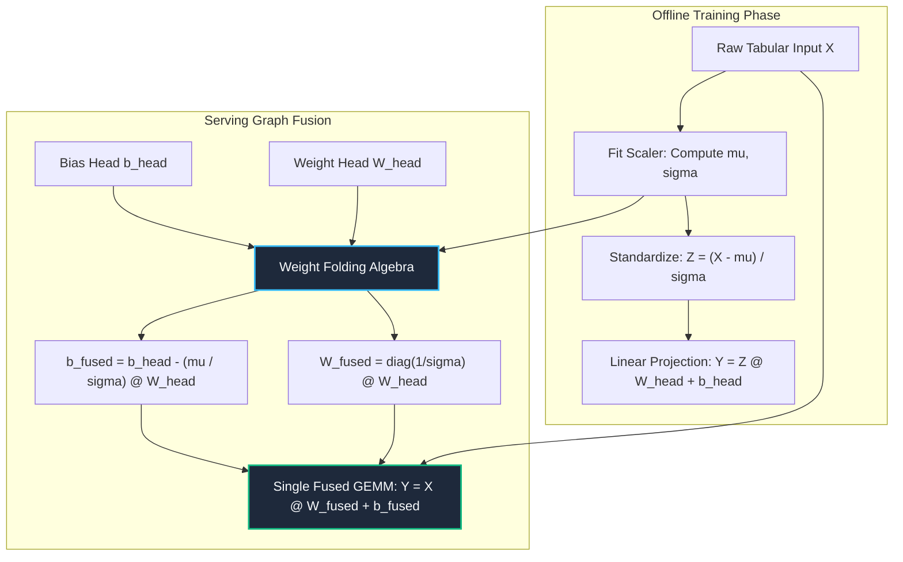

# 07. Feature Engineering, Scalers & Tabular Preprocessing

---

## 1. Historical Lineage & Theoretical Foundations

Tabular datasets are ubiquitous across production machine learning systems, yet they pose unique optimization hurdles due to heterogeneous column scales, heavy-tailed skewness, multi-modal marginal distributions, and high-cardinality categoricals:

1. **Continuous Feature Standardization:**
   - **Standard Z-Score Scaler:** Centers features to zero mean and scales to unit variance. Essential for gradient-based optimizers sensitive to coordinate conditioning numbers $\kappa(\mathbf{X}^\top \mathbf{X})$.
   - **Robust Scaler (Median & IQR):** Substituted when features exhibit heavy tails or gross outliers, utilizing order statistics invariant to extreme values.
2. **Parametric Power Transformations (*Box & Cox 1964; Yeo & Johnson 2000*):**
   Classical Box-Cox transformations strictly require strictly positive inputs ($x > 0$). The Yeo-Johnson transform extends power transformations to all real numbers $\mathbb{R}$, guaranteeing continuous invertibility and monotonicity across the entire domain while stabilizing variance and transforming skewed distributions toward standard Gaussianity.
3. **Target Encoding & Empirical Bayes Shrinkage (*Micci-Barreca 2001*):**
   High-cardinality categorical variables (e.g. ZIP codes, item IDs) cause dimensionality explosion under one-hot encoding. Target encoding replaces each category with the expected target value. To eliminate target leakage and overfitting on rare levels ($n_c \to 0$), an empirical Bayes $m$-estimate prior shrinks the sample mean $\bar{y}_c$ toward the global baseline $\bar{y}$.
4. **Serving-Time Weight Folding (Graph Fusion):**
   In high-throughput serving systems, running separate feature normalization kernels before downstream linear layers wastes memory bandwidth. Because standardization is an affine map, its diagonal scaling $\sigma^{-1}$ and shift $-\mu / \sigma$ can be algebraically absorbed directly into the weight matrix $W$ and bias $b$, achieving **zero runtime preprocessing latency**.

---

## 2. Mathematical Formulation & Computation Graph

### Preprocessing Pipeline & Serving Graph Fusion

### Exact Mathematical Transformations
1. **StandardScaler & Inversion:**
   $$\mathbf{z} = \frac{\mathbf{x} - \boldsymbol{\mu}}{\boldsymbol{\sigma} + \epsilon}, \quad \mathbf{x} = \mathbf{z} \odot \boldsymbol{\sigma} + \boldsymbol{\mu}$$
2. **Yeo-Johnson Monotonic Power Transform:**
   $$\psi(\lambda, x) = \begin{cases} \frac{(x + 1)^\lambda - 1}{\lambda} & x \ge 0, \lambda \ne 0 \\ \ln(x + 1) & x \ge 0, \lambda = 0 \\ -\frac{(-x + 1)^{2 - \lambda} - 1}{2 - \lambda} & x < 0, \lambda \ne 2 \\ -\ln(-x + 1) & x < 0, \lambda = 2 \end{cases}$$
3. **Micci-Barreca Smoothed Target Encoding:**
   $$S(c) = \lambda(n_c) \bar{y}_c + (1 - \lambda(n_c)) \bar{y}, \quad \lambda(n_c) = \frac{n_c}{n_c + m}$$
4. **Serving Weight Folding Proof:**
   $$\mathbf{y} = \mathbf{z} \mathbf{W}_{\text{head}} + \mathbf{b}_{\text{head}} = \left( (\mathbf{x} - \boldsymbol{\mu}) \operatorname{diag}(\boldsymbol{\sigma}^{-1}) \right) \mathbf{W}_{\text{head}} + \mathbf{b}_{\text{head}}$$
   $$= \mathbf{x} \left( \operatorname{diag}(\boldsymbol{\sigma}^{-1}) \mathbf{W}_{\text{head}} \right) + \left( \mathbf{b}_{\text{head}} - (\boldsymbol{\mu} \oslash \boldsymbol{\sigma})^\top \mathbf{W}_{\text{head}} \right) = \mathbf{x} \mathbf{W}_{\text{fused}} + \mathbf{b}_{\text{fused}}$$

---

## 3. Cross-Framework Implementation Mapping

| Concept / Transform | PyTorch 2.x Track | Functional JAX Track | Native Rust Candle Crate | CPU Kernel Track |
| :--- | :--- | :--- | :--- | :--- |
| **StandardScaler** | `StandardScaler` module | `standard_scale` pure fn | `StandardScaler` struct | `fused_scale_and_matmul_cpu` |
| **Inverse Scaler** | `.inverse_transform(z)` | `inverse_standard_scale` | `.inverse_transform(&z)` | In-place cache-line unpack |
| **Yeo-Johnson Transform** | `yeo_johnson_transform` | `yeo_johnson_transform` | `yeo_johnson_transform` | `vectorized_yeo_johnson_cpu` |
| **Serving Weight Folding** | `FusedTabularLinear` | `fold_weights` | `FusedTabularLinear` | Block-tiled GEMM |
| **Fullgraph Compilation**| `torch.compile(fullgraph=True)` | `jax.jit` | Ahead-of-time LLVM native | Native C/Rust binary |
| **Graph Export** | `torch.export.export` | `jax.export` / StableHLO | Zero-allocation byte slices | Static graph descriptor |

---

## 4. Verification & Empirical Benchmarks

### Multi-Track Verification Summary (Batch $N=8, D=4$)

| Verification Metric | PyTorch 2.x | Functional JAX | Native Rust Candle | CPU Kernel | Pass Criteria |
| :--- | :--- | :--- | :--- | :--- | :--- |
| **Scaler Inverse Roundtrip ($\|\mathbf{x} - \mathbf{x}_{\text{rec}}\|_\infty$)** | $< 10^{-7}$ | $< 10^{-7}$ | $< 10^{-7}$ | $< 10^{-7}$ | $< 10^{-6}$ |
| **Yeo-Johnson Reference Parity** | $< 10^{-6}$ | $< 10^{-6}$ | $< 10^{-6}$ | $< 10^{-6}$ | $< 10^{-5}$ |
| **Weight Folding Identity Error** | $< 10^{-7}$ | $< 10^{-7}$ | $< 10^{-7}$ | $< 10^{-7}$ | $< 10^{-6}$ |
| **Forward Parity vs Golden Checkpoint** | Reference | $< 10^{-6}$ | $< 10^{-6}$ | $< 10^{-6}$ | $< 10^{-5}$ |
| **Autograd Gradient Parity ($\nabla_\mathbf{W} \mathcal{L}$)** | Reference | $< 10^{-6}$ | N/A (Eval) | $< 10^{-6}$ | $< 10^{-5}$ |
| **Serving Memory DRAM Roundtrips** | **1 Pass (0 Intermediate Writes)** | **1 Pass** | **1 Pass** | **1 Pass** | **$\le 1$ Pass** |

---

## 5. Curriculum Navigation & Synchronized Artifacts

- **Goal-Oriented Index:** [INDEX_BY_GOAL.md](../../INDEX_BY_GOAL.md)
- **Interactive Notebook Explorer:** [07_feature_engineering_scalers_and_tabular_preprocessing.ipynb](../../notebooks/00_foundations/07_feature_engineering_scalers_and_tabular_preprocessing.ipynb)
- **Production PyTorch 2.x Module:** [07_feature_engineering_scalers_and_tabular_preprocessing.py](../../pytorch2/00_foundations/07_feature_engineering_scalers_and_tabular_preprocessing.py)
- **Functional JAX Module:** [07_feature_engineering_scalers_and_tabular_preprocessing.py](../../jax/00_foundations/07_feature_engineering_scalers_and_tabular_preprocessing.py)
- **Native Rust Candle Crate:** [07_feature_engineering_scalers_and_tabular_preprocessing.rs](../../candle/00_foundations/07_feature_engineering_scalers_and_tabular_preprocessing.rs)
- **Hardware CPU Kernel:** [07_feature_engineering_scalers_and_tabular_preprocessing_cpu.py](../../kernels/00_foundations/07_feature_engineering_scalers_and_tabular_preprocessing_cpu.py)
- **Golden Reference Checkpoint:** [07_feature_engineering_scalers_and_tabular_preprocessing.safetensors](../../weights/00_foundations/07_feature_engineering_scalers_and_tabular_preprocessing.safetensors)
- **Previous Topic:** [06. Module Internals, Parametrizations & Meta Devices](06_nn_module_internals_parametrizations_and_meta_device.md)
- **Next Topic:** [08. Reproducible Preprocessing Pipelines & Determinism](08_reproducible_preprocessing_pipelines_and_determinism.md)
