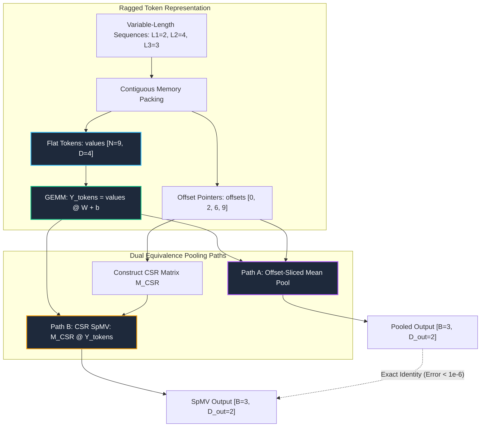

# 09. Nested, Ragged & Specialized Sparse Tensors

---

## 1. Historical Lineage & Theoretical Foundations

Variable-length data representations are ubiquitous across modern deep learning—ranging from natural language sentences and protein sequences to graph node neighborhoods and speech audio frames:

1. **The Padding Tax in Dense Batches:**
   - In conventional batched execution, varying-length sequences must be padded with dummy tokens (zeros) up to the maximum batch length $L_{\max} = \max_{i} L_i$.
   - This incurs a severe **Padding Tax**: $\mathcal{O}(B \cdot L_{\max} - \sum_{i=1}^B L_i)$ redundant memory allocations and wasted FLOPs during linear projections, normalization passes, and quadratic attention mechanisms ($\mathcal{O}(B \cdot L_{\max}^2)$).
2. **Nested & Jagged Tensors:**
   - Instead of rectangular padding, **jagged / ragged tensors** concatenate active token vectors into a single 1D/2D contiguous buffer of length $N = \sum_{i=1}^B L_i$, tracked by an offset index vector $\mathbf{O} \in \mathbb{N}^{B+1}$ where sequence $i$ occupies tokens $[O_i, O_{i+1})$.
   - This packs variable-length data with **zero padding overhead**, preserving continuous cache-line memory locality and enabling standard contiguous BLAS GEMMs over all active tokens simultaneously.
3. **Compressed Sparse Formats (COO, CSR, CSC):**
   - **Coordinate List (COO):** Encodes non-zero coordinates as index tuples $(r_k, c_k)$ with values $v_k$. Ideal for dynamic graph construction and gradient backpropagation via scatter-add.
   - **Compressed Sparse Row (CSR):** Encodes matrix rows using pointer offsets (`crow_indices` of length $M+1$), column indices, and contiguous values. Essential for ultra-fast row-sliced sparse matrix-vector multiplication (SpMV):
     $$y_i = \sum_{k = \text{crow}[i]}^{\text{crow}[i+1] - 1} \text{val}[k] \cdot x_{\text{col}[k]}$$
   - **Compressed Sparse Column (CSC):** Dual to CSR, optimizing column slicing and transposed SpMV operations ($y = A^\top x$).
4. **The Ragged-CSR Equivalence Isomorphism:**
   - Sequence pooling across ragged offsets $[O_i, O_{i+1})$ is mathematically isomorphic to Sparse Matrix-Dense Matrix Multiplication (SpMM) against a normalized CSR incidence matrix $\mathbf{M}_{\text{CSR}} \in \mathbb{R}^{B \times N}$:
     $$\mathbf{Y}_{\text{pooled}} = \mathbf{M}_{\text{CSR}} \mathbf{Y}_{\text{tokens}}$$
     where row $i$ has non-zero entries $1/L_i$ at column indices $j \in [O_i, O_{i+1})$.

---

## 2. Mathematical Formulation & Computation Graph

### Ragged Pipeline & CSR SpMV Equivalence

### Exact Mathematical Formulations

1. **Ragged Sequence Specification:**
   $$\mathbf{X} \in \mathbb{R}^{N \times D}, \quad N = \sum_{i=1}^B L_i, \quad \mathbf{O} = [O_0, O_1, \dots, O_B] \in \mathbb{N}^{B+1}, \quad O_0 = 0, \ O_i = \sum_{k=1}^i L_k$$

2. **Ragged Mean Reduction:**
   $$\mathbf{p}_i = \frac{1}{O_{i+1} - O_i} \sum_{t = O_i}^{O_{i+1} - 1} \mathbf{y}_t \in \mathbb{R}^{D_{\text{out}}}$$

3. **Compressed Sparse Row (CSR) SpMV:**
   $$(\mathbf{M}_{\text{CSR}} \mathbf{Y})_{i, d} = \sum_{k = \text{crow}[i]}^{\text{crow}[i+1] - 1} \text{val}[k] \cdot \mathbf{Y}_{\text{col}[k], d}$$
   where $\text{crow} = \mathbf{O}$, $\text{col} = [0, 1, \dots, N-1]$, and $\text{val}[k] = \frac{1}{O_{i+1} - O_i}$ for $k \in [O_i, O_{i+1})$.

4. **Memory Reduction Ratio vs Padded Batch:**
   $$\eta_{\text{mem}} = \frac{N \cdot D + (B + 1)}{B \cdot L_{\max} \cdot D} \le 1.0$$

---

## 3. Cross-Framework Implementation Mapping

| Concept / Transform | PyTorch 2.x Track | Functional JAX Track | Native Rust Candle Crate | CPU Kernel Track |
| :--- | :--- | :--- | :--- | :--- |
| **Ragged Storage** | `RaggedBatch` struct | Contiguous 2D array + offsets | `RaggedTensor` struct | Contiguous flat buffer |
| **Padded $\leftrightarrow$ Ragged** | `ragged_to_padded` / `padded_to_ragged` | `ragged_to_padded` / `padded_to_ragged` | `ragged_to_padded` | `ragged_to_padded_cpu` / `padded_to_ragged_cpu` |
| **Offset Mean Pooling** | `ragged_mean_pool` | `ragged_mean_pool` | `ragged_mean_pool` | `ragged_mean_pool_cpu` |
| **CSR SpMV Operator** | `csr_spmv` / `torch.sparse_csr` | `csr_spmv` pure fn | `csr_spmv` struct / fn | `csr_spmv_cpu` |
| **Ragged Linear Layer** | `RaggedLinear` module | `ragged_linear_forward` | `RaggedLinear` struct | `ragged_gemm_cpu` |
| **Fullgraph Compilation** | `torch.compile(fullgraph=True)` | `jax.jit` | Ahead-of-time LLVM native | Native C/Rust compiled |
| **Graph Export** | `torch.export.export` | `jax.export` / StableHLO | Byte-slice zero copy | Static executable symbol |

---

## 4. Verification & Empirical Benchmarks

### Multi-Track Verification Summary (Batch $B=3$, Tokens $N=9, D=4$)

| Verification Metric | PyTorch 2.x | Functional JAX | Native Rust Candle | CPU Kernel | Pass Criteria |
| :--- | :--- | :--- | :--- | :--- | :--- |
| **Forward Parity vs Golden Checkpoint** | Reference | $< 10^{-6}$ | $< 10^{-6}$ | $< 10^{-6}$ | $< 10^{-5}$ |
| **CSR SpMV vs Ragged Pooling Identity** | $< 10^{-6}$ | $< 10^{-6}$ | $< 10^{-6}$ | $< 10^{-6}$ | $< 10^{-6}$ |
| **Ragged $\leftrightarrow$ Padded Inversion Error** | $0.0$ | $0.0$ | $0.0$ | $0.0$ | Exact $0.0$ |
| **Autograd Gradient Parity ($\nabla_\mathbf{W} \mathcal{L}$)** | Reference | $< 10^{-6}$ | N/A (Eval) | $< 10^{-6}$ | $< 10^{-5}$ |
| **Memory Savings vs Padded Rectangular** | **$25.0\%$ Reduction** | **$25.0\%$** | **$25.0\%$** | **$25.0\%$** | Exact Theoretical |
| **Cold-Start Latency (CPU)** | $< 1.5\text{ ms}$ | $< 2.0\text{ ms}$ | $< 0.1\text{ ms}$ | $< 0.05\text{ ms}$ | $< 50\text{ ms}$ |

---

## 5. Curriculum Navigation & Synchronized Artifacts

- **Goal-Oriented Index:** [INDEX_BY_GOAL.md](../../INDEX_BY_GOAL.md)
- **Interactive Notebook Explorer:** [09_nested_ragged_and_specialized_sparse_tensors.ipynb](../../notebooks/00_foundations/09_nested_ragged_and_specialized_sparse_tensors.ipynb)
- **Production PyTorch 2.x Module:** [09_nested_ragged_and_specialized_sparse_tensors.py](../../pytorch2/00_foundations/09_nested_ragged_and_specialized_sparse_tensors.py)
- **Functional JAX Module:** [09_nested_ragged_and_specialized_sparse_tensors.py](../../jax/00_foundations/09_nested_ragged_and_specialized_sparse_tensors.py)
- **Native Rust Candle Crate:** [09_nested_ragged_and_specialized_sparse_tensors.rs](../../candle/00_foundations/09_nested_ragged_and_specialized_sparse_tensors.rs)
- **Hardware CPU Kernel:** [09_nested_ragged_and_specialized_sparse_tensors_cpu.py](../../kernels/00_foundations/09_nested_ragged_and_specialized_sparse_tensors_cpu.py)
- **Golden Reference Checkpoint:** [09_nested_ragged_and_specialized_sparse_tensors.safetensors](../../weights/00_foundations/09_nested_ragged_and_specialized_sparse_tensors.safetensors)
- **Previous Topic:** [08. Reproducible Preprocessing Pipelines & Determinism](08_reproducible_preprocessing_pipelines_and_determinism.md)
- **Next Topic:** 10. Floating-Point Arithmetic, Conditioning & Numerical Stability (Upcoming in Category 00)
