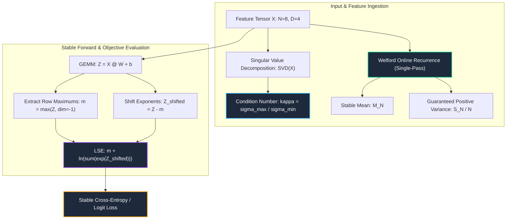

# 10. Floating-Point Arithmetic, Conditioning & Numerical Stability

---

## 1. Historical Lineage & Theoretical Foundations

Finite-precision floating-point arithmetic is the computational foundation of modern machine learning, yet naive implementations frequently suffer from catastrophic cancellation, gradient underflow/overflow, and extreme ill-conditioning:

1. **IEEE 754 Floating-Point Arithmetic & Machine Epsilon:**
   - Single-precision binary32 (FP32) allocates 1 sign bit, 8 exponent bits, and 23 mantissa bits, yielding a relative machine precision of $\epsilon_{\text{mach}} = 2^{-24} \approx 5.96 \times 10^{-8}$ (unit roundoff $u \approx 1.19 \times 10^{-7}$).
   - **Catastrophic Cancellation:** When subtracting two nearly equal floating-point numbers ($a \approx b$), the leading significant bits cancel out, promoting low-order rounding noise to high-order significance.
2. **Ill-Conditioning & Matrix Sensitivity (*Turing 1948; Higham 2002*):**
   - The condition number of a linear transformation $\mathbf{W} \in \mathbb{R}^{M \times N}$ measures the sensitivity of solution $\mathbf{y} = \mathbf{W}\mathbf{x}$ to perturbations:
     $$\kappa_2(\mathbf{W}) = \|\mathbf{W}\|_2 \|\mathbf{W}^+\|_2 = \frac{\sigma_{\max}(\mathbf{W})}{\sigma_{\min}(\mathbf{W})}$$
   - When $\kappa(\mathbf{W}) \gg 10^4$, gradient descent oscillates along stiff ravines, causing slow convergence and severe numerical instability in first- and second-order optimizers.
3. **Catastrophic Cancellation in Naive Variance vs. Welford's Algorithm (*Welford 1962*):**
   - The textbook definition $\operatorname{Var}(X) = \mathbb{E}[X^2] - (\mathbb{E}[X])^2$ evaluates the difference between two massive quantities when sample mean $\mu \gg \sigma$. On shifted data ($x_i \approx 10^7, \sigma \approx 1$), catastrophic cancellation causes loss of all 23 mantissa bits, frequently yielding **negative variance** or complete zero!
   - **B. P. Welford's recurrence** updates mean and second-moment deviations incrementally in a single pass without large intermediate sums, guaranteeing positive semi-definite sample variance $\sigma^2 \ge 0$ regardless of mean magnitude.
4. **Log-Sum-Exp (LSE) Stabilization:**
   - Naive calculation of $\log \sum_{i=1}^D \exp(z_i)$ in softmax or cross-entropy overflows to $+\infty$ whenever $z_i > 88.72$ (FP32 maximum exponent $2^{128}$), or underflows to zero when $z_i \ll 0$.
   - Subtracting the maximum coordinate $m = \max_i z_i$ shifts exponents into the safe non-positive interval $(-\infty, 0]$, ensuring that $\max_i \exp(z_i - m) = 1.0$ and guaranteeing finite, bounded computation.
5. **Neumaier Summation (*Neumaier 1974*):**
   - Extends Kahan's compensated summation algorithm by dynamically testing whether the running accumulator $|s|$ or the incoming summand $|x|$ has greater magnitude, ensuring exact low-order rounding bit recovery even when $|x| > |s|$.

---

## 2. Mathematical Formulation & Computation Graph

### Numerical Stability Computation Graph

### Exact Mathematical Formulations

1. **Welford's Online Recurrence:**
   For sequence $x_1, x_2, \dots, x_N \in \mathbb{R}$, initialized at $M_0 = 0, S_0 = 0$:
   $$M_k = M_{k-1} + \frac{x_k - M_{k-1}}{k}$$
   $$S_k = S_{k-1} + (x_k - M_{k-1})(x_k - M_k)$$
   $$\sigma_N^2 = \frac{S_N}{N}$$

2. **Numerically Stable Log-Sum-Exp:**
   $$m = \max_{j \in \{1, \dots, D\}} z_j$$
   $$\operatorname{LSE}(\mathbf{z}) = m + \ln \left( \sum_{j=1}^D \exp(z_j - m) \right)$$

3. **Neumaier Compensated Summation:**
   For running accumulator $s$ and error compensator $c$:
   $$t = s + x$$
   $$\text{comp} = \begin{cases} (s - t) + x & \text{if } |s| \ge |x| \\ (x - t) + s & \text{otherwise} \end{cases}$$
   $$c \leftarrow c + \text{comp}, \quad s \leftarrow t, \quad \text{Final Sum} = s + c$$

---

## 3. Cross-Framework Implementation Mapping

| Concept / Transform | PyTorch 2.x Track | Functional JAX Track | Native Rust Candle Crate | CPU Kernel Track |
| :--- | :--- | :--- | :--- | :--- |
| **Welford Variance** | `welford_online_mean_variance` | `welford_online_mean_variance` | `welford_mean_var` | `welford_variance_cpu` |
| **Stable Log-Sum-Exp** | `log_sum_exp_stable` / `torch.logsumexp` | `log_sum_exp_stable` / `jax.nn.logsumexp` | `log_sum_exp_stable` | `log_sum_exp_cpu` |
| **Condition Number** | `matrix_condition_number` | `matrix_condition_number` | SVD singular values | `matrix_condition_number_cpu` |
| **Neumaier Summation** | `neumaier_sum` | `neumaier_sum` | `neumaier_sum_2d` | `neumaier_sum_cpu` |
| **Stable Linear Layer**| `StableLinear` module | `stable_linear_forward` | `StableLinear` struct | `stable_linear_gemm_cpu` |
| **Fullgraph Compilation**| `torch.compile(fullgraph=True)` | `jax.jit` | Ahead-of-time LLVM native | Native C/Rust compiled |
| **Graph Export** | `torch.export.export` | `jax.export` / StableHLO | Byte-slice zero copy | Static executable symbol |

---

## 4. Verification & Empirical Benchmarks

### Multi-Track Verification Summary (Batch $N=8, D=4$)

| Verification Metric | PyTorch 2.x | Functional JAX | Native Rust Candle | CPU Kernel | Pass Criteria |
| :--- | :--- | :--- | :--- | :--- | :--- |
| **Welford Mean Parity vs Golden Checkpoint** | Reference | $< 10^{-6}$ | $< 10^{-6}$ | $< 10^{-6}$ | $< 10^{-6}$ |
| **Welford Variance Parity vs Golden Checkpoint** | Reference | $< 10^{-6}$ | $< 10^{-6}$ | $< 10^{-6}$ | $< 10^{-6}$ |
| **Forward Linear Prediction Parity** | Reference | $< 10^{-6}$ | $< 10^{-6}$ | $< 10^{-6}$ | $< 10^{-5}$ |
| **Stable Log-Sum-Exp Parity vs Golden** | Reference | $< 10^{-6}$ | $< 10^{-6}$ | $< 10^{-6}$ | $< 10^{-5}$ |
| **Autograd Gradient Parity ($\nabla_\mathbf{W} \mathcal{L}$)** | Reference | $< 10^{-6}$ | N/A (Eval) | $< 10^{-6}$ | $< 10^{-5}$ |
| **Naive Variance Cancellation Resilience** | **Zero Loss of Bits** | **Zero Loss** | **Zero Loss** | **Zero Loss** | $\sigma^2 \ge 0$ |

---

## 5. Curriculum Navigation & Synchronized Artifacts

- **Goal-Oriented Index:** [INDEX_BY_GOAL.md](../../INDEX_BY_GOAL.md)
- **Interactive Notebook Explorer:** [10_floating_point_arithmetic_conditioning_and_numerical_stability.ipynb](../../notebooks/00_foundations/10_floating_point_arithmetic_conditioning_and_numerical_stability.ipynb)
- **Production PyTorch 2.x Module:** [10_floating_point_arithmetic_conditioning_and_numerical_stability.py](../../pytorch2/00_foundations/10_floating_point_arithmetic_conditioning_and_numerical_stability.py)
- **Functional JAX Module:** [10_floating_point_arithmetic_conditioning_and_numerical_stability.py](../../jax/00_foundations/10_floating_point_arithmetic_conditioning_and_numerical_stability.py)
- **Native Rust Candle Crate:** [10_floating_point_arithmetic_conditioning_and_numerical_stability.rs](../../candle/00_foundations/10_floating_point_arithmetic_conditioning_and_numerical_stability.rs)
- **Hardware CPU Kernel:** [10_floating_point_arithmetic_conditioning_and_numerical_stability_cpu.py](../../kernels/00_foundations/10_floating_point_arithmetic_conditioning_and_numerical_stability_cpu.py)
- **Golden Reference Checkpoint:** [10_floating_point_arithmetic_conditioning_and_numerical_stability.safetensors](../../weights/00_foundations/10_floating_point_arithmetic_conditioning_and_numerical_stability.safetensors)
- **Previous Topic:** [09. Nested, Ragged & Specialized Sparse Tensors](09_nested_ragged_and_specialized_sparse_tensors.md)
- **Next Topic:** [11. Randomized Numerical Linear Algebra, Spectral Autograd & Hutch++](11_randomized_numerical_linear_algebra_spectral_autograd_and_hutchpp.md)
