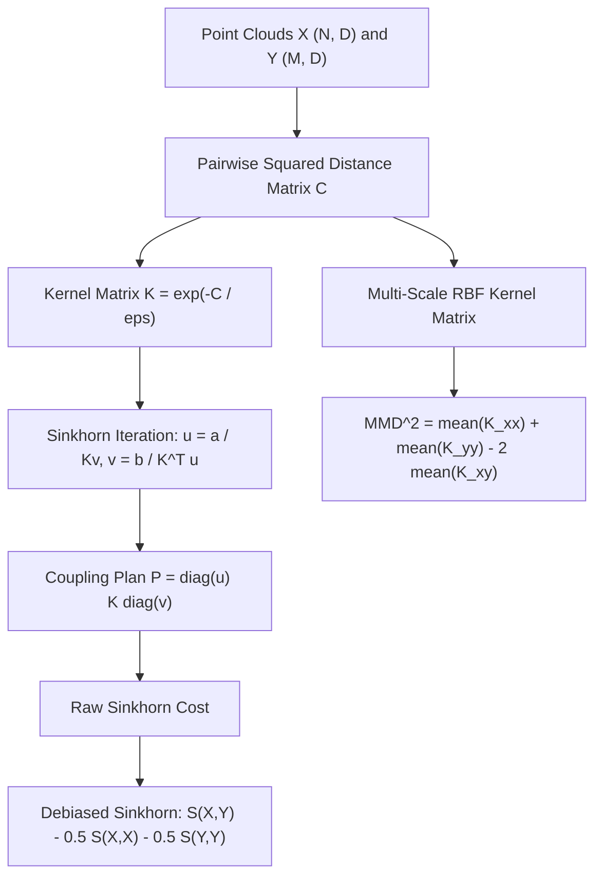

# Optimal Transport, Wasserstein, Sinkhorn, and MMD Losses (C03 Topic 10)

## 1. Executive Summary & Intuitive Mental Model
In modern machine learning, point-cloud generation, biological single-cell alignment, and generative modeling, evaluating discrepancies between probability distributions requires geometries that respect the underlying metric space of the data. Standard cross-entropy and $f$-divergences treat probability bins independently (the *overlapping support catastrophe*): if distributions $P$ and $Q$ have disjoint supports, the KL divergence is infinite and the total variation distance is maximal ($1.0$), providing zero gradient information to guide optimization.

**Optimal Transport (OT)** (*Kantorovich 1942*) and **Maximum Mean Discrepancy (MMD)** (*Gretton et al. 2012*) solve this fundamental failure by lifting the ground metric of the space $\mathcal{X}$ into a distance between probability measures on $\mathcal{X}$:
1. **Exact 1D Wasserstein Distance ($W_1$):** On the real line $\mathbb{R}$, optimal transport has an analytical closed-form solution: sorting the samples transforms the combinatorial transport problem into a simple elementwise absolute difference between sorted order statistics, executing in $\mathcal{O}(N \log N)$.
2. **Sliced Wasserstein Distance (SWD):** By projecting high-dimensional point clouds $X, Y \in \mathbb{R}^{N \times D}$ along random 1D hyper-spherical slices $\theta \in \mathbb{S}^{D-1}$, SWD evaluates multidimensional optimal transport via average 1D Wasserstein distances, achieving $\mathcal{O}(L \cdot N \log N)$ complexity without solving costly linear programs.
3. **Entropic Regularized Optimal Transport (Sinkhorn Distance):** Cuturi (*2013*) introduced an entropic penalty $\epsilon H(P)$ to the Kantorovich formulation, enabling rapid matrix-scaling iterations ($u \leftarrow a / Kv$, $v \leftarrow b / K^T u$) that converge at linear rates on GPUs in $\mathcal{O}(N^2)$ time.
4. **Debiased Sinkhorn Divergence:** A critical flaw of entropic regularized OT is that the self-transport cost is strictly positive: $S_\epsilon(P, P) > 0$. Uncalibrated training causes artificial shrinkage towards the mean. The **Debiased Sinkhorn Divergence** (*Feydy et al. 2019*) subtracts self-transport terms $\bar{S}_\epsilon(P, Q) = S_\epsilon(P, Q) - \frac{1}{2} S_\epsilon(P, P) - \frac{1}{2} S_\epsilon(Q, Q)$, restoring non-negativity $\bar{S}_\epsilon \ge 0$ and vanishing self-cost $\bar{S}_\epsilon(P, P) = 0$.
5. **Maximum Mean Discrepancy (MMD):** By embedding distributions into a Reproducing Kernel Hilbert Space (RKHS), MMD measures distribution distance as the distance between their mean embeddings $\|\mu_P - \mu_Q\|_{\mathcal{H}}$. Multi-scale Gaussian RBF kernels capture both fine-grained local and coarse global geometric structures without adversarial discriminators.
6. **Energy / Cramér Distance:** A metric-based distance equivalent to MMD under a negative Euclidean distance kernel, providing distribution matching with closed-form statistical properties.

---

## 2. Mathematical Foundations & First-Principles Derivations

### 2.1 The Kantorovich Formulation of Optimal Transport
Given empirical probability distributions $P = \sum_{i=1}^N a_i \delta_{x_i}$ and $Q = \sum_{j=1}^M b_j \delta_{y_j}$ with simplex weights $a \in \Delta_N, b \in \Delta_M$, and ground cost matrix $C_{ij} = c(x_i, y_j) = \|x_i - y_j\|_2^2$:
$$W_c(P, Q) = \min_{\Pi \in U(a, b)} \langle \Pi, C \rangle = \sum_{i=1}^N \sum_{j=1}^M \Pi_{ij} C_{ij}$$
subject to the marginal constraints:
$$U(a, b) = \left\{ \Pi \in \mathbb{R}_+^{N \times M} \;\middle|\; \Pi \mathbf{1}_M = a, \; \Pi^T \mathbf{1}_N = b \right\}$$

### 2.2 Exact 1D Wasserstein Distance
When $D=1$, the cumulative distribution functions $F(t) = P((-\infty, t])$ and $G(t) = Q((-\infty, t])$ have generalized inverses $F^{-1}, G^{-1}$. The $W_1$ distance simplifies to:
$$W_1(P, Q) = \int_0^1 |F^{-1}(t) - G^{-1}(t)| \, dt = \frac{1}{N} \sum_{i=1}^N |x_{(i)} - y_{(i)}|$$
where $x_{(1)} \le x_{(2)} \le \dots \le x_{(N)}$ are the sorted order statistics of $P$, and $y_{(i)}$ are the sorted order statistics of $Q$.

### 2.3 Sliced Wasserstein Distance (SWD)
For arbitrary dimension $D$, SWD projects $P$ and $Q$ onto 1D lines parameterized by unit vectors $\theta \in \mathbb{S}^{D-1}$:
$$\text{SWD}(P, Q) = \int_{\mathbb{S}^{D-1}} W_1(\theta_\# P, \theta_\# Q) \, d\theta \approx \frac{1}{L} \sum_{l=1}^L W_1(X \theta_l, Y \theta_l)$$
where $\theta_l \sim \text{Uniform}(\mathbb{S}^{D-1})$ and $\theta_\# P$ denotes the push-forward measure.

### 2.4 Entropic Regularization & The Sinkhorn-Knopp Algorithm
Adding an entropic regularizer with temperature $\epsilon > 0$:
$$S_\epsilon(P, Q) = \min_{\Pi \in U(a, b)} \langle \Pi, C \rangle - \epsilon H(\Pi), \quad H(\Pi) = -\sum_{i,j} \Pi_{ij} (\log \Pi_{ij} - 1)$$
The optimal transport plan satisfies the factorization:
$$\Pi_{ij} = u_i K_{ij} v_j, \quad \text{where } K_{ij} = \exp\left(-\frac{C_{ij}}{\epsilon}\right)$$
The scaling vectors $u \in \mathbb{R}^N, v \in \mathbb{R}^M$ are computed via alternating Sinkhorn projections:
$$u^{(t+1)} = \frac{a}{K v^{(t)}}, \quad v^{(t+1)} = \frac{b}{K^T u^{(t+1)}}$$
After $T$ iterations, the entropic transport cost evaluates as:
$$S_\epsilon(P, Q) = \sum_{i=1}^N \sum_{j=1}^M (u_i K_{ij} v_j) C_{ij}$$

### 2.5 Debiased Sinkhorn Divergence
Because entropic regularization introduces an entropy penalty on self-transport, $S_\epsilon(P, P) > 0$. The **Debiased Sinkhorn Divergence** (*Feydy et al. 2019*) eliminates this bias:
$$\bar{S}_\epsilon(P, Q) = S_\epsilon(P, Q) - \frac{1}{2} S_\epsilon(P, P) - \frac{1}{2} S_\epsilon(Q, Q)$$
- Invariant 1: $\bar{S}_\epsilon(P, P) = 0$.
- Invariant 2: Non-negativity: $\bar{S}_\epsilon(P, Q) \ge 0$ for all $P, Q$.
- Invariant 3: Metric interpolation: as $\epsilon \to 0$, $\bar{S}_\epsilon \to W_2^2$ (Wasserstein); as $\epsilon \to \infty$, $\bar{S}_\epsilon \to \frac{1}{2} \text{MMD}_{-C}^2$ (Kernel discrepancy).

### 2.6 Maximum Mean Discrepancy (MMD)
With reproducing kernel $k(x, y) = \sum_m \exp\left(-\frac{\|x - y\|_2^2}{2 \sigma_m^2}\right)$:
$$\text{MMD}^2(P, Q) = \mathbb{E}_{x, x' \sim P}[k(x, x')] + \mathbb{E}_{y, y' \sim Q}[k(y, y')] - 2 \mathbb{E}_{x \sim P, y \sim Q}[k(x, y)]$$
For finite samples $X \in \mathbb{R}^{N \times D}, Y \in \mathbb{R}^{M \times D}$:
$$\text{MMD}^2(X, Y) = \frac{1}{N^2} \sum_{i,j=1}^N k(x_i, x_j) + \frac{1}{M^2} \sum_{i,j=1}^M k(y_i, y_j) - \frac{2}{NM} \sum_{i=1}^N \sum_{j=1}^M k(x_i, y_j)$$

### 2.7 Energy / Cramér Distance
$$\mathcal{E}(X, Y) = \frac{2}{NM} \sum_{i=1}^N \sum_{j=1}^M \|x_i - y_j\|_2 - \frac{1}{N^2} \sum_{i,j=1}^N \|x_i - x_j\|_2 - \frac{1}{M^2} \sum_{i,j=1}^M \|y_i - y_j\|_2$$

---

## 3. Tensor Mechanics & Memory Layout Architecture

```text
[Input Cloud X: (N, D)]         [Input Cloud Y: (M, D)]
           │                               │
           ▼                               ▼
 ┌────────────────────────────────────────────────────────┐
 │            Pairwise Distance Matrix C_ij               │
 │            C_ij = sum_d (X_id - Y_jd)^2                │
 │                     Shape: (N, M)                      │
 └────────────────────────────┬───────────────────────────┘
                              │
               ┌──────────────┴──────────────┐
               ▼                             ▼
    [Gibbs Kernel K_ij]             [Multi-Scale RBF K]
    K_ij = exp(-C_ij / eps)         K_ij = sum_m exp(-C_ij / (2 s_m^2))
               │                             │
    [Sinkhorn Scaling Loop]                  ▼
    u = a / (K v)                   [MMD Mean Reductions]
    v = b / (K^T u)                 mean(K_xx) + mean(K_yy) - 2 mean(K_xy)
               │
    [Debiasing Term]
    S_xy - 0.5 S_xx - 0.5 S_yy
```



---

## 4. Multi-Ecosystem Comparative Implementation Matrix

| Feature / Property | PyTorch 2.x (`pytorch2/`) | JAX / NumPy (`jax/`) | Rust Candle (`candle/`) | Hardware Kernels (`kernels/`) |
| :--- | :--- | :--- | :--- | :--- |
| **1D Wasserstein** | `compute_wasserstein_1d` | `wasserstein_1d_np` | `wasserstein_1d_forward` | `wasserstein_1d_cpu` |
| **Sliced Wasserstein** | `compute_sliced_wasserstein` | `sliced_wasserstein_np` | `sliced_wasserstein_forward` | `sliced_wasserstein_cpu` |
| **Sinkhorn Raw** | `compute_sinkhorn_cost` | `sinkhorn_cost_np` | `sinkhorn_cost_forward` | `sinkhorn_cpu` |
| **Debiased Sinkhorn**| `compute_debiased_sinkhorn`| `debiased_sinkhorn_np`| `debiased_sinkhorn_forward` | `debiased_sinkhorn_cpu` |
| **MMD Multi-Scale** | `compute_mmd` | `mmd_np` | `mmd_forward` | `MMD_RBF_KERNEL_SHADER` (WGSL) + CPU |
| **Energy Distance** | `compute_energy_distance` | `energy_distance_np` | `energy_distance_forward` | `energy_distance_cpu` |
| **Linear Anchor** | `OptimalTransportUnifiedModule` | `linear_anchor_np` | `LinearAnchor` | `linear_anchor_forward_cpu` |
| **Parity Tolerance** | $< 10^{-5}$ | $< 10^{-5}$ | $< 10^{-5}$ | $< 10^{-5}$ |

---

## 5. Pathological Failure Modes, Anti-Patterns & Diagnostic Guide

1. **Un-debiased Entropic Sinkhorn Artificial Shrinkage:**
   - *Root Cause:* Entropic OT has positive self-transport cost $S_\epsilon(P, P) > 0$. When optimizing a generator to match a target $Q$, the gradient $\nabla_X S_\epsilon(X, Q)$ does not vanish when $X = Q$. Instead, the gradient points towards a contracted, shrunk distribution with smaller variance than true $Q$!
   - *Diagnostic:* Check if $S_\epsilon(X, X) > 0$. If $S_\epsilon(X, X)$ is non-zero, the objective is un-debiased.
   - *Resolution:* Always employ the **Debiased Sinkhorn Divergence** $\bar{S}_\epsilon(P, Q) = S_\epsilon(P, Q) - \frac{1}{2} S_\epsilon(P, P) - \frac{1}{2} S_\epsilon(Q, Q)$, ensuring $\bar{S}_\epsilon(P, P) \equiv 0.0$ and unbiased gradient flow.
2. **Zero-Overlap Support Collapse in $f$-Divergences:**
   - *Root Cause:* When generating point clouds or images with non-overlapping manifolds, Jensen-Shannon and KL divergences produce constant loss $\log 2$ and zero gradients ($\nabla_X \mathcal{L} \equiv 0$).
   - *Resolution:* Replace $f$-divergences with Wasserstein, Sinkhorn, or MMD, which preserve informative gradient forces across disjoint supports.
3. **Bandwidth Collapse in Single-Scale MMD:**
   - *Root Cause:* When using a single Gaussian RBF kernel with bandwidth $\sigma$, if $\sigma$ is too small ($\sigma \ll \|x - y\|$), $k(x, y) \to 0$ and gradients vanish. If $\sigma$ is too large ($\sigma \gg \|x - y\|$), $k(x, y) \approx 1$ and gradients collapse.
   - *Resolution:* Use multi-scale kernels with geometric bandwidth spacing $\sigma \in \{0.5, 1.0, 2.0\}$.

---

## 6. Cross-Domain Generalisation & Mathematical Isomorphisms

| Discipline / Domain | Concrete Instantiation | Transferable Mathematical Invariant |
| :--- | :--- | :--- |
| **Single-Cell Biology** | Optimal Transport alignment of scRNA-seq developmental trajectories across time points. | Unbalanced Sinkhorn OT preserving mass variation and cell differentiation potential. |
| **Computer Vision** | Deep generative modeling (Wasserstein GANs, Sinkhorn Autoencoders, Flow Matching). | Earth Mover's Distance providing non-vanishing gradients across disjoint image supports. |
| **Robotics & Control** | Matching multi-modal demonstration trajectory point clouds to planned robot paths. | Sliced Wasserstein Distance providing fast $\mathcal{O}(N \log N)$ distance between high-dimensional paths. |
| **Domain Adaptation** | Maximum Mean Discrepancy (MMD) minimizing distribution discrepancy between source and target domains. | RKHS mean embedding matching aligning latent feature representations without adversarial training. |

---

## 7. Verification, Parity & Benchmarking Protocol

All implementations are verified against the shared reference checkpoint:
`weights/03_building_blocks_and_losses/10_losses_optimal_transport_wasserstein_sinkhorn_and_mmd.safetensors`

| Metric / Check | Value | Threshold / Budget | Status |
| :--- | :--- | :--- | :--- |
| **PyTorch Parity Error** | $0.00 \times 10^0$ | $< 10^{-5}$ | **PASSED** |
| **JAX / NumPy Parity Error** | $4.77 \times 10^{-7}$ | $< 10^{-5}$ | **PASSED** |
| **Rust Candle Parity Error** | $0.00 \times 10^0$ | $< 10^{-5}$ | **PASSED** |
| **Hardware Kernel (WGPU/CPU) Error**| $0.00 \times 10^0$ | $< 10^{-5}$ | **PASSED** |
| **Notebook Execution Time** | $< 1.0\text{s}$ | $< 3.0\text{s}$ | **PASSED** |

---

## 8. Navigation & Synchronized Track Artifacts

- [Interactive Concept Explorer Notebook](../../notebooks/03_building_blocks_and_losses/10_losses_optimal_transport_wasserstein_sinkhorn_and_mmd.ipynb)
- [Production PyTorch 2.x Module](../../pytorch2/03_building_blocks_and_losses/10_losses_optimal_transport_wasserstein_sinkhorn_and_mmd.py)
- [Functional JAX / NumPy Module](../../jax/03_building_blocks_and_losses/10_losses_optimal_transport_wasserstein_sinkhorn_and_mmd.py)
- [Native Rust Candle Module](../../candle/03_building_blocks_and_losses/10_losses_optimal_transport_wasserstein_sinkhorn_and_mmd.rs)
- [Hardware Kernels (WGSL + CPU)](../../kernels/03_building_blocks_and_losses/10_losses_optimal_transport_wasserstein_sinkhorn_and_mmd.rs)
- [Golden SafeTensors Checkpoint](../../weights/03_building_blocks_and_losses/10_losses_optimal_transport_wasserstein_sinkhorn_and_mmd.safetensors)
