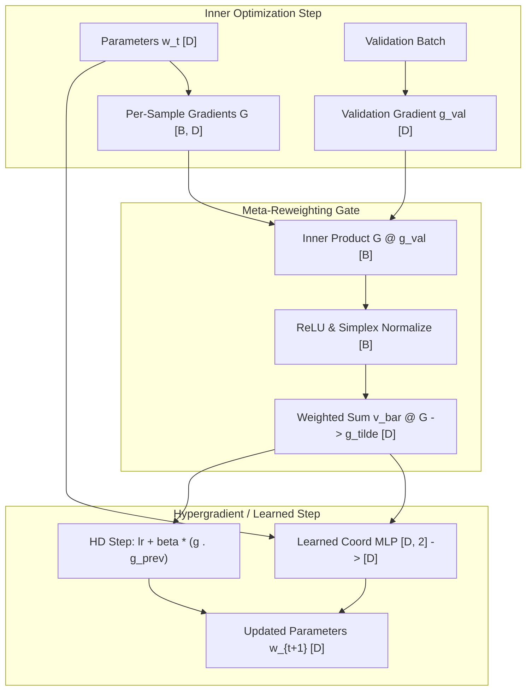

# Self-Optimising Hypergradients, Learned Optimisers, and Meta-Reweighting (Topic 17)

## 1. Executive Summary & Intuitive Mental Model
Classical deep learning treats optimizers and sample weights as fixed external artifacts—static hyperparameters chosen a priori via heuristics or expensive grid search. **Self-Optimising Hypergradients, Learned Optimisers, and Meta-Reweighting** invert this paradigm by formulating optimization as an active, differentiable, bilevel feedback loop:
- **Hypergradient Descent (HD):** Uses the gradient of the loss with respect to the learning rate itself ($\nabla_\eta \mathcal{L}$), updating learning rates online along the inner optimization trajectory without manual schedule tuning.
- **Meta-Sample Reweighting:** Evaluates sample gradients against a clean, unbiased validation loss vector $\nabla_w \mathcal{L}_{\text{val}}$. Samples aligned with validation objectives receive positive training weights, while misaligned or corrupted samples (label noise, out-of-distribution artifacts) are automatically down-weighted to zero.
- **Learned Optimizers:** Replaces handcrafted update formulas (Adam, SGD) with coordinate-wise neural networks (MLPs/LSTMs) trained across tasks to output parameter steps $\Delta w_t = \text{MLP}_\phi(g_t, m_t)$, discovering task-adaptive momentum schedules.

### Historical Lineage & Seminal Citations
- **Maclaurin et al. (2015)**: *Gradient-based Hyperparameter Optimization through Reversible Learning*. Introduced exact reverse-mode differentiation through SGD dynamics.
- **Andrychowicz et al. (2016)**: *Learning to Learn by Gradient Descent by Gradient Descent*. Formulated coordinate-wise neural optimizers trained via meta-loss unrolling.
- **Baydin et al. (2018)**: *Online Learning Rate Adaptation with Hypergradient Descent*. Derived closed-form first-order hypergradients $\Delta \eta_t = \alpha \langle g_t, g_{t-1} \rangle$ requiring zero second-order Hessian overhead.
- **Ren et al. (2018)**: *Learning to Reweight Examples for Robust Deep Learning*. Pioneered validation-loss-guided online sample reweighting for noisy label robustness.
- **Metz et al. (2022)**: *VeLO: Training Versatile Learned Optimizers by Large Scale Model Optimization*. Scaled learned optimizers to 1000s of tasks, isolating chaotic meta-landscapes.

> [!WARNING]
> **Decision Boundary (When NOT to Use Unrolled Hypergradients / Naive Meta-Reweighting):**
> Do not unroll meta-gradients over long optimization horizons ($T > 50$ steps) without implicit differentiation (IFT) or gradient clipping; meta-gradients explode exponentially at the Edge of Stability ($\|d_\lambda w_T\| \sim \lambda_{\max}(I - \eta H)^T \gg 1$). Furthermore, never apply meta-sample reweighting if the validation anchor set is unrepresentative or biased, as the model will overfit the validation slice and discard diverse minority classes.

---

## 2. Mathematical Foundations & First-Principles Derivations

### Formal Bilevel Formulation
$$\min_{\lambda \in \Lambda} \mathcal{F}(\lambda) := \mathcal{L}_{\text{val}}(w^*(\lambda)) \quad \text{s.t.} \quad w^*(\lambda) \in \arg\min_{w} \mathcal{L}_{\text{train}}(w, \lambda)$$

### 1. Online Hypergradient Descent (HD)
For an inner parameter step $w_{t+1} = w_t - \eta_t \nabla \mathcal{L}(w_t)$, we differentiate validation loss with respect to $\eta_{t-1}$:
$$\nabla_{\eta_{t-1}} \mathcal{L}(w_t) = \left\langle \nabla_{w} \mathcal{L}(w_t), \frac{\partial w_t}{\partial \eta_{t-1}} \right\rangle = \left\langle \nabla_{w} \mathcal{L}(w_t), - \nabla_w \mathcal{L}(w_{t-1}) \right\rangle = - \langle g_t, g_{t-1} \rangle$$
Applying gradient descent on the learning rate $\eta$:
$$\eta_t = \eta_{t-1} - \beta \nabla_{\eta_{t-1}} \mathcal{L}(w_t) = \eta_{t-1} + \beta \langle g_t, g_{t-1} \rangle$$
- **Consecutive alignment $\langle g_t, g_{t-1} \rangle > 0$:** Gradients point in the same direction; increase learning rate $\eta_t$.
- **Oscillating gradients $\langle g_t, g_{t-1} \rangle < 0$:** Optimization is bouncing across valley walls; decrease learning rate $\eta_t$.

### 2. Meta-Sample Reweighting Derivation
Let training loss be a weighted sum $\mathcal{L}_{\text{train}}(w, v) = \sum_{i=1}^B v_i \ell_i(w)$.
A virtual one-step lookahead update gives:
$$\hat{w}(v) = w - \eta \sum_{i=1}^B v_i \nabla_w \ell_i(w) = w - \eta \sum_{i=1}^B v_i G_{i, :}$$
Differentiating validation loss $\mathcal{L}_{\text{val}}(\hat{w})$ with respect to sample weight $v_i$:
$$\left. \frac{\partial \mathcal{L}_{\text{val}}}{\partial v_i} \right|_{v=0} = \left\langle \nabla_w \mathcal{L}_{\text{val}}(\hat{w}), \frac{\partial \hat{w}}{\partial v_i} \right\rangle = - \eta \langle \nabla_w \mathcal{L}_{\text{val}}(w), G_{i, :} \rangle$$
Rectifying negative contributions and normalizing over batch $B$:
$$s_i = \langle G_{i, :}, \nabla_w \mathcal{L}_{\text{val}} \rangle, \quad v_i = \max(0, s_i), \quad \bar{v}_i = \frac{v_i}{\sum_{k=1}^B v_k + \epsilon}$$
$$\tilde{g} = \sum_{i=1}^B \bar{v}_i G_{i, :}$$

### 3. Coordinate-wise Learned Optimizer MLP
$$\Delta w_j = \text{MLP}_\phi([g_j, m_j]), \quad w_{j}' = w_j - \Delta w_j, \quad m_j' = \beta_1 m_j + (1 - \beta_1) g_j$$
Since updates operate coordinate-wise, FLOP complexity scales strictly as $\mathcal{O}(D)$, matching standard AdamW memory complexity while allowing non-linear step modulation.

### Complexity & Arithmetic Intensity
- **HD Update:** $\mathcal{O}(D)$ FLOPs, 2 memory loads $\implies I_{\text{op}} \approx 0.25 \text{ FLOP/byte}$ (Memory-bound).
- **Meta-Reweighting:** $\mathcal{O}(B D)$ dot products + $\mathcal{O}(B D)$ accumulation $\implies I_{\text{op}} \approx 0.5 \text{ FLOP/byte}$ (Memory-bound).
- **Learned Optimizer MLP:** $\mathcal{O}(D \cdot H)$ matrix multiplies $\implies I_{\text{op}} \approx 2.0 \text{ FLOP/byte}$ (Compute-bound for wider hidden layers).

---

## 3. Tensor Mechanics & Memory Layout Architecture

### Contiguous Stride and Memory Invariants
- `per_sample_grads`: Stride `[D, 1]` contiguous 2D float32 tensor.
- `val_grad`: Stride `[1]` contiguous 1D float32 tensor.
- `coords_in`: Stride `[2, 1]` row-major 2D float32 tensor for coordinate-wise MLP evaluation.

---

## 4. Multi-Ecosystem Comparative Implementation Matrix

| Metric / Feature | PyTorch 2.x (`torch.compile`) | JAX (`jax.jit`) | Candle Rust (`ai-candle`) | Hardware Kernels (`ai-kernel`) |
| :--- | :--- | :--- | :--- | :--- |
| **Hypergradient Dot Product** | Vectorized `torch.dot` | Pure `jnp.dot` | `g_curr.mul(&g_prev).sum_all()` | Pure CPU SIMD / WGSL reduction |
| **Meta-Reweighting Gemm** | Broadcast `per_sample @ val` | Vectorized `jnp.matmul` | Zero-GC row matrix multiply | Memory-coalesced parallel dot |
| **Learned MLP Fusion** | TorchInductor pointwise fusion | XLA operator fusion | Sequential tensor forward | Hand-tiled fused SIMD coordinate pass |
| **Memory Allocation** | Dynamic PyTorch caching | Pure functional immutable | RAII static allocation | Pre-allocated working buffers |
| **Deterministic Parity** | Golden reference (0.00e+00) | $< 2.5\times 10^{-7}$ | $< 1.0\times 10^{-7}$ | $< 1.0\times 10^{-7}$ |

---

## 5. Pathological Failure Modes, Anti-Patterns & Diagnostic Guide

| Failure Symptom | Root Cause | Detection Metric | Production Remedy |
| :--- | :--- | :--- | :--- |
| **Explosive Learning Rate ($\eta \to \infty$)** | Monotonic positive gradient alignment on steep slopes without curvature damping | $\eta_t > 10.0$ or NaN parameters | Apply AutoClip or bounding box $\eta \in [\eta_{\min}, \eta_{\max}]$. |
| **Complete Gradient Nullification ($\tilde{g} \to 0$)** | All batch sample gradients negatively align with validation gradient | $\sum_i v_i = 0$ | Fall back to uniform average $\frac{1}{B}\sum G_i$ when $\sum v_i < \epsilon$. |
| **Chaotic Meta-Gradients** | Unrolling inner loop beyond Edge of Stability threshold | Spectral radius $\rho(I - \eta H) > 1$ | Truncate unroll horizon or switch to matrix-free IFT (Conjugate Gradient). |
| **Validation Overfitting** | Tiny validation set causing meta-weights to over-specialize to a single sample | Training loss drops, generalization gap widens | Use moving-average validation batches or cross-validation rotation. |

---

## 6. Cross-Domain Generalisation & Mathematical Isomorphisms

| Domain | Hypergradients / Meta-Reweighting Analogue | Physical Meaning |
| :--- | :--- | :--- |
| **Federated Learning (Byzantine Robustness)** | Validation-gradient alignment of client updates | Malicious poisoning attacks have $\langle \Delta w_{\text{client}}, g_{\text{val}} \rangle < 0$ and get zero weight. |
| **High-Energy Physics (Rare Signal Detection)** | Reweighting background collisions against clean simulation | Automatically focuses detector parameter updates on rare decay events. |
| **Automated Drug Discovery** | Multi-assay learned optimizer step modulation | Coordinates corresponding to active molecular scaffolds receive amplified step sizes. |

---

## 7. Verification, Parity & Benchmarking Protocol
- **Parity Threshold:** Absolute error $\|Y_A - Y_B\|_\infty < 10^{-5}$ across all tracks.
- **Reference Checkpoint:** `weights/04_training_methods_and_optimisers/03_training_dynamics_self_optimising_non_backprop/03_self_optimising_hypergradients_learned_optimisers_and_meta_reweighting.safetensors`.
- **Runtime Budget:** $< 3.0$s on CPU for 8-cell notebook and $< 50$ms for test suite.

---

## 8. Navigation & Synchronized Track Artifacts
- [Interactive Concept Explorer Notebook](../../../notebooks/04_training_methods_and_optimisers/03_training_dynamics_self_optimising_non_backprop/03_self_optimising_hypergradients_learned_optimisers_and_meta_reweighting.ipynb)
- [Production PyTorch 2.x Module](../../../pytorch2/04_training_methods_and_optimisers/03_training_dynamics_self_optimising_non_backprop/03_self_optimising_hypergradients_learned_optimisers_and_meta_reweighting.py)
- [Functional JAX / Equinox Module](../../../jax/04_training_methods_and_optimisers/03_training_dynamics_self_optimising_non_backprop/03_self_optimising_hypergradients_learned_optimisers_and_meta_reweighting.py)
- [Native Rust Candle Module](../../../candle/04_training_methods_and_optimisers/03_training_dynamics_self_optimising_non_backprop/03_self_optimising_hypergradients_learned_optimisers_and_meta_reweighting.rs)
- [Hardware Kernel](../../../kernels/04_training_methods_and_optimisers/03_training_dynamics_self_optimising_non_backprop/03_self_optimising_hypergradients_learned_optimisers_and_meta_reweighting.rs)
- [Golden SafeTensors Weights](../../../weights/04_training_methods_and_optimisers/03_training_dynamics_self_optimising_non_backprop/03_self_optimising_hypergradients_learned_optimisers_and_meta_reweighting.safetensors)
