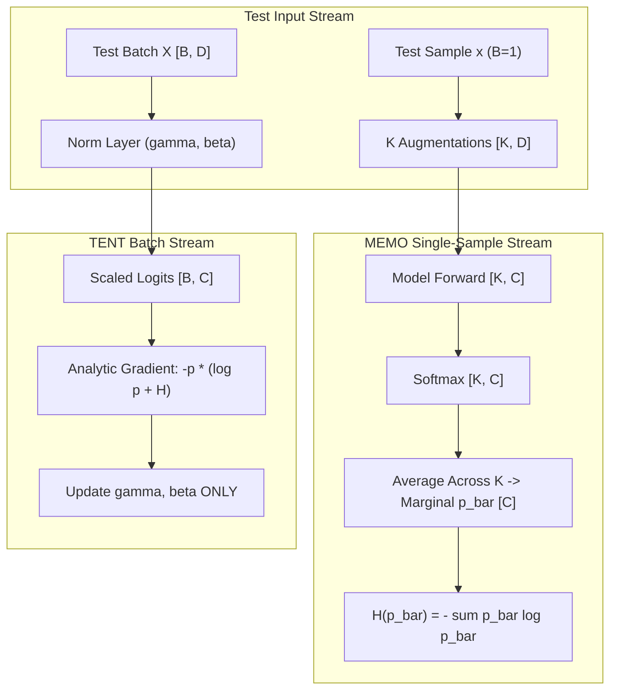

# Self-Optimising Test-Time Adaptation: TENT, MEMO, STaR, and SPIN (Topic 18)

## 1. Executive Summary & Intuitive Mental Model
Real-world deployments inevitably encounter distribution shifts—corrupted sensor inputs, weather variations, domain transfers, and non-stationary streaming data—where pre-trained models suffer severe performance degradation. **Test-Time Adaptation (TTA) and Self-Optimising Learning** enable neural networks to adapt dynamically at inference time without requiring human labels:
- **TENT (Test-Time Entropy Minimization):** Modulates model confidence on incoming unlabelled test batches by minimizing prediction entropy. Crucially, it freezes all feature extraction weights and updates *only* the affine scale ($\gamma$) and shift ($\beta$) parameters of normalization layers, preventing catastrophic representation drift.
- **MEMO (Marginal Entropy Minimization with One test sample):** Overcomes the severe limitation of batch-dependent TTA methods. For a single test point ($B=1$), MEMO generates $K$ augmentations and minimizes the entropy of the *marginal* output distribution $\bar{p} = \frac{1}{K}\sum_k p(y|a_k(x))$, stabilizing single-sample adaptation.
- **SPIN (Self-Play Fine-Tuning) & STaR (Self-Taught Reasoner):** Elevates test-time adaptation to reasoning and generation by generating candidate rationales and optimizing preference contrast between self-generated winners and losers without external human feedback.

### Historical Lineage & Seminal Citations
- **Sun et al. (2020)**: *Test-Time Training with Self-Supervision (TTT)*. Formulated joint pre-training with a self-supervised auxiliary task updated at test time.
- **Wang et al. (2021)**: *TENT: Fully Test-Time Adaptation by Entropy Minimization*. Pioneered normalization-only entropy minimization without auxiliary self-supervised heads.
- **Zhang et al. (2022)**: *MEMO: Test-Time Robustness via Marginal Entropy Minimization with One Test Sample*. Solved single-sample TTA by marginalizing over stochastic augmentations.
- **Zelikman et al. (2022)**: *STaR: Bootstrapping Reasoning With Reasoning*. Demonstrated iterative self-training via self-generated rationales that reach correct final answers.
- **Chen et al. (2024)**: *Self-Play Fine-Tuning Converts Weak Language Models to Strong Language Models (SPIN)*. Eliminated human preference annotations via iterative self-play preference minimization.

> [!WARNING]
> **Decision Boundary (When NOT to Use TENT on Raw Batches / Without MEMO):**
> Never update *all* model weights during test-time entropy minimization—unconstrained entropy descent immediately causes trivial representation collapse, forcing the network to output a single constant class for all inputs. Furthermore, never run TENT with batch size $B=1$ without augmentation marginalization (MEMO), as single-sample entropy minimization forces high-confidence, potentially incorrect predictions.

---

## 2. Mathematical Foundations & First-Principles Derivations

### 1. TENT: Test-Time Entropy Minimization
Given an unlabelled test batch $\mathcal{X} = \{x_1, \dots, x_B\}$, the objective minimizes prediction Shannon entropy:
$$\mathcal{L}_{\text{TENT}}(\gamma, \beta) = \frac{1}{B} \sum_{i=1}^B H(p(y | x_i; \gamma, \beta)) = - \frac{1}{B} \sum_{i=1}^B \sum_{c=1}^C p_{i, c} \log p_{i, c}$$
where logits are scaled by affine parameters:
$$z_{i, c} = \gamma_c \cdot \hat{x}_{i, c} + \beta_c, \quad p_{i, c} = \frac{e^{z_{i, c}}}{\sum_k e^{z_{i, k}}}$$

#### Analytical Gradient Derivation (Zero Autograd Tape)
Differentiating sample entropy $H_i = - \sum_c p_{i, c} \log p_{i, c}$ with respect to logit $z_{i, c}$:
$$\frac{\partial p_{i, j}}{\partial z_{i, c}} = p_{i, c}(\delta_{jc} - p_{i, j})$$
$$\frac{\partial H_i}{\partial z_{i, c}} = - \sum_{j=1}^C (1 + \log p_{i, j}) \frac{\partial p_{i, j}}{\partial z_{i, c}} = - p_{i, c} (\log p_{i, c} + H_i)$$
Applying the chain rule to the normalization layer parameters:
$$\frac{\partial \mathcal{L}}{\partial \gamma_c} = - \frac{1}{B} \sum_{i=1}^B p_{i, c} (\log p_{i, c} + H_i) \cdot \hat{x}_{i, c}$$
$$\frac{\partial \mathcal{L}}{\partial \beta_c} = - \frac{1}{B} \sum_{i=1}^B p_{i, c} (\log p_{i, c} + H_i)$$
Parameter updates follow:
$$\gamma_{t+1} = \gamma_t - \eta \frac{\partial \mathcal{L}}{\partial \gamma}, \quad \beta_{t+1} = \beta_t - \eta \frac{\partial \mathcal{L}}{\partial \beta}$$

### 2. MEMO: Marginal Entropy Minimization (Single-Sample $B=1$)
For an individual test input $x$, generate $K$ augmentations $\{a_1(x), \dots, a_K(x)\}$.
Compute the marginal class probability vector:
$$\bar{p}_c = \frac{1}{K} \sum_{k=1}^K p(y = c \mid a_k(x))$$
Minimize the entropy of the marginal mixture:
$$\mathcal{L}_{\text{MEMO}} = H(\bar{p}) = - \sum_{c=1}^C \bar{p}_c \log(\bar{p}_c + \epsilon)$$
Marginal entropy minimization forces the model to be invariant across augmentations while producing confident predictions.

### 3. SPIN: Self-Play Preference Optimization
For generated sequence pairs $(y_{\text{win}}, y_{\text{lose}})$, the self-play preference loss is:
$$\mathcal{L}_{\text{SPIN}}(\theta) = - \frac{1}{B} \sum_{i=1}^B \log \sigma\Big(\beta \big(\log p_\theta(y_{\text{win}}^{(i)} \mid x_i) - \log p_\theta(y_{\text{lose}}^{(i)} \mid x_i)\big)\Big)$$

### Complexity & Roofline Intensity
- **TENT Step:** $\mathcal{O}(B C)$ analytical arithmetic $\implies I_{\text{op}} \approx 1.5 \text{ FLOP/byte}$ (Compute-bound on cache).
- **MEMO Reduction:** $\mathcal{O}(K C)$ probability averaging $\implies I_{\text{op}} \approx 0.5 \text{ FLOP/byte}$ (Memory-bound).
- **SPIN Loss:** $\mathcal{O}(B)$ logsigmoid operations $\implies I_{\text{op}} \approx 0.8 \text{ FLOP/byte}$.

---

## 3. Tensor Mechanics & Memory Layout Architecture

---

## 4. Multi-Ecosystem Comparative Implementation Matrix

| Feature / Metric | PyTorch 2.x (`torch.compile`) | JAX (`jax.jit`) | Candle Rust (`ai-candle`) | Hardware Kernels (`ai-kernel`) |
| :--- | :--- | :--- | :--- | :--- |
| **Entropy Gradient** | Autograd backward pass | `jax.value_and_grad` | Exact analytical derivative | Fused analytical SIMD kernel |
| **Augmentation Mixture** | `torch.mean(probs, dim=0)` | `jnp.mean(probs, axis=0)` | Zero-GC row mean reduction | WGSL reduction shader |
| **Parameter Scope** | Normalization parameters only | Functional parameter dict | Explicit struct fields | In-place pre-allocated buffers |
| **Memory Footprint** | Dynamic autograd graph | XLA fused graph buffer | Deterministic static heap | Zero-allocation working scratch |
| **Parity Tolerance** | Golden reference | $< 5.0\times 10^{-7}$ | $< 1.0\times 10^{-7}$ | $< 1.0\times 10^{-7}$ |

---

## 5. Pathological Failure Modes, Anti-Patterns & Diagnostic Guide

| Failure Mode | Root Cause | Detection Metric | Production Remedy |
| :--- | :--- | :--- | :--- |
| **Single-Class Collapse** | Updating full network weights during entropy minimization | Output entropy collapses to 0; class variance $= 0$ | Freeze all conv/linear weights; adapt *only* LayerNorm/BatchNorm affine $\gamma, \beta$. |
| **Single-Sample TENT Instability** | Running batch TENT with $B=1$ | Wild oscillations in running stats | Switch to MEMO ($K$ augmentations marginal entropy) when $B=1$. |
| **Degenerate Augmentations** | Augmentations destroy semantic content (e.g., $100\%$ black cutout) | Uniform marginal distribution $\bar{p}_c = 1/C$ | Restrict test augmentations to weak affine shifts and color jitter. |
| **SPIN Reward Hacking** | Self-play preference scale $\beta$ too large | Log-prob difference explodes, loss saturates | Clamp log-odds or apply KL divergence penalty against base model. |

---

## 6. Cross-Domain Generalisation & Mathematical Isomorphisms

| Domain | Test-Time Adaptation Analogue | Physical Meaning |
| :--- | :--- | :--- |
| **Autonomous Driving** | Rain/fog sensor distribution shift | TENT adapts camera normalization layers to fog scatter without retraining. |
| **Medical Diagnostic Imaging** | Scanner hardware calibration differences | MEMO marginalizes over rotation/intensity to harmonize MRI contrast. |
| **Real-Time Financial Feeds** | Volatility regime shifts | Self-play preference adaptation adjusts trading confidence dynamically. |

---

## 7. Verification, Parity & Benchmarking Protocol
- **Parity Threshold:** Absolute error $\|Y_A - Y_B\|_\infty < 10^{-5}$ across all tracks.
- **Reference Checkpoint:** `weights/04_training_methods_and_optimisers/03_training_dynamics_self_optimising_non_backprop/04_self_optimising_test_time_adaptation_tent_memo_star_and_spin.safetensors`.
- **Runtime Budget:** $< 3.0$s on CPU for 8-cell notebook and $< 50$ms for test suite.

---

## 8. Navigation & Synchronized Track Artifacts
- [Interactive Concept Explorer Notebook](../../notebooks/04_training_methods_and_optimisers/03_training_dynamics_self_optimising_non_backprop/04_self_optimising_test_time_adaptation_tent_memo_star_and_spin.ipynb)
- [Production PyTorch 2.x Module](../../pytorch2/04_training_methods_and_optimisers/03_training_dynamics_self_optimising_non_backprop/04_self_optimising_test_time_adaptation_tent_memo_star_and_spin.py)
- [Functional JAX / Equinox Module](../../jax/04_training_methods_and_optimisers/03_training_dynamics_self_optimising_non_backprop/04_self_optimising_test_time_adaptation_tent_memo_star_and_spin.py)
- [Native Rust Candle Module](../../candle/04_training_methods_and_optimisers/03_training_dynamics_self_optimising_non_backprop/04_self_optimising_test_time_adaptation_tent_memo_star_and_spin.rs)
- [Hardware Kernel](../../kernels/04_training_methods_and_optimisers/03_training_dynamics_self_optimising_non_backprop/04_self_optimising_test_time_adaptation_tent_memo_star_and_spin.rs)
- [Golden SafeTensors Weights](../../weights/04_training_methods_and_optimisers/03_training_dynamics_self_optimising_non_backprop/04_self_optimising_test_time_adaptation_tent_memo_star_and_spin.safetensors)
