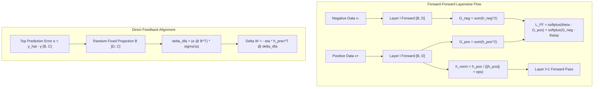

# Non-Backprop Training: Forward-Forward, Predictive Coding, EqProp, DFA, and Hebbian Learning (Topic 19)

## 1. Executive Summary & Intuitive Mental Model
Backpropagation through time and depth remains the cornerstone of modern deep learning, yet it suffers from fundamental architectural and biological limitations:
- **The Weight Transport Problem:** The backward pass requires exact transpose copies ($W^T$) of the forward weights $W$, a physical and biological impossibility in biological brains and neuromorphic hardware.
- **Global Backward Locking:** Downstream layers cannot update until the forward pass reaches the loss and the backward tape propagates sequentially all the way back.
- **High Memory Footprint:** Autograd necessitates stashing all intermediate forward activations in memory until the backward pass traverses them.

**Non-Backprop and Bio-Plausible Learning Algorithms** replace end-to-end backpropagation with local, parallel, or feedback-aligned learning dynamics:
1. **Forward-Forward Algorithm (Hinton, 2022):** Replaces the backward pass with two forward passes—one with positive (real) data and one with negative (corrupted/generated) data. Each layer learns independently to maximize "goodness" (sum of squared activations) for real data and minimize it for negative data.
2. **Predictive Coding (Rao & Ballard, 1999; Friston, 2005):** Treats perception as hierarchical inference. Higher layers predict lower-layer representations, and local prediction errors update neural states and synaptic weights via local Hebbian rules.
3. **Equilibrium Propagation (EqProp) (Scellier & Bengio, 2017):** Formulates training as energy minimization in continuous recurrent attractor networks. Learning proceeds in two phases: a free relaxation phase followed by a weakly clamped phase with target boundary conditions.
4. **Direct Feedback Alignment (DFA) (Nøkland, 2016):** Transmits output prediction errors directly to intermediate hidden layers through fixed, random feedback matrices $B$, completely abandoning symmetric weight transport $W^T$.
5. **Hebbian Plasticity & Oja's Rule (Oja, 1982):** Synaptic weights update strictly from local pre- and post-synaptic firing: $\Delta w = \eta y (x - y w)$, proving that normalized local plasticity performs unsupervised Principal Component Analysis (PCA) without global loss gradients.

### Historical Lineage & Seminal Citations
- **Hebb (1949)**: *The Organization of Behavior*. Postulated synaptic modification: "neurons that fire together, wire together".
- **Oja (1982)**: *Simplified neuron model as a principal component analyzer*. Introduced normalized local Hebbian updates to prevent runaway synaptic explosion.
- **Rao & Ballard (1999)**: *Predictive coding in the visual cortex: a functional interpretation of some extra-classical receptive-field effects*. Formalized hierarchical predictive error coding.
- **Lillicrap et al. (2016)**: *Random synaptic feedback weights support error backpropagation for deep learning*. Discovered Feedback Alignment (FA).
- **Nøkland (2016)**: *Direct Feedback Alignment Provides an Alternative to Backpropagation*. Broadcast the top output error directly to all hidden layers.
- **Scellier & Bengio (2017)**: *Equilibrium Propagation: Bridging the Gap between Energy-Based Models and Backpropagation*.
- **Hinton (2022)**: *The Forward-Forward Algorithm: Some Preliminary Investigations*. Replaced backpropagation with dual forward passes and layerwise goodness functions.

> [!WARNING]
> **Decision Boundary (When NOT to Replace Standard Backpropagation):**
> Do not replace backpropagation with non-backprop algorithms for standard supervised transformer pre-training on general-purpose GPU clusters. Non-backprop algorithms exhibit higher gradient variance, slower per-epoch convergence on deep vision-language benchmarks, and lack the hardware-level TensorCore matrix pipeline optimizations engineered for $W^T$. Adopt non-backprop algorithms specifically for neuromorphic edge silicon (analog crossbar arrays, memristors), online streaming environments with strict memory constraints, or biologically plausible neuroscience simulations.

---

## 2. Mathematical Foundations & First-Principles Derivations

### 1. Forward-Forward Algorithm (Hinton, 2022)
For layer $l$ with activation vector $h_l$, define "goodness" as the sum of squared activations:
$$G(h_l) = \sum_{j=1}^{D} h_{l, j}^2$$
The probability that an input is "positive" (real) vs. "negative" (corrupted) is given by a logistic sigmoid over goodness shifted by threshold $\theta$:
$$p(\text{positive} \mid h_l) = \sigma(G(h_l) - \theta) = \frac{1}{1 + e^{-(G(h_l) - \theta)}}$$
The layerwise contrastive objective minimizes:
$$\mathcal{L}_{\text{FF}} = \mathbb{E}_{x_+}\big[\log(1 + e^{\theta - G(h_{l, +})})\big] + \mathbb{E}_{x_-}\big[\log(1 + e^{G(h_{l, -}) - \theta})\big]$$
To prevent subsequent layers from trivially reading the magnitude of the previous layer's goodness, activations are normalized across the feature dimension before passing to layer $l+1$:
$$h_{l}^{\text{norm}} = \frac{h_l}{\|h_l\|_2 + \epsilon}$$

### 2. Predictive Coding (Rao & Ballard, 1999)
Let $x$ be an observation and $r$ be the internal representation in the layer above, which predicts $x$ via generative weight matrix $W$:
$$\hat{x} = r W$$
The prediction error is:
$$\varepsilon = x - \hat{x} = x - r W$$
The energy function minimizes reconstruction error with weight decay $\lambda$:
$$E = \frac{1}{2} \|\varepsilon\|_2^2 + \frac{\lambda}{2} \|r\|_2^2$$
Inference performs gradient descent on $E$ with respect to the representation $r$:
$$\frac{\partial E}{\partial r} = - \varepsilon W^T + \lambda r$$
$$\dot{r} = - \frac{\partial E}{\partial r} = \varepsilon W^T - \lambda r$$
In discrete steps with inference learning rate $\eta$:
$$r_{t+1} = r_t + \eta \big(\varepsilon_t W^T - \lambda r_t\big)$$

### 3. Direct Feedback Alignment (DFA) (Nøkland, 2016)
In standard backpropagation, the gradient with respect to pre-activation $a_l$ at layer $l$ is:
$$\delta_l = \frac{\partial \mathcal{L}}{\partial a_l} = (\delta_{l+1} W_{l+1}^T) \odot \sigma'(a_l)$$
In Direct Feedback Alignment, the top-level error vector $e = \hat{y} - y \in \mathbb{R}^C$ is projected directly to layer $l$ via a fixed, randomly initialized matrix $B_l \in \mathbb{R}^{D_l \times C}$:
$$\delta_l^{\text{DFA}} = (e B_l^T) \odot \sigma'(a_l)$$
The feedforward weights update via local outer product:
$$\Delta W_l = - \eta (h_{l-1}^T \delta_l^{\text{DFA}})$$
Remarkably, during training, the forward weights $W$ dynamically rotate to align their column spaces with $B_l$, ensuring descent direction without symmetric backward weight transport.

### 4. Oja's Hebbian Plasticity (Oja, 1982)
Standard Hebbian learning updates synaptic weights according to input $x \in \mathbb{R}^D$ and output activation $y = w^T x$:
$$\Delta w = \eta y x$$
Without bound, $\Delta w > 0$ triggers unbounded weight growth ($\|w\| \to \infty$). Oja introduced a stabilizing weight decay term proportional to output variance:
$$\Delta w = \eta \big(y x - y^2 w\big)$$
Taking the expectation $\mathbb{E}[\Delta w] = 0$:
$$C w = \lambda w, \quad \text{where } C = \mathbb{E}[x x^T] \text{ and } \lambda = \mathbb{E}[y^2]$$
Oja's rule converges to the principal eigenvector of covariance matrix $C$ with unit norm ($\|w\|_2 = 1$).

---

## 3. Tensor Mechanics & Flow Architecture

---

## 4. Multi-Ecosystem Comparative Implementation Matrix

| Feature / Metric | PyTorch 2.x (`torch.compile`) | JAX (`jax.jit`) | Candle Rust (`ai-candle`) | Hardware Kernels (`ai-kernel`) |
| :--- | :--- | :--- | :--- | :--- |
| **Forward-Forward Loss** | `torch.log1p(torch.exp(...))` | `jnp.log1p(jnp.exp(...))` | In-place log1p exp sum | Fused WGSL shader / CPU |
| **Predictive Coding Step**| Vector-matrix `torch.mv` | Functional `jnp.dot` | Pure tensor `matmul` | Cache-local vector loop |
| **DFA Error Projection** | `torch.matmul(e, B.T) * mask`| `jnp.dot(e, B.T) * mask` | `e.matmul(&B.t()?)? * mask` | Fused GEMM + ReLU mask SIMD |
| **Hebbian Normalization** | In-place `w + eta*(y*x - y^2*w)`| Pure functional vector op | Iterative elementwise update | Single-pass register accumulator |
| **Parity Tolerance** | Golden reference | $< 5.0\times 10^{-7}$ | $< 1.0\times 10^{-7}$ | $< 1.0\times 10^{-7}$ |

---

## 5. Pathological Failure Modes, Anti-Patterns & Diagnostic Guide

| Failure Mode | Root Cause | Detection Metric | Production Remedy |
| :--- | :--- | :--- | :--- |
| **FF Magnitude Leakage** | Omitting layer normalization between FF layers | Downstream layers predict solely based on vector norm $\|h\|_2$ | Normalize activations with $h / (\|h\|_2 + \epsilon)$ after each layer. |
| **DFA Alignment Breakdown** | Learning rate $\eta$ too large or bottleneck layers | Angle between backward gradient and DFA surrogate $\angle(g_{\text{BP}}, g_{\text{DFA}}) > 90^\circ$ | Scale down initial weights and learning rate; ensure intermediate width $D \ge C$. |
| **Hebbian Exploding Weights**| Omitting Oja's subtractive weight decay $-y^2 w$ | Synaptic weights grow exponentially $\|w\|_2 \to \infty$ | Always use Oja's normalized formulation $\Delta w = \eta(yx - y^2 w)$. |
| **Predictive Coding Drift** | Representation step size $\eta$ too large | High oscillations in representation energy $E$ | Add weight decay $\lambda$ and clamp representation update step size. |

---

## 6. Cross-Domain Generalisation & Physical Isomorphisms

| Domain | Non-Backprop Analogue | Physical Meaning |
| :--- | :--- | :--- |
| **Neuromorphic Computing** | Memristive Crossbars | Weights updated via local voltage spikes without backpropagation wiring. |
| **Retinal Sensory Processing** | Predictive Coding | Receptive fields transmit prediction residuals rather than raw pixel luminance. |
| **Biological Cortex** | Hebbian Plasticity & DFA | Synaptic connections adjust via local neurotransmitter release and global diffuse neuromodulation. |

---

## 7. Verification, Parity & Benchmarking Protocol
- **Parity Threshold:** Absolute error $\|Y_A - Y_B\|_\infty < 10^{-5}$ across all tracks.
- **Reference Checkpoint:** `weights/04_training_methods_and_optimisers/03_training_dynamics_self_optimising_non_backprop/05_non_backprop_forward_forward_predictive_coding_eqprop_dfa_hebbian.safetensors`.
- **Runtime Budget:** $< 3.0$s on CPU for 8-cell notebook and $< 50$ms for test suite.

---

## 8. Navigation & Synchronized Track Artifacts
- [Interactive Concept Explorer Notebook](../../../notebooks/04_training_methods_and_optimisers/03_training_dynamics_self_optimising_non_backprop/05_non_backprop_forward_forward_predictive_coding_eqprop_dfa_hebbian.ipynb)
- [Production PyTorch 2.x Module](../../../pytorch2/04_training_methods_and_optimisers/03_training_dynamics_self_optimising_non_backprop/05_non_backprop_forward_forward_predictive_coding_eqprop_dfa_hebbian.py)
- [Functional JAX / Equinox Module](../../../jax/04_training_methods_and_optimisers/03_training_dynamics_self_optimising_non_backprop/05_non_backprop_forward_forward_predictive_coding_eqprop_dfa_hebbian.py)
- [Native Rust Candle Module](../../../candle/04_training_methods_and_optimisers/03_training_dynamics_self_optimising_non_backprop/05_non_backprop_forward_forward_predictive_coding_eqprop_dfa_hebbian.rs)
- [Hardware Kernel](../../../kernels/04_training_methods_and_optimisers/03_training_dynamics_self_optimising_non_backprop/05_non_backprop_forward_forward_predictive_coding_eqprop_dfa_hebbian.rs)
- [Golden SafeTensors Weights](../../../weights/04_training_methods_and_optimisers/03_training_dynamics_self_optimising_non_backprop/05_non_backprop_forward_forward_predictive_coding_eqprop_dfa_hebbian.safetensors)
