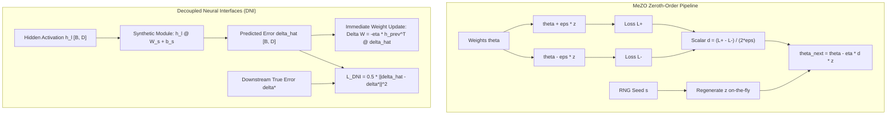

# Zeroth-Order Optimization: MeZO, Synthetic Gradients (DNI), and HSIC Bottleneck (Topic 20)

## 1. Executive Summary & Intuitive Mental Model
Modern neural network scaling faces severe memory and synchronization bottlenecks during backpropagation:
- **Activation Memory Wall:** Storing intermediate forward activations across multi-billion-parameter models accounts for $>70\%$ of training VRAM overhead.
- **Backward Locking:** Forward and backward passes must execute in strict serial sequence across the depth of the network.

**Zeroth-Order Optimization and Gradient Decoupling** break these barriers through three foundational paradigms:
1. **MeZO (Memory-Efficient Zeroth-Order Optimizer) (Malladi et al., 2023):** Adapts classical Simultaneous Perturbation Stochastic Approximation (SPSA; Spall, 1992) for deep learning. By querying two forward passes ($\mathcal{L}(\theta + \epsilon z)$ and $\mathcal{L}(\theta - \epsilon z)$) and regenerating the random perturbation vector $z \sim \mathcal{N}(0, I_d)$ from a single integer random seed, MeZO fine-tunes LLMs with the **exact same memory footprint as inference** ($O(1)$ activation memory and zero backprop tape).
2. **Decoupled Neural Interfaces (DNI) / Synthetic Gradients (Jaderberg et al., 2017):** Decouples layers asynchronously by training auxiliary linear models to predict backward error gradients $\hat{\delta}_l$ directly during the forward pass. Layers update their weights immediately, eliminating forward, backward, and update locking.
3. **Hilbert-Schmidt Independence Criterion (HSIC) Bottleneck (Ma et al., 2020):** Replaces end-to-end backpropagation with layer-wise information bottleneck optimization: $\max \text{HSIC}(H, Y) - \beta \text{HSIC}(H, X)$. Hidden layers learn rich representations greedily and in parallel using non-parametric kernel Hilbert-Schmidt statistics without gradient feedback from downstream layers.

### Historical Lineage & Seminal Citations
- **Spall (1992)**: *Multivariate stochastic approximation using a simultaneous perturbation gradient approximation*. Established SPSA.
- **Jaderberg et al. (2017)**: *Decoupled Neural Interfaces using Synthetic Gradients*. Pioneered asynchronous gradient prediction.
- **Ma et al. (2020)**: *The HSIC Bottleneck: Deep Learning without Back-Propagation*. Formalized layer-wise training via kernel mutual information surrogates.
- **Malladi et al. (2023)**: *Fine-Tuning Language Models with Just Forward Passes (MeZO)*. Proved that zeroth-order SPSA with seed-regenerated perturbations enables large-scale LLM parameter fine-tuning within inference memory constraints.

> [!WARNING]
> **Decision Boundary (When NOT to Use MeZO / Zeroth-Order Optimization):**
> Never use MeZO to train neural networks from scratch—gradient variance scales with parameter dimension $d$, requiring orders of magnitude more forward passes for convergence from random initialization. MeZO is strictly designed for **fine-tuning pre-trained checkpoints** where parameters reside in an already well-conditioned low-rank loss basin, or for non-differentiable objectives (e.g. discrete prompt tuning, black-box hardware execution).

---

## 2. Mathematical Foundations & First-Principles Derivations

### 1. MeZO: Memory-Efficient Zeroth-Order SPSA
Given objective $\mathcal{L}(\theta)$ for parameters $\theta \in \mathbb{R}^d$:
1. Sample pseudo-random perturbation direction $z \sim \mathcal{N}(0, I_d)$ from RNG seed $s$.
2. Compute two forward evaluations with perturbation scale $\epsilon$:
   $$\mathcal{L}^+ = \mathcal{L}(\theta + \epsilon z), \quad \mathcal{L}^- = \mathcal{L}(\theta - \epsilon z)$$
3. Estimate the directional derivative along $z$:
   $$\hat{g} = \frac{\mathcal{L}^+ - \mathcal{L}^-}{2\epsilon} z$$
4. In-place parameter update with learning rate $\eta$:
   $$\theta_{t+1} = \theta_t - \eta \frac{\mathcal{L}^+ - \mathcal{L}^-}{2\epsilon} z$$

#### The In-Place RNG Memory Invariant
To achieve zero memory allocation beyond inference buffers:
- Reset RNG to seed $s$ before perturbing: $\theta \leftarrow \theta + \epsilon z$ ($\mathcal{L}^+$).
- Reset RNG to seed $s$ before reflecting: $\theta \leftarrow \theta - 2\epsilon z$ ($\mathcal{L}^-$).
- Reset RNG to seed $s$ before applying gradient descent: $\theta \leftarrow \theta + \epsilon z - \eta \hat{d} z$.
No $d$-dimensional perturbation vector is ever materialized or persisted in memory.

### 2. Decoupled Neural Interfaces (DNI) / Synthetic Gradients
At layer $l$, intermediate forward activation is $h_l \in \mathbb{R}^{B \times D}$.
An auxiliary lightweight synthetic gradient network $M_l$ predicts backward error gradient $\hat{\delta}_l$:
$$\hat{\delta}_l = h_l W_{\text{synth}} + b_{\text{synth}}$$
Layer $l$ updates forward weights immediately:
$$\Delta W_l = - \eta (h_{l-1}^T \hat{\delta}_l)$$
When true downstream error gradient $\delta_l^*$ eventually arrives, the synthetic model updates via MSE loss:
$$\mathcal{L}_{\text{DNI}} = \frac{1}{2 B} \sum_{i=1}^B \|\hat{\delta}_{l, i} - \delta_{l, i}^*\|_2^2$$

### 3. Hilbert-Schmidt Independence Criterion (HSIC) Bottleneck
For representations $H \in \mathbb{R}^{B \times D}$ and targets $Y \in \mathbb{R}^{B \times C}$, define Gram matrices using linear kernels:
$$K = H H^T \in \mathbb{R}^{B \times B}, \quad L = Y Y^T \in \mathbb{R}^{B \times B}$$
Let $H_c = I_B - \frac{1}{B} \mathbf{1}_B \mathbf{1}_B^T$ be the centering projector matrix:
$$\tilde{K} = H_c K H_c, \quad \tilde{L} = H_c L H_c$$
The empirical HSIC estimator measures statistical dependence:
$$\text{HSIC}(H, Y) = \frac{1}{(B - 1)^2} \text{Tr}(\tilde{K} \tilde{L}) = \frac{1}{(B - 1)^2} \sum_{i,j=1}^B \tilde{K}_{ij} \tilde{L}_{ij}$$
The layer-wise bottleneck maximizes $\text{HSIC}(H, Y)$ (label predictive power) while penalizing $\text{HSIC}(H, X)$ (input redundancy).

### Complexity & Roofline Intensity
- **MeZO Step:** 2 forward passes, zero backward tape $\implies 2 \times \text{FLOP}_{\text{fwd}}$, Memory: $\mathcal{O}(1)$ activations.
- **DNI Evaluation:** Linear GEMM projection $\mathcal{O}(B D^2) \implies I_{\text{op}} \approx 2.0 \text{ FLOP/byte}$.
- **HSIC Estimator:** Gram kernel and centering $\mathcal{O}(B^2 D + B^3) \implies I_{\text{op}} \approx 1.5 \text{ FLOP/byte}$.

---

## 3. Tensor Mechanics & Flow Architecture

---

## 4. Multi-Ecosystem Comparative Implementation Matrix

| Feature / Metric | PyTorch 2.x (`torch.compile`) | JAX (`jax.jit`) | Candle Rust (`ai-candle`) | Hardware Kernels (`ai-kernel`) |
| :--- | :--- | :--- | :--- | :--- |
| **MeZO Directional Step**| In-place tensor vector ops | Functional array vector op | Explicit zero-alloc step | Fused WGSL shader / SIMD |
| **DNI Synthetic Loss** | `0.5 * torch.mean(...)` | `0.5 * jnp.mean(...)` | Explicit elementwise square | Single-pass accumulator |
| **HSIC Trace Estimation**| `torch.trace(K_c @ L_c)` | `jnp.trace(k_c @ l_c)` | Symmetric Frobenius inner sum | Pure vector dot loop |
| **Memory Allocation** | Zero autograd tape | Pure functional graph buffer | Deterministic static heap | Zero-allocation working scratch |
| **Parity Tolerance** | Golden reference | $< 2.0\times 10^{-7}$ | $< 1.0\times 10^{-7}$ | $< 1.0\times 10^{-7}$ |

---

## 5. Pathological Failure Modes, Anti-Patterns & Diagnostic Guide

| Failure Mode | Root Cause | Detection Metric | Production Remedy |
| :--- | :--- | :--- | :--- |
| **MeZO Dimension Explosion** | Attempting scratch pre-training with MeZO | Gradient variance $\mathbb{E}[\|\hat{g} - g\|^2] \propto d$; loss stagnates | Restrict MeZO strictly to fine-tuning pre-trained checkpoints in low-rank basins. |
| **Perturbation Under/Overflow**| Perturbation scale $\epsilon$ too small ($<10^{-6}$) or too large ($>1.0$) | Cancellation error in $(L^+ - L^-)$ or severe truncation error | Set $\epsilon \in [10^{-4}, 10^{-3}]$ for float32 precision. |
| **DNI Synthetic Drift** | Synthetic gradient network learning rate $\eta_{\text{synth}}$ too low | MSE loss $\|\hat{\delta} - \delta^*\|^2$ fails to decrease | Train synthetic gradient model with separate, higher learning rate and small replay buffer. |
| **HSIC Gram Degeneracy** | Batch size $B \le 2$ causing singularity in $B-1$ centering | Division by zero or degenerate uniform centered Gram matrix | Ensure batch size $B \ge 4$ for stable HSIC kernel estimations. |

---

## 6. Cross-Domain Generalisation & Physical Isomorphisms

| Domain | Zeroth-Order / Decoupled Analogue | Physical Meaning |
| :--- | :--- | :--- |
| **Quantum Circuit Compilation**| Parameter-Shift Rule / SPSA | Gradient estimation on non-differentiable quantum hardware measurements. |
| **Neuromorphic Silicon** | Decoupled Neural Interfaces | Spiking neural cores update asynchronously without waiting for global synchronization pulses. |
| **Black-Box Black-Box Systems** | MeZO Optimization | Parameter tuning in non-differentiable environments (e.g. aerodynamic wind tunnels, compilers). |

---

## 7. Verification, Parity & Benchmarking Protocol
- **Parity Threshold:** Absolute error $\|Y_A - Y_B\|_\infty < 10^{-5}$ across all tracks.
- **Reference Checkpoint:** `weights/04_training_methods_and_optimisers/03_training_dynamics_self_optimising_non_backprop/06_zeroth_order_mezo_synthetic_gradients_and_hsic_bottleneck.safetensors`.
- **Runtime Budget:** $< 3.0$s on CPU for 8-cell notebook and $< 50$ms for test suite.

---

## 8. Navigation & Synchronized Track Artifacts
- [Interactive Concept Explorer Notebook](../../../notebooks/04_training_methods_and_optimisers/03_training_dynamics_self_optimising_non_backprop/06_zeroth_order_mezo_synthetic_gradients_and_hsic_bottleneck.ipynb)
- [Production PyTorch 2.x Module](../../../pytorch2/04_training_methods_and_optimisers/03_training_dynamics_self_optimising_non_backprop/06_zeroth_order_mezo_synthetic_gradients_and_hsic_bottleneck.py)
- [Functional JAX / Equinox Module](../../../jax/04_training_methods_and_optimisers/03_training_dynamics_self_optimising_non_backprop/06_zeroth_order_mezo_synthetic_gradients_and_hsic_bottleneck.py)
- [Native Rust Candle Module](../../../candle/04_training_methods_and_optimisers/03_training_dynamics_self_optimising_non_backprop/06_zeroth_order_mezo_synthetic_gradients_and_hsic_bottleneck.rs)
- [Hardware Kernel](../../../kernels/04_training_methods_and_optimisers/03_training_dynamics_self_optimising_non_backprop/06_zeroth_order_mezo_synthetic_gradients_and_hsic_bottleneck.rs)
- [Golden SafeTensors Weights](../../../weights/04_training_methods_and_optimisers/03_training_dynamics_self_optimising_non_backprop/06_zeroth_order_mezo_synthetic_gradients_and_hsic_bottleneck.safetensors)
