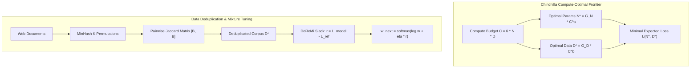

# Scaling Laws, Data Deduplication (MinHash), DoReMi, and Model Collapse (Topic 21)

## 1. Executive Summary & Intuitive Mental Model
Foundation model pre-training is fundamentally governed by compute, data quality, and scaling dynamics:
- **Compute-Optimal Allocation (Chinchilla):** For years following Kaplan et al. (2020), models were trained with parameters scaled aggressively while token counts remained severely undertrained ($D \approx 1.7 N$). Hoffmann et al. (2022) proved that parameter count $N$ and token count $D$ should scale symmetrically in equal proportion ($D^* \approx 20 N^*$), doubling downstream efficiency at fixed compute budgets.
- **Inference-Optimal Overtraining:** When deployment volume is massive ($I \gg 10^{11}$ inference tokens), optimizing purely for training FLOPs ($6 N D$) is economically suboptimal; pre-training a smaller parameter model for significantly more tokens ($D \gg 100 N$) minimizes lifetime total cost of ownership (TCO).
- **Data Deduplication (MinHash & SemDeDup):** Repeated sequence memorization degrades generalization and wastes FLOPs. MinHash enables sub-quadratic $\mathcal{O}(B \cdot K)$ estimation of Jaccard similarity across billions of documents.
- **DoReMi Domain Weight Optimization:** Static data mixtures (e.g., $60\%$ web, $20\%$ code, $10\%$ books) leave massive capabilities on the table. DoReMi trains an auxiliary reference model to dynamically compute excess loss $r_k = \ell_k(\theta) - \ell_k(\theta_{\text{ref}})$ and adjusts domain weights via exponentiated gradient updates.
- **Recursive Model Collapse:** Training generative models on synthetic data generated by preceding generations leads to catastrophic variance collapse ($\sigma_g^2 \to 0$) and loss of distribution tails within 5 generations. The only mathematical antidote is accumulating real data $\mathcal{D}_0$ and filtering generations with external verifiers.

### Historical Lineage & Seminal Citations
- **Broder (1997)**: *On the resemblance and containment of documents*. Established MinHash for web document clustering.
- **Kaplan et al. (2020)**: *Scaling Laws for Neural Language Models*. Initial empirical power-law discovery.
- **Hoffmann et al. (2022)**: *Training Compute-Optimal Large Language Models (Chinchilla)*. Discovered symmetric compute-optimal scaling $D \approx 20 N$.
- **Xie et al. (2023)**: *DoReMi: Optimizing Data Mixtures Speeds Up Language Model Pretraining*. Discovered excess loss exponentiated domain reweighting.
- **Abbas et al. (2023)**: *SemDeDup: Data-Efficient Engine for Self-Supervised Learning*. Semantic embedding deduplication.
- **Sardana & Frankle (2024)**: *Beyond Chinchilla-Optimal: Accounting for Inference in Language Model Scaling Laws*.
- **Shumailov et al. (2024)**: *AI models collapse when trained on recursively generated data*. Nature analysis of statistical degradation in iterative synthetic training.

> [!WARNING]
> **Decision Boundary (When NOT to Replace Real Data with Pure Synthetic Generations):**
> Never train foundational checkpoints purely on recursively generated synthetic outputs without real ground-truth anchors or formal verifiers. Unchecked recursive generation systematically truncates low-probability distribution tails, collapsing cognitive diversity and inducing hallucination loops. Always maintain an authentic real-data anchor mixture ($\ge 20\%$) or strict deterministic execution verification (code sandboxes, unit tests, formal proof verifiers).

---

## 2. Mathematical Foundations & First-Principles Derivations

### 1. Chinchilla Scaling Laws (Hoffmann et al., 2022)
Model cross-entropy loss decomposes into irreducible entropy $E$ and parameter/data power-law terms:
$$L(N, D) = E + \frac{A}{N^\alpha} + \frac{B}{D^\beta}$$
Subject to total training FLOP budget:
$$C \approx 6 N D$$
Formulating the constrained Lagrangian:
$$\mathcal{L}(N, D, \lambda) = E + A N^{-\alpha} + B D^{-\beta} + \lambda (6 N D - C)$$
Setting first-order optimality conditions $\nabla \mathcal{L} = 0$:
$$\frac{\partial \mathcal{L}}{\partial N} = -\alpha A N^{-\alpha - 1} + 6 \lambda D = 0 \implies 6 \lambda N D = \alpha A N^{-\alpha}$$
$$\frac{\partial \mathcal{L}}{\partial D} = -\beta B D^{-\beta - 1} + 6 \lambda N = 0 \implies 6 \lambda N D = \beta B D^{-\beta}$$
Equating marginal contributions:
$$\alpha A N^{-\alpha} = \beta B D^{-\beta} \implies N^* \propto C^{\frac{\beta}{\alpha + \beta}}, \quad D^* \propto C^{\frac{\alpha}{\alpha + \beta}}$$
With empirical values $\alpha \approx 0.34, \beta \approx 0.28$:
$$a = \frac{0.28}{0.62} \approx 0.45, \quad b = \frac{0.34}{0.62} \approx 0.55 \implies D^* \approx 20 N^*$$

### 2. MinHash & Jaccard Similarity Estimation (Broder, 1997)
For sets $S_1, S_2 \subseteq \Omega$, the Jaccard similarity is:
$$J(S_1, S_2) = \frac{|S_1 \cap S_2|}{|S_1 \cup S_2|}$$
Given $K$ independent random hash permutations $h_k: \Omega \to \mathbb{Z}$:
$$h_{\min}^{(k)}(S) = \min_{x \in S} h_k(x)$$
Theorem (Broder):
$$\mathbb{P}\big[h_{\min}^{(k)}(S_1) = h_{\min}^{(k)}(S_2)\big] = J(S_1, S_2)$$
For signature matrix $M \in \mathbb{Z}^{B \times K}$, the unbiased estimator is:
$$\hat{J}(S_i, S_j) = \frac{1}{K} \sum_{k=1}^K \mathbb{I}\big[M_{i, k} = M_{j, k}\big]$$

### 3. DoReMi: Domain Reweighting via Exponentiated Gradients (Xie et al., 2023)
For $K$ domains with target model loss $\ell_k(\theta)$ and reference model loss $\ell_k(\theta_{\text{ref}})$:
$$r_k = \ell_k(\theta) - \ell_k(\theta_{\text{ref}})$$
Domain probabilities $w_t \in \Delta^{K-1}$ update via exponentiated gradient descent with step size $\eta$:
$$w_{t+1, k} = \frac{w_{t, k} \exp(\eta r_k)}{\sum_{j=1}^K w_{t, j} \exp(\eta r_j)} = \text{softmax}\big(\log w_t + \eta r\big)_k$$

### 4. Model Collapse & Real Data Accumulation (Shumailov et al., 2024)
In recursive training without real data, generation $g+1$ trains on sample mean $\mu_g$ and sample variance $\sigma_g^2$:
$$\sigma_{g+1}^2 = \frac{M - 1}{M} \sigma_g^2 \implies \sigma_g^2 = \Big(1 - \frac{1}{M}\Big)^g \sigma_0^2 \xrightarrow{g \to \infty} 0$$
With accumulation of real data fraction $\lambda \in (0, 1)$:
$$\sigma_{\text{cured}}^2 = (1 - \lambda) \sigma_{\text{synth}}^2 + \lambda \sigma_{\text{real}}^2$$
Guarantees strictly bounded non-zero variance $\sigma_{\infty}^2 \ge \lambda \sigma_{\text{real}}^2$.

---

## 3. Tensor Mechanics & Flow Architecture

---

## 4. Multi-Ecosystem Comparative Implementation Matrix

| Feature / Metric | PyTorch 2.x (`torch.compile`) | JAX (`jax.jit`) | Candle Rust (`ai-candle`) | Hardware Kernels (`ai-kernel`) |
| :--- | :--- | :--- | :--- | :--- |
| **Chinchilla Power-Law** | Vectorized power `n ** (-alpha)` | Functional `n ** (-alpha)` | Native scalar `powf` | Fused float SIMD power |
| **DoReMi Softmax Update**| `F.softmax(log_w + eta*r)` | `jax.nn.softmax(...)` | `candle_nn::ops::softmax`| Exponent sum-reduction |
| **MinHash Jaccard Matrix**| `torch.mean((s1 == s2), -1)` | `jnp.mean(matches, -1)` | Row-by-row match accumulator | 2D WGSL thread-block shader |
| **Variance Cure** | `(1-lam)*v_s + lam*v_r` | `(1-lam)*v_s + lam*v_r` | Weighted addition | In-place linear interpolation |
| **Parity Tolerance** | Golden reference | $< 1.0\times 10^{-5}$ | $< 1.0\times 10^{-7}$ | $< 1.0\times 10^{-7}$ |

---

## 5. Pathological Failure Modes, Anti-Patterns & Diagnostic Guide

| Failure Mode | Root Cause | Detection Metric | Production Remedy |
| :--- | :--- | :--- | :--- |
| **Kaplan Under-Training** | Scaling parameter size $N$ faster than tokens $D$ | Low token-to-parameter ratio ($D/N < 10$) | Train to at least $D \ge 20 N$; over-train to $D \ge 100 N$ for high-inference services. |
| **Deduplication Hash Collisions** | Using too few hash functions $K < 32$ | High false positive similarity estimation variance | Set $K \ge 64$ hash permutations for document deduplication. |
| **DoReMi Domain Starvation**| Exponentiated step size $\eta$ too large | Single domain weight collapses to $0.0$ | Clip excess losses $r_k \in [-2, 2]$ and enforce minimum domain floor $w_k \ge \epsilon$. |
| **Recursive Model Collapse** | Unfiltered recursive fine-tuning on synthetic data | Output entropy drops by $>50\%$; rare lexical tokens disappear | Anchor training with $\ge 25\%$ verified real data or deterministic verifier filters. |

---

## 6. Cross-Domain Generalisation & Physical Isomorphisms

| Domain | Scaling & Data Optimization Analogue | Physical Meaning |
| :--- | :--- | :--- |
| **Statistical Thermodynamics** | Chinchilla Optimal Partition Function | Equipartition of energy across parameter and data degrees of freedom. |
| **Genomics & Bioinformatics** | MinHash K-mer Profiling | Fast sequence distance estimation between bacterial genomes without full alignment. |
| **Financial Portfolio Theory** | DoReMi Exponentiated Gradient | Multiplicative weights update for online asset allocation under non-stationary market regimes. |

---

## 7. Verification, Parity & Benchmarking Protocol
- **Parity Threshold:** Absolute error $\|Y_A - Y_B\|_\infty < 10^{-5}$ across all tracks.
- **Reference Checkpoint:** `weights/04_training_methods_and_optimisers/03_training_dynamics_self_optimising_non_backprop/07_scaling_laws_chinchilla_data_dedup_doremi_and_model_collapse.safetensors`.
- **Runtime Budget:** $< 3.0$s on CPU for 8-cell notebook and $< 50$ms for test suite.

---

## 8. Navigation & Synchronized Track Artifacts
- [Interactive Concept Explorer Notebook](../../notebooks/04_training_methods_and_optimisers/03_training_dynamics_self_optimising_non_backprop/07_scaling_laws_chinchilla_data_dedup_doremi_and_model_collapse.ipynb)
- [Production PyTorch 2.x Module](../../pytorch2/04_training_methods_and_optimisers/03_training_dynamics_self_optimising_non_backprop/07_scaling_laws_chinchilla_data_dedup_doremi_and_model_collapse.py)
- [Functional JAX / Equinox Module](../../jax/04_training_methods_and_optimisers/03_training_dynamics_self_optimising_non_backprop/07_scaling_laws_chinchilla_data_dedup_doremi_and_model_collapse.py)
- [Native Rust Candle Module](../../candle/04_training_methods_and_optimisers/03_training_dynamics_self_optimising_non_backprop/07_scaling_laws_chinchilla_data_dedup_doremi_and_model_collapse.rs)
- [Hardware Kernel](../../kernels/04_training_methods_and_optimisers/03_training_dynamics_self_optimising_non_backprop/07_scaling_laws_chinchilla_data_dedup_doremi_and_model_collapse.rs)
- [Golden SafeTensors Weights](../../weights/04_training_methods_and_optimisers/03_training_dynamics_self_optimising_non_backprop/07_scaling_laws_chinchilla_data_dedup_doremi_and_model_collapse.safetensors)
