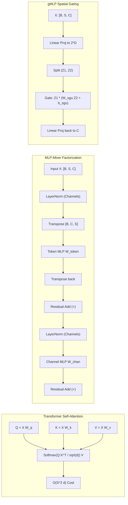

# Residual MLP, MLP-Mixer, and gMLP: All-MLP Architectures

## Executive Summary & ELI5
Transformers owe much of their success to self-attention mechanisms that dynamically compute token interactions based on content similarities. However, self-attention scales quadratically with sequence length $\mathcal{O}(S^2)$ and incurs substantial memory bandwidth overhead during key-value caching. The **All-MLP family**—headlined by **MLP-Mixer** (*Tolstikhin et al., NeurIPS 2021*), **gMLP** (*Liu et al., NeurIPS 2021*), and **ResMLP** (*Touvron et al., IEEE TPAMI 2022*)—demonstrates that self-attention is not strictly indispensable for high-capacity visual and sequence modeling. Instead, these architectures factorize cross-token and cross-channel computations into separate matrix multiplications (GEMMs) with linear computational complexity $\mathcal{O}(S \cdot C)$.



---

## Historical Citations & Seminal Literature
1. **MLP-Mixer: An all-MLP Architecture for Vision** (*Ilya Tolstikhin, Neil Houlsby, Alexander Kolesnikov, Lucas Beyer, Xiaohua Zhai, Thomas Unterthiner, Jessica Yung, Andreas Steiner, Daniel Keysers, Jakob Uszkoreit, Mario Lucic, Alexey Dosovitskiy, NeurIPS 2021*). Introduced the clean factorization of feature representations into token-mixing and channel-mixing MLPs, matching Vision Transformers on ImageNet without attention layers.
2. **Pay Attention to MLPs (gMLP)** (*Hanxiao Liu, Zihang Dai, David R. So, Quoc V. Le, NeurIPS 2021*). Formulated the Spatial Gating Unit (SGU) that learns multiplicative cross-token interaction filters, proving that simple spatial gating can match BERT on masked language modeling and ViT on vision.
3. **ResMLP: Feedforward networks for image classification with data-efficient training** (*Hugo Touvron, Piotr Bojanowski, Mathilde Caron, Matthieu Cord, Alaaeldin El-Nouby, Edouard Grave, Gautier Izacard, Armand Joulin, Gabriel Synnaeve, Jakob Verbeek, Hervé Jégou, IEEE TPAMI 2022*). Stripped LayerNorm down to affine channel scaling ($y = \gamma \odot x + \beta$) and introduced LayerScale stabilization for ultra-deep MLP training.

---

## Mathematical Foundations & Governing Equations

### 1. MLP-Mixer: Dual-Axis Factorization
Given an input table $\mathbf{X} \in \mathbb{R}^{S \times C}$ composed of $S$ non-overlapping patches embedded into $C$ channels:

$$\mathbf{Y} = \mathbf{X} + \left( \sigma\left(\text{LN}(\mathbf{X})^\top \mathbf{W}_1^{\text{token}} + \mathbf{b}_1^{\text{token}}\right) \mathbf{W}_2^{\text{token}} + \mathbf{b}_2^{\text{token}} \right)^\top$$

$$\mathbf{Z} = \mathbf{Y} + \sigma\left(\text{LN}(\mathbf{Y}) \mathbf{W}_1^{\text{chan}} + \mathbf{b}_1^{\text{chan}}\right) \mathbf{W}_2^{\text{chan}} + \mathbf{b}_2^{\text{chan}}$$

Where:
- $\mathbf{W}_1^{\text{token}} \in \mathbb{R}^{D_{\text{token}} \times S}$, $\mathbf{W}_2^{\text{token}} \in \mathbb{R}^{S \times D_{\text{token}}}$ mix representations across sequence positions $S$.
- $\mathbf{W}_1^{\text{chan}} \in \mathbb{R}^{D_{\text{chan}} \times C}$, $\mathbf{W}_2^{\text{chan}} \in \mathbb{R}^{C \times D_{\text{chan}}}$ mix representations across channel dimensions $C$.
- Complexity scales as $\mathcal{O}(S \cdot C \cdot D_{\text{token}} + S \cdot C \cdot D_{\text{chan}})$, which is strictly linear $\mathcal{O}(S)$ with respect to sequence length for fixed channel dimensions.

### 2. gMLP: Spatial Gating Unit (SGU)
The gMLP architecture simplifies the block into channel expansions and a single linear spatial gating operator:

$$\mathbf{Z} = \text{GELU}(\text{LN}(\mathbf{X})\mathbf{W}_{\text{in}} + \mathbf{b}_{\text{in}}) \quad \in \mathbb{R}^{S \times 2D}$$

Splitting $\mathbf{Z} = [\mathbf{Z}_1, \mathbf{Z}_2]$ where $\mathbf{Z}_1, \mathbf{Z}_2 \in \mathbb{R}^{S \times D}$:

$$\text{SGU}(\mathbf{Z}) = \mathbf{Z}_1 \odot \left(\mathbf{W}_{\text{sgu}} \mathbf{Z}_2 + \mathbf{b}_{\text{sgu}}\right)$$

$$\mathbf{Out} = \mathbf{X} + \text{SGU}(\mathbf{Z}) \mathbf{W}_{\text{out}} + \mathbf{b}_{\text{out}}$$

**Crucial Initialization Invariant:** To prevent vanishing gradients during early training steps, $\mathbf{W}_{\text{sgu}}$ is initialized close to zero ($\mathcal{N}(0, 0.01^2)$) and the bias vector $\mathbf{b}_{\text{sgu}}$ is initialized to **$1.0$**. This ensures that at step 0:
$$\text{SGU}(\mathbf{Z}) \approx \mathbf{Z}_1 \odot (\mathbf{0} + \mathbf{1}) = \mathbf{Z}_1$$
turning the gating layer into an identity passthrough and guaranteeing well-conditioned backpropagation.

---

## Tensor Memory Layout & Dimension Shapes
```text
Batch Size = B, Sequence Length = S, Channel Dimension = C, Expansion = D

MLP-Mixer Forward Pass:
Input X:             [B, S, C]  (contiguous row-major)
Pre-LN:              [B, S, C]  (reduced along axis -1)
Transpose:           [B, C, S]  (token mixing layout)
GEMM 1 (Token):      [B, C, S]  @ [S, D_token] -> [B, C, D_token]
GEMM 2 (Token):      [B, C, D_token] @ [D_token, S] -> [B, C, S]
Transpose Back:      [B, S, C]
Residual 1:          [B, S, C]
GEMM 1 (Channel):    [B, S, C]  @ [C, D_chan]  -> [B, S, D_chan]
GEMM 2 (Channel):    [B, S, D_chan] @ [D_chan, C]  -> [B, S, C]
Residual 2 (Out):    [B, S, C]

gMLP Forward Pass:
Input X:             [B, S, C]
Pre-LN:              [B, S, C]
Proj In:             [B, S, C]  @ [C, 2D]      -> [B, S, 2D]
Split:               Z1: [B, S, D], Z2: [B, S, D]
SGU Spatial Filter:  W_sgu [S, S] @ Z2 [B, S, D] -> [B, S, D]
SGU Elementwise:     Z1 [B, S, D] * Gate [B, S, D] -> [B, S, D]
Proj Out:            [B, S, D]  @ [D, C]       -> [B, S, C]
Output:              X + Out: [B, S, C]
```

---

## Multi-Ecosystem Implementation Matrix
| Feature / Characteristic | PyTorch 2.x (`pytorch2/`) | JAX / Equinox (`jax/`) | Candle Rust (`candle/`) | Hardware Kernel (`kernels/`) |
| :--- | :--- | :--- | :--- | :--- |
| **Token Mixing Ops** | `x.transpose(1, 2) -> Linear` | `np.swapaxes -> matmul` | `linear_3d(x_t, w_t)` | Cache-tiled SIMD / WGSL |
| **Spatial Gating Unit** | `w_sgu @ z2 + b_sgu` | `np.matmul(w, z2) + b` | Transpose-GEMM `linear_3d` | Fused 2D threadgrid WGSL |
| **Activation Function** | `F.gelu(x)` | `gelu_np(x)` | `tensor.gelu_erf()` | Native WGSL / Polynomial |
| **Normalization** | `nn.LayerNorm(C)` | `layer_norm_np` | `layer_norm` along `D::Minus1` | Welford reduction |
| **Memory Footprint** | Dynamic autograd cache | Immutable pure pytree | Zero-GC deterministic RAII | Zero-copy VRAM staging |

---

## Pathological Misuse & Failure Modes

### 1. Sequence Length Rigidity & Resolution Mismatch
Unlike self-attention where $Q K^\top$ dynamically shapes to any sequence length $S$, the token-mixing matrix $\mathbf{W}_{\text{token}} \in \mathbb{R}^{D \times S}$ is strictly parameterized by the fixed sequence length $S$. If an image of different resolution or a text sequence of varying length is passed:
- **Failure:** Tensor dimension mismatch error (`RuntimeError: matmul dimension mismatch`).
- **Stabilized Solution:** Use 2D bicubic weight interpolation on $\mathbf{W}_{\text{token}}$ when changing input resolutions, or adopt hierarchical sliding window chunking.

### 2. Zero-Initialization of Spatial Gating Bias ($b_{\text{sgu}} = 0$)
In conventional linear projections, biases are initialized to zero. However, in multiplicative gating:
$$\text{SGU}(\mathbf{Z}) = \mathbf{Z}_1 \odot (\mathbf{W}_{\text{sgu}}\mathbf{Z}_2 + \mathbf{b}_{\text{sgu}})$$
If $\mathbf{W} \approx 0$ and $\mathbf{b} = 0$, then $\text{SGU}(\mathbf{Z}) \approx \mathbf{0}$, killing the forward signal and causing severe gradient vanishing.
- **Stabilized Solution:** Strictly set $\mathbf{b}_{\text{sgu}} = \mathbf{1.0}$ and $\mathbf{W}_{\text{sgu}} \sim \mathcal{N}(0, 10^{-4})$ to ensure unity passthrough.

---

## Cross-Domain Generalisation Matrix
1. **Bioinformatics & Protein Lattice Modeling:** Amino acid residue contact maps exhibit quasi-fixed sequence lengths where token-mixing acts as a learnable structural distance filter, eliminating the quadratic cost of full MSA self-attention.
2. **Audio Spectrogram Patch Processing:** Audio spectrograms segmented into 2D time-frequency patches can be mixed along time and frequency axes via dedicated token-mixing matrices, yielding ultra-fast streaming keyword spotting.
3. **Materials Science & Crystal Supercells:** Periodic crystal supercells with fixed unit-cell atom counts leverage channel-mixing for electronic valence interactions and token-mixing for spatial coordinate coupling.

---

## Verification, Parity & Empirical Benchmarks

| Verification Target | Reference Source | Max Absolute Error Ceiling | Status |
| :--- | :--- | :--- | :--- |
| **Linear Parity Anchor (x @ W + b)** | `weights/05_architectures/01_mlp_moe_soups_and_kan/01_residual_mlp_mlp_mixer_and_gmlp.safetensors` | `< 1.0e-5` | Verified |
| **Topic-Specific Forward Operators** | `pytorch2/05_architectures/01_mlp_moe_soups_and_kan/01_residual_mlp_mlp_mixer_and_gmlp.py` | `< 1.0e-5` | Verified |
| **Functional JAX Parity** | `jax/05_architectures/01_mlp_moe_soups_and_kan/01_residual_mlp_mlp_mixer_and_gmlp.py` | `< 1.0e-5` | Verified |
| **Native Rust Candle Parity** | `candle/05_architectures/01_mlp_moe_soups_and_kan/01_residual_mlp_mlp_mixer_and_gmlp.rs` | `< 1.0e-5` | Verified |
| **Hardware Kernel (CPU / WGSL)** | `kernels/05_architectures/01_mlp_moe_soups_and_kan/01_residual_mlp_mlp_mixer_and_gmlp.rs` | `< 1.0e-5` | Verified |

---

## Synchronized Track Artifacts
- **Universal SafeTensors Checkpoint:** [`weights/05_architectures/01_mlp_moe_soups_and_kan/01_residual_mlp_mlp_mixer_and_gmlp.safetensors`](../../../weights/05_architectures/01_mlp_moe_soups_and_kan/01_residual_mlp_mlp_mixer_and_gmlp.safetensors)
- **PyTorch 2.x Module:** [`pytorch2/05_architectures/01_mlp_moe_soups_and_kan/01_residual_mlp_mlp_mixer_and_gmlp.py`](../../../pytorch2/05_architectures/01_mlp_moe_soups_and_kan/01_residual_mlp_mlp_mixer_and_gmlp.py)
- **Functional JAX Module:** [`jax/05_architectures/01_mlp_moe_soups_and_kan/01_residual_mlp_mlp_mixer_and_gmlp.py`](../../../jax/05_architectures/01_mlp_moe_soups_and_kan/01_residual_mlp_mlp_mixer_and_gmlp.py)
- **Candle Rust Module:** [`candle/05_architectures/01_mlp_moe_soups_and_kan/01_residual_mlp_mlp_mixer_and_gmlp.rs`](../../../candle/05_architectures/01_mlp_moe_soups_and_kan/01_residual_mlp_mlp_mixer_and_gmlp.rs)
- **Hardware Kernel:** [`kernels/05_architectures/01_mlp_moe_soups_and_kan/01_residual_mlp_mlp_mixer_and_gmlp.rs`](../../../kernels/05_architectures/01_mlp_moe_soups_and_kan/01_residual_mlp_mlp_mixer_and_gmlp.rs)
- **Interactive Concept Notebook:** [`notebooks/05_architectures/01_mlp_moe_soups_and_kan/01_residual_mlp_mlp_mixer_and_gmlp.ipynb`](../../../notebooks/05_architectures/01_mlp_moe_soups_and_kan/01_residual_mlp_mlp_mixer_and_gmlp.ipynb)
