# Mixture of Experts: Sparse Top-K, Expert Choice, and Soft MoE

## Executive Summary & ELI5
Scaling dense neural network architectures faces a fundamental thermodynamic and computational barrier: every additional parameter increases the FLOP requirement for every single forward and backward pass. **Mixture of Experts (MoE)** breaks this coupling by introducing conditional computation (sparsity). Instead of passing all tokens through a single monolithic feedforward network (FFN), the network routes each token to a specialized subset of $E$ independent "expert" sub-networks.

The classic **Sparse Top-$K$ MoE** (*Shazeer et al., 2017; Fedus et al., 2021*) allows tokens to choose their preferred top-$k$ experts, but requires auxiliary load-balancing losses to prevent routing collapse (where 1 expert handles 100% of tokens while the rest starve). **Expert-Choice Routing** (*Zhou et al., 2022*) inverts this mechanism: each expert chooses its top-$C$ tokens, guaranteeing mathematically perfect load balance without auxiliary penalties. Finally, **Soft MoE** (*Puigcerver et al., 2023*) dispenses with discrete token dispatch entirely, computing fully differentiable soft token mixtures into expert slots and combining slot outputs back to tokens.

```mermaid
flowchart TD
    subgraph TopK ["Sparse Top-K MoE (Token Choice)"]
        X1["Token x_t"] --> Router1["Router W_g: Logits H"]
        Router1 --> TopK_Select["Top-k Selection: indices I_t"]
        TopK_Select --> Dispatch1["Dispatch to Experts e in I_t"]
        Dispatch1 --> Combine1["Normalized Weighted Sum sum(w_i * E_i(x_t))"]
        Router1 -.-> AuxLoss["Aux Load-Balancing Loss + Z-loss"]
    end
    subgraph ExpertChoice ["Expert Choice MoE (Inverted Routing)"]
        X2["All Tokens X: [T, D]"] --> Router2["Router Probs: G = Softmax(H)"]
        Router2 --> TransposeG["Transpose: G^T in R^{E x T}"]
        TransposeG --> TopC["Each Expert selects Top-C Tokens"]
        TopC --> BalancedExec["Guaranteed Uniform Workload C per Expert"]
    end
    subgraph SoftMoE ["Soft MoE (Fully Differentiable)"]
        X3["Tokens X: [T, D]"] --> DispSoft["Phi = Softmax(X W_disp, dim=Tokens)"]
        DispSoft --> SlotIn["Slot Inputs: Slot_j = Phi^T @ X"]
        SlotIn --> SlotExec["Expert_e(Slot_j)"]
        SlotExec --> CombSoft["Psi = Softmax(X W_comb, dim=Slots)"]
        CombSoft --> OutSoft["Tokens Y = Psi @ Slot_Outputs"]
    end
```



---

## Historical Citations & Seminal Literature
1. **Adaptive Mixtures of Local Experts** (*Robert A. Jacobs, Michael I. Jordan, Steven J. Nowlan, Geoffrey E. Hinton, Neural Computation 1991*). Introduced the foundational divide-and-conquer gating framework where competitive gating networks assign tasks to decoupled local experts.
2. **Outrageously Large Neural Networks: The Sparsely-Gated Mixture-of-Experts Layer** (*Noam Shazeer, Azalia Mirhoseini, Krzysztof Maziarz, Andy Davis, Quoc V. Le, Geoffrey E. Hinton, Jeff Dean, ICLR 2017*). Introduced noisy Top-$k$ gating, auxiliary load-balancing loss, and scaled sequence models to 137 billion parameters with constant compute budgets.
3. **Switch Transformers: Scaling to Trillion Parameter Models with Simple and Efficient Sparsity** (*William Fedus, Barret Zoph, Noam Shazeer, JMLR 2022*). Simplified routing to Top-1 gating, established capacity factor buffering, and introduced the Router Z-loss to eliminate floating-point overflow.
4. **Mixture-of-Experts with Expert Choice Routing** (*Yanqi Zhou, Tao Lei, Hanxiao Liu, Nan Du, Yanping Huang, Vincent Zhao, Andrew Dai, Quoc V. Le, Claire Cui, James Laudon, NeurIPS 2022*). Inverted token assignment so each expert chooses top-$C$ tokens, achieving perfect load balancing and enabling variable token compute.
5. **From Sparse to Soft Mixtures of Experts** (*Joan Puigcerver, Carlos Riquelme, Basil Mustafa, Cedric Renggli, André Susano Pinto, Sylvain Gelly, Daniel Keysers, Neil Houlsby, ICLR 2024*). Replaced discrete top-$k$ routing with continuous soft token-to-slot dispatch and slot-to-token combination, creating a completely differentiable MoE without dropped tokens.

---

## Mathematical Foundations & Governing Equations

### 1. Sparse Top-$K$ MoE Formulation
Given an input token representation $\mathbf{x} \in \mathbb{R}^{D}$ and $E$ feedforward expert networks $\{f_1, \dots, f_E\}$:

$$\mathbf{H}(\mathbf{x}) = \mathbf{x} \mathbf{W}_g + \mathbf{b}_g \quad \in \mathbb{R}^{E}$$

Select the top-$k$ gating indices $\mathcal{K} = \text{TopK}(\mathbf{H}(\mathbf{x}), k)$. The normalized gating weights are:

$$g_i = \begin{cases} \frac{\exp(H(\mathbf{x})_i)}{\sum_{j \in \mathcal{K}} \exp(H(\mathbf{x})_j)}, & \text{if } i \in \mathcal{K} \\ 0, & \text{otherwise} \end{cases}$$

The MoE output is the linear mixture:

$$\mathbf{y} = \sum_{i \in \mathcal{K}} g_i f_i(\mathbf{x})$$

### 2. Auxiliary Load-Balancing & Router Z-Loss
To prevent the routing collapse pathology (where a small subset of experts receives all gradient signals while other experts remain dead), an auxiliary load-balancing loss is enforced across a batch of $T$ tokens:

$$\mathcal{L}_{\text{aux}} = \alpha \cdot E \sum_{i=1}^E f_i P_i$$

Where:
- $f_i = \frac{1}{T} \sum_{t=1}^T \mathbb{I}(i \in \mathcal{K}_t)$ is the fraction of tokens dispatched to expert $i$.
- $P_i = \frac{1}{T} \sum_{t=1}^T \text{softmax}(\mathbf{H}(\mathbf{x}_t))_i$ is the average routing probability assigned to expert $i$.
- $\alpha \approx 0.01$ is the auxiliary balancing multiplier.

**Router Z-Loss:** Large unnormalized router logits cause exponentiation overflow in FP16/BF16. The router Z-loss penalizes extreme logit magnitudes:

$$\mathcal{L}_z = \frac{\beta}{T} \sum_{t=1}^T \left(\log \sum_{i=1}^E \exp(H(\mathbf{x}_t)_i)\right)^2$$

### 3. Expert-Choice Routing
Rather than tokens choosing experts, the routing matrix $\mathbf{G} = \text{softmax}(\mathbf{X} \mathbf{W}_g, \text{dim}=\text{experts})^\top \in \mathbb{R}^{E \times T}$ is inspected by each expert. Expert $e$ selects the top $C = \frac{k \cdot T}{E}$ tokens with highest score $G_{e, t}$:

$$\mathcal{T}_e = \text{TopK}(G_{e, :}, C)$$

$$\mathbf{y}_t = \sum_{e: t \in \mathcal{T}_e} G_{e, t} f_e(\mathbf{x}_t)$$

Every expert processes exactly $C$ tokens, guaranteeing $100\%$ hardware utilization without capacity padding or dropped tokens.

### 4. Soft MoE
Let each expert have $p$ slots, yielding $M = E \cdot p$ total slots:
1. **Dispatch Weights:** $\mathbf{\Phi} = \text{softmax}(\mathbf{X} \mathbf{W}_{\text{disp}} + \mathbf{b}_{\text{disp}}, \text{dim}=\text{tokens}) \in \mathbb{R}^{T \times M}$.
2. **Slot Aggregation:** $\tilde{\mathbf{X}} = \mathbf{\Phi}^\top \mathbf{X} \in \mathbb{R}^{M \times D}$.
3. **Slot Processing:** $\tilde{\mathbf{Y}}_j = f_{\lfloor j/p \rfloor}(\tilde{\mathbf{X}}_j) \in \mathbb{R}^{1 \times D}$.
4. **Combine Weights:** $\mathbf{\Psi} = \text{softmax}(\mathbf{X} \mathbf{W}_{\text{comb}} + \mathbf{b}_{\text{comb}}, \text{dim}=\text{slots}) \in \mathbb{R}^{T \times M}$.
5. **Output Synthesis:** $\mathbf{Y} = \mathbf{\Psi} \tilde{\mathbf{Y}} \in \mathbb{R}^{T \times D}$.

---

## Tensor Memory Layout & Dimension Shapes
```text
Batch Size = B, Sequence Length = S, Total Tokens T = B * S, Hidden Dim = D, Experts = E
Expert Capacity = C, Top-k = k, Slots per Expert = p, Total Slots M = E * p

Top-K MoE Tensor Flow:
Input X:             [T, D]
Router Weights:      [D, E]
Router Logits H:     [T, E]
Top-k Indices:       [T, k]
Top-k Weights:       [T, k]
Expert FFN W1:       [E, D, D_ff]
Expert FFN W2:       [E, D_ff, D]
Output Y:            [T, D] -> [B, S, D]

Soft MoE Tensor Flow:
Dispatch Proj:       [T, D] @ [D, M] -> [T, M]
Dispatch Matrix Phi: [T, M] (Column-normalized: sum along T is 1)
Slot Inputs:         Phi^T [M, T] @ X [T, D] -> [M, D]
Slot Outputs:        Expert_e(Slot_j) -> [M, D]
Combine Proj:        [T, D] @ [D, M] -> [T, M]
Combine Matrix Psi:  [T, M] (Row-normalized: sum along M is 1)
Token Outputs Y:     Psi [T, M] @ Slot_Outputs [M, D] -> [T, D]
```

---

## Multi-Ecosystem Implementation Matrix
| Feature / Characteristic | PyTorch 2.x (`pytorch2/`) | JAX / Equinox (`jax/`) | Candle Rust (`candle/`) | Hardware Kernel (`kernels/`) |
| :--- | :--- | :--- | :--- | :--- |
| **Top-K Selection** | `torch.topk(logits, k)` | `np.argsort(logits)[-k:]` | Host-sorted vector dispatch | Bitonic / Parallel Top-K |
| **Load Balancing Loss** | Vectorized indicator sum | Vectorized frequency sum | Host accumulator $E \sum f_i P_i$ | Reduction kernel |
| **Expert Choice Routing** | Inverted transposed topk | Transposed token sorting | Inverted index evaluation | Column-wise sorting |
| **Soft MoE Dispatch** | `Phi.t() @ X` | `np.matmul(Phi.T, X)` | `phi.t()?.matmul(&x)` | 2D Threadgrid `phi[t, j] * x[t, d]` |
| **Soft MoE Combine** | `Psi @ slot_outputs` | `np.matmul(Psi, slots)`| `psi.matmul(&slots)` | 2D Threadgrid `psi[t, j] * s[j, d]` |
| **Compilation Mode** | `torch.compile(fullgraph=True)` | `jax.jit` | `cargo build --release` | Native SPIR-V / WGSL |

---

## Pathological Misuse & Failure Modes

### 1. Routing Collapse via Omitted Auxiliary Loss
Without an explicit load-balancing auxiliary loss $\mathcal{L}_{\text{aux}}$, the gating network quickly discovers a degenerate local minimum: it directs all tokens to a single expert that has slightly higher initial gradient norm. That single expert receives all gradients and updates rapidly, reinforcing the router's bias until 1 expert handles 100% of tokens and the remaining $E-1$ experts are permanently dead.
- **Stabilized Solution:** Strictly include $\mathcal{L}_{\text{aux}} = \alpha E \sum f_i P_i$ with $\alpha \in [0.01, 0.05]$ during all training steps.

### 2. Autoregressive Causal Decoding Leakage with Soft MoE / Expert Choice
In causal autoregressive generation (e.g. GPT decoding), token $t$ must never attend to or receive information from future tokens $\tau > t$.
- **Pathology:** In standard **Expert-Choice** or **Soft MoE**, dispatch matrices $\mathbf{\Phi}$ and $\mathbf{G}$ normalize across all tokens $T$ in the batch. As a consequence, token $t=0$ contains linear combinations of future tokens $t=5$, completely violating causality and leaking future labels!
- **Stabilized Solution:** For causal decoding, use causal masking in the dispatch attention or limit Soft MoE / Expert Choice to bidirectional encoder models (e.g., Vision Transformers, BERT, Speech Encoders).

---

## Cross-Domain Generalisation Matrix
1. **Multimodal Vision-Language Routing:** Different experts naturally specialize into visual feature extraction, linguistic reasoning, and OCR symbols without explicit supervision.
2. **Physics-Informed Neural Operators (PINO):** In multi-phase fluid simulations, separate experts specialize in laminar core flows, turbulent boundary layers, and shock discontinuities.
3. **Genomic Sequence & Splice-Site Prediction:** Dedicated experts specialize in non-coding intronic sequences, exonic coding regions, and donor/acceptor splice junctions.

---

## Synchronized Track Artifacts
- **Universal SafeTensors Checkpoint:** [`weights/05_architectures/01_mlp_moe_soups_and_kan/02_mixture_of_experts_top_k_expert_choice_and_soft_moe.safetensors`](../../../weights/05_architectures/01_mlp_moe_soups_and_kan/02_mixture_of_experts_top_k_expert_choice_and_soft_moe.safetensors)
- **PyTorch 2.x Module:** [`pytorch2/05_architectures/01_mlp_moe_soups_and_kan/02_mixture_of_experts_top_k_expert_choice_and_soft_moe.py`](../../../pytorch2/05_architectures/01_mlp_moe_soups_and_kan/02_mixture_of_experts_top_k_expert_choice_and_soft_moe.py)
- **Functional JAX Module:** [`jax/05_architectures/01_mlp_moe_soups_and_kan/02_mixture_of_experts_top_k_expert_choice_and_soft_moe.py`](../../../jax/05_architectures/01_mlp_moe_soups_and_kan/02_mixture_of_experts_top_k_expert_choice_and_soft_moe.py)
- **Candle Rust Module:** [`candle/05_architectures/01_mlp_moe_soups_and_kan/02_mixture_of_experts_top_k_expert_choice_and_soft_moe.rs`](../../../candle/05_architectures/01_mlp_moe_soups_and_kan/02_mixture_of_experts_top_k_expert_choice_and_soft_moe.rs)
- **Hardware Kernel:** [`kernels/05_architectures/01_mlp_moe_soups_and_kan/02_mixture_of_experts_top_k_expert_choice_and_soft_moe.rs`](../../../kernels/05_architectures/01_mlp_moe_soups_and_kan/02_mixture_of_experts_top_k_expert_choice_and_soft_moe.rs)
- **Interactive Concept Notebook:** [`notebooks/05_architectures/01_mlp_moe_soups_and_kan/02_mixture_of_experts_top_k_expert_choice_and_soft_moe.ipynb`](../../../notebooks/05_architectures/01_mlp_moe_soups_and_kan/02_mixture_of_experts_top_k_expert_choice_and_soft_moe.ipynb)
