# DeepSeekMoE: Fine-Grained Experts, Auxiliary-Loss-Free Load Balancing & Mixture of Depths

## Executive Summary & ELI5
While conventional Sparse Top-$K$ Mixture of Experts (MoE) decouples model capacity from compute, it introduces two severe systemic pathologies: **coarse-grained expert redundancy** and **gradient distortion from auxiliary load-balancing losses**. 

**DeepSeekMoE** (*Dai et al., 2024*) solves both problems through an architectural breakthrough:
1. **Fine-Grained Expert Segmentation:** Instead of a few large experts (e.g. 8 experts with size $D_{\text{ff}}$), it splits the intermediate dimension into $m$ smaller slices (e.g. 64 experts with size $D_{\text{ff}} / m$), allowing exponentially more combinatoric specializations ($\binom{N_r}{k}$) for the exact same total FLOP budget.
2. **Dedicated Shared Experts:** Isolates $N_s$ shared experts that are unconditionally active for all tokens, capturing universal linguistic and factual priors, allowing routed experts to focus purely on specialized domains.
3. **Auxiliary-Loss-Free Balancing** (*Wang et al. / DeepSeek-V3, 2024*): Discards standard auxiliary losses $\mathcal{L}_{\text{aux}}$ that penalize language modeling perplexity. Instead, it maintains a dynamic bias $b_i$ updated outside autograd based on actual expert usage, using $b_i$ **strictly** for top-$k$ routing while computing gating weights on pristine, unbiased logits.

In parallel, **Mixture of Depths (MoD)** (*Raposo et al., DeepMind 2024*) applies dynamic routing across *depth* rather than *width*, selecting a fixed capacity $C < S$ of tokens to execute expensive attention/FFN blocks while the remaining tokens bypass via identity residual connections.

```mermaid
flowchart TD
    subgraph DeepSeekMoE ["DeepSeekMoE Architecture"]
        X["Input Token x_t: [D]"] --> SharedBranch["Shared Experts (Always Active)"]
        X --> Router["Router: Logits s_t = x_t W_g + b_g"]
        
        SharedBranch --> SumShared["f^shared(x_t) = sum_{s=1}^{N_s} E_s^shared(x_t)"]
        
        Router --> BiasedTopK["Top-k on BIASED Scores: TopK(s_t + b_dyn, k)"]
        BiasedTopK --> UnbiasedSoftmax["Gating Weights on UNBIASED Logits: Softmax(s_{t, TopK})"]
        UnbiasedSoftmax --> RoutedExec["f^routed(x_t) = sum_{j in TopK} g_j E_j^routed(x_t)"]
        
        SumShared --> TotalOut["y_t = f^shared(x_t) + f^routed(x_t)"]
        RoutedExec --> TotalOut
    end
    
    subgraph MoD ["Mixture of Depths (MoD)"]
        Tokens["Sequence Tokens X: [S, D]"] --> MoDRouter["Router: r_t = Sigmoid(x_t w + b)"]
        MoDRouter --> TopCTokens["Select Top-C Tokens (Capacity C < S)"]
        TopCTokens -->|Top-C Selected| ExecBlock["x_t + r_t * FFN(x_t)"]
        TopCTokens -->|Remaining S-C| Bypass["x_t (Skip / Zero FLOPs)"]
    end
```



---

## Historical Citations & Seminal Literature
1. **DeepSeekMoE: Towards Ultimate Expert Specialization in Mixture-of-Experts Language Models** (*Damai Dai, Chengqi Deng, Chenggang Zhao, R. X. Xu, Huazuo Gao, Deli Chen, Jiashi Li, Wangding Zeng, Xingkai Yu, Y. Wu, Zhenda Xie, Y. K. Li, Panpan Huang, Fuli Luo, Chong Ruan, Zhifang Sui, Wenfeng Liang, arXiv:2401.06066, 2024*). Introduced fine-grained segmentation and shared expert isolation, drastically increasing expert combinatorial capacity while preserving common knowledge.
2. **Mixture-of-Depths: Dynamically allocating compute in language models** (*David Raposo, Sam Ritter, Blake Richards, Timothy Lillicrap, Peter C. Humphreys, Adam Santoro, DeepMind, arXiv:2404.02258, 2024*). Demonstrated that allocating variable compute per token across depth via top-$C$ capacity routing achieves parity with dense models using 50% fewer FLOPs.
3. **DeepSeek-V3 Technical Report: Auxiliary-Loss-Free Load Balancing** (*DeepSeek-AI, arXiv:2412.19437, 2024*). Formulated the auxiliary-loss-free balancing mechanism via dynamic bias addition $b_i \leftarrow b_i + \gamma \text{sign}(\bar{c} - c_i)$ during routing selection without backpropagating balancing penalties into representations.

---

## Mathematical Foundations & Governing Equations

### 1. DeepSeekMoE: Fine-Grained Segmentation & Shared Routing
Let an input token representation be $\mathbf{x} \in \mathbb{R}^{D}$. The layer maintains $N_s$ shared experts and $N_r$ fine-grained routed experts:

$$\mathbf{y}_t = \sum_{i=1}^{N_s} f_i^{\text{shared}}(\mathbf{x}_t) + \sum_{j \in \mathcal{K}_t} g_{t, j} f_j^{\text{routed}}(\mathbf{x}_t)$$

Where:
- $f_i^{\text{shared}}(\mathbf{x}) = \text{GELU}(\mathbf{x} \mathbf{W}_{1, i}^{\text{shared}} + \mathbf{b}_{1, i}^{\text{shared}}) \mathbf{W}_{2, i}^{\text{shared}} + \mathbf{b}_{2, i}^{\text{shared}}$
- Intermediate dimension $D_{\text{ff}}^{\text{fine}} = \frac{D_{\text{ff}}}{m}$ is reduced proportionally to expert count $N_r = m \cdot E$.
- $\mathcal{K}_t \subset \{1, \dots, N_r\}$ is the set of top-$k$ routed expert indices.

### 2. Auxiliary-Loss-Free Load Balancing
In conventional MoE, load balancing requires an auxiliary loss $\mathcal{L}_{\text{aux}} = \alpha E \sum f_i P_i$. Because $\mathcal{L}_{\text{aux}}$ acts as a regularization constraint on the primary objective, setting $\alpha$ too high degrades perplexity, while setting it too low induces routing collapse.

**Aux-Loss-Free Mechanism:**
1. Compute raw unnormalized router logits: $\mathbf{s}_t = \mathbf{x}_t \mathbf{W}_g + \mathbf{b}_g \in \mathbb{R}^{N_r}$.
2. Top-$k$ expert selection is conducted using **biased** logits:
   $$\mathcal{K}_t = \text{TopK}(\mathbf{s}_t + \mathbf{b}_{\text{dyn}}, k)$$
3. Gating weights $g_{t, j}$ are normalized over selected experts using **UNBIASED** logits:
   $$g_{t, j} = \frac{\exp(s_{t, j})}{\sum_{l \in \mathcal{K}_t} \exp(s_{t, l})}$$
4. Outside autograd (at the end of each forward-backward step), update dynamic bias vector $\mathbf{b}_{\text{dyn}}$:
   $$b_{\text{dyn}, i} \leftarrow b_{\text{dyn}, i} + \gamma \cdot \text{sign}\left(\bar{c} - c_i\right)$$
   where $c_i = \sum_{t=1}^T \mathbb{I}(i \in \mathcal{K}_t)$ is the token count received by expert $i$, and $\bar{c} = \frac{1}{N_r} \sum_{i=1}^{N_r} c_i$ is the target average capacity.

### 3. Mixture of Depths (MoD)
Let a sequence of $S$ tokens be $\mathbf{X} \in \mathbb{R}^{S \times D}$.
1. Scalar router computes execution priority:
   $$r_t = \sigma(\mathbf{x}_t \mathbf{w}_{\text{mod}} + b_{\text{mod}}) \in [0, 1]$$
2. For a specified capacity $C = \lfloor \rho \cdot S \rfloor$ (where $\rho \in (0, 1]$ is the capacity factor):
   $$\mathcal{S} = \text{TopK}(\{r_1, \dots, r_S\}, C)$$
3. Conditional forward pass:
   $$\mathbf{y}_t = \begin{cases} \mathbf{x}_t + r_t \cdot \text{Block}(\mathbf{x}_t), & \text{if } t \in \mathcal{S} \\ \mathbf{x}_t, & \text{if } t \notin \mathcal{S} \end{cases}$$
Because exactly $C$ tokens execute the layer, tensor allocations and kernel launches remain completely static and deterministic.

---

## Tensor Memory Layout & Dimension Shapes
```text
Batch Size = B, Sequence Length = S, Total Tokens T = B * S, Hidden Dim = D
Fine-grained Intermediate Dim = D_ff, Shared Experts = N_s, Routed Experts = N_r, Top-k = k

DeepSeekMoE Tensor Flow:
Input X:                 [T, D]
Shared Experts Out:      sum_{s=1}^{N_s} Expert_s(X) -> [T, D]
Router Weights:          [D, N_r]
Raw Logits s:            [T, N_r]
Biased Logits s + b_dyn: [T, N_r]
Top-k Indices K:         [T, k] (from biased logits)
Gating Weights:          Softmax(s[K], dim=-1) -> [T, k] (from raw logits!)
Routed Experts Out:      sum_{j=1}^k g_j * Expert_{K_j}(x) -> [T, D]
Total Output:            Shared_Out + Routed_Out -> [B, S, D]

Mixture of Depths (MoD) Tensor Flow:
Input X:                 [B, S, D]
Router Weights w_mod:    [D, 1]
Router Probabilities r:  Sigmoid(X @ w_mod + b_mod) -> [B, S]
Selected Indices S:      TopK(r, C) -> [B, C]
Block Execution:         Only tokens X[B, S] execute block -> [B, C, D]
Gather/Scatter Merge:    Y[B, S, D] (C tokens scaled by r, remaining S-C bypassed)
```

---

## Multi-Ecosystem Implementation Matrix
| Feature / Characteristic | PyTorch 2.x (`pytorch2/`) | JAX / Equinox (`jax/`) | Candle Rust (`candle/`) | Hardware Kernel (`kernels/`) |
| :--- | :--- | :--- | :--- | :--- |
| **Shared Experts** | Unconditional `ModuleList` sum | Vectorized batch matmul | Pure tensor addition | Fused multi-expert GEMM |
| **Biased Top-K Selection** | `torch.topk(s + b_dyn, k)` | `np.argsort(s + b_dyn)[-k:]`| Host-sorted vector dispatch | Parallel bitonic top-k |
| **Unbiased Weight Gathering**| `torch.gather(s, -1, idx)` | Indexed lookup on raw logits| Unbiased score slice | In-register softmax |
| **Dynamic Bias Update** | In-place buffer `.add_()` | Functional return `b_dyn + ...`| Slice map outside autograd | Atomic step accumulator |
| **MoD Conditional Compute** | Top-$C$ index scatter-add | Top-$C$ token gather-add | Iterative index narrow | 2D Threadgrid mask blend |

---

## Pathological Misuse & Failure Modes

### 1. Leaking Dynamic Bias into Gating Weights
If the dynamic bias $b_{\text{dyn}}$ is added to the gating weights applied to expert outputs:
$$g_{t, j} = \text{softmax}(s_{t, j} + b_{\text{dyn}, j})$$
- **Failure:** The routing multiplier no longer reflects the true representation affinity of the expert for the token. Instead, unpopular experts are artificially amplified in the output representation, degrading perplexity and introducing gradient bias.
- **Stabilized Solution:** Strictly use $b_{\text{dyn}}$ **only** within `topk(s + b_dyn, k)` index selection, and evaluate `softmax(s_topk)` on the pristine raw logits $\mathbf{s}$.

### 2. Autoregressive Causal Bleed in MoD
- **Failure:** If Mixture of Depths selects top-$C$ tokens across the entire sequence dimension using standard softmax or top-$C$ sorting during autoregressive decoding, token $t=0$ depends on the router logits of future tokens $t=5$.
- **Stabilized Solution:** In causal generation, router decisions must rely strictly on causal prefix capacities or token-level threshold gating ($\mathbb{I}(r_t > \tau)$).

---

## Cross-Domain Generalisation Matrix
1. **Large Language Models (DeepSeek-V3):** Fine-grained shared experts hold syntax, grammar, and world knowledge, while routed experts specialize into coding, mathematics, reasoning, and literature.
2. **Audio Representation & Neural Codecs:** Shared experts encode acoustic harmonic structures, while routed experts model phoneme-specific transients and background ambiences.
3. **Biomolecular Graph Transformers:** Shared experts model covalent peptide backbones, while routed experts handle variable ligand binding pockets and solvent electrostatic fields.

---

## Synchronized Track Artifacts
- **Universal SafeTensors Checkpoint:** [`weights/05_architectures/01_mlp_moe_soups_and_kan/03_deepseek_moe_aux_loss_free_and_mixture_of_depths.safetensors`](../../../weights/05_architectures/01_mlp_moe_soups_and_kan/03_deepseek_moe_aux_loss_free_and_mixture_of_depths.safetensors)
- **PyTorch 2.x Module:** [`pytorch2/05_architectures/01_mlp_moe_soups_and_kan/03_deepseek_moe_aux_loss_free_and_mixture_of_depths.py`](../../../pytorch2/05_architectures/01_mlp_moe_soups_and_kan/03_deepseek_moe_aux_loss_free_and_mixture_of_depths.py)
- **Functional JAX Module:** [`jax/05_architectures/01_mlp_moe_soups_and_kan/03_deepseek_moe_aux_loss_free_and_mixture_of_depths.py`](../../../jax/05_architectures/01_mlp_moe_soups_and_kan/03_deepseek_moe_aux_loss_free_and_mixture_of_depths.py)
- **Candle Rust Module:** [`candle/05_architectures/01_mlp_moe_soups_and_kan/03_deepseek_moe_aux_loss_free_and_mixture_of_depths.rs`](../../../candle/05_architectures/01_mlp_moe_soups_and_kan/03_deepseek_moe_aux_loss_free_and_mixture_of_depths.rs)
- **Hardware Kernel:** [`kernels/05_architectures/01_mlp_moe_soups_and_kan/03_deepseek_moe_aux_loss_free_and_mixture_of_depths.rs`](../../../kernels/05_architectures/01_mlp_moe_soups_and_kan/03_deepseek_moe_aux_loss_free_and_mixture_of_depths.rs)
- **Interactive Concept Notebook:** [`notebooks/05_architectures/01_mlp_moe_soups_and_kan/03_deepseek_moe_aux_loss_free_and_mixture_of_depths.ipynb`](../../../notebooks/05_architectures/01_mlp_moe_soups_and_kan/03_deepseek_moe_aux_loss_free_and_mixture_of_depths.ipynb)
