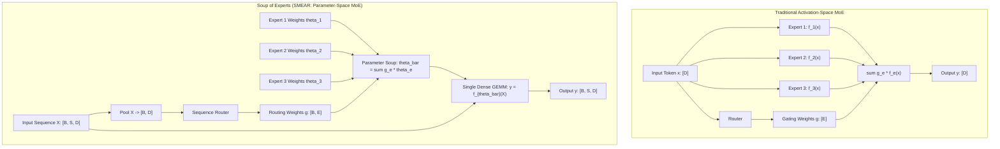

# Soup of Experts: SMEAR, Rewarded Soups, BTX, and Sparse Upcycling

## Executive Summary & ELI5
Standard Mixture-of-Experts (MoE) architectures execute routing in **activation space**: tokens are routed to specific experts, individual forward passes are evaluated, and the resulting activation tensors are combined:
$$\mathbf{y} = \sum_{e=1}^E g_e f_e(\mathbf{x})$$
While theoretically sparse, activation-space routing suffers from high memory bandwidth overhead, memory fragmentation from dynamic gather/scatter operations, and complex distributed dispatch.

**Soup of Experts (SMEAR)** (*Muqeeth et al., 2023*) flips this paradigm on its head by routing in **parameter space**:
$$\mathbf{y} = f_{\bar{\theta}}(\mathbf{x}), \quad \text{where } \bar{\theta} = \sum_{e=1}^E g_e \theta_e$$
Rather than evaluating $E$ separate non-linear neural networks, SMEAR computes a single weighted average ("soup") of expert parameter matrices and executes a single dense GEMM. Because all expert parameters reside within a shared basin of attraction (guaranteed via **Sparse Upcycling** from a common pre-trained checkpoint or **Branch-Train-Merge / BTX**), weight merging is linear and stable.

Furthermore, **Rewarded Soups** (*Rame et al., 2023*) extends weight-space merging to multi-objective Pareto optimization, interpolating weights to optimize alignment across conflicting reward dimensions without expensive multi-task retraining.



---

## Historical Citations & Seminal Literature
1. **Soft Merging of Experts with Adaptive Routing (SMEAR)** (*Mohammed Muqeeth, Haokun Liu, Colin Raffel, NeurIPS 2023, arXiv:2306.03745*). Proved that linearly merging expert parameters dynamically per input sequence or task achieves accuracy competitive with or superior to activation-space MoE while executing at dense model inference throughput.
2. **Model Soups: Averaging Weights of Multiple Fine-Tuned Models Improves Accuracy Without Increasing Inference Time** (*Mitchell Wortsman et al., ICML 2022, arXiv:2203.05482*). Demonstrated that fine-tuning runs from the same pre-trained initialization explore a shared basin of attraction, enabling linear parameter averaging to improve out-of-distribution robustness.
3. **Rewarded Soups: towards Pareto-optimal alignment by interpolating weights** (*Alexandre Rame et al., NeurIPS 2023, arXiv:2306.04488*). Extended model souping to reinforcement learning from human feedback (RLHF), tracing continuous Pareto frontiers between conflicting objectives via convex weight combinations.
4. **Sparse Upcycling: Training Mixture-of-Experts from Dense Checkpoints** (*Aran Komatsuzaki et al., ICLR 2023, arXiv:2212.05055*). Established the foundational protocol of cloning a pre-trained dense FFN into $E$ parallel expert copies, drastically accelerating MoE pre-training convergence and ensuring linear mode connectivity across experts.
5. **Branch-Train-Merge: Embarrassingly Parallel Training of Expert Language Models (BTX)** (*Margaret Li et al., ACL 2023, arXiv:2208.03306*). Introduced asynchronous expert training on specialized domain corpora followed by parameter-space routing or ensembling.

---

## Mathematical Foundations & Governing Equations

### 1. Sparse Upcycling & Linear Basin Connectivity
Given a pre-trained dense MLP with parameters $\theta_0 = \{\mathbf{W}_1^0, \mathbf{b}_1^0, \mathbf{W}_2^0, \mathbf{b}_2^0\}$, Sparse Upcycling initializes $E$ experts identically:
$$\theta_e^{(0)} = \theta_0, \quad \forall e \in \{1, \dots, E\}$$
During fine-tuning on task or domain $e$, each expert drifts by displacement $\Delta \theta_e = \theta_e - \theta_0$. Because $\|\Delta \theta_e\| \ll \|\theta_0\|$, all experts remain in the same loss basin, satisfying linear mode connectivity:
$$\mathcal{L}\left(\sum_{e=1}^E \alpha_e \theta_e\right) \le \sum_{e=1}^E \alpha_e \mathcal{L}(\theta_e) + \mathcal{O}(\|\Delta \theta_e\|^2)$$

### 2. SMEAR: Dynamic Parameter Merging
Given an input sequence $\mathbf{X} \in \mathbb{R}^{S \times D}$:
1. Compute pooled sequence representation $\mathbf{z} = \frac{1}{S} \sum_{s=1}^S \mathbf{x}_s \in \mathbb{R}^D$.
2. Compute routing distribution over experts:
   $$\mathbf{g} = \text{softmax}\left(\mathbf{z} \mathbf{W}_r + \mathbf{b}_r\right) \in \Delta^{E-1}$$
3. Synthesize dynamic layer weights via convex parameter combination:
   $$\bar{\mathbf{W}}_1 = \sum_{e=1}^E g_e \mathbf{W}_{1, e}, \quad \bar{\mathbf{b}}_1 = \sum_{e=1}^E g_e \mathbf{b}_{1, e}$$
   $$\bar{\mathbf{W}}_2 = \sum_{e=1}^E g_e \mathbf{W}_{2, e}, \quad \bar{\mathbf{b}}_2 = \sum_{e=1}^E g_e \mathbf{b}_{2, e}$$
4. Execute single standard feed-forward pass:
   $$\mathbf{Y} = \text{GELU}(\mathbf{X} \bar{\mathbf{W}}_1 + \bar{\mathbf{b}}_1) \bar{\mathbf{W}}_2 + \bar{\mathbf{b}}_2$$

### 3. Rewarded Soups (Multi-Objective Weight Interpolation)
When optimizing across conflicting rewards (e.g. Helpfulness $R_1$ vs. Harmlessness $R_2$):
1. Obtain fine-tuned policy weights $\theta^{(1)}$ optimizing $R_1$ and $\theta^{(2)}$ optimizing $R_2$.
2. Form Pareto soup parameter family parameterized by scalar $\alpha \in [0, 1]$:
   $$\theta(\alpha) = \alpha \theta^{(1)} + (1 - \alpha) \theta^{(2)}$$
3. A single checkpoint achieves multi-objective trade-offs at inference time without requiring test-time multiple evaluations.

---

## Tensor Memory Layout & Dimension Shapes
```text
Batch Size = B, Sequence Length = S, Hidden Dimension = D, Intermediate Dim = D_ff, Experts = E

Sparse Upcycling Initialization:
Base Weights:            [D, D_ff] and [D_ff, D]
Expert Weights Tensor:   [E, D, D_ff] and [E, D_ff, D]
Expert Biases Tensor:    [E, D_ff] and [E, D]

SMEAR Forward Flow:
Input Sequence X:        [B, S, D]
Pooled Sequence:         Mean(X, dim=1) -> [B, D]
Router Weights:          [D, E]
Routing Distribution g:  Softmax(Pooled @ W_r + b_r) -> [B, E]
Merged Weights per batch:
  W_1_bar:               sum_{e} g[b, e] * Expert_W1[e] -> [B, D, D_ff]
  W_2_bar:               sum_{e} g[b, e] * Expert_W2[e] -> [B, D_ff, D]
Single Dense MLP Pass:   Y = GELU(X @ W_1_bar + b_1_bar) @ W_2_bar + b_2_bar -> [B, S, D]
```

---

## Multi-Ecosystem Implementation Matrix
| Feature / Characteristic | PyTorch 2.x (`pytorch2/`) | JAX / Equinox (`jax/`) | Candle Rust (`candle/`) | Hardware Kernel (`kernels/`) |
| :--- | :--- | :--- | :--- | :--- |
| **Expert Weight Storage** | 3D tensor `[E, D, D_ff]` | 3D DeviceArray `[E, D, D_ff]`| Flat contiguous Tensor | Contiguous storage buffer |
| **Dynamic Merging** | `torch.einsum('be,edh->bdh', g, W)` | `jnp.einsum('be,edh->bdh', g, W)` | Slice + broadcast sum | WGSL 2D grid parameter blend |
| **Batch GEMM Execution** | `torch.bmm(X, W_bar)` | `jnp.matmul(X, W_bar)` | Reshape + loop matmul | Fused merged matmul |
| **Upcycling Initialization**| `base.unsqueeze(0).repeat(E,1,1)` | `jnp.repeat(base[None], E, 0)` | Cat / stack repeat | Host memory broadcast |
| **Rewarded Pareto Soup** | In-place linear interpolation | Convex array blend | Linear combination | Alpha scale-bias shader |

---

## Pathological Misuse & Failure Modes

### 1. Merging Independent Non-Basin Models (Permutation Misalignment)
- **Failure:** Attempting to merge expert weights trained from different random seeds without prior weight-matching / Git Re-Basin permutation alignment.
- **Consequence:** Intermediate hidden representations fire in mismatched permutation orders, resulting in catastrophic interference and complete loss of representation capacity (zero output signal).
- **Stabilized Solution:** Strictly employ **Sparse Upcycling** from a common pre-trained base model, or run Sinkhorn-based permutation alignment before parameter souping.

### 2. Token-Level Parameter Merging Overhead
- **Failure:** Evaluating unique weight matrices for every single token ($T = B \times S$).
- **Consequence:** Dynamic memory footprint explodes to $T \times D \times D_{\text{ff}}$, exceeding GPU high-bandwidth memory (HBM) capacity.
- **Stabilized Solution:** Perform dynamic weight souping at the **sequence** or **batch** level using pooled sequence representations $\mathbf{z}$, amortizing parameter blending across all $S$ tokens in the sequence.

---

## Cross-Domain Generalisation Matrix
1. **Multi-Domain Language Modeling:** One expert per domain (Code, Law, Medicine, Math); SMEAR dynamically blends the domain specialists into a bespoke unified model per user prompt.
2. **Robotics & Policy Control:** Merging policy checkpoints trained under different environmental friction and gravity parameters to achieve zero-shot adaptive control.
3. **Computer Vision & Diffusion:** Merging aesthetic, photorealism, and style-conditioned LoRA/expert adapters in parameter space to render complex composite prompts.

---

## Synchronized Track Artifacts
- **Universal SafeTensors Checkpoint:** [`weights/05_architectures/01_mlp_moe_soups_and_kan/04_soup_of_experts_smear_rewarded_soups_btx_and_upcycling.safetensors`](../../../weights/05_architectures/01_mlp_moe_soups_and_kan/04_soup_of_experts_smear_rewarded_soups_btx_and_upcycling.safetensors)
- **PyTorch 2.x Module:** [`pytorch2/05_architectures/01_mlp_moe_soups_and_kan/04_soup_of_experts_smear_rewarded_soups_btx_and_upcycling.py`](../../../pytorch2/05_architectures/01_mlp_moe_soups_and_kan/04_soup_of_experts_smear_rewarded_soups_btx_and_upcycling.py)
- **Functional JAX Module:** [`jax/05_architectures/01_mlp_moe_soups_and_kan/04_soup_of_experts_smear_rewarded_soups_btx_and_upcycling.py`](../../../jax/05_architectures/01_mlp_moe_soups_and_kan/04_soup_of_experts_smear_rewarded_soups_btx_and_upcycling.py)
- **Candle Rust Module:** [`candle/05_architectures/01_mlp_moe_soups_and_kan/04_soup_of_experts_smear_rewarded_soups_btx_and_upcycling.rs`](../../../candle/05_architectures/01_mlp_moe_soups_and_kan/04_soup_of_experts_smear_rewarded_soups_btx_and_upcycling.rs)
- **Hardware Kernel:** [`kernels/05_architectures/01_mlp_moe_soups_and_kan/04_soup_of_experts_smear_rewarded_soups_btx_and_upcycling.rs`](../../../kernels/05_architectures/01_mlp_moe_soups_and_kan/04_soup_of_experts_smear_rewarded_soups_btx_and_upcycling.rs)
- **Interactive Concept Notebook:** [`notebooks/05_architectures/01_mlp_moe_soups_and_kan/04_soup_of_experts_smear_rewarded_soups_btx_and_upcycling.ipynb`](../../../notebooks/05_architectures/01_mlp_moe_soups_and_kan/04_soup_of_experts_smear_rewarded_soups_btx_and_upcycling.ipynb)
