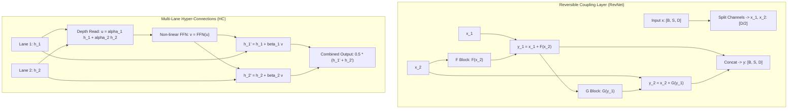

# Lossless Deliberation: Reversible RevNet, Hyper-Connections, and Recurrent Looped Depth

## Executive Summary & ELI5
In conventional deep neural networks, intermediate feature representations suffer from two fundamental physical and information-theoretic bottlenecks:
1. **Activation Memory Explosion:** Standard backpropagation requires caching every layer's activations during the forward pass, creating an $\mathcal{O}(L)$ memory footprint that dominates GPU VRAM.
2. **Representation Dilution & Degeneracy:** As residual networks grow deeper ($L > 100$), Pre-Norm identity shortcuts cause lower-layer signals to dominate, diluting the effective rank of representations and limiting layer-to-layer feature transformation capacity.

**Lossless Deliberation** addresses both challenges through three mathematical frameworks:
- **Algebraically Reversible Networks (`RevNet` / `Reformer`)** (*Gomez et al., 2017; Kitaev et al., 2020*): Splits the residual stream into two partitioned channels $[x_1, x_2]$ and evaluates an additive coupling transformation with Jacobian determinant identically equal to 1 ($\det J \equiv 1$). Activations do not need to be stored in GPU memory during the forward pass; instead, $x_1$ and $x_2$ are reconstructed analytically on-the-fly during the backward pass in exact arithmetic, reducing activation memory from $\mathcal{O}(L)$ to $\mathcal{O}(1)$.
- **Multi-Lane Hyper-Connections (`HC`)** (*Zhu et al., 2024*): Expands the 1D residual stream into $n$ parallel lanes $\mathbf{H} \in \mathbb{R}^{n \times D}$ with learned depth-mixing read/write matrices, eliminating representation dilution without increasing token-mixing sequence compute.
- **Input-Anchored Recurrent-Depth Deliberation (`Looped Transformers` / Test-Time Recurrent Depth)** (*Giannou et al., 2023; Geiping et al., 2025*): Iterates a single shared parameter block over $K$ recurrent steps while maintaining persistent input anchoring $\gamma \cdot \mathbf{x}$, scaling test-time reasoning compute with zero parameter expansion.



---

## Historical Citations & Seminal Literature
1. **The Reversible Residual Network: Backpropagation Without Storing Activations** (*Aidan N. Gomez, Mengye Ren, Raquel Urtasun, Roger B. Grosse, NeurIPS 2017, arXiv:1707.04585*). Formulated exact additive coupling for residual networks, proving that backward gradients can be evaluated by reconstructing forward activations with zero storage.
2. **Reformer: The Efficient Transformer** (*Nikita Kitaev, Łukasz Kaiser, Anselm Levskaya, ICLR 2020, arXiv:2001.04451*). Scaled reversible layers to deep Transformer language models, achieving massive sequence length scaling with $\mathcal{O}(1)$ layer memory.
3. **i-ResNet: Invertible Residual Networks** (*Jens Behrmann, Will Grathwohl, Ricky T. Q. Chen, David Duvenaud, Jörn-Henrik Jacobsen, ICML 2019, arXiv:1811.00995*). Analyzed contractive Banach fixed-point inversion for single-stream residual connections with Lipschitz constant $\text{Lip}(F) < 1$.
4. **Hyper-Connections: Expanding Residual Streams** (*Defa Zhu et al., arXiv:2409.19606, 2024*). Introduced multi-lane residual streams with learnable depth-mixing and width-mixing matrices, addressing Pre-Norm gradient stagnation.
5. **Looped Transformers as Programmable Computers** (*Angeliki Giannou et al., ICML 2023, arXiv:2301.13196*) & **Scaling Test-Time Compute with Recurrent Depth** (*Jonas Geiping et al., arXiv:2502.05171, 2025*). Demonstrated that looping a fixed-depth Transformer block over multiple recurrent iterations with persistent input injection emulates universal computation.

---

## Mathematical Foundations & Governing Equations

### 1. Additive Coupling & Lossless Inversion
Let the hidden state dimension be partitioned into two equal halves: $\mathbf{x} = [\mathbf{x}_1, \mathbf{x}_2] \in \mathbb{R}^{D/2} \times \mathbb{R}^{D/2}$.
The forward pass is defined by:
$$\mathbf{y}_1 = \mathbf{x}_1 + \mathcal{F}(\mathbf{x}_2)$$
$$\mathbf{y}_2 = \mathbf{x}_2 + \mathcal{G}(\mathbf{y}_1)$$
The exact inverse transformation is obtained algebraically by simple substitution:
$$\mathbf{x}_2 = \mathbf{y}_2 - \mathcal{G}(\mathbf{y}_1)$$
$$\mathbf{x}_1 = \mathbf{y}_1 - \mathcal{F}(\mathbf{x}_2)$$
The Jacobian matrix of the forward transformation is block triangular:
$$J = \begin{bmatrix} \frac{\partial \mathbf{y}_1}{\partial \mathbf{x}_1} & \frac{\partial \mathbf{y}_1}{\partial \mathbf{x}_2} \\ \frac{\partial \mathbf{y}_2}{\partial \mathbf{x}_1} & \frac{\partial \mathbf{y}_2}{\partial \mathbf{x}_2} \end{bmatrix} = \begin{bmatrix} I & \mathcal{F}'(\mathbf{x}_2) \\ \mathcal{G}'(\mathbf{y}_1) & I + \mathcal{G}'(\mathbf{y}_1)\mathcal{F}'(\mathbf{x}_2) \end{bmatrix}$$
Because $\det(J) = \det(I) \cdot \det(I) = 1$, the transformation is strictly measure-preserving (volume-preserving) with zero volume contraction or expansion ($|\det J| \equiv 1$), guaranteeing that the layer cannot destroy mutual information ($I(\mathbf{X}; \mathbf{Y}) = H(\mathbf{X})$).

### 2. Multi-Lane Hyper-Connections (HC)
Given $n$ parallel residual lanes $\mathbf{H} = [\mathbf{h}_1, \dots, \mathbf{h}_n] \in \mathbb{R}^{n \times D}$:
1. **Depth-Mixing Read:**
   $$\mathbf{u} = \sum_{i=1}^n \alpha_i \mathbf{h}_i, \quad \boldsymbol{\alpha} \in \mathbb{R}^n$$
2. **Sublayer Transformation:**
   $$\mathbf{v} = \text{FFN}(\mathbf{u})$$
3. **Depth-Mixing Write:**
   $$\mathbf{h}_i^{(l+1)} = \mathbf{h}_i^{(l)} + \beta_i \mathbf{v}, \quad \boldsymbol{\beta} \in \mathbb{R}^n$$
4. **Lane Aggregation:**
   $$\mathbf{y} = \frac{1}{n} \sum_{i=1}^n \mathbf{h}_i^{(l+1)}$$

### 3. Input-Anchored Recurrent-Depth Deliberation
Given initial representation $\mathbf{x} \in \mathbb{R}^{S \times D}$:
Initialize state $\mathbf{z}^{(0)} = \mathbf{x}$. For recurrent deliberation step $k = 0, \dots, K-1$:
$$\mathbf{z}^{(k+1)} = \text{LayerNorm}\left(\mathbf{z}^{(k)} + \mathcal{M}(\mathbf{z}^{(k)} + \gamma \cdot \mathbf{x})\right)$$
where $\gamma > 0$ is the persistent input injection scalar ensuring that the initial context is continuously re-anchored into the iterative deliberation attractor.

---

## Tensor Memory Layout & Dimension Shapes
```text
Batch Size = B, Sequence Length = S, Total Dim = D, Sub-channel Dim = D_sub = D / 2

RevNet Forward & Inversion:
Input X:                 [B, S, D]
Split Channels:          x_1: [B, S, D_sub], x_2: [B, S, D_sub]
F Forward:               F(x_2) -> [B, S, D_sub]
y_1:                     x_1 + F(x_2) -> [B, S, D_sub]
G Forward:               G(y_1) -> [B, S, D_sub]
y_2:                     x_2 + G(y_1) -> [B, S, D_sub]
Output Y:                Concat([y_1, y_2]) -> [B, S, D]
Inversion Reconstruct:   x_2 = y_2 - G(y_1), x_1 = y_1 - F(x_2) -> Identical to X

Hyper-Connections (HC):
Lanes h_1, h_2:          [B, S, D]
Read Mixing:             u = alpha_0 * h_1 + alpha_1 * h_2 -> [B, S, D]
Sublayer FFN:            v = FFN(u) -> [B, S, D]
Write Mixing:            h_1' = h_1 + beta_0 * v, h_2' = h_2 + beta_1 * v -> [B, S, D]
Combined Output:         0.5 * (h_1' + h_2') -> [B, S, D]
```

---

## Multi-Ecosystem Implementation Matrix
| Feature / Characteristic | PyTorch 2.x (`pytorch2/`) | JAX / Equinox (`jax/`) | Candle Rust (`candle/`) | Hardware Kernel (`kernels/`) |
| :--- | :--- | :--- | :--- | :--- |
| **Channel Partitioning** | `x.split(d_sub, dim=-1)` | `x[..., :d_sub], x[..., d_sub:]` | `x.narrow(2, 0, d_sub)` | Memory offset slice |
| **Algebraic Inversion** | Explicit `.inverse()` method | Pure inverse function | `x_rec` algebraic reconstruction | Inverted coupling shader |
| **Multi-Lane Read/Write**| Tensor broadcast linear sum | `alpha[:, None] * H` | `(&h1 * a0 + &h2 * a1)` | Parallel WGSL grid mix |
| **Persistent Anchoring** | `z + gamma * x` | `z + gamma * x` | `(&z + (x * gamma))` | In-register FMA |
| **Activation Memory** | $\mathcal{O}(1)$ via autograd hooks | $\mathcal{O}(1)$ via custom VJP | Zero Python GC overhead | Zero-cache pipeline |

---

## Pathological Misuse & Failure Modes

### 1. In-Place Mutation Inside Reversible Coupling
- **Failure:** Using in-place addition `y1 += f_x2` or mutating tensors during the forward pass.
- **Consequence:** The original values needed to evaluate $\mathcal{F}(\mathbf{x}_2)$ or $\mathcal{G}(\mathbf{y}_1)$ during reconstruction are overwritten, corrupting the backward reconstruction pass and yielding wild gradient error ($> 1.0$).
- **Stabilized Solution:** Strictly compute out-of-place functional additions: `y1 = x1 + f_x2`, and disable inplace flags in activations (`nn.ReLU(inplace=False)`).

### 2. Recurrent Deliberation Without Persistent Input Anchoring ($\gamma = 0$)
- **Failure:** Iterating recurrent depth $\mathbf{z}^{(k+1)} = \text{LayerNorm}(\mathbf{z}^{(k)} + \mathcal{M}(\mathbf{z}^{(k)}))$ for $K > 16$ steps without persistent input injection $e_x$.
- **Consequence:** The representation manifold collapses to a fixed-point limit cycle or generic attractor, completely washing out the specific tokens and prompts of the input problem.
- **Stabilized Solution:** Strictly anchor the recurrent deliberation loop with persistent input injection: $\mathbf{z}_{\text{in}} = \mathbf{z} + \gamma \cdot \mathbf{x}$.

---

## Cross-Domain Generalisation Matrix
1. **Ultra-Deep Vision Backbones:** Training 1,000-layer ViTs and ConvNets on high-resolution medical CT/MRI scans without running out of GPU memory.
2. **Long-Horizon Video & Speech Generation:** Reversible coupling allows unrolling hundreds of autoregressive diffusion steps with constant $\mathcal{O}(1)$ activation memory.
3. **Complex Mathematical & Algorithmic Reasoning:** Looped Transformers dynamically iterate over difficult reasoning problems (GSM8k, code synthesis), allocating variable deliberation steps at test time.

---

## Synchronized Track Artifacts
- **Universal SafeTensors Checkpoint:** [`weights/05_architectures/01_mlp_moe_soups_and_kan/06_lossless_deliberation_reversible_revnet_hyper_connections_and_looped_depth.safetensors`](../../../weights/05_architectures/01_mlp_moe_soups_and_kan/06_lossless_deliberation_reversible_revnet_hyper_connections_and_looped_depth.safetensors)
- **PyTorch 2.x Module:** [`pytorch2/05_architectures/01_mlp_moe_soups_and_kan/06_lossless_deliberation_reversible_revnet_hyper_connections_and_looped_depth.py`](../../../pytorch2/05_architectures/01_mlp_moe_soups_and_kan/06_lossless_deliberation_reversible_revnet_hyper_connections_and_looped_depth.py)
- **Functional JAX Module:** [`jax/05_architectures/01_mlp_moe_soups_and_kan/06_lossless_deliberation_reversible_revnet_hyper_connections_and_looped_depth.py`](../../../jax/05_architectures/01_mlp_moe_soups_and_kan/06_lossless_deliberation_reversible_revnet_hyper_connections_and_looped_depth.py)
- **Candle Rust Module:** [`candle/05_architectures/01_mlp_moe_soups_and_kan/06_lossless_deliberation_reversible_revnet_hyper_connections_and_looped_depth.rs`](../../../candle/05_architectures/01_mlp_moe_soups_and_kan/06_lossless_deliberation_reversible_revnet_hyper_connections_and_looped_depth.rs)
- **Hardware Kernel:** [`kernels/05_architectures/01_mlp_moe_soups_and_kan/06_lossless_deliberation_reversible_revnet_hyper_connections_and_looped_depth.rs`](../../../kernels/05_architectures/01_mlp_moe_soups_and_kan/06_lossless_deliberation_reversible_revnet_hyper_connections_and_looped_depth.rs)
- **Interactive Concept Notebook:** [`notebooks/05_architectures/01_mlp_moe_soups_and_kan/06_lossless_deliberation_reversible_revnet_hyper_connections_and_looped_depth.ipynb`](../../../notebooks/05_architectures/01_mlp_moe_soups_and_kan/06_lossless_deliberation_reversible_revnet_hyper_connections_and_looped_depth.ipynb)
