# Classic to Modern CNNs: ResNet v1/v2, DenseNet, MobileNetV2, and ConvNeXt-V2 (GRN)

## Executive Summary & ELI5
Convolutional Neural Networks (CNNs) have undergone a radical structural evolution over the past decade:
1. **Pre-Activation ResNet (ResNet-v2)** (*He et al., 2016*): Reorganizes batch normalization and activation functions to precede convolutions (`BN -> ReLU -> Conv -> BN -> ReLU -> Conv -> (+)`), establishing an unobstructed linear identity shortcut that acts as a pure gradient highway across hundreds of layers.
2. **DenseNet** (*Huang et al., 2017*): Replaces additive shortcuts with **concatenative feature reuse** ($x_{l+1} = [x_0, x_1, \dots, x_l, H_l(x_l)]$), ensuring every layer has direct access to features from all preceding layers with a modest growth rate $k$.
3. **MobileNetV2** (*Sandler et al., 2018*): Introduces the **Inverted Residual Bottleneck** with depthwise separable convolutions: expanding into high-dimensional channels ($t \times C$), filtering spatially with a $3\times 3$ depthwise convolution, and projecting back to a narrow low-dimensional bottleneck with a linear (non-activated) projection to prevent manifold collapse.
4. **ConvNeXt-V2** (*Woo et al., 2023*): Modernizes the pure ConvNet to compete directly with Vision Transformers by incorporating $7\times 7$ large-kernel depthwise convolutions, inverted $4\times$ pointwise expansion, and **Global Response Normalization (GRN)**. GRN calibrates channel-wise feature competition across spatial locations, preventing feature collapse during masked autoencoder self-supervised pre-training.

```mermaid
flowchart TD
    subgraph PreActResNet ["Pre-Activation ResNet-v2 Block"]
        X1["Input x"] --> Act1["ReLU / Norm"]
        Act1 --> Conv1["3x3 Conv"]
        Conv1 --> Act2["ReLU / Norm"]
        Act2 --> Conv2["3x3 Conv"]
        Conv2 --> Add1["(+)"]
        X1 -->|Pure Identity Shortcut Highway| Add1
        Add1 --> Out1["Output y"]
    end

    subgraph ConvNeXtV2 ["ConvNeXt-V2 Inverted Bottleneck with GRN"]
        X2["Input x: [B, C, H, W]"] --> DW["7x7 Depthwise Conv (groups=C)"]
        DW --> PW1["1x1 Pointwise Expansion (4xC)"]
        PW1 --> GELU["GELU Activation"]
        GELU --> GRN["Global Response Normalization (GRN)"]
        GRN --> PW2["1x1 Pointwise Projection (back to C)"]
        PW2 --> Add2["(+)"]
        X2 --> Add2
        Add2 --> Out2["Output y: [B, C, H, W]"]
    end
```



---

## Historical Citations & Seminal Literature
1. **Deep Residual Learning for Image Recognition & Identity Mappings in Deep Residual Networks** (*Kaiming He, Xiangyu Zhang, Shaoqing Ren, Jian Sun, CVPR 2016 & ECCV 2016, arXiv:1512.03385, arXiv:1603.05027*). Introduced ResNet and ResNet-v2, establishing the theoretical necessity of clean identity shortcuts for unobstructed gradient propagation.
2. **Densely Connected Convolutional Networks (DenseNet)** (*Gao Huang, Zhuang Liu, Laurens van der Maaten, Kilian Q. Weinberger, CVPR 2017, arXiv:1608.06993*). Proposed feature concatenation across layers to encourage feature reuse and alleviate vanishing gradients.
3. **MobileNetV2: Inverted Residuals and Linear Bottlenecks** (*Mark Sandler, Andrew Howard, Menglong Zhu, Andrey Zhmoginov, Liang-Chieh Chen, CVPR 2018, arXiv:1801.04381*). Formulated the inverted bottleneck structure and demonstrated why non-linearities in low-dimensional projection bottlenecks destroy information manifolds.
4. **A ConvNet for the 2020s (ConvNeXt) & ConvNeXt V2: Co-designing and Scaling ConvNets with Masked Autoencoders** (*Zhuang Liu et al., CVPR 2022; Sanghyun Woo et al., CVPR 2023, arXiv:2201.03545, arXiv:2301.00808*). Revitalized convolutional architectures against Vision Transformers, inventing Global Response Normalization to eliminate channel collapse under self-supervised masked autoencoder objectives.

---

## Mathematical Foundations & Governing Equations

### 1. Pre-Activation ResNet-v2 Forward & Backward Dynamics
In ResNet-v1, non-linearities and normalization follow convolutions:
$$\mathbf{y} = \text{ReLU}(\mathbf{x} + \mathcal{F}(\mathbf{x}))$$
In Pre-Activation ResNet-v2, non-linearities and normalizations precede convolutions:
$$\mathbf{x}_{l+1} = \mathbf{x}_l + \mathcal{F}(\mathbf{x}_l, \mathcal{W}_l)$$
Recursively expanding across $L$ layers yields:
$$\mathbf{x}_L = \mathbf{x}_l + \sum_{i=l}^{L-1} \mathcal{F}(\mathbf{x}_i, \mathcal{W}_i)$$
By the chain rule, the gradient of the loss $\mathcal{E}$ with respect to any early layer $\mathbf{x}_l$ decomposes into:
$$\frac{\partial \mathcal{E}}{\partial \mathbf{x}_l} = \frac{\partial \mathcal{E}}{\partial \mathbf{x}_L} \frac{\partial \mathbf{x}_L}{\partial \mathbf{x}_l} = \frac{\partial \mathcal{E}}{\partial \mathbf{x}_L} \left(I + \frac{\partial}{\partial \mathbf{x}_l} \sum_{i=l}^{L-1} \mathcal{F}(\mathbf{x}_i, \mathcal{W}_i)\right)$$
Because of the identity term $I$, gradients flow directly from layer $L$ to layer $l$ without vanishing through matrix multiplications.

### 2. Global Response Normalization (GRN) in ConvNeXt-V2
Given an intermediate expanded feature tensor $\mathbf{X} \in \mathbb{R}^{B \times C \times H \times W}$ after GELU activation:
1. **Global Spatial Aggregation (L2 Norm):**
   $$G_c = \|\mathbf{X}_c\|_2 = \sqrt{\sum_{h=1}^H \sum_{w=1}^W X_{c, h, w}^2 + \epsilon}, \quad \forall c \in \{1, \dots, C\}$$
2. **Relative Channel Contrast Normalization:**
   $$N_c = \frac{G_c}{\frac{1}{C}\sum_{j=1}^C G_j + \epsilon} \in \mathbb{R}$$
   If channel $c$ has higher relative activation energy than the channel average, $N_c > 1$; if lower, $N_c < 1$.
3. **Calibrated Feature Scaling with Residual Addition:**
   $$X'_{c, h, w} = \gamma_c \cdot (X_{c, h, w} \cdot N_c) + \beta_c + X_{c, h, w}$$
   where $\gamma_c, \beta_c$ are learnable channel scale and bias parameters initialized to 0.

---

## Tensor Memory Layout & Dimension Shapes
```text
Batch Size = B, In Channels = C_in, Spatial Height = H, Spatial Width = W, Hidden Expansion = C_mid = 4 * C_in

ConvNeXt-V2 Block Tensor Flow:
Input X:                 [B, C_in, H, W]
7x7 Depthwise Conv:      Weight: [C_in, 1, 7, 7], groups=C_in, pad=3 -> [B, C_in, H, W]
1x1 Pointwise Expansion: Weight: [C_mid, C_in, 1, 1], pad=0 -> [B, C_mid, H, W]
GELU Activation:         GELU(H_pw1) -> [B, C_mid, H, W]
Global Response Norm:
  L2 Spatial Norm G:     Norm(H_act, dim=(2,3), keepdim=True) -> [B, C_mid, 1, 1]
  Mean Spatial Norm:     Mean(G, dim=1, keepdim=True) -> [B, 1, 1, 1]
  Channel Contrast N:    G / (Mean_G + eps) -> [B, C_mid, 1, 1]
  GRN Calibrated Out:    gamma * (H_act * N) + beta + H_act -> [B, C_mid, H, W]
1x1 Pointwise Project:   Weight: [C_in, C_mid, 1, 1], pad=0 -> [B, C_in, H, W]
Residual Sum:            X + H_pw2 -> [B, C_in, H, W]
```

---

## Multi-Ecosystem Implementation Matrix
| Feature / Characteristic | PyTorch 2.x (`pytorch2/`) | JAX / Equinox (`jax/`) | Candle Rust (`candle/`) | Hardware Kernel (`kernels/`) |
| :--- | :--- | :--- | :--- | :--- |
| **Depthwise Convolution** | `nn.Conv2d(..., groups=C)`| Vectorized loop conv | `x.conv2d(..., groups=C)` | Tiled shared-memory conv |
| **Pointwise Conv** | `nn.Conv2d(..., k=1)` | `1x1` matmul conv | `x.conv2d(..., k=1, g=1)` | TensorCore GEMM |
| **Global Response Norm**| Tensor norm + broadcast | `np.linalg.norm` + broadcast| `sum_keepdim.sqrt` | 1D workgroup reduction |
| **Pre-Activation ResNet** | Sequential ReLU + Conv | Functional composition | Chained `relu` + `conv2d` | Fused convolution shader |
| **Linear Anchor** | `x @ weight + bias` | `x @ weight + bias` | `x.matmul + bias` | Fused linear kernel |

---

## Pathological Misuse & Failure Modes

### 1. Feature Channel Collapse Under Masked Autoencoding
- **Failure:** Training standard ConvNeXt-v1 (without GRN) with Masked Autoencoders (MAE).
- **Consequence:** Because MAE forces the network to predict masked patches from high-frequency pixel reconstructions, channels become redundant and compete destructively, causing representation collapse where 30–50% of feature maps become completely dead (zero variance).
- **Stabilized Solution:** Incorporate Global Response Normalization (`GRN`) after the GELU expansion; GRN acts as an intra-channel competitive lateral inhibition mechanism that dynamically revives underactive channels.

### 2. Non-Linearity in Low-Dimensional Inverted Bottlenecks
- **Failure:** Placing ReLU or GELU non-linearities after the narrow linear projection in MobileNetV2 / ConvNeXt bottlenecks.
- **Consequence:** Because the channel dimension is narrow ($C \ll C_{\text{mid}}$), negative clipping by non-linearities irrevocably collapses low-dimensional manifolds into zero, causing severe loss of representational fidelity.
- **Stabilized Solution:** Keep the final projection layer strictly linear before the residual addition.

---

## Cross-Domain Generalisation Matrix
1. **Medical Imaging & 2D Pathology:** ConvNeXt-V2 large-kernel receptive fields capture multi-cellular morphology without ViT quadratic attention scaling on gigapixel whole-slide images.
2. **Audio Spectrogram Processing:** Depthwise $7\times 7$ convolutions capture joint temporal-harmonic formant structures in mel-spectrograms.
3. **Robotics Visual Servoing:** Inverted residual convolutions provide real-time, low-latency edge feature extraction for closed-loop drone control at $>120$ FPS.

---

## Synchronized Track Artifacts
- **Universal SafeTensors Checkpoint:** [`weights/05_architectures/02_convolutional_and_spatiotemporal/01_classic_to_modern_cnns_resnet_densenet_convnext.safetensors`](../../../weights/05_architectures/02_convolutional_and_spatiotemporal/01_classic_to_modern_cnns_resnet_densenet_convnext.safetensors)
- **PyTorch 2.x Module:** [`pytorch2/05_architectures/02_convolutional_and_spatiotemporal/01_classic_to_modern_cnns_resnet_densenet_convnext.py`](../../../pytorch2/05_architectures/02_convolutional_and_spatiotemporal/01_classic_to_modern_cnns_resnet_densenet_convnext.py)
- **Functional JAX Module:** [`jax/05_architectures/02_convolutional_and_spatiotemporal/01_classic_to_modern_cnns_resnet_densenet_convnext.py`](../../../jax/05_architectures/02_convolutional_and_spatiotemporal/01_classic_to_modern_cnns_resnet_densenet_convnext.py)
- **Candle Rust Module:** [`candle/05_architectures/02_convolutional_and_spatiotemporal/01_classic_to_modern_cnns_resnet_densenet_convnext.rs`](../../../candle/05_architectures/02_convolutional_and_spatiotemporal/01_classic_to_modern_cnns_resnet_densenet_convnext.rs)
- **Hardware Kernel:** [`kernels/05_architectures/02_convolutional_and_spatiotemporal/01_classic_to_modern_cnns_resnet_densenet_convnext.rs`](../../../kernels/05_architectures/02_convolutional_and_spatiotemporal/01_classic_to_modern_cnns_resnet_densenet_convnext.rs)
- **Interactive Concept Notebook:** [`notebooks/05_architectures/02_convolutional_and_spatiotemporal/01_classic_to_modern_cnns_resnet_densenet_convnext.ipynb`](../../../notebooks/05_architectures/02_convolutional_and_spatiotemporal/01_classic_to_modern_cnns_resnet_densenet_convnext.ipynb)
