# Specialized Convolutions & Channel Attention: CoordConv, SE-Net, ECA-Net & ASPP

## Executive Summary & ELI5
Standard 2D convolutions share two fundamental structural properties: **translation equivariance** (applying the same local filter at every spatial position) and **channel uniformity** (treating all feature channels with equal static weighting). While these inductive biases are ideal for texture classification, they fall short for tasks requiring spatial coordinate awareness (e.g., robotic grasping, coordinate regression) or dynamic channel prioritization:
1. **CoordConv** (*Liu et al., 2018*): Injects explicit Cartesian coordinate channels ($x \in [-1, 1], y \in [-1, 1]$) into the input tensor ($[B, C, H, W] \to [B, C+2, H, W]$), allowing a standard convolution to learn coordinate-dependent representations without breaking downstream translation equivariance where needed.
2. **Squeeze-and-Excitation (SE)** (*Hu et al., 2018*): Dynamically recalibrates channel responses by computing a global spatial summary via Global Average Pooling (GAP), passing it through a two-layer bottleneck MLP ($C \to C/r \to C$), and multiplying the original feature map by the resulting sigmoid channel weights $\mathbf{s} \in (0, 1)^C$.
3. **Efficient Channel Attention (ECA)** (*Wang et al., 2020*): Eliminates the dimensionality reduction bottleneck of SE-Net. Instead of an MLP, ECA uses a direct $1\text{D}$ fast convolution with adaptive kernel size $k$ across the channel dimension, reducing parameters while capturing local cross-channel interactions.
4. **Atrous / Dilated Convolution & ASPP** (*Yu & Koltun, 2015; Chen et al., 2017*): Expands the receptive field exponentially without pooling or downsampling by introducing gaps (dilation rate $r$) between kernel weights, capturing multi-scale context in Atrous Spatial Pyramid Pooling (ASPP).

```mermaid
flowchart TD
    subgraph CoordConvBlock ["CoordConv 2D Block"]
        X1["Input x: [B, C, H, W]"] --> Cat["Concat along Channels"]
        Coords["Coord Grids: x, y in [-1, 1]"] --> Cat
        Cat --> Conv["Standard Conv2d (C+2 -> C_out)"]
        Conv --> Out1["Output y: [B, C_out, H, W]"]
    end

    subgraph SEBlock ["Squeeze-and-Excitation (SE) Block"]
        X2["Input x: [B, C, H, W]"] --> GAP2["Global Avg Pool (GAP) -> [B, C]"]
        GAP2 --> FC1["Dense Layer (C -> C/r) + ReLU"]
        FC1 --> FC2["Dense Layer (C/r -> C) + Sigmoid"]
        FC2 --> Scale2["Channel-wise Product (x * s)"]
        X2 --> Scale2
        Scale2 --> Out2["Output y: [B, C, H, W]"]
    end

    subgraph ECABlock ["Efficient Channel Attention (ECA) Block"]
        X3["Input x: [B, C, H, W]"] --> GAP3["Global Avg Pool (GAP) -> [B, C]"]
        GAP3 --> Conv1D["1D Conv (kernel k=3) + Sigmoid"]
        Conv1D --> Scale3["Channel-wise Product (x * s)"]
        X3 --> Scale3
        Scale3 --> Out3["Output y: [B, C, H, W]"]
    end
```

---

## Historical Citations & Seminal Literature
1. **Multi-Scale Context Aggregation by Dilated Convolutions** (*Fisher Yu, Vladlen Koltun, ICLR 2016, arXiv:1511.07122*). Introduced atrous / dilated convolutions to systematically expand receptive fields without losing spatial resolution.
2. **Deformable Convolutional Networks & Deformable ConvNets v2** (*Jifeng Dai et al., ICCV 2017; Xizhou Zhu et al., CVPR 2019, arXiv:1703.06211, arXiv:1811.11168*). Introduced 2D spatial offset fields and modulation masks to adapt kernel sampling grids to object deformation.
3. **Squeeze-and-Excitation Networks** (*Jie Hu, Li Shen, Samuel Albanie, Gang Sun, Enhua Wu, CVPR 2018, arXiv:1709.01507*). Won ImageNet 2017 challenge by introducing channel-wise self-attention via lightweight squeeze-and-excitation blocks.
4. **An Intriguing Failing of Convolutional Neural Networks and the CoordConv Solution** (*Rosanne Liu et al., NeurIPS 2018, arXiv:1807.03247*). Proved standard CNNs fail at simple coordinate transforms (e.g., Cartesian to pixel mapping) and introduced CoordConv.
5. **ECA-Net: Efficient Channel Attention for Deep Convolutional Neural Networks** (*Qilong Wang et al., CVPR 2020, arXiv:1910.03151*). Replaced SE-Net's fully-connected dimensionality reduction with fast 1D convolution across channels.

---

## Mathematical Foundations & Governing Equations

### 1. CoordConv Coordinate Augmentation
Given an input feature map $\mathbf{X} \in \mathbb{R}^{B \times C \times H \times W}$:
1. Create normalized coordinate grids:
   $$x_{i, j} = \frac{2j}{W - 1} - 1 \in [-1, 1], \quad y_{i, j} = \frac{2i}{H - 1} - 1 \in [-1, 1]$$
2. Concatenate coordinate maps along the channel dimension:
   $$\mathbf{X}_{\text{coord}} = [\mathbf{X}, \mathbf{x}_{\text{grid}}, \mathbf{y}_{\text{grid}}] \in \mathbb{R}^{B \times (C+2) \times H \times W}$$
3. Perform standard convolution:
   $$\mathbf{Y} = \mathbf{W} * \mathbf{X}_{\text{coord}} + \mathbf{b}$$

### 2. Squeeze-and-Excitation (SE) Dynamics
1. **Squeeze (Global Information Embedding):**
   $$z_c = \frac{1}{H \times W} \sum_{i=1}^H \sum_{j=1}^W X_{c, i, j}, \quad \mathbf{z} \in \mathbb{R}^C$$
2. **Excitation (Adaptive Channel Calibration):**
   $$\mathbf{s} = \sigma\left(\mathbf{W}_2 \cdot \text{ReLU}(\mathbf{W}_1 \mathbf{z} + \mathbf{b}_1) + \mathbf{b}_2\right), \quad \mathbf{W}_1 \in \mathbb{R}^{\frac{C}{r} \times C}, \ \mathbf{W}_2 \in \mathbb{R}^{C \times \frac{C}{r}}$$
3. **Scale Recalibration:**
   $$\tilde{\mathbf{X}}_c = s_c \cdot \mathbf{X}_c, \quad \forall c \in \{1, \dots, C\}$$

### 3. Efficient Channel Attention (ECA)
ECA avoids dimensionality reduction by performing local $1\text{D}$ convolution with kernel size $k$ directly on channel descriptor $\mathbf{z}$:
$$\mathbf{s} = \sigma\left(\text{C1D}_k(\mathbf{z})\right) \implies s_c = \sigma\left(\sum_{j \in \Omega_c^k} w_j z_j + b\right)$$
where $\Omega_c^k$ represents the $k$ adjacent neighboring channels of $c$, with adaptive kernel size $k = \psi(C) = \left|\frac{\log_2(C)}{\gamma} + \frac{b}{\gamma}\right|_{\text{odd}}$.

### 4. Dilated Convolution & The Gridding Artifact
A 1D atrous convolution with kernel size $K$ and dilation rate $r$ is defined as:
$$y[i] = \sum_{k=0}^{K-1} x[i + r \cdot k] \cdot w[k]$$
When successive layers use non-coprime dilation rates (e.g., $r = [2, 4, 8]$), receptive fields sample from a periodic lattice with stride $\gcd(r_1, r_2, \dots) > 1$, leaving interspersed pixels completely unobserved (**gridding / checkerboard artifact**). Using coprime rates (e.g., $r = [1, 2, 5]$) guarantees complete, dense spatial coverage.

---

## Asymptotic Time & Memory Complexity
- **CoordConv Overhead:** $\mathcal{O}(2 \cdot K^2 \cdot H \cdot W)$ FLOPs for the two extra coordinate channels (negligible for typical channel counts $C \ge 64$).
- **SE Parameter & FLOP Overhead:** $\frac{2}{r} C^2$ parameters and $\mathcal{O}(H W C + \frac{2}{r} C^2)$ FLOPs.
- **ECA Parameter & FLOP Overhead:** $k$ parameters ($k \approx 3$ to $5$) and $\mathcal{O}(H W C + k C)$ FLOPs (virtually zero parameter overhead).

---

## Decision Boundaries & Misuse Anti-Patterns
> [!WARNING]
> **Decision Boundary: When NOT to Use It**
> - **CoordConv:** Never use CoordConv for pure texture classification or translation-invariant tasks where absolute position in the frame is irrelevant or misleading (e.g., classifying a cropped patch of fabric).
> - **Dilated Convolutions:** Never stack consecutive dilated convolutions with powers-of-two dilation rates ($[2, 4, 8]$) without intermediate smoothing convolutions; the resulting gridding artifact degrades high-frequency edge detection.

---

## Synchronized Track Artifacts
- **Universal SafeTensors Checkpoint:** [`weights/05_architectures/02_convolutional_and_spatiotemporal/02_specialized_convolutions_and_channel_attention.safetensors`](../../../weights/05_architectures/02_convolutional_and_spatiotemporal/02_specialized_convolutions_and_channel_attention.safetensors)
- **PyTorch 2.x Module:** [`pytorch2/05_architectures/02_convolutional_and_spatiotemporal/02_specialized_convolutions_and_channel_attention.py`](../../../pytorch2/05_architectures/02_convolutional_and_spatiotemporal/02_specialized_convolutions_and_channel_attention.py)
- **Functional JAX Module:** [`jax/05_architectures/02_convolutional_and_spatiotemporal/02_specialized_convolutions_and_channel_attention.py`](../../../jax/05_architectures/02_convolutional_and_spatiotemporal/02_specialized_convolutions_and_channel_attention.py)
- **Candle Rust Module:** [`candle/05_architectures/02_convolutional_and_spatiotemporal/02_specialized_convolutions_and_channel_attention.rs`](../../../candle/05_architectures/02_convolutional_and_spatiotemporal/02_specialized_convolutions_and_channel_attention.rs)
- **Hardware Kernel:** [`kernels/05_architectures/02_convolutional_and_spatiotemporal/02_specialized_convolutions_and_channel_attention.rs`](../../../kernels/05_architectures/02_convolutional_and_spatiotemporal/02_specialized_convolutions_and_channel_attention.rs)
- **Interactive Concept Notebook:** [`notebooks/05_architectures/02_convolutional_and_spatiotemporal/02_specialized_convolutions_and_channel_attention.ipynb`](../../../notebooks/05_architectures/02_convolutional_and_spatiotemporal/02_specialized_convolutions_and_channel_attention.ipynb)

