# U-Net & Multiscale Feature Pyramids: U-Net, FPN, BiFPN & HRNet

## Executive Summary & ELI5
Standard feedforward CNNs downsample feature maps monotonically to expand receptive fields and extract high-level semantic abstractions. However, dense prediction tasks (e.g., medical image segmentation, object detection, keypoint estimation) require both **high-level semantic understanding** and **precise pixel-level localization**:
1. **U-Net** (*Ronneberger et al., 2015*): Introduces a symmetrical U-shaped architecture with a contracting encoder, an expansive decoder, and **long skip connections**. These skip connections concatenate high-resolution feature maps directly from the encoder to corresponding decoder stages, preserving sharp boundary information that would otherwise be destroyed by pooling.
2. **Feature Pyramid Network (FPN)** (*Lin et al., 2017*): Adds a top-down pathway with lateral connections ($1\times 1$ conv + nearest-neighbor $2\times$ upsampling + addition), constructing multi-scale semantic feature pyramids with marginal computation cost.
3. **BiFPN (Bidirectional Feature Pyramid Network)** (*Tan et al., 2020*): Enhances FPN with **bidirectional cross-scale connections** and **Fast Normalized Fusion**. Instead of unweighted addition, BiFPN assigns learnable, bounded importance weights $\frac{w_i}{\epsilon + \sum_j w_j}$ to each scale input without the latency overhead of Softmax.
4. **HRNet (High-Resolution Network)** (*Wang et al., 2020*): Maintains high-resolution representations throughout the entire network by connecting multi-resolution subnets in parallel and repeatedly fusing representations across resolutions.

```mermaid
flowchart TD
    subgraph UNet ["U-Net Architecture"]
        E1["Encoder Stage 1 [H, W]"] -->|Skip Connection| D1["Decoder Stage 1 [H, W]"]
        E1 --> Pool1["2x2 MaxPool"]
        Pool1 --> E2["Encoder Stage 2 [H/2, W/2]"]
        E2 --> Bottleneck["Bottleneck Conv"]
        Bottleneck --> Up1["2x Nearest Upsample"]
        Up1 --> Concat1["Concat([Up, E1])"]
        Concat1 --> D1
        D1 --> OutU["Segmentation Map"]
    end

    subgraph BiFPN ["BiFPN Fast Normalized Fusion"]
        P_in1["Feature Level i (P_i)"] --> Weight1["Weight w1 >= 0"]
        P_in2["Feature Level j (P_j)"] --> Weight2["Weight w2 >= 0"]
        Weight1 --> Norm["Normalize: w_i / (sum w_k + eps)"]
        Weight2 --> Norm
        Norm --> Fuse["Weighted Sum (+)"]
        Fuse --> Conv1x1["1x1 Depthwise/Pointwise Conv"]
        Conv1x1 --> OutB["Fused Pyramid Level"]
    end
```

---

## Historical Citations & Seminal Literature
1. **U-Net: Convolutional Networks for Biomedical Image Segmentation** (*Olaf Ronneberger, Philipp Fischer, Thomas Brox, MICCAI 2015, arXiv:1505.04597*). Invented the contracting/expansive U-shaped network with long skip connections, establishing the benchmark architecture for biomedical image segmentation.
2. **Feature Pyramid Networks for Object Detection** (*Tsung-Yi Lin et al., CVPR 2017, arXiv:1612.03144*). Formulated top-down feature pyramids with lateral connections for scale-invariant object recognition.
3. **EfficientDet: Scalable and Efficient Object Detection (BiFPN)** (*Mingxing Tan, Ruoming Pang, Quoc V. Le, CVPR 2020, arXiv:1911.09070*). Introduced bidirectional multi-scale connections and Fast Normalized Feature Fusion.
4. **Deep High-Resolution Representation Learning for Visual Recognition (HRNet)** (*Jingdong Wang et al., IEEE TPAMI 2020, arXiv:1908.07919*). Proved the efficacy of maintaining parallel high-resolution representations rather than downsampling-then-upsampling.

---

## Mathematical Foundations & Governing Equations

### 1. U-Net Skip Connection Concatenation
Let $\mathbf{x}_{\text{enc}}^{(l)} \in \mathbb{R}^{B \times C_l \times H_l \times W_l}$ be the encoder activation at resolution level $l$, and $\mathbf{x}_{\text{dec}}^{(l+1)} \in \mathbb{R}^{B \times C_{l+1} \times \frac{H_l}{2} \times \frac{W_l}{2}}$ be the lower-resolution decoder state.
1. **Expansive Upsampling:**
   $$\hat{\mathbf{x}}_{\text{dec}}^{(l)} = \text{Upsample}_{2\times}\left(\mathbf{x}_{\text{dec}}^{(l+1)}\right) \in \mathbb{R}^{B \times C_{l+1} \times H_l \times W_l}$$
2. **Channel Concatenation & Synthesis:**
   $$\mathbf{y}^{(l)} = \text{ReLU}\left(\mathbf{W}_{\text{dec}}^{(l)} * \left[\hat{\mathbf{x}}_{\text{dec}}^{(l)}, \mathbf{x}_{\text{enc}}^{(l)}\right] + \mathbf{b}^{(l)}\right)$$
where $[\cdot, \cdot]$ denotes concatenation along the channel axis ($C_{l+1} + C_l$).

### 2. BiFPN Fast Normalized Feature Fusion
When fusing features $\mathbf{I}_1, \dots, \mathbf{I}_n$ from different pyramid levels at the same spatial resolution:
1. **Softmax Fusion (Conventional, Slow):**
   $$\mathbf{O} = \sum_{i=1}^n \frac{e^{w_i}}{\sum_j e^{w_j}} \mathbf{I}_i$$
   Computing transcendental exponentials causes significant GPU kernel latency.
2. **Fast Normalized Fusion (BiFPN, Fast):**
   $$\mathbf{O} = \text{Conv}\left(\sum_{i=1}^n \frac{\text{ReLU}(w_i)}{\epsilon + \sum_{j=1}^n \text{ReLU}(w_j)} \mathbf{I}_i\right)$$
where learnable weights $w_i \in \mathbb{R}$ are guaranteed non-negative via ReLU, achieving identical normalization properties with pure arithmetic operations ($>30\%$ faster on GPU/TPU).

---

## Asymptotic Time & Memory Complexity
- **U-Net FLOPs:** $\mathcal{O}\left(\sum_{l=1}^L 2 \cdot K^2 \cdot H_l W_l C_l C_{l+1}\right)$, dominated by high-resolution early stages where $H_1 W_1$ is largest.
- **BiFPN Fast Fusion:** $\mathcal{O}(n \cdot H W C)$ arithmetic operations with zero transcendental operations, followed by a $1\times 1$ conv of $\mathcal{O}(H W C^2)$ FLOPs.
- **Peak Activation Memory:** $\mathcal{O}\left(B \cdot \sum_{l=1}^L H_l W_l C_l\right)$; all encoder activations must be retained in memory until the corresponding decoder level executes.

---

## Decision Boundaries & Misuse Anti-Patterns
> [!WARNING]
> **Decision Boundary: When NOT to Use It**
> - **Odd Spatial Input Dimensions:** Never pass odd spatial dimensions ($H$ or $W$ not divisible by $2^L$) into U-Net without reflection padding. For example, downsampling $15\times 15$ yields $7\times 7$, which when upsampled $2\times$ becomes $14\times 14 \neq 15\times 15$, triggering silent dimension mismatches or off-by-one spatial cropping during skip concatenation.
> - **Softmax Multi-Scale Fusion:** Avoid Softmax in real-time multiscale pyramid fusion; Fast Normalized Fusion achieves identical empirical mAP with lower latency and zero exponential underflow.

---

## Tensor Memory Layout & Reference Shapes

Golden reference tensors verified in `weights/05_architectures/02_convolutional_and_spatiotemporal/03_unet_and_multiscale_feature_pyramids.safetensors`:

- `bias`: `[4]` (`F32`)
- `bifpn_conv_b`: `[4]` (`F32`)
- `bifpn_conv_w`: `[4, 4, 1, 1]` (`F32`)
- `bifpn_output`: `[2, 4, 8, 8]` (`F32`)
- `bifpn_w`: `[2]` (`F32`)
- `bot_b`: `[8]` (`F32`)
- `bot_w`: `[8, 8, 3, 3]` (`F32`)
- `dec_b`: `[4]` (`F32`)
- `dec_w`: `[4, 16, 3, 3]` (`F32`)
- `enc_b`: `[8]` (`F32`)
- `enc_w`: `[8, 4, 3, 3]` (`F32`)
- `input`: `[2, 4, 8, 8]` (`F32`)
- `test_input`: `[8, 4]` (`F32`)
- `test_output`: `[8, 4]` (`F32`)
- `unet_output`: `[2, 4, 8, 8]` (`F32`)
- `weight`: `[4, 4]` (`F32`)

---

## Cross-Domain Generalisation & Mathematical Isomorphisms

- **Denoising Diffusion Probabilistic Models (DDPM):** U-Net forms the core denoising backbone of Latent Diffusion and Stable Diffusion models.
- **Biomedical Organ Segmentation (CT / MRI):** 2D and 3D U-Nets segment organ contours and tumors at single-voxel precision.
- **Aerial & Satellite Earth Observation:** BiFPN feature pyramids detect multi-scale vehicles, buildings, and agricultural fields across gigapixel orthomosaics.

---

## Verification, Parity & Empirical Benchmarks

| Verification Target | Reference Source | Max Absolute Error Ceiling | Status |
| :--- | :--- | :--- | :--- |
| **Linear Parity Anchor (x @ W + b)** | `weights/05_architectures/02_convolutional_and_spatiotemporal/03_unet_and_multiscale_feature_pyramids.safetensors` | `< 1.0e-5` | Verified |
| **Topic-Specific Forward Operators** | `pytorch2/05_architectures/02_convolutional_and_spatiotemporal/03_unet_and_multiscale_feature_pyramids.py` | `< 1.0e-5` | Verified |
| **Functional JAX Parity** | `jax/05_architectures/02_convolutional_and_spatiotemporal/03_unet_and_multiscale_feature_pyramids.py` | `< 1.0e-5` | Verified |
| **Native Rust Candle Parity** | `candle/05_architectures/02_convolutional_and_spatiotemporal/03_unet_and_multiscale_feature_pyramids.rs` | `< 1.0e-5` | Verified |
| **Hardware Kernel (CPU / WGSL)** | `kernels/05_architectures/02_convolutional_and_spatiotemporal/03_unet_and_multiscale_feature_pyramids.rs` | `< 1.0e-5` | Verified |

---

## Synchronized Track Artifacts
- **Universal SafeTensors Checkpoint:** [`weights/05_architectures/02_convolutional_and_spatiotemporal/03_unet_and_multiscale_feature_pyramids.safetensors`](../../../weights/05_architectures/02_convolutional_and_spatiotemporal/03_unet_and_multiscale_feature_pyramids.safetensors)
- **PyTorch 2.x Module:** [`pytorch2/05_architectures/02_convolutional_and_spatiotemporal/03_unet_and_multiscale_feature_pyramids.py`](../../../pytorch2/05_architectures/02_convolutional_and_spatiotemporal/03_unet_and_multiscale_feature_pyramids.py)
- **Functional JAX Module:** [`jax/05_architectures/02_convolutional_and_spatiotemporal/03_unet_and_multiscale_feature_pyramids.py`](../../../jax/05_architectures/02_convolutional_and_spatiotemporal/03_unet_and_multiscale_feature_pyramids.py)
- **Candle Rust Module:** [`candle/05_architectures/02_convolutional_and_spatiotemporal/03_unet_and_multiscale_feature_pyramids.rs`](../../../candle/05_architectures/02_convolutional_and_spatiotemporal/03_unet_and_multiscale_feature_pyramids.rs)
- **Hardware Kernel:** [`kernels/05_architectures/02_convolutional_and_spatiotemporal/03_unet_and_multiscale_feature_pyramids.rs`](../../../kernels/05_architectures/02_convolutional_and_spatiotemporal/03_unet_and_multiscale_feature_pyramids.rs)
- **Interactive Concept Notebook:** [`notebooks/05_architectures/02_convolutional_and_spatiotemporal/03_unet_and_multiscale_feature_pyramids.ipynb`](../../../notebooks/05_architectures/02_convolutional_and_spatiotemporal/03_unet_and_multiscale_feature_pyramids.ipynb)
