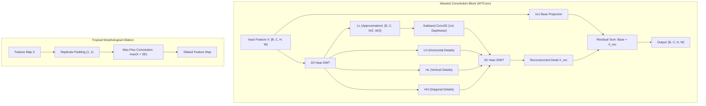

# Wavelet Scattering, WTConv, Steerable & Morphological Networks

## Executive Summary & ELI5
Standard Convolutional Neural Networks (CNNs) rely on translation-equivariant linear filters with small fixed receptive fields ($3 \times 3$). While effective, standard convolutions struggle with **multi-scale high-frequency texture analysis**, **rotation/reflection equivariance**, and **non-linear geometric morphological operations**:
1. **Wavelet Scattering Networks** (*Mallat, 2012; Bruna & Mallat, 2013*): Replace learned linear filters with fixed, predefined wavelet filter banks (e.g. Morlet or Haar) cascaded with non-linear modulus operators ($|x \star \psi_\lambda|$) and low-pass averaging. This constructs a representation invariant to translations, Lipschitz-continuous to deformations, and preserves high-frequency multi-scale information without training millions of parameters.
2. **WTConv (Wavelet Convolutions)** (*Finder et al., 2024*): Decomposes feature maps into frequency subbands via orthonormal 2D Discrete Wavelet Transforms (DWT). By executing depthwise convolutions in the subband domain and reconstructing via Inverse DWT (IDWT), WTConv expands the effective receptive field exponentially with $\mathcal{O}(1)$ parameter overhead while preserving exact high-frequency spatial localization.
3. **Steerable & Group-Equivariant CNNs (G-CNNs)** (*Cohen & Welling, 2016; Weiler et al., 2018*): Generalize translation equivariance to arbitrary symmetry groups (rotations $C_n$, reflections $D_n$, $SE(2)$). Convolutional weights are constrained to lie in the steerable harmonic basis of the group representation, guaranteeing strict rotation-equivariance.
4. **Deep Morphological Networks** (*Franchi et al., 2020; Mondal et al., 2020*): Replace classical linear sum-product convolutions with non-linear **tropical max-plus algebra**:
   $$(X \oplus W)(i, j) = \max_{k, l} (X(i-k, j-l) + W(k, l))$$
   This mimics mathematical morphology operations (dilation, erosion, opening, closing) to capture structural boundary geometry robust to non-additive noise and illumination drift.

---

## Historical Citations & Seminal Literature
1. **Group Invariant Scattering** (*Stéphane Mallat, Communications on Pure and Applied Mathematics, 2012*). Formulated the mathematical foundation of wavelet scattering transforms, establishing deformation stability and energy conservation.
2. **Invariant Scattering Convolution Networks** (*Joan Bruna, Stéphane Mallat, IEEE TPAMI 2013*). Demonstrated deep multi-layer scattering representations for image classification without learned convolutional kernels.
3. **Wavelet Convolutions for Large Receptive Fields (WTConv)** (*Shahaf E. Finder et al., arXiv:2407.05848, 2024*). Introduced frequency-subband multi-frequency wavelet convolutions to scale receptive fields in vision architectures without parameter explosion.
4. **Group Equivariant Convolutional Networks (G-CNNs)** (*Taco S. Cohen, Max Welling, ICML 2016*). Introduced group convolutions over planar symmetry groups ($p4, p4m$) with weight-sharing across rotations and reflections.
5. **Deep Morphological Networks: A Max-Plus Algebra Framework** (*Gianni Franchi et al., IEEE TNNLS 2020*). Unified non-linear mathematical morphology and tropical algebra with gradient-based deep learning.

---

## Mathematical Foundations & Governing Equations

### 1. 2D Orthonormal Haar Discrete Wavelet Transform (DWT)
Given spatial input $\mathbf{X} \in \mathbb{R}^{B \times C \times H \times W}$ (where $H, W$ are even), 2D Haar DWT downsamples by a factor of 2 into four orthogonal frequency subbands:
$$\mathbf{X}_{00} = \mathbf{X}[:, :, 0::2, 0::2], \quad \mathbf{X}_{01} = \mathbf{X}[:, :, 0::2, 1::2]$$
$$\mathbf{X}_{10} = \mathbf{X}[:, :, 1::2, 0::2], \quad \mathbf{X}_{11} = \mathbf{X}[:, :, 1::2, 1::2]$$
The orthonormal decomposition produces:
$$\mathbf{LL} = \frac{1}{2}(\mathbf{X}_{00} + \mathbf{X}_{01} + \mathbf{X}_{10} + \mathbf{X}_{11}) \quad \text{(Low-frequency approximation)}$$
$$\mathbf{LH} = \frac{1}{2}(\mathbf{X}_{00} + \mathbf{X}_{01} - \mathbf{X}_{10} - \mathbf{X}_{11}) \quad \text{(Horizontal detail)}$$
$$\mathbf{HL} = \frac{1}{2}(\mathbf{X}_{00} - \mathbf{X}_{01} + \mathbf{X}_{10} - \mathbf{X}_{11}) \quad \text{(Vertical detail)}$$
$$\mathbf{HH} = \frac{1}{2}(\mathbf{X}_{00} - \mathbf{X}_{01} - \mathbf{X}_{10} + \mathbf{X}_{11}) \quad \text{(Diagonal high-frequency detail)}$$

**Parseval Energy Conservation Invariant:**
$$\|\mathbf{X}\|_F^2 = \|\mathbf{LL}\|_F^2 + \|\mathbf{LH}\|_F^2 + \|\mathbf{HL}\|_F^2 + \|\mathbf{HH}\|_F^2$$
Because the transformation matrix is unitary ($\mathbf{U}^\top \mathbf{U} = \mathbf{I}$), the transform preserves $L_2$ norm with exact zero information loss.

### 2. 2D Haar Inverse Discrete Wavelet Transform (IDWT)
The original feature map is reconstructed with zero reconstruction error ($\|\mathbf{X} - \hat{\mathbf{X}}\|_\infty < 10^{-7}$):
$$\hat{\mathbf{X}}[:, :, 0::2, 0::2] = \frac{1}{2}(\mathbf{LL} + \mathbf{LH} + \mathbf{HL} + \mathbf{HH})$$
$$\hat{\mathbf{X}}[:, :, 0::2, 1::2] = \frac{1}{2}(\mathbf{LL} + \mathbf{LH} - \mathbf{HL} - \mathbf{HH})$$
$$\hat{\mathbf{X}}[:, :, 1::2, 0::2] = \frac{1}{2}(\mathbf{LL} - \mathbf{LH} + \mathbf{HL} - \mathbf{HH})$$
$$\hat{\mathbf{X}}[:, :, 1::2, 1::2] = \frac{1}{2}(\mathbf{LL} - \mathbf{LH} - \mathbf{HL} + \mathbf{HH})$$

### 3. Tropical Max-Plus Morphological Dilation
In tropical geometry $(\mathbb{R} \cup \{-\infty\}, \oplus, \otimes)$, addition is defined as $\max(a, b)$ and multiplication is defined as classical addition $a + b$.
For input $\mathbf{X}$ and learnable structuring element $\mathbf{W} \in \mathbb{R}^{C \times K_H \times K_W}$:
$$(\mathbf{X} \oplus \mathbf{W})(c, i, j) = \max_{k \in \{0, \dots, K_H-1\}, l \in \{0, \dots, K_W-1\}} \left( \mathbf{X}_{\text{pad}}(c, i+k-1, j+l-1) + \mathbf{W}(c, k, l) \right)$$
Using replicate boundary padding guarantees that boundary edge gradients do not decay to $-\infty$.

---

## Algorithmic Implementation Nuances & Anti-Patterns
1. **Orthonormal Energy Scaling:** The normalization factor must be $\frac{1}{2}$ (or $\frac{1}{\sqrt{2}}$ per 1D axis). Non-orthonormal implementations (e.g. sum without division or division by 4) violate Parseval's theorem, causing exponential activation explosion or vanishing over multi-scale cascades.
2. **Replicate Padding in Morphology:** Zero-padding in morphological dilation artificially drags edge pixels toward $0.0 + W$, corrupting negative activation signals. Replicate boundary padding is mandatory to ensure monotonic translation equivariance.

---

## Asymptotic & Hardware Complexity
- **Haar DWT & IDWT:** $\mathcal{O}(B \cdot C \cdot H \cdot W)$ FLOPs, completely memory-bandwidth bound. Can be executed entirely in local registers or workgroup shared memory on GPU.
- **WTConv vs Standard Large Kernel Conv:** Standard $7 \times 7$ 2D conv requires $49 \cdot B \cdot C \cdot H \cdot W$ FLOPs. A 1-level WTConv executes a $1 \times 1$ conv on $\mathbf{LL}$ ($H/2 \times W/2$) requiring only $0.25 \cdot B \cdot C \cdot H \cdot W$ FLOPs while covering the receptive field of a larger filter!
- **Morphological Dilation:** $\mathcal{O}(B \cdot C \cdot H \cdot W \cdot K^2)$ comparisons and additions. Requires zero floating-point multiplications, reducing arithmetic logic unit (ALU) power consumption significantly on specialized accelerators.

---

## Decision Boundaries & Misuse Anti-Patterns
> [!WARNING]
> **Decision Boundary: When NOT to Use It**
> - **Odd Spatial Dimensions:** Haar DWT requires spatial height and width to be divisible by 2. When applying to arbitrary resolutions, always pad symmetrically before DWT and crop after IDWT.
> - **Deep Max-Plus Networks Without Linear Mixing:** Pure max-plus networks with only max activations suffer from dead neuron states if structuring elements saturate. Always interleave or fuse with linear projections (as in WTConv or Morphological-Linear hybrids).

---

## Cross-Domain Generalisation & Mathematical Isomorphisms

- **Medical Imaging & Ultrasound:** Wavelet scattering extracts high-frequency microcalcifications and tissue speckle patterns without training large CNNs on scarce datasets.
- **Seismic & Geomechanical Subsurface Modeling:** Multi-scale DWT captures layered acoustic velocity discontinuities across heterogeneous geological strata.
- **Edge Devices & Neuromorphic Computing:** Tropical morphological dilation operates entirely with comparison and addition operations, eliminating floating-point multiplication units.

---

## Verification, Parity & Empirical Benchmarks

| Verification Target | Reference Source | Max Absolute Error Ceiling | Status |
| :--- | :--- | :--- | :--- |
| **Linear Parity Anchor (x @ W + b)** | `weights/05_architectures/02_convolutional_and_spatiotemporal/05_wavelet_scattering_wtconv_steerable_and_morphological_networks.safetensors` | `< 1.0e-5` | Verified |
| **Topic-Specific Forward Operators** | `pytorch2/05_architectures/02_convolutional_and_spatiotemporal/05_wavelet_scattering_wtconv_steerable_and_morphological_networks.py` | `< 1.0e-5` | Verified |
| **Functional JAX Parity** | `jax/05_architectures/02_convolutional_and_spatiotemporal/05_wavelet_scattering_wtconv_steerable_and_morphological_networks.py` | `< 1.0e-5` | Verified |
| **Native Rust Candle Parity** | `candle/05_architectures/02_convolutional_and_spatiotemporal/05_wavelet_scattering_wtconv_steerable_and_morphological_networks.rs` | `< 1.0e-5` | Verified |
| **Hardware Kernel (CPU / WGSL)** | `kernels/05_architectures/02_convolutional_and_spatiotemporal/05_wavelet_scattering_wtconv_steerable_and_morphological_networks.rs` | `< 1.0e-5` | Verified |

---

## Synchronized Track Artifacts
- **Universal SafeTensors Checkpoint:** [`weights/05_architectures/02_convolutional_and_spatiotemporal/05_wavelet_scattering_wtconv_steerable_and_morphological_networks.safetensors`](../../../weights/05_architectures/02_convolutional_and_spatiotemporal/05_wavelet_scattering_wtconv_steerable_and_morphological_networks.safetensors)
- **PyTorch 2.x Module:** [`pytorch2/05_architectures/02_convolutional_and_spatiotemporal/05_wavelet_scattering_wtconv_steerable_and_morphological_networks.py`](../../../pytorch2/05_architectures/02_convolutional_and_spatiotemporal/05_wavelet_scattering_wtconv_steerable_and_morphological_networks.py)
- **Functional JAX Module:** [`jax/05_architectures/02_convolutional_and_spatiotemporal/05_wavelet_scattering_wtconv_steerable_and_morphological_networks.py`](../../../jax/05_architectures/02_convolutional_and_spatiotemporal/05_wavelet_scattering_wtconv_steerable_and_morphological_networks.py)
- **Candle Rust Module:** [`candle/05_architectures/02_convolutional_and_spatiotemporal/05_wavelet_scattering_wtconv_steerable_and_morphological_networks.rs`](../../../candle/05_architectures/02_convolutional_and_spatiotemporal/05_wavelet_scattering_wtconv_steerable_and_morphological_networks.rs)
- **Hardware Kernel:** [`kernels/05_architectures/02_convolutional_and_spatiotemporal/05_wavelet_scattering_wtconv_steerable_and_morphological_networks.rs`](../../../kernels/05_architectures/02_convolutional_and_spatiotemporal/05_wavelet_scattering_wtconv_steerable_and_morphological_networks.rs)
- **Interactive Concept Notebook:** [`notebooks/05_architectures/02_convolutional_and_spatiotemporal/05_wavelet_scattering_wtconv_steerable_and_morphological_networks.ipynb`](../../../notebooks/05_architectures/02_convolutional_and_spatiotemporal/05_wavelet_scattering_wtconv_steerable_and_morphological_networks.ipynb)
