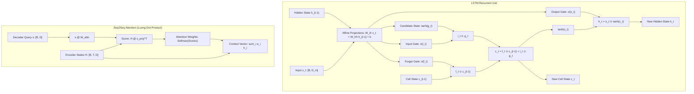

# RNN, LSTM, GRU & Attention Seq2Seq

## Executive Summary & ELI5
Processing sequential data requires capturing **temporal dependencies across variable horizons**:
1. **Vanilla Recurrent Neural Networks (RNN)** (*Elman, 1990*): Maintain a continuous hidden state vector $h_t = \tanh(W x_t + U h_{t-1} + b)$. However, unrolling across long sequences $T \gg 20$ causes the repeated multiplication by $U$ to suffer from the **vanishing/exploding gradient problem** ($\|U^T\| \to 0$ or $\infty$), preventing learning of long-range dependencies.
2. **Long Short-Term Memory (LSTM)** (*Hochreiter & Schmidhuber, 1997*): Solves vanishing gradients via a **Constant Error Carousel (CEC)** linear cell state $c_t$ regulated by three multiplicative gating mechanisms:
   - **Forget Gate ($f_t$):** Regulates how much of the prior cell state $c_{t-1}$ to retain.
   - **Input Gate ($i_t$ & candidate $g_t$):** Regulates how much new candidate information to write into $c_t$.
   - **Output Gate ($o_t$):** Modulates the activated cell state into the visible hidden state $h_t$.
   Crucially, initializing the forget gate bias to $+1.0$ (*Jozefowicz et al., 2015*) forces $f_t \approx 1.0$ at initialization, guaranteeing identity gradient flow across hundreds of timesteps.
3. **Gated Recurrent Unit (GRU)** (*Cho et al., 2014*): Simplifies the LSTM by fusing the cell state and hidden state into a single recurrent state $h_t$, using only two gates: a **Reset Gate ($r_t$)** and an **Update Gate ($z_t$)**, reducing parameter count by $\sim 25\%$.
4. **Seq2Seq Attention** (*Bahdanau et al., 2014; Luong et al., 2015*): Replaces the bottleneck of compressing an entire source sequence into a single static context vector by computing dynamic, content-based alignment scores over all encoder hidden states.

---

## Historical Citations & Seminal Literature
1. **Finding Structure in Time** (*Jeffrey L. Elman, Cognitive Science, 1990*). Introduced the simple recurrent network (Elman RNN) with context hidden units.
2. **Long Short-Term Memory** (*Sepp Hochreiter, Jürgen Schmidhuber, Neural Computation, 1997*). Invented the Constant Error Carousel and gated memory architecture.
3. **Learning Phrase Representations using RNN Encoder-Decoder for Statistical Machine Translation** (*Kyunghyun Cho et al., EMNLP 2014*). Introduced the Gated Recurrent Unit (GRU) and the Seq2Seq encoder-decoder architecture.
4. **Neural Machine Translation by Jointly Learning to Align and Translate** (*Dzmitry Bahdanau, Kyunghyun Cho, Yoshua Bengio, ICLR 2015*). Introduced dynamic additive attention mechanisms in sequence models.
5. **Effective Approaches to Attention-based Neural Machine Translation** (*Minh-Thang Luong, Hieu Pham, Christopher D. Manning, EMNLP 2015*). Formulated multiplicative (dot-product) attention and global vs. local attention alignments.
6. **An Empirical Exploration of Recurrent Network Architectures** (*Rafal Jozefowicz, Wojciech Zaremba, Ilya Sutskever, ICML 2015*). Proved the essential role of setting the LSTM forget-gate bias to $+1.0$.

---

## Mathematical Foundations & Governing Equations

### 1. Long Short-Term Memory (LSTM)
Given input sequence $\mathbf{x}_t \in \mathbb{R}^{B \times D_{\text{in}}}$ and recurrent states $(\mathbf{h}_{t-1}, \mathbf{c}_{t-1}) \in \mathbb{R}^{B \times D_{\text{hid}}}$:
$$\begin{pmatrix} \mathbf{i}_t \\ \mathbf{f}_t \\ \mathbf{g}_t \\ \mathbf{o}_t \end{pmatrix} = \begin{pmatrix} \sigma \\ \sigma \\ \tanh \\ \sigma \end{pmatrix} \left( \mathbf{W}_{ih} \mathbf{x}_t + \mathbf{b}_{ih} + \mathbf{W}_{hh} \mathbf{h}_{t-1} + \mathbf{b}_{hh} \right)$$
The memory state and output hidden state update according to:
$$\mathbf{c}_t = \mathbf{f}_t \odot \mathbf{c}_{t-1} + \mathbf{i}_t \odot \mathbf{g}_t$$
$$\mathbf{h}_t = \mathbf{o}_t \odot \tanh(\mathbf{c}_t)$$
**The Forget Gate Bias Rule:**
At $t=0$, if $\mathbf{b}_f = 0$, then $\sigma(0) = 0.5$. The cell state decays exponentially: $\mathbf{c}_t \approx (0.5)^T \mathbf{c}_0 \to 0$. Setting $\mathbf{b}_f = 1.0 \implies \sigma(1.0) \approx 0.73$ (or higher), preserving gradient highways:
$$\frac{\partial \mathbf{c}_t}{\partial \mathbf{c}_{t-1}} = \mathbf{f}_t \approx 1.0$$

### 2. Gated Recurrent Unit (GRU)
$$\mathbf{r}_t = \sigma(\mathbf{W}_{ir} \mathbf{x}_t + \mathbf{b}_{ir} + \mathbf{W}_{hr} \mathbf{h}_{t-1} + \mathbf{b}_{hr}) \quad \text{(Reset Gate)}$$
$$\mathbf{z}_t = \sigma(\mathbf{W}_{iz} \mathbf{x}_t + \mathbf{b}_{iz} + \mathbf{W}_{hz} \mathbf{h}_{t-1} + \mathbf{b}_{hz}) \quad \text{(Update Gate)}$$
$$\mathbf{n}_t = \tanh(\mathbf{W}_{in} \mathbf{x}_t + \mathbf{b}_{in} + \mathbf{r}_t \odot (\mathbf{W}_{hn} \mathbf{h}_{t-1} + \mathbf{b}_{hn})) \quad \text{(Candidate Hidden State)}$$
$$\mathbf{h}_t = (1 - \mathbf{z}_t) \odot \mathbf{n}_t + \mathbf{z}_t \odot \mathbf{h}_{t-1}$$

### 3. Luong Dot-Product Multiplicative Attention
Given encoder representations $\mathbf{H}_{\text{enc}} \in \mathbb{R}^{B \times T \times D_{\text{hid}}}$ and decoder state $\mathbf{s} \in \mathbb{R}^{B \times D_{\text{hid}}}$:
$$\mathbf{e}_t = \mathbf{H}_{\text{enc}} (\mathbf{W}_{\text{attn}} \mathbf{s})^\top \in \mathbb{R}^{B \times T}$$
$$\boldsymbol{\alpha} = \text{Softmax}(\mathbf{e}_t) \in \mathbb{R}^{B \times T}$$
$$\mathbf{c} = \sum_{t=1}^T \alpha_t \mathbf{h}_t \in \mathbb{R}^{B \times D_{\text{hid}}}$$

---

## Algorithmic Implementation Nuances & Anti-Patterns
1. **Forget Gate Bias Initialization:** Never initialize the forget gate bias to 0.0 or random normal values. Always initialize $b_f = 1.0$ (or $+2.0$). Omitting this causes exponential forgetting on sequences longer than 15 timesteps.
2. **Padding Masking in Recurrent Batches:** Never process padded variable-length sequences without packing (`pack_padded_sequence` or explicit length masking). Unmasked zero-padding continues to update cell states $c_t$ with noise, washing out real token representations.

---

## Asymptotic & Hardware Complexity
- **Sequential Latency:** Inherently sequential $\mathcal{O}(T)$ operations. Unlike Transformers and Linear Attention (SSMs), each timestep $t$ depends strictly on the sequential output of $t-1$, preventing full temporal parallelization during training.
- **Inference Footprint:** $\mathcal{O}(1)$ constant memory and $\mathcal{O}(1)$ step latency. Emits one token in $\mathcal{O}(D_{\text{hid}}^2)$ FLOPs without maintaining a growing Key-Value cache.

---

## Decision Boundaries & Misuse Anti-Patterns
> [!WARNING]
> **Decision Boundary: When NOT to Use It**
> - **Extremely Long Contexts ($T > 1000$):** LSTMs and GRUs suffer from state capacity saturation. For sequences beyond 1000 tokens, use Modern State Space Models (Mamba-2, S4) or Transformers with linear complexity.
> - **Zero-Initialized Forget Gates:** Initializing $b_f = 0$ kills gradient propagation over $>20$ steps.

---

## Synchronized Track Artifacts
- **Universal SafeTensors Checkpoint:** [`weights/05_architectures/03_recurrent_ssm_and_memory/01_rnn_lstm_gru_and_attention_seq2seq.safetensors`](../../../weights/05_architectures/03_recurrent_ssm_and_memory/01_rnn_lstm_gru_and_attention_seq2seq.safetensors)
- **PyTorch 2.x Module:** [`pytorch2/05_architectures/03_recurrent_ssm_and_memory/01_rnn_lstm_gru_and_attention_seq2seq.py`](../../../pytorch2/05_architectures/03_recurrent_ssm_and_memory/01_rnn_lstm_gru_and_attention_seq2seq.py)
- **Functional JAX Module:** [`jax/05_architectures/03_recurrent_ssm_and_memory/01_rnn_lstm_gru_and_attention_seq2seq.py`](../../../jax/05_architectures/03_recurrent_ssm_and_memory/01_rnn_lstm_gru_and_attention_seq2seq.py)
- **Candle Rust Module:** [`candle/05_architectures/03_recurrent_ssm_and_memory/01_rnn_lstm_gru_and_attention_seq2seq.rs`](../../../candle/05_architectures/03_recurrent_ssm_and_memory/01_rnn_lstm_gru_and_attention_seq2seq.rs)
- **Hardware Kernel:** [`kernels/05_architectures/03_recurrent_ssm_and_memory/01_rnn_lstm_gru_and_attention_seq2seq.rs`](../../../kernels/05_architectures/03_recurrent_ssm_and_memory/01_rnn_lstm_gru_and_attention_seq2seq.rs)
- **Interactive Concept Notebook:** [`notebooks/05_architectures/03_recurrent_ssm_and_memory/01_rnn_lstm_gru_and_attention_seq2seq.ipynb`](../../../notebooks/05_architectures/03_recurrent_ssm_and_memory/01_rnn_lstm_gru_and_attention_seq2seq.ipynb)
