# xLSTM: Extended Long Short-Term Memory (sLSTM & mLSTM)

## Executive Summary & ELI5
While Long Short-Term Memory (LSTM) solved the vanishing gradient problem in 1997, it was historically eclipsed by Transformers because LSTMs could not:
1. **Revise stored storage decisions** due to monotonic 1D memory saturation.
2. **Parallelize training execution** across temporal sequence dimensions.
3. **Scale storage capacity linearly** without quadratically increasing hidden state dimensions.

**Extended Long Short-Term Memory (xLSTM)** (*Beck et al., 2024*) resolves these limitations by introducing two novel recurrent cells:
- **sLSTM (Scalar LSTM with Exponential Gating & Memory Mixing):** Replaces traditional sigmoid gating with **stabilized exponential gating** ($\exp(\cdot)$) and a dynamic normalizer state $n_t$. This gives the network the power to dynamically overwrite and amplify previous memories, while preventing numerical overflow through max-stabilization ($m_t = \max(\log\sigma(f_t) + m_{t-1}, i_t)$).
- **mLSTM (Matrix LSTM with Associative Outer-Product Updates):** Replaces the scalar cell state $c_t \in \mathbb{R}^d$ with a **matrix memory state** $C_t \in \mathbb{R}^{d \times d}$. The memory update is performed via outer-product associative writes $v_t k_t^\top$, matching the storage capacity and retrieval dynamics of Linear Attention and Modern Hopfield Networks while maintaining $\mathcal{O}(1)$ step inference complexity.

```mermaid
flowchart TD
    subgraph sLSTMCell ["sLSTM Unit (Exponential Gating)"]
        Xt_s["Input x_t"] --> Affine_s["Affine Gates: i, f, z, o"]
        Ht_prev["Hidden h_{t-1}"] --> Affine_s
        Affine_s --> MaxStab["Max-Stabilization State: m_t = max(log σ(f_t) + m_{t-1}, i_t)"]
        MaxStab --> ExpGating["Exp Gates: i_t = exp(raw_i - m_t), f_t = σ(raw_f) exp(m_{t-1} - m_t)"]
        ExpGating --> CellUpdate_s["Cell State: c_t = f_t c_{t-1} + i_t tanh(z_t)"]
        ExpGating --> NormUpdate_s["Normalizer: n_t = f_t n_{t-1} + i_t"]
        CellUpdate_s --> Div_s["h_tilde = c_t / (n_t + ε)"]
        NormUpdate_s --> Div_s
        Div_s --> OutGate_s["h_t = σ(o_t) ⊙ h_tilde"]
    end

    subgraph mLSTMCell ["mLSTM Unit (Matrix Associative Memory)"]
        Xt_m["Input x_t"] --> QKV["Projections: q_t, k_t, v_t, i_t, f_t, o_t"]
        QKV --> OuterProd["Associative Write: v_t ⊗ k_t^T ∈ R^{D x D}"]
        QKV --> MatrixStab["Max-Stabilizer: m_t"]
        MatrixStab --> MatrixUpdate["Matrix State: C_t = f_t C_{t-1} + i_t (v_t ⊗ k_t^T)"]
        OuterProd --> MatrixUpdate
        MatrixUpdate --> Retrieve["Readout: C_q = C_t q_t"]
        QKV --> Retrieve
        Retrieve --> Denom["denom = max(|n_t^T q_t|, 1)"]
        Denom --> Out_m["h_t = σ(o_t) ⊙ (C_q / denom)"]
    end
```

---

## Historical Citations & Seminal Literature
1. **Long Short-Term Memory** (*Sepp Hochreiter, Jürgen Schmidhuber, Neural Computation, 1997*). Invented the original gated memory carousel.
2. **xLSTM: Extended Long Short-Term Memory** (*Maximilian Beck, Korbinian Pöppel, Markus Spanring, et al., arXiv:2405.04517, 2024*). Formulated sLSTM and mLSTM, introducing stabilized exponential gating, matrix associative memory, and proving performance parity with modern Transformers.
3. **Transformers are RNNs: Fast Autoregressive Transformers with Linear Attention** (*Angelos Katharopoulos et al., ICML 2020*). Established the equivalence between associative recurrent outer-product updates and linear attention mechanisms.
4. **Resurrecting Recurrent Neural Networks for Long Sequences** (*Antonio Orvieto et al., ICML 2023*). Highlighted linear recurrence stability and diagonal state space models.

---

## Mathematical Foundations & Governing Equations

### 1. sLSTM (Scalar LSTM with Exponential Gating)
Given input $\mathbf{x}_t \in \mathbb{R}^d$ and prior hidden state $\mathbf{h}_{t-1} \in \mathbb{R}^d$:
$$\tilde{\mathbf{i}}_t = \mathbf{W}_i \mathbf{x}_t + \mathbf{U}_i \mathbf{h}_{t-1} + \mathbf{b}_i, \quad \tilde{\mathbf{f}}_t = \mathbf{W}_f \mathbf{x}_t + \mathbf{U}_f \mathbf{h}_{t-1} + \mathbf{b}_f$$
$$\tilde{\mathbf{z}}_t = \mathbf{W}_z \mathbf{x}_t + \mathbf{U}_z \mathbf{h}_{t-1} + \mathbf{b}_z, \quad \tilde{\mathbf{o}}_t = \mathbf{W}_o \mathbf{x}_t + \mathbf{U}_o \mathbf{h}_{t-1} + \mathbf{b}_o$$

To prevent exponential explosion while retaining unbounded relative gate ratios, state tracking uses scalar/vector maximum tracker $\mathbf{m}_t$:
$$\mathbf{m}_t = \max\left(\log \sigma(\tilde{\mathbf{f}}_t) + \mathbf{m}_{t-1}, \ \tilde{\mathbf{i}}_t\right)$$
$$\mathbf{i}_t = \exp(\tilde{\mathbf{i}}_t - \mathbf{m}_t), \quad \mathbf{f}_t = \sigma(\tilde{\mathbf{f}}_t) \odot \exp(\mathbf{m}_{t-1} - \mathbf{m}_t)$$

The recurrent cell and normalizer states update as:
$$\mathbf{c}_t = \mathbf{f}_t \odot \mathbf{c}_{t-1} + \mathbf{i}_t \odot \tanh(\tilde{\mathbf{z}}_t)$$
$$\mathbf{n}_t = \mathbf{f}_t \odot \mathbf{n}_{t-1} + \mathbf{i}_t$$
$$\tilde{\mathbf{h}}_t = \frac{\mathbf{c}_t}{\mathbf{n}_t + \epsilon}, \quad \mathbf{h}_t = \sigma(\tilde{\mathbf{o}}_t) \odot \tilde{\mathbf{h}}_t$$

### 2. mLSTM (Matrix Associative LSTM)
Given query, key, value projections $\mathbf{q}_t, \mathbf{k}_t, \mathbf{v}_t \in \mathbb{R}^d$:
$$\mathbf{q}_t = \mathbf{W}_q \mathbf{x}_t + \mathbf{b}_q, \quad \mathbf{k}_t = \mathbf{W}_k \mathbf{x}_t + \mathbf{b}_k, \quad \mathbf{v}_t = \mathbf{W}_v \mathbf{x}_t + \mathbf{b}_v$$
Scalar input and forget gate activations are derived across channel projections:
$$m_t = \max\left(\log \sigma(\tilde{f}_t) + m_{t-1}, \ \tilde{i}_t\right)$$
$$i_t = \exp(\tilde{i}_t - m_t), \quad f_t = \sigma(\tilde{f}_t) \exp(m_{t-1} - m_t)$$

The matrix storage state $\mathbf{C}_t \in \mathbb{R}^{d \times d}$ and normalizer vector $\mathbf{n}_t \in \mathbb{R}^d$ update via associative outer products:
$$\mathbf{C}_t = f_t \mathbf{C}_{t-1} + i_t (\mathbf{v}_t \mathbf{k}_t^\top)$$
$$\mathbf{n}_t = f_t \mathbf{n}_{t-1} + i_t \mathbf{k}_t$$
$$\tilde{\mathbf{h}}_t = \frac{\mathbf{C}_t \mathbf{q}_t}{\max(|\mathbf{n}_t^\top \mathbf{q}_t|, 1)}, \quad \mathbf{h}_t = \sigma(\tilde{\mathbf{o}}_t) \odot \tilde{\mathbf{h}}_t$$

---

## Algorithmic Implementation Nuances & Anti-Patterns
1. **Exponential Gate Clamping:** Exponential gates $\exp(x)$ without the running max tracker $m_t$ immediately overflow FP32 to `+Inf` within 5 steps. Always compute in log-space relative to $m_t$.
2. **Denormalizer Regularization in sLSTM:** The denominator $(n_t + \epsilon)$ requires $\epsilon \approx 10^{-6}$ to prevent zero-division when initial forget gates clear the memory buffer.
3. **Parallel Form in mLSTM:** Like linear attention, the mLSTM recurrent step $\mathbf{C}_t = f_t \mathbf{C}_{t-1} + i_t \mathbf{v}_t \mathbf{k}_t^\top$ can be unrolled via parallel prefix scans during training, enabling full GPU parallelization.

---

## Asymptotic & Hardware Complexity
- **sLSTM Step Cost:** $\mathcal{O}(D_{\text{hid}}^2)$ FLOPs, $\mathcal{O}(D_{\text{hid}})$ state memory.
- **mLSTM Step Cost:** $\mathcal{O}(D_{\text{hid}}^2)$ FLOPs, $\mathcal{O}(D_{\text{hid}}^2)$ state memory.
- **Inference KV Cache:** $\mathcal{O}(1)$ constant memory overhead during auto-regressive generation, eliminating the $\mathcal{O}(T)$ KV cache footprint of Transformers.

---

## Decision Boundaries & Misuse Anti-Patterns
> [!WARNING]
> **Decision Boundary: When NOT to Use It**
> - **Extremely Small Memory Budgets (Edge MCUs with $< 16\text{KB}$ SRAM):** mLSTM's matrix state $C_t \in \mathbb{R}^{D \times D}$ requires $D^2 \times 4$ bytes per head per sequence. For edge microcontrollers, prefer sLSTM or standard GRUs.
> - **Unstabilized Exponential Gates:** Never omit the maximum stabilizer $m_t$.

---

## Cross-Domain Generalisation & Mathematical Isomorphisms
- **High-Frequency Financial Time Series:** mLSTM acts as an online associative covariance estimator, updating volatility matrices without storing historical ticks.
- **Real-Time Audio & Speech Synthesis:** sLSTM's exponential gating enables crisp onset detection and dynamic reverberation tracking at constant inference latency.
- **Robot Joint Impedance Control:** Associative matrix state stores instantaneous task jacobian mappings online during closed-loop manipulation.

---

## Verification, Parity & Empirical Benchmarks

| Verification Target | Reference Source | Max Absolute Error Ceiling | Status |
| :--- | :--- | :--- | :--- |
| **Linear Parity Anchor (x @ W + b)** | `weights/05_architectures/03_recurrent_ssm_and_memory/02_xlstm_slstm_and_mlstm.safetensors` | `< 1.0e-5` | Verified |
| **sLSTM Forward Parity** | `pytorch2/05_architectures/03_recurrent_ssm_and_memory/02_xlstm_slstm_and_mlstm.py` | `< 1.0e-5` | Verified |
| **mLSTM Forward Parity** | `pytorch2/05_architectures/03_recurrent_ssm_and_memory/02_xlstm_slstm_and_mlstm.py` | `< 1.0e-5` | Verified |
| **Functional JAX Parity** | `jax/05_architectures/03_recurrent_ssm_and_memory/02_xlstm_slstm_and_mlstm.py` | `< 1.0e-5` | Verified |
| **Native Rust Candle Parity** | `candle/05_architectures/03_recurrent_ssm_and_memory/02_xlstm_slstm_and_mlstm.rs` | `< 1.0e-5` | Verified |
| **Hardware Kernel (CPU / WGSL)** | `kernels/05_architectures/03_recurrent_ssm_and_memory/02_xlstm_slstm_and_mlstm.rs` | `< 1.0e-5` | Verified |

---

## Synchronized Track Artifacts
- **Universal SafeTensors Checkpoint:** [`weights/05_architectures/03_recurrent_ssm_and_memory/02_xlstm_slstm_and_mlstm.safetensors`](../../../weights/05_architectures/03_recurrent_ssm_and_memory/02_xlstm_slstm_and_mlstm.safetensors)
- **PyTorch 2.x Module:** [`pytorch2/05_architectures/03_recurrent_ssm_and_memory/02_xlstm_slstm_and_mlstm.py`](../../../pytorch2/05_architectures/03_recurrent_ssm_and_memory/02_xlstm_slstm_and_mlstm.py)
- **Functional JAX Module:** [`jax/05_architectures/03_recurrent_ssm_and_memory/02_xlstm_slstm_and_mlstm.py`](../../../jax/05_architectures/03_recurrent_ssm_and_memory/02_xlstm_slstm_and_mlstm.py)
- **Candle Rust Module:** [`candle/05_architectures/03_recurrent_ssm_and_memory/02_xlstm_slstm_and_mlstm.rs`](../../../candle/05_architectures/03_recurrent_ssm_and_memory/02_xlstm_slstm_and_mlstm.rs)
- **Hardware Kernel:** [`kernels/05_architectures/03_recurrent_ssm_and_memory/02_xlstm_slstm_and_mlstm.rs`](../../../kernels/05_architectures/03_recurrent_ssm_and_memory/02_xlstm_slstm_and_mlstm.rs)
- **Interactive Concept Notebook:** [`notebooks/05_architectures/03_recurrent_ssm_and_memory/02_xlstm_slstm_and_mlstm.ipynb`](../../../notebooks/05_architectures/03_recurrent_ssm_and_memory/02_xlstm_slstm_and_mlstm.ipynb)
