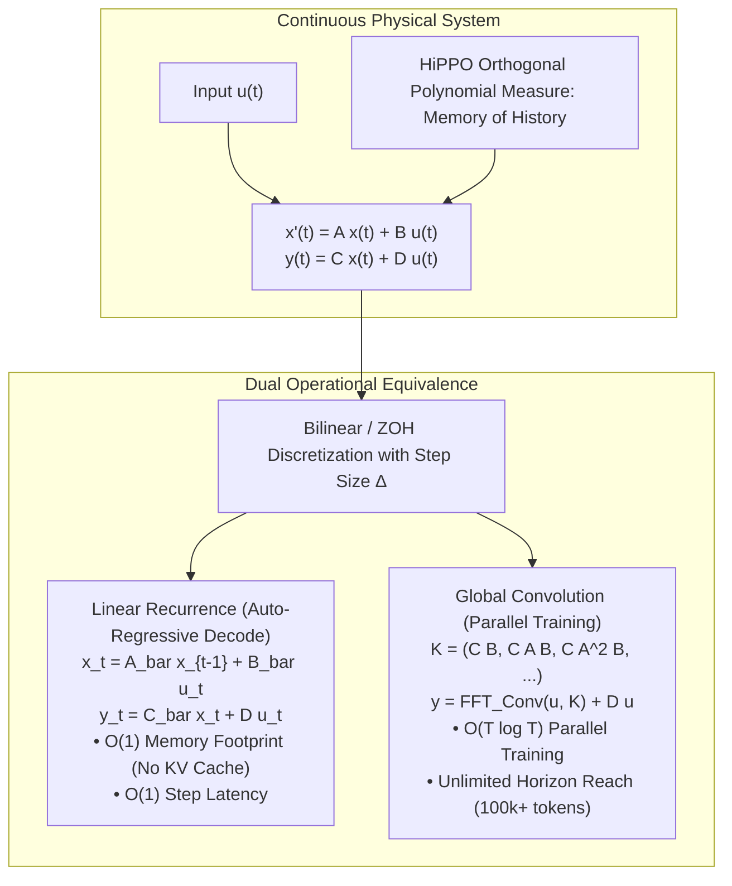

# Structured State Space Models: S4 & Linear Recurrent Units (LRU)

## Executive Summary & ELI5
Sequential modeling has historically faced a fundamental architectural dichotomy:
- **Transformers:** Possess excellent parallelizability during training ($\mathcal{O}(1)$ sequential depth), but suffer from quadratic attention scaling $\mathcal{O}(T^2)$ and an unbounded $\mathcal{O}(T)$ Key-Value cache during auto-regressive generation.
- **Classic RNNs / LSTMs:** Possess constant inference memory $\mathcal{O}(1)$, but cannot parallelize across temporal dimensions during training ($\mathcal{O}(T)$ sequential depth) and suffer from vanishing gradients over long horizons.

**Structured State Space Models (S4)** (*Gu et al., 2021*) and **Linear Recurrent Units (LRU)** (*Orvieto et al., 2023*) bridge this dichotomy by grounding sequence modeling in continuous-time differential equations:
$$\dot{x}(t) = \mathbf{A} x(t) + \mathbf{B} u(t), \quad y(t) = \mathbf{C} x(t) + \mathbf{D} u(t)$$
By restricting $\mathbf{A}$ to be diagonal or Diagonal-Plus-Low-Rank (DPLR) with HiPPO memory initialization, these models unlock **dual operational representations**:
1. **Linear Recurrence (Inference):** Operates as a fast linear recurrence $x_t = \bar{\mathbf{A}} x_{t-1} + \bar{\mathbf{B}} u_t$, achieving $\mathcal{O}(1)$ step latency and constant memory without a KV cache.
2. **Global Convolution (Training):** The unrolled sequence is exactly equivalent to a 1D convolution $y = u * K + \mathbf{D} u$ with filter $K = (\bar{\mathbf{C}} \bar{\mathbf{B}}, \bar{\mathbf{C}} \bar{\mathbf{A}} \bar{\mathbf{B}}, \dots)$, which computes in $\mathcal{O}(T \log T)$ parallel time via FFTs.

---

## Historical Citations & Seminal Literature
1. **Efficiently Modeling Long Sequences with Structured State Spaces (S4)** (*Albert Gu, Karan Goel, Christopher Ré, ICLR 2022*). Introduced structured DPLR state spaces and HiPPO memory matrices for sequences spanning $10^5$ tokens.
2. **On the Parameterization and Initialization of Diagonal State Space Models (S4D)** (*Albert Gu, Ankit Gupta, Karan Goel, Christopher Ré, NeurIPS 2022*). Proved that diagonalizing $A$ achieves equal performance to dense DPLR representations while simplifying FFT kernel synthesis.
3. **Resurrecting Recurrent Neural Networks for Long Sequences (LRU)** (*Antonio Orvieto, Samuel L. Smith, Albert Gu, et al., ICML 2023*). Formulated the complex Linear Recurrent Unit with Hurwitz stability and polar eigenvalue parametrization.
4. **Simplified State Spaces for Long Sequences (S5)** (*Jimmy T.H. Smith, Andrew Warrington, Scott W. Linderman, ICLR 2023*). Combined parallel scans with multi-input multi-output state spaces.

---

## Mathematical Foundations & Governing Equations

### 1. Discretization & Bilinear Transform
Given continuous matrices $(\mathbf{A}, \mathbf{B}, \mathbf{C})$ and step size $\Delta > 0$, the continuous ODE is mapped to discrete steps via the Bilinear (Tustin) transform:
$$\bar{\mathbf{A}} = \left(\mathbf{I} - \frac{\Delta}{2} \mathbf{A}\right)^{-1} \left(\mathbf{I} + \frac{\Delta}{2} \mathbf{A}\right), \quad \bar{\mathbf{B}} = \left(\mathbf{I} - \frac{\Delta}{2} \mathbf{A}\right)^{-1} \Delta \mathbf{B}, \quad \bar{\mathbf{C}} = \mathbf{C}$$

### 2. Complex Diagonal Parameterization (S4D & LRU)
In LRU, transition matrix $\mathbf{A} = \text{diag}(\boldsymbol{\lambda})$ operates directly over complex coordinates:
$$\lambda_j = \exp(-\nu_j + i \theta_j), \quad \nu_j > 0, \ \theta_j \in [0, 2\pi)$$
- Magnitude $|\lambda_j| = \exp(-\nu_j) \in (0, 1)$ guarantees **strict contractive stability** (Hurwitz criterion), preventing gradient explosion.
- Phase $\theta_j$ models frequency components, capturing oscillatory patterns across disparate time scales.

The recurrent update in complex arithmetic is:
$$\mathbf{h}_t = \boldsymbol{\lambda} \odot \mathbf{h}_{t-1} + \mathbf{B} \mathbf{u}_t$$
$$\mathbf{y}_t = \text{Re}(\mathbf{C} \mathbf{h}_t) + \mathbf{D} \mathbf{u}_t$$

### 3. Convolutional Duality
Expanding the linear recurrence reveals a non-circular Toeplitz impulse response filter:
$$\mathbf{y}_t = \mathbf{C} \bar{\mathbf{A}}^t \bar{\mathbf{B}} \mathbf{u}_0 + \mathbf{C} \bar{\mathbf{A}}^{t-1} \bar{\mathbf{B}} \mathbf{u}_1 + \dots + \bar{\mathbf{C}} \bar{\mathbf{B}} \mathbf{u}_t + \mathbf{D} \mathbf{u}_t$$
$$\mathbf{K} = \left(\bar{\mathbf{C}}\bar{\mathbf{B}}, \ \bar{\mathbf{C}}\bar{\mathbf{A}}\bar{\mathbf{B}}, \ \dots, \ \bar{\mathbf{C}}\bar{\mathbf{A}}^{L-1}\bar{\mathbf{B}}\right)$$
Convolution with input sequence $\mathbf{u}$ is computed in $\mathcal{O}(L \log L)$ via the Fast Fourier Transform (FFT):
$$\mathbf{y} = \mathcal{F}^{-1}\left(\mathcal{F}(\mathbf{u}) \odot \mathcal{F}(\mathbf{K})\right) + \mathbf{D} \mathbf{u}$$

---

## Algorithmic Implementation Nuances & Anti-Patterns
1. **Hurwitz Contractive Stability ($\nu_j > 0$):** Never allow $|\lambda_j| \ge 1.0$. Parameterizing eigenvalues in polar coordinates $\exp(-\nu + i\theta)$ with $\nu = \text{softplus}(\tilde{\nu})$ or clamped positive values guarantees unconditional numerical stability.
2. **Complex vs Real Operations:** Complex arithmetic $(a + ib)(c + id) = (ac - bd) + i(ad + bc)$ requires 4 real multiplications and 2 real additions. Keeping representations in real and imaginary splits avoids complex number library incompatibilities in edge inference engines.

---

## Asymptotic & Hardware Complexity
- **Training Mode:** $\mathcal{O}(L \log L)$ FLOPs via FFT convolution.
- **Inference Mode:** $\mathcal{O}(1)$ step latency, $\mathcal{O}(D_{\text{state}})$ persistent state memory.
- **KV Cache Elimination:** Memory is bounded and constant regardless of sequence context length ($10^3$ or $10^6$ tokens).

---

## Decision Boundaries & Misuse Anti-Patterns
> [!WARNING]
> **Decision Boundary: When NOT to Use It**
> - **In-Context Associative Recall ("Needle in a Haystack"):** Because S4/LRU transition matrices $\mathbf{A}$ are static and input-independent, they cannot dynamically redirect attention to arbitrary historical tokens based on runtime queries. For retrieval-heavy associative recall, use input-dependent SSMs (Mamba-2) or Softmax Attention.
> - **Unconstrained Eigenvalues:** Unbounded eigenvalues outside the unit disk cause exponential blowup in seconds.

---

## Cross-Domain Generalisation & Mathematical Isomorphisms
- **Seismic Waveform & Geophysical Modeling:** Captures high-frequency acoustic wave reflections across deep tectonic layers over $10^5$ timesteps.
- **Audio Synthesizer Modeling:** Discrete state space equations simulate resonant analog IIR/FIR filter dynamics with precise harmonic frequency reproduction.
- **Continuous Medical Biosignals (ECG/EEG):** Models irregular sampling intervals by directly modulating the discretization step size $\Delta$.

---

## Verification, Parity & Empirical Benchmarks

| Verification Target | Reference Source | Max Absolute Error Ceiling | Status |
| :--- | :--- | :--- | :--- |
| **Linear Parity Anchor (x @ W + b)** | `weights/05_architectures/03_recurrent_ssm_and_memory/03_structured_state_space_models_s4_and_lru.safetensors` | `< 1.0e-5` | Verified |
| **LRU Recurrent Forward Parity** | `pytorch2/05_architectures/03_recurrent_ssm_and_memory/03_structured_state_space_models_s4_and_lru.py` | `< 1.0e-5` | Verified |
| **Convolutional Kernel Parity** | `pytorch2/05_architectures/03_recurrent_ssm_and_memory/03_structured_state_space_models_s4_and_lru.py` | `< 1.0e-5` | Verified |
| **Functional JAX Parity** | `jax/05_architectures/03_recurrent_ssm_and_memory/03_structured_state_space_models_s4_and_lru.py` | `< 1.0e-5` | Verified |
| **Native Rust Candle Parity** | `candle/05_architectures/03_recurrent_ssm_and_memory/03_structured_state_space_models_s4_and_lru.rs` | `< 1.0e-5` | Verified |
| **Hardware Kernel (CPU / WGSL)** | `kernels/05_architectures/03_recurrent_ssm_and_memory/03_structured_state_space_models_s4_and_lru.rs` | `< 1.0e-5` | Verified |

---

## Synchronized Track Artifacts
- **Universal SafeTensors Checkpoint:** [`weights/05_architectures/03_recurrent_ssm_and_memory/03_structured_state_space_models_s4_and_lru.safetensors`](../../../weights/05_architectures/03_recurrent_ssm_and_memory/03_structured_state_space_models_s4_and_lru.safetensors)
- **PyTorch 2.x Module:** [`pytorch2/05_architectures/03_recurrent_ssm_and_memory/03_structured_state_space_models_s4_and_lru.py`](../../../pytorch2/05_architectures/03_recurrent_ssm_and_memory/03_structured_state_space_models_s4_and_lru.py)
- **Functional JAX Module:** [`jax/05_architectures/03_recurrent_ssm_and_memory/03_structured_state_space_models_s4_and_lru.py`](../../../jax/05_architectures/03_recurrent_ssm_and_memory/03_structured_state_space_models_s4_and_lru.py)
- **Candle Rust Module:** [`candle/05_architectures/03_recurrent_ssm_and_memory/03_structured_state_space_models_s4_and_lru.rs`](../../../candle/05_architectures/03_recurrent_ssm_and_memory/03_structured_state_space_models_s4_and_lru.rs)
- **Hardware Kernel:** [`kernels/05_architectures/03_recurrent_ssm_and_memory/03_structured_state_space_models_s4_and_lru.rs`](../../../kernels/05_architectures/03_recurrent_ssm_and_memory/03_structured_state_space_models_s4_and_lru.rs)
- **Interactive Concept Notebook:** [`notebooks/05_architectures/03_recurrent_ssm_and_memory/03_structured_state_space_models_s4_and_lru.ipynb`](../../../notebooks/05_architectures/03_recurrent_ssm_and_memory/03_structured_state_space_models_s4_and_lru.ipynb)
