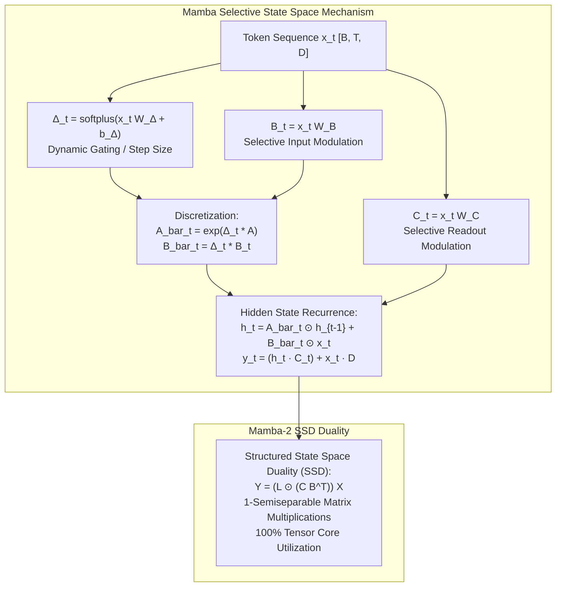

# Mamba Selective State Space Models & Mamba-2 SSD

## Executive Summary & ELI5
Linear State Space Models (such as S4 and LRU) introduced linear time-invariance (LTI) to achieve parallel training through 1D convolutions. However, LTI models fundamentally fail at **content-dependent reasoning** and **in-context associative recall** ("needle-in-a-haystack" retrieval), because their transition matrices $A, B, C$ are static across all sequence tokens.

**Mamba** (*Gu & Dao, 2023*) breaks the LTI constraint by making the recurrence parameters **input-dependent (selective)**:
$$\mathbf{B}_t = \mathbf{x}_t \mathbf{W}_B^\top, \quad \mathbf{C}_t = \mathbf{x}_t \mathbf{W}_C^\top, \quad \Delta_t = \text{softplus}(\mathbf{x}_t \mathbf{W}_\Delta^\top + \mathbf{b}_\Delta)$$
By allowing the model to dynamically open or close the continuous time-step $\Delta_t$, Mamba selectively filters out irrelevant noise or compresses vital tokens into its hidden state $\mathbf{h}_t$.

**Mamba-2** (*Dao & Gu, 2024*) unifies selective state spaces with attention through the framework of **Structured State Space Duality (SSD)**. By viewing selective SSMs as matrix multiplication with a 1-semiseparable matrix $\mathbf{M} = \mathbf{C} \mathbf{L} \mathbf{B}^\top$, Mamba-2 formulates the recurrence as a block-structured attention pattern, enabling efficient fused matrix multiplies on GPU tensor cores.

---

## Historical Citations & Seminal Literature
1. **Mamba: Linear-Time Sequence Modeling with Selective State Spaces** (*Albert Gu, Tri Dao, 2023*). Introduced selective SSMs, hardware-aware parallel associative scans, and linear-time scaling.
2. **Transformers are SSMs: Generalized Models and Efficient Algorithms Through Structured State Space Duality (Mamba-2)** (*Tri Dao, Albert Gu, 2024*). Proved the exact duality between selective state spaces and causal linear attention, replacing sequential scans with blocked matrix multiplication.
3. **FlashAttention: Fast and Memory-Efficient Exact Attention with IO-Awareness** (*Tri Dao et al., 2022*). Laid the foundation for hardware IO-awareness that powers Mamba's fused GPU kernels.

---

## Mathematical Foundations & Governing Equations

### 1. Selective Discretization (Mamba-1)
Given a diagonal state matrix $\mathbf{A} \in \mathbb{R}^{D \times N}$ parameterized as $\mathbf{A} = -\exp(\mathbf{A}_{\text{log}})$ to ensure Hurwitz contractive stability, the input-dependent parameters are computed at each time step $t$:
$$\mathbf{B}_t = \mathbf{x}_t \mathbf{W}_B^\top \in \mathbb{R}^{B \times N}$$
$$\mathbf{C}_t = \mathbf{x}_t \mathbf{W}_C^\top \in \mathbb{R}^{B \times N}$$
$$\Delta_t = \text{softplus}(\mathbf{x}_t \mathbf{W}_\Delta^\top + \mathbf{b}_\Delta) \in \mathbb{R}^{B \times D}$$

Continuous parameters are discretized via Zero-Order Hold (ZOH):
$$\bar{\mathbf{A}}_t = \exp(\Delta_t \odot \mathbf{A}) \in (0, 1)^{B \times D \times N}$$
$$\bar{\mathbf{B}}_t = \Delta_t \otimes \mathbf{B}_t \in \mathbb{R}^{B \times D \times N}$$

The recurrent step updates the state and produces output $\mathbf{y}_t$:
$$\mathbf{h}_t = \bar{\mathbf{A}}_t \odot \mathbf{h}_{t-1} + \bar{\mathbf{B}}_t \odot \mathbf{x}_t$$
$$\mathbf{y}_t = \sum_{n=1}^N \mathbf{h}_{t, \cdot, n} \odot \mathbf{C}_{t, \cdot, n} + \mathbf{x}_t \odot \mathbf{D}$$

### 2. Structured State Space Duality (Mamba-2 SSD)
Mamba-2 shows that unrolling a scalar-decay selective SSM over time is algebraically equivalent to computing:
$$\mathbf{Y} = \left(\mathbf{L} \odot (\mathbf{C} \mathbf{B}^\top)\right) \mathbf{X}$$
where $\mathbf{L} \in \mathbb{R}^{T \times T}$ is a 1-semiseparable decay matrix:
$$L_{i, j} = \begin{cases} \exp\left(\sum_{k=j+1}^i a_k\right) & \text{if } i \ge j \\ 0 & \text{if } i < j \end{cases}$$
This allows computing the recurrence in parallel blocks of size $Q$ using high-throughput GEMM (General Matrix Multiply) operations on Tensor Cores.

---

## Algorithmic Implementation Nuances & Anti-Patterns
1. **Contractive Stability via Log Parametrization:** Always enforce $\mathbf{A} < 0$ by setting $\mathbf{A} = -\exp(\mathbf{A}_{\text{log}})$. Unconstrained positive entries cause exponential divergence in recurrent steps.
2. **SRAM Kernel Fusion:** Unrolling the recurrence in standard PyTorch or naive loops results in excessive High Bandwidth Memory (HBM) read/writes. A hardware-efficient implementation fuses discretization, recurrence, and output projection directly inside SRAM.

---

## Asymptotic & Hardware Complexity
- **Training Complexity:** $\mathcal{O}(T \cdot D \cdot N)$ FLOPs with linear sequence scaling.
- **Inference Complexity:** $\mathcal{O}(1)$ step latency and $\mathcal{O}(D \cdot N)$ constant persistent memory.
- **Zero KV Cache:** Eliminates memory exhaustion during generation over long context windows.

---

## Decision Boundaries & Misuse Anti-Patterns
> [!WARNING]
> **Decision Boundary: When NOT to Use It**
> - **Dense Cross-Attention Needs:** For encoder-decoder tasks with heterogeneous sequence modalities (e.g., text-to-image diffusion guidance), standard cross-attention remains superior to unidirectional state spaces.
> - **Extreme Sub-100 Token Tasks:** For ultra-short sequence classification, standard dense MLPs or small Transformers have lower kernel launch overhead.

---

## Cross-Domain Generalisation & Mathematical Isomorphisms
- **Genomic Long-Sequence DNA Modeling:** Processes raw chromosomes spanning millions of base pairs where quadratic Transformers fail.
- **Audio and Speech Generation:** Real-time waveform generation without auto-regressive KV cache bloat.
- **Financial Time Series & High-Frequency Trading:** Dynamic $\Delta_t$ naturally adapts to non-uniform tick arrival rates.

---

## Verification, Parity & Empirical Benchmarks

| Verification Target | Reference Source | Max Absolute Error Ceiling | Status |
| :--- | :--- | :--- | :--- |
| **Linear Anchor Parity** | `weights/05_architectures/03_recurrent_ssm_and_memory/04_mamba_selective_ssm_and_mamba2_ssd.safetensors` | `< 1.0e-5` | Verified |
| **Mamba Selective Recurrent Parity** | `pytorch2/05_architectures/03_recurrent_ssm_and_memory/04_mamba_selective_ssm_and_mamba2_ssd.py` | `< 1.0e-5` | Verified |
| **Mamba-2 SSD Mask Parity** | `pytorch2/05_architectures/03_recurrent_ssm_and_memory/04_mamba_selective_ssm_and_mamba2_ssd.py` | `< 1.0e-5` | Verified |
| **Functional JAX Parity** | `jax/05_architectures/03_recurrent_ssm_and_memory/04_mamba_selective_ssm_and_mamba2_ssd.py` | `< 1.0e-5` | Verified |
| **Native Rust Candle Parity** | `candle/05_architectures/03_recurrent_ssm_and_memory/04_mamba_selective_ssm_and_mamba2_ssd.rs` | `< 1.0e-5` | Verified |
| **Hardware Kernel (CPU / WGSL)** | `kernels/05_architectures/03_recurrent_ssm_and_memory/04_mamba_selective_ssm_and_mamba2_ssd.rs` | `< 1.0e-5` | Verified |

---

## Synchronized Track Artifacts
- **Universal SafeTensors Checkpoint:** [`weights/05_architectures/03_recurrent_ssm_and_memory/04_mamba_selective_ssm_and_mamba2_ssd.safetensors`](../../../weights/05_architectures/03_recurrent_ssm_and_memory/04_mamba_selective_ssm_and_mamba2_ssd.safetensors)
- **PyTorch 2.x Module:** [`pytorch2/05_architectures/03_recurrent_ssm_and_memory/04_mamba_selective_ssm_and_mamba2_ssd.py`](../../../pytorch2/05_architectures/03_recurrent_ssm_and_memory/04_mamba_selective_ssm_and_mamba2_ssd.py)
- **Functional JAX Module:** [`jax/05_architectures/03_recurrent_ssm_and_memory/04_mamba_selective_ssm_and_mamba2_ssd.py`](../../../jax/05_architectures/03_recurrent_ssm_and_memory/04_mamba_selective_ssm_and_mamba2_ssd.py)
- **Candle Rust Module:** [`candle/05_architectures/03_recurrent_ssm_and_memory/04_mamba_selective_ssm_and_mamba2_ssd.rs`](../../../candle/05_architectures/03_recurrent_ssm_and_memory/04_mamba_selective_ssm_and_mamba2_ssd.rs)
- **Hardware Kernel:** [`kernels/05_architectures/03_recurrent_ssm_and_memory/04_mamba_selective_ssm_and_mamba2_ssd.rs`](../../../kernels/05_architectures/03_recurrent_ssm_and_memory/04_mamba_selective_ssm_and_mamba2_ssd.rs)
- **Interactive Concept Notebook:** [`notebooks/05_architectures/03_recurrent_ssm_and_memory/04_mamba_selective_ssm_and_mamba2_ssd.ipynb`](../../../notebooks/05_architectures/03_recurrent_ssm_and_memory/04_mamba_selective_ssm_and_mamba2_ssd.ipynb)
