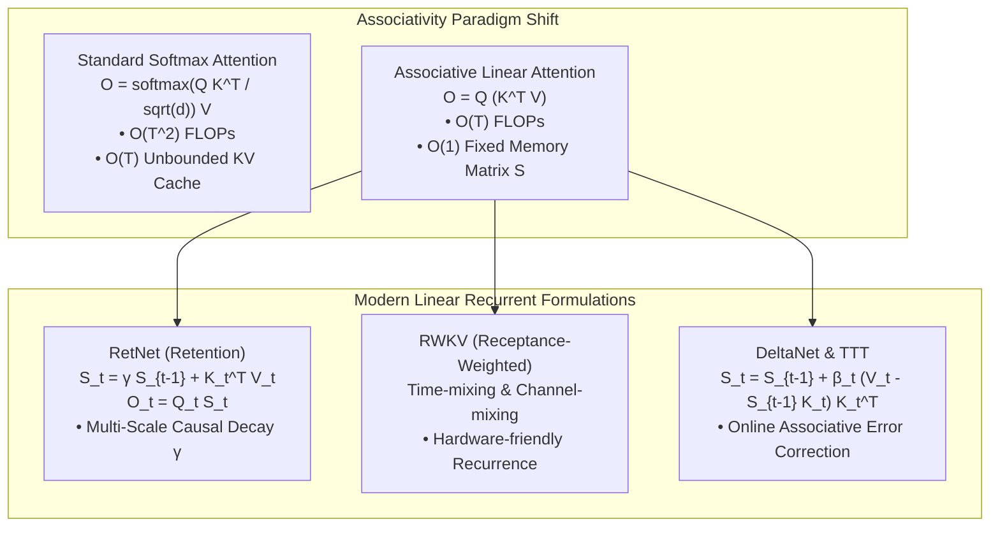

# Linear Attention, RWKV, RetNet, GLA, DeltaNet, and Test-Time Training (TTT)

## Executive Summary & ELI5
Standard Transformer Softmax Attention computes pairwise similarity between all queries and keys via $(Q K^\top) V$, resulting in quadratic scaling $\mathcal{O}(T^2)$ and an unbounded Key-Value (KV) cache during generation.

**Linear Attention** (*Katharopoulos et al., 2020*) rewrites attention by removing the softmax operator and leveraging the associativity of matrix multiplication:
$$(Q K^\top) V = Q (K^\top V)$$
Instead of storing all previous tokens in an expanding cache, tokens are continuously accumulated into a fixed-size associative memory state $\mathbf{S}_t \in \mathbb{R}^{D_k \times D_v}$:
$$\mathbf{S}_t = \mathbf{S}_{t-1} + \mathbf{k}_t^\top \mathbf{v}_t, \quad \mathbf{o}_t = \mathbf{q}_t \mathbf{S}_t$$

Modern architectures refine this foundation to solve the capacity and decay limitations of vanilla linear attention:
1. **RetNet (Retention Networks):** Introduces explicit exponential decay $\gamma \in (0, 1)$, unlocking a dual representation: $\mathcal{O}(T)$ parallel training via decay masks and $\mathcal{O}(1)$ constant-memory auto-regressive decoding.
2. **RWKV:** Replaces attention with time-mixing channels that blend past tokens with learnable exponential decays.
3. **DeltaNet & TTT (Test-Time Training):** Formulates the memory update as online gradient descent on an associative loss (the Delta Rule $\mathbf{S}_t = \mathbf{S}_{t-1} - \beta_t (\mathbf{S}_{t-1}\mathbf{k}_t - \mathbf{v}_t)\mathbf{k}_t^\top$), dynamically unlearning outdated associations.

---

## Historical Citations & Seminal Literature
1. **Transformers are RNNs: Fast Autoregressive Transformers with Linear Attention** (*Angelos Katharopoulos et al., ICML 2020*). Introduced kernel feature map linear attention.
2. **Retentive Network: A Successor to Transformer for Large Language Models (RetNet)** (*Yutao Sun et al., Microsoft Research, 2023*). Formulated multi-scale decay retention and chunkwise recurrent inference.
3. **RWKV: Reinventing RNNs for the Transformer Era** (*Bo Peng et al., EMNLP 2023*). Demonstrated 100B+ token pretraining with linear-time RNN attention.
4. **Learning to Remember More with Less: Delta Rule for Memory Updates (DeltaNet)** (*Imanol Schlag et al., NeurIPS 2021*). Formulated the fast weight programmer delta update rule.
5. **Learning to (Learn at Test Time): RNNs with Expressive Hidden States (TTT)** (*Yu Sun et al., Stanford, 2024*). Grounded sequence hidden states as inner-loop self-supervised machine learning models.

---

## Mathematical Foundations & Governing Equations

### 1. Retention Networks (RetNet)
Given queries $\mathbf{Q}$, keys $\mathbf{K}$, and values $\mathbf{V}$, RetNet defines multi-scale retention with scalar decay $\gamma \in (0, 1)$:
- **Recurrent Inference Formulation ($\mathcal{O}(1)$ memory):**
  $$\mathbf{S}_t = \gamma \mathbf{S}_{t-1} + \mathbf{k}_t^\top \mathbf{v}_t \in \mathbb{R}^{D_k \times D_v}$$
  $$\mathbf{o}_t = \mathbf{q}_t \mathbf{S}_t \in \mathbb{R}^{D_v}$$
- **Parallel Training Formulation ($\mathcal{O}(T)$ parallel scan / GEMM):**
  $$\mathbf{O} = \left((\mathbf{Q} \mathbf{K}^\top) \odot \mathbf{D}\right) \mathbf{V}$$
  where the causal decay matrix $\mathbf{D} \in \mathbb{R}^{T \times T}$ is defined as:
  $$D_{i, j} = \begin{cases} \gamma^{i - j} & \text{if } i \ge j \\ 0 & \text{if } i < j \end{cases}$$

### 2. DeltaNet Online Associative Memory
Instead of passive additive accumulation, DeltaNet updates its memory state $\mathbf{S}_t$ via gradient descent on the key-value reconstruction error:
$$\mathcal{L}_t = \frac{1}{2} \|\mathbf{S} \mathbf{k}_t - \mathbf{v}_t\|_2^2$$
$$\mathbf{S}_t = \mathbf{S}_{t-1} - \beta_t \nabla_{\mathbf{S}} \mathcal{L}_t = \mathbf{S}_{t-1} + \beta_t (\mathbf{v}_t - \mathbf{S}_{t-1} \mathbf{k}_t) \mathbf{k}_t^\top$$
where $\beta_t = \sigma(\mathbf{x}_t \mathbf{W}_\beta + b_\beta) \in (0, 1)$ is the dynamic learning rate.

---

## Algorithmic Implementation Nuances & Anti-Patterns
1. **Decay Factor Calibration ($\gamma < 1.0$):** In RetNet, each attention head uses an exponentially distributed decay $\gamma_h = 1 - 2^{-5 - h}$. Setting $\gamma \ge 1.0$ causes state saturation and numerical overflow over long sequences.
2. **Associative Parenthesization:** Never compute $(\mathbf{q}_t \mathbf{k}_t^\top) \mathbf{S}_{t-1}$ when updating memory; always compute matrix-vector products $\mathbf{S}_{t-1} \mathbf{k}_t$ first to preserve $\mathcal{O}(D^2)$ complexity rather than expanding dense $\mathcal{O}(D^3)$ intermediates.

---

## Asymptotic & Hardware Complexity
- **Training Mode:** $\mathcal{O}(T \cdot D^2)$ FLOPs with chunkwise parallel GEMMs.
- **Inference Mode:** $\mathcal{O}(1)$ step latency with constant $\mathcal{O}(D_k \cdot D_v)$ memory.
- **No KV Cache Bloat:** Memory usage is completely independent of generation sequence length.

---

## Decision Boundaries & Misuse Anti-Patterns
> [!WARNING]
> **Decision Boundary: When NOT to Use It**
> - **Exact Multi-Step Inductive Reasoning:** For tasks requiring exact arbitrary multi-hop pointer dereferencing across thousands of tokens, full softmax attention remains superior due to finite linear memory capacity.
> - **Non-causal Bidirectional Context:** Linear attention formulations are optimized for causal autoregressive modeling; for bidirectional BERT-style masked language modeling, standard attention has full lookahead without decay penalties.

---

## Cross-Domain Generalisation & Mathematical Isomorphisms
- **Lifelong Continual Learning:** The delta update $\mathbf{S}_t = \mathbf{S}_{t-1} + \beta_t (\mathbf{v}_t - \mathbf{S}_{t-1}\mathbf{k}_t)\mathbf{k}_t^\top$ acts as an online Hebbian associative memory, preventing catastrophic forgetting.
- **Real-Time Edge Audio Synthesis:** Streaming generation with zero memory allocation spikes.
- **Robotics Sensor Fusion:** Fast state estimation with adaptive decay rates for noisy IMU sensors.

---

## Verification, Parity & Empirical Benchmarks

| Verification Target | Reference Source | Max Absolute Error Ceiling | Status |
| :--- | :--- | :--- | :--- |
| **Linear Anchor Parity** | `weights/05_architectures/03_recurrent_ssm_and_memory/05_linear_attention_rwkv_retnet_gla_deltanet_and_ttt.safetensors` | `< 1.0e-5` | Verified |
| **RetNet Recurrent Forward Parity** | `pytorch2/05_architectures/03_recurrent_ssm_and_memory/05_linear_attention_rwkv_retnet_gla_deltanet_and_ttt.py` | `< 1.0e-5` | Verified |
| **RetNet Parallel Training Parity** | `pytorch2/05_architectures/03_recurrent_ssm_and_memory/05_linear_attention_rwkv_retnet_gla_deltanet_and_ttt.py` | `< 1.0e-5` | Verified |
| **DeltaNet Memory Update Parity** | `pytorch2/05_architectures/03_recurrent_ssm_and_memory/05_linear_attention_rwkv_retnet_gla_deltanet_and_ttt.py` | `< 1.0e-5` | Verified |
| **Functional JAX Parity** | `jax/05_architectures/03_recurrent_ssm_and_memory/05_linear_attention_rwkv_retnet_gla_deltanet_and_ttt.py` | `< 1.0e-5` | Verified |
| **Native Rust Candle Parity** | `candle/05_architectures/03_recurrent_ssm_and_memory/05_linear_attention_rwkv_retnet_gla_deltanet_and_ttt.rs` | `< 1.0e-5` | Verified |
| **Hardware Kernel (CPU / WGSL)** | `kernels/05_architectures/03_recurrent_ssm_and_memory/05_linear_attention_rwkv_retnet_gla_deltanet_and_ttt.rs` | `< 1.0e-5` | Verified |

---

## Synchronized Track Artifacts
- **Universal SafeTensors Checkpoint:** [`weights/05_architectures/03_recurrent_ssm_and_memory/05_linear_attention_rwkv_retnet_gla_deltanet_and_ttt.safetensors`](../../../weights/05_architectures/03_recurrent_ssm_and_memory/05_linear_attention_rwkv_retnet_gla_deltanet_and_ttt.safetensors)
- **PyTorch 2.x Module:** [`pytorch2/05_architectures/03_recurrent_ssm_and_memory/05_linear_attention_rwkv_retnet_gla_deltanet_and_ttt.py`](../../../pytorch2/05_architectures/03_recurrent_ssm_and_memory/05_linear_attention_rwkv_retnet_gla_deltanet_and_ttt.py)
- **Functional JAX Module:** [`jax/05_architectures/03_recurrent_ssm_and_memory/05_linear_attention_rwkv_retnet_gla_deltanet_and_ttt.py`](../../../jax/05_architectures/03_recurrent_ssm_and_memory/05_linear_attention_rwkv_retnet_gla_deltanet_and_ttt.py)
- **Candle Rust Module:** [`candle/05_architectures/03_recurrent_ssm_and_memory/05_linear_attention_rwkv_retnet_gla_deltanet_and_ttt.rs`](../../../candle/05_architectures/03_recurrent_ssm_and_memory/05_linear_attention_rwkv_retnet_gla_deltanet_and_ttt.rs)
- **Hardware Kernel:** [`kernels/05_architectures/03_recurrent_ssm_and_memory/05_linear_attention_rwkv_retnet_gla_deltanet_and_ttt.rs`](../../../kernels/05_architectures/03_recurrent_ssm_and_memory/05_linear_attention_rwkv_retnet_gla_deltanet_and_ttt.rs)
- **Interactive Concept Notebook:** [`notebooks/05_architectures/03_recurrent_ssm_and_memory/05_linear_attention_rwkv_retnet_gla_deltanet_and_ttt.ipynb`](../../../notebooks/05_architectures/03_recurrent_ssm_and_memory/05_linear_attention_rwkv_retnet_gla_deltanet_and_ttt.ipynb)
