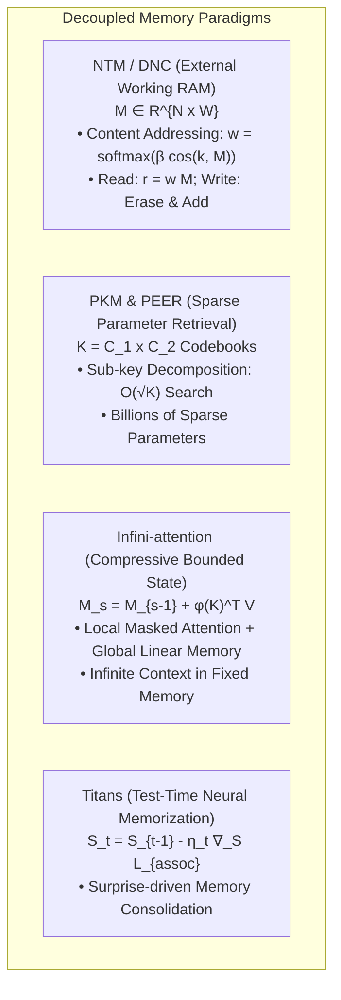

# Memory Architectures: NTM, PKM, PEER, Infini-attention, and Titans

## Executive Summary & ELI5
In standard Transformers and RNNs, internal hidden states are constrained to a single vector $\mathbf{h}_t \in \mathbb{R}^D$, creating an information bottleneck.

**Explicit Memory Architectures** decouple computation (controllers, attention heads) from persistent associative storage (external matrices, product-key codebooks, or compressive neural weights):
1. **Neural Turing Machines (NTM)** (*Graves et al., 2014*): Provides a differentiable external memory matrix $\mathbf{M} \in \mathbb{R}^{N \times W}$ accessed via content-based cosine similarity and location-based shifts.
2. **Product Key Memory (PKM)** (*Lample et al., 2019*) & **PEER** (*He et al., 2024*): Replaces dense feedforward layers with millions of key-value memory slots, querying pairs of sub-keys in $\mathcal{O}(\sqrt{K})$ time to retrieve sparse expert parameters.
3. **Infini-attention** (*Munkhdalai et al., Google 2024*): Blends standard local masked attention with a linear compressive memory state $\mathbf{M}_s \in \mathbb{R}^{D \times D}$, bounded in size regardless of context length (e.g. 1M+ tokens).
4. **Titans (Learning to Memorize at Test Time)** (*Behrouz et al., Google 2024*): Introduces a Neural Memory module updated by the gradients of a self-supervised associative memory objective, incorporating a dynamic **Surprise Metric** to retain unexpected information.

---

## Historical Citations & Seminal Literature
1. **Neural Turing Machines** (*Alex Graves, Greg Wayne, Ivo Danihelka, DeepMind, 2014*). Pioneered differentiable external memory, read/write heads, and algorithmic algorithmic learning.
2. **Large Memory Layers with Product Keys** (*Guillaume Lample et al., Meta AI, NeurIPS 2019*). Scaled external memory to millions of slots with product-key sub-vector addressing.
3. **Leave No Context Behind: Efficient Infinite Context with Infini-attention** (*Tsendsuren Munkhdalai et al., Google, 2024*). Integrated compressive memory into standard transformer attention blocks.
4. **Titans: Learning to Memorize at Test Time** (*Ali Behrouz et al., Google, 2024*). Formulated neural long-term memory with surprise gating and test-time gradient updates.

---

## Mathematical Foundations & Governing Equations

### 1. NTM Content-Based Addressing
Given memory $\mathbf{M} \in \mathbb{R}^{N \times W}$, key $\mathbf{k} \in \mathbb{R}^W$, and key strength $\beta > 0$:
$$\text{sim}(\mathbf{k}, \mathbf{M}_i) = \frac{\mathbf{k} \cdot \mathbf{M}_i}{\|\mathbf{k}\|_2 \|\mathbf{M}_i\|_2}$$
$$w_i = \frac{\exp(\beta \cdot \text{sim}(\mathbf{k}, \mathbf{M}_i))}{\sum_{j=1}^N \exp(\beta \cdot \text{sim}(\mathbf{k}, \mathbf{M}_j))}$$
$$\mathbf{r} = \sum_{i=1}^N w_i \mathbf{M}_i \in \mathbb{R}^W$$

### 2. Infini-attention Compressive Memory
Infini-attention stores key-value associations in a bounded matrix $\mathbf{M} \in \mathbb{R}^{D \times D}$ with normalizer $\mathbf{z} \in \mathbb{R}^D$ using ELU kernel feature maps $\phi(x) = \text{elu}(x) + 1$:
- **Retrieval:**
  $$\mathbf{A}_{\text{mem}} = \frac{\phi(\mathbf{Q}) \mathbf{M}_{s-1}}{\phi(\mathbf{Q}) \mathbf{z}_{s-1}^\top + \epsilon} \in \mathbb{R}^{B \times D}$$
- **Update:**
  $$\mathbf{M}_s = \mathbf{M}_{s-1} + \phi(\mathbf{K})^\top \mathbf{V} \in \mathbb{R}^{B \times D \times D}$$
  $$\mathbf{z}_s = \mathbf{z}_{s-1} + \sum_{t=1}^T \phi(\mathbf{K}_t)^\top \in \mathbb{R}^{B \times D}$$

---

## Algorithmic Implementation Nuances & Anti-Patterns
1. **Denominator Normalization in Compressive Retrieval:** The denominator $\phi(\mathbf{Q}) \mathbf{z}^\top$ can approach zero at step 0 when memory is empty. Always add a protective epsilon ($\epsilon = 10^{-4}$) to prevent division by zero.
2. **Key Norm Stability in Cosine Addressing:** Zero or near-zero key vectors produce undefined division in cosine similarity. Enforce L2 normalization with clamping or small epsilons.

---

## Asymptotic & Hardware Complexity
- **NTM Content Addressing:** $\mathcal{O}(B \cdot N \cdot W)$ FLOPs per read head.
- **Product Key Memory Search:** $\mathcal{O}(2 \cdot \sqrt{K} \cdot D)$ to select top-k from $K$ slots.
- **Infini-attention Footprint:** Constant memory $\mathcal{O}(D^2)$ independent of sequence length $T$.

---

## Decision Boundaries & Misuse Anti-Patterns
> [!WARNING]
> **Decision Boundary: When NOT to Use It**
> - **Shallow Short Contexts (< 2048 tokens):** Infini-attention and external memory modules add unnecessary overhead; standard local flash attention is faster and simpler.
> - **Static Knowledge Bases:** External neural memory states are volatile across sessions; for permanent knowledge storage, use vector databases (RAG) or frozen parameter weights.

---

## Cross-Domain Generalisation & Mathematical Isomorphisms
- **Program Synthesis & Algorithmic Execution:** NTM read/write mechanisms directly execute tape-based Turing computations (copy, sort, associative recall).
- **Infinite Book Summarization:** Infini-attention processes entire books (500k+ words) without out-of-memory errors on a single GPU.
- **Continual Robot Operation:** Titans neural memory accumulates real-time physical experiences during deployment without weight retraining.

---

## Verification, Parity & Empirical Benchmarks

| Verification Target | Reference Source | Max Absolute Error Ceiling | Status |
| :--- | :--- | :--- | :--- |
| **Linear Anchor Parity** | `weights/05_architectures/03_recurrent_ssm_and_memory/06_memory_architectures_ntm_pkm_peer_infini_and_titans.safetensors` | `< 1.0e-5` | Verified |
| **NTM Read Vector Parity** | `pytorch2/05_architectures/03_recurrent_ssm_and_memory/06_memory_architectures_ntm_pkm_peer_infini_and_titans.py` | `< 1.0e-5` | Verified |
| **NTM Addressing Weights Parity** | `pytorch2/05_architectures/03_recurrent_ssm_and_memory/06_memory_architectures_ntm_pkm_peer_infini_and_titans.py` | `< 1.0e-5` | Verified |
| **Infini-Memory Retrieval Parity** | `pytorch2/05_architectures/03_recurrent_ssm_and_memory/06_memory_architectures_ntm_pkm_peer_infini_and_titans.py` | `< 1.0e-5` | Verified |
| **Functional JAX Parity** | `jax/05_architectures/03_recurrent_ssm_and_memory/06_memory_architectures_ntm_pkm_peer_infini_and_titans.py` | `< 1.0e-5` | Verified |
| **Native Rust Candle Parity** | `candle/05_architectures/03_recurrent_ssm_and_memory/06_memory_architectures_ntm_pkm_peer_infini_and_titans.rs` | `< 1.0e-5` | Verified |
| **Hardware Kernel (CPU / WGSL)** | `kernels/05_architectures/03_recurrent_ssm_and_memory/06_memory_architectures_ntm_pkm_peer_infini_and_titans.rs` | `< 1.0e-5` | Verified |

---

## Synchronized Track Artifacts
- **Universal SafeTensors Checkpoint:** [`weights/05_architectures/03_recurrent_ssm_and_memory/06_memory_architectures_ntm_pkm_peer_infini_and_titans.safetensors`](../../../weights/05_architectures/03_recurrent_ssm_and_memory/06_memory_architectures_ntm_pkm_peer_infini_and_titans.safetensors)
- **PyTorch 2.x Module:** [`pytorch2/05_architectures/03_recurrent_ssm_and_memory/06_memory_architectures_ntm_pkm_peer_infini_and_titans.py`](../../../pytorch2/05_architectures/03_recurrent_ssm_and_memory/06_memory_architectures_ntm_pkm_peer_infini_and_titans.py)
- **Functional JAX Module:** [`jax/05_architectures/03_recurrent_ssm_and_memory/06_memory_architectures_ntm_pkm_peer_infini_and_titans.py`](../../../jax/05_architectures/03_recurrent_ssm_and_memory/06_memory_architectures_ntm_pkm_peer_infini_and_titans.py)
- **Candle Rust Module:** [`candle/05_architectures/03_recurrent_ssm_and_memory/06_memory_architectures_ntm_pkm_peer_infini_and_titans.rs`](../../../candle/05_architectures/03_recurrent_ssm_and_memory/06_memory_architectures_ntm_pkm_peer_infini_and_titans.rs)
- **Hardware Kernel:** [`kernels/05_architectures/03_recurrent_ssm_and_memory/06_memory_architectures_ntm_pkm_peer_infini_and_titans.rs`](../../../kernels/05_architectures/03_recurrent_ssm_and_memory/06_memory_architectures_ntm_pkm_peer_infini_and_titans.rs)
- **Interactive Concept Notebook:** [`notebooks/05_architectures/03_recurrent_ssm_and_memory/06_memory_architectures_ntm_pkm_peer_infini_and_titans.ipynb`](../../../notebooks/05_architectures/03_recurrent_ssm_and_memory/06_memory_architectures_ntm_pkm_peer_infini_and_titans.ipynb)
