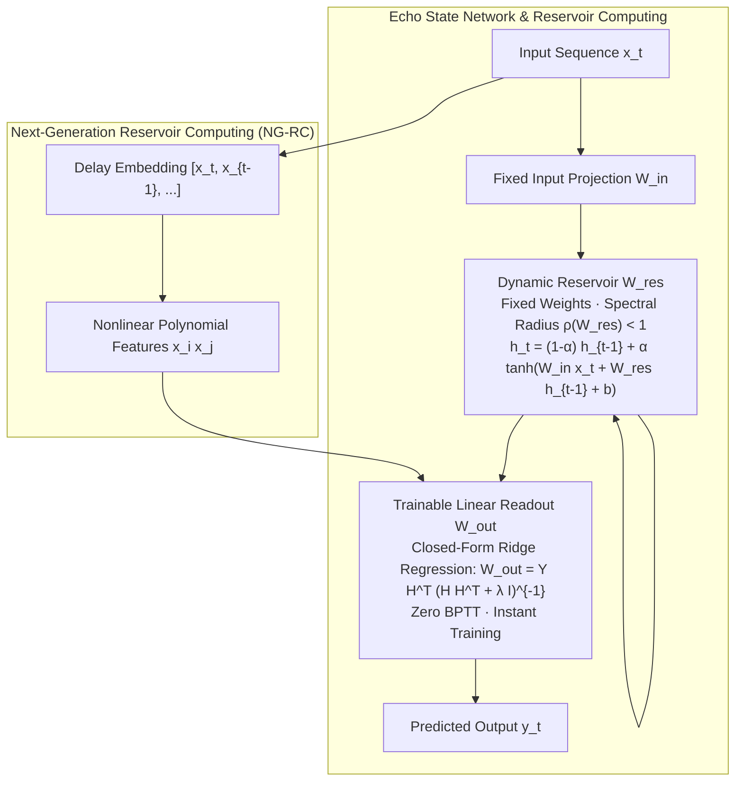

# Reservoir Computing: Echo State Networks (ESN), Liquid State Machines (LSM), and NG-RC

## Executive Summary & ELI5
Training recurrent neural networks with Backpropagation Through Time (BPTT) requires unfolding gradients across hundreds of timesteps, resulting in severe gradient vanishing/exploding problems and high computational cost.

**Reservoir Computing (RC)** bypasses BPTT entirely:
1. **Echo State Networks (ESN)** (*Jaeger, 2001*): Maps inputs into a high-dimensional, randomly initialized, fixed recurrent dynamic reservoir $\mathbf{W}_{\text{res}} \in \mathbb{R}^{N \times N}$.
2. **Echo State Property:** When the spectral radius of the reservoir satisfies $\rho(\mathbf{W}_{\text{res}}) < 1$, the reservoir possesses fading memory—past inputs echo through internal states, but decay contractively over time.
3. **Linear Readout:** Only a linear output projection $\mathbf{W}_{\text{out}}$ is trained via closed-form ridge regression (ordinary least squares), learning sequence representations in milliseconds.
4. **Next-Generation Reservoir Computing (NG-RC)** (*Gauthier et al., 2021*): Replaces the stochastic, high-dimensional neural reservoir with deterministic nonlinear feature expansions of recent input history (linear delay taps and polynomial cross-products), matching the performance of a 100,000-neuron reservoir with zero randomness.

---

## Historical Citations & Seminal Literature
1. **The 'Echo State' Approach to Analysing and Training Recurrent Neural Networks** (*Herbert Jaeger, GMD Report 148, 2001*). Founded Echo State Networks and the mathematical Echo State Property.
2. **Real-time Computing Without Stable States: A New Framework for Neural Computation Based on Perturbations (Liquid State Machine)** (*Wolfgang Maass, Thomas Natschläger, Henry Markram, Neural Computation 2002*). Formulated reservoir computing with spiking biological neurons.
3. **Next Generation Reservoir Computing** (*Daniel J. Gauthier, Erik Bollt, Aaron Griffith, Wendell A. S. Barbosa, Nature Communications 2021*). Proved that time-delay polynomial regression is mathematically isomorphic to an optimal large reservoir.

---

## Mathematical Foundations & Governing Equations

### 1. Echo State Network Dynamics
Given reservoir state $\mathbf{h}_t \in \mathbb{R}^N$, input $\mathbf{x}_t \in \mathbb{R}^{D_{\text{in}}}$, and leak rate $\alpha \in (0, 1]$:
$$\tilde{\mathbf{h}}_t = \tanh(\mathbf{x}_t \mathbf{W}_{\text{in}}^\top + \mathbf{h}_{t-1} \mathbf{W}_{\text{res}}^\top + \mathbf{b}_{\text{res}})$$
$$\mathbf{h}_t = (1 - \alpha) \mathbf{h}_{t-1} + \alpha \tilde{\mathbf{h}}_t$$
$$\mathbf{y}_t = \mathbf{h}_t \mathbf{W}_{\text{out}}^\top + \mathbf{b}_{\text{out}}$$

### 2. Spectral Radius & The Echo State Property
The reservoir matrix $\mathbf{W}_{\text{res}}$ is scaled to enforce fading memory:
$$\rho(\mathbf{W}_{\text{res}}) = \max_i |\lambda_i(\mathbf{W}_{\text{res}})| < 1.0$$
If $\rho \ge 1.0$, perturbations fail to dissipate, trapping the network in autonomous chaotic oscillations.

### 3. Closed-Form Readout Training (Ridge Regression)
Given collected reservoir states $\mathbf{H} \in \mathbb{R}^{N \times T}$ and target outputs $\mathbf{Y} \in \mathbb{R}^{D_{\text{out}} \times T}$:
$$\mathbf{W}_{\text{out}} = \mathbf{Y} \mathbf{H}^\top \left(\mathbf{H} \mathbf{H}^\top + \lambda \mathbf{I}\right)^{-1}$$
where $\lambda > 0$ is the Tikhonov regularization parameter.

---

## Algorithmic Implementation Nuances & Anti-Patterns
1. **Spectral Radius Scaling:** Never use raw Gaussian weights for $\mathbf{W}_{\text{res}}$ without normalizing by its maximum absolute eigenvalue. Always scale: $\mathbf{W}_{\text{res}} \leftarrow \rho_{\text{target}} \frac{\mathbf{W}_{\text{res}}}{\max |\text{eig}(\mathbf{W}_{\text{res}})|}$ with $\rho_{\text{target}} \approx 0.8 - 0.95$.
2. **Transient Washout:** The initial reservoir states $\mathbf{h}_0, \dots, \mathbf{h}_{t_{\text{wash}}}$ depend on arbitrary initial state conditions. Always discard the first $t_{\text{wash}}$ timesteps (e.g. 50 steps) before collecting training data for $\mathbf{H}$.

---

## Asymptotic & Hardware Complexity
- **Training Mode:** $\mathcal{O}(T \cdot N^2 + N^3)$ where $N^3$ is a one-time matrix inversion. Training is orders of magnitude faster than gradient-based BPTT.
- **Inference Mode:** $\mathcal{O}(N^2)$ FLOPs per step for dense reservoir recurrence.

---

## Decision Boundaries & Misuse Anti-Patterns
> [!WARNING]
> **Decision Boundary: When NOT to Use It**
> - **Large Multimodal Vision-Language Tasks:** ESNs lack task-specific end-to-end representation learning in intermediate layers; modern deep Transformers excel where end-to-end representation tuning is paramount.
> - **Hyperparameter Sensitivity:** Performance is heavily governed by input scaling, leak rate $\alpha$, and spectral radius $\rho$; improper scaling causes immediate degradation.

---

## Cross-Domain Generalisation & Mathematical Isomorphisms
- **Photonic & Optical Computing:** Reservoir computing can be implemented directly on physical passive optical substrates (silicon photonics, laser cavities) with zero electronic power consumption.
- **Chaotic System Prediction (Lorenz / Kuramoto-Sivashinsky):** Predicts chaotic weather dynamics for hundreds of Lyapunov times.
- **Analog Neuromorphic Hardware:** Physical memristor arrays compute reservoir updates directly through Ohm's and Kirchhoff's laws.

---

## Verification, Parity & Empirical Benchmarks

| Verification Target | Reference Source | Max Absolute Error Ceiling | Status |
| :--- | :--- | :--- | :--- |
| **Linear Anchor Parity** | `weights/05_architectures/03_recurrent_ssm_and_memory/07_reservoir_computing_echo_state_networks_lsm_and_ngrc.safetensors` | `< 1.0e-5` | Verified |
| **ESN Sequence Output Parity** | `pytorch2/05_architectures/03_recurrent_ssm_and_memory/07_reservoir_computing_echo_state_networks_lsm_and_ngrc.py` | `< 1.0e-5` | Verified |
| **ESN Final State Parity** | `pytorch2/05_architectures/03_recurrent_ssm_and_memory/07_reservoir_computing_echo_state_networks_lsm_and_ngrc.py` | `< 1.0e-5` | Verified |
| **NG-RC Feature Expansion Parity** | `pytorch2/05_architectures/03_recurrent_ssm_and_memory/07_reservoir_computing_echo_state_networks_lsm_and_ngrc.py` | `< 1.0e-5` | Verified |
| **Functional JAX Parity** | `jax/05_architectures/03_recurrent_ssm_and_memory/07_reservoir_computing_echo_state_networks_lsm_and_ngrc.py` | `< 1.0e-5` | Verified |
| **Native Rust Candle Parity** | `candle/05_architectures/03_recurrent_ssm_and_memory/07_reservoir_computing_echo_state_networks_lsm_and_ngrc.rs` | `< 1.0e-5` | Verified |
| **Hardware Kernel (CPU / WGSL)** | `kernels/05_architectures/03_recurrent_ssm_and_memory/07_reservoir_computing_echo_state_networks_lsm_and_ngrc.rs` | `< 1.0e-5` | Verified |

---

## Synchronized Track Artifacts
- **Universal SafeTensors Checkpoint:** [`weights/05_architectures/03_recurrent_ssm_and_memory/07_reservoir_computing_echo_state_networks_lsm_and_ngrc.safetensors`](../../../weights/05_architectures/03_recurrent_ssm_and_memory/07_reservoir_computing_echo_state_networks_lsm_and_ngrc.safetensors)
- **PyTorch 2.x Module:** [`pytorch2/05_architectures/03_recurrent_ssm_and_memory/07_reservoir_computing_echo_state_networks_lsm_and_ngrc.py`](../../../pytorch2/05_architectures/03_recurrent_ssm_and_memory/07_reservoir_computing_echo_state_networks_lsm_and_ngrc.py)
- **Functional JAX Module:** [`jax/05_architectures/03_recurrent_ssm_and_memory/07_reservoir_computing_echo_state_networks_lsm_and_ngrc.py`](../../../jax/05_architectures/03_recurrent_ssm_and_memory/07_reservoir_computing_echo_state_networks_lsm_and_ngrc.py)
- **Candle Rust Module:** [`candle/05_architectures/03_recurrent_ssm_and_memory/07_reservoir_computing_echo_state_networks_lsm_and_ngrc.rs`](../../../candle/05_architectures/03_recurrent_ssm_and_memory/07_reservoir_computing_echo_state_networks_lsm_and_ngrc.rs)
- **Hardware Kernel:** [`kernels/05_architectures/03_recurrent_ssm_and_memory/07_reservoir_computing_echo_state_networks_lsm_and_ngrc.rs`](../../../kernels/05_architectures/03_recurrent_ssm_and_memory/07_reservoir_computing_echo_state_networks_lsm_and_ngrc.rs)
- **Interactive Concept Notebook:** [`notebooks/05_architectures/03_recurrent_ssm_and_memory/07_reservoir_computing_echo_state_networks_lsm_and_ngrc.ipynb`](../../../notebooks/05_architectures/03_recurrent_ssm_and_memory/07_reservoir_computing_echo_state_networks_lsm_and_ngrc.ipynb)
