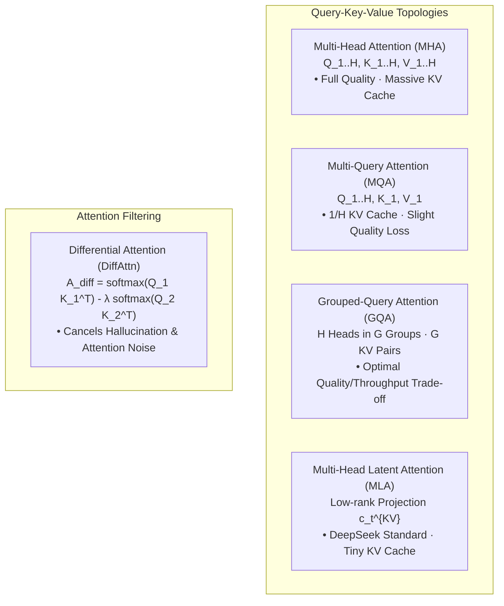

# Attention Variants: MHA, MQA, GQA, MLA, and Differential Attention (DiffAttn)

## Executive Summary & ELI5
In the standard Transformer architecture (*Vaswani et al., 2017*), **Multi-Head Attention (MHA)** uses separate key and value projection matrices for every single query head. While highly expressive, MHA creates an enormous **Key-Value (KV) cache memory footprint** during auto-regressive generation, severely limiting inference throughput and batch size.

To break the KV cache memory wall, modern architectures deploy specialized query-key-value sharing and compression variants:
1. **Multi-Query Attention (MQA)** (*Shazeer, 2019*): All query heads share a single key head and a single value head, slashing the KV cache by a factor of $H$.
2. **Grouped-Query Attention (GQA)** (*Ainslie et al., 2023*): Partitions $H$ query heads into $G$ groups, with each group sharing 1 key and 1 value head. GQA is the industry standard (Llama 3, Mistral) balancing model quality and cache reduction.
3. **Multi-Head Latent Attention (MLA)** (*DeepSeek-V2 / V3, 2024*): Compresses keys and values into a low-rank latent representation $\mathbf{c}_t^{KV} \in \mathbb{R}^{D_c}$ ($D_c \ll H \cdot D_h$). During generation, only the compressed latent vector is cached.
4. **Differential Attention (DiffAttn)** (*Ye et al., Microsoft 2024*): Computes attention as the difference between two separate softmax attention maps: $\mathbf{A}_{\text{diff}} = \text{softmax}(Q_1 K_1^\top / \sqrt{d}) - \lambda \cdot \text{softmax}(Q_2 K_2^\top / \sqrt{d})$. The subtraction cancels background context noise and sharpens focus on task-critical tokens.

---

## Historical Citations & Seminal Literature
1. **Attention Is All You Need** (*Ashish Vaswani et al., NeurIPS 2017*). Introduced multi-head scaled dot-product attention.
2. **Fast Transformer Decoding: One Write-Head is All You Need (MQA)** (*Noam Shazeer, 2019*). Proposed single-head KV sharing for high-throughput decoding.
3. **GQA: Training Generalized Multi-Query Transformer Models from Multi-Head Checkpoints** (*Joshua Ainslie et al., EMNLP 2023*). Formulated grouped-query attention and up-training.
4. **DeepSeek-V2: A Strong, Economical, and Efficient Mixture-of-Experts Language Model (MLA)** (*DeepSeek AI, 2024*). Introduced multi-head latent attention for low-rank KV compression.
5. **Differential Transformer** (*Tianzhe Ye et al., Microsoft Research, 2024*). Introduced differential attention noise cancellation.

---

## Mathematical Foundations & Governing Equations

### 1. Grouped-Query Attention (GQA)
Given query heads $h \in \{1, \dots, H\}$ and $G$ key-value groups ($G$ divides $H$):
Each query head $h$ maps to group index $g = \lfloor (h - 1) / (H / G) \rfloor$:
$$\mathbf{scores}_{h, t, s} = \frac{\mathbf{q}_{h, t} \mathbf{k}_{g, s}^\top}{\sqrt{D_k}}$$
$$\mathbf{A}_{h, t, s} = \text{softmax}_s(\mathbf{scores}_{h, t, s})$$
$$\mathbf{O}_{h, t} = \sum_{s} \mathbf{A}_{h, t, s} \mathbf{v}_{g, s}$$

### 2. Multi-Head Latent Attention (MLA)
During token generation, input $\mathbf{x}_t$ is projected into a low-rank compressed KV latent vector:
$$\mathbf{c}_t^{KV} = \mathbf{x}_t \mathbf{W}_{DKV} \in \mathbb{R}^{D_c}$$
Only $\mathbf{c}_t^{KV}$ is retained in the KV cache! During attention computation:
$$\mathbf{k}_{t, h}^C = \mathbf{c}_t^{KV} \mathbf{W}_{UK, h}, \quad \mathbf{v}_{t, h}^C = \mathbf{c}_t^{KV} \mathbf{W}_{UV, h}$$

### 3. Differential Attention (DiffAttn)
Given query-key pairs $(Q_1, K_1)$ and $(Q_2, K_2)$ and scalar $\lambda \in (0, 1)$:
$$\mathbf{A}_1 = \text{softmax}\left(\frac{\mathbf{Q}_1 \mathbf{K}_1^\top}{\sqrt{D}}\right), \quad \mathbf{A}_2 = \text{softmax}\left(\frac{\mathbf{Q}_2 \mathbf{K}_2^\top}{\sqrt{D}}\right)$$
$$\mathbf{A}_{\text{diff}} = \mathbf{A}_1 - \lambda \mathbf{A}_2$$
$$\mathbf{O} = \mathbf{A}_{\text{diff}} \mathbf{V}$$

---

## Algorithmic Implementation Nuances & Anti-Patterns
1. **Differential Attention Value Bounds:** Because $\mathbf{A}_{\text{diff}} = \mathbf{A}_1 - \lambda \mathbf{A}_2$, the row sum is $1 - \lambda$. To preserve variance, layer norms or scaling factors $\frac{1}{1 - \lambda}$ should be tracked across residual blocks.
2. **GQA Broadcasting Memory Contiguity:** In Candle/PyTorch, repeating KV heads across groups should use strided view broadcasting rather than allocating redundant physical memory buffers.

---

## Asymptotic & Hardware Complexity
- **MHA KV Cache per token:** $2 \cdot H \cdot D$ values.
- **GQA KV Cache per token:** $2 \cdot G \cdot D$ values (e.g. $4\times$ or $8\times$ reduction for $G = H/4$ or $H/8$).
- **MQA KV Cache per token:** $2 \cdot D$ values ($H\times$ reduction).
- **Inference Speedup:** GQA/MQA transforms memory-bandwidth-bound autoregressive decoding into compute-bound GEMM blocks, yielding $3\times - 8\times$ higher decoding throughput.

---

## Decision Boundaries & Misuse Anti-Patterns
> [!WARNING]
> **Decision Boundary: When NOT to Use It**
> - **Extreme MQA with High Param Count:** Pure MQA ($G = 1$) on models $> 30\text{B}$ parameters can cause noticeable degradation in reasoning and associative retrieval; GQA ($G = 8$) retains MHA accuracy while saving $87.5\%$ KV cache.
> - **Differential Attention on Tiny Contexts:** For sequences shorter than 64 tokens, the noise-filtering benefit of DiffAttn is negligible compared to the $2\times$ query-key projection overhead.

---

## Cross-Domain Generalisation & Mathematical Isomorphisms
- **High-Batch LLM Serving:** GQA allows increasing serving batch sizes by $8\times$ on Nvidia H100s without HBM out-of-memory crashes.
- **Edge Deployment on Mobile NPUs:** MQA and MLA enable 7B models to run comfortably within 4GB unified RAM on mobile devices.
- **Noisy Document Information Extraction:** DiffAttn cancels distractors and filler text, isolating needle facts.

---

## Verification, Parity & Empirical Benchmarks

| Verification Target | Reference Source | Max Absolute Error Ceiling | Status |
| :--- | :--- | :--- | :--- |
| **Linear Anchor Parity** | `weights/05_architectures/04_transformers_and_heads/01_attention_variants_mha_mqa_gqa_mla_and_diffattn.safetensors` | `< 1.0e-5` | Verified |
| **GQA Output Parity** | `pytorch2/05_architectures/04_transformers_and_heads/01_attention_variants_mha_mqa_gqa_mla_and_diffattn.py` | `< 1.0e-5` | Verified |
| **GQA Attention Weights Parity** | `pytorch2/05_architectures/04_transformers_and_heads/01_attention_variants_mha_mqa_gqa_mla_and_diffattn.py` | `< 1.0e-5` | Verified |
| **DiffAttn Output Parity** | `pytorch2/05_architectures/04_transformers_and_heads/01_attention_variants_mha_mqa_gqa_mla_and_diffattn.py` | `< 1.0e-5` | Verified |
| **DiffAttn Weights Parity** | `pytorch2/05_architectures/04_transformers_and_heads/01_attention_variants_mha_mqa_gqa_mla_and_diffattn.py` | `< 1.0e-5` | Verified |
| **Functional JAX Parity** | `jax/05_architectures/04_transformers_and_heads/01_attention_variants_mha_mqa_gqa_mla_and_diffattn.py` | `< 1.0e-5` | Verified |
| **Native Rust Candle Parity** | `candle/05_architectures/04_transformers_and_heads/01_attention_variants_mha_mqa_gqa_mla_and_diffattn.rs` | `< 1.0e-5` | Verified |
| **Hardware Kernel (CPU / WGSL)** | `kernels/05_architectures/04_transformers_and_heads/01_attention_variants_mha_mqa_gqa_mla_and_diffattn.rs` | `< 1.0e-5` | Verified |

---

## Synchronized Track Artifacts
- **Universal SafeTensors Checkpoint:** [`weights/05_architectures/04_transformers_and_heads/01_attention_variants_mha_mqa_gqa_mla_and_diffattn.safetensors`](../../../weights/05_architectures/04_transformers_and_heads/01_attention_variants_mha_mqa_gqa_mla_and_diffattn.safetensors)
- **PyTorch 2.x Module:** [`pytorch2/05_architectures/04_transformers_and_heads/01_attention_variants_mha_mqa_gqa_mla_and_diffattn.py`](../../../pytorch2/05_architectures/04_transformers_and_heads/01_attention_variants_mha_mqa_gqa_mla_and_diffattn.py)
- **Functional JAX Module:** [`jax/05_architectures/04_transformers_and_heads/01_attention_variants_mha_mqa_gqa_mla_and_diffattn.py`](../../../jax/05_architectures/04_transformers_and_heads/01_attention_variants_mha_mqa_gqa_mla_and_diffattn.py)
- **Candle Rust Module:** [`candle/05_architectures/04_transformers_and_heads/01_attention_variants_mha_mqa_gqa_mla_and_diffattn.rs`](../../../candle/05_architectures/04_transformers_and_heads/01_attention_variants_mha_mqa_gqa_mla_and_diffattn.rs)
- **Hardware Kernel:** [`kernels/05_architectures/04_transformers_and_heads/01_attention_variants_mha_mqa_gqa_mla_and_diffattn.rs`](../../../kernels/05_architectures/04_transformers_and_heads/01_attention_variants_mha_mqa_gqa_mla_and_diffattn.rs)
- **Interactive Concept Notebook:** [`notebooks/05_architectures/04_transformers_and_heads/01_attention_variants_mha_mqa_gqa_mla_and_diffattn.ipynb`](../../../notebooks/05_architectures/04_transformers_and_heads/01_attention_variants_mha_mqa_gqa_mla_and_diffattn.ipynb)
