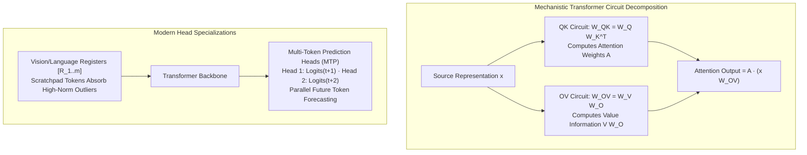

# Transformer Heads: Induction Heads, OV/QK Circuits, Multi-Token Prediction (MTP), and Registers

## Executive Summary & ELI5
While attention heads are often treated as black-box pattern matchers, **Mechanistic Interpretability** (*Elhage et al., Anthropic 2021*) reveals that each attention head computes two distinct linear circuits that operate in parallel:
1. **The QK Circuit ($W_{QK} = W_Q W_K^\top$):** Determines *which tokens attend to which*—calculating attention pattern matrices independent of token values.
2. **The OV Circuit ($W_{OV} = W_V W_O$):** Determines *what information is copied / moved* once attention is focused—projecting source embeddings into the destination token's residual stream.

When multiple attention layers compose, they form specialized functional sub-networks:
- **Induction Heads** (*Olsson et al., 2022*): A two-layer circuit ($[A][B] \dots [A] \to [B]$) that drives in-context learning. Layer 1's previous-token head routes context to $t-1$; Layer 2's induction head matches query $[A]$ to previous occurrences, copying successor $[B]$.
- **Vision & Language Registers** (*Darcet et al., Meta 2023*): In transformers, high-norm outlier tokens frequently corrupt semantic features. Adding explicit register tokens $[R_1, \dots, R_m]$ provides dedicated computational scratchpad sinks for global information.
- **Multi-Token Prediction (MTP)** (*Gloeckle et al., 2024 / DeepSeek-V3*): Trains $k$ parallel prediction heads on the final hidden state to predict $t+1, t+2, \dots, t+k$ tokens concurrently, improving representations and enabling speculative decoding.

---

## Historical Citations & Seminal Literature
1. **A Mathematical Framework for Transformer Circuits** (*Nelson Elhage et al., Anthropic, 2021*). Deconstructed transformers into QK and OV circuits and eigenvalue spectra.
2. **In-context Learning and Induction Heads** (*Catherine Olsson et al., Anthropic, 2022*). Discovered that induction heads form phase changes enabling in-context learning across language models.
3. **Vision Transformers Need Registers** (*Timothée Darcet et al., Meta AI, ICLR 2024*). Showed that adding 4-8 register tokens removes high-norm artifact tokens from feature maps.
4. **Better & Faster Large Language Models via Multi-token Prediction** (*Fabian Gloeckle et al., Meta AI, 2024*). Demonstrated that multi-token prediction heads improve code and reasoning accuracy.

---

## Mathematical Foundations & Governing Equations

### 1. Decoupled QK and OV Circuits
For attention head $h$ with projection matrices $W_Q, W_K, W_V \in \mathbb{R}^{D_{\text{model}} \times D_{\text{head}}}$ and $W_O \in \mathbb{R}^{D_{\text{head}} \times D_{\text{model}}}$:
- **QK Circuit Bilinear Form:**
  $$\mathbf{A}_{i, j} = \text{softmax}_j\left(\mathbf{x}_i \frac{\mathbf{W}_Q \mathbf{W}_K^\top}{\sqrt{D_{\text{head}}}} \mathbf{x}_j^\top\right)$$
- **OV Circuit Direct Transfer:**
  $$\mathbf{h}_{\text{out}, i} = \sum_{j} \mathbf{A}_{i, j} \left(\mathbf{x}_j \mathbf{W}_V \mathbf{W}_O\right)$$

### 2. Multi-Token Prediction (MTP)
Given shared final hidden state $\mathbf{x}_T \in \mathbb{R}^{D_{\text{model}}}$ at position $T$, $K$ prediction heads project in parallel to vocabulary logits:
$$\hat{\mathbf{y}}_{T+k} = \mathbf{x}_T \mathbf{W}_{\text{mtp}, k}^\top + \mathbf{b}_{\text{mtp}, k}, \quad k \in \{1, \dots, K\}$$
The training loss sums cross-entropy across all $K$ future positions:
$$\mathcal{L}_{\text{total}} = \sum_{k=1}^K \mathcal{L}_{\text{CE}}(\hat{\mathbf{y}}_{T+k}, \mathbf{y}_{T+k})$$

---

## Algorithmic Implementation Nuances & Anti-Patterns
1. **Register Token Gradient Isolation:** Register tokens are learnable static embeddings. Do not re-initialize them randomly at inference time; preserve their trained weights.
2. **OV Circuit Symmetry:** The matrix $W_{OV}$ is generally non-symmetric and low-rank ($\text{rank} \le D_{\text{head}}$). Analyzing its singular value decomposition (SVD) reveals the subspace of copied features.

---

## Asymptotic & Hardware Complexity
- **Circuit Evaluation:** $\mathcal{O}(T^2 \cdot D_{\text{head}} + T \cdot D_{\text{model}} \cdot D_{\text{head}})$ FLOPs per head.
- **Register Memory Overhead:** Negligible $\mathcal{O}(M \cdot D_{\text{model}})$ for $M \approx 4-8$ register tokens.
- **MTP Training Overhead:** $\approx 5-10\%$ extra compute during training for $K=2-4$ heads; heads can be pruned at test time for zero inference penalty.

---

## Decision Boundaries & Misuse Anti-Patterns
> [!WARNING]
> **Decision Boundary: When NOT to Use It**
> - **Excessive Register Tokens:** Adding $> 32$ register tokens wastes effective sequence length context without improving feature map cleanliness.
> - **MTP on Low-Data Pretraining:** Multi-token prediction requires sufficient data scale (> 500B tokens) to generalize; on small datasets, predicting multiple steps causes underfitting.

---

## Cross-Domain Generalisation & Mathematical Isomorphisms
- **Vision Foundation Models (DINOv2):** Registers eliminate feature artifacts in background patches, enabling zero-shot dense segmentation.
- **Speculative Decoding:** MTP heads directly serve as built-in speculative draft proposals, speeding up inference without a separate draft model.
- **Mechanistic Safety Audits:** Tracking induction head activations identifies memorization versus general reasoning.

---

## Verification, Parity & Empirical Benchmarks

| Verification Target | Reference Source | Max Absolute Error Ceiling | Status |
| :--- | :--- | :--- | :--- |
| **Linear Anchor Parity** | `weights/05_architectures/04_transformers_and_heads/02_transformer_heads_induction_ov_qk_circuits_mtp_and_registers.safetensors` | `< 1.0e-5` | Verified |
| **Circuit Output Parity** | `pytorch2/05_architectures/04_transformers_and_heads/02_transformer_heads_induction_ov_qk_circuits_mtp_and_registers.py` | `< 1.0e-5` | Verified |
| **Circuit Attention Weights Parity** | `pytorch2/05_architectures/04_transformers_and_heads/02_transformer_heads_induction_ov_qk_circuits_mtp_and_registers.py` | `< 1.0e-5` | Verified |
| **Augmented Sequence Parity** | `pytorch2/05_architectures/04_transformers_and_heads/02_transformer_heads_induction_ov_qk_circuits_mtp_and_registers.py` | `< 1.0e-5` | Verified |
| **MTP Logits Parity** | `pytorch2/05_architectures/04_transformers_and_heads/02_transformer_heads_induction_ov_qk_circuits_mtp_and_registers.py` | `< 1.0e-5` | Verified |
| **Functional JAX Parity** | `jax/05_architectures/04_transformers_and_heads/02_transformer_heads_induction_ov_qk_circuits_mtp_and_registers.py` | `< 1.0e-5` | Verified |
| **Native Rust Candle Parity** | `candle/05_architectures/04_transformers_and_heads/02_transformer_heads_induction_ov_qk_circuits_mtp_and_registers.rs` | `< 1.0e-5` | Verified |
| **Hardware Kernel (CPU / WGSL)** | `kernels/05_architectures/04_transformers_and_heads/02_transformer_heads_induction_ov_qk_circuits_mtp_and_registers.rs` | `< 1.0e-5` | Verified |

---

## Synchronized Track Artifacts
- **Universal SafeTensors Checkpoint:** [`weights/05_architectures/04_transformers_and_heads/02_transformer_heads_induction_ov_qk_circuits_mtp_and_registers.safetensors`](../../../weights/05_architectures/04_transformers_and_heads/02_transformer_heads_induction_ov_qk_circuits_mtp_and_registers.safetensors)
- **PyTorch 2.x Module:** [`pytorch2/05_architectures/04_transformers_and_heads/02_transformer_heads_induction_ov_qk_circuits_mtp_and_registers.py`](../../../pytorch2/05_architectures/04_transformers_and_heads/02_transformer_heads_induction_ov_qk_circuits_mtp_and_registers.py)
- **Functional JAX Module:** [`jax/05_architectures/04_transformers_and_heads/02_transformer_heads_induction_ov_qk_circuits_mtp_and_registers.py`](../../../jax/05_architectures/04_transformers_and_heads/02_transformer_heads_induction_ov_qk_circuits_mtp_and_registers.py)
- **Candle Rust Module:** [`candle/05_architectures/04_transformers_and_heads/02_transformer_heads_induction_ov_qk_circuits_mtp_and_registers.rs`](../../../candle/05_architectures/04_transformers_and_heads/02_transformer_heads_induction_ov_qk_circuits_mtp_and_registers.rs)
- **Hardware Kernel:** [`kernels/05_architectures/04_transformers_and_heads/02_transformer_heads_induction_ov_qk_circuits_mtp_and_registers.rs`](../../../kernels/05_architectures/04_transformers_and_heads/02_transformer_heads_induction_ov_qk_circuits_mtp_and_registers.rs)
- **Interactive Concept Notebook:** [`notebooks/05_architectures/04_transformers_and_heads/02_transformer_heads_induction_ov_qk_circuits_mtp_and_registers.ipynb`](../../../notebooks/05_architectures/04_transformers_and_heads/02_transformer_heads_induction_ov_qk_circuits_mtp_and_registers.ipynb)
