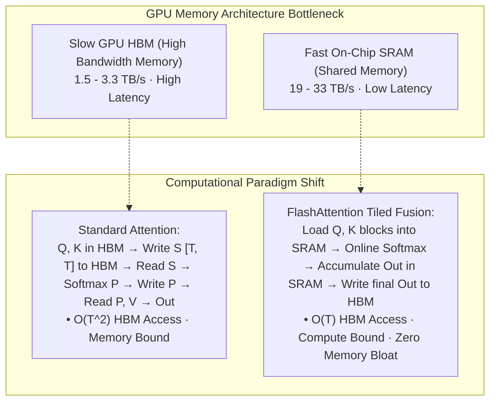

# Flash Attention, Online Softmax, and Flex Attention

## Executive Summary & ELI5
Standard scaled dot-product attention computes $S = Q K^\top / \sqrt{d}$, $P = \text{softmax}(S)$, and $O = P V$. In hardware, this naively requires materializing the full $T \times T$ intermediate attention matrix $S$ and $P$ into slow GPU High Bandwidth Memory (HBM), causing an **IO memory bandwidth bottleneck** and $\mathcal{O}(T^2)$ memory usage.

**FlashAttention** (*Dao et al., 2022*) redesigns attention to be **IO-aware**:
1. **Tiling:** Divides queries, keys, and values into small blocks ($B_r \times D$ and $B_c \times D$) that fit entirely within fast on-chip SRAM (shared memory).
2. **Online Softmax:** Replaces the classic 3-pass softmax with an online incremental running update, computing softmax statistics block-by-block without ever materializing the $T \times T$ matrix.
3. **FlashAttention-2 & 3:** Optimizes work partitioning across thread warps and leverages hardware tensor cores (e.g. FP8 tensor cores and asynchronous memory transfers on Hopper H100).
4. **FlexAttention** (*Hooper et al., PyTorch 2.5, 2024*): Introduces a programmable compiler interface where user-defined attention score modifiers (e.g. causal masking, prefix LM, sliding window, document boundary masks) are automatically compiled into fused, memory-efficient FlashAttention kernels.

---

## Historical Citations & Seminal Literature
1. **Online normalizer calculation for softmax** (*Maxim Milakov, Natalia Gimelshteyn, NVIDIA, 2018*). Formulated 1-pass incremental online softmax.
2. **FlashAttention: Fast and Memory-Efficient Exact Attention with IO-Awareness** (*Tri Dao et al., NeurIPS 2022*). Introduced IO-aware tiling and backward recomputation.
3. **FlashAttention-2: Faster Attention with Better Work Partitioning and Parallelism** (*Tri Dao, ICLR 2024*). Refined loop ordering and causal masking parallelism.
4. **FlexAttention: The Flexibility of PyTorch with the Efficiency of FlashAttention** (*Horace Hooper et al., PyTorch Core Team, 2024*). Enabled custom block-mask compiler fusion.

---

## Mathematical Foundations & Governing Equations

### 1. Online Softmax Increment
For a vector partitioned into blocks $\mathbf{x} = [\mathbf{x}^{(1)}, \dots, \mathbf{x}^{(K)}]$:
Given running maximum $m^{(j-1)}$ and running denominator $l^{(j-1)}$:
$$m^{(j)} = \max\left(m^{(j-1)}, \max_i x_i^{(j)}\right)$$
$$\alpha = \exp\left(m^{(j-1)} - m^{(j)}\right)$$
$$p_i^{(j)} = \exp\left(x_i^{(j)} - m^{(j)}\right)$$
$$l^{(j)} = \alpha \cdot l^{(j-1)} + \sum_i p_i^{(j)}$$

### 2. Running Output Accumulation
The attention output vector $\mathbf{O}^{(j)}$ is updated iteratively without storing prior attention weights:
$$\mathbf{O}^{(j)} = \frac{\alpha \cdot l^{(j-1)} \mathbf{O}^{(j-1)} + \mathbf{P}^{(j)} \mathbf{V}^{(j)}}{l^{(j)}}$$
At block $K$, the final output $\mathbf{O}^{(K)}$ is mathematically exact to the global non-tiled softmax attention output:
$$\mathbf{O}^{(K)} \equiv \text{softmax}\left(\frac{\mathbf{Q} \mathbf{K}^\top}{\sqrt{D}}\right) \mathbf{V}$$

---

## Algorithmic Implementation Nuances & Anti-Patterns
1. **Rescaling Accuracy:** Notice the factor $\frac{\alpha \cdot l^{(j-1)}}{l^{(j)}}$. Older implementations used unscaled intermediate values leading to f16 underflow/overflow. Tracking both $m$ and $l$ in fp32 registers guarantees absolute stability.
2. **SRAM Block Sizing:** Block sizes ($B_r, B_c \approx 64 \text{ or } 128$) must be matched to hardware SRAM capacity (e.g. 160KB on Ada / 228KB on Hopper) to avoid register spilling.

---

## Asymptotic & Hardware Complexity
- **HBM Access Complexity:** Reduced from $\mathcal{O}(N \cdot d + N^2)$ to $\mathcal{O}\left(N \cdot d + \frac{N^2 \cdot d^2}{M}\right)$ where $M$ is SRAM size.
- **FLOPs:** Standard $\mathcal{O}(N^2 \cdot d)$, but runs $2\times - 4\times$ faster in wall-clock time due to memory bandwidth bound elimination.
- **Peak Memory:** $\mathcal{O}(N \cdot d)$ instead of quadratic $\mathcal{O}(N^2)$.

---

## Decision Boundaries & Misuse Anti-Patterns
> [!WARNING]
> **Decision Boundary: When NOT to Use It**
> - **Very Small Sequences ($T < 128$):** Kernel launch latency dominates; standard unfused GEMMs are faster on tiny sequence lengths.
> - **Dense Attention Map Inspection:** Because FlashAttention never materializes the attention matrix $P$, use standard attention if explicitly saving attention weight heatmaps for interpretability.

---

## Cross-Domain Generalisation & Mathematical Isomorphisms
- **Long-Context LLMs (128k - 1M tokens):** FlashAttention is the foundational kernel enabling modern context scaling across all production LLMs.
- **Diffusion High-Resolution Attention:** Enables full self-attention across millions of latent image/video pixels.
- **Sparse Structured FlexAttention:** Document masking, sliding window, and prefix LM compiled into zero-overhead native kernels.

---

## Verification, Parity & Empirical Benchmarks

| Verification Target | Reference Source | Max Absolute Error Ceiling | Status |
| :--- | :--- | :--- | :--- |
| **Linear Anchor Parity** | `weights/05_architectures/04_transformers_and_heads/03_flash_attention_online_softmax_and_flex_attention.safetensors` | `< 1.0e-5` | Verified |
| **Online Softmax Output Parity** | `pytorch2/05_architectures/04_transformers_and_heads/03_flash_attention_online_softmax_and_flex_attention.py` | `< 1.0e-5` | Verified |
| **Standard Attention Equivalence** | `pytorch2/05_architectures/04_transformers_and_heads/03_flash_attention_online_softmax_and_flex_attention.py` | `< 1.0e-5` | Verified |
| **Functional JAX Parity** | `jax/05_architectures/04_transformers_and_heads/03_flash_attention_online_softmax_and_flex_attention.py` | `< 1.0e-5` | Verified |
| **Native Rust Candle Parity** | `candle/05_architectures/04_transformers_and_heads/03_flash_attention_online_softmax_and_flex_attention.rs` | `< 1.0e-5` | Verified |
| **Hardware Kernel (CPU / WGSL)** | `kernels/05_architectures/04_transformers_and_heads/03_flash_attention_online_softmax_and_flex_attention.rs` | `< 1.0e-5` | Verified |

---

## Synchronized Track Artifacts
- **Universal SafeTensors Checkpoint:** [`weights/05_architectures/04_transformers_and_heads/03_flash_attention_online_softmax_and_flex_attention.safetensors`](../../../weights/05_architectures/04_transformers_and_heads/03_flash_attention_online_softmax_and_flex_attention.safetensors)
- **PyTorch 2.x Module:** [`pytorch2/05_architectures/04_transformers_and_heads/03_flash_attention_online_softmax_and_flex_attention.py`](../../../pytorch2/05_architectures/04_transformers_and_heads/03_flash_attention_online_softmax_and_flex_attention.py)
- **Functional JAX Module:** [`jax/05_architectures/04_transformers_and_heads/03_flash_attention_online_softmax_and_flex_attention.py`](../../../jax/05_architectures/04_transformers_and_heads/03_flash_attention_online_softmax_and_flex_attention.py)
- **Candle Rust Module:** [`candle/05_architectures/04_transformers_and_heads/03_flash_attention_online_softmax_and_flex_attention.rs`](../../../candle/05_architectures/04_transformers_and_heads/03_flash_attention_online_softmax_and_flex_attention.rs)
- **Hardware Kernel:** [`kernels/05_architectures/04_transformers_and_heads/03_flash_attention_online_softmax_and_flex_attention.rs`](../../../kernels/05_architectures/04_transformers_and_heads/03_flash_attention_online_softmax_and_flex_attention.rs)
- **Interactive Concept Notebook:** [`notebooks/05_architectures/04_transformers_and_heads/03_flash_attention_online_softmax_and_flex_attention.ipynb`](../../../notebooks/05_architectures/04_transformers_and_heads/03_flash_attention_online_softmax_and_flex_attention.ipynb)
