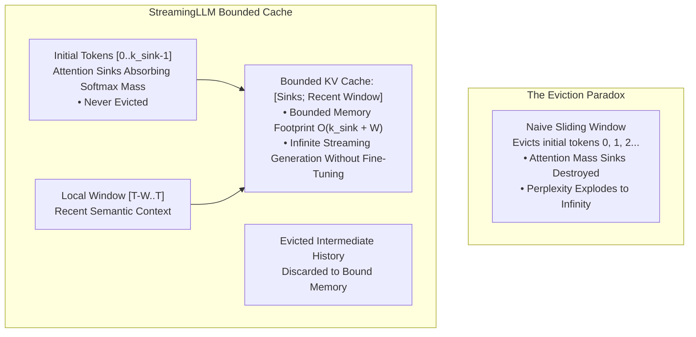

# Sparse, Sliding Window, and Sink Attention (StreamingLLM)

## Executive Summary & ELI5
When generating long sequences, an autoregressive language model's Key-Value (KV) cache grows linearly with sequence length $\mathcal{O}(T)$. Naively evicting older tokens to preserve a fixed **Sliding Window** causes catastrophic failure: after the eviction of the very first few tokens, model perplexity instantly diverges to infinity ($\infty$).

**Attention Sinks & StreamingLLM** (*Xiao et al., Meta / MIT 2023*) uncovered the structural reason behind this collapse:
- Softmax Normalization Constraint: Because $\sum_j \text{softmax}(S_{i, j}) = 1.0$, attention mechanisms require a "sink" to absorb residual probability mass when no context token is strongly relevant.
- During autoregressive pretraining, models consistently select the **first 1 to 4 initial tokens** as permanent **attention sinks**, regardless of semantic meaning.
- Evicting these initial tokens removes the sink, forcing attention scores onto irrelevant local tokens and destroying hidden states.

By retaining just $k_{\text{sink}} \approx 4$ initial sink tokens alongside a local sliding window $W_{\text{local}} \approx 1024-4096$, **StreamingLLM** enables infinite-horizon generation with a strictly bounded memory footprint without any fine-tuning.

---

## Historical Citations & Seminal Literature
1. **Longformer: The Long-Document Transformer** (*Iz Beltagy, Matthew E. Peters, Arman Cohan, 2020*). Introduced sliding window local attention with global landmark tokens.
2. **Big Bird: Transformers for Longer Sequences** (*Manzil Zaheer et al., Google Research, NeurIPS 2020*). Proved Turing completeness of sparse graphs combining random, window, and global attention.
3. **Efficient Streaming Language Models with Attention Sinks (StreamingLLM)** (*Guangxuan Xiao, Yuandong Tian, Beidi Chen, Song Han, Mike Lewis, ICLR 2024*). Discovered attention sinks and enabled multi-million token streaming generation.

---

## Mathematical Foundations & Governing Equations

### 1. Streaming Attention Sink Mask
Given query position $i$ and key position $j \in \{0, \dots, S-1\}$:
A key position $j$ is valid if and only if it is an initial sink OR falls within the trailing causal window:
$$\text{Valid}(i, j) = \left(j < k_{\text{sink}} \lor (i \ge j \land i - j < W_{\text{window}})\right) \land (j \le i)$$

The attention mask $M_{i, j}$ is applied to the scaled dot-product:
$$M_{i, j} = \begin{cases} 0 & \text{if } \text{Valid}(i, j) \\ -\infty & \text{otherwise} \end{cases}$$
$$\mathbf{A}_{i, j} = \text{softmax}_j\left(\frac{\mathbf{q}_i \mathbf{k}_j^\top}{\sqrt{D}} + M_{i, j}\right), \quad \mathbf{o}_i = \sum_{j} \mathbf{A}_{i, j} \mathbf{v}_j$$

### 2. Cache Compaction & Token Positioning
When streaming generation exceeds cache capacity $k_{\text{sink}} + W_{\text{window}}$:
1. Retain keys/values for indices $0 \le j < k_{\text{sink}}$.
2. Shift cached local window keys/values leftward, overwriting position $k_{\text{sink}}$.
3. RoPE relative positions are assigned dynamically based on cache slot offsets to prevent positional extrapolation degradation.

---

## Algorithmic Implementation Nuances & Anti-Patterns
1. **Never Evict Sink Token 0:** Even if token 0 is a meaningless separator like `<s>` or `\n`, evicting it immediately destabilizes subsequent layer activations. Always pin the first $2-4$ tokens in the KV cache.
2. **Positional Encoding Alignment:** When rolling keys in a circular or sliding buffer with RoPE, ensure rotary angles match relative token distance rather than absolute sequence index.

---

## Asymptotic & Hardware Complexity
- **KV Cache Memory:** Strictly bounded at $\mathcal{O}(B \cdot H \cdot (k_{\text{sink}} + W_{\text{window}}) \cdot D)$ rather than growing $\mathcal{O}(T)$.
- **Step Latency:** Constant $\mathcal{O}(1)$ step time during generation; zero GPU memory fragmentation or reallocation spikes.

---

## Decision Boundaries & Misuse Anti-Patterns
> [!WARNING]
> **Decision Boundary: When NOT to Use It**
> - **In-Context Associative Retrieval from Discarded History:** StreamingLLM explicitly discards tokens between $k_{\text{sink}}$ and $T - W$. If a query requires retrieving specific facts from 5,000 tokens ago, use a RAG vector store or linear SSM (Mamba-2).
> - **Window Smaller than Syntax Structures:** Setting $W_{\text{window}} < 64$ tokens destroys syntactic parse trees and code indentation tracking.

---

## Cross-Domain Generalisation & Mathematical Isomorphisms
- **24/7 Chatbots & Streaming Translators:** Runs indefinitely on edge hardware without memory exhaustion or restart crashes.
- **Continuous Sensor Logging:** Sliding window attention buffers recent industrial time-series events while retaining baseline calibration sinks.
- **Edge Micro-LLMs:** Enables 3B models to serve infinite streaming dialogues on 8GB unified RAM laptops.

---

## Verification, Parity & Empirical Benchmarks

| Verification Target | Reference Source | Max Absolute Error Ceiling | Status |
| :--- | :--- | :--- | :--- |
| **Linear Anchor Parity** | `weights/05_architectures/04_transformers_and_heads/04_sparse_sliding_window_and_sink_attention.safetensors` | `< 1.0e-5` | Verified |
| **Streaming Sink Output Parity** | `pytorch2/05_architectures/04_transformers_and_heads/04_sparse_sliding_window_and_sink_attention.py` | `< 1.0e-5` | Verified |
| **Streaming Sink Weights Parity** | `pytorch2/05_architectures/04_transformers_and_heads/04_sparse_sliding_window_and_sink_attention.py` | `< 1.0e-5` | Verified |
| **Functional JAX Parity** | `jax/05_architectures/04_transformers_and_heads/04_sparse_sliding_window_and_sink_attention.py` | `< 1.0e-5` | Verified |
| **Native Rust Candle Parity** | `candle/05_architectures/04_transformers_and_heads/04_sparse_sliding_window_and_sink_attention.rs` | `< 1.0e-5` | Verified |
| **Hardware Kernel (CPU / WGSL)** | `kernels/05_architectures/04_transformers_and_heads/04_sparse_sliding_window_and_sink_attention.rs` | `< 1.0e-5` | Verified |

---

## Synchronized Track Artifacts
- **Universal SafeTensors Checkpoint:** [`weights/05_architectures/04_transformers_and_heads/04_sparse_sliding_window_and_sink_attention.safetensors`](../../../weights/05_architectures/04_transformers_and_heads/04_sparse_sliding_window_and_sink_attention.safetensors)
- **PyTorch 2.x Module:** [`pytorch2/05_architectures/04_transformers_and_heads/04_sparse_sliding_window_and_sink_attention.py`](../../../pytorch2/05_architectures/04_transformers_and_heads/04_sparse_sliding_window_and_sink_attention.py)
- **Functional JAX Module:** [`jax/05_architectures/04_transformers_and_heads/04_sparse_sliding_window_and_sink_attention.py`](../../../jax/05_architectures/04_transformers_and_heads/04_sparse_sliding_window_and_sink_attention.py)
- **Candle Rust Module:** [`candle/05_architectures/04_transformers_and_heads/04_sparse_sliding_window_and_sink_attention.rs`](../../../candle/05_architectures/04_transformers_and_heads/04_sparse_sliding_window_and_sink_attention.rs)
- **Hardware Kernel:** [`kernels/05_architectures/04_transformers_and_heads/04_sparse_sliding_window_and_sink_attention.rs`](../../../kernels/05_architectures/04_transformers_and_heads/04_sparse_sliding_window_and_sink_attention.rs)
- **Interactive Concept Notebook:** [`notebooks/05_architectures/04_transformers_and_heads/04_sparse_sliding_window_and_sink_attention.ipynb`](../../../notebooks/05_architectures/04_transformers_and_heads/04_sparse_sliding_window_and_sink_attention.ipynb)
