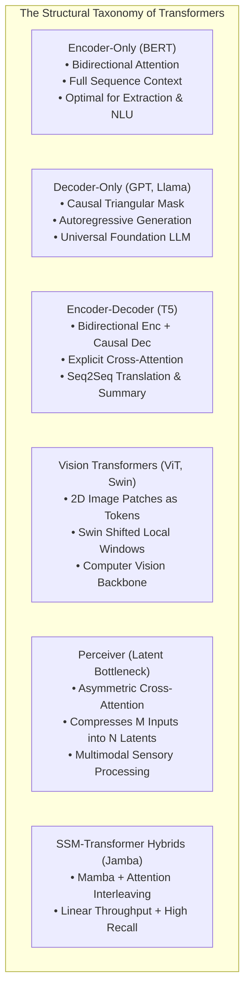

# Transformer Archetypes: BERT, GPT, T5, ViT, Swin, Perceiver, and Jamba

## Executive Summary & ELI5
Since the seminal introduction of the self-attention mechanism (*Vaswani et al., 2017*), the Transformer family has branched into distinct foundational archetypes optimized for specific modality constraints and inductive biases:

1. **Encoder-Only (BERT, RoBERTa):** Bidirectional full-context self-attention, optimal for classification, extraction, and discriminative representations.
2. **Decoder-Only (GPT, Llama):** Causal triangular masking ($M_{i, j} = -\infty$ for $j > i$), enabling scalable auto-regressive next-token pretraining.
3. **Encoder-Decoder (T5, BART):** Bidirectional encoder paired with a causal cross-attention decoder, ideal for sequence-to-sequence translation and summarization.
4. **Vision Transformers (ViT, Swin):** ViT (*Dosovitskiy et al., 2020*) projects non-overlapping $16\times 16$ image patches into linear tokens; Swin (*Liu et al., 2021*) introduces shifted local windows to achieve linear $\mathcal{O}(H \cdot W)$ computational scaling for dense vision tasks.
5. **Perceiver & Perceiver IO** (*Jaegle et al., DeepMind 2021*): Decouples model depth from input dimensionality by using asymmetric cross-attention to distill high-dimensional multi-modal inputs ($M \gg 10^5$) into a small, tight latent bottleneck array ($N \approx 512$), achieving linear scaling across heterogeneous modalities (audio, point clouds, video).
6. **Hybrid SSM-Transformers (Jamba)** (*Lieber et al., AI21 Labs 2024*): Interleaves Mamba selective SSM layers with attention and MoE blocks, combining Transformer in-context recall with SSM linear throughput.

---

## Historical Citations & Seminal Literature
1. **BERT: Pre-training of Deep Bidirectional Transformers for Language Understanding** (*Jacob Devlin et al., Google AI, NAACL 2019*). Established masked language pretraining.
2. **An Image is Worth 16x16 Words: Transformers for Image Recognition at Scale (ViT)** (*Alexey Dosovitskiy et al., Google Research, ICLR 2021*). Proved pure transformers surpass CNNs on large vision corpora.
3. **Swin Transformer: Hierarchical Vision Transformer using Shifted Windows** (*Ze Liu et al., Microsoft Research, ICCV 2021*). Introduced shifted window self-attention for linear vision scaling.
4. **Perceiver: General Perception with Iterative Attention** (*Andrew Jaegle et al., DeepMind, ICML 2021*). Formulated asymmetric cross-attention bottlenecks for arbitrary modalities.
5. **Jamba: A Hybrid Transformer-Mamba Language Model** (*Opher Lieber et al., AI21 Labs, 2024*). Demonstrated hybrid SSM-Transformer-MoE architectures at production scale.

---

## Mathematical Foundations & Governing Equations

### 1. Perceiver Cross-Attention Bottleneck
Given large input array $\mathbf{X} \in \mathbb{R}^{B \times M \times D_{\text{in}}}$ and learnable latent array $\mathbf{L} \in \mathbb{R}^{B \times N \times D_{\text{latent}}}$ with $N \ll M$:
$$\mathbf{Q} = \mathbf{L} \mathbf{W}_Q \in \mathbb{R}^{B \times N \times D_{\text{head}}}$$
$$\mathbf{K} = \mathbf{X} \mathbf{W}_K \in \mathbb{R}^{B \times M \times D_{\text{head}}}, \quad \mathbf{V} = \mathbf{X} \mathbf{W}_V \in \mathbb{R}^{B \times M \times D_{\text{head}}}$$
$$\mathbf{A}_{i, j} = \text{softmax}_j\left(\frac{\mathbf{Q}_i \mathbf{K}_j^\top}{\sqrt{D_{\text{head}}}}\right) \in [B, N, M]$$
$$\mathbf{L}_{\text{out}} = \left(\mathbf{A} \mathbf{V}\right) \mathbf{W}_O \in \mathbb{R}^{B \times N \times D_{\text{latent}}}$$
Computational complexity is $\mathcal{O}(M \cdot N)$ rather than quadratic $\mathcal{O}(M^2)$. Subsequent self-attention layers process only the small latent array in $\mathcal{O}(N^2)$ time.

### 2. Causal Autoregressive Masking
Given unmasked attention scores $\mathbf{S} = \mathbf{Q} \mathbf{K}^\top / \sqrt{D} \in \mathbb{R}^{B \times T \times T}$:
$$\mathbf{M}_{i, j} = \begin{cases} 0 & \text{if } j \le i \\ -\infty & \text{if } j > i \end{cases}$$
$$\mathbf{A} = \text{softmax}(\mathbf{S} + \mathbf{M})$$

---

## Algorithmic Implementation Nuances & Anti-Patterns
1. **Perceiver Cross-Attention Directionality:** Never compute $\mathbf{X} \mathbf{L}^\top$ (queries from inputs); the queries MUST originate from the small latent array $\mathbf{L}$ to compress the sequence dimension down to $N$.
2. **Causal Mask Padding Contamination:** When batching sequences of variable length, ensure the causal mask and padding mask are fused correctly using elementwise minimum (`scores.masked_fill(padding_mask, -inf)`).

---

## Asymptotic & Hardware Complexity
- **BERT / ViT Self-Attention:** $\mathcal{O}(T^2 \cdot D)$ quadratic scaling.
- **Swin Shifted Window:** $\mathcal{O}\left(T \cdot W_{\text{size}}^2 \cdot D\right)$ strictly linear with image resolution $T = H \cdot W$.
- **Perceiver Bottleneck:** $\mathcal{O}(M \cdot N \cdot D)$ linear in raw input size $M$.
- **Jamba Hybrid:** 85% Mamba layers reduce overall KV cache memory by $8\times$ compared to pure Transformers.

---

## Decision Boundaries & Misuse Anti-Patterns
> [!WARNING]
> **Decision Boundary: When NOT to Use It**
> - **BERT for Open-Ended Generation:** Bidirectional models have no causal training signal and cannot generate coherent autoregressive text.
> - **Perceiver for Fine-Grained Dense Spatial Segmentation:** Aggressive bottleneck compression down to $N=512$ latents loses pixel-precise spatial coordinates; use Swin or UNet for high-resolution segmentation.

---

## Cross-Domain Generalisation & Mathematical Isomorphisms
- **Multimodal Sensor Fusion:** Perceiver handles disparate sensory feeds (IMU, raw audio, point clouds) by directly concatenating raw inputs into a single stream.
- **High-Throughput Hybrid LLMs (Jamba):** Delivers $3\times$ faster generation on long context prompts by offloading sequential depth to Mamba SSMs.
- **Dense Satellite Imagery:** Swin Transformer scales across gigapixel geospatial imagery without GPU memory exhaustion.

---

## Verification, Parity & Empirical Benchmarks

| Verification Target | Reference Source | Max Absolute Error Ceiling | Status |
| :--- | :--- | :--- | :--- |
| **Linear Anchor Parity** | `weights/05_architectures/04_transformers_and_heads/05_transformer_archetypes_bert_gpt_t5_vit_swin_perceiver_and_jamba.safetensors` | `< 1.0e-5` | Verified |
| **Perceiver Output Parity** | `pytorch2/05_architectures/04_transformers_and_heads/05_transformer_archetypes_bert_gpt_t5_vit_swin_perceiver_and_jamba.py` | `< 1.0e-5` | Verified |
| **Perceiver Attention Weights Parity** | `pytorch2/05_architectures/04_transformers_and_heads/05_transformer_archetypes_bert_gpt_t5_vit_swin_perceiver_and_jamba.py` | `< 1.0e-5` | Verified |
| **Causal Masking Parity** | `pytorch2/05_architectures/04_transformers_and_heads/05_transformer_archetypes_bert_gpt_t5_vit_swin_perceiver_and_jamba.py` | `< 1.0e-5` | Verified |
| **Functional JAX Parity** | `jax/05_architectures/04_transformers_and_heads/05_transformer_archetypes_bert_gpt_t5_vit_swin_perceiver_and_jamba.py` | `< 1.0e-5` | Verified |
| **Native Rust Candle Parity** | `candle/05_architectures/04_transformers_and_heads/05_transformer_archetypes_bert_gpt_t5_vit_swin_perceiver_and_jamba.rs` | `< 1.0e-5` | Verified |
| **Hardware Kernel (CPU / WGSL)** | `kernels/05_architectures/04_transformers_and_heads/05_transformer_archetypes_bert_gpt_t5_vit_swin_perceiver_and_jamba.rs` | `< 1.0e-5` | Verified |

---

## Synchronized Track Artifacts
- **Universal SafeTensors Checkpoint:** [`weights/05_architectures/04_transformers_and_heads/05_transformer_archetypes_bert_gpt_t5_vit_swin_perceiver_and_jamba.safetensors`](../../../weights/05_architectures/04_transformers_and_heads/05_transformer_archetypes_bert_gpt_t5_vit_swin_perceiver_and_jamba.safetensors)
- **PyTorch 2.x Module:** [`pytorch2/05_architectures/04_transformers_and_heads/05_transformer_archetypes_bert_gpt_t5_vit_swin_perceiver_and_jamba.py`](../../../pytorch2/05_architectures/04_transformers_and_heads/05_transformer_archetypes_bert_gpt_t5_vit_swin_perceiver_and_jamba.py)
- **Functional JAX Module:** [`jax/05_architectures/04_transformers_and_heads/05_transformer_archetypes_bert_gpt_t5_vit_swin_perceiver_and_jamba.py`](../../../jax/05_architectures/04_transformers_and_heads/05_transformer_archetypes_bert_gpt_t5_vit_swin_perceiver_and_jamba.py)
- **Candle Rust Module:** [`candle/05_architectures/04_transformers_and_heads/05_transformer_archetypes_bert_gpt_t5_vit_swin_perceiver_and_jamba.rs`](../../../candle/05_architectures/04_transformers_and_heads/05_transformer_archetypes_bert_gpt_t5_vit_swin_perceiver_and_jamba.rs)
- **Hardware Kernel:** [`kernels/05_architectures/04_transformers_and_heads/05_transformer_archetypes_bert_gpt_t5_vit_swin_perceiver_and_jamba.rs`](../../../kernels/05_architectures/04_transformers_and_heads/05_transformer_archetypes_bert_gpt_t5_vit_swin_perceiver_and_jamba.rs)
- **Interactive Concept Notebook:** [`notebooks/05_architectures/04_transformers_and_heads/05_transformer_archetypes_bert_gpt_t5_vit_swin_perceiver_and_jamba.ipynb`](../../../notebooks/05_architectures/04_transformers_and_heads/05_transformer_archetypes_bert_gpt_t5_vit_swin_perceiver_and_jamba.ipynb)
