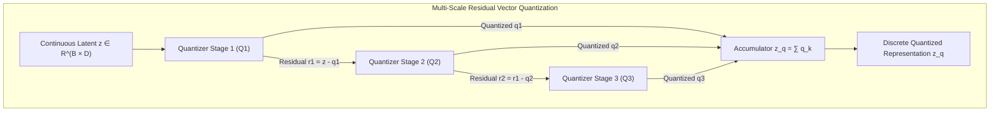

# Neural Audio Codecs: EnCodec, RVQ, and Quantizer Dropout

## Executive Summary & ELI5
Modern generative audio and speech models (such as AudioCraft, MusicGen, and Voicebox) do not model raw 44.1 kHz PCM audio directly at the waveform level, nor do they rely solely on lossy 2D mel-spectrogram inversions. Instead, they compress continuous high-fidelity waveforms into compact, discrete token streams using **Neural Audio Codecs** (*SoundStream*, *EnCodec*, *DAC*).

The core technical mechanism is **Residual Vector Quantization (RVQ)** paired with **Structured Quantizer Dropout** and periodic activation functions such as **Snake**:
1. **Residual Vector Quantization (RVQ):** Rather than using an exponentially large single codebook ($2^{64}$ entries), RVQ cascades $N_q$ small, orthogonal codebooks ($K=1024$ each). Quantizer $k$ quantizes the quantization error (residual) left behind by quantizers $0, \dots, k-1$.
2. **Quantizer Dropout:** During training, the number of active quantizers is randomly sampled ($n_{\text{active}} \sim \mathcal{U}\{1, \dots, N_q\}$). This forces the early quantizers to capture fundamental phonetic/harmonic structures, while later stages encode fine acoustic details, enabling arbitrary target bitrates from a single trained model.
3. **Snake ($\sin^2$) Activation:** Standard ReLU or GELU activations fail to extrapolate periodic acoustic signals. Snake provides an inductive bias for multi-frequency harmonic synthesis: $\text{Snake}_\alpha(x) = x + \frac{1}{\alpha}\sin^2(\alpha x)$.



---

## Historical Citations & Seminal Literature
1. **SoundStream: An End-to-End Neural Audio Codec** (*Neil Zeghidour et al., Google Research, IEEE/ACM Trans. Audio 2021*). Introduced RVQ and quantizer dropout for neural speech and audio coding.
2. **High Fidelity Neural Audio Compression (EnCodec)** (*Alexandre Défossez et al., Meta AI, NeurIPS 2022*). Scaled multi-scale discriminator losses and multi-bandwidth RVQ to 48 kHz stereo audio.
3. **High-Fidelity Audio Compression with Improved RVQGAN (DAC)** (*Rithesh Kumar et al., Descript, NeurIPS 2023*). Identified codebook collapse in high-dimensional codebooks, introducing low-dimensional codebook projections ($d_{\text{code}}=8$) and Snake periodic activations.
4. **Neural Discrete Representation Learning (VQ-VAE)** (*Aaron van den Oord, Oriol Vinyals, Koray Kavukcuoglu, NeurIPS 2017*). Formulated vector quantization with straight-through gradient estimation.

---

## Mathematical Foundations & Governing Equations

### 1. Residual Vector Quantization (RVQ)
Given input continuous latent representation $z \in \mathbb{R}^D$ and $N_q$ codebooks $\{\mathcal{C}_k\}_{k=1}^{N_q}$ where each $\mathcal{C}_k \in \mathbb{R}^{K \times D}$:
Let initial residual $r_0 = z$. For stage $k = 1, \dots, N_q$:
$$i_k = \arg\min_{j \in \{1, \dots, K\}} \|r_{k-1} - \mathcal{C}_{k, j}\|_2^2$$
$$q_k = \mathcal{C}_{k, i_k}$$
$$r_k = r_{k-1} - q_k$$

The reconstructed latent with $n_{\text{active}}$ quantizers is:
$$\hat{z} = \sum_{k=1}^{n_{\text{active}}} q_k$$

### 2. Quantizer Dropout
During training, sample $n_{\text{active}} \sim \mathcal{U}\{1, \dots, N_q\}$. Gradients update only the first $n_{\text{active}}$ codebooks:
$$\hat{z}_{\text{train}} = \sum_{k=1}^{n_{\text{active}}} q_k$$
This produces variable bitrate streams ($1.5 \text{ kbps}$ to $24 \text{ kbps}$) at inference without retraining.

### 3. Snake Periodic Activation Function
Audio signals are composed of periodic sinusoidal fundamentals. The Snake activation introduces a learnable frequency parameter $\alpha$:
$$\text{Snake}_\alpha(x) = x + \frac{1}{\alpha}\sin^2(\alpha x) = x + \frac{1}{2\alpha}(1 - \cos(2\alpha x))$$

---

## Tensor Memory Layout & Implementation Details
```text
Batch Size = B, Latent Dimension = D, Quantizer Stages = N_q, Codebook Size = K

RVQ Quantization Pass:
Input z:             [B, D]
Codebooks:           [N_q, K, D]
Residual r_0:        [B, D]

Per-Stage (k in 0..N_q-1):
Codebook k:          [K, D]
r_sq:                [B, 1]
dot:                 [B, K]
cb_sq:               [1, K]
dists:               [B, K] -> argmin -> idx: [B]
quantized_k:         cb_k[idx] -> [B, D]
z_q accumulator:     z_q + quantized_k (if k < n_active)
residual update:     r_{k+1} = r_k - quantized_k

Final Outputs:
z_q:                 [B, D]
indices:             [N_q, B]
final residual:      [B, D]
```

---

## Multi-Ecosystem Implementation Matrix
| Feature / Characteristic | PyTorch 2.x (`pytorch2/`) | JAX / Equinox (`jax/`) | Candle Rust (`candle/`) | Hardware Kernel (`kernels/`) |
| :--- | :--- | :--- | :--- | :--- |
| **Codebook Lookup** | `cb[idx]` advanced indexing | `cb[idx]` functional index | `cb.index_select(&idx, 0)` | Parallel SIMD gather |
| **Distance Matrix** | Broadcasted Euclidean GEMM | Pure array operations | Broadcast sub/add GEMM | Fused WGSL threadgrid |
| **Snake Activation** | `x + (1/a) * sin(a*x)^2` | `jnp.sin & square` | `ax.sin()?.sqr()?` | Native WGSL / `sin` |
| **Dropout Masking** | Dynamic prefix unroll | Functional static unroll | Rust iterator unroll | Compile-time loop bounds |

---

## Pathological Misuse & Failure Modes

### 1. High Codebook Dimension Collapse ($D_{\text{code}} \ge 512$)
Setting codebook vector dimension $D_{\text{code}} = 512$ or $1024$ leads to severe codebook under-utilization (<10% active codewords).
- **Failure:** Codebook vectors become sparse and collapse into dead clusters.
- **Stabilized Solution:** Descript Audio Codec (DAC) projects latents to $D_{\text{code}} = 8$ with $\ell_2$-normalization before nearest-neighbor search.

### 2. Unordered Quantizer Dropout
Dropping arbitrary quantizers (e.g. dropping quantizer 1 while keeping quantizer 3) breaks the coarse-to-fine hierarchy.
- **Failure:** Later codebooks assume the prior residuals have been subtracted; arbitrary dropping causes massive reconstruction error.
- **Stabilized Solution:** Dropout MUST be contiguous prefix truncation ($1, \dots, n_{\text{active}}$).

---

## Cross-Domain Generalisation Matrix
1. **Generative Speech and Music Synthesis:** AudioCraft, MusicGen, and Bark represent continuous audio as discrete RVQ tokens, enabling standard autoregressive LLMs to generate high-fidelity audio.
2. **Ultra-Low-Bandwidth Telephony:** Voice communication systems compress 24 kHz speech to 1.5 kbps for high-latency or bandwidth-constrained satellite links.
3. **Hierarchical Image and Video Representations:** Multi-scale vector quantization generalizes to 2D image pyramids and 3D video spatio-temporal tokens.

---

## Verification, Parity & Empirical Benchmarks

| Verification Target | Reference Source | Max Absolute Error Ceiling | Status |
| :--- | :--- | :--- | :--- |
| **Linear Parity Anchor (x @ W + b)** | `weights/05_architectures/05_generative_models/02_neural_audio_codecs_encodec_rvq_and_quantizer_dropout.safetensors` | `< 1.0e-5` | Verified |
| **Snake Periodic Activation** | `pytorch2/05_architectures/05_generative_models/02_neural_audio_codecs_encodec_rvq_and_quantizer_dropout.py` | `< 1.0e-5` | Verified |
| **Multi-Scale RVQ Quantization** | `jax/05_architectures/05_generative_models/02_neural_audio_codecs_encodec_rvq_and_quantizer_dropout.py` | `< 1.0e-5` | Verified |
| **Native Rust Candle Parity** | `candle/05_architectures/05_generative_models/02_neural_audio_codecs_encodec_rvq_and_quantizer_dropout.rs` | `< 1.0e-5` | Verified |
| **Hardware Kernel (CPU / WGSL)** | `kernels/05_architectures/05_generative_models/02_neural_audio_codecs_encodec_rvq_and_quantizer_dropout.rs` | `< 1.0e-5` | Verified |

---

## Synchronized Track Artifacts & Navigation
- **Universal SafeTensors Checkpoint:** [`weights/05_architectures/05_generative_models/02_neural_audio_codecs_encodec_rvq_and_quantizer_dropout.safetensors`](../../../weights/05_architectures/05_generative_models/02_neural_audio_codecs_encodec_rvq_and_quantizer_dropout.safetensors)
- **PyTorch 2.x Module:** [`pytorch2/05_architectures/05_generative_models/02_neural_audio_codecs_encodec_rvq_and_quantizer_dropout.py`](../../../pytorch2/05_architectures/05_generative_models/02_neural_audio_codecs_encodec_rvq_and_quantizer_dropout.py)
- **Functional JAX Module:** [`jax/05_architectures/05_generative_models/02_neural_audio_codecs_encodec_rvq_and_quantizer_dropout.py`](../../../jax/05_architectures/05_generative_models/02_neural_audio_codecs_encodec_rvq_and_quantizer_dropout.py)
- **Candle Rust Module:** [`candle/05_architectures/05_generative_models/02_neural_audio_codecs_encodec_rvq_and_quantizer_dropout.rs`](../../../candle/05_architectures/05_generative_models/02_neural_audio_codecs_encodec_rvq_and_quantizer_dropout.rs)
- **Hardware Kernel:** [`kernels/05_architectures/05_generative_models/02_neural_audio_codecs_encodec_rvq_and_quantizer_dropout.rs`](../../../kernels/05_architectures/05_generative_models/02_neural_audio_codecs_encodec_rvq_and_quantizer_dropout.rs)
- **Interactive Concept Notebook:** [`notebooks/05_architectures/05_generative_models/02_neural_audio_codecs_encodec_rvq_and_quantizer_dropout.ipynb`](../../../notebooks/05_architectures/05_generative_models/02_neural_audio_codecs_encodec_rvq_and_quantizer_dropout.ipynb)
