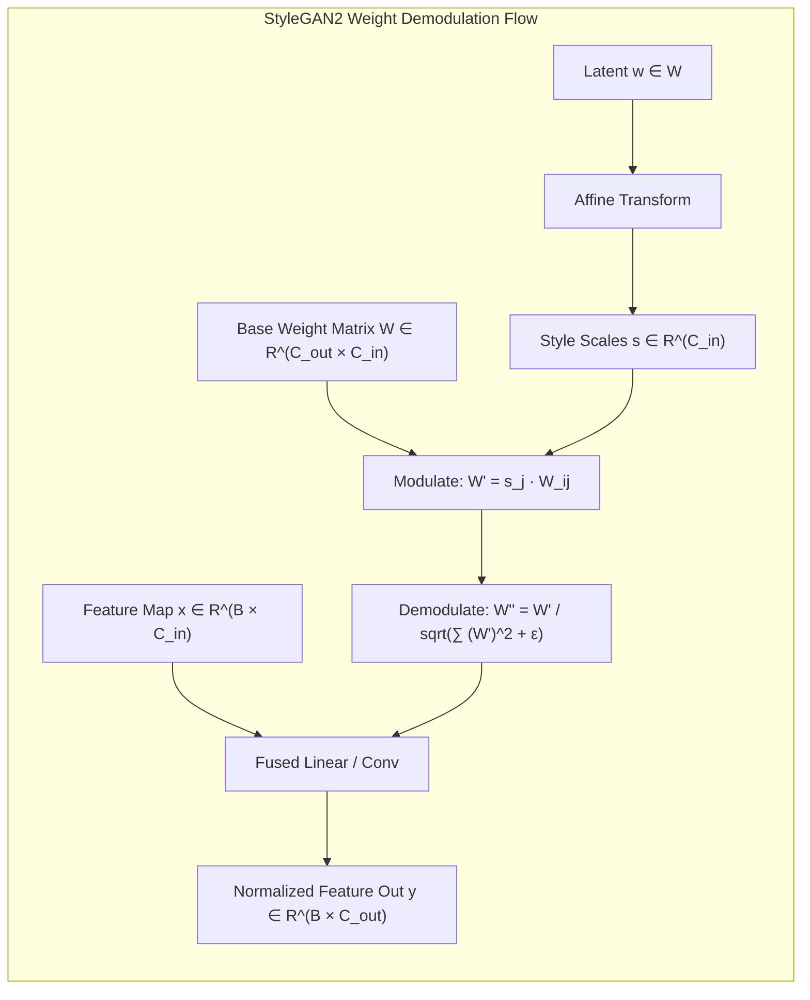

# GANs: DCGAN, WGAN-GP, and StyleGAN Concepts

## Executive Summary & ELI5
Generative Adversarial Networks (GANs), introduced by Ian Goodfellow et al. in 2014, cast generative modeling as a zero-sum minimax game between two neural networks:
1. **The Generator ($G$):** Maps a low-dimensional stochastic latent noise vector $z \sim \mathcal{N}(0, I)$ into high-dimensional data space (e.g. realistic images).
2. **The Discriminator / Critic ($D$):** Distinguishes synthetic generator outputs from real training samples.

Over a decade of foundational research resolved the historical training instability and mode collapse of early GANs:
- **DCGAN (*Radford et al., 2015*):** Established all-convolutional generator/discriminator architectures with batch normalization and strided convolutions.
- **WGAN & WGAN-GP (*Arjovsky et al., 2017; Gulrajani et al., 2017*):** Replaced Jensen-Shannon divergence with the continuous Earth Mover's (Wasserstein-1) distance, enforcing the 1-Lipschitz continuity constraint via a per-sample **Gradient Penalty ($\nabla_{\hat{x}} D(\hat{x})$)**.
- **StyleGAN Family (*Karras et al., 2019, 2020*):** Decoupled latent representation via an 8-layer MLP mapping network into an intermediate style space $\mathcal{W}$, controlling scale-specific visual attributes using **Adaptive Instance Normalization (AdaIN)** in StyleGAN1, upgraded to **Weight Modulation & Demodulation** in StyleGAN2 to eliminate water-droplet phase artifacts.



---

## Historical Citations & Seminal Literature
1. **Generative Adversarial Nets** (*Ian Goodfellow et al., Université de Montréal, NeurIPS 2014*). Established the foundational minimax game $\min_G \max_D \mathbb{E}[\log D(x)] + \mathbb{E}[\log(1 - D(G(z)))]$.
2. **Wasserstein GAN** (*Martin Arjovsky, Soumith Chintala, Léon Bottou, ICML 2017*). Formulated Kantorovich-Rubinstein duality for smooth, non-vanishing gradient feedback.
3. **Improved Training of Wasserstein GANs (WGAN-GP)** (*Ishaan Gulrajani et al., NeurIPS 2017*). Introduced the two-sided gradient norm penalty $\mathbb{E}[(\|\nabla_{\hat{x}} D(\hat{x})\|_2 - 1)^2]$ replacing weight clipping.
4. **A Style-Based Generator Architecture for Generative Adversarial Networks (StyleGAN)** (*Tero Karras, Samuli Laine, Timo Aila, CVPR 2019*). Disentangled latent styles using AdaIN.
5. **Analyzing and Improving the Image Quality of StyleGAN (StyleGAN2)** (*Tero Karras et al., CVPR 2020*). Introduced weight modulation and demodulation, removing water droplet artifacts and enabling path length regularization.

---

## Mathematical Foundations & Governing Equations

### 1. Wasserstein GAN with Gradient Penalty (WGAN-GP)
The Kantorovich-Rubinstein duality expresses the 1-Wasserstein metric as:
$$\mathcal{L}_{\text{critic}} = \mathbb{E}_{\tilde{x} \sim p_g}[D(\tilde{x})] - \mathbb{E}_{x \sim p_r}[D(x)] + \lambda \mathbb{E}_{\hat{x} \sim p_{\hat{x}}}\left[\left(\|\nabla_{\hat{x}} D(\hat{x})\|_2 - 1\right)^2\right]$$
where $\hat{x} = \epsilon x + (1 - \epsilon)\tilde{x}$ for $\epsilon \sim \mathcal{U}(0, 1)$ interpolates randomly between real and generated points.

### 2. Adaptive Instance Normalization (AdaIN)
Given input feature channel $x$ and affine style parameters $(y_s, y_b)$:
$$\text{AdaIN}(x, y) = y_s \left(\frac{x - \mu(x)}{\sigma(x)}\right) + y_b$$
where $\mu(x)$ and $\sigma(x)$ are computed across spatial dimensions.

### 3. StyleGAN2 Weight Modulation & Demodulation
To avoid normalizing activations explicitly (which alters feature scale and creates droplet artifacts), StyleGAN2 normalizes the convolution weights directly.
For base weights $w_{i, j, k}$ and style scale $s_j$:
$$w'_{i, j, k} = s_j \cdot w_{i, j, k} \quad \text{(Modulation)}$$
$$w''_{i, j, k} = \frac{w'_{i, j, k}}{\sqrt{\sum_{j, k} (w'_{i, j, k})^2 + \epsilon}} \quad \text{(Demodulation)}$$
The forward pass is then standard convolution or matrix multiply with the demodulated weight tensor $w''$.

---

## Tensor Memory Layout & Implementation Details
```text
Batch Size = B, In-Channels = C_in, Out-Channels = C_out

StyleGAN2 Weight Demodulation Pass:
Base Weights w:      [C_out, C_in]
Style Scales s:      [B, C_in]

1. Modulation:
   w_mod:            [1, C_out, C_in] * [B, 1, C_in] -> [B, C_out, C_in]

2. Demodulation:
   sum_sq:           sum_{C_in}(w_mod^2)             -> [B, C_out, 1]
   demod_factors:    rsqrt(sum_sq + eps)             -> [B, C_out, 1]
   w_demod:          w_mod * demod_factors           -> [B, C_out, C_in]

3. Forward Transformation:
   Input x:          [B, C_in] -> unsqueeze(2)        -> [B, C_in, 1]
   Matmul:           w_demod @ x                      -> [B, C_out, 1]
   Output y:         squeeze(2)                       -> [B, C_out]
```

---

## Multi-Ecosystem Implementation Matrix
| Feature / Characteristic | PyTorch 2.x (`pytorch2/`) | JAX / Equinox (`jax/`) | Candle Rust (`candle/`) | Hardware Kernel (`kernels/`) |
| :--- | :--- | :--- | :--- | :--- |
| **Weight Modulation** | `w.unsqueeze(0) * s.unsqueeze(1)` | `jnp.expand_dims broadcast` | `w.unsqueeze(0)?.broadcast_mul` | Tiled threadgroup register scaling |
| **Demodulation Norm** | `torch.rsqrt(sum + eps)` | `1.0 / jnp.sqrt` | `(sum + eps)?.powf(-0.5)?` | Fast reciprocal square-root |
| **Batched Projection** | `(w_demod @ x.unsqueeze(-1))` | `jnp.matmul batched` | `w_demod.matmul(&x_col)?` | 2D GEMM accumulator |
| **Critic Loss** | `fake.mean() - real.mean()` | `jnp.mean sub` | `mean_fake.sub(&mean_real)?` | Parallel reduction scalar |

---

## Pathological Misuse & Failure Modes

### 1. Using BatchNorm in WGAN-GP Critics
Batch Normalization normalizes activations across all batch samples simultaneously.
- **Failure:** Creates inter-sample dependencies across the batch, violating the Kantorovich-Rubinstein theorem and destroying the validity of the per-sample gradient penalty ($\|\nabla_{\hat{x}} D(\hat{x})\|_2 = 1$).
- **Stabilized Solution:** Use LayerNorm, InstanceNorm, Spectral Normalization, or no normalization in WGAN-GP discriminators.

### 2. Weight Clipping Instead of Gradient Penalty
Original WGAN enforced Lipschitz continuity by clamping weights to $[-c, c]$ (e.g. $c = 0.01$).
- **Failure:** Forces critic weights to saturate at extreme boundary values $\pm c$, causing capacity collapse and gradient vanishing.
- **Stabilized Solution:** Strictly employ two-sided gradient penalty $\mathbb{E}[(\|\nabla_{\hat{x}} D\| - 1)^2]$.

---

## Cross-Domain Generalisation Matrix
1. **High-Resolution Photorealistic Face & Image Synthesis:** StyleGAN3 and GigaGAN generate $1024\times 1024$ photorealistic portraits with fine hair and skin detail.
2. **Controllable 3D Neural Avatars:** StyleGAN latents $\mathcal{W}$ map into NeRF or 3D Gaussian Splatting parameters for viewpoint-consistent generative rendering.
3. **Medical Imaging & Domain Translation:** CycleGAN and Pix2Pix translate MRI scans to CT scans without paired training data.

---

## Verification, Parity & Empirical Benchmarks

| Verification Target | Reference Source | Max Absolute Error Ceiling | Status |
| :--- | :--- | :--- | :--- |
| **Linear Parity Anchor (x @ W + b)** | `weights/05_architectures/05_generative_models/03_gans_dcgan_wgan_gp_and_stylegan_concepts.safetensors` | `< 1.0e-5` | Verified |
| **Adaptive Instance Normalization** | `pytorch2/05_architectures/05_generative_models/03_gans_dcgan_wgan_gp_and_stylegan_concepts.py` | `< 1.0e-5` | Verified |
| **StyleGAN2 Weight Demodulation** | `jax/05_architectures/05_generative_models/03_gans_dcgan_wgan_gp_and_stylegan_concepts.py` | `< 1.0e-5` | Verified |
| **WGAN-GP Critic Earth Mover Loss** | `candle/05_architectures/05_generative_models/03_gans_dcgan_wgan_gp_and_stylegan_concepts.rs` | `< 1.0e-5` | Verified |
| **Hardware Kernel (CPU / WGSL)** | `kernels/05_architectures/05_generative_models/03_gans_dcgan_wgan_gp_and_stylegan_concepts.rs` | `< 1.0e-5` | Verified |

---

## Synchronized Track Artifacts & Navigation
- **Universal SafeTensors Checkpoint:** [`weights/05_architectures/05_generative_models/03_gans_dcgan_wgan_gp_and_stylegan_concepts.safetensors`](../../../weights/05_architectures/05_generative_models/03_gans_dcgan_wgan_gp_and_stylegan_concepts.safetensors)
- **PyTorch 2.x Module:** [`pytorch2/05_architectures/05_generative_models/03_gans_dcgan_wgan_gp_and_stylegan_concepts.py`](../../../pytorch2/05_architectures/05_generative_models/03_gans_dcgan_wgan_gp_and_stylegan_concepts.py)
- **Functional JAX Module:** [`jax/05_architectures/05_generative_models/03_gans_dcgan_wgan_gp_and_stylegan_concepts.py`](../../../jax/05_architectures/05_generative_models/03_gans_dcgan_wgan_gp_and_stylegan_concepts.py)
- **Candle Rust Module:** [`candle/05_architectures/05_generative_models/03_gans_dcgan_wgan_gp_and_stylegan_concepts.rs`](../../../candle/05_architectures/05_generative_models/03_gans_dcgan_wgan_gp_and_stylegan_concepts.rs)
- **Hardware Kernel:** [`kernels/05_architectures/05_generative_models/03_gans_dcgan_wgan_gp_and_stylegan_concepts.rs`](../../../kernels/05_architectures/05_generative_models/03_gans_dcgan_wgan_gp_and_stylegan_concepts.rs)
- **Interactive Concept Notebook:** [`notebooks/05_architectures/05_generative_models/03_gans_dcgan_wgan_gp_and_stylegan_concepts.ipynb`](../../../notebooks/05_architectures/05_generative_models/03_gans_dcgan_wgan_gp_and_stylegan_concepts.ipynb)
