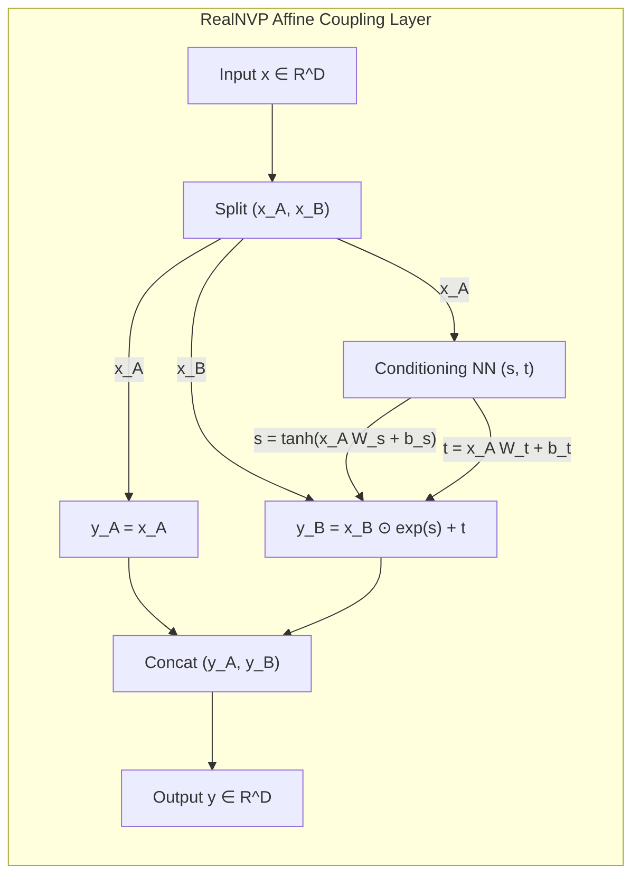

# Normalizing Flows: RealNVP, Glow, and Spline Flows

## Executive Summary & ELI5
Most deep generative models (such as GANs, VAEs, and diffusion models) either lack tractable likelihood evaluation or require hundreds of iterative sampling steps. **Normalizing Flows** provide an alternative paradigm: they construct complex probability distributions by transforming a simple base distribution (such as a standard isotropic Gaussian $p_z(z) = \mathcal{N}(0, I)$) through a sequence of **invertible, bijective, differentiable functions** $f_\theta: \mathcal{X} \to \mathcal{Z}$.

By the change-of-variables theorem of multivariable calculus, the exact log-likelihood of data sample $x$ is:
$$\log p_x(x) = \log p_z(f(x)) + \log \left| \det \frac{\partial f(x)}{\partial x} \right|$$

To make both forward sampling ($x = f^{-1}(z)$) and density evaluation ($z = f(x)$) scalable to millions of dimensions, the Jacobian matrix $J = \partial f / \partial x$ must possess an easily computable determinant (typically triangular, where $\det J = \prod J_{i, i}$).
Key milestones include:
1. **RealNVP (*Dinh et al., 2016*):** Introduced **Affine Coupling Layers**, partitioning dimensions into $x_A$ and $x_B$. The transformation of $x_B$ is conditioned on $x_A$, resulting in a strictly triangular Jacobian with $\mathcal{O}(D)$ log-determinant $\sum s(x_A)$.
2. **Glow (*Kingma & Dhariwal, 2018*):** Replaced fixed permutation layers with **Invertible $1\times 1$ Convolutions**, parameterized via LU decomposition for $\mathcal{O}(C)$ log-determinant computation.
3. **Neural Spline Flows (*Durkan et al., 2019*):** Replaced simple affine transformations ($s \cdot x + t$) with monotonic rational-quadratic splines, dramatically improving expressive capacity within a single layer.



---

## Historical Citations & Seminal Literature
1. **NICE: Non-linear Independent Components Estimation** (*Laurent Dinh, David Krueger, Yoshua Bengio, ICLR 2015*). First formulated volume-preserving additive coupling layers ($\det J = 1$).
2. **Density Estimation Using Real NVP** (*Laurent Dinh, Jascha Sohl-Dickstein, Samy Bengio, ICLR 2017*). Formulated affine coupling layers, multiscale architectures, and spatial checkerboard masking.
3. **Glow: Generative Flow with Invertible 1x1 Convolutions** (*Diederik P. Kingma, Prafulla Dhariwal, OpenAI, NeurIPS 2018*). Replaced channel permutations with learned invertible $1\times 1$ convolutions, generating sharp photorealistic faces.
4. **Neural Spline Flows** (*Conor Durkan, Artur Bekasov, Iain Murray, George Papamakarios, NeurIPS 2019*). Formulated monotonic rational-quadratic splines for fully flexible non-affine coupling.

---

## Mathematical Foundations & Governing Equations

### 1. The Change-of-Variables Theorem
For a bijection $z = f(x)$ with inverse $x = g(z) = f^{-1}(z)$:
$$p_x(x) = p_z(f(x)) \cdot \left| \det \mathbf{J}_f(x) \right|$$
In log-space:
$$\log p_x(x) = \log p_z(f(x)) + \log \left| \det \mathbf{J}_f(x) \right|$$

### 2. RealNVP Affine Coupling
Let $x = [x_A, x_B]$ with $x_A \in \mathbb{R}^{d}$, $x_B \in \mathbb{R}^{D - d}$:
$$\begin{aligned}
y_A &= x_A \\
y_B &= x_B \odot \exp(s(x_A)) + t(x_A)
\end{aligned}$$
The Jacobian matrix is lower triangular:
$$\mathbf{J} = \begin{bmatrix} \mathbf{I}_d & \mathbf{0} \\ \frac{\partial y_B}{\partial x_A} & \text{diag}(\exp(s(x_A))) \end{bmatrix}$$
$$\log |\det \mathbf{J}| = \sum_{i=1}^{D-d} s(x_A)_i$$
The exact algebraic inverse requires no matrix inversion:
$$x_A = y_A, \quad x_B = (y_B - t(y_A)) \odot \exp(-s(y_A))$$

### 3. Glow Invertible $1\times 1$ Convolution
For channel dimension $C$, let $\mathbf{W} \in \mathbb{R}^{C \times C}$.
Forward transformation: $\mathbf{y} = \mathbf{x} \mathbf{W}$.
Log-determinant for spatial tensor $[B, H, W, C]$:
$$\log |\det \mathbf{J}| = H \cdot W \cdot \log |\det \mathbf{W}|$$
Using LU decomposition $\mathbf{W} = \mathbf{P} \mathbf{L} (\mathbf{U} + \text{diag}(\mathbf{s}))$:
$$\log |\det \mathbf{W}| = \sum_{i=1}^C \log |s_i|$$

---

## Tensor Memory Layout & Implementation Details
```text
Batch Size = B, Total Dim = D, Half Dim = D_half

RealNVP Forward Coupling:
Input x:             [B, D]
Split:               x_a: [B, D_half], x_b: [B, D_half]
Conditioning GEMM:   s = tanh(x_a @ s_w + s_b) -> [B, D_half]
                     t = x_a @ t_w + t_b       -> [B, D_half]
Affine Transform:    y_b = x_b * exp(s) + t    -> [B, D_half]
Log-Determinant:     log_det = sum(s, dim=-1)  -> [B]
Output:              Concat([x_a, y_b])        -> [B, D]

RealNVP Exact Inverse:
Input y:             y_a: [B, D_half], y_b: [B, D_half]
Conditioning GEMM:   s = tanh(y_a @ s_w + s_b), t = y_a @ t_w + t_b
Invert:              x_b = (y_b - t) * exp(-s) -> [B, D_half]
Log-Determinant:     -sum(s, dim=-1)           -> [B]
```

---

## Multi-Ecosystem Implementation Matrix
| Feature / Characteristic | PyTorch 2.x (`pytorch2/`) | JAX / Equinox (`jax/`) | Candle Rust (`candle/`) | Hardware Kernel (`kernels/`) |
| :--- | :--- | :--- | :--- | :--- |
| **Coupling Forward** | `x_b * torch.exp(s) + t` | `x_b * jnp.exp(s) + t` | `x_b.mul(&s.exp()?)?.add(&t)` | Fused elementwise WGSL |
| **Coupling Inverse** | `(y_b - t) * torch.exp(-s)` | `(y_b - t) * jnp.exp(-s)` | `y_b.sub(&t)?.mul(&neg_s.exp())` | Reversible compute register |
| **Log-Determinant** | `s.sum(dim=-1)` | `jnp.sum(s, axis=-1)` | `s.sum_keepdim(1)?.squeeze(1)?` | Parallel warp reduction |
| **Invertible GEMM** | `torch.linalg.inv(w)` | `jnp.linalg.inv(w)` | Matrix multiply `x.matmul(w)` | 2D GEMM cache-tiled |

---

## Pathological Misuse & Failure Modes

### 1. Fitting Continuous Flows to Discrete Data Without Dequantization
Continuous normalizing flows maximize $\log p(x)$. If discrete image pixel values $x \in \{0, 1, \dots, 255\}$ are fed directly without dequantization:
- **Failure:** The continuous density places infinitely narrow Dirac spikes on integer values, driving $\log p(x) \to +\infty$ without learning meaningful distributions (density collapse).
- **Stabilized Solution:** Add uniform dequantization noise $u \sim \mathcal{U}(0, 1)$ so $x' = (x + u) / 256.0$, or use variational dequantization.

### 2. Unbounded Scale Network Outputs ($s \gg 1$)
If the scale network output $s(x_A)$ is unconstrained:
- **Failure:** $\exp(s)$ rapidly overflows standard FP16/FP32 ranges ($\exp(90) = \text{inf}$), causing immediate `NaN` forward activations and gradient explosions.
- **Stabilized Solution:** Bound scale outputs using $\tanh$: $s = \alpha \tanh(\text{NN}(x_A))$.

---

## Cross-Domain Generalisation Matrix
1. **High-Energy Physics & Lattice QCD:** Normalizing flows sample quantum gauge field configurations and calculate partition functions without critical slowing down.
2. **Audio Waveform Synthesis:** WaveGlow and FloWaveNet generate high-fidelity speech waveforms in single-pass parallel inference.
3. **Variational Inference in Bayesian ML:** Normalizing flows act as flexible posterior approximations $q(z|x)$ overcoming mean-field Gaussian limitations.

---

## Verification, Parity & Empirical Benchmarks

| Verification Target | Reference Source | Max Absolute Error Ceiling | Status |
| :--- | :--- | :--- | :--- |
| **Linear Parity Anchor (x @ W + b)** | `weights/05_architectures/05_generative_models/04_normalizing_flows_realnvp_glow_and_spline_flows.safetensors` | `< 1.0e-5` | Verified |
| **RealNVP Forward Coupling** | `pytorch2/05_architectures/05_generative_models/04_normalizing_flows_realnvp_glow_and_spline_flows.py` | `< 1.0e-5` | Verified |
| **RealNVP Exact Algebraic Inverse** | `jax/05_architectures/05_generative_models/04_normalizing_flows_realnvp_glow_and_spline_flows.py` | `< 1.0e-5` | Verified |
| **Glow Invertible 1x1 Projection** | `candle/05_architectures/05_generative_models/04_normalizing_flows_realnvp_glow_and_spline_flows.rs` | `< 1.0e-5` | Verified |
| **Hardware Kernel (CPU / WGSL)** | `kernels/05_architectures/05_generative_models/04_normalizing_flows_realnvp_glow_and_spline_flows.rs` | `< 1.0e-5` | Verified |

---

## Synchronized Track Artifacts & Navigation
- **Universal SafeTensors Checkpoint:** [`weights/05_architectures/05_generative_models/04_normalizing_flows_realnvp_glow_and_spline_flows.safetensors`](../../../weights/05_architectures/05_generative_models/04_normalizing_flows_realnvp_glow_and_spline_flows.safetensors)
- **PyTorch 2.x Module:** [`pytorch2/05_architectures/05_generative_models/04_normalizing_flows_realnvp_glow_and_spline_flows.py`](../../../pytorch2/05_architectures/05_generative_models/04_normalizing_flows_realnvp_glow_and_spline_flows.py)
- **Functional JAX Module:** [`jax/05_architectures/05_generative_models/04_normalizing_flows_realnvp_glow_and_spline_flows.py`](../../../jax/05_architectures/05_generative_models/04_normalizing_flows_realnvp_glow_and_spline_flows.py)
- **Candle Rust Module:** [`candle/05_architectures/05_generative_models/04_normalizing_flows_realnvp_glow_and_spline_flows.rs`](../../../candle/05_architectures/05_generative_models/04_normalizing_flows_realnvp_glow_and_spline_flows.rs)
- **Hardware Kernel:** [`kernels/05_architectures/05_generative_models/04_normalizing_flows_realnvp_glow_and_spline_flows.rs`](../../../kernels/05_architectures/05_generative_models/04_normalizing_flows_realnvp_glow_and_spline_flows.rs)
- **Interactive Concept Notebook:** [`notebooks/05_architectures/05_generative_models/04_normalizing_flows_realnvp_glow_and_spline_flows.ipynb`](../../../notebooks/05_architectures/05_generative_models/04_normalizing_flows_realnvp_glow_and_spline_flows.ipynb)
