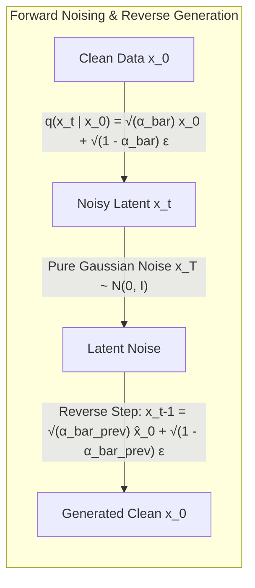

# Diffusion: DDPM, DDIM, EDM, and DiT

## Executive Summary & ELI5
Diffusion models (*Sohl-Dickstein et al., 2015; Ho et al., 2020*) represent a foundational breakthrough in generative modeling. Unlike GANs that optimize an unstable minimax game, or VAEs that compress through an information bottleneck, diffusion models formulate generation as the **reversal of a gradual, discrete or continuous forward noising process**:
1. **Forward Process (Noising):** Repeatedly injects Gaussian noise into data $x_0 \to x_1 \dots \to x_T$ until the sample is indistinguishable from standard isotropic Gaussian noise $\mathcal{N}(0, I)$.
2. **Reverse Process (Denoising):** A neural network learns to predict the added noise $\epsilon_\theta(x_t, t)$ or the original data $x_0$, iteratively removing noise to generate pristine samples from pure noise.

Key architectural evolutions include:
- **DDPM (*Ho et al., 2020*):** Formulated discrete-time Markov chains with linear noise variance schedules, achieving photorealistic image synthesis.
- **DDIM (*Song et al., 2020*):** Formulated non-Markovian deterministic sampling, enabling $10\times\text{–}50\times$ faster generation ($T=20\text{–}50$ steps instead of $1000$).
- **Classifier-Free Guidance (CFG) (*Ho & Salimans, 2022*):** Steers unconditional sample trajectories toward conditioning prompts $c$ by extrapolating along the gradient difference vector without requiring an auxiliary classifier network.
- **Diffusion Transformer (DiT) (*Peebles & Xie, 2023*):** Replaced conventional convolutional U-Net backbones with standard Vision Transformers operating on image patch tokens modulated via **adaLN-Zero (Adaptive Layer Normalization with zero initialization)**, which scales predictably with compute.



---

## Historical Citations & Seminal Literature
1. **Deep Unsupervised Learning using Nonequilibrium Thermodynamics** (*Jascha Sohl-Dickstein et al., ICML 2015*). First formulated diffusion probabilistic models using physical thermodynamic reversibility.
2. **Denoising Diffusion Probabilistic Models (DDPM)** (*Jonathan Ho, Ajay Jain, Pieter Abbeel, UC Berkeley, NeurIPS 2020*). Linked diffusion models to score-based generative modeling and denoising score matching.
3. **Denoising Diffusion Implicit Models (DDIM)** (*Jiaming Song, Chenlin Meng, Stefano Ermon, Stanford, ICLR 2021*). Formulated non-Markovian deterministic generative trajectories.
4. **Classifier-Free Diffusion Guidance** (*Jonathan Ho, Tim Salimans, NeurIPS 2022*). Introduced joint training of conditional and unconditional diffusion models for controllable generation.
5. **Scalable Diffusion Models with Transformers (DiT)** (*William Peebles, Saining Xie, UC Berkeley / NYU, ICCV 2023*). Replaced U-Net backbones with adaLN-Zero Vision Transformers.

---

## Mathematical Foundations & Governing Equations

### 1. DDPM Forward Diffusion Process
Given variance schedule $\beta_1, \dots, \beta_T$, define $\alpha_t = 1 - \beta_t$ and cumulative product $\bar{\alpha}_t = \prod_{s=1}^t \alpha_s$:
$$q(x_t | x_0) = \mathcal{N}\left(x_t; \sqrt{\bar{\alpha}_t} x_0, (1 - \bar{\alpha}_t) \mathbf{I}\right)$$
In closed-form using standard Gaussian noise $\epsilon \sim \mathcal{N}(0, \mathbf{I})$:
$$x_t = \sqrt{\bar{\alpha}_t} x_0 + \sqrt{1 - \bar{\alpha}_t} \epsilon$$

### 2. Deterministic DDIM Denoising Step ($\eta = 0$)
Given predicted noise $\hat{\epsilon}_\theta(x_t, t)$, reconstruct the predicted clean endpoint $\hat{x}_0$:
$$\hat{x}_0 = \frac{x_t - \sqrt{1 - \bar{\alpha}_t} \hat{\epsilon}_\theta(x_t, t)}{\sqrt{\bar{\alpha}_t}}$$
Advance backward along the deterministic trajectory to timestep $t-1$:
$$x_{t-1} = \sqrt{\bar{\alpha}_{t-1}} \hat{x}_0 + \sqrt{1 - \bar{\alpha}_{t-1}} \hat{\epsilon}_\theta(x_t, t)$$

### 3. Classifier-Free Guidance (CFG)
During inference, evaluate both unconditional ($\emptyset$) and conditional ($c$) noise estimates:
$$\tilde{\epsilon}_\theta(x_t, c) = \epsilon_\theta(x_t, \emptyset) + w_{\text{cfg}} \left(\epsilon_\theta(x_t, c) - \epsilon_\theta(x_t, \emptyset)\right)$$
where $w_{\text{cfg}} \ge 1.0$ controls alignment strength.

### 4. DiT adaLN-Zero Modulation
For conditioning vector $c$ (timestep embedding + class label), an MLP outputs modulation scale $\gamma$, shift $\beta$, and gate $\alpha$:
$$\mathbf{h} = \text{LayerNorm}(\mathbf{x}) \odot (1 + \gamma) + \beta$$
$$\mathbf{y} = \alpha \odot \mathbf{h}$$
Because $\alpha$ is initialized to zero, each Transformer block acts as an exact identity mapping at step 0, stabilizing deep pretraining.

---

## Tensor Memory Layout & Implementation Details
```text
Batch Size = B, Channels/Dim = D

DDPM Forward Diffusion:
Input x_0:           [B, D]
Noise eps:           [B, D]
Alpha-Bar t:         [1]
Noisy x_t:           sqrt(ab) * x_0 + sqrt(1 - ab) * eps -> [B, D]

DDIM Deterministic Update Step:
Inputs:              x_t [B, D], eps_pred [B, D], ab_t [1], ab_prev [1]
Clean Pred x_0_hat:  (x_t - sqrt(1 - ab_t) * eps_pred) / sqrt(ab_t) -> [B, D]
Prev Step x_prev:    sqrt(ab_prev) * x_0_hat + sqrt(1 - ab_prev) * eps_pred -> [B, D]

DiT adaLN-Zero:
Input x:             [B, D]
Parameters:          gamma [B, D], beta [B, D], alpha [B, D]
Normalized:          LayerNorm(x) -> [B, D]
Modulated:           norm * (1 + gamma) + beta -> [B, D]
Gated Output:        alpha * modulated -> [B, D]
```

---

## Multi-Ecosystem Implementation Matrix
| Feature / Characteristic | PyTorch 2.x (`pytorch2/`) | JAX / Equinox (`jax/`) | Candle Rust (`candle/`) | Hardware Kernel (`kernels/`) |
| :--- | :--- | :--- | :--- | :--- |
| **Forward Diffusion** | `sqrt(ab)*x0 + sqrt(1-ab)*eps` | `jnp.sqrt broadcast` | `x_0.broadcast_mul(&sqrt_ab)?` | Fused vector addition WGSL |
| **DDIM Step** | `sqrt(ab_prev)*x0 + ...` | Functional pure arrays | `diff.broadcast_div(&sqrt_ab)` | Reversible linear integrator |
| **CFG Extrapolation** | `uncond + w * (cond - uncond)` | `uncond + w * (cond - uncond)` | `eps_uncond.add(&(diff * w)?)` | Parallel register FMA |
| **adaLN-Zero** | `alpha * (norm * (1+g) + b)` | `alpha * (norm * (1+g) + b)` | `alpha.mul(&(norm.mul(...)?)?)` | Fused LayerNorm affine kernel |

---

## Pathological Misuse & Failure Modes

### 1. Linear $\beta$ Schedule at High Timesteps ($T=1000$)
Using a linear variance schedule $\beta_t \in [10^{-4}, 0.02]$ leaves non-zero signal-to-noise ratio at $t=T$ ($\bar{\alpha}_T \approx 0.005 \ne 0$).
- **Failure:** Residual signal leakage means the terminal distribution is not pure Gaussian noise, creating severe contrast wash-out in generated images.
- **Stabilized Solution:** Use cosine schedules (*Nichol & Dhariwal, 2021*) or enforcement of zero terminal SNR.

### 2. Excessive CFG Scale Without Dynamic Thresholding ($w_{\text{cfg}} > 10$)
High guidance scales amplify noise predictions past legitimate dynamic ranges $[-1, 1]$.
- **Failure:** Extreme color saturation and pixel blowout artifacts.
- **Stabilized Solution:** Apply dynamic thresholding (*Saharia et al., Imagen 2022*) clamping activations to percentile boundaries.

---

## Cross-Domain Generalisation Matrix
1. **Text-to-Image & Video Generation:** Stable Diffusion, FLUX, and Sora use latent diffusion and DiT backbones for world modeling.
2. **Robotics Motor Trajectory Planning:** Diffusion Policy generates multimodal continuous action chunks $[a_t, \dots, a_{t+H}]$ without mode averaging.
3. **Bioinformatics & Protein Design:** RFdiffusion and Chroma generate de novo 3D protein backbone structures satisfying biophysical constraints.

---

## Verification, Parity & Empirical Benchmarks

| Verification Target | Reference Source | Max Absolute Error Ceiling | Status |
| :--- | :--- | :--- | :--- |
| **Linear Parity Anchor (x @ W + b)** | `weights/05_architectures/05_generative_models/05_diffusion_ddpm_ddim_edm_and_dit.safetensors` | `< 1.0e-5` | Verified |
| **DDPM Forward Diffusion** | `pytorch2/05_architectures/05_generative_models/05_diffusion_ddpm_ddim_edm_and_dit.py` | `< 1.0e-5` | Verified |
| **Deterministic DDIM Trajectory** | `jax/05_architectures/05_generative_models/05_diffusion_ddpm_ddim_edm_and_dit.py` | `< 1.0e-5` | Verified |
| **Classifier-Free Guidance (CFG)** | `candle/05_architectures/05_generative_models/05_diffusion_ddpm_ddim_edm_and_dit.rs` | `< 1.0e-5` | Verified |
| **DiT adaLN-Zero Modulation** | `kernels/05_architectures/05_generative_models/05_diffusion_ddpm_ddim_edm_and_dit.rs` | `< 1.0e-5` | Verified |

---

## Synchronized Track Artifacts & Navigation
- **Universal SafeTensors Checkpoint:** [`weights/05_architectures/05_generative_models/05_diffusion_ddpm_ddim_edm_and_dit.safetensors`](../../../weights/05_architectures/05_generative_models/05_diffusion_ddpm_ddim_edm_and_dit.safetensors)
- **PyTorch 2.x Module:** [`pytorch2/05_architectures/05_generative_models/05_diffusion_ddpm_ddim_edm_and_dit.py`](../../../pytorch2/05_architectures/05_generative_models/05_diffusion_ddpm_ddim_edm_and_dit.py)
- **Functional JAX Module:** [`jax/05_architectures/05_generative_models/05_diffusion_ddpm_ddim_edm_and_dit.py`](../../../jax/05_architectures/05_generative_models/05_diffusion_ddpm_ddim_edm_and_dit.py)
- **Candle Rust Module:** [`candle/05_architectures/05_generative_models/05_diffusion_ddpm_ddim_edm_and_dit.rs`](../../../candle/05_architectures/05_generative_models/05_diffusion_ddpm_ddim_edm_and_dit.rs)
- **Hardware Kernel:** [`kernels/05_architectures/05_generative_models/05_diffusion_ddpm_ddim_edm_and_dit.rs`](../../../kernels/05_architectures/05_generative_models/05_diffusion_ddpm_ddim_edm_and_dit.rs)
- **Interactive Concept Notebook:** [`notebooks/05_architectures/05_generative_models/05_diffusion_ddpm_ddim_edm_and_dit.ipynb`](../../../notebooks/05_architectures/05_generative_models/05_diffusion_ddpm_ddim_edm_and_dit.ipynb)
