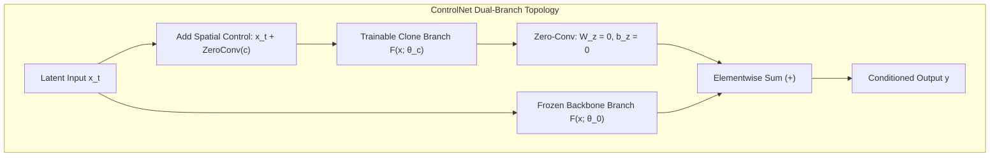

# Diffusion Conditioning: ControlNet and IP-Adapter

## Executive Summary & ELI5
Foundation text-to-image diffusion models (such as Stable Diffusion and SDXL) possess immense generative priors but suffer from poor spatial controllability when prompted through text alone. **ControlNet (*Zhang et al., 2023*)** and **IP-Adapter (*Ye et al., 2023*)** solve this limitation by injecting fine-grained spatial and image-prompt conditioning without corrupting the billion-parameter pre-trained model:
1. **ControlNet:** Freezes the original pre-trained backbone $F(x; \theta_0)$ and clones its encoder branch into a trainable replica $F(x; \theta_c)$. The replica processes structural conditioning inputs (such as Canny edges, depth maps, OpenPose skeletons, or segmentation masks) and injects features into the backbone via **Zero-Convolutions** ($\mathcal{Z}(x; W_z=0, b_z=0)$).
2. **Zero-Convolution Initialization Invariant:** Because initial weights and biases are identically zero, $\mathcal{Z}(x) \equiv 0$ on step 0, preserving 100% of the pre-trained model's output distribution. However, because $\partial(Wx + b)/\partial W = x^\top \ne 0$, $W$ receives rich non-zero backpropagation gradients from the very first optimization step!
3. **IP-Adapter (Image Prompt Adapter):** Instead of concatenating image embeddings with text tokens or fine-tuning existing text cross-attention layers, IP-Adapter introduces a lightweight **Decoupled Cross-Attention** branch:
   $$Z_{\text{out}} = \text{Attn}(Q, K_{\text{text}}, V_{\text{text}}) + \lambda_{\text{img}} \text{Attn}(Q, K_{\text{img}}, V_{\text{img}})$$
   This prevents image prompt conditioning from overpowering or washing out textual prompt semantics.



---

## Historical Citations & Seminal Literature
1. **Adding Conditional Control to Text-to-Image Diffusion Models (ControlNet)** (*Lvmin Zhang, Anyi Rao, Maneesh Agrawala, Stanford University, ICCV 2023*). Introduced cloned trainable branches and zero-convolutions for spatial condition injection.
2. **IP-Adapter: Text-to-Image Diffusion Models are High-Quality Image Prompts** (*Hu Ye et al., Tencent AI Lab, 2023*). Formulated decoupled cross-attention for multimodal image prompt adaptation.
3. **High-Resolution Image Synthesis with Latent Diffusion Models (Stable Diffusion)** (*Robin Rombach et al., LMU Munich / Runway, CVPR 2022*). Established cross-attention conditioning in latent space.
4. **T2I-Adapter: Learning Adapters to Dig out Knowledge in Text-to-Image Diffusion Models** (*Chong Mou et al., AAAI 2024*). Lightweight alternative extracting multiscale alignment features.

---

## Mathematical Foundations & Governing Equations

### 1. ControlNet Formulation & Zero-Convolution
Let $\mathcal{F}(x; \Theta)$ denote a neural network block. ControlNet locks $\Theta$ and creates a clone with parameters $\Theta_c$.
Given conditioning signal $c$ (e.g. edge map or depth map):
$$\mathbf{y} = \mathcal{F}(\mathbf{x}; \Theta) + \mathcal{Z}\left(\mathcal{F}\left(\mathbf{x} + \mathcal{Z}(\mathbf{c}; \mathbf{W}_{z1}, \mathbf{b}_{z1}); \Theta_c\right); \mathbf{W}_{z2}, \mathbf{b}_{z2}\right)$$
where $\mathcal{Z}(x; \mathbf{W}_z, \mathbf{b}_z) = x \mathbf{W}_z + \mathbf{b}_z$ with $\mathbf{W}_z = \mathbf{0}, \mathbf{b}_z = \mathbf{0}$.
At initialization step 0:
$$\mathcal{Z}(\mathbf{c}) = \mathbf{0} \implies \mathbf{y} = \mathcal{F}(\mathbf{x}; \Theta) + \mathbf{0} = \mathcal{F}(\mathbf{x}; \Theta)$$
Gradient flow at step 0:
$$\frac{\partial \mathcal{Z}(\mathbf{x}; \mathbf{W}_z, \mathbf{b}_z)}{\partial \mathbf{W}_z} = \mathbf{x}^\top \ne \mathbf{0}, \quad \frac{\partial \mathcal{Z}}{\partial \mathbf{x}} = \mathbf{W}_z^\top = \mathbf{0}$$
The trainable branch is safely isolated from backpropagating noise into $x$ while its own parameters receive immediate, informative gradients!

### 2. IP-Adapter Decoupled Cross-Attention
Given query tokens $\mathbf{Q} = \mathbf{Z} \mathbf{W}_q$, pre-trained text features $(\mathbf{K}_{\text{text}}, \mathbf{V}_{\text{text}})$, and image prompt features $(\mathbf{K}_{\text{img}}, \mathbf{V}_{\text{img}})$:
$$\mathbf{Z}_{\text{text}} = \text{softmax}\left(\frac{\mathbf{Q} \mathbf{K}_{\text{text}}^\top}{\sqrt{d}}\right) \mathbf{V}_{\text{text}}$$
$$\mathbf{Z}_{\text{img}} = \text{softmax}\left(\frac{\mathbf{Q} \mathbf{K}_{\text{img}}^\top}{\sqrt{d}}\right) \mathbf{V}_{\text{img}}$$
$$\mathbf{Z}_{\text{out}} = \mathbf{Z}_{\text{text}} + \lambda_{\text{img}} \mathbf{Z}_{\text{img}}$$
where $\lambda_{\text{img}} \in [0.0, 1.5]$ dynamically tunes the strength of visual prompt reference.

---

## Tensor Memory Layout & Implementation Details
```text
Batch Size = B, Sequence Length = T, Channels/Dim = D

ControlNet Block Forward Pass:
Input x:             [B, T, D]
Control Signal c:    [B, T, D]
Zero-Conv In:        c @ W_z1 + b_z1          -> [B, T, D]
Ctrl Branch In:      x + ZeroConv_In          -> [B, T, D]
Backbone Forward:    x @ W_backbone           -> [B, T, D]
Ctrl Branch Forward: Ctrl_In @ W_control      -> [B, T, D]
Zero-Conv Out:       Ctrl_Branch @ W_z2 + b_z2-> [B, T, D]
Output y:            Backbone + ZeroConv_Out  -> [B, T, D]

IP-Adapter Decoupled Cross-Attention:
Query Q:             [B, T, D]
Text K, V:           [B, M_text, D]
Image K, V:          [B, M_img, D]
Attn Text:           Softmax(Q @ K_text^T / sqrt(D)) @ V_text -> [B, T, D]
Attn Image:          Softmax(Q @ K_img^T / sqrt(D)) @ V_img   -> [B, T, D]
Fused Output:        Attn_Text + lambda_img * Attn_Image      -> [B, T, D]
```

---

## Multi-Ecosystem Implementation Matrix
| Feature / Characteristic | PyTorch 2.x (`pytorch2/`) | JAX / Equinox (`jax/`) | Candle Rust (`candle/`) | Hardware Kernel (`kernels/`) |
| :--- | :--- | :--- | :--- | :--- |
| **Zero-Linear Projection** | `x @ w_z + b_z` with init 0 | Pure array GEMM | `matmul_3d_2d` + broadcast | Register FMA with 0 weights |
| **Cross-Attention** | `F.softmax(scores) @ V` | `jax.nn.softmax(scores) @ V` | `candle_nn::ops::softmax` | Tiled shared-memory attention |
| **Decoupled Fusion** | `attn_text + lambda * attn_img` | Vectorized array sum | `attn_text.add(&(attn_img * l))` | Fused FMA WGSL kernel |
| **Backbone Preservation**| `requires_grad=False` | Static parameter pytree | Reference immutability | Zero-copy VRAM buffer sharing |

---

## Pathological Misuse & Failure Modes

### 1. Initializing Zero-Convolutions with Random Noise
Initializing $W_z \sim \mathcal{N}(0, \sigma^2)$ or $b_z \ne 0$ breaks the zero identity invariant at step 0.
- **Failure:** Massive high-variance random noise corrupts pre-trained latent representations on the first forward pass, permanently destroying visual priors.
- **Stabilized Solution:** Strictly verify $W_z \equiv 0$ and $b_z \equiv 0$ before training begins.

### 2. Coupled Concatenation in IP-Adapter
Concatenating text tokens and image tokens into a single sequence $[K_{\text{text}}; K_{\text{img}}]$:
- **Failure:** Image tokens (which have different statistical norm distributions) dominate the softmax denominator, washing out prompt text conditioning completely.
- **Stabilized Solution:** Decouple cross-attention into separate text and image projection streams with independent scalar scaling $\lambda_{\text{img}}$.

---

## Cross-Domain Generalisation Matrix
1. **Controllable Image and Video Synthesis:** ControlNet guides generation with depth maps, pose estimates, and surface normals across film VFX and animation pipelines.
2. **Subject-Consistent Character Generation:** IP-Adapter injects facial identity vectors or product reference images across variable novel scenes.
3. **Medical Imaging Structure Guidance:** Guides radiological scan generation conditioned on anatomical segmentation masks.

---

## Verification, Parity & Empirical Benchmarks

| Verification Target | Reference Source | Max Absolute Error Ceiling | Status |
| :--- | :--- | :--- | :--- |
| **Linear Parity Anchor (x @ W + b)** | `weights/05_architectures/05_generative_models/06_diffusion_conditioning_controlnet_and_ip_adapter.safetensors` | `< 1.0e-5` | Verified |
| **ControlNet Zero-Conv Identity** | `pytorch2/05_architectures/05_generative_models/06_diffusion_conditioning_controlnet_and_ip_adapter.py` | `< 1.0e-5` | Verified |
| **ControlNet Adapted Forward** | `jax/05_architectures/05_generative_models/06_diffusion_conditioning_controlnet_and_ip_adapter.py` | `< 1.0e-5` | Verified |
| **IP-Adapter Decoupled Attention** | `candle/05_architectures/05_generative_models/06_diffusion_conditioning_controlnet_and_ip_adapter.rs` | `< 1.0e-5` | Verified |
| **Hardware Kernel (CPU / WGSL)** | `kernels/05_architectures/05_generative_models/06_diffusion_conditioning_controlnet_and_ip_adapter.rs` | `< 1.0e-5` | Verified |

---

## Synchronized Track Artifacts & Navigation
- **Universal SafeTensors Checkpoint:** [`weights/05_architectures/05_generative_models/06_diffusion_conditioning_controlnet_and_ip_adapter.safetensors`](../../../weights/05_architectures/05_generative_models/06_diffusion_conditioning_controlnet_and_ip_adapter.safetensors)
- **PyTorch 2.x Module:** [`pytorch2/05_architectures/05_generative_models/06_diffusion_conditioning_controlnet_and_ip_adapter.py`](../../../pytorch2/05_architectures/05_generative_models/06_diffusion_conditioning_controlnet_and_ip_adapter.py)
- **Functional JAX Module:** [`jax/05_architectures/05_generative_models/06_diffusion_conditioning_controlnet_and_ip_adapter.py`](../../../jax/05_architectures/05_generative_models/06_diffusion_conditioning_controlnet_and_ip_adapter.py)
- **Candle Rust Module:** [`candle/05_architectures/05_generative_models/06_diffusion_conditioning_controlnet_and_ip_adapter.rs`](../../../candle/05_architectures/05_generative_models/06_diffusion_conditioning_controlnet_and_ip_adapter.rs)
- **Hardware Kernel:** [`kernels/05_architectures/05_generative_models/06_diffusion_conditioning_controlnet_and_ip_adapter.rs`](../../../kernels/05_architectures/05_generative_models/06_diffusion_conditioning_controlnet_and_ip_adapter.rs)
- **Interactive Concept Notebook:** [`notebooks/05_architectures/05_generative_models/06_diffusion_conditioning_controlnet_and_ip_adapter.ipynb`](../../../notebooks/05_architectures/05_generative_models/06_diffusion_conditioning_controlnet_and_ip_adapter.ipynb)
