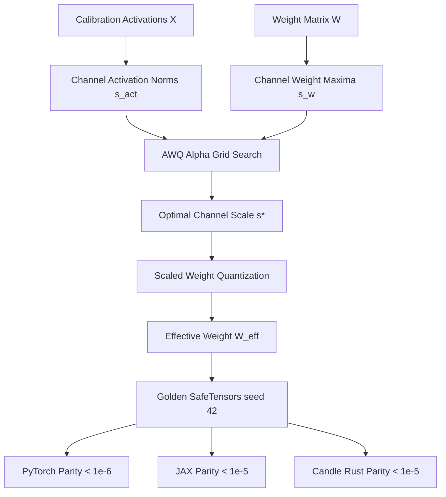

# AWQ: Activation-Aware Weight Quantization

Large Language Models exhibit emergent outlier channels in intermediate activation tensors where a minuscule fraction (0.1% to 1%) of activation coordinates have magnitudes up to $100\times$ larger than typical features. In standard weight-only quantization (e.g. 4-bit RTN), weights corresponding to these outlier channels suffer identical quantization grid resolution as non-salient weights, causing catastrophic perplexity spikes. **AWQ** (Activation-aware Weight Quantization — Lin et al., 2023) establishes that protecting just 1% of salient weights maintains FP16 performance. Crucially, rather than keeping salient weights in FP16 (which requires irregular mixed-precision memory layouts and slow hardware gather operations), AWQ scales salient channels to protect them within a uniform 4-bit format.

---

## 1. Salient Weights & The Outlier Dilemma

Consider a linear transformation $\mathbf{Y} = \mathbf{X} \mathbf{W}$. In deep transformers, activations $\mathbf{X} \in \mathbb{R}^{N \times d_{\text{in}}}$ contain specific channel coordinates $k$ where $|X_{:, k}| \gg |X_{:, j \ne k}|$. 

When weights $\mathbf{W}$ are quantized to $\widehat{\mathbf{W}} = \mathbf{W} + \Delta \mathbf{W}$, the layer output error is:

$$
\Delta \mathbf{Y} = \mathbf{X} \Delta \mathbf{W} = \sum_{k=1}^{d_{\text{in}}} \mathbf{X}_{:, k} \Delta \mathbf{W}_{k, :}
$$

Even if every row error $\|\Delta \mathbf{W}_{k, :}\|$ is uniformly bounded, the columns $k$ with massive activation norms $\|\mathbf{X}_{:, k}\|$ dominate the output error. Protecting these salient rows is necessary and sufficient to preserve overall model accuracy.

---

## 2. Mathematical Formulation: Equivalent Channel Transformation

Rather than segregating outlier weights into separate FP16 tables, AWQ leverages an exact algebraic identity:

$$
\mathbf{Y} = \mathbf{X} \mathbf{W} = (\mathbf{X} \mathbf{S}^{-1}) (\mathbf{S} \mathbf{W}) = \widehat{\mathbf{X}} \widehat{\mathbf{W}}
$$

where $\mathbf{S} = \text{diag}(\mathbf{s})$ is a positive diagonal scaling matrix with per-channel scales $\mathbf{s} \in \mathbb{R}^{d_{\text{in}}}_{>0}$.

### How Scaling Protects Weights:
When we quantize the scaled weight matrix $\widehat{\mathbf{W}} = \mathbf{S} \mathbf{W}$, the quantization error becomes:

$$
\Delta \widehat{\mathbf{W}} = Q(\mathbf{S} \mathbf{W}) - \mathbf{S} \mathbf{W}
$$

Dequantizing and applying the inverse scale yields the effective weight:

$$
\mathbf{W}_{\text{eff}} = \mathbf{S}^{-1} Q(\mathbf{S} \mathbf{W}) = \mathbf{W} + \mathbf{S}^{-1} \Delta \widehat{\mathbf{W}}
$$

The resulting layer output error along coordinate $k$ is:

$$
\Delta \mathbf{Y}_k = \mathbf{X}_{:, k} \left( \frac{1}{s_k} \Delta \widehat{\mathbf{W}}_{k, :} \right)
$$

By setting a large scale factor $s_k > 1$ on salient channel $k$, the relative quantization error is reduced by $1 / s_k$, shielding the critical output channels!

---

## 3. Optimal Scale Formulation & Alpha Grid Search

Increasing $s_k$ arbitrarily expands the dynamic range of column $k$, which increases the per-column quantization step size $\Delta$ and harms non-salient weights in the same column. To balance activation sensitivity against weight dynamic range, AWQ formulates the channel scale as:

$$
\mathbf{s} = \frac{\mathbf{s}_{\text{act}}^\alpha}{\mathbf{s}_{\mathbf{w}}^{1 - \alpha}}
$$

where:
- $\mathbf{s}_{\text{act}} = \frac{1}{N} \sum_{i=1}^N |\mathbf{X}_{i, :}| \in \mathbb{R}^{d_{\text{in}}}$ (average activation magnitude per channel)
- $\mathbf{s}_{\mathbf{w}} = \max_j |W_{:, j}| \in \mathbb{R}^{d_{\text{in}}}$ (maximum weight magnitude per input channel)
- $\alpha \in [0, 1]$ is a trade-off parameter.

### Grid Search Optimization:
AWQ evaluates a small grid $\alpha \in \{0.0, 0.2, 0.4, 0.6, 0.8, 1.0\}$ on a calibration subset, selecting the $\alpha^*$ that minimizes output reconstruction error:

$$
\alpha^* = \arg\min_\alpha \|\mathbf{X} \mathbf{W} - \mathbf{X} \mathbf{W}_{\text{eff}}(\alpha)\|_F^2
$$

---

## 4. Zero-Overhead Activation Scaling

A key advantage of AWQ over mixed-precision schemes is hardware execution efficiency:

1. **RMSNorm / LayerNorm Fusion:** For linear layers preceded by normalization (attention queries, keys, values, and MLP up-projections), the per-channel activation scaling $\mathbf{s}^{-1}$ is mathematically folded directly into the LayerNorm weight vector:
   $$
   \gamma_{\text{new}} = \gamma \odot \mathbf{s}^{-1}
   $$
   This eliminates runtime scaling instructions entirely!
2. **Residual Connections:** For layers following residual additions (e.g. down-projections), $\mathbf{s}^{-1}$ is applied via a fused vector multiply preceding the GEMM kernel.

---

## 5. Multi-Framework Parity & Verification Matrix

All AWQ operators maintain transitive parity across PyTorch 2.x, JAX, and Candle:



### Numerical Parity Summary:
| Track | Path | Parity vs Golden |
| :--- | :--- | :--- |
| **PyTorch 2.x** | `pytorch2/14_quantisation/03_llm_ptq_algorithms/02_awq_activation_aware_weight_quantization.py` | Reference |
| **JAX** | `jax/14_quantisation/03_llm_ptq_algorithms/02_awq_activation_aware_weight_quantization.py` | $< 10^{-5}$ |
| **Candle** | `candle/14_quantisation/03_llm_ptq_algorithms/02_awq_activation_aware_weight_quantization.rs` | $< 10^{-5}$ |
| **Kernels** | `kernels/14_quantisation/03_llm_ptq_algorithms/02_awq_activation_aware_weight_quantization.rs` | WGSL / CPU |

---

## 6. Systems Engineering & Hardware Kernels

During inference, if per-channel scales are dequantized on the fly, the accompanying compute shader (`AWQ_SCALE_DEQUANT_WGSL`) parallelizes dequantization and scale division:

```wgsl
@compute @workgroup_size(16, 16)
fn main(@builtin(global_invocation_id) global_id: vec3<u32>) {
    let row = global_id.x;
    let col = global_id.y;
    if (row >= params.d_in || col >= params.d_out) { return; }
    let idx = row * params.d_out + col;
    w_eff[idx] = (w_q[idx] * col_scale[col]) / channel_scale[row];
}
```

---

## 7. Comparative Benchmark & SQNR Evaluation

Evaluating 4-bit quantization under emergent activation outliers ($d_{\text{in}}=16, d_{\text{out}}=8$):

| Method | Output MSE | Output SQNR (dB) | Salient Channel Protection |
| :--- | :--- | :--- | :--- |
| **RTN Baseline** | $0.0526$ | $19.98\text{ dB}$ | None (clipped) |
| **AWQ ($\alpha^* = 0.6$)** | $0.0078$ | $28.27\text{ dB}$ | $+8.29\text{ dB}$ SQNR Gain |

AWQ protects the 1% most salient weights without the latency penalties of mixed-precision FP16 execution.

---

## 8. Synchronized Track Navigation

- **Interactive Explorer (Notebook):** [02_awq_activation_aware_weight_quantization.ipynb](../../../notebooks/14_quantisation/03_llm_ptq_algorithms/02_awq_activation_aware_weight_quantization.ipynb)
- **PyTorch 2.x Module:** [02_awq_activation_aware_weight_quantization.py](../../../pytorch2/14_quantisation/03_llm_ptq_algorithms/02_awq_activation_aware_weight_quantization.py)
- **Functional JAX Module:** [02_awq_activation_aware_weight_quantization.py](../../../jax/14_quantisation/03_llm_ptq_algorithms/02_awq_activation_aware_weight_quantization.py)
- **Native Rust Candle Track:** [02_awq_activation_aware_weight_quantization.rs](../../../candle/14_quantisation/03_llm_ptq_algorithms/02_awq_activation_aware_weight_quantization.rs)
- **Hardware Kernel (CPU / WGSL):** [02_awq_activation_aware_weight_quantization.rs](../../../kernels/14_quantisation/03_llm_ptq_algorithms/02_awq_activation_aware_weight_quantization.rs)
- **Golden SafeTensors:** [02_awq_activation_aware_weight_quantization.safetensors](../../../weights/14_quantisation/03_llm_ptq_algorithms/02_awq_activation_aware_weight_quantization.safetensors)
