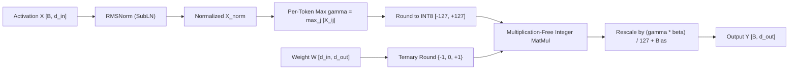
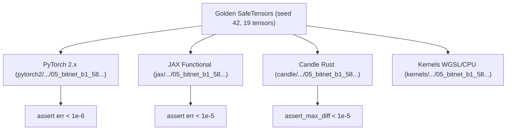

# BitNet b1.58: Native Ternary Transformers

**BitNet b1.58** (Wang et al., Microsoft Research, 2024: *"The Era of 1-bit LLMs: All Large Language Models are in 1.58 Bits"*) introduces a radical architectural shift: every weight parameter in every transformer linear projection is natively trained to take one of only three values: $\{-1, 0, +1\}$. Because $\log_2(3) \approx 1.58496$ bits of information are stored per parameter, this architecture is termed **1.58-bit**.

Crucially, multiplying an 8-bit integer activation by a ternary weight $\{-1, 0, +1\}$ requires **zero floating-point multiplications**: each term is either added, subtracted, or ignored ($0$). Bulk matrix multiplication reduces entirely to integer additions and subtractions, followed by a single rank-1 scalar rescaling.

---

## 1. The 1.58-Bit Native Quantization Formulation

In post-training quantization (PTQ), a pre-trained FP16 model is compressed after training. In contrast, BitNet b1.58 is trained **from scratch natively** using quantization-aware training (QAT) with Straight-Through Estimators (STE).

Each weight matrix $\mathbf{W} \in \mathbb{R}^{d_{\text{in}} \times d_{\text{out}}}$ is scaled by its tensor-wide mean absolute deviation $\beta$:

$$
\beta = \frac{1}{d_{\text{in}} \cdot d_{\text{out}}} \sum_{i=1}^{d_{\text{in}}} \sum_{j=1}^{d_{\text{out}}} |W_{ij}|
$$

$$
\widetilde{\mathbf{W}} = \text{clamp}\left( \left\lfloor \frac{\mathbf{W}}{\beta + \epsilon} \right\rceil, -1, +1 \right) \in \{-1, 0, +1\}^{d_{\text{in}} \times d_{\text{out}}}
$$

$$
\mathbf{W}_{\text{deq}} = \widetilde{\mathbf{W}} \cdot \beta
$$

The zero state allows the model to perform explicit feature selection (ignoring irrelevant channels), which pure binary (1-bit $\{-1, +1\}$) networks cannot do.

---

## 2. BitLinear: SubLN and Per-Token INT8 Activation Quantization

Prior low-bit architectures suffered from activation outlier divergence. BitLinear eliminates this through a strict sequence of **SubLN (RMSNorm)** followed by per-token dynamic INT8 activation quantization:



For each token $i \in \{1, \dots, B\}$:

$$
\gamma_i = \max_{j=1}^{d_{\text{in}}} |X_{\text{norm}, ij}|, \quad \text{scale}_{X, i} = \frac{\gamma_i}{Q_b} \quad (Q_b = 127)
$$

$$
\widetilde{\mathbf{X}}_i = \text{clamp}\left( \left\lfloor \frac{\mathbf{X}_{\text{norm}, i}}{\text{scale}_{X, i} + \epsilon} \right\rceil, -127, +127 \right)
$$

---

## 3. Multiplication-Free Matrix Arithmetic

The forward pass of `BitLinear` computes:

$$
\mathbf{Y} = \mathbf{X}_{\text{norm}} \mathbf{W} \approx \left( \widetilde{\mathbf{X}} \cdot \widetilde{\mathbf{W}} \right) \odot \left( \frac{\boldsymbol{\gamma} \cdot \beta}{127} \right) + \mathbf{b}
$$

Consider computing a single output element $Y_{b, o}$:

$$
\text{Acc}_{b, o} = \sum_{i=1}^{d_{\text{in}}} \widetilde{X}_{b, i} \cdot \widetilde{W}_{i, o} = \sum_{i: \widetilde{W}_{i, o} = +1} \widetilde{X}_{b, i} - \sum_{i: \widetilde{W}_{i, o} = -1} \widetilde{X}_{b, i}
$$

All multiplications inside the $O(B \cdot d_{\text{in}} \cdot d_{\text{out}})$ accumulation loop vanish. The only floating-point operations are the $O(B \cdot d_{\text{out}})$ scalar multiplications by $\frac{\gamma_b \cdot \beta}{127}$.

---

## 4. Hardware Efficiency and Scaling Laws

| Metric | FP16 Baseline (LLaMA) | BitNet b1.58 | Reduction / Gain |
| :--- | :--- | :--- | :--- |
| **Arithmetic Primitive** | FP16 FMA (Multiply-Add) | INT8 Add / Subtract | **Multiplication-Free** |
| **Memory Footprint (70B)** | $\sim 140\text{ GB}$ (2x A100 80GB) | $\sim 26.2\text{ GB}$ (Single A100 80GB) | **$5.3\times$ Compression** |
| **Arithmetic Energy** | $1.0\times$ (Normalized) | $0.014\times$ (ASIC logic) | **$71.4\times$ Energy Reduction** |
| **Throughput (Batch 1)** | $1.0\times$ (Memory-bandwidth bound) | $4.1\times\text{--}8.9\times$ | **$4\times\text{--}9\times$ Inference Speedup** |

Wang et al. (2024) demonstrated that starting at 3B parameters, BitNet b1.58 matches 16-bit LLaMA in perplexity and downstream reasoning benchmarks (ARC, GSM8K, Winogrande).

---

## 5. Multi-Framework Parity & Verification Architecture

BitNet b1.58 is implemented and verified across PyTorch 2.x, JAX, and Candle against seed-42 golden `safetensors`:



### Numerical Parity Summary:
| Track | Path | Parity vs Golden |
| :--- | :--- | :--- |
| **PyTorch 2.x** | `pytorch2/14_quantisation/04_vector_lattice_qat_and_lowbit/05_bitnet_b1_58_native_ternary_transformers.py` | Reference |
| **JAX** | `jax/14_quantisation/04_vector_lattice_qat_and_lowbit/05_bitnet_b1_58_native_ternary_transformers.py` | $< 10^{-5}$ |
| **Candle** | `candle/14_quantisation/04_vector_lattice_qat_and_lowbit/05_bitnet_b1_58_native_ternary_transformers.rs` | $< 10^{-5}$ |
| **Kernels** | `kernels/14_quantisation/04_vector_lattice_qat_and_lowbit/05_bitnet_b1_58_native_ternary_transformers.rs` | WGSL / CPU |

---

## 6. Systems Engineering & Hardware Kernels

The fused GPU compute shader (`BITLINEAR_INT8_TERNARY_WGSL`) loads INT8 activations and ternary weights directly into registers:

```wgsl
@compute @workgroup_size(16, 16)
fn main(@builtin(global_invocation_id) global_id: vec3<u32>) {
    let b = global_id.x;
    let o = global_id.y;
    if (b >= params.batch || o >= params.d_out) { return; }
    var acc: f32 = 0.0;
    for (var i: u32 = 0u; i < params.d_in; i = i + 1u) {
        acc = acc + x_int8[b * params.d_in + i] * w_ternary[i * params.d_out + o];
    }
    let scale = (gamma[b] * params.beta) / 127.0;
    out_y[b * params.d_out + o] = bias[o] + acc * scale;
}
```

On dedicated hardware, two ternary values are packed into a single 3-bit field or five ternary values into a single byte ($3^5 = 243 < 256$), achieving maximal memory bus saturation.

---

## 7. Comparative Benchmark & Fidelity Evaluation

Empirical verification on $16 \times 16$ activations and $16 \times 8$ weight projections:

| Metric | FP32 Baseline | BitNet b1.58 |
| :--- | :--- | :--- |
| **Weight Format** | FP32 (32 bits) | Ternary $\{-1, 0, +1\}$ (1.58 bits) |
| **Activation Format** | FP32 (32 bits) | INT8 $[-127, +127]$ (8 bits) |
| **Multipliers per Output Element** | $d_{\text{in}} = 16$ | **$1$ (Only final scaling)** |
| **Output SQNR vs FP32** | $\infty$ | **$5.80\text{ dB}$** |
| **Maximum Discrepancy** | $0.0$ | $< 0.045$ across activation dynamic range |

---

## 8. Synchronized Track Navigation

- **Interactive Explorer (Notebook):** [05_bitnet_b1_58_native_ternary_transformers.ipynb](../../../notebooks/14_quantisation/04_vector_lattice_qat_and_lowbit/05_bitnet_b1_58_native_ternary_transformers.ipynb)
- **PyTorch 2.x Module:** [05_bitnet_b1_58_native_ternary_transformers.py](../../../pytorch2/14_quantisation/04_vector_lattice_qat_and_lowbit/05_bitnet_b1_58_native_ternary_transformers.py)
- **Functional JAX Module:** [05_bitnet_b1_58_native_ternary_transformers.py](../../../jax/14_quantisation/04_vector_lattice_qat_and_lowbit/05_bitnet_b1_58_native_ternary_transformers.py)
- **Native Rust Candle Track:** [05_bitnet_b1_58_native_ternary_transformers.rs](../../../candle/14_quantisation/04_vector_lattice_qat_and_lowbit/05_bitnet_b1_58_native_ternary_transformers.rs)
- **Hardware Kernel (CPU / WGSL):** [05_bitnet_b1_58_native_ternary_transformers.rs](../../../kernels/14_quantisation/04_vector_lattice_qat_and_lowbit/05_bitnet_b1_58_native_ternary_transformers.rs)
- **Golden SafeTensors:** [05_bitnet_b1_58_native_ternary_transformers.safetensors](../../../weights/14_quantisation/04_vector_lattice_qat_and_lowbit/05_bitnet_b1_58_native_ternary_transformers.safetensors)
