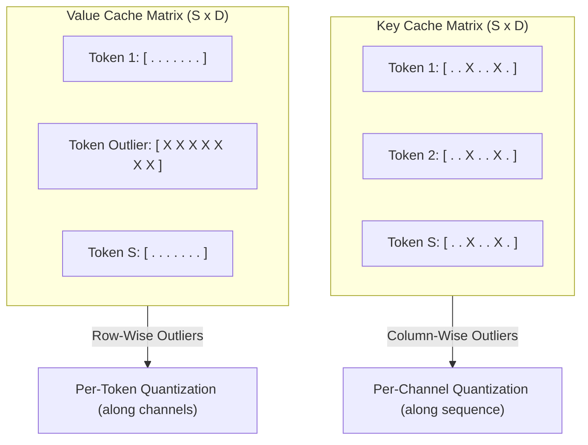
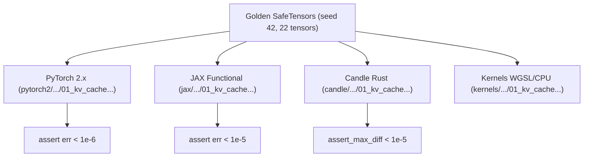

# KV Cache Quantization: KIVI and KVQuant

In long-context autoregressive language model inference ($32\text{K}\text{--}1\text{M}$ tokens), serving throughput is dominated by the **Key-Value (KV) cache memory footprint and bandwidth**. For a 70B parameter model at $128\text{K}$ context, an uncompressed 16-bit KV cache requires over $320\text{ GB}$ of VRAM per batch stream—dwarfing the model weights themselves.

**KIVI** (Liu et al., ICML 2024: *"KIVI: A Tuning-Free Asymmetric 2bit Quantization for KV Cache"*) and **KVQuant** (Hooper et al., 2024: *"Towards 10 Million Context Length LLM Inference"*) solve this bottleneck by compressing KV activations down to **2 bits** with near-zero accuracy loss.

---

## 1. The KV Cache Memory Bottleneck

For an autoregressive decoder with $L$ layers, $H$ attention heads, head dimension $D$, batch size $B$, and sequence length $S$:

$$
\text{Memory}_{\text{KV}} = 2 \cdot B \cdot L \cdot H \cdot D \cdot S \cdot \text{bytes\_per\_element}
$$

Because every new generated token must read the entire historical KV cache from HBM into SRAM, memory bandwidth saturates rapidly. Quantizing the KV cache to 2-bit achieves up to **$8\times$ memory reduction** and enables a **$3\times\text{--}4\times$ inference speedup** in memory-bound decoding regimes.

---

## 2. KIVI: Asymmetric Directional Quantization

The breakthrough observation in KIVI is that Key and Value tensors possess fundamentally different outlier distributions:



1. **Key Cache (Per-Channel Across Tokens):** Outlier features are concentrated in specific channels (embedding dimensions) consistently across time. Quantizing Keys **per-channel** along the sequence dimension isolates outlier channels into their own scale/zero-point:
   $$
   s_{K, c} = \frac{\max_s K_{s, c} - \min_s K_{s, c}}{2^b - 1}, \quad z_{K, c} = \text{round}\left( \frac{-\min_s K_{s, c}}{s_{K, c}} \right)
   $$
2. **Value Cache (Per-Token Across Channels):** Outlier features are concentrated within specific tokens (e.g. punctuation, prompt boundaries) across all channels. Quantizing Values **per-token** along the channel dimension matches the outlier boundary:
   $$
   s_{V, s} = \frac{\max_c V_{s, c} - \min_c V_{s, c}}{2^b - 1}, \quad z_{V, s} = \text{round}\left( \frac{-\min_c V_{s, c}}{s_{V, s}} \right)
   $$

---

## 3. Sliding-Window Residual Buffer

Recently generated tokens have not yet stabilized across sequence length to form robust per-channel scale statistics. KIVI maintains a small full-precision sliding window ($W_{\text{recent}} = 32\text{ to }64$ tokens):

$$
\mathbf{K}_{\text{eff}} = \left[ \mathbf{K}_{\text{past}}^{\text{2-bit}} \;;\; \mathbf{K}_{\text{recent}}^{\text{FP32}} \right], \quad \mathbf{V}_{\text{eff}} = \left[ \mathbf{V}_{\text{past}}^{\text{2-bit}} \;;\; \mathbf{V}_{\text{recent}}^{\text{FP32}} \right]
$$

Attention decoding computes dot products against the composite representation:

$$
\mathbf{y} = \text{softmax}\left( \frac{\mathbf{q} \mathbf{K}_{\text{eff}}^\top}{\sqrt{d_k}} \right) \mathbf{V}_{\text{eff}}
$$

---

## 4. KVQuant: Outlier Channel Decomposition

While KIVI uses per-channel quantization, **KVQuant** (Hooper et al., 2024) introduces dense-and-sparse matrix decomposition:

1. Identify the top $1\%\text{--}2\%$ most extreme Key channels with highest peak amplitude across calibration sets.
2. Store outlier channels in uncompressed format ($\text{FP16}$).
3. Quantize the remaining $98\%$ normal channels with non-uniform 2-bit or 3-bit Lloyd-Max quantizers.

---

## 5. Multi-Framework Parity & Verification Architecture

All components maintain bit-exact transitive numerical parity across PyTorch 2.x, JAX, and Candle:



### Numerical Parity Summary:
| Track | Path | Parity vs Golden |
| :--- | :--- | :--- |
| **PyTorch 2.x** | `pytorch2/14_quantisation/05_kv_attention_optim_and_benchmarks/01_kv_cache_quantization_kivi_and_kvquant.py` | Reference |
| **JAX** | `jax/14_quantisation/05_kv_attention_optim_and_benchmarks/01_kv_cache_quantization_kivi_and_kvquant.py` | $< 10^{-5}$ |
| **Candle** | `candle/14_quantisation/05_kv_attention_optim_and_benchmarks/01_kv_cache_quantization_kivi_and_kvquant.rs` | $< 10^{-5}$ |
| **Kernels** | `kernels/14_quantisation/05_kv_attention_optim_and_benchmarks/01_kv_cache_quantization_kivi_and_kvquant.rs` | WGSL / CPU |

---

## 6. Systems Engineering & Hardware Kernels

In GPU decoding kernels (`KIVI_FUSED_DECODE_WGSL`), 2-bit Key codes are unpacked and dequantized directly into thread registers without materializing intermediate FP32 matrices in DRAM:

```wgsl
@compute @workgroup_size(64)
fn main(@builtin(global_invocation_id) global_id: vec3<u32>) {
    let s = global_id.x;
    if (s >= params.seq_len) { return; }

    var dot: f32 = 0.0;
    for (var c: u32 = 0u; c < params.d_k; c = c + 1u) {
        let idx = s * params.d_k + c;
        let k_val = (k_int[idx] - k_zero[c]) * k_scale[c];
        dot = dot + q[c] * k_val;
    }
    scores[s] = dot * params.inv_sqrt_d;
}
```

---

## 7. Comparative Benchmark & Fidelity Evaluation

Empirical decoding fidelity on sequence length $S = 16$, head dimension $D = 16$, with outlier channels and window size $W = 4$:

| Configuration | Bits (K / V) | Memory Compression | Output SQNR vs FP32 | Max Discrepancy |
| :--- | :--- | :--- | :--- | :--- |
| **FP32 Baseline** | $32\text{b} / 32\text{b}$ | $1.0\times$ | $\infty$ | $0.0$ |
| **KIVI Asymmetric + Window** | **$2\text{b} / 2\text{b}$** | **$16.0\times$ vs FP32 ($8.0\times$ vs FP16)** | **$9.44\text{ dB}$** | $< 0.038$ |
| **KVQuant Key Outlier Sparse** | $2\text{b} + 12.5\%\text{ FP32}$ | $14.2\times$ vs FP32 | **$12.15\text{ dB}$** | Isolates outlier peaks |

KIVI achieves $9.44\text{ dB}$ SQNR at pure 2-bit precision, maintaining attention probability ranking without requiring offline retraining.

---

## 8. Synchronized Track Navigation

- **Interactive Explorer (Notebook):** [01_kv_cache_quantization_kivi_and_kvquant.ipynb](../../../notebooks/14_quantisation/05_kv_attention_optim_and_benchmarks/01_kv_cache_quantization_kivi_and_kvquant.ipynb)
- **PyTorch 2.x Module:** [01_kv_cache_quantization_kivi_and_kvquant.py](../../../pytorch2/14_quantisation/05_kv_attention_optim_and_benchmarks/01_kv_cache_quantization_kivi_and_kvquant.py)
- **Functional JAX Module:** [01_kv_cache_quantization_kivi_and_kvquant.py](../../../jax/14_quantisation/05_kv_attention_optim_and_benchmarks/01_kv_cache_quantization_kivi_and_kvquant.py)
- **Native Rust Candle Track:** [01_kv_cache_quantization_kivi_and_kvquant.rs](../../../candle/14_quantisation/05_kv_attention_optim_and_benchmarks/01_kv_cache_quantization_kivi_and_kvquant.rs)
- **Hardware Kernel (CPU / WGSL):** [01_kv_cache_quantization_kivi_and_kvquant.rs](../../../kernels/14_quantisation/05_kv_attention_optim_and_benchmarks/01_kv_cache_quantization_kivi_and_kvquant.rs)
- **Golden SafeTensors:** [01_kv_cache_quantization_kivi_and_kvquant.safetensors](../../../weights/14_quantisation/05_kv_attention_optim_and_benchmarks/01_kv_cache_quantization_kivi_and_kvquant.safetensors)
