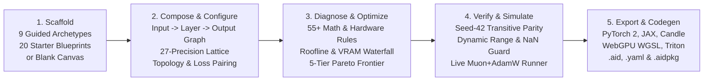
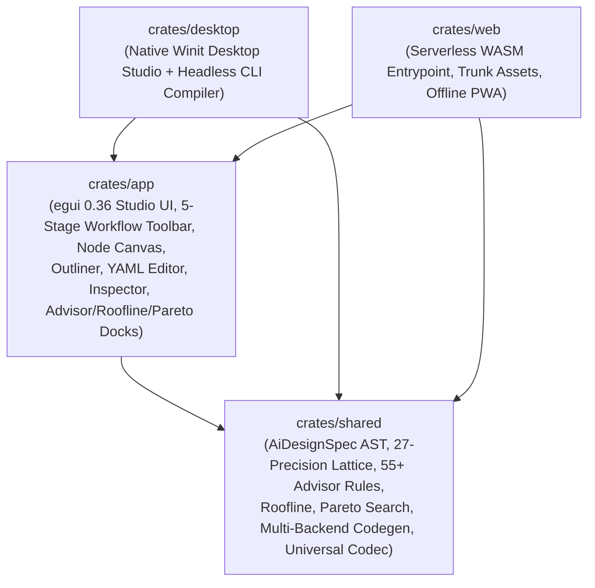

# `ai_designer` — AI Designer Studio & Training Suite

[](LICENSE)
[](https://www.rust-lang.org)
[](https://github.com/emilk/egui)
[](../../README.md)

**AI Designer Studio & Training Suite** (`tools/ai_designer/`) is the interactive visual architecture workbench and headless CLI compiler for the [`AI-Examples`](../../README.md) repository. Built in pure Rust with [`egui 0.36`](https://github.com/emilk/egui) / [`eframe 0.36`](https://docs.rs/eframe), it runs natively on **Desktop (Windows, macOS, Linux via Winit)**, in the **Browser (Serverless WebAssembly / PWA via Trunk)**, and as a **Headless CLI** for batch compilation, linting, Pareto optimization, and multi-format packaging.

---

## 🧭 1. End-to-End 5-Stage Usage Workflow

Both the interactive Studio GUI and the headless CLI follow a clear, progressive **5-stage design-to-deployment workflow** directly visible in the Studio's top workflow strip:



### Stage ① — Scaffold (`① ✨ New / Wizard` or Left Palette)
Choose how to initialize your model specification (`AiDesignSpec`):
- **Guided Archetypes (9 Presets):** Select a domain archetype (*Language Transformer*, *Vision / Spatiotemporal*, *Physics / SciML Operator*, *Robotics Diffusion Policy*, *Time-Series Forecaster*, *Tabular Monotonic Network*, *Reversible / Looped Deliberation*, *Sparse Mixture-of-Experts*), customize `d_model`, `depth`, and execution precision, and scaffold a complete computation graph.
- **Starter Blueprints (20 Pre-Engineered YAML Specs):** Load any of the 20 production blueprints in [`templates/`](templates/) spanning all 18 [`AI-Examples`](../../README.md) categories with one click.
- **Blank Canvas:** Start from clean input (`x`) and output (`y`) ports, or click **`⚡ Auto-Architect Synthesis`** to automatically synthesize a backbone tailored to your declared I/O tensor spaces.

### Stage ② — Compose & Configure (`2. Compose: Graph | Outliner | YAML (.yaml)`)
Edit your architecture across three synchronized views that update in real time:
- **Interactive Dataflow Graph (`Graph`):** Visual dataflow canvas rendering **Input Stream Cards**, **Computation Layer Cards**, and **Output Stream & Loss Cards** connected by cubic Bézier wires with midpoint symbolic shape chips (`[B, T, D]`), precision badges, and a top-left **Canvas HUD** (Zoom `-`, `100%`, `+`, `Auto-Layout`, `In -> Layers -> Out` counter, plus inline Move Up, Move Down, Duplicate, and Delete layer actions).
- **Hierarchy Outliner (`Outliner`):** Structured tree view of Input Streams, Macro Wiring Topology, Computation Layers (with inline reorder, duplicate, and delete buttons), Output Streams, and Training Regime.
- **Live Specification Source (`YAML (.yaml)`):** Direct `.yaml` specification editor with syntax validation and instant AST synchronization.
- **Left Sidebar (`Operator & Topic Catalog`):**
  - **Multi-Axis Layer Filters:** Filter 35+ operators by text search, **Functional Category** (*Attention & Memory*, *State Space & Recurrent*, *Feedforward & Splines*, *Spectral & Physics*, *Norms & Activations*, *Routing & MoE*), and **Computational Paradigm / Complexity** (*Linear O(T) Sequence*, *KV-Compressed Attention*, *Quadratic / Global Mixing*, *Physics & Geometric*, *Sparse / Conditional*, *Dense Projection*, *Shape-Preserving*, *Optimization-as-Architecture*).
  - **Clickable Curriculum Links:** Every operator row, category header, and topic chip in the 18-category `AI-Examples` catalog links directly to its reference documentation.
- **Right Sidebar (`Layer & Blueprint Inspector`):**
  - **When a Layer is Selected:** Shows a clickable `AI-Examples` curriculum topic link, layer order controls (`Move Up`, `Move Down`, `Duplicate`, `Delete`), the **27-Format Numeric & Precision Lattice** selector, full operator-specific hyperparameters, and a bottom **"Node Overview & Architecture Guide"** card explaining *what the layer does*, *what it is typically used for*, *what usually follows it*, and one-click buttons to append recommended successor layers.
  - **When No Layer is Selected (or when an Input/Output Card is Clicked):** Configures model metadata, **Target Hardware Profile** (with `Auto-Detect Host`), **Muon 2D + AdamW 1D Parameter Partitioning**, **Gradient Hygiene** (`AutoClip`, `Grokfast`, `Activation Checkpointing`), **Macro Wiring Topology**, **Input Port Normalization & Coordinate Encoding**, and **Output Loss & Structural Constraints**.

### Stage ③ — Diagnose & Optimize (Bottom Dock: `⚡ Advisor`, `📊 Roofline`, `📈 Pareto`)
Every edit automatically re-evaluates four analytical engines:
1. **`⚡ Advisor` (55+ Domain & Hardware Rules):** Flags mathematical and systems failure modes (e.g., *MLA + coupled RoPE preventing KV absorption*, *unanchored recurrent depth loops washing out inputs*, *Euler integration on Hamiltonian systems*, *unnormalized Muon 1D vectors*) and provides one-click **`⚡ Quick Fix`** AST mutations.
2. **`📊 Hardware Roofline & VRAM`:** Computes operational intensity ($\text{FLOPs/Byte}$), classifies the model as **Compute Bound** vs. **Memory Bandwidth Bound** against the target hardware's ridge point, calculates the critical sequence horizon $L^*$ before OOM, and breaks down VRAM across Weights, Optimizer States, and Activations.
3. **`📈 Pareto Frontier (5)`:** Synthesizes 5 hardware-aware scaling variants (*1. Edge-Minimal*, *2. Latency-Optimal*, *3. Workstation-Balanced*, *4. High-Capacity*, *5. Frontier-Extreme*) comparing parameter count, FLOPs/token, step latency, and VRAM headroom with one-click **`✨ Apply Variant`**.

### Stage ④ — Verify & Simulate (`④ ▶ Verify & Train`)
Open the **`▶ Training & Parity Runner`** tab in the bottom dock:
- **`🔬 Test Parity & Condition`:** Runs a deterministic Seed-42 forward pass across the computation graph, reporting activation dynamic range $[\min, \max]$, condition stability, and verifying zero `NaN`/`Inf` traps.
- **`▶ Run Verification & Training`:** Streams live training steps with Muon Newton-Schulz orthogonalization and AutoClip diagnostics alongside a real-time convergence plot.

### Stage ⑤ — Export & Codegen (`5. Generate Target Code`, `.aid`, `.yaml`, `.aidpkg`)
- **`Generate Target Code`:** Opens the **Multi-Backend Target Code Generator** modal emitting complete source files for:
  - **PyTorch 2.x** (`pytorch/model.py`, `pytorch/train.py` with `torch.compile` and Muon/AdamW partitioning)
  - **JAX / Equinox** (`jax/model.py`, `jax/train.py` with `eqx.Module` and `jax.jit`)
  - **Rust Candle** (`candle/Cargo.toml`, `candle/src/model.rs`)
  - **WebGPU Compute Shaders** (`kernels/shaders.wgsl`, `kernels/cpu_simd.rs`)
  - **OpenAI Triton** (`kernels/triton_ops.py`)
  - **Cross-Backend Parity Harness** (`verify_and_bench.py`)
  - Includes one-click **`Copy File`**, **`Download File`**, and **`Save Bundle to Disk`** (`exported_models/<model_id>/`).
- **Native `.aid`, `.yaml` & `.aidpkg` Exports:**
  - **`.aid`:** Native binary byte container (`AID\x01` magic header + format descriptor + CRC32 integrity checksum + BSON payload).
  - **`.yaml`:** Human-readable YAML blueprint specification.
  - **`.aidpkg`:** 64-byte page-aligned single-file package bundling the blueprint specification, manifest, and optional `.safetensors` weights.

---

## 🏛️ 2. Workspace Architecture

`tools/ai_designer` is organized into four single-responsibility crates:



| Crate | Path | Responsibility |
| :--- | :--- | :--- |
| **`shared`** | [`crates/shared`](crates/shared) | Strongly-typed `AiDesignSpec` AST (`spec/`), shape inference, hardware probe, analytical Roofline & Muon/AdamW partitioner (`analysis/`), 55+ rule diagnostic engine, auto-architect & Pareto search (`advisor/`), 5-track code generator (`codegen/`), importers (`importer/`), and universal format codecs (`format/`). |
| **`app`** | [`crates/app`](crates/app) | Cross-platform `egui` / `eframe` UI view-controller (`StudioState`, `DesignWizardModal`, `PaletteView`, `InspectorView`, `CanvasNodeView`, `CanvasTreeView`, `CanvasYamlView`, `AdvisorDockView`, `RooflineDockView`, `StudioRunnerView`, `CodeViewerView`, and multi-tier `localStorage`/`IndexedDB` persistence). |
| **`desktop`** | [`crates/desktop`](crates/desktop) | Native desktop runner (`cargo run -p desktop`) and headless CLI engine (`crates/desktop/src/cli.rs`) with `mimalloc` global allocator. |
| **`web`** | [`crates/web`](crates/web) | WebAssembly client entrypoint (`wasm-bindgen`), PWA manifest, offline Service Worker, and Trunk build configuration. |

---

## 🚀 3. Quickstart: GUI & Headless CLI

All commands below are run from `tools/ai_designer/`.

### A. Launch Native Desktop Studio GUI
```bash
cargo run -p desktop
# Or explicitly:
cargo run -p desktop -- --gui
```

### B. Launch WebAssembly Studio Locally (Trunk)
```bash
trunk serve
```
Open [http://localhost:8080](http://localhost:8080) in your browser.

### C. Headless CLI Reference (`cargo run -p desktop -- <subcommand>`)

When invoked with a subcommand, `desktop` runs headlessly without opening a window:

| Subcommand | Example Invocation | Description |
| :--- | :--- | :--- |
| **`help`** | `cargo run -p desktop -- --help` | Displays full CLI usage manual and format matrix. |
| **`new`** | `cargo run -p desktop -- new my_net --preset transformer --dim 512 --depth 6 --precision bf16 -o my_net.aid` | Scaffolds a new architecture from any preset (`blank`, `transformer`, `vision`, `physics`, `robotics`, `timeseries`, `tabular`, `residual`, `moe`) into `.aid` or `.yaml`. |
| **`template`** | `cargo run -p desktop -- template list`<br/>`cargo run -p desktop -- template 01 -o dit.yaml` | Lists all 20 starter blueprints or exports a template by index/name. |
| **`lint`** | `cargo run -p desktop -- lint dit.yaml --fix` | Evaluates all 55+ mathematical and hardware advisor rules with optional `--fix` AST auto-repair. |
| **`verify`** | `cargo run -p desktop -- verify dit.yaml` | Runs deterministic Seed-42 forward pass, shape inference, and dynamic-range / `NaN` verification. |
| **`pareto`** | `cargo run -p desktop -- pareto dit.yaml` | Synthesizes and scores 5 hardware-aware Pareto candidates across FLOPs, latency, and VRAM. |
| **`export`** | `cargo run -p desktop -- export dit.yaml -o build_out` | Exports a full multi-backend project directory (`pytorch/`, `jax/`, `candle/`, `kernels/`, `verify_and_bench.py`) or converts between `.aid`, `.yaml`, `.json`, `.toml`, `.bson`, `.ron`, `.aidpkg`, and `.tar.gz`. |
| **`import`** | `cargo run -p desktop -- import config.json -o imported.aid` | Ingests `.safetensors` headers, HuggingFace `config.json`, Python `nn.Module` ASTs, or existing blueprints. |
| **`package`** | `cargo run -p desktop -- package dit.yaml --weights model.safetensors -o model.aidpkg` | Bundles specification and weights into a 64-byte page-aligned `.aidpkg`, `.pkg`, or `.tar.gz` archive. |
| **`unpack`** | `cargo run -p desktop -- unpack model.aidpkg -o extracted/` | Extracts blueprints, manifest, and weights from `.aidpkg`, `.pkg`, or `.tar.gz`. |
| **`hardware`** | `cargo run -p desktop -- hardware` | Probes host CPU cores, OS, architecture, and live GPU specs via `nvidia-smi`. |
| **`catalog`** | `cargo run -p desktop -- catalog` | Lists all 18 `AI-Examples` curriculum categories and their representative topics. |
| **`audit`** | `cargo run -p desktop -- audit ../../pytorch2` | Audits repository PyTorch 2 modules and summarizes operator AST coverage. |

---

## 📋 4. Pre-Engineered Starter Blueprints (`templates/`)

The Studio bundles 20 starter blueprints in [`templates/`](templates/) (embedded at compile time for instant offline access in both Desktop and WASM):

| # | Blueprint File | Architecture & Domain Focus |
| :- | :--- | :--- |
| `01` | [`01_spatiotemporal_dit_flow.aid.yaml`](templates/01_spatiotemporal_dit_flow.aid.yaml) | Vision & 3D Geometry: Patchify + `WTConv` + 2D/3D-RoPE + `SlotAttention` + `OT-CFM` |
| `02` | [`02_bimanual_diffusion_act_policy.aid.yaml`](templates/02_bimanual_diffusion_act_policy.aid.yaml) | Robotics & Control: Action Chunking + `SO(3)` 6D Rotation + `CBF-QP` Safety Filter |
| `03` | [`03_streaming_codec_mamba.aid.yaml`](templates/03_streaming_codec_mamba.aid.yaml) | Audio & DSP: Periodic `Snake` Activation + Causal `Mamba-2 SSD` + Unrolled `LISTA` |
| `04` | [`04_symplectic_fourier_neural_operator.aid.yaml`](templates/04_symplectic_fourier_neural_operator.aid.yaml) | SciML & Physics: Spectral `FNO` + Reversible Stream + Curl-Free / Symplectic Conservation |
| `05` | [`05_equivariant_biomolecular_flow.aid.yaml`](templates/05_equivariant_biomolecular_flow.aid.yaml) | Structural Biology: `Evoformer` Triangle + `IPA` + $E(3)$-Equivariant `EGNN` + `FAPE` |
| `06` | [`06_patch_xlstm_probabilistic_forecaster.aid.yaml`](templates/06_patch_xlstm_probabilistic_forecaster.aid.yaml) | Time-Series & Finance: `RevIN` + `xLSTM` (`mLSTM`) + Quantile `CRPS` / `GPD` Tail Risk |
| `07` | [`07_monotonic_ple_tabpfn.aid.yaml`](templates/07_monotonic_ple_tabpfn.aid.yaml) | Tabular & Clinical: Piecewise Linear Embeddings (`PLE`) + `HardConcreteL0` + Monotonic Constraints |
| `08` | [`08_hybrid_jamba_mla_verifier.aid.yaml`](templates/08_hybrid_jamba_mla_verifier.aid.yaml) | Language & Reasoning: Hybrid `Mamba-2 SSD` + `MLA` (Decoupled RoPE) + `DeepSeekMoE` + `GRPO` |
| `09` | [`09_autograd_custom_kernel_backward.aid.yaml`](templates/09_autograd_custom_kernel_backward.aid.yaml) | Foundations: Custom Autograd JVP/VJP & Fused Kernel Verification |
| `10` | [`10_optimal_transport_sinkhorn_matcher.aid.yaml`](templates/10_optimal_transport_sinkhorn_matcher.aid.yaml) | Paradigms & Combinatorics: Differentiable Permutahedron & Optimal Transport |
| `11` | [`11_muon_wsd_accelerated_transformer.aid.yaml`](templates/11_muon_wsd_accelerated_transformer.aid.yaml) | Training Optimization: Newton-Schulz `Muon` + `AdamW` Partition + `WSD` Schedule |
| `12` | [`12_safe_cbf_qp_diffusion_policy.aid.yaml`](templates/12_safe_cbf_qp_diffusion_policy.aid.yaml) | Safe Embodied AI: Control Barrier Function `CBF-QP` + Trajectory Optimization |
| `13` | [`13_structural_causal_neural_scm.aid.yaml`](templates/13_structural_causal_neural_scm.aid.yaml) | Causal AI: Identifiable Representation & Structural Causal Model |
| `14` | [`14_monosemantic_sparse_autoencoder_sae.aid.yaml`](templates/14_monosemantic_sparse_autoencoder_sae.aid.yaml) | Mechanistic Interpretability: Sparse Autoencoder (`SAE`) + $L_0$ / `Entmax-1.5` |
| `15` | [`15_differentially_private_dp_sgd.aid.yaml`](templates/15_differentially_private_dp_sgd.aid.yaml) | Privacy & Cryptographic AI: Per-Sample Gradient Clipping & Formal Bounds |
| `16` | [`16_torch_compile_inductor_fastpath.aid.yaml`](templates/16_torch_compile_inductor_fastpath.aid.yaml) | Compilation & Performance: Zero-Graph-Break Static Shape Fastpath |
| `17` | [`17_bitnet_ternary_1_58_quant.aid.yaml`](templates/17_bitnet_ternary_1_58_quant.aid.yaml) | Precision & Extreme Quantisation: Native Ternary `BitNet b1.58` |
| `18` | [`18_awq_activation_aware_quantizer.aid.yaml`](templates/18_awq_activation_aware_quantizer.aid.yaml) | Activation-Aware Quantisation: Salient Channel Protection (`AWQ`) & `NF4`/`FP8` |
| `19` | [`19_speculative_medusa_draft_decoder.aid.yaml`](templates/19_speculative_medusa_draft_decoder.aid.yaml) | Compression & Speculative Decoding: Multi-Head Medusa Draft Decoder |
| `20` | [`20_fsdp2_ring_attention_transformer.aid.yaml`](templates/20_fsdp2_ring_attention_transformer.aid.yaml) | Distributed & Cluster Scale: FSDP2 & Ring Attention Multi-Node Transformer |

---

## ⌨️ 5. UI Design Standards & Keyboard Shortcuts

The Studio interface is designed around progressive disclosure, immediate visual feedback, and keyboard/mouse ergonomics:

| Input / Shortcut | Action in AI Designer Studio |
| :--- | :--- |
| **`Middle-Mouse Drag`** or **`Alt + Left-Drag`** | Pan smoothly across the Node Graph canvas |
| **`Scroll Wheel`** or **HUD `➖` / `100%` / `➕`** | Zoom in/out on the Node Graph canvas (`25%` to `250%`, with automatic Level-of-Detail shape chips) |
| **`Home`** or **`🎯 Reset & Auto-Layout`** | Reset camera pan/zoom and arrange all nodes into a clean left-to-right flow grid |
| **`Left-Click Node`** | Select node and open its hyperparameters & 27-precision selector in the Right Inspector |
| **`⬆` / `⬇` / `⧉` / `🗑`** (Canvas HUD, Outliner, or Inspector) | Reorder selected layer earlier/later, duplicate layer, or delete layer |
| **`Delete` / `Backspace`** | Delete the currently selected layer on the canvas (when no text input is focused) |
| **`Escape`** | Close any open modal window (`Wizard`, `Code Viewer`, `Help`, `Telemetry`, `Storage`) or deselect the active node |
| **`🎨 Theme` Button** (Top Navbar) | Cycle between **Charcoal Dark**, **Warm Light**, **High Contrast Dark**, and **High Contrast Light** (with automatic `44×44` accessible touch targets) |

---

## 🧪 6. Testing & Verification

Run the complete workspace test suite from `tools/ai_designer/`:

```bash
# Run all unit, integration, and 20-template roundtrip tests
cargo test --workspace

# Run clippy static analysis across all targets
cargo clippy --workspace --all-targets --all-features -- -D warnings
```

| Test Suite | Location | Coverage |
| :--- | :--- | :--- |
| **App & Studio Workflow Tests** | [`crates/app/tests/app_tests.rs`](crates/app/tests/app_tests.rs) | Studio initialization, 5-tier Pareto frontier caching, layer reordering/duplication/deletion, auto-layout, and multi-tier JSON/RON persistence |
| **20-Template & `.aidpkg` Roundtrip** | [`crates/shared/tests/templates_test.rs`](crates/shared/tests/templates_test.rs) | Parses, re-serializes, and verifies `.aid.yaml`, `.ron`, and binary `.aidpkg` roundtrips across all 20 starter templates |
| **Domain & Serialization Tests** | [`crates/shared/tests/models_tests.rs`](crates/shared/tests/models_tests.rs) | State routing, backward compatibility, and JSON/CSV/Compressed-BSON roundtrips |
| **Desktop & Web Smoke Tests** | [`crates/desktop/tests/smoke_tests.rs`](crates/desktop/tests/smoke_tests.rs), [`crates/web/tests/smoke_tests.rs`](crates/web/tests/smoke_tests.rs) | Native viewport and WebRunner initialization checks |

---

## 📄 License

Dual-licensed under [MIT](LICENSE-MIT) or [Apache 2.0](LICENSE-APACHE) at your option.
